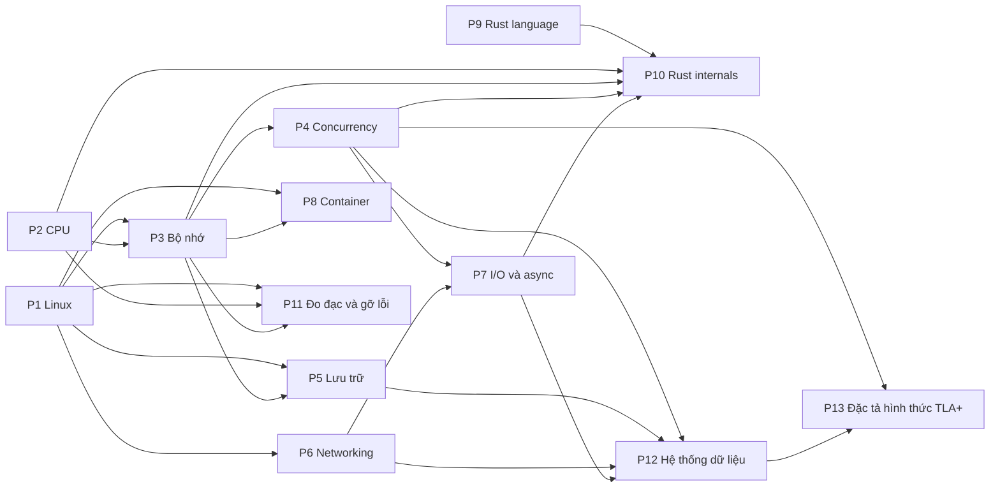

# 00 — Lộ trình: nền tảng hệ thống để hiểu Rust internals (13 phase)

> Mọi khẳng định về sự thật trong bộ tài liệu này đều có chú thích. Chú thích ghi URL và **câu trích nguyên văn** từ nguồn. Chạy `python3 tools/verify_citations.py` để máy tự tải lại nguồn và kiểm tra từng câu trích. Những gì không có chú thích là **lời khuyên hoặc giả định của người soạn**, và được ghi rõ như vậy.

## 1. Vì sao học nền tảng khi đang học Rust

Bạn bị vướng ở internal của Rust không phải vì Rust khó một cách vô cớ. Rust đưa ra ngoài, ở dạng kiểu dữ liệu và quy tắc biên dịch, những thứ mà runtime của ngôn ngữ backend quen thuộc giấu đi:

| Bạn gặp trong Rust | Thật ra là kiến thức nền | Bằng chứng |
|---|---|---|
| Ownership, `Box`, stack/heap, `move` | Bộ nhớ của tiến trình: stack, heap, address space (P3) | Rust Book nói vị trí stack hay heap ảnh hưởng đến cách ngôn ngữ hoạt động[^book-stack]; OSTEP định nghĩa address space là toàn bộ trạng thái bộ nhớ của chương trình đang chạy[^ostep-as] |
| Allocator mặc định | `malloc` của libc | `std::alloc::System` dựa trên `malloc` trên Unix[^std-system] |
| `File`, `TcpStream`, `OwnedFd` | File descriptor và system call | `std::os::fd` là module cho file descriptor kiểu Unix[^std-fd]; với Unix, mọi I/O đều là đọc/ghi file descriptor[^beej-fd]; system call là giao diện cơ bản giữa ứng dụng và kernel[^syscalls] |
| `std::sync::Mutex` | Futex của Linux | Mã nguồn `Mutex` của std 1.95 gọi `futex_wait`/`futex_wake`[^std-futex]; futex là cơ chế "fast user-space locking"[^futex2] |
| `Ordering::Acquire/Release`, `Atomic*` | Memory model và phần cứng đa nhân | Rust kế thừa memory model cho atomics từ C++20[^nomicon-atomics] |
| `async`/`.await`, Tokio | Event queue của OS: epoll/kqueue | Tokio có I/O driver dựa trên event queue của OS (epoll, kqueue, IOCP)[^tokio]; epoll theo dõi nhiều file descriptor xem cái nào sẵn sàng I/O[^epoll] |
| `Pin`, `Waker` | Địa chỉ bộ nhớ cố định; cơ chế đánh thức task | `Pin` tồn tại vì đôi khi cần một giá trị không bị di chuyển, tức địa chỉ của nó không đổi[^std-pin]; `Waker` báo cho executor rằng task sẵn sàng chạy[^std-waker] |
| `repr(C)`, size/align, niche | Layout bộ nhớ của kiểu | Reference định nghĩa layout là kích thước, alignment và offset của các field[^ref-layout] |
| Lỗi borrow checker | MIR và phân tích luồng | Borrow checker là một kiểm tra an toàn chạy trên MIR[^mir-borrowck] |

Kết luận cho cách học (lời khuyên của người soạn): học nền tảng **theo nhu cầu**, mỗi phần nền tảng gắn với một nhóm Rust internals cụ thể. Không đọc hết một cuốn OS rồi mới quay lại Rust. Vì thế bộ tài liệu có một **đường lõi** (mục 5) chỉ gồm những chương tối thiểu theo thứ tự.

## 2. Giả định

Các giả định dưới đây là của người soạn, không phải sự thật có nguồn. Hãy sửa nếu không đúng với bạn:

- Bạn là backend engineer đã đi làm nhiều năm, hổng nền tảng OS, Linux, networking và kiến trúc máy, và đang vướng ở Rust internals.
- Bạn muốn **học lý thuyết trước, làm lab sau**. Với khoảng **8–10 giờ/tuần**, đọc đủ 13 phase mất khoảng **40 tuần** theo bảng ở mục 4 (thời lượng là **gợi ý của người soạn**, chưa đo trên người học thật). Đường lõi (mục 5) ngắn hơn nhiều.
- Bạn đã đọc qua Rust Book đến chương generics/traits/lifetimes. Nếu chưa, đọc Rust Book song song với P1.
- Máy chính là macOS. Lab dành riêng cho Linux (`strace`, `/proc`, `epoll`) chạy trong container qua `./labs/linux.sh`.
- Toolchain được ghim ở **Rust 1.95.0**. Mọi link docs Rust đều trỏ vào bản 1.95.0, để nội dung trích dẫn không đổi theo thời gian.

## 3. Bản đồ phụ thuộc giữa các phase

Mũi tên là thứ tự học do người soạn đề xuất, không phải ràng buộc cứng. P9 không có tiên quyết trong sơ đồ vì nó là ngôn ngữ thuần; đọc song song với bất kỳ phase nào bạn đang vướng. P11 (đo đạc và gỡ lỗi) dựa vào P1, P2 và P3; các chương của nó cũng dẫn tới P7 (Tokio) và P8 (container) khi cần, nhưng đó là liên kết đọc thêm chứ không vẽ thành tiên quyết. P12 (hệ thống dữ liệu) dựa vào P4 (lock, memory model), P5 (WAL, `fsync`, journaling), P6 (TCP, timeout) và P7 (async, hủy và `timeout` trong Tokio); các chương của nó còn dẫn lẻ tới P1, P2, P3 và P10, nhưng đó là liên kết đọc thêm chứ không vẽ thành tiên quyết. P13 (đặc tả hình thức với TLA+) dựa vào P4 (race condition, deadlock, memory model: lỗi "kiểm tra rồi mới làm" mà phase mô hình hóa ở mức thiết kế) và P12 (replication, transaction, lease và fencing, consensus, outbox: các hệ thống mà spec mô tả); chương 09 của P13 còn dẫn lẻ tới P7·09 (`timeout` không hủy việc phía xa) như liên kết đọc thêm.

## 4. Mười ba phase

Mỗi phase có một trang tổng quan `00-tong-quan.md` (mục tiêu, bản đồ chương, thứ tự đọc, sách gốc, câu hỏi tổng hợp) và 6–18 chương. Cột "Thời lượng" là gợi ý của người soạn cho 8–10 giờ/tuần.

| Phase | Thời lượng (gợi ý) | Chủ đề | Tổng quan | Lab (làm sau) |
|---|---|---|---|---|
| P1 | 2 tuần | Kernel, system call, process, file descriptor, signal, user/quyền, `/proc`, Rust trên giao diện hệ thống | [01-linux](01-linux/00-tong-quan.md) | [01-linux-lab](labs/01-linux-lab.md) |
| P2 | 2 tuần | Mô hình máy, biểu diễn dữ liệu, assembly x86-64/AArch64, calling convention, pipeline, cache | [02-cpu](02-cpu/00-tong-quan.md) | [02-cpu-lab](labs/02-cpu-lab.md) |
| P3 | 3 tuần | Address space, paging, TLB, page fault, bộ nhớ process Linux, allocator, stack/layout, Rust và bộ nhớ | [03-memory](03-memory/00-tong-quan.md) | [03-memory-lab](labs/03-memory-lab.md) |
| P4 | 3 tuần | Thread, scheduling, lock, condvar, deadlock, memory model, lock-free, Send/Sync, thread-local storage | [04-concurrency](04-concurrency/00-tong-quan.md) | [04-concurrency-lab](labs/04-concurrency-lab.md) |
| P5 | 3 tuần | Thiết bị lưu trữ, file API, file system, page cache, journaling, durability, RAID/COW | [05-storage](05-storage/00-tong-quan.md) | [05-storage-lab](labs/05-storage-lab.md) |
| P6 | 3 tuần | Layering, link layer, IP, UDP/TCP, congestion control, socket, DNS/HTTP/TLS, zero-copy I/O | [06-networking](06-networking/00-tong-quan.md) | [06-networking-lab](labs/06-networking-lab.md) |
| P7 | 3 tuần | Mô hình I/O, epoll/kqueue/io_uring, event loop, Future/Waker/Pin, mio, Tokio, async trong production | [07-io-async](07-io-async/00-tong-quan.md) | [07-io-async-lab](labs/07-io-async-lab.md) |
| P8 | 2 tuần | Namespaces, cgroups v2, filesystem container, bảo mật, OCI, mạng, Rust trong container | [08-containers](08-containers/00-tong-quan.md) | [08-containers-lab](labs/08-containers-lab.md) |
| P9 | 3 tuần | Ownership/lifetime, trait, generics, smart pointer, lỗi, iterator/closure, macro, Cargo | [09-rust-language](09-rust-language/00-tong-quan.md) | [09-rust-language-lab](labs/09-rust-language-lab.md) |
| P10 | 3 tuần | Pipeline rustc, layout, vtable, monomorphization, variance/dropck, borrowck, unsafe/Miri, panic/FFI, collection của std | [10-rust-internals](10-rust-internals/00-tong-quan.md) | [10-rust-internals-lab](labs/10-rust-internals-lab.md) |
| P11 | 3 tuần | `perf`/flame graph, eBPF/ftrace/uprobe, đo và cải thiện hiệu năng service Rust, debugger và DWARF, core dump/backtrace, ELF/linker/loader | [11-do-dac-va-go-loi](11-do-dac-va-go-loi/00-tong-quan.md) | — |
| P12 | 6 tuần | Độ tin cậy và hiệu năng của hệ thống dữ liệu, mô hình dữ liệu, storage engine, encoding, replication, partitioning, transaction/isolation, sự cố hệ phân tán, consistency/consensus, batch và stream, đúng đắn và tích hợp dữ liệu, kiến trúc hệ dữ liệu, trách nhiệm với dữ liệu, ba case study: PostgreSQL bên trong (process, VACUUM, lock, planner), Redis bên trong (event loop, persistence, replication, cluster) và Redis trong thực chiến (pattern cache, rate limiter, lock, queue), rồi chương chuyên sâu về thuật toán đồng thuận (Paxos, Raft, VR, Zab, EPaxos, PBFT) | [12-he-thong-du-lieu](12-he-thong-du-lieu/00-tong-quan.md) | — |
| P13 | 4 tuần | Vì sao đặc tả hình thức; toán nền tảng; state, behavior, action; invariant và model checker TLC; liveness và fairness; PlusCal; refinement; đặc tả 2PC, Paxos, Raft; mô hình hóa lock có lease, hàng đợi, cache-aside, outbox, retry; nối spec với code Rust (trace validation, Stateright, loom, shuttle, proptest) | [13-tla-plus](13-tla-plus/00-tong-quan.md) | — |
| Capstone | sau lý thuyết | HTTP server trên epoll, rồi mini async runtime | — | [capstone](labs/capstone.md) |

**Thứ tự gợi ý:** P1 → P2 → P3 → P4 → P5 → P6 → P7 → P8 → P9 → P10 → P11 → P12 → P13, rồi lab và capstone. Nếu bạn đang vướng một chủ đề cụ thể, đi theo bản đồ ở mục 3 thay vì theo số.

**Lab làm sau lý thuyết.** Lab nằm ở thư mục `docs/labs/` (trong sách là phần "Thực hành" ở cuối mục lục, bắt đầu từ [lab P1](labs/01-linux-lab.md)) và code nằm ở các crate `labs/crates/lab-*`. Mỗi lab giả định bạn đã đọc phase lý thuyết tương ứng, không cần đã đọc hết mọi phase. Mọi phase đều có lab, riêng P12 có hai lab:

- [P12a — một node](labs/12a-du-lieu-mot-node-lab.md): storage engine, encoding, MVCC, batch và PostgreSQL.
- [P12b — phân tán](labs/12b-du-lieu-phan-tan-lab.md): replication, quorum, partitioning, fencing, consensus, stream và Redis.

Lab [P11](labs/11-do-dac-va-go-loi-lab.md), [P12a](labs/12a-du-lieu-mot-node-lab.md), [P12b](labs/12b-du-lieu-phan-tan-lab.md) và [P13](labs/13-tla-plus-lab.md) chỉ chạy phần Rust trên macOS. Các bước cần Linux (`perf`, `gdb`, `bpftrace`, core dump), PostgreSQL/Redis thật hoặc TLC được ghi rõ là **chưa chạy**: có lệnh và kỳ vọng rút từ nguồn, nhưng không có output.

Riêng [lab P9](labs/09-rust-language-lab.md) (crate `lab-language`) là lab điền code cho test chạy qua, nên test đỏ khi bạn chưa làm bài là chủ ý.

**Tiêu chí xong một phase** (lời khuyên của người soạn): trả lời được câu hỏi tự kiểm tra ở cuối mỗi chương mà không mở tài liệu, tự vẽ lại được bản đồ chương của phase, và giải thích được bằng lời của mình vì sao Rust thiết kế các API ở phần "Liên hệ với Rust" như vậy.

## 5. Đường lõi cho backend engineer

Nếu thời gian có hạn, đọc đúng 37 chương dưới đây theo thứ tự; phần còn lại của bộ tài liệu là đọc thêm khi gặp vấn đề tương ứng. Danh sách và lý do là **chọn lọc của người soạn** cho người làm backend service bằng Rust, không phải sự thật có nguồn. Với khoảng 8–10 giờ/tuần, đường lõi dự kiến khoảng 13–15 tuần (ước lượng của người soạn).

| # | Chương | Vì sao nằm trong đường lõi |
|---|---|---|
| 1 | [P1·01 OS và kernel](01-linux/01-os-va-kernel.md) | Khái niệm user/kernel mode và trap là nền của mọi chương sau. |
| 2 | [P1·02 System call](01-linux/02-system-call.md) | Mọi I/O của service đi qua đây; đọc được `strace` là kỹ năng debug cơ bản. |
| 3 | [P1·03 Process](01-linux/03-process.md) | Hiểu `fork`/`exec`/`wait`, zombie và PID 1 trước khi chạy service trong container. |
| 4 | [P1·04 File descriptor và VFS](01-linux/04-file-descriptor-va-vfs.md) | Socket, file, pipe đều là fd; lỗi rò fd và redirect bắt nguồn từ đây. |
| 5 | [P1·05 Signal](01-linux/05-signal.md) | Graceful shutdown và `SIGPIPE` là việc hằng ngày của service. |
| 6 | [P3·01 Address space](03-memory/01-address-space.md) | Địa chỉ ảo và các lỗi bộ nhớ kinh điển là nền để hiểu ownership. |
| 7 | [P3·05 Bộ nhớ của tiến trình trên Linux](03-memory/05-bo-nho-tien-trinh-linux.md) | Đọc RSS, `maps`, `mmap`, overcommit khi chẩn đoán một service phình bộ nhớ. |
| 8 | [P3·06 Heap allocator](03-memory/06-heap-allocator.md) | Giải thích vì sao `free` không luôn trả RAM; nền cho `GlobalAlloc`. |
| 9 | [P3·08 Rust và bộ nhớ](03-memory/08-rust-va-bo-nho.md) | Nối ownership, `Box`, `Vec`, `Drop` với cơ chế bộ nhớ ở trên. |
| 10 | [P4·01 Thread](04-concurrency/01-thread.md) | Thread là gì trên Linux và chi phí của nó, trước khi nói về lock. |
| 11 | [P4·03 Race condition và lock](04-concurrency/03-lock.md) | Cơ chế đằng sau `Mutex`, và vì sao `counter += 1` không an toàn. |
| 12 | [P4·04 Condition variable và semaphore](04-concurrency/04-condition-variable-va-semaphore.md) | Mẫu producer/consumer và thread pool dựa trên chúng. |
| 13 | [P4·06 Memory model](04-concurrency/06-memory-model.md) | Không có nó thì `Ordering` chỉ là chữ; cần cho mọi code atomic. |
| 14 | [P4·08 Concurrency trong Rust](04-concurrency/08-rust-concurrency.md) | `Send`/`Sync`, `Arc`, `Mutex` và giới hạn của những gì Rust chặn. |
| 15 | [P5·04 Page cache, writeback và direct I/O](05-storage/04-page-cache-va-direct-io.md) | Giải thích `write` đi đâu và vì sao container "hết RAM" khi chỉ ghi file. |
| 16 | [P5·06 Durability trong thực tế](05-storage/06-durability-trong-thuc-te.md) | `fsync` và mẫu ghi an toàn quyết định dữ liệu có mất khi sập nguồn không. |
| 17 | [P6·04 UDP và TCP cơ bản](06-networking/04-udp-va-tcp-co-ban.md) | Handshake, trạng thái TCP và `ss` là công cụ chẩn đoán kết nối. |
| 18 | [P6·05 TCP: tin cậy và flow control](06-networking/05-tcp-reliability-va-flow-control.md) | Giải thích retransmit, window, Nagle/`TCP_NODELAY` trong độ trễ thực tế. |
| 19 | [P6·07 Socket API, phía kernel và `std::net`](06-networking/07-socket-va-kernel.md) | Backlog, accept queue, buffer và ánh xạ sang `std::net`. |
| 20 | [P7·01 Các mô hình I/O](07-io-async/01-mo-hinh-io.md) | Đặt blocking, non-blocking và multiplexing vào một khung chung. |
| 21 | [P7·02 select, poll và epoll](07-io-async/02-select-poll-epoll.md) | Cơ chế mà reactor của Tokio/mio đứng trên. |
| 22 | [P7·05 Future, poll và Waker](07-io-async/05-future-poll-waker.md) | Mô hình poll-based là lõi của async Rust. |
| 23 | [P7·06 async/await, state machine và Pin](07-io-async/06-async-await-pin.md) | Hiểu future là state machine và vì sao cần `Pin`. |
| 24 | [P7·08 Tokio](07-io-async/08-tokio.md) | Runtime bạn thực sự dùng: `spawn`, blocking, hủy, shutdown. |
| 25 | [P7·09 Async Rust trong production](07-io-async/09-async-trong-production.md) | Hủy, `timeout`, backpressure và blocking trong async là nguồn lỗi thường gặp nhất của service Tokio sau khi đã biết `spawn`. |
| 26 | [P8·03 cgroups v2](08-containers/03-cgroups-v2.md) | Giới hạn CPU/memory của container và các lỗi như OOM, throttling. |
| 27 | [P8·08 Rust trong container](08-containers/08-rust-trong-container.md) | Gom signal, PID 1, cgroup và allocator vào checklist triển khai service Rust. |
| 28 | [P10·02 Type layout](10-rust-internals/02-type-layout.md) | Size, alignment, niche: nền để đọc `size_of` và FFI. |
| 29 | [P10·03 DST, fat pointer và vtable](10-rust-internals/03-dst-fat-pointer-vtable.md) | Hiểu `&dyn Trait`, `Box<dyn Trait>` thật sự là gì. |
| 30 | [P10·06 Borrow checker](10-rust-internals/06-borrow-checker.md) | Biết lỗi borrow đến từ phân tích nào trên MIR thay vì đoán. |
| 31 | [P10·07 unsafe, UB và Miri](10-rust-internals/07-unsafe-ub-miri.md) | Ranh giới của Safe Rust và công cụ kiểm tra khi bạn phải viết `unsafe`. |
| 32 | [P11·01 perf và sampling profiler](11-do-dac-va-go-loi/01-perf-va-sampling-profiler.md) | Khi service chậm, đo bằng `perf`/flame graph trước khi đoán; nền cho các chương hiệu năng và gỡ lỗi còn lại của P11. |
| 33 | [P12·05 Replication](12-he-thong-du-lieu/05-replication.md) | Replica đọc, lag và failover là việc hằng ngày của service dùng database có bản sao; chương nói dữ liệu cũ từ đâu ra và quorum bảo đảm gì, không bảo đảm gì. |
| 34 | [P12·07 Transaction và isolation](12-he-thong-du-lieu/07-transaction.md) | Mức isolation và anomaly quyết định code ghi nhiều bước có sai âm thầm hay không; kèm vòng retry cho lỗi serialization. |
| 35 | [P12·08 Sự cố của hệ phân tán](12-he-thong-du-lieu/08-su-co-he-phan-tan.md) | Mọi lệnh gọi qua mạng có thể không hồi đáp; nền cho timeout, retry, lease và vì sao không dùng timestamp từ hai máy để sắp thứ tự. |
| 36 | [P12·09 Consistency và consensus](12-he-thong-du-lieu/09-consistency-va-consensus.md) | Phân biệt linearizability với serializability, hiểu quorum, Raft, etcd/ZooKeeper và vì sao khóa phân tán cần fencing token. |
| 37 | [P13·01 Vì sao đặc tả hình thức](13-tla-plus/01-vi-sao-dac-ta-hinh-thuc.md) | Trả lời "có đáng viết đặc tả cho thiết kế này không": vì sao test không phủ được interleaving hiếm, bug thiết kế khác bug code, AWS đã dùng TLA+ vào đâu và giới hạn của model checking. Không đòi biết trước toán; mục "Kiến thức cần trước" chỉ nhắc P12·08 (chương 35 ở trên) và mục 2 của [P4·05](04-concurrency/05-concurrency-bug-va-deadlock.md) (atomicity violation; đọc thêm khi cần, không thuộc đường lõi). |

Đường lõi bỏ P2 (CPU), P9 (Rust language) và phần lớn P5, P6, P8, P10, P11, P12, P13 để giữ ngắn. Đọc chương trong các phase đó khi vướng: [P2](02-cpu/00-tong-quan.md) khi cần đọc assembly hoặc hiểu cache; [P9](09-rust-language/00-tong-quan.md) khi gặp giới hạn của trait, closure, macro, Cargo; [P11](11-do-dac-va-go-loi/00-tong-quan.md) khi service chậm, treo hoặc crash (chương 05 về core dump và backtrace là ứng viên kế tiếp nếu bạn muốn đường lõi dài hơn, theo nhận xét của người soạn); [P12](12-he-thong-du-lieu/00-tong-quan.md) cho phần còn lại của hệ thống dữ liệu: bốn chương 05, 07, 08, 09 ở trên nhắc P12·01 (fault, percentile) và P12·03 (log, WAL, B-tree) ở mục "Kiến thức cần trước", nên đọc lướt hai chương đó khi cần; [chương 12 — Đúng đắn và tích hợp dữ liệu](12-he-thong-du-lieu/12-dung-dan-va-tich-hop-du-lieu.md) (idempotency, outbox) là ứng viên kế tiếp của P12 cho backend, theo nhận xét của người soạn, và cần thêm [chương 11](12-he-thong-du-lieu/11-stream-processing.md); [chương 15 — PostgreSQL bên trong](12-he-thong-du-lieu/15-postgresql-ben-trong.md) và [chương 16 — Redis bên trong](12-he-thong-du-lieu/16-redis-ben-trong.md) và [chương 17 — Redis trong thực chiến](12-he-thong-du-lieu/17-redis-patterns.md) là các case study (không có chương DDIA tương ứng) nên đọc khi bạn đang vận hành đúng hệ thống đó; chương 15 không vào đường lõi vì dài và chỉ có ích khi bạn chạm vào PostgreSQL thật, lựa chọn của người soạn; [P13](13-tla-plus/00-tong-quan.md) chỉ giữ chương 01 vì nó đứng một mình và cho biết có đáng đầu tư tiếp không; [chương 09 — Mô hình hóa hệ backend](13-tla-plus/09-mo-hinh-hoa-he-backend.md) (lock có lease và fencing, hàng đợi at-least-once, outbox, retry viết thành spec) là ứng viên kế tiếp của P13 cho backend, theo nhận xét của người soạn, nhưng không vào đường lõi vì mục "Kiến thức cần trước" của nó đòi [03](13-tla-plus/03-trang-thai-hanh-vi-action.md), [04](13-tla-plus/04-invariant-va-tlc.md), [05](13-tla-plus/05-liveness-va-fairness.md) và [06](13-tla-plus/06-pluscal.md), nên thêm nó là thêm bốn chương nữa; các chương còn lại của từng phase theo trang tổng quan của phase đó.

## 6. Cách đọc một chương: ba tầng

Mỗi chương mở đầu bằng mục **Bạn sẽ hiểu được gì** (các câu hỏi Q1…Qn, mỗi câu trỏ tới một mục). Mỗi mục trả lời một câu hỏi theo ba tầng:

1. **Trả lời ngắn** — khối trích dẫn 2–4 câu bằng lời thường. Chỉ đọc tầng này cũng đủ để biết đáp án.
2. **Giải thích** — mở bằng một hình dung đời thường hoặc backend, rồi cơ chế từng bước, thuật ngữ giải nghĩa ở lần đầu xuất hiện.
3. **Đi sâu** — khối `
` gập: source code, cờ syscall, phiên bản kernel, số đo, ngoại lệ hiếm. Bỏ qua được mà vẫn hiểu câu hỏi.

Mục kết thúc bằng dòng **Quay lại Qn**. Cuối chương có **Liên hệ với Rust** (nếu có), **Tóm tắt**, **Câu hỏi tự kiểm tra** (đáp án gập trong `
`) và **Đọc thêm**.

**Quy ước dẫn chứng.** Mỗi khẳng định sự thật có một chú thích (Markdown footnote); chú thích ghi tên nguồn, URL và **câu trích nguyên văn**. Câu trích tiếng Anh chỉ nằm trong chú thích, không chen vào thân bài. Lời khuyên hoặc nhận định của người soạn được ghi rõ là "nhận xét của người soạn", suy luận chưa có nguồn ghi là "suy luận của người soạn". Lý thuyết lấy từ tài liệu đọc được; bộ tài liệu không chạy thí nghiệm để tạo ra khẳng định mới. Chi tiết quy ước và cách tự kiểm tra nguồn nằm ở file `README.md` của repo.

## 7. Nguồn chính và lý do chọn

Ưu tiên nguồn miễn phí, chính thức và ổn định:

- **OSTEP** (*Operating Systems: Three Easy Pieces*). Sách xoay quanh ba trụ cột virtualization, concurrency và persistence[^ostep-pieces], và có bản online miễn phí theo từng chương[^ostep-free]. Dùng cho P1 đến P5 và P7.
- **Linux man pages** (bản Debian bookworm trên manpages.debian.org). Đây là tài liệu gốc cho system call; ví dụ `proc(5)` mô tả `/proc` là pseudo-filesystem dẫn tới cấu trúc dữ liệu của kernel[^proc5]. Dùng xuyên suốt.
- **The Linux Command Line** (William Shotts), tải PDF miễn phí[^tlcl]. Đọc khi cần củng cố shell ở P1.
- **Beej's Guide to Network Programming**: sockets API từ góc nhìn file descriptor[^beej-fd]. Dùng cho P6 (và P1 mục fd).
- **Computer Networks: A Systems Approach**, phát hành theo giấy phép CC BY 4.0[^cnsa]. Đọc bổ trợ cho P6.
- **RFC 9293** (TCP): thay thế RFC 793[^rfc9293-obs] và mô tả three-way handshake[^rfc9293-hs]. Đây là nguồn chuẩn cho P6.
- **High Performance Browser Networking**: chương về TCP, mở đầu bằng handshake[^hpbn]. Góc nhìn hiệu năng, hợp với dân backend (P6).
- **Rust Atomics and Locks** (Mara Bos), đọc miễn phí trên web[^atomics-free]. Đây là sách chính cho P4.
- **The Rustonomicon**: tài liệu về các chi tiết cần biết khi viết Unsafe Rust[^nomicon]. Dùng cho P1, P3, P4, P9 và P10.
- **The Rust Reference** (type layout) và **rustc-dev-guide** (MIR)[^mir]. Dùng cho P10; rustc-dev-guide còn được dẫn lẻ ở P2, P9 và P11.
- **Miri**: công cụ phát hiện Undefined Behavior[^miri]. Dùng cho P10.
- **Learning Rust With Entirely Too Many Linked Lists**: học Rust qua 6 cách cài linked list[^lists]. Bài tập phụ cho P3 và P10.
- **Writing an OS in Rust** (Philipp Oppermann): loạt bài viết một OS nhỏ bằng Rust[^blogos]. Tùy chọn, sau khi xong lab capstone.
- **Asynchronous Programming in Rust** (async book): lưu ý trang chủ đang ghi là sách đang được viết lại và còn thiếu nhiều phần[^async-book]. Chỉ đọc bổ trợ; nguồn chính cho P7 là docs `std::future`/`std::task`, docs Tokio/mio và man page `epoll(7)`.
- **Designing Data-Intensive Applications** (Martin Kleppmann, O'Reilly, ấn bản 1): chỉ dùng **tên và thứ tự chương** làm khung cho P12, theo mục lục do ETH Library lưu[^ddia-toc-rm]. Sách không có bản đọc tự do và không được dùng làm nguồn cho khẳng định nào; mọi chú thích của P12 trỏ tới paper, bài giảng, RFC và tài liệu chính thức.
- **Kleppmann, *Distributed Systems* (bài giảng Cambridge 2021–22)**: ghi chú bài giảng đọc miễn phí, nguồn chung của P12 về fault, replication, đồng hồ, consensus và idempotence[^cam-rm].
- **Paper gốc và tài liệu sản phẩm**: P12 ưu tiên paper (Raft, Dynamo, Berenson et al., MapReduce…) và docs của PostgreSQL, Kafka, Flink…; ví dụ Raft mô tả một thuật toán consensus mà cụm vẫn chạy khi đa số server còn hoạt động[^raft-rm], và PostgreSQL định nghĩa các mức isolation bằng hiện tượng không được xảy ra ở mỗi mức[^pg-iso-rm].
- **Specifying Systems** (Leslie Lamport): sách chính của P13 về cú pháp và ngữ nghĩa TLA+, bản PDF đặt trên trang của tác giả[^ss-rm]; **PlusCal User's Manual** (cùng tác giả) cho PlusCal, định nghĩa PlusCal là ngôn ngữ để viết thuật toán chứ không phải chương trình[^pm-rm]; báo cáo của nhóm AWS (Newcombe và cộng sự, 2014) là nguồn công nghiệp, nói các kỹ sư AWS dùng đặc tả hình thức và model checking từ 2011[^aws-rm]. Các trang Learn TLA+, Apalache và docs thư viện Rust (Stateright, loom, shuttle, proptest) là tài liệu sống hoặc theo phiên bản, được dẫn ở chú thích của từng chương P13.

## 8. Cách dùng bộ tài liệu

1. Mở trang tổng quan của phase để xem bản đồ chương. Gặp chú thích nào thì mở link và đọc đoạn nguồn quanh câu trích.
2. Đọc các chương theo trang `00-tong-quan.md` của phase; nếu ít thời gian, theo đường lõi ở mục 5.
3. Trả lời câu hỏi tự kiểm tra cuối chương và câu hỏi tổng hợp của trang tổng quan.
4. Khi muốn kiểm chứng bằng tay: làm file lab tương ứng trong `docs/labs/` (`cd labs && cargo run -p <crate>` trên macOS, hoặc `./labs/linux.sh …` với lab Linux).
5. Nếu nghi ngờ một khẳng định, chạy `python3 tools/verify_citations.py docs/<phase>/<chương>.md`. Câu trích bị đổi hoặc bị bịa sẽ bị báo `FAIL`.
6. Gặp một thuật ngữ tiếng Anh lạ hoặc quên nghĩa một từ tiếng Việt đang dùng: tra [bảng thuật ngữ Việt–Anh](thuat-ngu.md); mỗi mục link tới chương giải nghĩa nó lần đầu.

[^book-stack]: The Rust Programming Language, 4.1 What Is Ownership? — <https://doc.rust-lang.org/1.95.0/book/ch04-01-what-is-ownership.html> — "But in a systems programming language like Rust, whether a value is on the stack or the heap affects how the language behaves and why you have to make certain decisions."
[^ostep-as]: OSTEP, ch.13 The Abstraction: Address Spaces — <https://pages.cs.wisc.edu/~remzi/OSTEP/vm-intro.pdf> — "the address space of a process contains all of the memory state of the running program"
[^std-system]: Rust std 1.95.0, `std::alloc::System` — <https://doc.rust-lang.org/1.95.0/std/alloc/struct.System.html> — "This is based on malloc on Unix platforms and HeapAlloc on Windows, plus related functions."
[^std-fd]: Rust std 1.95.0, module `std::os::fd` — <https://doc.rust-lang.org/1.95.0/std/os/fd/index.html> — "Owned and borrowed Unix-like file descriptors."
[^beej-fd]: Beej's Guide to Network Programming, What is a socket? — <https://beej.us/guide/bgnet/html/split/what-is-a-socket.html> — "when Unix programs do any sort of I/O, they do it by reading or writing to a file descriptor."
[^syscalls]: syscalls(2), Linux man-pages (Debian bookworm) — <https://manpages.debian.org/bookworm/manpages-dev/syscalls.2.en.html> — "The system call is the fundamental interface between an application and the Linux kernel."
[^std-futex]: rust-lang/rust tag 1.95.0, library/std/src/sys/sync/mutex/futex.rs — <https://raw.githubusercontent.com/rust-lang/rust/1.95.0/library/std/src/sys/sync/mutex/futex.rs> — "use crate::sys::futex::{self, futex_wait, futex_wake};"
[^futex2]: futex(2), Linux man-pages (Debian bookworm) — <https://manpages.debian.org/bookworm/manpages-dev/futex.2.en.html> — "futex - fast user-space locking"
[^nomicon-atomics]: The Rustonomicon, Atomics — <https://doc.rust-lang.org/1.95.0/nomicon/atomics.html> — "Rust pretty blatantly just inherits the memory model for atomics from C++20."
[^tokio]: Tokio 1.53.2 crate docs — <https://docs.rs/tokio/1.53.2/tokio/> — "an I/O driver backed by the operating system’s event queue (epoll, kqueue, IOCP, etc…), and a high performance timer."
[^epoll]: epoll(7), Linux man-pages (Debian bookworm) — <https://manpages.debian.org/bookworm/manpages/epoll.7.en.html> — "monitoring multiple file descriptors to see if I/O is possible on any of them"
[^std-pin]: Rust std 1.95.0, module `std::pin` — <https://doc.rust-lang.org/1.95.0/std/pin/index.html> — "It is sometimes useful to be able to rely upon a certain value not being able to move, in the sense that its address in memory cannot change."
[^std-waker]: Rust std 1.95.0, `std::task::Waker` — <https://doc.rust-lang.org/1.95.0/std/task/struct.Waker.html> — "A Waker is a handle for waking up a task by notifying its executor that it is ready to be run."
[^ref-layout]: The Rust Reference, Type layout — <https://doc.rust-lang.org/1.95.0/reference/type-layout.html> — "The layout of a type is its size, alignment, and the relative offsets of its fields."
[^mir-borrowck]: rustc-dev-guide, The MIR — <https://rustc-dev-guide.rust-lang.org/mir/index.html> — "used for certain flow-sensitive safety checks – notably the borrow checker!"
[^ostep-pieces]: OSTEP, trang chủ sách — <https://pages.cs.wisc.edu/~remzi/OSTEP/> — "The book is centered around three conceptual pieces that are fundamental to operating systems: virtualization, concurrency, and persistence."
[^ostep-free]: OSTEP, trang chủ sách — <https://pages.cs.wisc.edu/~remzi/OSTEP/> — "the free online form of the book, in chapter-by-chapter form"
[^proc5]: proc(5), Linux man-pages (Debian bookworm) — <https://manpages.debian.org/bookworm/manpages/proc.5.en.html> — "The proc filesystem is a pseudo-filesystem which provides an interface to kernel data structures."
[^tlcl]: The Linux Command Line, trang sách — <https://linuxcommand.org/tlcl.php> — "this book is available for free download in PDF format"
[^cnsa]: Computer Networks: A Systems Approach, Preface — <https://book.systemsapproach.org/preface.html> — "is available under terms of the Creative Commons (CC BY 4.0) license"
[^rfc9293-obs]: RFC 9293, Transmission Control Protocol (TCP) — <https://www.rfc-editor.org/rfc/rfc9293.html> — "This document obsoletes RFC 793"
[^rfc9293-hs]: RFC 9293, Transmission Control Protocol (TCP) — <https://www.rfc-editor.org/rfc/rfc9293.html> — "The \"three-way handshake\" is the procedure used to establish a connection."
[^hpbn]: High Performance Browser Networking, Building Blocks of TCP — <https://hpbn.co/building-blocks-of-tcp/> — "All TCP connections begin with a three-way handshake"
[^atomics-free]: Rust Atomics and Locks, trang sách — <https://marabos.nl/atomics/> — "You can read this book for free here on this website."
[^nomicon]: The Rustonomicon, trang đầu — <https://doc.rust-lang.org/1.95.0/nomicon/index.html> — "The Rustonomicon digs into all the awful details that you need to understand when writing Unsafe Rust programs."
[^mir]: rustc-dev-guide, The MIR — <https://rustc-dev-guide.rust-lang.org/mir/index.html> — "MIR is Rust’s Mid-level Intermediate Representation."
[^miri]: Miri, README (commit 0923e3e) — <https://raw.githubusercontent.com/rust-lang/miri/0923e3ee8eccff5912b668cbccf3bc464ff3c0e1/README.md> — "Miri is an [Undefined Behavior][reference-ub] detection tool for Rust."
[^lists]: Learning Rust With Entirely Too Many Linked Lists — <https://rust-unofficial.github.io/too-many-lists/> — "In this series I will teach you basic and advanced Rust programming entirely by having you implement 6 linked lists."
[^blogos]: Writing an OS in Rust — <https://os.phil-opp.com/> — "This blog series creates a small operating system in the Rust programming language."
[^async-book]: Asynchronous Programming in Rust, trang đầu — <https://rust-lang.github.io/async-book/> — "this guide is currently undergoing a rewrite"
[^ddia-toc-rm]: Designing Data-Intensive Applications (O'Reilly, ấn bản 1), mục lục do ETH Library lưu — <https://toc.library.ethz.ch/objects/pdf03/z01_978-1-4493-7332-0_01.pdf> — "Part I. 1. Foundations of Data Systems Reliable, Scalable, and Maintainable Applications"
[^cam-rm]: Kleppmann, Distributed Systems lecture notes (Cambridge, 2021/22), Section 1.1 — <https://www.cl.cam.ac.uk/teaching/2122/ConcDisSys/dist-sys-notes.pdf> — "Dealing with faults is what makes distributed computing fundamentally different, and often harder, compared to programming a single computer."
[^raft-rm]: Ongaro & Ousterhout, Raft, §2 — <https://raft.github.io/raft.pdf> — "They are fully functional (available) as long as any majority of the servers are operational and can communicate with each other and with clients."
[^pg-iso-rm]: PostgreSQL 16, 13.2 Transaction Isolation — <https://www.postgresql.org/docs/16/transaction-iso.html> — "The other three levels are defined in terms of phenomena, resulting from interaction between concurrent transactions, which must not occur at each level."
[^ss-rm]: Lamport, Specifying Systems, trang tên sách — <https://lamport.azurewebsites.net/tla/book-02-08-08.pdf> — "Specifying Systems The TLA+ Language and Tools for Hardware and Software Engineers Leslie Lamport Microsoft Research"
[^pm-rm]: Lamport, A PlusCal User's Manual (P-Syntax), mục 1 — <https://lamport.azurewebsites.net/tla/p-manual.pdf> — "PlusCal is an algorithm language. An algorithm language is meant for writing algorithms, not programs."
[^aws-rm]: Newcombe et al., Use of Formal Methods at Amazon Web Services (2014), tóm tắt — <https://lamport.azurewebsites.net/tla/formal-methods-amazon.pdf> — "Since 2011, engineers at Amazon Web Services (AWS) have been using formal specification and model checking to help solve difficult design problems in critical systems."
