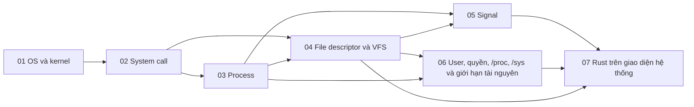

# P1 · Tổng quan — Linux và system interface

> Trang này chỉ điều hướng: mục tiêu, bản đồ chương, thứ tự đọc, sách gốc và câu hỏi tổng hợp. Mọi khẳng định kỹ thuật có chú thích nằm trong từng chương; các lời khuyên về thứ tự đọc là của người soạn.

## Mục tiêu của phase

Phase này dựng ranh giới giữa chương trình của bạn và kernel: user mode/kernel mode, system call, process, file descriptor, signal, user/quyền và `/proc`. Học xong, bạn đọc được `strace`, hiểu vì sao một process Rust chết hoặc treo, và biết std của Rust đứng trên những system call nào. Đây là nền cho mọi phase sau.

## Bản đồ chương

Mũi tên nghĩa là chương đích dùng khái niệm của chương nguồn (nhận xét của người soạn về thứ tự học).

## Các chương

| Chương | Nội dung chính |
|---|---|
| [01 — OS và kernel](01-os-va-kernel.md) | OS làm gì cho chương trình, ba trụ cột virtualization/concurrency/persistence; limited direct execution; user vs kernel mode; trap, interrupt, timer và context switch; phân hệ kernel; kernel space vs user space. |
| [02 — System call](02-system-call.md) | `write` đi vào kernel bằng lệnh máy nào, số hiệu syscall và `errno`; wrapper libc vs `syscall(2)`; vDSO và `Instant::now()`; `strace`/`ptrace`; đọc man page (section 2 vs 3, POSIX vs Linux). |
| [03 — Process](03-process.md) | Process vs chương trình; `fork` và copy-on-write; `exec` giữ/đổi gì; vì sao tách `fork`/`exec`; `wstatus`; zombie, orphan, PID 1; process group, session, job control; `argv`, environment. |
| [04 — File descriptor và VFS](04-file-descriptor-va-vfs.md) | fd, open file description và inode; offset chia sẻ qua `fork`/`dup`; `dup2`, `O_CLOEXEC`; fd nhỏ nhất chưa dùng; VFS và "everything is a file"; redirection và pipe; pipe, FIFO, Unix socket. |
| [05 — Signal](05-signal.md) | Disposition, mask, pending, delivery; signal chuẩn vs real-time; `sigaction`/`sigprocmask`; `EINTR` và `SA_RESTART`; hàm async-signal-safe; `SIGCHLD`, `SIGPIPE`; `SIGTERM` vs `SIGKILL`; `signalfd`. |
| [06 — User, quyền, /proc, /sys và giới hạn tài nguyên](06-user-quyen-proc-sys.md) | ID của process và quyền truy cập file; bit quyền, setuid/setgid/sticky, `umask`; capabilities; đọc `/proc/<pid>`; `/sys` và `sysctl`; `RLIMIT_NOFILE`, `EMFILE`/`ENFILE`. |
| [07 — Rust trên giao diện hệ thống](07-rust-tren-giao-dien-he-thong.md) | `RawFd`/`OwnedFd`/`BorrowedFd` và `close`; `io::Error` và `errno`; `Command::spawn` (`posix_spawn` vs `fork`+`exec`), `pre_exec`; `Child` không `wait`; `SIGPIPE` trong Rust; `env::args`/`OsString`; `libc` vs `nix`/`rustix`. |

## Thứ tự đọc

Đọc 01 → 07 theo số: mỗi chương dùng khái niệm của chương trước (02 cần trap ở 01; 04 cần `fork` ở 03). Chương 06 là chương tra cứu, có thể đọc sau khi xong 05. Chương 07 đọc cuối vì nó gom cả phase vào API của std.

## Lộ trình đọc sách gốc

Các nguồn dưới đây đều là nguồn mà chương của phase đã dùng; mở đọc song song với chương tương ứng. Không bắt buộc: chương đã tự chứa phần cần thiết.

- [OSTEP — Introduction (ch.1)](https://pages.cs.wisc.edu/~remzi/OSTEP/intro.pdf) — chương 01.
- [OSTEP — Processes: Introduction](https://pages.cs.wisc.edu/~remzi/OSTEP/cpu-intro.pdf) — chương 01, 03.
- [OSTEP — Limited Direct Execution](https://pages.cs.wisc.edu/~remzi/OSTEP/cpu-mechanisms.pdf) — chương 01, 02.
- [OSTEP — Process API](https://pages.cs.wisc.edu/~remzi/OSTEP/cpu-api.pdf) — chương 03.
- [syscalls(2), Linux man-pages (Debian bookworm)](https://manpages.debian.org/bookworm/manpages-dev/syscalls.2.en.html) — chương 02.
- [proc(5), Linux man-pages (Debian bookworm)](https://manpages.debian.org/bookworm/manpages/proc.5.en.html) — chương 06.
- [Beej's Guide — What is a socket?](https://beej.us/guide/bgnet/html/split/what-is-a-socket.html) — chương 04.
- [Rust docs — `std::os::fd`](https://doc.rust-lang.org/1.95.0/std/os/fd/index.html) — chương 07.
- [The Rust Book — Unsafe Rust](https://doc.rust-lang.org/1.95.0/book/ch20-01-unsafe-rust.html) — chương 07.

## Câu hỏi tổng hợp xuyên chương

Không có đáp án ở đây; mỗi câu trỏ về chương cần đọc lại.

1. Shell chạy `a | b > out.txt`: kể lại chuỗi `fork`, `pipe`, `dup2`, `exec` và hai tiến trình con được dọn thế nào ([chương 03](03-process.md), [chương 04](04-file-descriptor-va-vfs.md), [chương 02](02-system-call.md)).
2. Từ `File::open` trong Rust xuống tới hàm xử lý trong kernel: những ranh giới nào được vượt qua (user/kernel mode, syscall, VFS, fd)? ([chương 07](07-rust-tren-giao-dien-he-thong.md), [chương 02](02-system-call.md), [chương 01](01-os-va-kernel.md), [chương 04](04-file-descriptor-va-vfs.md)).
3. Service Rust báo `EMFILE`: bạn chẩn đoán bằng `/proc`, `ulimit`, `RLIMIT_NOFILE` và danh sách fd như thế nào? ([chương 06](06-user-quyen-proc-sys.md), [chương 04](04-file-descriptor-va-vfs.md)).
4. Ghi vào pipe/socket mà đầu đọc đã đóng: `SIGPIPE`, `EPIPE` và cách Rust khởi động process liên quan nhau ra sao? ([chương 05](05-signal.md), [chương 04](04-file-descriptor-va-vfs.md), [chương 07](07-rust-tren-giao-dien-he-thong.md)).
5. Service chạy làm PID 1 trong container nhận `SIGTERM`: zombie, reaping và graceful shutdown phụ thuộc vào những cơ chế nào của process và signal? ([chương 03](03-process.md), [chương 05](05-signal.md) mục 8; phía PID namespace: P8 [chương 02](../08-containers/02-namespaces.md) mục 4).
6. Service nghe cổng thấp mà không chạy root: UID, capabilities và quyền file cùng quyết định điều gì? ([chương 06](06-user-quyen-proc-sys.md), [chương 03](03-process.md)).
7. `Instant::now()` và `write(2)` khác nhau thế nào về chi phí vào kernel, và vDSO xuất hiện ở đâu? ([chương 02](02-system-call.md), [chương 01](01-os-va-kernel.md)).

## Lab

Làm sau khi đã đọc lý thuyết:

- [Lab 01 — Linux và system call interface](../labs/01-linux-lab.md)
- [Capstone — HTTP server trên epoll rồi mini async runtime (làm sau cùng, dùng P1, P6, P7)](../labs/capstone.md)
