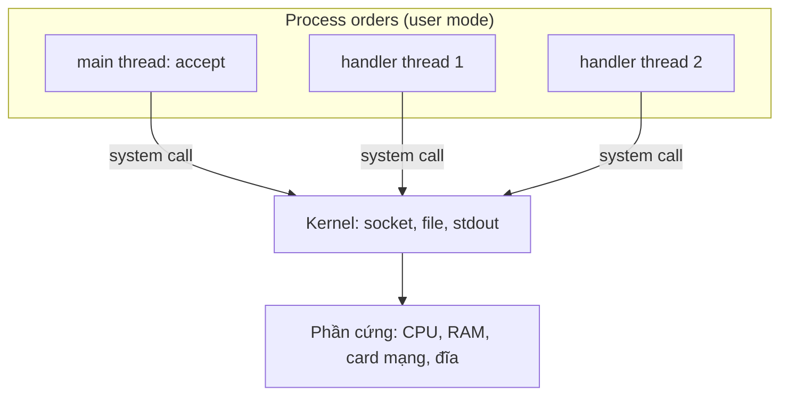
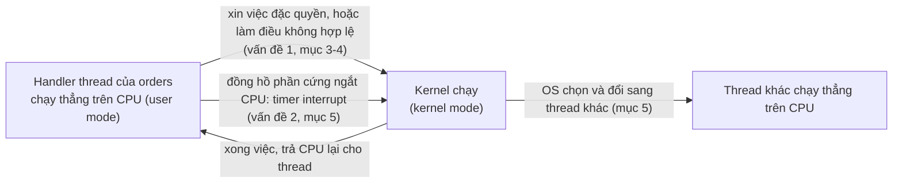
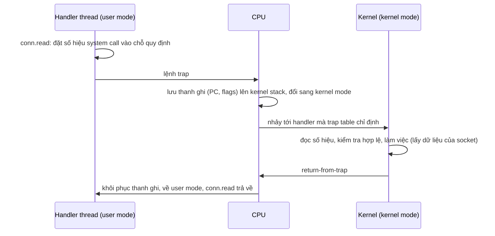
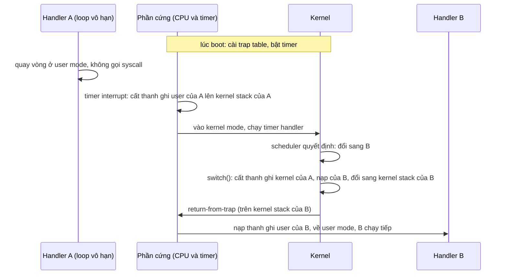
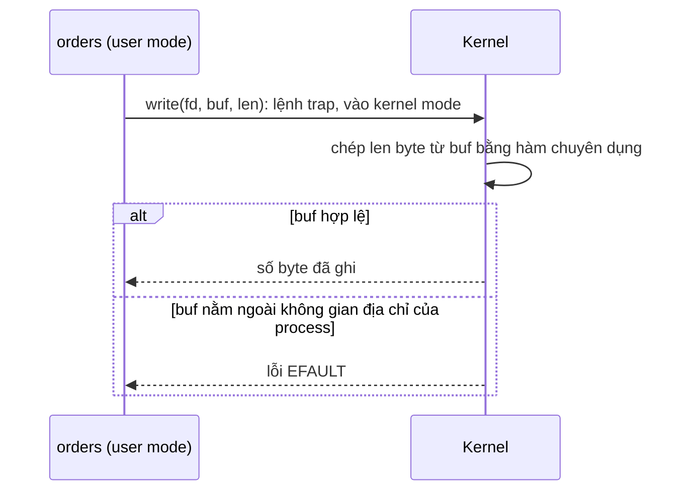

# P1 · Chương 01 — OS và kernel

> Phạm vi: mọi khẳng định về kernel trong chương này là về **Linux**. Các ví dụ "đã chạy thật" chỉ là *quan sát* một lần chạy, không phải bảo đảm của tài liệu. Chi tiết về nguồn và phiên bản kernel nằm ở phần Đi sâu cuối mục 1.

## Bạn sẽ hiểu được gì

1. **Q1.** OS làm gì cho service của bạn, và "ba trụ cột" virtualization, concurrency, persistence là gì? → mục 1
2. **Q2.** Nhiều chương trình dùng chung một CPU mà vẫn chạy nhanh, không giẫm chân nhau: nhờ cơ chế nào (limited direct execution)? → mục 2
3. **Q3.** User mode khác kernel mode thế nào; code user thử làm việc của kernel thì chuyện gì xảy ra; trên AArch64 và x86-64 các mức đặc quyền có tên là gì? → mục 3
4. **Q4.** Khi service gọi `read` trên socket, CPU đi vào kernel rồi quay ra bằng đường nào? Trap, trap table, interrupt và exception khác nhau ra sao? → mục 4
5. **Q5.** Một handler thread kẹt trong `loop {}` thì OS lấy lại CPU bằng cách nào (timer interrupt, preemption)? Context switch là gì? → mục 5
6. **Q6.** Linux kernel gồm những phân hệ chính nào? → mục 6
7. **Q7.** Trong bộ nhớ, kernel space khác user space chỗ nào, và vì sao kernel không tin con trỏ do service đưa vào? → mục 7

## Kiến thức cần trước

Đây là chương mở đầu của phase nên không cần chương nào trước. Bạn chỉ cần nhớ hai điều: chương trình là một dãy lệnh máy chạy trên CPU, và CPU có thanh ghi (register, những ô nhớ rất nhỏ nằm ngay trong CPU), trong đó có program counter (PC) cho biết lệnh nào sắp chạy. Cần ôn thì xem [Phase 2 · Chương 01](../02-cpu/01-mo-hinh-may-va-isa.md).

Bạn đã viết service chạy trên Linux (mở cổng, đọc file, ghi log) nhưng chưa cần biết bên dưới OS làm gì; chương này lấp chỗ đó. Code ví dụ bằng Rust, chỉ cần đọc được `std::net` và `std::fs`.

Các chương sau: [system call](02-system-call.md), [process](03-process.md), [file descriptor và VFS](04-file-descriptor-va-vfs.md), [signal](05-signal.md), [user, quyền, /proc, /sys](06-user-quyen-proc-sys.md), [Rust trên giao diện hệ thống](07-rust-tren-giao-dien-he-thong.md).

---

## 1. OS là gì và ba trụ cột (Q1)

> **Trả lời ngắn.** OS (hệ điều hành) đứng giữa chương trình và phần cứng. Nó biến CPU, bộ nhớ và đĩa thật thành những phiên bản "ảo" dễ dùng hơn[^os-virt]. Vì nhiều chương trình phải chia nhau những thứ đó, nó còn đóng vai người quản lý tài nguyên (resource manager)[^os-resmgr]. Công việc ấy gồm ba mảng lớn: virtualization (ảo hóa tài nguyên), concurrency (xử lý nhiều việc cùng lúc) và persistence (giữ dữ liệu lâu dài)[^os-themes].

**Giải thích.**

*Với service của bạn.* Hãy hình dung `orders`, một service viết bằng Rust, chạy trên Linux, là một process có vài thread. Mỗi request nó nhận một kết nối, đọc một file, ghi một dòng log, và cả ba việc đó nó đều phải nhờ OS làm hộ. Ta sẽ bám theo `orders` suốt chương (nhận xét của người soạn: đây là ví dụ giả định, không phải code trong repo). Câu hỏi của mục này: OS làm gì thay `orders`, và làm sao một máy phục vụ được cả chục chương trình như thế cùng lúc?

### 1.1 `orders` nhờ OS những gì

Dưới đây là vài dòng code mà `orders` chạy qua khi phục vụ một request (đã bỏ phần xử lý lỗi), kèm việc mỗi dòng đang nhờ OS:

| Dòng code | Việc nhờ OS |
|---|---|
| `TcpListener::bind("0.0.0.0:8080")` | Gắn một socket vào cổng 8080 để nghe kết nối đến[^n1-tcplistener] |
| `listener.accept()` | Chờ tới khi có client nối vào; thread bị chặn trong lúc chờ[^n1-accept] |
| `conn.read(&mut buf)` | Lấy byte client đã gửi và đặt vào `buf`[^n1-read] |
| `File::open("orders/42.json")` | Mở một file để đọc[^n1-file-open] |
| `println!("served order 42")` | Ghi một dòng ra standard output[^n1-println] |

Cả năm dòng đều phải đi qua OS. Lý do là ứng dụng thông thường chạy ở user mode, một chế độ CPU bị hạn chế (mục 3 sẽ nói kỹ), và mỗi khi cần OS làm gì thì nó gọi system call[^typical-apps].

Mấy từ sẽ gặp lại nhiều lần:

- **System call** (syscall): lời gọi để chương trình xin OS làm việc. Một OS điển hình có sẵn vài trăm system call cho ứng dụng gọi[^os-syscalls].
- **Process**: một chương trình đang chạy[^process-def]. `orders` là một process.
- **Thread**: một luồng thực thi bên trong process. Thread của Rust `std` là thread của OS, mỗi thread có stack riêng[^rs-native-threads].
- **Kernel**: phần lõi của OS, chạy với toàn quyền trên máy[^kernel-mode].



(Sơ đồ minh họa của người soạn: `orders` không chạm vào phần cứng, mọi thứ đi qua kernel.)

### 1.2 Ba trụ cột

Nhưng `orders` không phải chương trình duy nhất trên máy. Cùng lúc còn có database, sshd và đủ thứ khác, và chương trình nào cũng muốn có CPU, có vùng nhớ riêng, được đọc ghi file thoải mái như thể cả máy là của mình. OS phải làm cho ảo giác đó thành sự thật.

Cách làm gọi là *virtualization*: OS lấy một tài nguyên vật lý (CPU, bộ nhớ, đĩa) và biến nó thành một bản "ảo" dễ dùng hơn, mạnh hơn, tổng quát hơn[^os-virt]. Chữ "ảo" ở đây không liên quan gì tới máy ảo (VM). Với bộ nhớ, mỗi process có một address space riêng, tức vùng địa chỉ chỉ mình nó thấy, còn OS lo ánh xạ vùng đó lên RAM thật[^os-vas].

Virtualization mới là một mảng. OS còn hai mảng nữa, và mỗi mảng đặt ra một câu hỏi cho `orders`:

| Trụ cột | Câu hỏi của `orders` | Ở đâu trong giáo trình |
|---|---|---|
| **Virtualization** | Máy còn chạy database, sshd… sao `orders` vẫn như có CPU và RAM riêng? | CPU: chương này. Bộ nhớ: [`../03-memory/01-address-space.md`](../03-memory/01-address-space.md). |
| **Concurrency** | Vài handler thread chạy xen kẽ và cùng đụng một dữ liệu thì chuyện gì xảy ra? | Phase 4: [`../04-concurrency/01-thread.md`](../04-concurrency/01-thread.md). Chương này chỉ chạm tới ở §4.5. |
| **Persistence** | Máy mất điện hoặc crash, đơn hàng đã nhận còn không? | Phase 5 (storage); ở phase này: [file descriptor](04-file-descriptor-va-vfs.md). |

*Concurrency* là cả loạt vấn đề xuất hiện khi một chương trình làm nhiều việc cùng một lúc, và chương trình phải xử lý cho đúng[^os-conc]. Vài handler thread của `orders` cùng đụng vào dữ liệu chung chính là loại vấn đề này.

*Persistence* bắt nguồn từ chỗ DRAM giữ dữ liệu theo kiểu volatile: mất điện hay crash là mất sạch những gì đang nằm trong RAM, nên muốn giữ lâu dài thì phải có cả phần cứng lẫn phần mềm lo việc lưu[^os-persist]. Đơn hàng mà `orders` chỉ giữ trong RAM sẽ bay mất. Muốn còn thì phải ghi ra đĩa, tức là lại nhờ OS.

### 1.3 Hai mục tiêu kéo ngược chiều

Việc này khó ở chỗ OS bị kéo về hai phía cùng lúc. Phía thứ nhất là hiệu năng: OS càng ít tốn thêm tài nguyên (overhead) càng tốt[^os-perf], vì `orders` không muốn mất thời gian cho phần OS chen vào mỗi request. Phía thứ hai là bảo vệ: một chương trình hỏng, hay cố ý phá, không được làm hại chương trình khác[^os-prot]. Nền tảng của việc này là isolation, tức cô lập các process với nhau[^os-isolation]; nếu `orders` có bug thì database cùng máy không được chết theo.

Hai mục tiêu căng nhau vì kiểm soát chặt hơn thường kéo theo chi phí lớn hơn (nhận xét của người soạn). Nói gọn, bài toán của việc ảo hóa CPU là vừa hiệu quả, vừa giữ được quyền kiểm soát máy[^lde-crux]. Các mục 2–5 là lời giải.

<details><summary>Đi sâu: vì sao đĩa không có bản ảo riêng, và cách đọc nguồn, phiên bản của chương</summary>

**Đĩa khác CPU và bộ nhớ.** OS không tạo một "đĩa ảo" riêng cho từng ứng dụng như nó làm với CPU và bộ nhớ, vì người dùng thường muốn chia sẻ thông tin qua file[^os-nopriv-disk]. Chẳng hạn `orders` ghi log, còn một công cụ khác trên máy đọc đúng file log đó.

**Nguồn và phiên bản.**

- Các mô hình trong sách OSTEP (trap, timer, context switch) là mô hình khái niệm, không phải mô tả từng bước Linux làm.
- Các trang `docs.kernel.org` mà chương này trích là bản hiện hành lúc soạn. Đầu trang ghi một bản kernel đang phát triển (7.3.0-rc6 lúc soạn; khi kiểm lại ngày 2026-10-12 đã là 7.3.0-rc7), không ghim, nên có thể khác kernel 6.x bạn đang chạy.
- Chỗ nào hai bản khác nhau, phần Đi sâu của mục đó sẽ nói; chỗ cần ghim phiên bản thì dùng source tag `v6.8`.
- Các ví dụ "đã chạy thật" chạy trong container lab (`./labs/linux.sh`, aarch64, kernel 6.8, `rustc 1.95.0`), trừ demo ở §3.2 chạy trên macOS arm64. Đó là quan sát một lần chạy, không phải bảo đảm của tài liệu.

</details>

**Quay lại Q1:** OS biến tài nguyên vật lý thành bản ảo dễ dùng và điều phối việc chia sẻ chúng, theo ba mảng virtualization, concurrency và persistence; với `orders`, mọi việc chạm ra ngoài process (mạng, file, log) đều phải nhờ OS qua system call.

---

## 2. Ảo hóa CPU và limited direct execution (Q2)

> **Trả lời ngắn.** OS cho các process thay phiên nhau dùng CPU, nên process nào cũng thấy như mình có một CPU riêng[^virt-cpu]. Trong lượt của mình, process chạy thẳng trên CPU (*direct execution*) nên nhanh đúng như ta mong[^direct-fast]. Nhưng nếu chạy thẳng mà không bị giới hạn gì thì OS mất quyền kiểm soát và chỉ còn là một thư viện thông thường[^lde-lib]. Vì vậy cách làm này tên là *limited direct execution*; các mục 3–5 nói giới hạn đó cụ thể là gì.

**Giải thích.**

*Với service `orders`.* Máy chạy `orders` chỉ có vài core, mà số thread đòi chạy nhiều hơn thế nhiều: các handler thread của `orders`, database, sshd… Khi một handler thread đang parse JSON, nó chạy thẳng trên CPU, không có OS chen vào giữa các lệnh, nên không chậm đi. Nhưng cũng vì không ai chen vào, thread đó có thể thử đụng thẳng vào card mạng, hoặc kẹt trong `loop {}` rồi giữ CPU mãi. *Limited direct execution* là cách OS vừa giữ được tốc độ, vừa xử lý được cả hai chuyện ấy.

### 2.1 Time sharing

Máy có ít CPU mà phải chạy rất nhiều thứ, nên OS chia thời gian: cho chương trình này dùng CPU một lúc, rồi đến chương trình khác, rồi quay vòng. Kỹ thuật đó tên là *time sharing*[^timeshare-def]. Mỗi lượt như vậy OS cho một *process* chạy; process là một chương trình đang chạy[^process-def]. OS chạy một process, dừng nó, chạy process khác, cứ thế mãi, và nhờ vậy tạo ra ảo giác có nhiều CPU ảo dù thực tế chỉ có một CPU vật lý, hoặc vài cái[^virt-cpu]. Process được mổ xẻ kỹ hơn ở [Chương 03](03-process.md).

### 2.2 Nhanh mà vẫn kiểm soát được

Bài toán nghe như tự mâu thuẫn: ảo hóa CPU sao cho hiệu quả, nhưng OS vẫn phải giữ quyền kiểm soát máy[^lde-crux]. Lời giải bắt đầu từ cách đơn giản nhất, *direct execution*: cứ để chương trình chạy thẳng trên CPU. Chương trình chạy native trên phần cứng nên nhanh đúng như ta mong[^direct-fast].

Cái giá của việc chạy thẳng là hai vấn đề[^lde-problems]:

1. **Việc đặc quyền.** Có những việc chương trình cần làm nhưng không thể giao toàn quyền cho nó, ví dụ gửi yêu cầu I/O tới đĩa[^restricted-op]. Trong `orders` đó là `File::open` và `conn.read`.
2. **Lấy lại CPU.** Khi một process đang chạy thẳng trên CPU mà không chịu nhường, OS phải có cách dừng nó để chuyển sang process khác. Trong `orders` đó là handler thread dính bug `loop {}`; mục 5 sẽ giải bài này.

Ý tưởng chung để giải cả hai gọi là **limited direct execution** (LDE). "Direct" để chạy nhanh; "limited" để OS vẫn nắm quyền, vì nếu chương trình không bị giới hạn gì thì OS chẳng điều khiển được gì và chỉ còn là một thư viện thông thường[^lde-lib]. Mục 3–4 giải vấn đề 1, mục 5 giải vấn đề 2.

Hình dưới tóm tắt hai đường đưa CPU từ code của `orders` vào kernel (sơ đồ của người soạn; mục 3–5 sẽ giải thích từng mũi tên):



### 2.3 Cơ chế và chính sách

Chương này chỉ bàn về *mechanism* (cơ chế): làm thế nào để chuyển quyền điều khiển giữa chương trình và OS, làm thế nào để lấy lại CPU. Việc chọn thread nào chạy tiếp là *policy* (chính sách) và thuộc về *scheduler*, phần của OS quyết định ai được chạy (xem [`../04-concurrency/02-scheduling.md`](../04-concurrency/02-scheduling.md)). Cách phân biệt gọn nhất: mechanism trả lời "làm thế nào" (ví dụ *context switch*, tức dừng thread này để chuyển sang thread khác, được thực hiện ra sao), còn policy trả lời "cái nào" (ví dụ lúc này nên chạy process nào)[^mech-policy].

<details><summary>Đi sâu: space sharing và context switch</summary>

Ngược với time sharing là *space sharing*: chia tài nguyên theo không gian, mỗi bên một phần[^spaceshare-def]. Còn cơ chế dừng chương trình này để chạy chương trình kia gọi là *context switch* (§5.3); mọi OS hiện đại đều dùng nó[^ctxsw-modern].

</details>

**Quay lại Q2:** chương trình chạy thẳng trên CPU để nhanh, còn OS giữ quyền kiểm soát nhờ chế độ đặc quyền (mục 3–4) và timer (mục 5).

---

## 3. User mode, kernel mode và mức đặc quyền (Q3)

> **Trả lời ngắn.** CPU có ít nhất hai chế độ: *user mode*, nơi code bị hạn chế, và *kernel mode*, nơi code được làm mọi thứ[^two-modes]. OS chạy ở kernel mode nên làm được cả những việc đặc quyền như gửi yêu cầu I/O[^kernel-mode]. Code ở user mode mà thử làm việc đặc quyền thì CPU phát một *exception*, tức sự kiện báo cho OS biết chương trình vừa làm điều không được phép, và OS nhiều khả năng sẽ giết process[^user-exception]. Mỗi loại CPU gọi các mức đặc quyền bằng tên riêng; bảng cho AArch64 và x86-64 nằm ở phần Đi sâu.

**Giải thích.**

*Với service `orders`.* `orders` chạy ở user mode, như hầu hết ứng dụng[^typical-apps]. Ở chế độ này code bị hạn chế trong những việc được phép làm[^user-mode], nên muốn chạm vào card mạng hay đĩa, `orders` phải nhờ kernel. Mục này cho thấy ranh giới đó chặn gì và chặn bằng cách nào; mục 4 cho thấy `orders` nhờ kernel ra sao.

### 3.1 Hai chế độ

Điều đầu tiên cần nắm: chế độ là **trạng thái của CPU**, không phải thuộc tính của chương trình. Cùng một handler thread của `orders` chạy lệnh này ở user mode; qua một lệnh đặc biệt để vào kernel (lệnh *trap*, mục 4) thì lệnh kế tiếp của nó chạy ở kernel mode[^trap-raise].

Hệ quả là khi thread gọi system call, không có process nào khác nhận việc thay. Chính thread đó tiếp tục chạy, nhưng lúc này đang chạy code kernel với quyền cao hơn. Trạng thái này có tên riêng trong kernel: *user context*[^ctx-kernel-ctx].

### 3.2 Thử chạm vào giới hạn

Ta thử chạm vào giới hạn đó xem sao. Chương trình Rust dưới đây (chỉ chạy được trên arm64) tự sinh ra một process con bằng cách chạy lại chính file của nó; process con thực thi hai lệnh máy. Lệnh thứ nhất đọc bộ đếm thời gian của CPU, user mode được phép làm. Lệnh thứ hai là `msr daifset, #3`, lệnh tắt ngắt trên CPU (ngắt là cách thiết bị phần cứng báo tin cho CPU, mục 4 sẽ nói kỹ); kernel Linux trên arm64 dùng chính lệnh này, trong hàm `__daif_local_irq_disable`, để tắt ngắt[^n1-daifset]. Process cha đợi con xong rồi in xem con kết thúc thế nào.

```rust
use std::arch::asm;
use std::os::unix::process::ExitStatusExt;
use std::process::Command;

fn child() {
    // Đọc bộ đếm thời gian của CPU: user mode được phép.
    let ticks: u64;
    unsafe { asm!("mrs {t}, cntvct_el0", t = out(reg) ticks) };
    println!("[con] 1) đọc cntvct_el0: ok (ticks > 0: {})", ticks > 0);

    // Tắt ngắt trên CPU: đúng lệnh kernel Linux arm64 dùng để tắt ngắt.
    println!("[con] 2) sắp chạy `msr daifset, #3` ...");
    unsafe { asm!("msr daifset, #3") };

    println!("[con] 3) dòng này sẽ không bao giờ in ra");
}

fn main() {
    if std::env::args().nth(1).as_deref() == Some("child") {
        return child();
    }
    // Process cha chạy lại chính file này ở chế độ "child", rồi xem con kết thúc ra sao.
    let status = Command::new(std::env::current_exe().unwrap())
        .arg("child")
        .status()
        .unwrap();
    println!("[cha] con kết thúc: {status}");
    println!("[cha] signal = {:?}, exit code = {:?}", status.signal(), status.code());
}
```

Kết quả chạy thật trên **macOS arm64** (Apple M3 Pro, `rustc 1.95.0`, `cargo run`, một lần chạy; đây không phải Linux):

```text
[con] 1) đọc cntvct_el0: ok (ticks > 0: true)
[con] 2) sắp chạy `msr daifset, #3` ...
[cha] con kết thúc: signal: 4 (SIGILL)
[cha] signal = Some(4), exit code = None
```

Dòng 3 của process con không bao giờ in ra. CPU không cho chạy lệnh thứ hai, và process con bị giết bằng signal số 4, tức `SIGILL` (illegal instruction)[^n1-sigill]. Process cha thấy con chết vì signal chứ không phải thoát với một exit code.

Đây đúng là cơ chế nói ở trên, chỉ khác là lệnh bị cấm không phải I/O: CPU phát exception, rồi OS nhiều khả năng giết process[^user-exception]. Demo chạy trên macOS chứ không phải Linux, nên ta chỉ dùng nó để thấy cơ chế; chương này không khẳng định Linux sẽ gửi đúng signal số 4 cho lệnh này (lý do ở §4.7).

Vì sao user mode bị cấm lệnh này? Nếu process tắt được ngắt trên CPU thì timer interrupt ở mục 5 không còn lấy lại được CPU từ nó nữa (suy luận của người soạn).

### 3.3 Vì sao phần cứng phải kiểm tra

Nếu chế độ chỉ là lời hứa của OS thì chương trình xấu cứ việc phá lời hứa, nên phải có phần cứng đứng ra kiểm tra từng lệnh (nhận xét của người soạn). Có ba việc mà chỉ kernel mode được làm:

- Gửi yêu cầu I/O tới thiết bị[^kernel-mode].
- Báo cho CPU biết *trap table* nằm ở đâu. Trap table là bảng "sự kiện nào thì chạy đoạn code nào" của kernel (mục 4). Đây là một quyền rất lớn[^trap-table-priv]. Vì vậy nếu user mode thử làm, phần cứng không cho[^hw-wont-let].
- Khởi động *timer*, đồng hồ phần cứng để OS lấy lại CPU (mục 5)[^timer-priv].

Nếu code user cài được trap table của riêng nó thì nó chiếm được cả máy (suy luận của người soạn).

Vậy khi `orders` cần kernel làm việc đặc quyền, nó xin bằng cách nào? Đó là chuyện của mục 4.

<details><summary>Đi sâu: tên mức đặc quyền theo kiến trúc, và khi kernel không ở EL1 hay mức 0</summary>

### 3.4 Mức đặc quyền theo kiến trúc

User mode và kernel mode là cách nói chung; mỗi kiến trúc CPU đặt tên riêng cho các mức. Bảng dưới chỉ ghi những gì có nguồn:

| Kiến trúc | User space chạy ở | Kernel chạy ở |
|---|---|---|
| **AArch64** | EL0[^arm-el0-user] | EL1 hoặc EL2: lúc boot, kernel được vào ở EL2 (khuyến nghị) hoặc EL1[^arm-boot]; với KVM và Virtualization Host Extensions (VHE), kernel host chạy trực tiếp ở EL2[^arm-vhe] |
| **x86-64** | mức đặc quyền 3[^x86-user-rpl] | mức đặc quyền 0, gọi là CPL0[^x86-cpl0] |

**AArch64.** Kiến trúc này chia các mức đặc quyền thành các *exception level*, từ EL0 đến EL3. EL0, EL1, EL2 đều có bản secure và non-secure; EL2 là mức của hypervisor (phần mềm chạy máy ảo); EL3 là mức cao nhất và chỉ có ở secure mode. EL2 và EL3 là tùy chọn của kiến trúc[^arm-levels].

Vì vậy "kernel chạy ở EL1" chỉ đúng một phần. Lúc boot, CPU phải ở trạng thái non-secure, ở EL2 (nên chọn EL2 để dùng được các extension ảo hóa) hoặc EL1[^arm-boot]. Còn với KVM có VHE, kernel của máy host chạy thẳng ở EL2[^arm-vhe].

Phía user space: một đoạn docs arm64 về thanh ghi AMU nhắc tới việc bẫy truy cập từ EL0 (userspace) lên EL1 (kernel)[^arm-el0-user]. Đây chỉ là chứng cứ gián tiếp rằng EL0 là mức của user space; docs không có định nghĩa riêng cho EL0.

**x86-64.** Intel định nghĩa 4 mức đặc quyền, đánh số từ 0 đến 3, số càng lớn càng ít đặc quyền[^sdm-levels], nên mức 0 là cao nhất. Vòng trong cùng (mức 0) dành cho phần mềm lõi, thường là kernel của OS; hệ thống chỉ dùng hai mức thì nên dùng 0 và 3[^sdm-rings]. *CPL* (current privilege level) là mức của chương trình đang chạy[^sdm-cpl].

Linux đúng với cách dùng hai mức đó: source ghi user mode là privilege level 3[^x86-user-rpl]. Riêng chuyện kernel chạy ở mức 0 thì docs không nói thẳng. Chỗ gần nhất là đoạn giải thích truy cập `GS.base`: các thanh ghi MSR chỉ truy cập được ở CPL0[^x86-cpl0]. Từ đó ta suy ra kernel chạy ở CPL0 (suy luận của người soạn).

Cuối cùng, lệnh đặc quyền chỉ chạy được khi CPL bằng 0; ở mức khác CPU phát exception #GP (general-protection)[^sdm-privileged].

### 3.5 Khi kernel không ở EL1 hay mức 0

"Kernel ở EL1" hay "kernel ở mức 0" chỉ là trường hợp thường gặp, không phải định nghĩa (nhận xét của người soạn). Trên arm64, kernel host của KVM có VHE chạy ở EL2 (bảng ở §3.4). Trên x86, một ghi chú trong source Linux `v6.8` nói rằng khi kernel chạy làm guest Xen PV (một kiểu ảo hóa) thì mức đặc quyền thật của nó là 1 chứ không phải 0[^xen-pv]. Mức 2 thì không bao giờ được dùng[^x86-level2]. Đó là chi tiết cài đặt của `v6.8`, có thể thay đổi.

</details>

**Quay lại Q3:** user mode bị hạn chế còn kernel mode thì không, ranh giới đó do CPU ép nên code user chạy lệnh đặc quyền sẽ bị OS kết thúc; tên các mức thì tùy kiến trúc (AArch64: user ở EL0, kernel ở EL1 hoặc EL2; x86-64: user ở mức 3, kernel ở mức 0).

---

## 4. Trap, trap table, interrupt và exception (Q4)

> **Trả lời ngắn.** Muốn nhờ kernel làm việc, chương trình chạy một lệnh đặc biệt gọi là *trap*: lệnh này vừa nhảy vào kernel vừa nâng quyền lên kernel mode[^trap-raise]. Chương trình không được tự chọn chỗ nhảy tới; kernel đã ghi sẵn từ lúc boot, trong *trap table*, đoạn code (handler) nào phải chạy cho sự kiện nào[^trap-table]. Ngoài system call còn hai thứ nữa cũng kéo CPU vào kernel: *exception*, khi chương trình làm điều không hợp lệ[^illegal-ops], và *interrupt*, khi thiết bị phần cứng báo tin[^trap-events]. Kernel làm xong thì lệnh *return-from-trap* đưa CPU về user mode để chương trình chạy tiếp[^return-trap].

**Giải thích.**

*Với service `orders`.* Dòng `conn.read(&mut buf)` trong handler thread trông như một lời gọi hàm thường, nhưng bên dưới thread đó đi vào kernel, kernel lấy dữ liệu của socket, rồi thread quay về đúng dòng kế tiếp. Lối vào kernel do kernel dựng sẵn; `orders` không tự chọn được. Ngoài lối đó còn hai nguyên nhân khác cũng kéo CPU vào kernel mà `orders` không chủ động: chính code của nó làm điều không hợp lệ, hoặc một thiết bị, chẳng hạn card mạng, báo tin.

### 4.1 Vào kernel: lệnh trap

Muốn nhờ kernel thì trước hết phải vào được kernel. Nhưng code user không thể gọi kernel như gọi một hàm thường: nếu process tự chọn được địa chỉ để nhảy tới, nó nhảy được vào bất kỳ chỗ nào trong kernel, và đó là một ý tưởng rất tệ[^no-jump]. Vì vậy CPU có một lệnh riêng cho việc này, gọi là *trap*[^trap-instr]. Lệnh trap làm hai việc cùng lúc: nhảy vào kernel và nâng quyền lên kernel mode[^trap-raise]. Chỗ nó nhảy tới không do chương trình chọn mà do kernel định sẵn, trong trap table (§4.2). Kernel làm xong thì chạy lệnh *return-from-trap*, quay về chương trình đã gọi và hạ quyền về user mode[^return-trap].

Có một điều kiện để return-from-trap đưa chương trình về đúng chỗ: phần cứng phải lưu đủ thanh ghi của chương trình trước khi vào kernel[^hw-save-trap]. Chẳng hạn trên x86, như OSTEP mô tả, CPU đẩy program counter, flags (thanh ghi cờ trạng thái) và vài thanh ghi khác lên *kernel stack*, một stack riêng chỉ dùng khi chạy code kernel; return-from-trap lấy chúng ra để chạy tiếp[^kstack]. Trong mô tả đó mỗi process có một kernel stack, còn Linux x86-64 cấp một kernel stack cho mỗi thread đang hoạt động, và stack này trống (trừ cấu trúc `thread_info` ở đáy) khi thread đang ở user space[^x86-kstack].

Một lưu ý nhỏ về thuật ngữ: ở đây "trap" chỉ lệnh để vào kernel. Tài liệu của Intel dùng chữ này cho một loại exception, hẹp hơn (xem cuối §4.3).

### 4.2 Trap table: ai quyết định nhảy tới đâu

Kernel quyết định, và quyết định ngay lúc boot. Khi máy vừa khởi động, nó đang ở chế độ đặc quyền nên cấu hình được phần cứng; một trong những việc đầu tiên kernel làm là báo cho phần cứng biết phải chạy code nào khi có sự kiện đặc biệt[^trap-table]. Sự kiện ở đây gồm ngắt từ đĩa, ngắt từ bàn phím, hay một chương trình gọi system call[^trap-events]. Bảng "sự kiện → handler" đó là *trap table*, và phần cứng nhớ nó cho tới lần khởi động lại sau[^trap-remember]. Báo vị trí trap table là việc chỉ kernel mode được làm (§3.3), nên chương trình không thể tự cài handler của mình.

Còn làm sao kernel biết chương trình đang xin dịch vụ nào? Mỗi system call có một số hiệu. Code user đặt số hiệu vào một thanh ghi (hoặc một chỗ quy định trên stack), kernel đọc số, kiểm tra hợp lệ rồi chạy code tương ứng[^syscall-num]. Cách này cũng là một lớp bảo vệ: code user không chỉ định được địa chỉ cụ thể mà chỉ xin dịch vụ theo số[^syscall-protect].

Ghép §4.1 và §4.2 lại, một lần `conn.read` đi như sau:



(Sơ đồ tổng hợp của người soạn từ các mô tả ở trên.) Sơ đồ bỏ qua một lớp: giữa `conn.read` và lệnh trap còn có thư viện C đóng gói system call (gọi `open()` thực ra là gọi một hàm của thư viện C[^libc-call]). Lớp đó thuộc [Chương 02](02-system-call.md). Trap table thật trên từng kiến trúc trông thế nào thì xem §4.6.

### 4.3 Ba nguồn sự kiện

Ba nguồn dưới đây đều đưa CPU vào kernel mode để chạy một handler. Điểm khác nhau là ai gây ra sự kiện:

| Nguồn | Ai gây ra | Ví dụ trong `orders` |
|---|---|---|
| **System call** | Chương trình, chủ động, bằng lệnh trap | `conn.read(&mut buf)` xin kernel đọc socket[^trap-events] |
| **Exception** | Chương trình đang chạy, khi làm điều không hợp lệ | Một handler thread dereference con trỏ rác, hoặc chạy lệnh đặc quyền như ở §3.2[^illegal-ops] |
| **Interrupt** | Thiết bị phần cứng, vào lúc chương trình không quyết định | Card mạng báo tin; timer báo hết giờ (mục 5)[^irq-anytime] |

Với con trỏ rác nằm trong code của chính `orders`, đường đi là exception (xem §4.7). Còn con trỏ rác mà `orders` đưa cho kernel thì là chuyện khác, ở mục 7.

Exception và interrupt dễ bị lẫn vì cả hai đều không do chương trình chủ động gọi. Mấu chốt để phân biệt là nguyên nhân nằm ở đâu. Exception sinh ra từ chính lệnh đang chạy: CPU phát hiện lỗi ngay lúc thực thi lệnh đó, ví dụ chia cho 0[^sdm-exc], nên nó gắn với một chỗ cụ thể trong code. Interrupt thì đến từ phần cứng bên ngoài, vào những lúc ngẫu nhiên so với chương trình[^sdm-intr], nên có thể chen vào giữa hai lệnh bất kỳ. Trong tài liệu Linux, interrupt từ thiết bị còn gọi là *IRQ* (interrupt request)[^irq-def].

Với exception, kernel thường kết luận chương trình đã làm sai và giết process, chẳng hạn khi nó tự phát yêu cầu I/O ở user mode[^user-exception]. Không phải lúc nào cũng vậy: page fault là một loại fault[^sdm-pf]. Fault là exception sửa được, sửa xong thì chạy lại lệnh như chưa có gì xảy ra[^sdm-fault]. Chi tiết page fault ở [Phase 3](../03-memory/04-page-fault-va-swapping.md).

Với interrupt thì chương trình không hề có lỗi, nên xử lý xong CPU phải cho nó chạy tiếp đúng chỗ bị ngắt. Muốn vậy phần cứng luôn phải lưu đủ trạng thái của chương trình lúc ngắt xảy ra, giống hệt trường hợp system call[^hw-save-int]. Với `orders`: handler thread đang parse JSON thì card mạng báo tin; CPU lưu trạng thái, kernel xử lý xong, và thread chạy tiếp mà code của nó không hề hay biết.

Cuối cùng, một lưu ý thuật ngữ khi đọc tài liệu Intel: ở đó exception được chia thành fault, trap và abort, tùy cách báo cáo và tùy lệnh gây lỗi có chạy lại được hay không[^sdm-class]. "Trap" theo cách chia đó chỉ là *một loại exception*, được báo ngay sau lệnh gây ra nó và quay về lệnh kế tiếp[^sdm-trap]. Còn trong chương này "trap" có nghĩa rộng hơn, như OSTEP dùng: lệnh đặc biệt để chuyển từ user sang kernel[^trap-instr].

<details><summary>Đi sâu: các ngữ cảnh CPU trong kernel, ngắt lồng nhau, trap table thật và signal</summary>

### 4.4 CPU có thể đang ở ngữ cảnh nào

Tài liệu hướng dẫn viết code kernel liệt kê bốn trạng thái mà một CPU có thể đang ở:

- phục vụ một hardware interrupt, không gắn với process nào[^ctx-hardirq];
- phục vụ softirq hoặc tasklet (phần việc xử lý ngắt được hoãn lại, xem §4.5), cũng không gắn với process nào[^ctx-softirq];
- chạy trong kernel space, gắn với một process: đây là *user context*[^ctx-kernel-ctx];
- chạy process ở user space[^ctx-user].

Bốn trạng thái này có thứ bậc: hai cấp thấp nhất (user context và user space) có thể preempt lẫn nhau, còn từ đó đi lên thì mỗi cấp chỉ bị cấp cao hơn preempt[^ctx-hierarchy]. (*Preempt* nghĩa là giành CPU từ bên đang chạy, xem §5.2.)

User context là trường hợp kernel chạy vì một process vào qua system call hoặc trap khác. Ở đó code kernel có thể bị preempt và có thể ngủ bằng cách gọi `schedule()`[^user-context]. Nghĩa là khi `orders` gọi `read`, code kernel chạy trong user context của chính process đó, trên kernel stack của thread đó, rồi mới quay về[^x86-kstack].

Ngắt phần cứng thì khác. Ngoài stack riêng của từng thread, kernel x86-64 còn có những stack chuyên dụng cho từng CPU[^x86-cpustacks]. Ngắt phần cứng ngoài đầu tiên (không lồng nhau) chạy trên một *interrupt stack* riêng, và kernel chuyển từ task hiện tại sang stack đó[^x86-irqstack].

### 4.5 Ngắt khi đang ở kernel

Chuyện gì xảy ra nếu đang xử lý system call thì có timer interrupt, hoặc đang xử lý một ngắt thì ngắt khác tới? Đây chính là chuyện của mảng concurrency[^conc-defer]. Cách đơn giản nhất là tắt ngắt trong lúc đang xử lý một ngắt, để không có ngắt nào khác chen vào CPU[^irq-disable]. Nhưng tắt quá lâu thì có thể làm mất ngắt[^irq-lost].

Linux làm theo một biến thể. Handler của ngắt phần cứng không bị chạy lồng chính nó, và vì nó tắt ngắt nên phải thật nhanh: thường chỉ báo đã nhận ngắt, đánh dấu một "software interrupt" rồi thoát[^hardirq-fast]. Phần xử lý thực sự nằm ở lớp softirq, chạy sau đó[^softirq-work].

### 4.6 Trap table trên phần cứng thật

"Trap table" là tên khái niệm; mỗi kiến trúc có bảng riêng. Trên x86, mỗi exception hay interrupt có một *vector number*; CPU lấy số đó làm chỉ số vào *interrupt descriptor table* (IDT), bảng cho biết điểm vào của handler tương ứng[^sdm-idt]. Trên arm64, source Linux `v6.8` có bảng `vectors`: mỗi mục ghi loại sự kiện (Synchronous, IRQ, FIQ, Error) và nơi nó xuất phát. Nhóm đầu của bảng là cho ngữ cảnh EL1t[^arm-vectors]. Ngoài ra có một nhóm bốn mục cho code 64-bit chạy ở EL0[^arm-vectors-el0].

Lệnh trap để gọi system call cũng khác nhau: arm64 dùng `svc #0`[^sc-table-arm64]. Còn x86-64 dùng `syscall`[^sc-table-x86]. Thanh ghi nào chứa số hiệu và đối số thì xem [Chương 02](02-system-call.md). Các nguồn đã đọc không nói `svc` hay `syscall` tìm ra handler của system call bằng cách nào; đó là chi tiết riêng của từng kiến trúc và giáo trình không khẳng định. Phía kernel Linux, code đón system call bắt đầu bằng assembly, dựng trạng thái cần thiết rồi mới gọi sang code C mức thấp[^entry-syscall].

### 4.7 Exception đến tay process bằng signal

Trên Linux, exception phần cứng do code user gây ra thường tới process dưới dạng signal. Man page `signal(7)` liệt kê sáu signal có thể sinh ra từ một hardware exception: SIGBUS, SIGEMT, SIGFPE, SIGILL, SIGSEGV và SIGTRAP. Exception nào dẫn tới signal nào thì tài liệu không nêu, và không phải lúc nào cũng hợp lý[^n1-hwexc-signals]. Đó là lý do §3.2 không khẳng định Linux gửi signal số 4.

Khi một lệnh máy gây exception, signal sinh ra nhắm đúng vào thread đang chạy lệnh đó, ví dụ SIGSEGV khi truy cập bộ nhớ không hợp lệ[^n1-sigsegv-thread]. Nên với con trỏ rác trong một handler thread của `orders`, signal đến đúng thread ấy. Signal làm gì tiếp thì thuộc [Chương 05](05-signal.md).

</details>

**Quay lại Q4:** system call, exception và interrupt đều làm CPU nhảy tới một handler do kernel đặt sẵn trong trap table; phần cứng lưu trạng thái trước khi vào, và return-from-trap đưa chương trình quay về đúng chỗ.

---

## 5. Lấy lại CPU: timer interrupt, preemption và context switch (Q5)

> **Trả lời ngắn.** Kernel không chờ thread tự nhường CPU: nó bật một đồng hồ phần cứng (timer) để cứ vài mili giây CPU lại bị ngắt một lần[^timer]. Mỗi lần ngắt, CPU buộc phải chạy code của kernel, kể cả khi thread đang chạy chẳng hợp tác chút nào[^timer-tip]. Lúc đó *scheduler*, phần của kernel chọn thread chạy tiếp, quyết định giữ nguyên hay đổi sang thread khác[^sched-decision]. Nếu đổi thì kernel làm một *context switch*: cất thanh ghi của thread cũ đi và nạp thanh ghi của thread mới vào[^ctxsw].

**Giải thích.**

Giả sử một handler thread của `orders` dính bug và rơi vào `loop {}`:

```rust
fn handle(conn: TcpStream) {
    // ... đọc request ...
    loop {} // bug: vòng lặp không bao giờ gọi vào kernel
}
```

Thread này quay mãi ở user mode, không gọi gì vào kernel, nên nó không bao giờ tự nhường CPU. Vậy các thread khác của `orders`, và các process khác trên máy, có bị đói CPU không? Không, vì kernel có cách lấy CPU lại mà không cần thread đồng ý. Đây chính là vấn đề thứ hai ở mục 2.2, và mục này trình bày lời giải (nhận xét của người soạn).

Ta đi qua ba bước: kernel không thể chờ thread tự nhường (5.1), nên nó dùng timer để giành CPU lại (5.2), rồi đổi sang thread khác nếu cần (5.3).

Một lưu ý về từ ngữ: OSTEP, nguồn chính của chương, viết về *process*, còn Linux xếp lịch theo từng *thread*. Mỗi thread của `orders` là một thực thể riêng trong mắt scheduler[^n2-pthreads-1to1], nên từ đây ta nói thread.

### 5.1 Cooperative: chờ thread tự nhường CPU

Cách đơn giản nhất để chia CPU là tin vào chương trình: chạy một lúc thì tự nhường cho thread khác[^coop]. Chương trình nhường bằng cách gọi syscall. Thậm chí có hẳn một syscall `yield` chỉ để làm việc đó: nó không làm gì ngoài việc trả quyền điều khiển lại cho OS[^yield]. Trong hệ *cooperative* như vậy, OS chỉ lấy lại được CPU khi chương trình gọi syscall hoặc làm điều bất hợp lệ[^coop-wait].

Handler `loop {}` của `orders` không làm việc nào trong hai việc đó, nên chẳng có sự kiện nào kéo CPU về tay kernel. Hệ cooperative đến đây là chịu thua: process kẹt trong vòng lặp vô hạn thì cách duy nhất là khởi động lại máy[^coop-reboot]. Vì vậy kernel cần một sự kiện đến từ bên ngoài chương trình, không phụ thuộc vào chuyện chương trình có chịu hợp tác hay không.

### 5.2 Timer interrupt

Sự kiện đó là *timer interrupt*. Máy có một thiết bị đồng hồ (timer) mà kernel lập trình để phát một interrupt sau mỗi vài mili giây (interrupt là tín hiệu từ phần cứng, xem mục 4). Mỗi lần như vậy, CPU dừng thread đang chạy, dù nó đang làm gì, rồi chạy *interrupt handler*, đoạn code mà kernel đã đăng ký sẵn cho interrupt đó. Đến đây kernel đã nắm lại CPU: cho thread cũ chạy tiếp hay dừng nó để cho thread khác chạy đều do kernel quyết định[^timer].

Lúc boot, kernel cài trap table (mục 4) rồi bật timer[^n2-boot-timer]. Bật timer là thao tác đặc quyền nên chỉ kernel mode làm được[^timer-priv]. Từ đó kernel yên tâm rằng CPU sớm muộn cũng quay về với nó, nên mới dám cho chương trình user chạy[^timer-safe].

Việc kernel chủ động dừng một thread đang chạy để cho thread khác chạy gọi là **preemption** (trưng dụng CPU). Gần như mọi scheduler hiện đại đều làm như vậy[^preempt-def].

Cần tách hai chuyện. Timer interrupt chỉ trả quyền điều khiển về cho kernel; có đổi thread hay không là việc của scheduler. Nếu `loop {}` là thread duy nhất muốn chạy trên core đó thì scheduler cho nó chạy tiếp (suy luận của người soạn). Khi nhiều thread cùng muốn chạy, Linux chia core theo chính sách chuẩn cho thread thường, man page gọi là `SCHED_OTHER`[^n2-sched-other]. Chính sách này tăng dần độ ưu tiên của thread nào sẵn sàng chạy mà chưa được chạy, nên mọi thread thường đều tiến triển công bằng[^n2-sched-fair]. Vậy handler kẹt vẫn ngốn CPU, nhưng chỉ ngốn phần của nó.

**Thử.** Chương trình dưới đây dựng lại đúng tình huống đó: nó tạo số thread `loop {}` gấp đôi số core, nên không còn core nào rảnh, rồi cho thread chính ngủ 200 ms năm lần và in thời gian đã trôi.

```rust
use std::thread;
use std::time::{Duration, Instant};

fn main() {
    let cores = thread::available_parallelism().unwrap().get();
    let stuck = cores * 2;
    for _ in 0..stuck {
        thread::spawn(|| loop {}); // handler dính bug: không gọi gì vào kernel
    }
    println!("{cores} core, {stuck} thread loop {{}}");

    let t0 = Instant::now();
    for i in 1..=5 {
        thread::sleep(Duration::from_millis(200));
        println!("heartbeat {i}: {:>4} ms", t0.elapsed().as_millis());
    }
}
```

Kết quả trên macOS arm64 của người soạn (Apple M3 Pro, 11 core, `rustc 1.95.0 -O --edition 2024`), không phải Linux:

```text
11 core, 22 thread loop {}
heartbeat 1:  205 ms
heartbeat 2:  409 ms
heartbeat 3:  614 ms
heartbeat 4:  818 ms
heartbeat 5: 1023 ms
```

22 thread `loop {}` chiếm hết 11 core, vậy mà thread chính vẫn dậy đều. Mỗi nhịp trễ vài mili giây so với máy rảnh (cùng chương trình với 0 thread `loop {}` cho 200, 400, 601, 805 và 1005 ms), nhưng không bị bỏ đói. Đây là một lần chạy; các lần khác lệch nhau vài mili giây. Muốn dậy được, thread chính phải có một core, tức là kernel đã lấy core từ một thread đang quay vòng. Chương trình chỉ thấy kết quả chứ không thấy interrupt, nên đây là suy luận của người soạn về cơ chế. Phép đo đếm được số lần thread bị lấy CPU trên Linux nằm ở mục 5.5.

Demo cố ý tạo nhiều thread `loop {}` hơn số core. Nếu còn core rảnh thì mỗi handler kẹt chỉ chiếm đúng một core và chẳng ai bị ảnh hưởng; chuyện kernel phải giành CPU lại chỉ nảy sinh khi số thread muốn chạy vượt số core (nhận xét của người soạn).

### 5.3 Context switch ở mức khái niệm

Giả sử scheduler quyết định nhường core từ handler A (đang `loop {}`) cho handler B. Việc kernel làm lúc đó gọi là **context switch**: cất trạng thái của A để sau này còn chạy tiếp được, rồi nạp trạng thái của B. Trạng thái ở đây là vài giá trị thanh ghi (*thanh ghi* là những ô nhớ nhỏ nằm ngay trong CPU). Kernel cất những giá trị đó của A, ví dụ lên kernel stack của A, rồi nạp lại những giá trị đã cất của B, ví dụ từ kernel stack của B[^ctxsw]. *Kernel stack* là stack riêng mà kernel dùng khi chạy code của nó cho một thread (xem mục 4).

Cả chuỗi, từ lúc timer ngắt A tới lúc B chạy:



Đi qua từng bước:

1. **Timer ngắt A.** Phần cứng cất thanh ghi của A lên kernel stack của A rồi vào kernel mode. Trong timer handler, OS quyết định chuyển từ A sang B[^fig63-a].
2. **`switch()`.** Hàm này cất thanh ghi hiện tại vào cấu trúc dữ liệu của A, nạp thanh ghi của B, rồi đổi sang kernel stack của B[^fig63-b].
3. **return-from-trap.** Lệnh này chạy trên kernel stack của B, nên CPU về user mode ở chỗ B bị dừng lần trước, không phải chỗ của A[^ctxsw-return].

Sơ đồ vẽ lại Figure 6.3 của OSTEP: đó là mô hình khái niệm, chưa phải từng bước của Linux (nhận xét của người soạn). Điều đáng nhớ là thanh ghi được cất hai lần, do hai bên khác nhau làm. Lần đầu, lúc timer ngắt, phần cứng tự cất thanh ghi *user* của A lên kernel stack của A[^two-saves]. Lần hai, lúc đổi từ A sang B, code của kernel cất thanh ghi *kernel* của A vào bộ nhớ, trong cấu trúc dữ liệu mô tả A[^two-saves2].

Tới đây ta thấy một handler rời CPU theo hai cách. Cách thứ nhất là *tự rời*: nó gọi một syscall mà phải chờ. Ví dụ `accept` chặn tới khi có client nối vào[^n2-accept-block]. Nhận dữ liệu từ socket cũng vậy: chưa có byte nào thì lời gọi chờ[^n2-recv-wait]. Lúc đó thread ngủ trong kernel[^user-context] và kernel giao core cho thread khác (suy luận của người soạn). Cách thứ hai là *bị lấy lại*, như handler `loop {}` bị timer cắt. Linux đếm riêng hai loại này; mục 5.5 đo chúng.

<details><summary>Đi sâu: chi phí context switch, tick và preemption mode của Linux, thread real-time, đo voluntary và involuntary</summary>

**Chi phí của một context switch.** Công cụ đo lmbench cho thấy năm 1996, trên CPU 200 MHz, một system call mất khoảng 4 micro giây và một context switch khoảng 6 micro giây. Máy hiện đại tốt hơn gần một bậc độ lớn, với kết quả dưới một micro giây trên CPU 2–3 GHz[^lmbench]. Đó là số của sách, chỉ để lấy cỡ độ lớn, không phải số đo trên máy bạn.

Với service thì hệ quả như sau (nhận xét của người soạn). Độ trễ của một syscall trong profile gồm cả chuỗi trap → handler → return-from-trap lẫn thời gian làm việc thật. Còn nếu số thread sẵn sàng chạy vượt xa số core thì kernel phải đổi thread liên tục, tức là thêm context switch. Phần lập lịch chi tiết ở [Phase 4](../04-concurrency/02-scheduling.md).

### 5.4 Timer trên Linux: tick và preemption mode

Trên Linux, timer interrupt định kỳ có tên là *scheduling-clock tick*, gọi tắt là tick. Kernel có ba cách xử lý tick[^tick-def]:

- Không bao giờ bỏ tick (`CONFIG_HZ_PERIODIC`)[^tick-periodic].
- Bỏ tick trên CPU đang rảnh (`CONFIG_NO_HZ_IDLE`). Đây là cách phổ biến nhất và nên là mặc định[^tick-modes].
- Bỏ tick trên CPU đang rảnh hoặc chỉ có đúng một task chạy được (`CONFIG_NO_HZ_FULL`)[^tick-full].

Bỏ tick khi CPU rảnh là để tiết kiệm điện: workload nhẹ có những quãng rảnh dài mà vẫn bị ngắt đều đặn thì tốn điện quá mức[^tick-power]. Ngược lại, workload có nhiều task chỉ dùng CPU theo đợt ngắn thì tắt tick chẳng được gì, chỉ thêm overhead mỗi lần vào hoặc ra idle và mỗi lần chuyển giữa user với kernel[^tick-never]. Chế độ thứ ba khớp với một `loop {}` chạy một mình: CPU chỉ có đúng một task chạy được thì chẳng có ai để đổi sang, nên bỏ tick không mất gì (suy luận của người soạn).

Kernel còn có chính sách cho một chuyện nữa: khi đang chạy code của chính nó, chẳng hạn giữa một syscall, kernel có bị preempt hay không. Tham số boot `preempt=` (khi bật `CONFIG_PREEMPT_DYNAMIC`) có các chế độ `none`, `voluntary`, `full` và `lazy`. Ở `full`, mọi đoạn code không bị cấm preempt tường minh đều có thể bị preempt bất cứ lúc nào[^preempt-param]. Chế độ `lazy` chỉ có trong docs hiện hành; docs của kernel `v6.8` mới liệt kê `none`, `voluntary` và `full`[^preempt-v68].

**Ngoại lệ: thread real-time.** Timer chỉ trả quyền cho kernel, còn scheduler vẫn làm theo chính sách của từng thread. Với chính sách real-time `SCHED_FIFO`, một thread chạy cho tới khi nó bị chặn vì I/O, bị thread ưu tiên cao hơn preempt, hoặc tự gọi `sched_yield(2)`[^n2-fifo]. Vậy một `loop {}` chạy dưới `SCHED_FIFO` sẽ không bị cắt để nhường cho thread cùng hoặc thấp ưu tiên hơn trên core đó (suy luận của người soạn từ câu trên). Các chính sách `SCHED_*` của Linux nằm ở [Phase 4 · Scheduling](../04-concurrency/02-scheduling.md), mục 7.

### 5.5 Quan sát được: voluntary vs involuntary

Trong `/proc/<pid>/status` có hai trường `voluntary_ctxt_switches` và `nonvoluntary_ctxt_switches`. Man page `proc(5)` chỉ mô tả chung là số lần context switch tự nguyện và không tự nguyện[^proc-ctxt]. Để biết chúng đếm gì thật sự, ta đọc source kernel `v6.8` (đây là chi tiết cài đặt của `v6.8`, có thể đổi ở bản khác).

`/proc` in hai trường đó từ hai bộ đếm `nvcsw` và `nivcsw` của task[^proc-ctxt-array]. Hai bộ đếm này nằm trong `include/linux/sched.h`[^proc-ctxt-src]. Trong hàm `__schedule()`, con trỏ `switch_count` mặc định trỏ vào `nivcsw`. Nó chỉ chuyển sang trỏ vào `nvcsw` khi lần vào scheduler này không phải là preemption và task đang ở trạng thái ngủ hoặc chờ (`prev_state` khác 0)[^sched-nvcsw].

Nói gọn lại (diễn giải của người soạn từ đoạn code đó): *voluntary* là thread tự rời CPU vì block hoặc ngủ; *nonvoluntary* là thread bị kernel lấy lại CPU, tức là bị preempt.

Chương trình Rust dưới đây đọc hai trường đó ba lần: lúc đầu, sau 2 giây quay vòng liên tục (*spin*) mà không chủ động gọi syscall nào (chỉ đọc đồng hồ bằng `Instant`, xem mục 8), và sau 100 lần `sleep(1ms)`. Vòng spin đóng vai handler `loop {}`, còn `sleep` đóng vai handler đang chờ I/O.

```rust
use std::time::{Duration, Instant};
fn ctxt() -> String {
    std::fs::read_to_string("/proc/self/status").unwrap().lines()
        .filter(|l| l.contains("ctxt_switches")).collect::<Vec<_>>().join(" | ")
}
fn main() {
    println!("start : {}", ctxt());
    let t = Instant::now();
    let mut x = 0u64;
    while t.elapsed() < Duration::from_secs(2) { x = x.wrapping_add(1); }
    println!("spin  : {} (x={})", ctxt(), x > 0);
    for _ in 0..100 { std::thread::sleep(Duration::from_millis(1)); }
    println!("sleep : {}", ctxt());
}
```

Đã chạy thật (rustc 1.95.0 `-O`, container Linux aarch64 của repo, 4 CPU, ghim bằng `taskset -c 0`; một lần chạy, số khác nhau theo máy):

| Kịch bản | nonvoluntary sau 2 giây spin | voluntary sau 100 lần sleep(1ms) |
|---|---|---|
| Một process trên CPU 0 | 1 → 10 | 7 → 107 |
| Hai process spin cùng ghim CPU 0 | 1 → 413 (process kia 0 → 395) | 8 → 108 |

`sleep` 100 lần làm voluntary tăng đúng 100: mỗi lần thread tự rời CPU. Khi hai process spin phải chia nhau một CPU, mỗi process bị lấy CPU khoảng 400 lần trong 2 giây, tức cỡ vài mili giây một lần, dù vòng lặp không chủ động gọi syscall nào. (Trên lab, `Instant::now()` không tạo syscall: quan sát ở [Chương 02](02-system-call.md) mục 4, không phải bảo đảm của `std`.) Theo suy luận của người soạn, đó là timer interrupt ở mục 5.2 đang làm việc: chương trình không hợp tác mà vẫn bị lấy lại CPU.

Đây chỉ là quan sát, không phải bảo đảm về độ dài time slice (khoảng thời gian một process được chạy liên tục trước khi bị đổi). Kết quả phụ thuộc scheduler, cấu hình và tải: chạy lại cùng chương trình trong cùng container cho nonvoluntary 1 → 9 và voluntary tăng 100 với một process; với hai process spin chung CPU 0 thì nonvoluntary 1 → 338 và 1 → 341, lệch cỡ 20% so với 413 ở bảng trên. Vì vậy đừng dựa vào con số tuyệt đối.

</details>

**Quay lại Q5:** timer interrupt buộc CPU quay về kernel dù handler `loop {}` không hợp tác; rồi scheduler chọn thread chạy tiếp và context switch đổi sang nó.

---

## 6. Linux kernel và các phân hệ chính (Q6)

> **Trả lời ngắn.** Linux là một kernel kiểu Unix, viết lại từ đầu và hướng tới tuân thủ POSIX, một chuẩn mà man page ghi ở mục `STANDARDS` (xem [Chương 02](02-system-call.md) mục 8)[^linux-def]. Tài liệu của kernel chia nó thành các phân hệ (*subsystem*), trong đó có Memory Management, Scheduler, Timers và Locking[^subs-toc]. Bên cạnh đó là nhóm networking và nhóm storage (filesystem, block, NVMe…)[^subs-net-storage]. Mỗi việc `orders` nhờ kernel làm đều rơi vào một trong các phân hệ ấy.

**Giải thích.**

Khi `orders` chạy, mỗi việc nó nhờ kernel đều có một phân hệ lo. Chia core cho các handler thread là việc của scheduler, còn cấp bộ nhớ cho `Vec` và stack là việc của memory management. `File::open` đi vào lớp filesystem, nhận kết nối đi vào networking, và ghi log xuống đĩa thì đi tiếp tới block layer. Biết việc nào thuộc phân hệ nào thì khi có sự cố bạn biết nên tra tài liệu và công cụ nào (nhận xét của người soạn).

### 6.1 Linux là gì

Linus Torvalds cùng một nhóm hacker rải rác trên mạng viết Linux từ đầu như một bản clone của Unix, với mục tiêu tuân thủ POSIX và Single UNIX Specification[^linux-def]. README liệt kê các tính năng: multitasking, virtual memory, shared library, demand loading, copy-on-write executable và networking IPv4/IPv6[^linux-features].

Nói chặt thì "Linux" chỉ là phần **kernel**. Debian hay Ubuntu là *bản phân phối*: chúng đóng gói kernel cùng thư viện C (glibc, musl), shell và các công cụ (nhận xét của người soạn). Vì vậy khi code gọi `open()`, thứ chạy trước là một hàm trong thư viện C[^libc-call]. Hàm đó mới trap vào kernel (xem [Chương 02](02-system-call.md)).

### 6.2 Các phân hệ chính

Docs kernel có một trang gom các phân hệ, mỗi phân hệ là một "cuốn sách" đi vào chi tiết cách nó chạy, viết cho người phát triển kernel[^subs-intro]. Nhóm "Core subsystems" gồm Core API, Driver implementer's API guide, Memory Management, Power Management, Scheduler, Timers và Locking, rồi đến nhóm Human interfaces[^subs-toc]. Sau đó là nhóm Networking interfaces (Networking, NetLabel, InfiniBand, MHI), nhóm Storage interfaces (Filesystems, Block, CD-ROM, SCSI, TCM, NVMe) và nhóm Other subsystems[^subs-net-storage].

Bảng dưới ghép chúng với những việc `orders` làm (ánh xạ của người soạn):

| Việc `orders` làm | Phân hệ trong docs | Phân hệ đó lo gì | Đọc tiếp |
|---|---|---|---|
| Nhiều handler thread chia nhau core | Scheduler | Chọn thread nào chạy tiếp[^sched-decision] | mục 5; [Phase 4](../04-concurrency/02-scheduling.md) |
| Handler `loop {}` bị cắt khỏi CPU | Timers | Thiết bị đồng hồ toàn hệ thống cấp nhịp tick định kỳ[^hrt-intro] | mục 5 |
| Xin bộ nhớ cho `Vec` và stack của thread | Memory Management | Mỗi process có không gian địa chỉ ảo riêng, OS ánh xạ nó lên bộ nhớ vật lý[^os-vas] | mục 7; [Phase 3](../03-memory/01-address-space.md) |
| `File::open`, đọc file, ghi log | Filesystems (VFS) | Lớp trong kernel đưa giao diện filesystem cho chương trình user[^n2-vfs-layer] | [Chương 04](04-file-descriptor-va-vfs.md) |
| `TcpListener::accept`, đọc và ghi socket | Networking | `socket()` tạo một điểm đầu cuối giao tiếp và trả về một file descriptor[^n2-socket] | [Phase 6](../06-networking/07-socket-va-kernel.md) |
| Dữ liệu cuối cùng xuống đĩa | Block | Đứng giữa userspace (và filesystem) với driver của thiết bị khối, xếp hàng các request I/O[^n2-blkmq] | [Phase 5](../05-storage/01-thiet-bi-luu-tru.md) |

VFS đáng chú ý ở chỗ nó còn cho nhiều filesystem cùng tồn tại sau một giao diện chung[^vfs-intro]. Bảng chỉ liệt kê phân hệ mà `orders` chạm tới rõ nhất; docs còn nhiều phân hệ khác. Lưu ý đây là cách tài liệu chia sách; nguồn không nói source kernel cũng chia module y như vậy.

<details><summary>Đi sâu: docs của từng phân hệ, Linux chạy ở đâu, các đường vào kernel</summary>

Mỗi phân hệ có bộ docs riêng. Docs Memory Management tự giới thiệu là hướng dẫn để hiểu phân hệ quản lý bộ nhớ của Linux[^mm-intro]. Docs Scheduler gồm CFS, EEVDF, deadline scheduling, real-time group scheduling, scheduler statistics…[^sched-toc]. Hai phân hệ này được bàn ở [Phase 3](../03-memory/01-address-space.md) và [Phase 4](../04-concurrency/02-scheduling.md).

Linux dễ port sang hầu hết kiến trúc 32/64-bit đa dụng, miễn là có paged MMU (PMMU) và bản port của gcc. Nó cũng đã được port sang vài kiến trúc không có PMMU, nhưng chức năng bị hạn chế[^linux-portable]. Linux còn chạy được như một *ứng dụng user space* (User-Mode Linux)[^uml]. Nghĩa là kernel cũng chỉ là một chương trình, một chương trình rất đặc biệt chứ không phải phép màu (nhận xét của người soạn).

Các đường vào kernel ở mục 4 (exception, interrupt, syscall, cùng KVM) được docs kernel mô tả chung trong một tài liệu về code entry/exit[^entry-title].

</details>

**Quay lại Q6:** Linux là kernel kiểu Unix; docs chia nó thành các phân hệ (scheduler, timers, memory management, filesystem, networking, block…), và mỗi việc của `orders` rơi vào một phân hệ trong đó.

---

## 7. Kernel space và user space trong bộ nhớ (Q7)

> **Trả lời ngắn.** Mỗi process có một không gian địa chỉ ảo riêng, và OS ánh xạ nó lên bộ nhớ vật lý[^os-vas]. Trên x86-64, nửa địa chỉ thấp là *user space*, khác nhau ở mỗi process[^x86-user]. Nửa cao là *kernel space*, dùng chung cho mọi process[^x86-kernel]. Vì kernel không tin con trỏ do user đưa, `write` với một con trỏ hỏng trả lỗi `EFAULT` chứ kernel không đọc bừa[^n2-write-efault].

**Giải thích.**

Mỗi lần `orders` gọi `write(fd, buf, len)`, nó đưa kernel một con trỏ: `buf` là địa chỉ của `len` byte nằm trong bộ nhớ của chính `orders`, và kernel phải đọc những byte đó. Nhưng con trỏ do user đưa có thể sai: do bug, do `unsafe`, do FFI, hoặc do ai đó cố ý trỏ vào bộ nhớ của kernel. Mục này nói kernel phân biệt bộ nhớ của user với bộ nhớ của chính nó thế nào, và vì sao một con trỏ hỏng chỉ làm `write` trả lỗi (nhận xét của người soạn).

### 7.1 Hai nửa của không gian địa chỉ

Process không nhìn thấy RAM thật. Nó nhìn thấy một *không gian địa chỉ ảo* của riêng mình, còn OS lo ánh xạ không gian đó sang bộ nhớ vật lý[^os-vas]. Vì mỗi process có không gian riêng, cùng một con số như `0x1000` có thể trỏ tới hai chỗ khác nhau trong hai process. Cơ chế dịch địa chỉ nằm ở [Phase 3](../03-memory/02-address-translation.md); ở đây ta chỉ cần bức tranh tổng thể.

Linux chia không gian địa chỉ làm hai nửa. Nửa thấp là **user space**, nơi `orders` có code, heap và stack của mình[^n2-addrspace-parts]. Mỗi process có một bản user space riêng[^x86-user]. Nửa cao là **kernel space**, chung cho mọi process[^x86-kernel]. AArch64 chia cùng kiểu: địa chỉ user có các bit 63:48 bằng 0, còn địa chỉ kernel có các bit đó bằng 1[^arm-split-v68].

```text
địa chỉ cao
┌────────────────────────────────────────────────────┐
│ kernel space: một bản dùng chung cho mọi process   │
├────────────────────────────────────────────────────┤
│ khoảng trống giữa hai nửa                          │
├────────────────────────────────────────────────────┤
│ user space: riêng cho từng process                 │
│ code, heap và stack của các thread orders          │
└────────────────────────────────────────────────────┘
địa chỉ 0
```

Kernel nhìn thấy cả hai nửa. Khi nó chạy thay cho `orders`, bảng dịch địa chỉ mà nó dùng chứa đủ cả phần user space, nên kernel chép dữ liệu qua lại giữa bộ nhớ của mình và bộ nhớ user được bằng `copy_to_user()` và các hàm tương tự[^n2-pti-usermap].

### 7.2 Con trỏ do user đưa không đáng tin

Ranh giới user/kernel ở bộ nhớ có cùng lý do với ranh giới user mode/kernel mode ở mục 3: ta không muốn một ứng dụng làm hại chính OS[^os-protect-os]. Vì kernel nhìn thấy cả bộ nhớ user nên về mặt kỹ thuật nó có thể đọc thẳng `buf`. Nhưng nó không được làm vậy.

Giả sử user truyền một địa chỉ "xấu", chẳng hạn một địa chỉ nằm trong phần kernel của không gian địa chỉ. Nếu kernel cứ đọc thì user đọc được toàn bộ bộ nhớ kernel. Mà bộ nhớ kernel thường chứa cả toàn bộ bộ nhớ vật lý của máy, nên chỉ một sơ suất nhỏ đó là đủ để một chương trình đọc được bộ nhớ của mọi process khác[^n2-bad-addr-why]. Vì vậy kernel phải phát hiện địa chỉ xấu và từ chối lời gọi[^bad-addr].

Linux làm điều này bằng cách không bao giờ dereference trực tiếp một con trỏ user. Muốn lấy hay đưa dữ liệu, code kernel phải dùng các hàm chuyên dụng: `get_user`/`put_user` cho một giá trị, `copy_from_user`/`copy_to_user` cho một khối[^copy-user]. Hàm nào phát hiện địa chỉ hỏng thì báo lỗi, và với `write` thì lỗi đó đến tay bạn là `EFAULT`: `buf` nằm ngoài không gian địa chỉ mà process truy cập được[^n2-write-efault].



**Thử.** Chương trình dưới đây gọi thẳng `write` của libc (qua FFI, nên phải `unsafe`) với bốn con trỏ: một con trỏ hợp lệ, địa chỉ `0x10` (không thuộc vùng nhớ nào của process), một địa chỉ ở nửa cao, và cuối cùng là chính code user tự đọc địa chỉ `0x10`.

```rust
use std::io;

unsafe extern "C" {
    fn write(fd: i32, buf: *const u8, count: usize) -> isize;
}

fn main() {
    // 1. Con trỏ hợp lệ.
    let msg = b"hello\n";
    let n = unsafe { write(1, msg.as_ptr(), msg.len()) };
    println!("con trỏ hợp lệ : write trả {n}");

    // 2. Địa chỉ 0x10: không thuộc vùng nhớ nào của process.
    let low = 0x10 as *const u8;
    let n = unsafe { write(1, low, 16) };
    let err = io::Error::last_os_error();
    println!("địa chỉ 0x10    : write trả {n}, errno = {err}");

    // 3. Địa chỉ ở nửa cao của không gian địa chỉ.
    let high = 0xffff_8000_0000_0000_u64 as *const u8;
    let n = unsafe { write(1, high, 16) };
    let err = io::Error::last_os_error();
    println!("địa chỉ nửa cao : write trả {n}, errno = {err}");

    // 4. Cùng địa chỉ 0x10, nhưng chính code user tự đọc.
    println!("tự đọc 0x10 ...");
    let b = unsafe { std::ptr::read_volatile(low) };
    println!("không tới được dòng này: {b}");
}
```

Quan sát trên macOS arm64 của người soạn (`rustc 1.95.0 -O --edition 2024`), không phải Linux. Với Linux, man page của `write(2)` ghi cùng mã lỗi `EFAULT` cho trường hợp này:

```text
hello
con trỏ hợp lệ : write trả 6
địa chỉ 0x10    : write trả -1, errno = Bad address (os error 14)
địa chỉ nửa cao : write trả -1, errno = Bad address (os error 14)
tự đọc 0x10 ...
```

Hai con trỏ hỏng đều làm `write` trả `-1` với `errno` 14, `Bad address`, tức `EFAULT`, và process vẫn sống để chạy tiếp. Chỉ khi chính code user chạm vào địa chỉ đó thì process mới chết, vì bị signal 11 (`SEGV`) giết. Shell báo exit status 139, một chương trình cha dùng `ExitStatusExt::signal()` cho `Some(11)`, và `kill -l 11` ra `SEGV`.

Cùng một địa chỉ mà hai kết cục khác nhau. Khi code user đọc `0x10`, CPU phát exception, và kernel đổi nó thành signal `SIGSEGV` gửi cho đúng thread gây ra (mục 4.7). `SIGSEGV` là signal dành cho truy cập bộ nhớ không hợp lệ[^n2-sigsegv]. Hành động mặc định của nó là kết thúc process và ghi core dump[^n2-sig-core]. Còn khi kernel tự chạm vào địa chỉ đó trong lúc chép dữ liệu cho `write`, nó đã chuẩn bị sẵn cho khả năng này nên chỉ trả mã lỗi. Phần Đi sâu giải thích cơ chế.

### 7.3 Hệ quả: `read` chép dữ liệu qua ranh giới

Vì kernel không đọc hay ghi thẳng bộ nhớ user mà chép qua các hàm trên, `read(fd, buf, n)` thực chất chép dữ liệu từ kernel sang `buf`. Đây là một lý do khiến I/O qua syscall có thêm một lần sao chép (suy luận của người soạn). Cách tránh nó, gọi là zero-copy, ở [Phase 6 · Chương 09](../06-networking/09-zero-copy-io.md).

<details><summary>Đi sâu: kernel bắt con trỏ hỏng thế nào, bản đồ x86-64 và AArch64, Page Table Isolation</summary>

**Kernel bắt con trỏ hỏng thế nào (x86).** Đoạn này theo docs x86 của kernel. Khi chạy ở kernel mode, kernel thường phải đụng vào bộ nhớ user có địa chỉ do một chương trình không đáng tin đưa tới, nên nó phải kiểm tra địa chỉ đó[^n2-ex-untrusted]. Thay vì tra trước từng địa chỉ, kernel để chính phần cứng bộ nhớ ảo làm việc kiểm tra: khi kernel chạm vào một địa chỉ chưa truy cập được, CPU phát *page fault exception* và gọi page fault handler[^n2-ex-hw]. Nếu địa chỉ thuộc không gian địa chỉ của process thì thường chỉ là trang chưa nạp vào RAM hoặc bị bảo vệ ghi. Trường hợp ta quan tâm là địa chỉ không hợp lệ, không có vùng nhớ nào chứa nó[^n2-ex-novma]. Khi đó handler lấy địa chỉ của lệnh gây lỗi để tìm một chỗ chạy tiếp (gọi là *fixup*), rồi sửa địa chỉ quay về để chương trình chạy tiếp ở đó[^n2-ex-fixup]. Với `get_user()`, kết quả là 0 nếu truy cập thành công và `-EFAULT` nếu thất bại[^n2-ex-getuser].

**Bản đồ x86-64 (page table 4 cấp).** Dải từ `0000000000000000` tới `00007fffffffefff`, khoảng 128 TB, là bộ nhớ ảo của user space và khác nhau ở mỗi address space (docs ghi là `mm`)[^x86-user]. Cao hơn là kernel space, dùng chung cho mọi process[^x86-kernel]. Vùng này gồm cả direct mapping của toàn bộ bộ nhớ vật lý[^x86-direct]. Giữa hai bên có một khoảng trống non-canonical. Lý do là các bit từ 63 tới bit cao nhất mà phần cứng hiện thực đều là bản sao của bit cao nhất đó (sign-extend), nên nếu đọc địa chỉ như số không dấu thì giữa user và kernel có một lỗ hổng[^x86-hole].

**AArch64.** AArch64 Linux dùng 3 hoặc 4 cấp bảng dịch với trang 4KB, cho địa chỉ ảo 39-bit (512GB) hoặc 48-bit (256TB), dùng cho cả user lẫn kernel[^arm-va]. Docs của `v6.8` ghi địa chỉ user có các bit 63:48 bằng 0, địa chỉ kernel có các bit đó bằng 1[^arm-split-v68]: dải thấp cho user, dải cao cho kernel, giống x86-64. Việc chọn thanh ghi dịch địa chỉ TTBRx (*Translation Table Base Register*, thanh ghi trỏ tới bảng dịch địa chỉ) phụ thuộc vào một bit của địa chỉ ảo. Docs hiện hành ghi đó là bit 55[^arm-ttbr]. Source `v6.8` thì ghi là bit 63[^arm-ttbr-v68], nên đây là chi tiết đổi theo phiên bản. Cũng theo docs hiện hành, `swapper_pg_dir` chỉ chứa ánh xạ kernel (global), còn `pgd` của user chỉ chứa ánh xạ user (non-global)[^arm-ttbr]. Vậy hai nửa dùng hai bảng dịch khác nhau (suy ra từ các câu trên).

**Con số phụ thuộc cấu hình.** Các con số trên là của docs hiện hành tại thời điểm soạn. Với page table 5 cấp, user space nở ra gấp 512 lần, từ 0.125 PB lên 64 PB[^x86-5level]. Hãy nhớ cấu trúc hơn là con số: dải thấp là user space riêng mỗi process, dải cao là kernel space chung.

**Page Table Isolation (PTI).** Không nên nói chung chung rằng "khi vào kernel, CPU không đổi bảng dịch địa chỉ". Trên x86-64 với PTI bật, process chạy user space bằng một bộ page table riêng. Khi vào kernel qua syscall, interrupt hay exception, CPU chuyển sang bản "kernel" đầy đủ; khi về user mode thì chuyển lại[^pti]. PTI bật được lúc biên dịch và tắt được lúc boot[^pti-config]. Với AArch64, docs đã tải không nói gì về việc đổi bảng khi vào kernel, nên giáo trình không khẳng định gì.

</details>

**Quay lại Q7:** nửa thấp của không gian địa chỉ là user space riêng mỗi process, nửa cao là kernel space chung; kernel không tin con trỏ user, chỉ chạm dữ liệu user qua các hàm chép và trả `EFAULT` khi con trỏ hỏng.

---

## 8. Liên hệ với Rust

Với `orders` viết bằng Rust, chương này không bắt bạn đổi dòng code nào. Nó chỉ cho bạn thấy bốn điều đang diễn ra bên dưới: code Rust chạy thẳng trên CPU, `thread::spawn` tạo thread mà kernel xếp lịch, `loop {}` trong thread thì kernel cắt được còn trong async task thì không, và `unsafe` là chỗ con trỏ hỏng có thể lọt tới kernel (nhận xét của người soạn).

**Rust chạy thẳng trên CPU, ở user mode.** Rust biên dịch trước (ahead-of-time) ra file thực thi[^rs-aot]. File đó chạy ở user mode như mọi ứng dụng thông thường, và khi cần dịch vụ của OS thì dùng syscall để trap vào kernel[^typical-apps]. Đó chính là *direct execution* ở mục 2: lệnh của `orders` chạy native trên CPU, còn mọi việc đặc quyền đều đi qua syscall (nhận xét của người soạn).

**`thread::spawn` tạo thread của OS.** Một chương trình Rust đang chạy là một tập native OS thread, mỗi thread có stack riêng[^rs-native-threads]. Vì vậy thread nào chạy lúc nào là do scheduler của kernel quyết định (mục 5), và `std` không có cơ chế preemption riêng (suy luận của người soạn từ câu trên). Handler `loop {}` của `orders` bị kernel cắt đúng như mục 5.

**Async task thì chỉ có cooperative.** Nếu `orders` dùng Tokio thì mỗi handler là một *task* chạy trên các thread của runtime[^n2-tokio-core]. Tokio chạy nhiều task trên ít thread bằng cách thay task đang chạy, nhưng việc thay đó chỉ xảy ra ở điểm `.await`[^n2-tokio-await-only]. Nói cách khác, task được lập lịch kiểu cooperative: nó chạy cho tới khi tự yield cho scheduler của Tokio[^n2-tokio-coop]. Vậy một `loop {}` không có `.await` trong async handler vẫn bị kernel cắt khỏi CPU, vì thread bên dưới là thread của OS (suy luận của người soạn). Nhưng các task khác xếp trên thread đó thì không chạy được. Đây là bài học của mục 5.1, lặp lại một tầng trên; chi tiết ở [Phase 7 · Tokio](../07-io-async/08-tokio.md), mục 4.

**`unsafe` và FFI: chỗ con trỏ hỏng lọt qua.** Trong safe Rust bạn không thể dereference raw pointer hay gọi hàm unsafe[^n2-book-unsafe]. Hàm khai báo trong khối `extern`, như `write` của libc ở mục 7, mặc định là unsafe: ngôn ngữ khác không tuân theo quy tắc của Rust và Rust không kiểm được, nên trách nhiệm thuộc về lập trình viên[^n2-book-extern]. Khi `unsafe` sai, `EFAULT` của kernel là chốt chặn cuối: kernel không để con trỏ hỏng làm hại nó (mục 7), nhưng process của bạn thì vẫn có thể hỏng (nhận xét của người soạn). Phần FFI với `libc`, `nix` và `rustix` ở [Chương 07](07-rust-tren-giao-dien-he-thong.md), mục 7.

**Đồng hồ trong ví dụ ở mục 5.5.** Chương trình đo ở mục 5.5 dùng `Instant`. Docs ghi rằng trên UNIX hiện nay `Instant` dùng `clock_gettime` với `CLOCK_MONOTONIC` (riêng Darwin dùng `CLOCK_UPTIME_RAW`)[^rs-instant-doc]. Docs cũng lưu ý danh sách lời gọi này có thể đổi theo thời gian[^rs-instant-disclaimer]. Việc `clock_gettime` có vào kernel hay không là chủ đề vDSO ở [Chương 02](02-system-call.md) mục 4; chương này không khẳng định.

Phần Rust thuần (ownership của fd, `io::Error`, `Command`) nằm ở [Chương 07](07-rust-tren-giao-dien-he-thong.md).

---

## Tóm tắt

- OS biến CPU, bộ nhớ, đĩa thật thành bản "ảo" dễ dùng và điều phối việc nhiều chương trình chia nhau chúng[^os-virt]. Việc đó gồm ba mảng: virtualization, concurrency, persistence[^os-themes]. Service như `orders` nhờ OS qua system call cho mọi việc mạng, file, log[^typical-apps].
- Hai mục tiêu kéo ngược chiều. Một bên là hiệu năng: giảm overhead của OS[^os-perf]. Bên kia là bảo vệ, dựa trên isolation giữa các process[^os-isolation].
- Limited direct execution: chương trình chạy thẳng trên CPU nên nhanh[^direct-fast]. Giới hạn đến từ chế độ đặc quyền (vấn đề 1) và timer (vấn đề 2); không có giới hạn thì OS chỉ còn là một thư viện[^lde-lib].
- CPU có ít nhất hai chế độ, user và kernel[^two-modes]. Code user chạy lệnh đặc quyền thì CPU phát exception và OS nhiều khả năng giết process[^user-exception] (quan sát ở §3.2: SIGILL trên macOS arm64). AArch64: user ở EL0, kernel ở EL2 hoặc EL1[^arm-boot]; x86-64: user ở mức 3, kernel ở mức 0 (CPL0)[^x86-cpl0].
- Code user vào kernel bằng lệnh trap[^trap-instr]. Chỗ nhảy tới là handler mà kernel đã đặt trong trap table lúc boot (trên x86 là IDT)[^trap-table]. Xong việc thì return-from-trap đưa chương trình về[^return-trap].
- Có ba nguồn sự kiện đưa CPU vào kernel. System call do chương trình chủ động gọi[^trap-events]. Exception xảy ra khi chương trình làm điều không hợp lệ[^illegal-ops]. Interrupt do thiết bị gây ra, đến bất cứ lúc nào[^irq-anytime].

- Timer interrupt giúp kernel lấy lại CPU kể cả khi thread không hợp tác (preemption): handler `loop {}` của `orders` bị cắt, còn các thread khác vẫn chạy[^timer-tip].
- Timer chỉ trả quyền cho kernel; có đổi thread hay không là việc của scheduler[^sched-decision]. Với thread thường, Linux chia CPU công bằng[^n2-sched-fair].
- Context switch: cất thanh ghi của thread cũ, nạp thanh ghi của thread mới, rồi return-from-trap[^ctxsw]. Phần cứng cất thanh ghi user khi ngắt[^two-saves]. Kernel cất thanh ghi kernel khi đổi thread[^two-saves2].
- Một thread rời CPU theo hai cách: tự rời khi chờ I/O hoặc ngủ (voluntary), hoặc bị kernel lấy lại (nonvoluntary)[^sched-nvcsw]. Trên Linux, hai process spin chung một CPU bị lấy CPU hàng trăm lần trong 2 giây (§5.5).
- Linux là kernel kiểu Unix[^linux-def]. Docs chia nó thành các phân hệ: scheduler, timers, memory management, filesystem, networking, block…[^subs-toc]
- Nửa thấp của không gian địa chỉ là user space, riêng mỗi process[^x86-user]. Nửa cao là kernel space, chung cho mọi process[^x86-kernel].
- Kernel không tin con trỏ do user đưa: nó chép dữ liệu qua `copy_from_user` và `copy_to_user`[^copy-user].
- `write` với con trỏ hỏng trả `EFAULT`[^n2-write-efault]. Quan sát trên macOS arm64: chính code user đọc địa chỉ đó thì process bị `SIGSEGV` giết.
- Thread của `std` là thread của OS nên bị kernel preempt[^rs-native-threads]. Async task của Tokio chỉ đổi ở `.await`[^n2-tokio-await-only]. Gọi `write` của libc với con trỏ tùy ý phải `unsafe`[^n2-book-extern].

---

## Câu hỏi tự kiểm tra

1. Ba trụ cột của OS là gì? Mỗi trụ cột ứng với chuyện gì của `orders`?

<details><summary>Đáp án</summary>

Là virtualization, concurrency và persistence, ba chủ đề lớn của OS[^os-themes]. Virtualization là biến tài nguyên vật lý thành bản ảo dễ dùng[^os-virt]. Concurrency là cả loạt vấn đề khi một chương trình làm nhiều việc cùng lúc[^os-conc]. Persistence là giữ dữ liệu bền qua mất điện hay crash[^os-persist]. Với `orders` (ví dụ của người soạn): virtualization là việc `orders` và database chạy chung máy mà mỗi bên như có CPU và RAM riêng; concurrency là các handler thread chạy xen kẽ trên dữ liệu chung; persistence là đơn hàng phải được ghi ra đĩa thì mới không mất khi máy mất điện hay crash.

</details>

2. Direct execution là gì, và vì sao chưa đủ?

<details><summary>Đáp án</summary>

Là cho chương trình chạy thẳng trên CPU nên nhanh[^direct-fast]. Nhưng nếu không giới hạn gì thì OS không kiểm soát được gì, chỉ còn là một thư viện thông thường[^lde-lib]. Vì thế phải giải hai vấn đề[^lde-problems]. Một là cho chương trình làm việc đặc quyền như I/O mà không trao toàn quyền[^restricted-op]. Hai là lấy lại CPU khi chương trình không chịu nhường.

</details>

3. Code ở user mode chạy lệnh đặc quyền thì chuyện gì xảy ra? Vì sao cài trap table và khởi động timer chỉ kernel mode được làm?

<details><summary>Đáp án</summary>

CPU phát exception và OS nhiều khả năng giết process[^user-exception]. Ở demo §3.2 (quan sát trên macOS arm64), process con chết vì SIGILL. Cài trap table là một khả năng rất mạnh nên thuộc loại thao tác đặc quyền[^trap-table-priv]. Khởi động timer cũng vậy[^timer-priv]. Ở user mode, phần cứng không cho làm những việc đó[^hw-wont-let]. Nếu code user làm được thì nó chiếm được cả máy (suy luận của người soạn, từ câu hỏi "point to ponder" của OSTEP).

</details>

4. Vì sao code user không nhảy thẳng vào một địa chỉ trong kernel? Cơ chế thay thế là gì?

<details><summary>Đáp án</summary>

Cho nhảy tùy ý vào kernel là một ý tưởng rất tệ[^no-jump]. Thay vào đó chương trình chạy lệnh trap, và handler do kernel đặt sẵn trong trap table từ lúc boot[^trap-table]. Dịch vụ được chọn bằng số hiệu system call chứ không bằng địa chỉ[^syscall-protect].

</details>

5. Phân biệt system call, exception và interrupt theo nguyên nhân; mỗi loại cho một ví dụ trong `orders`.

<details><summary>Đáp án</summary>

System call: chương trình chủ động chạy lệnh trap, ví dụ `conn.read`[^trap-events]. Exception: chương trình làm điều không hợp lệ, ví dụ dereference con trỏ rác hoặc chạy lệnh đặc quyền[^illegal-ops]. Interrupt: thiết bị gây ra vào lúc chương trình không quyết định nên có thể đến bất cứ lúc nào, ví dụ card mạng hoặc timer[^irq-anytime].

</details>

6. Khi trap hoặc ngắt xảy ra, phần cứng lưu gì và lưu ở đâu?

<details><summary>Đáp án</summary>

Ví dụ x86 trong OSTEP: program counter, flags và vài thanh ghi được đẩy lên kernel stack[^kstack]. Với Linux x86-64, mỗi thread có một kernel stack riêng, và stack này trống khi thread ở user space[^x86-kstack].

</details>

7. Linux chạy kernel ở mức đặc quyền nào trên AArch64 và x86-64, còn user space ở mức nào?

<details><summary>Đáp án</summary>

AArch64: user space chạy ở EL0[^arm-el0-user]. Kernel được vào ở EL2 (khuyến nghị) hoặc EL1, ở trạng thái non-secure[^arm-boot]. Với KVM có VHE thì kernel host chạy ở EL2[^arm-vhe]. x86-64: user chạy ở mức 3[^x86-user-rpl]. Kernel chạy ở mức 0, tức CPL0[^x86-cpl0]. Lệnh đặc quyền chỉ chạy được khi CPL bằng 0[^sdm-privileged].

</details>

8. Một handler thread của `orders` rơi vào `loop {}` và không gọi syscall nào. Kernel lấy lại CPU bằng cách nào? Kể các bước từ lúc timer ngắt tới lúc handler khác chạy, và cho biết chuyện gì xảy ra nếu OS chỉ có cách cooperative.

<details><summary>Đáp án</summary>

Timer được lập trình để ngắt CPU sau mỗi vài mili giây, nên CPU dừng handler `loop {}` và chạy interrupt handler của kernel dù thread không hợp tác[^timer-tip]. Phần cứng cất thanh ghi user của handler A lên kernel stack của A[^two-saves]. Scheduler quyết định đổi sang handler B[^sched-decision]. Code kernel cất thanh ghi kernel của A vào cấu trúc dữ liệu của A, nạp thanh ghi của B rồi đổi sang kernel stack của B[^fig63-b]. return-from-trap chạy trên kernel stack của B, nên CPU chạy tiếp B[^ctxsw-return]. Nếu OS chỉ cooperative thì không có sự kiện nào đưa CPU về kernel, và cách duy nhất là khởi động lại máy[^coop-reboot].

</details>

9. Trong `/proc/<pid>/status` của `orders`, handler `loop {}` làm tăng bộ đếm nào, còn handler đang chờ `accept` hay `sleep` làm tăng bộ đếm nào? Phần nào là quan sát, phần nào là suy luận?

<details><summary>Đáp án</summary>

Theo source `v6.8`, `/proc` đọc hai bộ đếm `nvcsw` (voluntary) và `nivcsw` (nonvoluntary)[^proc-ctxt-array]. `__schedule()` mặc định tính vào `nivcsw`, và chỉ tính vào `nvcsw` khi lần vào scheduler không phải preemption mà task đang ngủ hoặc chờ[^sched-nvcsw]. Vậy `loop {}` bị timer cắt thì tăng nonvoluntary, còn handler chờ hoặc ngủ thì tăng voluntary. Quan sát trên Linux ở §5.5: 100 lần `sleep(1ms)` làm voluntary tăng đúng 100, và hai process spin chung một CPU bị lấy CPU hàng trăm lần trong 2 giây. Handler chờ `accept` cụ thể chưa được đo: đó là suy luận từ cùng đoạn code.

</details>

10. Tạo thread, xin thêm bộ nhớ, `File::open`, `TcpListener::accept` và ghi dữ liệu xuống đĩa lần lượt rơi vào phân hệ nào của kernel? "Linux" chính xác là gì?

<details><summary>Đáp án</summary>

Ánh xạ này là của người soạn; docs chỉ liệt kê tên các phân hệ[^subs-toc]:

- Tạo thread và chia core: scheduler, lo việc chọn thread chạy tiếp[^sched-decision].
- Xin bộ nhớ: memory management, lo không gian địa chỉ ảo và ánh xạ nó lên bộ nhớ vật lý[^os-vas].
- `File::open`: VFS, lớp đưa giao diện filesystem cho chương trình user[^n2-vfs-layer].
- `accept`: networking; `socket()` trả về một file descriptor[^n2-socket].
- Ghi xuống đĩa: block layer, đứng giữa filesystem và driver của thiết bị khối[^n2-blkmq].

"Linux" nói chặt là phần kernel: README gọi nó là bản clone của Unix viết lại từ đầu[^linux-def]. Debian hay Ubuntu thêm thư viện C, shell và công cụ (nhận xét của người soạn).

</details>

11. `orders` truyền cho `write` một con trỏ hỏng (ví dụ `0x10`, hoặc một địa chỉ ở nửa cao). Kết quả là gì, vì sao kernel không đọc thẳng con trỏ đó, và vì sao cùng con trỏ ấy giết process khi chính code user đọc nó? Heap và stack của `orders` nằm ở nửa nào của không gian địa chỉ?

<details><summary>Đáp án</summary>

`write` trả lỗi `EFAULT`: `buf` nằm ngoài không gian địa chỉ mà process truy cập được[^n2-write-efault]. Kernel không đọc thẳng vì nếu để user đưa địa chỉ trong phần kernel mà vẫn đọc, user sẽ đọc được bộ nhớ của mọi process khác[^n2-bad-addr-why]. Vì vậy Linux chép dữ liệu qua `copy_from_user` và các hàm tương tự[^copy-user].

Khi chính code user đọc địa chỉ đó, CPU phát exception và kernel gửi `SIGSEGV` cho thread gây ra (mục 4.7). Còn khi kernel chạm vào địa chỉ đó trong hàm chép, page fault handler tìm được một chỗ chạy tiếp (fixup) và quay về đó thay vì giết process[^n2-ex-fixup]. Kết quả là hàm chép báo lỗi `-EFAULT`[^n2-ex-getuser]. Quan sát trên macOS arm64 ở §7: `write` trả -1 với `errno` 14, còn tự đọc `0x10` thì process chết với signal 11.

Heap và stack nằm ở nửa thấp, tức user space, riêng mỗi process[^x86-user]. Nửa cao là kernel space, chung cho mọi process[^x86-kernel].

</details>

12. Một handler của `orders` gọi `read` trên socket chưa có dữ liệu. Kể hành trình từ lúc gọi tới lúc `read` trả về: những ranh giới nào bị vượt qua?

<details><summary>Đáp án</summary>

- Code gọi `read` thật ra là gọi một hàm trong thư viện C[^libc-call].
- Hàm đó chạy lệnh trap, vừa nhảy vào kernel vừa nâng quyền lên kernel mode[^trap-raise].
- Kernel nhảy tới đúng handler nhờ trap table do chính nó cài lúc boot; user code không tự chọn nơi nhảy[^trap-table].
- Socket chưa có dữ liệu thì lời gọi nhận dữ liệu sẽ chờ[^n2-recv-wait]. Thread ngủ trong kernel[^user-context].
- Thread tự rời CPU (voluntary), scheduler chọn thread khác và kernel context switch sang nó[^ctxsw].
- Khi dữ liệu tới, card mạng phát interrupt vào lúc bất kỳ[^irq-anytime]; kernel đánh thức thread (suy luận của người soạn).
- Kernel chép dữ liệu vào `buf` bằng các hàm chép chuyên dụng, không dereference thẳng con trỏ[^copy-user].
- return-from-trap hạ quyền về user mode và handler chạy tiếp[^return-trap].

</details>

---

## Đọc thêm

- OSTEP ch.2 *Introduction to Operating Systems* — <https://pages.cs.wisc.edu/~remzi/OSTEP/intro.pdf> — ba trụ cột và các mục tiêu thiết kế, đầy đủ hơn chương này.
- OSTEP ch.6 *Limited Direct Execution* — <https://pages.cs.wisc.edu/~remzi/OSTEP/cpu-mechanisms.pdf> — nguồn chính của chương, kèm code context switch của xv6 và đoạn "Be Wary of User Inputs" về con trỏ hỏng ở `write`.
- OSTEP ch.4 *The Abstraction: The Process* — <https://pages.cs.wisc.edu/~remzi/OSTEP/cpu-intro.pdf> — time sharing và cách tách mechanism khỏi policy.
- OSTEP ch.7 *Scheduling: Introduction* — <https://pages.cs.wisc.edu/~remzi/OSTEP/cpu-sched.pdf> — mục "Preemptive Schedulers": scheduler hiện đại dùng context switch để dừng process này chạy process khác.
- Linux kernel docs, *Entry/exit handling for exceptions, interrupts, syscalls and KVM* — <https://docs.kernel.org/core-api/entry.html> — code vào và ra kernel.
- Linux kernel docs, *Kernel Stacks* (x86) — <https://docs.kernel.org/arch/x86/kernel-stacks.html> — thread stack, interrupt stack, IST.
- Linux kernel docs, *Unreliable Guide To Hacking The Linux Kernel* — <https://docs.kernel.org/kernel-hacking/hacking.html> — các ngữ cảnh hardirq, softirq, user context và nhóm hàm `copy_to_user`/`copy_from_user`.
- Linux kernel docs, *NO_HZ* — <https://docs.kernel.org/timers/no_hz.html> — chi tiết về tick.
- Linux kernel docs, *Kernel level exception handling* (x86) — <https://docs.kernel.org/arch/x86/exception-tables.html> — kernel bắt con trỏ user hỏng bằng exception table và fixup.
- Linux kernel docs, bản đồ bộ nhớ — <https://docs.kernel.org/arch/arm64/memory.html>, <https://docs.kernel.org/arch/x86/x86_64/mm.html> — đọc cùng [`../03-memory/02-address-translation.md`](../03-memory/02-address-translation.md).
- Linux kernel docs, *Page Table Isolation (PTI)* — <https://docs.kernel.org/arch/x86/pti.html> — vì sao vào kernel có thể đổi bảng dịch địa chỉ trên x86-64.
- Intel SDM Vol. 3A, chương 5 *Protection* (mục 5.5, 5.9) và chương 6 *Interrupt and Exception Handling* — <https://cdrdv2-public.intel.com/782154/253668-sdm-vol-3a.pdf> — mức đặc quyền, CPL, lệnh đặc quyền, định nghĩa interrupt và exception, IDT.
- `sched(7)` — <https://manpages.debian.org/bookworm/manpages/sched.7.en.html> — `SCHED_OTHER`, `SCHED_FIFO` và các chính sách khác; đào sâu hơn ở [Phase 4 · Scheduling](../04-concurrency/02-scheduling.md).
- `write(2)` — <https://manpages.debian.org/bookworm/manpages-dev/write.2.en.html> — danh sách lỗi của `write`, gồm `EFAULT`.
- Tokio 1.53.2, mục *CPU-bound tasks and blocking code* — <https://docs.rs/tokio/1.53.2/tokio/index.html> — vì sao code chạy lâu không có `.await` chặn các task khác; xem thêm [Phase 7 · Tokio](../07-io-async/08-tokio.md), mục 4.
- The Rust Programming Language, ch.20.1 *Unsafe Rust* — <https://doc.rust-lang.org/1.95.0/book/ch20-01-unsafe-rust.html> — các "unsafe superpowers" và khối `unsafe extern`.
- Tiếp theo: [Chương 02 — System call](02-system-call.md).

---

[^os-virt]: OSTEP, ch.2 Introduction to Operating Systems, §2 — <https://pages.cs.wisc.edu/~remzi/OSTEP/intro.pdf> — "the OS takes a physical resource (such as the processor, or memory, or a disk) and transforms it into a more general, powerful, and easy-to-use virtual form of itself."
[^os-resmgr]: OSTEP, ch.2 Introduction to Operating Systems, §2 — <https://pages.cs.wisc.edu/~remzi/OSTEP/intro.pdf> — "the OS is sometimes known as a resource manager."
[^os-themes]: OSTEP, ch.2 Introduction to Operating Systems, §2.5 — <https://pages.cs.wisc.edu/~remzi/OSTEP/intro.pdf> — "it takes physical resources, such as a CPU, memory, or disk, and virtualizes them. It handles tough and tricky issues related to concurrency. And it stores files persistently, thus making them safe over the long-term."
[^n1-tcplistener]: Rust std 1.95.0, struct `std::net::TcpListener` — <https://doc.rust-lang.org/1.95.0/std/net/struct.TcpListener.html> — "After creating a TcpListener by binding it to a socket address, it listens for incoming TCP connections. These can be accepted by calling accept or by iterating over the Incoming iterator returned by incoming."
[^n1-accept]: Rust std 1.95.0, `TcpListener::accept` — <https://doc.rust-lang.org/1.95.0/std/net/struct.TcpListener.html> — "This function will block the calling thread until a new TCP connection is established. When established, the corresponding TcpStream and the remote peer’s address will be returned."
[^n1-read]: Rust std 1.95.0, trait `std::io::Read`, method `read` — <https://doc.rust-lang.org/1.95.0/std/io/trait.Read.html> — "Pull some bytes from this source into the specified buffer, returning how many bytes were read."
[^n1-file-open]: Rust std 1.95.0, `File::open` — <https://doc.rust-lang.org/1.95.0/std/fs/struct.File.html> — "Attempts to open a file in read-only mode."
[^n1-println]: Rust std 1.95.0, macro `println!` — <https://doc.rust-lang.org/1.95.0/std/macro.println.html> — "Prints to the standard output, with a newline."
[^typical-apps]: OSTEP, ch.6 Mechanism: Limited Direct Execution, Aside: Key CPU Virtualization Terms — <https://pages.cs.wisc.edu/~remzi/OSTEP/cpu-mechanisms.pdf> — "Typical user applications run in user mode, and use a system call to trap into the kernel to request operating system services."
[^os-syscalls]: OSTEP, ch.2 Introduction to Operating Systems, §2 — <https://pages.cs.wisc.edu/~remzi/OSTEP/intro.pdf> — "the OS also provides some interfaces (APIs) that you can call. A typical OS, in fact, exports a few hundred system calls that are available to applications."
[^process-def]: OSTEP, ch.4 The Abstraction: The Process — <https://pages.cs.wisc.edu/~remzi/OSTEP/cpu-intro.pdf> — "The abstraction provided by the OS of a running program is something we will call a process."
[^rs-native-threads]: Rust std 1.95.0, module `std::thread`, The threading model — <https://doc.rust-lang.org/1.95.0/std/thread/index.html> — "An executing Rust program consists of a collection of native OS threads, each with their own stack and local state."
[^kernel-mode]: OSTEP, ch.6 Mechanism: Limited Direct Execution — <https://pages.cs.wisc.edu/~remzi/OSTEP/cpu-mechanisms.pdf> — "In contrast to user mode is kernel mode, which the operating system (or kernel) runs in. In this mode, code that runs can do what it likes, including privileged operations such as issuing I/O requests"
[^os-vas]: OSTEP, ch.2 Introduction to Operating Systems, §2.2 — <https://pages.cs.wisc.edu/~remzi/OSTEP/intro.pdf> — "Each process accesses its own private virtual address space (sometimes just called its address space), which the OS somehow maps onto the physical memory of the machine."
[^os-conc]: OSTEP, ch.2 Introduction to Operating Systems, §2.3 — <https://pages.cs.wisc.edu/~remzi/OSTEP/intro.pdf> — "We use this conceptual term to refer to a host of problems that arise, and must be addressed, when working on many things at once (i.e., concurrently) in the same program."
[^os-persist]: OSTEP, ch.2 Introduction to Operating Systems, §2.4 — <https://pages.cs.wisc.edu/~remzi/OSTEP/intro.pdf> — "In system memory, data can be easily lost, as devices such as DRAM store values in a volatile manner; when power goes away or the system crashes, any data in memory is lost. Thus, we need hardware and software to be able to store data persistently"
[^os-perf]: OSTEP, ch.2 Introduction to Operating Systems, §2.5 — <https://pages.cs.wisc.edu/~remzi/OSTEP/intro.pdf> — "our goal is to minimize the overheads of the OS"
[^os-prot]: OSTEP, ch.2 Introduction to Operating Systems, §2.5 — <https://pages.cs.wisc.edu/~remzi/OSTEP/intro.pdf> — "we want to make sure that the malicious or accidental bad behavior of one does not harm others"
[^os-isolation]: OSTEP, ch.2 Introduction to Operating Systems, §2.5 — <https://pages.cs.wisc.edu/~remzi/OSTEP/intro.pdf> — "isolating processes from one another is the key to protection and thus underlies much of what an OS must do."
[^lde-crux]: OSTEP, ch.6 Mechanism: Limited Direct Execution — <https://pages.cs.wisc.edu/~remzi/OSTEP/cpu-mechanisms.pdf> — "The OS must virtualize the CPU in an efficient manner while retaining control over the system. To do so, both hardware and operating-system support will be required."
[^os-nopriv-disk]: OSTEP, ch.2 Introduction to Operating Systems, §2.4 — <https://pages.cs.wisc.edu/~remzi/OSTEP/intro.pdf> — "Unlike the abstractions provided by the OS for the CPU and memory, the OS does not create a private, virtualized disk for each application."
[^virt-cpu]: OSTEP, ch.4 The Abstraction: The Process — <https://pages.cs.wisc.edu/~remzi/OSTEP/cpu-intro.pdf> — "The OS creates this illusion by virtualizing the CPU. By running one process, then stopping it and running another, and so forth, the OS can promote the illusion that many virtual CPUs exist when in fact there is only one physical CPU (or a few)."
[^direct-fast]: OSTEP, ch.6 Mechanism: Limited Direct Execution — <https://pages.cs.wisc.edu/~remzi/OSTEP/cpu-mechanisms.pdf> — "Direct execution has the obvious advantage of being fast; the program runs natively on the hardware CPU and thus executes as quickly as one would expect."
[^lde-lib]: OSTEP, ch.6 Mechanism: Limited Direct Execution — <https://pages.cs.wisc.edu/~remzi/OSTEP/cpu-mechanisms.pdf> — "without limits on running programs, the OS wouldn’t be in control of anything and thus would be “just a library”"
[^timeshare-def]: OSTEP, ch.4 The Abstraction: The Process — <https://pages.cs.wisc.edu/~remzi/OSTEP/cpu-intro.pdf> — "Time sharing is a basic technique used by an OS to share a resource. By allowing the resource to be used for a little while by one entity, and then a little while by another, and so forth, the resource in question (e.g., the CPU, or a network link) can be shared by many."
[^lde-problems]: OSTEP, ch.6 Mechanism: Limited Direct Execution — <https://pages.cs.wisc.edu/~remzi/OSTEP/cpu-mechanisms.pdf> — "The first is simple: if we just run a program, how can the OS make sure the program doesn’t do anything that we don’t want it to do, while still running it efficiently? The second: when we are running a process, how does the operating system stop it from running and switch to another process, thus implementing the time sharing we require to virtualize the CPU?"
[^restricted-op]: OSTEP, ch.6 Mechanism: Limited Direct Execution — <https://pages.cs.wisc.edu/~remzi/OSTEP/cpu-mechanisms.pdf> — "But running on the CPU introduces a problem: what if the process wishes to perform some kind of restricted operation, such as issuing an I/O request to a disk, or gaining access to more system resources such as CPU or memory?"
[^mech-policy]: OSTEP, ch.4 The Abstraction: The Process — <https://pages.cs.wisc.edu/~remzi/OSTEP/cpu-intro.pdf> — "You can think of the mechanism as providing the answer to a how question about a system; for example, how does an operating system perform a context switch? The policy provides the answer to a which question; for example, which process should the operating system run right now?"
[^spaceshare-def]: OSTEP, ch.4 The Abstraction: The Process — <https://pages.cs.wisc.edu/~remzi/OSTEP/cpu-intro.pdf> — "The counterpart of time sharing is space sharing, where a resource is divided (in space) among those who wish to use it."
[^ctxsw-modern]: OSTEP, ch.4 The Abstraction: The Process — <https://pages.cs.wisc.edu/~remzi/OSTEP/cpu-intro.pdf> — "which gives the OS the ability to stop running one program and start running another on a given CPU; this time-sharing mechanism is employed by all modern OSes."
[^two-modes]: OSTEP, ch.6 Mechanism: Limited Direct Execution, Aside: Key CPU Virtualization Terms — <https://pages.cs.wisc.edu/~remzi/OSTEP/cpu-mechanisms.pdf> — "The CPU should support at least two modes of execution: a restricted user mode and a privileged (non-restricted) kernel mode."
[^user-exception]: OSTEP, ch.6 Mechanism: Limited Direct Execution — <https://pages.cs.wisc.edu/~remzi/OSTEP/cpu-mechanisms.pdf> — "when running in user mode, a process can’t issue I/O requests; doing so would result in the processor raising an exception; the OS would then likely kill the process."
[^user-mode]: OSTEP, ch.6 Mechanism: Limited Direct Execution — <https://pages.cs.wisc.edu/~remzi/OSTEP/cpu-mechanisms.pdf> — "known as user mode; code that runs in user mode is restricted in what it can do."
[^trap-raise]: OSTEP, ch.6 Mechanism: Limited Direct Execution — <https://pages.cs.wisc.edu/~remzi/OSTEP/cpu-mechanisms.pdf> — "This instruction simultaneously jumps into the kernel and raises the privilege level to kernel mode"
[^ctx-kernel-ctx]: Linux kernel docs, Unreliable Guide To Hacking The Linux Kernel — <https://docs.kernel.org/kernel-hacking/hacking.html> — "running in kernel space, associated with a process (user context);"
[^n1-daifset]: Linux source tag v6.8, arch/arm64/include/asm/irqflags.h — <https://raw.githubusercontent.com/torvalds/linux/v6.8/arch/arm64/include/asm/irqflags.h> — "static __always_inline void __daif_local_irq_disable(void) { barrier(); asm volatile("msr daifset, #3"); barrier(); }"
[^n1-sigill]: signal(7), Linux man-pages (Debian bookworm), Standard signals — <https://manpages.debian.org/bookworm/manpages/signal.7.en.html> — "SIGILL P1990 Core Illegal Instruction"
[^trap-table-priv]: OSTEP, ch.6 Mechanism: Limited Direct Execution — <https://pages.cs.wisc.edu/~remzi/OSTEP/cpu-mechanisms.pdf> — "being able to execute the instruction to tell the hardware where the trap tables are is a very powerful capability."
[^hw-wont-let]: OSTEP, ch.6 Mechanism: Limited Direct Execution — <https://pages.cs.wisc.edu/~remzi/OSTEP/cpu-mechanisms.pdf> — "If you try to execute this instruction in user mode, the hardware won’t let you, and you can probably guess what will happen (hint: adios, offending program)."
[^timer-priv]: OSTEP, ch.6 Mechanism: Limited Direct Execution — <https://pages.cs.wisc.edu/~remzi/OSTEP/cpu-mechanisms.pdf> — "the OS must start the timer, which is of course a privileged operation."
[^arm-el0-user]: Linux kernel docs, arm64 Activity Monitors Extension (source tag v6.8) — <https://raw.githubusercontent.com/torvalds/linux/v6.8/Documentation/arch/arm64/amu.rst> — "this does not bypass the setting of AMUSERENR_EL0 to trap accesses from EL0 (userspace) to EL1 (kernel)."
[^arm-boot]: Linux kernel docs, arm64 Booting AArch64 Linux (source tag v6.8) — <https://raw.githubusercontent.com/torvalds/linux/v6.8/Documentation/arch/arm64/booting.rst> — "The CPU must be in non-secure state, either in EL2 (RECOMMENDED in order to have access to the virtualisation extensions), or in EL1."
[^arm-vhe]: Linux kernel docs, Memory Layout on AArch64 Linux (source tag v6.8) — <https://raw.githubusercontent.com/torvalds/linux/v6.8/Documentation/arch/arm64/memory.rst> — "When using KVM with the Virtualization Host Extensions, no additional mappings are created, since the host kernel runs directly in EL2."
[^x86-user-rpl]: Linux source tag v6.8, arch/x86/include/asm/segment.h — <https://raw.githubusercontent.com/torvalds/linux/v6.8/arch/x86/include/asm/segment.h> — "/* User mode is privilege level 3: */ #define USER_RPL 0x3"
[^x86-cpl0]: Linux kernel docs, Using FS and GS segments in user space applications — <https://docs.kernel.org/arch/x86/x86_64/fsgs.html> — "the kernel’s access to GS.base as MSRs are accessible only in CPL0."
[^arm-levels]: Linux kernel docs, arm64 Booting AArch64 Linux (source tag v6.8) — <https://raw.githubusercontent.com/torvalds/linux/v6.8/Documentation/arch/arm64/booting.rst> — "The AArch64 exception model is made up of a number of exception levels (EL0 - EL3), with EL0, EL1 and EL2 having a secure and a non-secure counterpart. EL2 is the hypervisor level, EL3 is the highest priority level and exists only in secure mode. Both are architecturally optional."
[^sdm-levels]: Intel 64 and IA-32 Architectures SDM, Vol. 3A, §5.5 Privilege Levels — <https://cdrdv2-public.intel.com/782154/253668-sdm-vol-3a.pdf> — "The processor’s segment-protection mechanism recognizes 4 privilege levels, numbered from 0 to 3. The greater numbers mean lesser privileges."
[^sdm-rings]: Intel 64 and IA-32 Architectures SDM, Vol. 3A, §5.5 Privilege Levels — <https://cdrdv2-public.intel.com/782154/253668-sdm-vol-3a.pdf> — "The center (reserved for the most privileged code, data, and stacks) is used for the segments containing the critical software, usually the kernel of an operating system. Outer rings are used for less critical software. (Systems that use only 2 of the 4 possible privilege levels should use levels 0 and 3.)"
[^sdm-cpl]: Intel 64 and IA-32 Architectures SDM, Vol. 3A, §5.5 Privilege Levels — <https://cdrdv2-public.intel.com/782154/253668-sdm-vol-3a.pdf> — "Current privilege level (CPL) — The CPL is the privilege level of the currently executing program or task."
[^sdm-privileged]: Intel 64 and IA-32 Architectures SDM, Vol. 3A, §5.9 Privileged Instructions — <https://cdrdv2-public.intel.com/782154/253668-sdm-vol-3a.pdf> — "They can be executed only when the CPL is 0 (most privileged). If one of these instructions is executed when the CPL is not 0, a general-protection exception (#GP) is generated."
[^xen-pv]: Linux source tag v6.8, arch/x86/include/asm/segment.h — <https://raw.githubusercontent.com/torvalds/linux/v6.8/arch/x86/include/asm/segment.h> — "When running on Xen PV, the actual privilege level of the kernel is 1, not 0."
[^x86-level2]: Linux source tag v6.8, arch/x86/include/asm/segment.h — <https://raw.githubusercontent.com/torvalds/linux/v6.8/arch/x86/include/asm/segment.h> — "Testing with USER_SEGMENT_RPL_MASK is valid for both native and Xen PV kernels because privilege level 2 is never used."
[^trap-table]: OSTEP, ch.6 Mechanism: Limited Direct Execution — <https://pages.cs.wisc.edu/~remzi/OSTEP/cpu-mechanisms.pdf> — "The kernel does so by setting up a trap table at boot time. When the machine boots up, it does so in privileged (kernel) mode, and thus is free to configure machine hardware as need be. One of the first things the OS thus does is to tell the hardware what code to run when certain exceptional events occur."
[^illegal-ops]: OSTEP, ch.6 Mechanism: Limited Direct Execution — <https://pages.cs.wisc.edu/~remzi/OSTEP/cpu-mechanisms.pdf> — "Applications also transfer control to the OS when they do something illegal."
[^trap-events]: OSTEP, ch.6 Mechanism: Limited Direct Execution — <https://pages.cs.wisc.edu/~remzi/OSTEP/cpu-mechanisms.pdf> — "For example, what code should run when a harddisk interrupt takes place, when a keyboard interrupt occurs, or when a program makes a system call?"
[^return-trap]: OSTEP, ch.6 Mechanism: Limited Direct Execution — <https://pages.cs.wisc.edu/~remzi/OSTEP/cpu-mechanisms.pdf> — "When finished, the OS calls a special return-from-trap instruction, which, as you might expect, returns into the calling user program while simultaneously reducing the privilege level back to user mode."
[^no-jump]: OSTEP, ch.6 Mechanism: Limited Direct Execution — <https://pages.cs.wisc.edu/~remzi/OSTEP/cpu-mechanisms.pdf> — "Clearly, the calling process can’t specify an address to jump to (as you would when making a procedure call); doing so would allow programs to jump anywhere into the kernel which clearly is a Very Bad Idea1"
[^trap-instr]: OSTEP, ch.6 Mechanism: Limited Direct Execution — <https://pages.cs.wisc.edu/~remzi/OSTEP/cpu-mechanisms.pdf> — "To execute a system call, a program must execute a special trap instruction."
[^hw-save-trap]: OSTEP, ch.6 Mechanism: Limited Direct Execution — <https://pages.cs.wisc.edu/~remzi/OSTEP/cpu-mechanisms.pdf> — "The hardware needs to be a bit careful when executing a trap, in that it must make sure to save enough of the caller’s registers in order to be able to return correctly when the OS issues the return-from-trap instruction."
[^kstack]: OSTEP, ch.6 Mechanism: Limited Direct Execution — <https://pages.cs.wisc.edu/~remzi/OSTEP/cpu-mechanisms.pdf> — "On x86, for example, the processor will push the program counter, flags, and a few other registers onto a per-process kernel stack; the return-fromtrap will pop these values off the stack and resume execution of the usermode program"
[^x86-kstack]: Linux kernel docs, x86 Kernel Stacks — <https://docs.kernel.org/arch/x86/kernel-stacks.html> — "Like all other architectures, x86_64 has a kernel stack for every active thread. These thread stacks are THREAD_SIZE (4*PAGE_SIZE) big. These stacks contain useful data as long as a thread is alive or a zombie. While the thread is in user space the kernel stack is empty except for the thread_info structure at the bottom."
[^trap-remember]: OSTEP, ch.6 Mechanism: Limited Direct Execution — <https://pages.cs.wisc.edu/~remzi/OSTEP/cpu-mechanisms.pdf> — "it remembers the location of these handlers until the machine is next rebooted"
[^syscall-num]: OSTEP, ch.6 Mechanism: Limited Direct Execution — <https://pages.cs.wisc.edu/~remzi/OSTEP/cpu-mechanisms.pdf> — "To specify the exact system call, a system-call number is usually assigned to each system call. The user code is thus responsible for placing the desired system-call number in a register or at a specified location on the stack; the OS, when handling the system call inside the trap handler, examines this number, ensures it is valid, and, if it is, executes the corresponding code."
[^syscall-protect]: OSTEP, ch.6 Mechanism: Limited Direct Execution — <https://pages.cs.wisc.edu/~remzi/OSTEP/cpu-mechanisms.pdf> — "This level of indirection serves as a form of protection; user code cannot specify an exact address to jump to, but rather must request a particular service via number."
[^libc-call]: OSTEP, ch.6 Mechanism: Limited Direct Execution — <https://pages.cs.wisc.edu/~remzi/OSTEP/cpu-mechanisms.pdf> — "when you call open() (for example), you are executing a procedure call into the C library."
[^irq-anytime]: Linux kernel docs, Unreliable Guide To Hacking The Linux Kernel — <https://docs.kernel.org/kernel-hacking/hacking.html> — "Timer ticks, network cards and keyboard are examples of real hardware which produce interrupts at any time."
[^sdm-exc]: Intel 64 and IA-32 Architectures SDM, Vol. 3A, §6.1 Interrupt and Exception Overview — <https://cdrdv2-public.intel.com/782154/253668-sdm-vol-3a.pdf> — "Exceptions occur when the processor detects an error condition while executing an instruction, such as division by zero."
[^sdm-intr]: Intel 64 and IA-32 Architectures SDM, Vol. 3A, §6.1 Interrupt and Exception Overview — <https://cdrdv2-public.intel.com/782154/253668-sdm-vol-3a.pdf> — "Interrupts occur at random times during the execution of a program, in response to signals from hardware."
[^irq-def]: Linux kernel docs, concepts underlying the IRQ subsystem — <https://docs.kernel.org/core-api/irq/concepts.html> — "An IRQ is an interrupt request from a device."
[^sdm-pf]: Intel 64 and IA-32 Architectures SDM, Vol. 3A, ch.6, Interrupt 14—Page-Fault Exception (#PF) — <https://cdrdv2-public.intel.com/782154/253668-sdm-vol-3a.pdf> — "Interrupt 14—Page-Fault Exception (#PF) Exception Class Fault."
[^sdm-fault]: Intel 64 and IA-32 Architectures SDM, Vol. 3A, §6.5 Exception Classifications — <https://cdrdv2-public.intel.com/782154/253668-sdm-vol-3a.pdf> — "Faults — A fault is an exception that can generally be corrected and that, once corrected, allows the program to be restarted with no loss of continuity."
[^hw-save-int]: OSTEP, ch.6 Mechanism: Limited Direct Execution — <https://pages.cs.wisc.edu/~remzi/OSTEP/cpu-mechanisms.pdf> — "in particular to save enough of the state of the program that was running when the interrupt occurred"
[^sdm-class]: Intel 64 and IA-32 Architectures SDM, Vol. 3A, §6.5 Exception Classifications — <https://cdrdv2-public.intel.com/782154/253668-sdm-vol-3a.pdf> — "Exceptions are classified as faults, traps, or aborts depending on the way they are reported and whether the instruction that caused the exception can be restarted without loss of program or task continuity."
[^sdm-trap]: Intel 64 and IA-32 Architectures SDM, Vol. 3A, §6.5 Exception Classifications — <https://cdrdv2-public.intel.com/782154/253668-sdm-vol-3a.pdf> — "A trap is an exception that is reported immediately following the execution of the trapping instruction. Traps allow execution of a program or task to be continued without loss of program continuity. The return address for the trap handler points to the instruction to be executed after the trapping instruction."
[^ctx-hardirq]: Linux kernel docs, Unreliable Guide To Hacking The Linux Kernel — <https://docs.kernel.org/kernel-hacking/hacking.html> — "not associated with any process, serving a hardware interrupt;"
[^ctx-softirq]: Linux kernel docs, Unreliable Guide To Hacking The Linux Kernel — <https://docs.kernel.org/kernel-hacking/hacking.html> — "not associated with any process, serving a softirq or tasklet;"
[^ctx-user]: Linux kernel docs, Unreliable Guide To Hacking The Linux Kernel — <https://docs.kernel.org/kernel-hacking/hacking.html> — "running a process in user space."
[^ctx-hierarchy]: Linux kernel docs, Unreliable Guide To Hacking The Linux Kernel — <https://docs.kernel.org/kernel-hacking/hacking.html> — "There is an ordering between these. The bottom two can preempt each other, but above that is a strict hierarchy: each can only be preempted by the ones above it."
[^user-context]: Linux kernel docs, Unreliable Guide To Hacking The Linux Kernel — <https://docs.kernel.org/kernel-hacking/hacking.html> — "User context is when you are coming in from a system call or other trap: like userspace, you can be preempted by more important tasks and by interrupts. You can sleep by calling schedule()."
[^x86-cpustacks]: Linux kernel docs, x86 Kernel Stacks — <https://docs.kernel.org/arch/x86/kernel-stacks.html> — "In addition to the per thread stacks, there are specialized stacks associated with each CPU. These stacks are only used while the kernel is in control on that CPU; when a CPU returns to user space the specialized stacks contain no useful data."
[^x86-irqstack]: Linux kernel docs, x86 Kernel Stacks — <https://docs.kernel.org/arch/x86/kernel-stacks.html> — "Used for external hardware interrupts. If this is the first external hardware interrupt (i.e. not a nested hardware interrupt) then the kernel switches from the current task to the interrupt stack."
[^conc-defer]: OSTEP, ch.6 Mechanism: Limited Direct Execution — <https://pages.cs.wisc.edu/~remzi/OSTEP/cpu-mechanisms.pdf> — "The answer is yes, the OS does indeed need to be concerned as to what happens if, during interrupt or trap handling, another interrupt occurs. This, in fact, is the exact topic of the entire second piece of this book, on concurrency"
[^irq-disable]: OSTEP, ch.6 Mechanism: Limited Direct Execution — <https://pages.cs.wisc.edu/~remzi/OSTEP/cpu-mechanisms.pdf> — "doing so ensures that when one interrupt is being handled, no other one will be delivered to the CPU."
[^irq-lost]: OSTEP, ch.6 Mechanism: Limited Direct Execution — <https://pages.cs.wisc.edu/~remzi/OSTEP/cpu-mechanisms.pdf> — "disabling interrupts for too long could lead to lost interrupts, which is (in technical terms) bad."
[^hardirq-fast]: Linux kernel docs, Unreliable Guide To Hacking The Linux Kernel — <https://docs.kernel.org/kernel-hacking/hacking.html> — "The kernel guarantees that this handler is never re-entered: if the same interrupt arrives, it is queued (or dropped). Because it disables interrupts, this handler has to be fast: frequently it simply acknowledges the interrupt, marks a ‘software interrupt’ for execution and exits."
[^softirq-work]: Linux kernel docs, Unreliable Guide To Hacking The Linux Kernel — <https://docs.kernel.org/kernel-hacking/hacking.html> — "Much of the real interrupt handling work is done here."
[^sdm-idt]: Intel 64 and IA-32 Architectures SDM, Vol. 3A, §6.2 Exception and Interrupt Vectors — <https://cdrdv2-public.intel.com/782154/253668-sdm-vol-3a.pdf> — "The processor uses the vector number assigned to an exception or interrupt as an index into the interrupt descriptor table (IDT). The table provides the entry point to an exception or interrupt handler"
[^arm-vectors]: Linux source tag v6.8, arch/arm64/kernel/entry.S — <https://raw.githubusercontent.com/torvalds/linux/v6.8/arch/arm64/kernel/entry.S> — "SYM_CODE_START(vectors) kernel_ventry 1, t, 64, sync // Synchronous EL1t kernel_ventry 1, t, 64, irq // IRQ EL1t kernel_ventry 1, t, 64, fiq // FIQ EL1t kernel_ventry 1, t, 64, error // Error EL1t"
[^arm-vectors-el0]: Linux source tag v6.8, arch/arm64/kernel/entry.S — <https://raw.githubusercontent.com/torvalds/linux/v6.8/arch/arm64/kernel/entry.S> — "kernel_ventry 0, t, 64, sync // Synchronous 64-bit EL0 kernel_ventry 0, t, 64, irq // IRQ 64-bit EL0 kernel_ventry 0, t, 64, fiq // FIQ 64-bit EL0 kernel_ventry 0, t, 64, error // Error 64-bit EL0"
[^sc-table-arm64]: syscall(2), Linux man-pages (Debian bookworm) — <https://manpages.debian.org/bookworm/manpages-dev/syscall.2.en.html> — "arm64 svc #0 w8 x0 x1 - blackfin excpt 0x0 P0 R0"
[^sc-table-x86]: syscall(2), Linux man-pages (Debian bookworm) — <https://manpages.debian.org/bookworm/manpages-dev/syscall.2.en.html> — "x86-64 syscall rax rax rdx - 5 x32 syscall rax rax rdx - 5"
[^entry-syscall]: Linux kernel docs, Entry/exit handling for exceptions, interrupts, syscalls and KVM — <https://docs.kernel.org/core-api/entry.html> — "Syscall-entry code starts in assembly code and calls out into low-level C code after establishing low-level architecture-specific state and stack frames."
[^n1-hwexc-signals]: signal(7), Linux man-pages (Debian bookworm), BUGS — <https://manpages.debian.org/bookworm/manpages/signal.7.en.html> — "There are six signals that can be delivered as a consequence of a hardware exception: SIGBUS, SIGEMT, SIGFPE, SIGILL, SIGSEGV, and SIGTRAP. Which of these signals is delivered, for any given hardware exception, is not documented and does not always make sense."
[^n1-sigsegv-thread]: signal(7), Linux man-pages (Debian bookworm), Sending a signal — <https://manpages.debian.org/bookworm/manpages/signal.7.en.html> — "A signal may be thread-directed because it was generated as a consequence of executing a specific machine-language instruction that triggered a hardware exception (e.g., SIGSEGV for an invalid memory access, or SIGFPE for a math error)"
[^timer]: OSTEP, ch.6 Mechanism: Limited Direct Execution — <https://pages.cs.wisc.edu/~remzi/OSTEP/cpu-mechanisms.pdf> — "A timer device can be programmed to raise an interrupt every so many milliseconds; when the interrupt is raised, the currently running process is halted, and a pre-configured interrupt handler in the OS runs. At this point, the OS has regained control of the CPU, and thus can do what it pleases: stop the current process, and start a different one."
[^timer-tip]: OSTEP, ch.6 Mechanism: Limited Direct Execution — <https://pages.cs.wisc.edu/~remzi/OSTEP/cpu-mechanisms.pdf> — "The addition of a timer interrupt gives the OS the ability to run again on a CPU even if processes act in a non-cooperative fashion."
[^sched-decision]: OSTEP, ch.6 Mechanism: Limited Direct Execution — <https://pages.cs.wisc.edu/~remzi/OSTEP/cpu-mechanisms.pdf> — "This decision is made by a part of the operating system known as the scheduler"
[^ctxsw]: OSTEP, ch.6 Mechanism: Limited Direct Execution — <https://pages.cs.wisc.edu/~remzi/OSTEP/cpu-mechanisms.pdf> — "A context switch is conceptually simple: all the OS has to do is save a few register values for the currently-executing process (onto its kernel stack, for example) and restore a few for the soon-to-be-executing process (from its kernel stack)."
[^n2-pthreads-1to1]: pthreads(7), Linux man-pages (Debian bookworm), Linux implementations of POSIX threads — <https://manpages.debian.org/bookworm/manpages/pthreads.7.en.html> — "Both of these are so-called 1:1 implementations, meaning that each thread maps to a kernel scheduling entity."
[^coop]: OSTEP, ch.6 Mechanism: Limited Direct Execution — <https://pages.cs.wisc.edu/~remzi/OSTEP/cpu-mechanisms.pdf> — "is known as the cooperative approach. In this style, the OS trusts the processes of the system to behave reasonably. Processes that run for too long are assumed to periodically give up the CPU so that the OS can decide to run some other task."
[^yield]: OSTEP, ch.6 Mechanism: Limited Direct Execution — <https://pages.cs.wisc.edu/~remzi/OSTEP/cpu-mechanisms.pdf> — "Systems like this often include an explicit yield system call, which does nothing except to transfer control to the OS so it can run other processes."
[^coop-wait]: OSTEP, ch.6 Mechanism: Limited Direct Execution — <https://pages.cs.wisc.edu/~remzi/OSTEP/cpu-mechanisms.pdf> — "Thus, in a cooperative scheduling system, the OS regains control of the CPU by waiting for a system call or an illegal operation of some kind to take place."
[^coop-reboot]: OSTEP, ch.6 Mechanism: Limited Direct Execution — <https://pages.cs.wisc.edu/~remzi/OSTEP/cpu-mechanisms.pdf> — "your only recourse when a process gets stuck in an infinite loop is to resort to the age-old solution to all problems in computer systems: reboot the machine."
[^n2-boot-timer]: OSTEP, ch.6 Mechanism: Limited Direct Execution, Summary — <https://pages.cs.wisc.edu/~remzi/OSTEP/cpu-mechanisms.pdf> — "the OS “baby proofs” the CPU, by first (during boot time) setting up the trap handlers and starting an interrupt timer, and then by only running processes in a restricted mode."
[^timer-safe]: OSTEP, ch.6 Mechanism: Limited Direct Execution — <https://pages.cs.wisc.edu/~remzi/OSTEP/cpu-mechanisms.pdf> — "Once the timer has begun, the OS can thus feel safe in that control will eventually be returned to it, and thus the OS is free to run user programs."
[^preempt-def]: OSTEP, ch.7 Scheduling: Introduction, Aside: Preemptive Schedulers — <https://pages.cs.wisc.edu/~remzi/OSTEP/cpu-sched.pdf> — "Virtually all modern schedulers are preemptive, and quite willing to stop one process from running in order to run another."
[^n2-sched-other]: sched(7), Linux man-pages (Debian bookworm), SCHED_OTHER — <https://manpages.debian.org/bookworm/manpages/sched.7.en.html> — "SCHED_OTHER is the standard Linux time-sharing scheduler that is intended for all threads that do not require the special real-time mechanisms."
[^n2-sched-fair]: sched(7), Linux man-pages (Debian bookworm), SCHED_OTHER — <https://manpages.debian.org/bookworm/manpages/sched.7.en.html> — "The dynamic priority is based on the nice value (see below) and is increased for each time quantum the thread is ready to run, but denied to run by the scheduler. This ensures fair progress among all SCHED_OTHER threads."
[^fig63-a]: OSTEP, ch.6 Mechanism: Limited Direct Execution, Figure 6.3 — <https://pages.cs.wisc.edu/~remzi/OSTEP/cpu-mechanisms.pdf> — "In this example, Process A is running and then is interrupted by the timer interrupt. The hardware saves its registers (onto its kernel stack) and enters the kernel (switching to kernel mode). In the timer interrupt handler, the OS decides to switch from running Process A to Process B."
[^fig63-b]: OSTEP, ch.6 Mechanism: Limited Direct Execution, Figure 6.3 — <https://pages.cs.wisc.edu/~remzi/OSTEP/cpu-mechanisms.pdf> — "At that point, it calls the switch() routine, which carefully saves current register values (into the process structure of A), restores the registers of Process B (from its process structure entry), and then switches contexts, specifically by changing the stack pointer to use B’s kernel stack (and not A’s)."
[^ctxsw-return]: OSTEP, ch.6 Mechanism: Limited Direct Execution — <https://pages.cs.wisc.edu/~remzi/OSTEP/cpu-mechanisms.pdf> — "the OS thus ensures that when the return-from-trap instruction is finally executed, instead of returning to the process that was running, the system resumes execution of another process."
[^two-saves]: OSTEP, ch.6 Mechanism: Limited Direct Execution — <https://pages.cs.wisc.edu/~remzi/OSTEP/cpu-mechanisms.pdf> — "the user registers of the running process are implicitly saved by the hardware, using the kernel stack of that process."
[^two-saves2]: OSTEP, ch.6 Mechanism: Limited Direct Execution — <https://pages.cs.wisc.edu/~remzi/OSTEP/cpu-mechanisms.pdf> — "the kernel registers are explicitly saved by the software (i.e., the OS), but this time into memory in the process structure of the process."
[^n2-accept-block]: accept(2), Linux man-pages (Debian bookworm), DESCRIPTION — <https://manpages.debian.org/bookworm/manpages-dev/accept.2.en.html> — "If no pending connections are present on the queue, and the socket is not marked as nonblocking, accept() blocks the caller until a connection is present."
[^n2-recv-wait]: recv(2), Linux man-pages (Debian bookworm), DESCRIPTION — <https://manpages.debian.org/bookworm/manpages-dev/recv.2.en.html> — "If no messages are available at the socket, the receive calls wait for a message to arrive, unless the socket is nonblocking"
[^lmbench]: OSTEP, ch.6 Mechanism: Limited Direct Execution, Aside: How Long Context Switches Take — <https://pages.cs.wisc.edu/~remzi/OSTEP/cpu-mechanisms.pdf> — "in 1996 running Linux 1.3.37 on a 200-MHz P6 CPU, system calls took roughly 4 microseconds, and a context switch roughly 6 microseconds [MS96]. Modern systems perform almost an order of magnitude better, with sub-microsecond results on systems with 2- or 3-GHz processors."
[^tick-def]: Linux kernel docs, NO_HZ: Reducing Scheduling-Clock Ticks — <https://docs.kernel.org/timers/no_hz.html> — "There are three main ways of managing scheduling-clock interrupts (also known as “scheduling-clock ticks” or simply “ticks”):"
[^tick-periodic]: Linux kernel docs, NO_HZ: Reducing Scheduling-Clock Ticks — <https://docs.kernel.org/timers/no_hz.html> — "Never omit scheduling-clock ticks (CONFIG_HZ_PERIODIC=y or CONFIG_NO_HZ=n for older kernels)."
[^tick-modes]: Linux kernel docs, NO_HZ: Reducing Scheduling-Clock Ticks — <https://docs.kernel.org/timers/no_hz.html> — "Omit scheduling-clock ticks on idle CPUs (CONFIG_NO_HZ_IDLE=y or CONFIG_NO_HZ=y for older kernels). This is the most common approach, and should be the default."
[^tick-full]: Linux kernel docs, NO_HZ: Reducing Scheduling-Clock Ticks — <https://docs.kernel.org/timers/no_hz.html> — "Omit scheduling-clock ticks on CPUs that are either idle or that have only one runnable task (CONFIG_NO_HZ_FULL=y)."
[^tick-power]: Linux kernel docs, NO_HZ: Reducing Scheduling-Clock Ticks — <https://docs.kernel.org/timers/no_hz.html> — "if you are instead running a light workload with long idle periods, failing to omit scheduling-clock interrupts will result in excessive power consumption."
[^tick-never]: Linux kernel docs, NO_HZ: Reducing Scheduling-Clock Ticks — <https://docs.kernel.org/timers/no_hz.html> — "attempting to turn off the scheduling clock interrupt will have no effect other than increasing the overhead of switching to and from idle and transitioning between user and kernel execution."
[^preempt-param]: Linux kernel docs, The kernel’s command-line parameters — <https://docs.kernel.org/admin-guide/kernel-parameters.html> — "full - Any section that isn't explicitly preempt disabled can be preempted anytime."
[^preempt-v68]: Linux kernel docs, The kernel’s command-line parameters (source tag v6.8) — <https://raw.githubusercontent.com/torvalds/linux/v6.8/Documentation/admin-guide/kernel-parameters.txt> — "none - Limited to cond_resched() calls voluntary - Limited to cond_resched() and might_sleep() calls full - Any section that isn't explicitly preempt disabled can be preempted anytime."
[^n2-fifo]: sched(7), Linux man-pages (Debian bookworm), SCHED_FIFO — <https://manpages.debian.org/bookworm/manpages/sched.7.en.html> — "A SCHED_FIFO thread runs until either it is blocked by an I/O request, it is preempted by a higher priority thread, or it calls sched_yield(2)."
[^proc-ctxt]: proc(5), Linux man-pages (Debian bookworm) — <https://manpages.debian.org/bookworm/manpages/proc.5.en.html> — "Number of voluntary and involuntary context switches (since Linux 2.6.23)."
[^proc-ctxt-array]: Linux source tag v6.8, fs/proc/array.c — <https://raw.githubusercontent.com/torvalds/linux/v6.8/fs/proc/array.c> — "seq_put_decimal_ull(m, "voluntary_ctxt_switches:\t", p->nvcsw); seq_put_decimal_ull(m, "\nnonvoluntary_ctxt_switches:\t", p->nivcsw);"
[^proc-ctxt-src]: Linux source tag v6.8, include/linux/sched.h — <https://raw.githubusercontent.com/torvalds/linux/v6.8/include/linux/sched.h> — "/* Context switch counts: */ unsigned long nvcsw; unsigned long nivcsw;"
[^sched-nvcsw]: Linux source tag v6.8, kernel/sched/core.c — <https://raw.githubusercontent.com/torvalds/linux/v6.8/kernel/sched/core.c> — "switch_count = &prev->nivcsw; /* * We must load prev->state once (task_struct::state is volatile), such * that we form a control dependency vs deactivate_task() below. */ prev_state = READ_ONCE(prev->__state); if (!(sched_mode & SM_MASK_PREEMPT) && prev_state) {"
[^linux-def]: Linux kernel docs, The Linux kernel (README) — <https://docs.kernel.org/admin-guide/README.html> — "Linux is a clone of the operating system Unix, written from scratch by Linus Torvalds with assistance from a loosely-knit team of hackers across the Net. It aims towards POSIX and Single UNIX Specification compliance."
[^subs-toc]: Linux kernel docs, Kernel subsystem documentation — <https://docs.kernel.org/subsystem-apis.html> — "Core subsystems Core API Documentation Driver implementer’s API guide Memory Management Documentation Power Management Scheduler Timers Locking Human interfaces"
[^subs-net-storage]: Linux kernel docs, Kernel subsystem documentation — <https://docs.kernel.org/subsystem-apis.html> — "Networking interfaces Networking NetLabel InfiniBand MHI Storage interfaces Filesystems in the Linux kernel Block CD-ROM SCSI Subsystem TCM Virtual Device NVMe Subsystem Other subsystems"
[^linux-features]: Linux kernel docs, The Linux kernel (README) — <https://docs.kernel.org/admin-guide/README.html> — "true multitasking, virtual memory, shared libraries, demand loading, shared copy-on-write executables, proper memory management, and multistack networking including IPv4 and IPv6."
[^subs-intro]: Linux kernel docs, Kernel subsystem documentation — <https://docs.kernel.org/subsystem-apis.html> — "These books get into the details of how specific kernel subsystems work from the point of view of a kernel developer."
[^hrt-intro]: Linux kernel docs, High resolution timers and dynamic ticks design notes — <https://docs.kernel.org/timers/highres.html> — "System-level global event devices are used for the Linux periodic tick."
[^n2-vfs-layer]: Linux kernel docs, Overview of the Linux Virtual File System — <https://docs.kernel.org/filesystems/vfs.html> — "The Virtual File System (also known as the Virtual Filesystem Switch) is the software layer in the kernel that provides the filesystem interface to userspace programs."
[^n2-socket]: socket(2), Linux man-pages (Debian bookworm), DESCRIPTION — <https://manpages.debian.org/bookworm/manpages-dev/socket.2.en.html> — "socket() creates an endpoint for communication and returns a file descriptor that refers to that endpoint."
[^n2-blkmq]: Linux kernel docs, Multi-Queue Block IO Queueing Mechanism (blk-mq), Operation — <https://docs.kernel.org/block/blk-mq.html> — "When the userspace performs IO to a block device (reading or writing a file, for instance), blk-mq takes action: it will store and manage IO requests to the block device, acting as middleware between the userspace (and a file system, if present) and the block device driver."
[^vfs-intro]: Linux kernel docs, Overview of the Linux Virtual File System — <https://docs.kernel.org/filesystems/vfs.html> — "It also provides an abstraction within the kernel which allows different filesystem implementations to coexist."
[^mm-intro]: Linux kernel docs, Memory Management Documentation — <https://docs.kernel.org/mm/index.html> — "This is a guide to understanding the memory management subsystem of Linux."
[^sched-toc]: Linux kernel docs, Scheduler — <https://docs.kernel.org/scheduler/index.html> — "CFS Bandwidth Control Deadline Task Scheduling CFS Scheduler EEVDF Scheduler Scheduler Domains Capacity Aware Scheduling Energy Aware Scheduling Schedutil Utilization Clamping Scheduler Nice Design Real-Time group scheduling Scheduler Statistics"
[^linux-portable]: Linux kernel docs, The Linux kernel (README) — <https://docs.kernel.org/admin-guide/README.html> — "Linux is easily portable to most general-purpose 32- or 64-bit architectures as long as they have a paged memory management unit (PMMU) and a port of the GNU C compiler (gcc) (part of The GNU Compiler Collection, GCC). Linux has also been ported to a number of architectures without a PMMU, although functionality is then obviously somewhat limited."
[^uml]: Linux kernel docs, The Linux kernel (README) — <https://docs.kernel.org/admin-guide/README.html> — "You can now run the kernel as a userspace application - this is called UserMode Linux (UML)."
[^entry-title]: Linux kernel docs, Entry/exit handling for exceptions, interrupts, syscalls and KVM — <https://docs.kernel.org/core-api/entry.html> — "Entry/exit handling for exceptions, interrupts, syscalls and KVM"
[^x86-user]: Linux kernel docs, Complete virtual memory map with 4-level page tables (x86-64) — <https://docs.kernel.org/arch/x86/x86_64/mm.html> — "0000000000000000 | 0 | 00007fffffffefff | ~128 TB | user-space virtual memory, different per mm"
[^x86-kernel]: Linux kernel docs, Complete virtual memory map with 4-level page tables (x86-64) — <https://docs.kernel.org/arch/x86/x86_64/mm.html> — "Kernel-space virtual memory, shared between all processes:"
[^n2-write-efault]: write(2), Linux man-pages (Debian bookworm), ERRORS (EFAULT) — <https://manpages.debian.org/bookworm/manpages-dev/write.2.en.html> — "buf is outside your accessible address space."
[^n2-addrspace-parts]: OSTEP, ch.13 The Abstraction: Address Spaces — <https://pages.cs.wisc.edu/~remzi/OSTEP/vm-intro.pdf> — "Of course, there are other things in there too (e.g., statically-initialized variables), but for now let us just assume those three components: code, stack, and heap."
[^arm-split-v68]: Linux kernel docs, Memory Layout on AArch64 Linux (source tag v6.8) — <https://raw.githubusercontent.com/torvalds/linux/v6.8/Documentation/arch/arm64/memory.rst> — "User addresses have bits 63:48 set to 0 while the kernel addresses have the same bits set to 1."
[^n2-pti-usermap]: Linux kernel docs, Page Table Isolation (PTI), Page Table Management — <https://docs.kernel.org/arch/x86/pti.html> — "The first set is very similar to the single set which is present in kernels without PTI. This includes a complete mapping of userspace that the kernel can use for things like copy_to_user()."
[^os-protect-os]: OSTEP, ch.2 Introduction to Operating Systems, §2.5 — <https://pages.cs.wisc.edu/~remzi/OSTEP/intro.pdf> — "we certainly don’t want an application to be able to harm the OS itself (as that would affect all programs running on the system)."
[^n2-bad-addr-why]: OSTEP, ch.6 Mechanism: Limited Direct Execution, Tip: Be Wary of User Inputs in Secure Systems — <https://pages.cs.wisc.edu/~remzi/OSTEP/cpu-mechanisms.pdf> — "Otherwise, it would be possible for a user to read all of kernel memory; given that kernel (virtual) memory also usually includes all of the physical memory of the system, this small slip would enable a program to read the memory of any other process in the system."
[^bad-addr]: OSTEP, ch.6 Mechanism: Limited Direct Execution, Tip: Be Wary of User Inputs in Secure Systems — <https://pages.cs.wisc.edu/~remzi/OSTEP/cpu-mechanisms.pdf> — "If the user (either accidentally or maliciously) passes in a “bad” address (e.g., one inside the kernel’s portion of the address space), the OS must detect this and reject the call."
[^copy-user]: Linux kernel docs, Unreliable Guide To Hacking The Linux Kernel — <https://docs.kernel.org/kernel-hacking/hacking.html> — "A pointer into userspace should never be simply dereferenced: data should be copied using these routines."
[^n2-sigsegv]: signal(7), Linux man-pages (Debian bookworm), Standard signals — <https://manpages.debian.org/bookworm/manpages/signal.7.en.html> — "SIGSEGV P1990 Core Invalid memory reference"
[^n2-sig-core]: signal(7), Linux man-pages (Debian bookworm), Signal dispositions — <https://manpages.debian.org/bookworm/manpages/signal.7.en.html> — "Core Default action is to terminate the process and dump core (see core(5))."
[^n2-ex-untrusted]: Linux kernel docs, x86 Kernel level exception handling — <https://docs.kernel.org/arch/x86/exception-tables.html> — "When a process runs in kernel mode, it often has to access user mode memory whose address has been passed by an untrusted program. To protect itself the kernel has to verify this address."
[^n2-ex-hw]: Linux kernel docs, x86 Kernel level exception handling — <https://docs.kernel.org/arch/x86/exception-tables.html> — "Linus decided to let the virtual memory hardware present in every Linux-capable CPU handle this test. How does this work? Whenever the kernel tries to access an address that is currently not accessible, the CPU generates a page fault exception and calls the page fault handler"
[^n2-ex-novma]: Linux kernel docs, x86 Kernel level exception handling — <https://docs.kernel.org/arch/x86/exception-tables.html> — "If the address is within the virtual address space of the process, the fault probably occurred, because the page was not swapped in, write protected or something similar. However, we are interested in the other case: the address is not valid, there is no vma that contains this address."
[^n2-ex-fixup]: Linux kernel docs, x86 Kernel level exception handling — <https://docs.kernel.org/arch/x86/exception-tables.html> — "There it uses the address of the instruction that caused the exception (i.e. regs->eip) to find an address where the execution can continue (fixup). If this search is successful, the fault handler modifies the return address (again regs->eip) and returns. The execution will continue at the address in fixup."
[^n2-ex-getuser]: Linux kernel docs, x86 Kernel level exception handling — <https://docs.kernel.org/arch/x86/exception-tables.html> — "the get_user() macro actually returns a value: 0, if the user access was successful, -EFAULT on failure."
[^x86-direct]: Linux kernel docs, Complete virtual memory map with 4-level page tables (x86-64) — <https://docs.kernel.org/arch/x86/x86_64/mm.html> — "direct mapping of all physical memory (page_offset_base)"
[^x86-hole]: Linux kernel docs, Complete virtual memory map with 4-level page tables (x86-64) — <https://docs.kernel.org/arch/x86/x86_64/mm.html> — "Bits 63 through to the most-significant implemented bit are sign extended. This causes hole between user space and kernel addresses if you interpret them as unsigned."
[^arm-va]: Linux kernel docs, Memory Layout on AArch64 Linux — <https://docs.kernel.org/arch/arm64/memory.html> — "AArch64 Linux uses either 3 levels or 4 levels of translation tables with the 4KB page configuration, allowing 39-bit (512GB) or 48-bit (256TB) virtual addresses, respectively, for both user and kernel."
[^arm-ttbr]: Linux kernel docs, Memory Layout on AArch64 Linux — <https://docs.kernel.org/arch/arm64/memory.html> — "TTBRx selection is given by bit 55 of the virtual address. The swapper_pg_dir contains only kernel (global) mappings while the user pgd contains only user (non-global) mappings."
[^arm-ttbr-v68]: Linux kernel docs, Memory Layout on AArch64 Linux (source tag v6.8) — <https://raw.githubusercontent.com/torvalds/linux/v6.8/Documentation/arch/arm64/memory.rst> — "TTBRx selection is given by bit 63 of the virtual address."
[^x86-5level]: Linux kernel docs, Complete virtual memory map with 5-level page tables (x86-64) — <https://docs.kernel.org/arch/x86/x86_64/mm.html> — "With 56-bit addresses, user-space memory gets expanded by a factor of 512x, from 0.125 PB to 64 PB. All kernel mappings shift down to the -64 PB starting offset and many of the regions expand to support the much larger physical memory supported."
[^pti]: Linux kernel docs, Page Table Isolation (PTI) — <https://docs.kernel.org/arch/x86/pti.html> — "To mitigate this class of attacks, we create an independent set of page tables for use only when running userspace applications. When the kernel is entered via syscalls, interrupts or exceptions, the page tables are switched to the full “kernel” copy. When the system switches back to user mode, the user copy is used again."
[^pti-config]: Linux kernel docs, Page Table Isolation (PTI) — <https://docs.kernel.org/arch/x86/pti.html> — "It can be enabled by setting CONFIG_MITIGATION_PAGE_TABLE_ISOLATION=y at compile time. Once enabled at compile-time, it can be disabled at boot with the ‘nopti’ or ‘pti=’ kernel parameters"
[^rs-aot]: The Rust Programming Language 1.95.0, ch.1.2 Hello, World! — <https://doc.rust-lang.org/1.95.0/book/ch01-02-hello-world.html> — "Rust is an ahead-of-time compiled language, meaning you can compile a program and give the executable to someone else, and they can run it even without having Rust installed."
[^n2-tokio-core]: Tokio 1.53.2, crate tokio, mục CPU-bound tasks and blocking code — <https://docs.rs/tokio/1.53.2/tokio/index.html> — "The core threads are where all asynchronous code runs, and Tokio will by default spawn one for each CPU core."
[^n2-tokio-await-only]: Tokio 1.53.2, crate tokio, mục CPU-bound tasks and blocking code — <https://docs.rs/tokio/1.53.2/tokio/index.html> — "this kind of swapping can only happen at .await points, so code that spends a long time without reaching an .await will prevent other tasks from running."
[^n2-tokio-coop]: Tokio 1.53.2, module tokio::task, mục Tasks are scheduled cooperatively — <https://docs.rs/tokio/1.53.2/tokio/task/index.html> — "In cooperative multitasking, a task is allowed to run until it yields, indicating to the Tokio runtime’s scheduler that it cannot currently continue executing."
[^n2-book-unsafe]: The Rust Programming Language 1.95.0, ch.20.1 Unsafe Rust — <https://doc.rust-lang.org/1.95.0/book/ch20-01-unsafe-rust.html> — "You can take five actions in unsafe Rust that you can’t in safe Rust, which we call unsafe superpowers. Those superpowers include the ability to: Dereference a raw pointer. Call an unsafe function or method."
[^n2-book-extern]: The Rust Programming Language 1.95.0, ch.20.1 Unsafe Rust, Using extern Functions to Call External Code — <https://doc.rust-lang.org/1.95.0/book/ch20-01-unsafe-rust.html> — "Functions declared within extern blocks are generally unsafe to call from Rust code, so extern blocks must also be marked unsafe. The reason is that other languages don’t enforce Rust’s rules and guarantees, and Rust can’t check them, so responsibility falls on the programmer to ensure safety."
[^rs-instant-doc]: Rust std 1.95.0, `std::time::Instant`, Underlying System calls — <https://doc.rust-lang.org/1.95.0/std/time/struct.Instant.html> — "UNIX clock_gettime with CLOCK_MONOTONIC Darwin clock_gettime with CLOCK_UPTIME_RAW"
[^rs-instant-disclaimer]: Rust std 1.95.0, `std::time::Instant`, Underlying System calls — <https://doc.rust-lang.org/1.95.0/std/time/struct.Instant.html> — "Disclaimer: These system calls might change over time."
