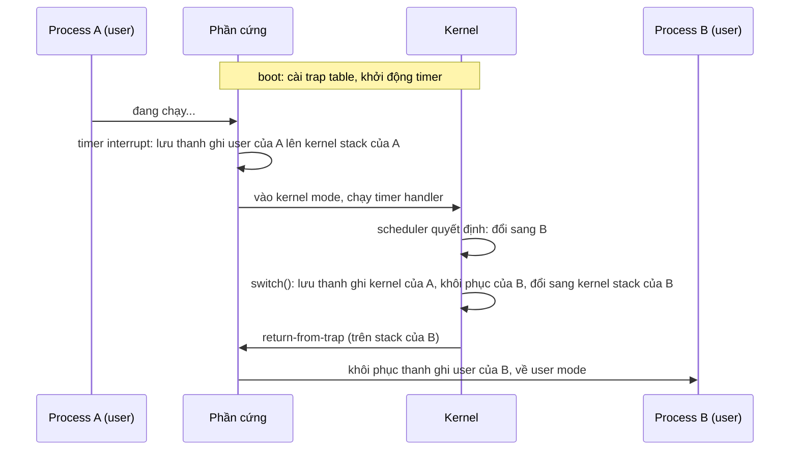

# P1 · Chương 01 — OS và kernel

> Phạm vi: mọi khẳng định về kernel là về **Linux**. Các trang `docs.kernel.org` được trích là bản hiện hành lúc soạn: trang tải về ghi phiên bản 7.3.0-rc6 (bản đang phát triển, không ghim), nên có thể khác kernel 6.x bạn đang chạy. Chỗ nào hai bản khác nhau thì chương nói rõ (ví dụ bit chọn TTBR ở mục 7, chế độ `preempt=lazy` ở §5.4), và chỗ cần ghim thì dùng source tag `v6.8`. Mô hình trap, timer và context switch của OSTEP là mô hình khái niệm, không phải mô tả từng bước của Linux. Ví dụ "đã chạy thật" chạy trong container lab (`./labs/linux.sh`, aarch64, kernel 6.8, `rustc 1.95.0`); kết quả là *quan sát* một lần chạy, không phải bảo đảm của tài liệu.

## Bạn sẽ hiểu được gì

1. **Q1.** Hệ điều hành (OS) làm gì cho chương trình của bạn, và "ba trụ cột" virtualization / concurrency / persistence là gì? → mục 1
2. **Q2.** Nhiều process dùng chung một CPU mà vẫn chạy nhanh và không phá nhau được là nhờ cơ chế nào (limited direct execution)? → mục 2
3. **Q3.** User mode khác kernel mode ở đâu; Linux dùng những mức đặc quyền nào trên AArch64 và x86-64? → mục 3
4. **Q4.** Trap, trap table, interrupt và exception là gì; một sự kiện đi từ lúc xảy ra đến lúc kernel chạy handler rồi quay về thế nào? → mục 4
5. **Q5.** Nếu một process lặp vô hạn mà không gọi kernel, OS lấy lại CPU bằng cách nào (timer interrupt, preemption)? Context switch về mặt khái niệm là gì? → mục 5
6. **Q6.** Linux kernel gồm những phân hệ chính nào? → mục 6
7. **Q7.** Kernel space khác user space ra sao trong bộ nhớ? → mục 7

## Kiến thức cần trước

Chương mở đầu của phase, không cần chương trước. Chỉ cần biết: chương trình là dãy lệnh máy chạy trên CPU; CPU có thanh ghi (register) và program counter (PC). Kiến trúc CPU chi tiết ở phase 2: [`../02-cpu/01-mo-hinh-may-va-isa.md`](../02-cpu/01-mo-hinh-may-va-isa.md). Chương sau: [system call](02-system-call.md), [process](03-process.md), [file descriptor và VFS](04-file-descriptor-va-vfs.md), [signal](05-signal.md), [user, quyền, /proc, /sys](06-user-quyen-proc-sys.md), [Rust trên giao diện hệ thống](07-rust-tren-giao-dien-he-thong.md).

---

## 1. OS là gì và ba trụ cột (Q1)

> **Trả lời ngắn.** OS (hệ điều hành) biến CPU, bộ nhớ và đĩa thật thành những phiên bản "ảo" dễ dùng hơn cho chương trình[^os-virt], đồng thời quản lý việc nhiều chương trình chia sẻ các tài nguyên đó[^os-resmgr]. OSTEP chia công việc của OS thành ba chủ đề lớn: virtualization (ảo hóa tài nguyên), concurrency (các vấn đề phát sinh khi nhiều việc chạy cùng lúc) và persistence (giữ dữ liệu bền qua mất điện hay crash)[^os-themes].

**Giải thích.**

Hình dung (nhận xét của người soạn): OS giống ban quản lý một tòa nhà văn phòng. Mỗi công ty thuê tầng thấy như mình có cả tòa nhà, còn ban quản lý lo điện nước, khóa cửa và chia sẻ thang máy sao cho công ty này không phá việc của công ty kia.

### 1.1 Vấn đề: một máy, rất nhiều chương trình

Máy có vài core CPU, một khối RAM, vài thiết bị lưu trữ và mạng. Trên đó cùng lúc có database, service, shell… Mỗi chương trình được viết như thể nó là chủ của máy: muốn một CPU, một vùng nhớ riêng, đọc ghi file. Ta lại không muốn chương trình này làm hỏng chương trình kia, càng không để nó làm hỏng cả máy.

OSTEP (*Operating Systems: Three Easy Pieces*, sách giáo khoa mở) trả lời bằng ý tưởng trung tâm: OS lấy một tài nguyên vật lý (bộ xử lý, bộ nhớ, đĩa) và biến nó thành một dạng "ảo" tổng quát, mạnh và dễ dùng hơn[^os-virt]. Để chương trình ra lệnh cho OS, OS cung cấp các giao diện (API) mà chương trình gọi được; một OS điển hình xuất ra vài trăm *system call* (lời gọi vào OS) cho ứng dụng[^os-syscalls]. Vì nhiều chương trình cùng chia sẻ CPU, bộ nhớ, đĩa, OS còn được gọi là *resource manager*[^os-resmgr].

### 1.2 Ba trụ cột

| Trụ cột | Câu hỏi | Ở đâu trong giáo trình |
|---|---|---|
| **Virtualization** | Làm sao nhiều chương trình chia sẻ CPU và RAM mà vẫn "thấy" tài nguyên riêng? | CPU: chương này. Bộ nhớ: [`../03-memory/01-address-space.md`](../03-memory/01-address-space.md). |
| **Concurrency** | Chuyện gì xảy ra khi nhiều việc chạy xen kẽ trên dữ liệu chung? | Phase 4: [`../04-concurrency/01-thread.md`](../04-concurrency/01-thread.md). Chương này chỉ chạm tới ở §4.5. |
| **Persistence** | Làm sao dữ liệu sống sót qua mất điện, crash? | Phase 5 (storage); ở phase này: [file descriptor](04-file-descriptor-va-vfs.md). |

OSTEP dùng "concurrency" cho một loạt vấn đề phát sinh, và phải được giải quyết, khi làm nhiều việc cùng lúc trong cùng một chương trình[^os-conc]. "Persistence": DRAM lưu giá trị kiểu volatile nên mất điện hay crash là mất dữ liệu trong bộ nhớ, vì vậy cần phần cứng và phần mềm để lưu dữ liệu bền[^os-persist].

### 1.3 Hai mục tiêu kéo ngược chiều

- **Hiệu năng**: OSTEP đặt mục tiêu giảm overhead của OS[^os-perf].
- **Bảo vệ**: hành vi xấu cố ý hay vô ý của một chương trình không được hại chương trình khác[^os-prot]; nền tảng là *isolation* giữa các process[^os-isolation].

Phần cơ chế CPU của OSTEP đặt bài toán gần với hai mục tiêu trên: ảo hóa CPU một cách hiệu quả mà vẫn giữ quyền kiểm soát hệ thống[^lde-crux]. Các mục 2–5 của chương này là lời giải cho bài toán đó (nhận xét của người soạn).

Chương này nói về *mechanism* — cách chuyển quyền điều khiển, cách lấy lại CPU — còn *policy* — chọn process nào chạy — là việc của scheduler, [`../04-concurrency/02-scheduling.md`](../04-concurrency/02-scheduling.md). OSTEP phân biệt hai thứ này bằng hai câu hỏi: mechanism trả lời câu "how" (ví dụ context switch được thực hiện thế nào), policy trả lời câu "which" (ví dụ chạy process nào ngay bây giờ)[^mech-policy].

<details><summary>Đi sâu: OS không tạo "đĩa ảo riêng" cho từng ứng dụng</summary>

Khác với CPU và bộ nhớ, OS **không** tạo một đĩa ảo riêng cho từng ứng dụng, vì người dùng thường muốn chia sẻ thông tin qua file[^os-nopriv-disk].

</details>

**Quay lại Q1:** OS ảo hóa tài nguyên vật lý và quản lý việc chia sẻ; ba trụ cột là virtualization, concurrency, persistence, và các mục sau tìm cách cân bằng giữa hiệu năng và bảo vệ.

---

## 2. Ảo hóa CPU và limited direct execution (Q2)

> **Trả lời ngắn.** OS cho các process (chương trình đang chạy) thay phiên dùng CPU, tạo ảo giác mỗi process có một CPU riêng[^virt-cpu]. Để vừa nhanh vừa kiểm soát được, process chạy thẳng trên CPU (*direct execution*), nên nhanh như mong đợi[^direct-fast], nhưng bị giới hạn: nếu không có giới hạn thì OS không kiểm soát được gì và chỉ còn là một thư viện thông thường[^lde-lib]. Cách làm này gọi là *limited direct execution*; các mục 3–5 cho thấy giới hạn đó cụ thể là gì.

**Giải thích.**

Hình dung (nhận xét của người soạn): nhiều nhóm dùng chung một phòng họp. Mỗi nhóm vào là làm việc ở tốc độ bình thường (direct), nhưng chuông báo hết giờ nằm trong tay quản lý (limited), nên nhóm nào cũng phải ra khi tới lượt nhóm khác.

### 2.1 Time sharing

Chỉ có vài CPU vật lý mà muốn chạy rất nhiều process. Kỹ thuật cơ bản là *time sharing*: cho một thực thể dùng tài nguyên một lúc, rồi đến thực thể khác, nhờ vậy nhiều bên dùng chung một tài nguyên[^timeshare-def]. Đơn vị OS chạy là *process*, "một chương trình đang chạy"[^process-def]. Bằng cách chạy một process, dừng nó, chạy process khác…, OS tạo ảo giác có nhiều CPU ảo dù chỉ có một CPU vật lý (hoặc vài cái)[^virt-cpu]. Process được mổ xẻ ở [Chương 03](03-process.md).

### 2.2 Nhanh mà vẫn kiểm soát được

OSTEP đặt bài toán là ảo hóa CPU sao cho vừa hiệu quả vừa giữ được quyền kiểm soát hệ thống[^lde-crux]. Lời giải bắt đầu bằng *direct execution*: chạy thẳng chương trình trên CPU, nên chương trình chạy native và nhanh như mong đợi[^direct-fast]. Nhưng chạy thẳng đẻ ra hai vấn đề: (1) làm sao cho chương trình làm được việc đặc quyền — ví dụ gửi yêu cầu I/O tới đĩa — mà không trao toàn quyền với máy[^restricted-op]; (2) làm sao dừng process đang chạy để chuyển sang process khác, tức lấy lại CPU khi chương trình không chịu trả[^lde-problems].

Cách chữa gọi là **limited direct execution** (LDE): "direct" để nhanh, "limited" vì nếu không có giới hạn thì OS không kiểm soát được gì và chỉ còn là một thư viện thông thường[^lde-lib]. §3–§4 giải vấn đề (1); §5 giải vấn đề (2).

<details><summary>Đi sâu: space sharing và context switch</summary>

Đối lập với time sharing là *space sharing*, chia tài nguyên theo không gian[^spaceshare-def]. Cơ chế dừng chương trình này, chạy chương trình kia là *context switch* (§5.3), được mọi OS hiện đại dùng[^ctxsw-modern].

</details>

**Quay lại Q2:** chương trình chạy thẳng trên CPU cho nhanh, còn quyền kiểm soát được giữ bằng chế độ đặc quyền (§3–§4) và timer (§5).

---

## 3. User mode, kernel mode và mức đặc quyền (Q3)

> **Trả lời ngắn.** CPU có ít nhất hai chế độ: user mode, nơi code bị hạn chế, và kernel mode, nơi OS chạy và làm được mọi thứ kể cả thao tác đặc quyền[^two-modes][^kernel-mode]. Mỗi kiến trúc đặt tên mức đặc quyền riêng: trên AArch64, user space chạy ở exception level EL0 còn kernel được vào ở EL2 hoặc EL1[^arm-el0-user][^arm-boot]; trên x86-64, kernel chạy ở mức đặc quyền 0 (CPL0) còn user ở mức 3[^x86-cpl0][^x86-user-rpl].

**Giải thích.**

Hình dung (nhận xét của người soạn): phòng máy chủ trong công ty có khóa thẻ. Ai cũng vào được sảnh, nhưng chỉ thẻ đặc biệt mới mở được phòng máy, và ổ khóa là phần cứng chứ không phải lời hứa của nhân viên.

### 3.1 Hai chế độ

Phần cứng cung cấp các chế độ thực thi; OSTEP nêu rằng CPU nên hỗ trợ tối thiểu hai chế độ: một user mode bị hạn chế và một kernel mode đặc quyền[^two-modes]. Ở *user mode*, code bị hạn chế trong việc được làm[^user-mode]. Ở *kernel mode*, nơi OS chạy, code "làm được những gì nó muốn", kể cả thao tác đặc quyền như phát yêu cầu I/O[^kernel-mode]. Nếu user mode cố làm việc đặc quyền, bộ xử lý phát một *exception* (sự kiện báo cho OS biết chương trình vừa làm điều không hợp lệ, xem §4.3) và OS nhiều khả năng sẽ giết process[^user-exception].

Chế độ là **trạng thái của CPU**, không phải của chương trình: cùng một thread, lệnh này ở user mode, sau một lệnh trap thì ở kernel mode[^trap-raise]. Khi thread gọi system call, không có process nào khác "nhận việc": chính thread đó chạy tiếp code kernel với quyền cao hơn, mà docs kernel gọi là *user context* (§4.4)[^ctx-kernel-ctx][^user-context].

### 3.2 Mức đặc quyền cụ thể

"User/kernel mode" là cách nói khái niệm; mỗi kiến trúc đặt tên khác nhau. Bảng dưới chỉ ghi những gì có nguồn:

| Kiến trúc | User space chạy ở | Kernel chạy ở |
|---|---|---|
| **AArch64** | EL0[^arm-el0-user] | EL1 hoặc EL2: lúc boot, kernel được vào ở EL2 (khuyến nghị) hoặc EL1[^arm-boot]; với KVM và Virtualization Host Extensions (VHE), kernel host chạy trực tiếp ở EL2[^arm-vhe] |
| **x86-64** | mức đặc quyền 3[^x86-user-rpl] | mức đặc quyền 0, gọi là CPL0[^x86-cpl0] |

**AArch64.** Tài liệu boot arm64 mô tả mô hình exception gồm các *exception level* EL0–EL3; EL0, EL1, EL2 đều có bản secure và non-secure; EL2 là mức hypervisor (phần mềm chạy máy ảo), EL3 là mức ưu tiên cao nhất và chỉ có ở secure mode; EL2 và EL3 là tùy chọn về kiến trúc[^arm-levels]. Vì thế "kernel chạy ở EL1" chỉ đúng một phần: khi dùng KVM với VHE, kernel host chạy trực tiếp ở EL2[^arm-vhe]. Phía thấp hơn: docs arm64 nói về việc truy cập thanh ghi AMU bị bẫy "từ EL0 (userspace) tới EL1 (kernel)"[^arm-el0-user], tức EL0 là mức của user space (chỉ là chứng cứ gián tiếp; docs không có định nghĩa riêng cho EL0).

**x86-64.** Theo sách hướng dẫn lập trình hệ thống của Intel, bộ xử lý nhận ra 4 mức đặc quyền đánh số 0–3, số càng lớn càng ít đặc quyền[^sdm-levels], nên mức 0 là mức đặc quyền cao nhất. Vòng bảo vệ trong cùng dành cho phần mềm lõi, thường là kernel của OS, và hệ thống chỉ dùng 2 mức thì nên dùng mức 0 và 3[^sdm-rings]. *CPL* (current privilege level) là mức của chương trình đang chạy[^sdm-cpl]. Linux khớp với cách dùng hai mức này: source ghi rõ user mode là privilege level 3[^x86-user-rpl], và docs kernel nhắc "CPL0" khi giải thích tên thanh ghi `MSR_KERNEL_GS_BASE`: có thể hiểu đó là cách kernel truy cập `GS.base`, vì các thanh ghi MSR chỉ truy cập được ở CPL0[^x86-cpl0]. Kết luận "kernel chạy ở CPL0" là suy ra từ hai chỗ đó (suy luận của người soạn): docs đã tải không có câu nào nói thẳng như vậy.

### 3.3 Vì sao phần cứng phải hỗ trợ

Không có phần cứng kiểm tra thì "kernel mode" chỉ là lời hứa (nhận xét của người soạn). OSTEP lấy trap table làm ví dụ: lệnh báo cho phần cứng biết trap table nằm ở đâu là một khả năng rất mạnh[^trap-table-priv], nên nó là thao tác đặc quyền — chạy ở user mode thì phần cứng không cho[^hw-wont-let]; khởi động timer cũng là thao tác đặc quyền[^timer-priv]. Trên x86 đây là quy tắc cụ thể: lệnh đặc quyền chỉ chạy được khi CPL bằng 0, ở mức khác thì CPU phát exception #GP[^sdm-privileged]. Nếu user code cài được trap table của mình thì nó chiếm được máy (suy luận của người soạn, từ câu hỏi "point to ponder" của OSTEP).

<details><summary>Đi sâu: lệnh vào kernel, và khi kernel không ở EL1 hay mức 0</summary>

Lệnh vào kernel khác nhau: arm64 dùng `svc #0`, x86-64 dùng `syscall`[^sc-table-arm64][^sc-table-x86]; chi tiết ở [Chương 02](02-system-call.md).

Quy ước "kernel ở EL1" hay "kernel ở mức 0" có ngoại lệ. Trên arm64, kernel host của KVM có VHE chạy ở EL2 (bảng ở §3.2). Trên x86, ghi chú trong source Linux `v6.8` nói khi chạy làm guest Xen PV (một kiểu ảo hóa) thì mức đặc quyền thật của kernel là 1 chứ không phải 0[^xen-pv], và mức 2 không bao giờ được dùng[^x86-level2] (chi tiết cài đặt của `v6.8`, có thể đổi). Vì vậy "kernel = EL1" hay "kernel = ring 0" là trường hợp thường gặp chứ không phải định nghĩa (nhận xét của người soạn).

</details>

**Quay lại Q3:** user mode bị hạn chế, kernel mode không; phần cứng ép ranh giới đó, và mỗi kiến trúc đặt tên mức đặc quyền khác nhau (AArch64: user ở EL0, kernel ở EL1 hoặc EL2; x86-64: user ở mức 3, kernel ở mức 0).


---

## 4. Trap, trap table, interrupt và exception (Q4)

> **Trả lời ngắn.** Để dùng dịch vụ của kernel, chương trình chạy một lệnh đặc biệt gọi là *trap*: lệnh này đồng thời nhảy vào kernel và nâng quyền lên kernel mode[^trap-instr][^trap-raise]. Chương trình không tự chọn nơi nhảy tới; kernel đã đặt sẵn lúc boot trong *trap table*, tức bảng ghi "sự kiện nào thì chạy đoạn code (handler) nào"[^trap-table][^no-jump]. Ngoài system call, hai nguồn sự kiện khác cũng đưa CPU vào kernel: *exception* (chương trình làm điều không hợp lệ) và *interrupt* (thiết bị phần cứng báo tin)[^trap-events][^illegal-ops]. Xong việc, lệnh *return-from-trap* đưa CPU về user mode, chạy tiếp chương trình[^return-trap].

**Giải thích.**

Hình dung (nhận xét của người soạn): quầy lễ tân của tòa nhà. Bạn không tự vào kho; bạn bấm chuông xin dịch vụ (trap), lễ tân làm theo quy trình tòa nhà đặt sẵn (handler trong trap table), rồi trả bạn về chỗ cũ. Chuông cửa từ ngoài (interrupt) có thể reo bất cứ lúc nào, không do bạn bấm.

### 4.1 Vào kernel: lệnh trap

User code không thể gọi kernel bằng lệnh nhảy thường: nếu process chỉ định được địa chỉ, nó nhảy vào bất cứ đâu trong kernel, và OSTEP gọi đó là một ý tưởng rất tệ[^no-jump]. Thay vào đó, để thực thi system call, chương trình chạy một lệnh *trap* đặc biệt[^trap-instr]; lệnh này đồng thời nhảy vào kernel và nâng đặc quyền lên kernel mode[^trap-raise]. OSTEP tóm gọn tác dụng của lệnh trap: lưu cẩn thận trạng thái thanh ghi, đổi phần cứng sang kernel mode và nhảy tới một đích định sẵn là trap table[^trap-summary]. Xong việc, OS chạy lệnh *return-from-trap* để quay về chương trình gọi và hạ đặc quyền về user mode[^return-trap].

Phần cứng phải lưu đủ các thanh ghi của chương trình gọi để quay về đúng[^hw-save-trap]. Ví dụ x86 của OSTEP: bộ xử lý đẩy program counter, flags (thanh ghi cờ trạng thái) và vài thanh ghi lên một *kernel stack* (stack dùng khi chạy code kernel) riêng của process; `return-from-trap` lấy chúng ra để chạy tiếp[^kstack]. Docs kernel nói thêm về Linux x86-64: giống mọi kiến trúc khác, mỗi thread đang hoạt động có một kernel stack, và stack này trống (trừ `thread_info` ở đáy) khi thread ở user space[^x86-kstack]. (Mô hình OSTEP là một kernel stack mỗi process; Linux gắn kernel stack với từng thread.)

### 4.2 Trap table: ai quyết định nhảy tới đâu

Kernel quyết định. Lúc boot máy ở chế độ đặc quyền nên kernel cấu hình được phần cứng; một trong những việc đầu tiên là báo phần cứng chạy code nào khi có các sự kiện đặc biệt[^trap-table], ví dụ ngắt đĩa, ngắt bàn phím, hay chương trình gọi system call[^trap-events]. Bảng "sự kiện → handler" là *trap table*. Phần cứng nhớ vị trí các handler cho tới lần khởi động lại sau[^trap-remember].

Để biết chương trình xin dịch vụ nào, mỗi system call thường được gán một số hiệu; user code đặt số này vào thanh ghi (hoặc vị trí quy định trên stack), kernel đọc số, kiểm tra hợp lệ rồi chạy code tương ứng[^syscall-num]. Đây là một dạng bảo vệ: user code không chỉ định địa chỉ cụ thể mà chỉ xin dịch vụ theo số[^syscall-protect]. Trên Linux, code vào syscall phía kernel bắt đầu bằng assembly, dựng trạng thái rồi gọi vào code C mức thấp[^entry-syscall]; phía user (lệnh trap, thanh ghi, số hiệu theo kiến trúc) xem [Chương 02](02-system-call.md) mục 2. Trap table trên phần cứng thật trông ra sao: xem §4.6.

### 4.3 Ba nguồn sự kiện

Cả ba đều đưa CPU vào kernel mode để chạy một handler, khác nhau ở nguyên nhân:

| Nguồn | Ai gây ra | Ví dụ (từ nguồn) |
|---|---|---|
| **System call** | Chương trình, chủ động, bằng lệnh trap | Chương trình thực hiện system call[^trap-events] |
| **Exception** | Chương trình đang chạy làm điều không hợp lệ | I/O ở user mode → exception[^user-exception]; làm điều bất hợp lệ cũng chuyển quyền cho OS[^illegal-ops]; trên x86, chạy lệnh đặc quyền khi CPL khác 0 → exception #GP[^sdm-privileged]; chia cho 0[^sdm-exc] |
| **Interrupt** | Thiết bị phần cứng, vào lúc chương trình không quyết định | Ngắt đĩa, bàn phím[^trap-events]; ngắt timer (§5); timer tick, card mạng, bàn phím tạo ngắt bất cứ lúc nào[^irq-anytime] |

Docs kernel định nghĩa *IRQ* là yêu cầu ngắt từ một thiết bị[^irq-def]. Intel định nghĩa hai khái niệm phần cứng này như sau: interrupt xảy ra vào những thời điểm ngẫu nhiên trong lúc chương trình chạy, để đáp lại tín hiệu từ phần cứng[^sdm-intr]; exception xảy ra khi bộ xử lý phát hiện một điều kiện lỗi trong lúc thực thi một lệnh, ví dụ chia cho 0[^sdm-exc].

Lưu ý thuật ngữ: trong tài liệu Intel, exception còn được chia thành fault, trap và abort tùy cách báo cáo và việc lệnh gây lỗi có chạy lại được không[^sdm-class]; ở đó "trap" là *một loại exception*, được báo ngay sau lệnh gây ra nó, và địa chỉ quay về trỏ tới lệnh kế tiếp[^sdm-trap]. Chương này theo nghĩa của OSTEP: *trap* là lệnh đặc biệt chuyển từ user sang kernel[^trap-instr]; đừng nhầm với nghĩa hẹp của Intel.

Exception không phải lúc nào cũng dẫn tới việc process bị giết: Intel xếp page fault vào loại fault[^sdm-pf], tức exception có thể sửa được rồi chạy lại chương trình mà không mất gì[^sdm-fault]; chi tiết page fault ở [Phase 3](../03-memory/04-page-fault-va-swapping.md).

Điểm đáng nhớ: ngắt có thể đến bất cứ lúc nào[^irq-anytime], nên phần cứng phải lưu đủ trạng thái của chương trình đang chạy để sau đó `return-from-trap` chạy tiếp đúng chỗ, y như với syscall tường minh[^hw-save-int]. Intel mô tả cùng ý: khi handler chạy xong, bộ xử lý chạy tiếp thủ tục bị ngắt[^sdm-resume].

<details><summary>Đi sâu: các ngữ cảnh CPU trong kernel, ngắt lồng nhau và trap table thật</summary>

### 4.4 CPU có thể đang ở ngữ cảnh nào

Hướng dẫn hacking của kernel: ở một thời điểm, mỗi CPU đang ở một trong các trạng thái: phục vụ hardware interrupt (không gắn với process nào)[^ctx-hardirq]; phục vụ softirq hoặc tasklet (phần việc xử lý ngắt được hoãn lại, xem §4.5), cũng không gắn với process nào[^ctx-softirq]; chạy trong kernel space gắn với một process, gọi là *user context*[^ctx-kernel-ctx]; hoặc chạy process trong user space[^ctx-user]. Có thứ bậc: hai cấp dưới cùng (user context và user space) preempt lẫn nhau (*preempt* là giành CPU từ bên đang chạy, xem §5.2), còn lên trên thì mỗi cấp chỉ bị cấp cao hơn preempt[^ctx-hierarchy]. User context là khi kernel chạy vì process vào từ system call hoặc trap khác; nó có thể bị preempt và có thể ngủ bằng cách gọi `schedule()`[^user-context].

Nghĩa là khi bạn gọi `read()`, code kernel chạy *trong user context của chính process bạn*, trên kernel stack của thread bạn, rồi mới quay về[^user-context][^x86-kstack]. Ngoại lệ là ngắt phần cứng: docs kernel x86-64 nói ngoài stack của từng thread còn có các stack chuyên dụng gắn với từng CPU[^x86-cpustacks], và ngắt phần cứng ngoài đầu tiên (không lồng nhau) được xử lý trên một *interrupt stack* riêng, kernel chuyển từ task hiện tại sang stack đó[^x86-irqstack].

### 4.5 Ngắt khi đang ở kernel

Nếu trong lúc xử lý syscall lại có timer interrupt, hoặc đang xử lý ngắt thì có ngắt khác tới thì sao? OSTEP nói đây chính là chủ đề của phần concurrency[^conc-defer]. Một cách đơn giản: tắt ngắt khi đang xử lý ngắt, để một ngắt đang được xử lý thì không có ngắt khác chuyển tới CPU[^irq-disable], nhưng tắt quá lâu có thể làm mất ngắt[^irq-lost]. Docs hacking của Linux mô tả một biến thể: handler ngắt phần cứng không bị chạy lồng chính nó, và vì nó tắt ngắt nên phải nhanh — thường chỉ báo đã nhận ngắt, đánh dấu một "software interrupt" rồi thoát[^hardirq-fast]. Phần việc xử lý ngắt thật sự nằm ở lớp softirq, chạy sau ngắt phần cứng[^softirq-work].

### 4.6 Trap table trên phần cứng thật

"Trap table" là tên khái niệm của OSTEP; mỗi kiến trúc có bảng riêng. Trên x86, mỗi exception hay interrupt có một *vector number*; bộ xử lý dùng số đó làm chỉ số vào *interrupt descriptor table* (IDT), bảng cho biết điểm vào của handler tương ứng[^sdm-idt]. Trên arm64, source Linux `v6.8` có bảng `vectors`; mỗi mục ghi loại sự kiện (Synchronous, IRQ, FIQ, Error) và nơi nó xuất phát, ví dụ nhóm đầu của bảng cho ngữ cảnh EL1t[^arm-vectors] và nhóm bốn mục cho code 64-bit chạy ở EL0[^arm-vectors-el0]. Các nguồn trên không nói lệnh `syscall` hay `svc` tìm ra handler của system call bằng cách nào; đó là chi tiết riêng của từng kiến trúc mà giáo trình không khẳng định. Lệnh và thanh ghi dùng khi gọi system call ở mỗi kiến trúc: xem [Chương 02](02-system-call.md).

</details>

**Quay lại Q4:** sự kiện (syscall, exception, interrupt) làm CPU nhảy tới handler do kernel đặt trong trap table, phần cứng lưu trạng thái, và return-from-trap quay về đúng chỗ.

---

## 5. Lấy lại CPU: timer interrupt, preemption và context switch (Q5)

> **Trả lời ngắn.** Process không chịu nhường CPU thì OS vẫn lấy lại được nhờ *timer interrupt*: một bộ đếm giờ phần cứng (timer device) được lập trình để cứ vài mili giây lại phát một ngắt, buộc CPU dừng process đang chạy và chạy đoạn code xử lý (handler) của OS[^timer][^timer-tip]. Khi OS đã nắm lại CPU, *scheduler* — phần của OS chọn process chạy tiếp — quyết định có đổi process hay không[^sched-decision]; nếu đổi thì OS chạy *context switch*: lưu thanh ghi của process cũ và khôi phục thanh ghi của process mới[^ctxsw].

**Giải thích.**

Hình dung (nhận xét của người soạn): cuộc họp có người bấm giờ. Ai nói quá lâu thì chuông reo và phải nhường, dù chưa muốn; nếu chỉ trông chờ mọi người tự giác dừng thì một người nói mãi sẽ chặn cả buổi họp.

### 5.1 Cooperative: tin vào process

Cách *cooperative* tin rằng process chạy quá lâu sẽ định kỳ nhường CPU[^coop], ví dụ qua system call, hoặc qua một syscall `yield` chỉ để chuyển quyền cho OS[^yield]. OS lấy lại quyền khi chương trình gọi syscall hoặc làm điều bất hợp lệ[^coop-wait]. Nhược điểm: process kẹt vòng lặp vô hạn không bao giờ trả CPU, và OSTEP nói thẳng cách duy nhất khi đó là khởi động lại máy[^coop-reboot].

### 5.2 Timer interrupt

Lời giải: một *timer device* được lập trình để phát ngắt sau mỗi vài mili giây; khi ngắt phát, process đang chạy bị dừng và một interrupt handler đã đăng ký sẵn trong OS chạy[^timer]. Đến đây OS đã nắm lại CPU và có thể làm điều nó muốn, kể cả dừng process hiện tại để chạy process khác[^timer]. Nhờ timer interrupt, OS chạy lại được trên CPU ngay cả khi process không hợp tác[^timer-tip]. Việc OS chủ động dừng một process đang chạy để chạy process khác như vậy gọi là **preemption** (trưng dụng CPU): OSTEP nói hầu hết scheduler hiện đại đều là preemptive, sẵn sàng dừng process này để chạy process khác[^preempt-def]. Thứ tự khởi tạo: OS cài trap table lúc boot, rồi khởi động timer (thao tác đặc quyền[^timer-priv]); từ đó OS yên tâm rằng quyền điều khiển rồi sẽ quay về với nó[^timer-safe].

### 5.3 Context switch ở mức khái niệm

Khi OS nắm lại CPU (qua syscall hoặc timer), *scheduler* quyết định tiếp tục process hiện tại hay đổi[^sched-decision]. Nếu đổi, OS chạy **context switch**: lưu vài giá trị thanh ghi của process đang chạy (ví dụ lên kernel stack của nó) và khôi phục của process sắp chạy từ kernel stack của nó[^ctxsw]. Nhờ vậy khi `return-from-trap` cuối cùng chạy, hệ thống tiếp tục một process khác thay vì process cũ[^ctxsw-return].



Sơ đồ vẽ lại theo Figure 6.3 của OSTEP: khi ngắt timer xảy ra, phần cứng lưu thanh ghi của A lên kernel stack của A và vào kernel mode, rồi trong handler OS quyết định chuyển từ A sang B[^fig63-a]; hàm `switch()` lưu thanh ghi hiện tại vào cấu trúc process của A, khôi phục thanh ghi của B và đổi sang kernel stack của B[^fig63-b]. Đây là mô hình khái niệm của sách, không phải mô tả từng bước của Linux (nhận xét của người soạn).

OSTEP phân biệt hai lần lưu thanh ghi: khi ngắt xảy ra, thanh ghi *user* của A được phần cứng lưu ngầm lên kernel stack của A[^two-saves]; khi OS chuyển A sang B, thanh ghi *kernel* được phần mềm lưu tường minh vào cấu trúc process của A[^two-saves2].

**Chi phí.** OSTEP dẫn công cụ đo lmbench: năm 1996 một system call mất khoảng 4 micro giây và một context switch khoảng 6 micro giây; hệ thống hiện đại tốt hơn gần một bậc độ lớn, với kết quả dưới một micro giây trên CPU 2–3 GHz[^lmbench] (số của sách chỉ để minh họa, không phải số đo trên máy bạn). (Nhận xét của người soạn) Với backend engineer: khi thread chặn trên I/O, nó rời CPU nhờ trap và kernel chạy thread khác; "độ trễ một syscall" trong profile là chi phí chuỗi trap → handler → return-from-trap cộng thời gian việc thật; và nếu số thread sẵn sàng chạy vượt xa số core thì kernel phải chia CPU giữa chúng, tức thêm context switch. Chi tiết lập lịch ở phase 4.

<details><summary>Đi sâu: tick của Linux, preemption mode và quan sát context switch</summary>

### 5.4 Timer trên Linux: tick và preemption mode

Docs kernel gọi ngắt timer định kỳ là *scheduling-clock tick* hay "tick", và có ba cách quản lý[^tick-def] — không bao giờ bỏ tick (`CONFIG_HZ_PERIODIC`)[^tick-periodic], bỏ tick trên CPU idle (`CONFIG_NO_HZ_IDLE`)[^tick-modes], bỏ tick trên CPU idle hoặc chỉ có một task chạy được (`CONFIG_NO_HZ_FULL`)[^tick-full]. Chế độ thứ hai là phổ biến nhất và nên là mặc định[^tick-modes]. Lý do bỏ tick trên CPU rảnh: workload nhẹ với quãng idle dài mà vẫn cứ ngắt sẽ tốn điện quá mức[^tick-power]. Ngược lại, workload có nhiều task dùng CPU theo đợt ngắn thì tắt tick chỉ tăng overhead chuyển vào/ra idle và chuyển user/kernel[^tick-never].

Việc *kernel tự preempt chính nó* cũng có chính sách: tham số boot `preempt=` (với `CONFIG_PREEMPT_DYNAMIC`) có các chế độ `none`, `voluntary`, `full`, `lazy`; ở `full`, mọi đoạn không bị cấm preempt tường minh đều có thể bị preempt bất cứ lúc nào[^preempt-param]. Chế độ `lazy` có trong docs hiện hành, còn docs của `v6.8` chỉ liệt kê `none`, `voluntary` và `full`[^preempt-v68].

### 5.5 Quan sát được: voluntary vs involuntary

Trong `/proc/<pid>/status` có hai trường `voluntary_ctxt_switches` và `nonvoluntary_ctxt_switches`; `proc(5)` chỉ mô tả chung là số lần context switch tự nguyện và không tự nguyện[^proc-ctxt]. Đọc source kernel `v6.8` thì thấy: `/proc` in hai trường này từ hai bộ đếm `nvcsw` và `nivcsw` của task[^proc-ctxt-array][^proc-ctxt-src]; trong `__schedule()`, con trỏ `switch_count` mặc định trỏ tới `nivcsw`, và chỉ khi lần vào scheduler không phải preemption mà task đang ở trạng thái ngủ/chờ (`prev_state` khác 0) thì mới được đổi sang `nvcsw`[^sched-nvcsw] (chi tiết cài đặt của `v6.8`, có thể đổi). Nói gọn (diễn giải của người soạn từ đoạn code đó): voluntary là thread tự rời CPU vì block/ngủ; nonvoluntary là bị kernel lấy lại CPU (preempt). Chương trình Rust dưới đây đọc hai trường ba lần: lúc đầu, sau 2 giây quay vòng liên tục (*spin*) không chủ động gọi syscall nào (chỉ đọc đồng hồ bằng `Instant`, xem mục 8), và sau 100 lần `sleep(1ms)`:

```rust
use std::time::{Duration, Instant};
fn ctxt() -> String {
    std::fs::read_to_string("/proc/self/status").unwrap().lines()
        .filter(|l| l.contains("ctxt_switches")).collect::<Vec<_>>().join(" | ")
}
fn main() {
    println!("start : {}", ctxt());
    let t = Instant::now();
    let mut x = 0u64;
    while t.elapsed() < Duration::from_secs(2) { x = x.wrapping_add(1); }
    println!("spin  : {} (x={})", ctxt(), x > 0);
    for _ in 0..100 { std::thread::sleep(Duration::from_millis(1)); }
    println!("sleep : {}", ctxt());
}
```

Đã chạy thật (rustc 1.95.0 `-O`, container Linux aarch64 của repo, 4 CPU, ghim bằng `taskset -c 0`; một lần chạy, số khác nhau theo máy):

| Kịch bản | nonvoluntary sau 2 giây spin | voluntary sau 100 lần sleep(1ms) |
|---|---|---|
| Một process trên CPU 0 | 1 → 10 | 7 → 107 |
| Hai process spin cùng ghim CPU 0 | 1 → 413 (process kia 0 → 395) | 8 → 108 |

`sleep` 100 lần làm voluntary tăng đúng 100: mỗi lần thread tự rời CPU. Khi hai process spin phải chia một CPU, mỗi process bị lấy CPU khoảng 400 lần trong 2 giây — cỡ vài mili giây một lần — dù vòng lặp không chủ động gọi syscall nào (trên lab, `Instant::now()` không tạo syscall: quan sát ở [Chương 02](02-system-call.md) mục 4, không phải bảo đảm của `std`). Theo suy luận của người soạn, đó là timer interrupt của §5.2 đang làm việc: chương trình không hợp tác mà vẫn bị lấy lại CPU. Đây là quan sát, không phải bảo đảm về độ dài time slice (khoảng thời gian một process được chạy liên tục trước khi bị đổi); kết quả phụ thuộc scheduler, cấu hình, tải. Chạy lại cùng chương trình trong cùng container cho: một process — nonvoluntary 1 → 9 và voluntary tăng 100; hai process spin chung CPU 0 — nonvoluntary 1 → 338 và 1 → 341, lệch cỡ 20% so với con số 413 ở bảng trên, nên đừng dựa vào con số tuyệt đối.

</details>

**Quay lại Q5:** timer interrupt buộc CPU quay về kernel dù process không hợp tác, rồi scheduler chọn và context switch đổi process.


---

## 6. Linux kernel và các phân hệ chính (Q6)

> **Trả lời ngắn.** Linux là kernel kiểu Unix, viết lại từ đầu và hướng tới tuân thủ POSIX[^linux-def] (một chuẩn mà man page ghi ở mục `STANDARDS`, xem [Chương 02](02-system-call.md) mục 8). Docs kernel tổ chức theo phân hệ: Memory Management, Scheduler, Timers, Locking, cùng các nhóm networking, storage và human interfaces[^subs-toc][^subs-net-storage]. Đây là cách tài liệu chia, không phải sơ đồ module của source.

**Giải thích.**

Hình dung (nhận xét của người soạn): sơ đồ phòng ban của một công ty. Nó cho bạn biết việc nào do bộ phận nào lo (bộ nhớ, lập lịch, mạng, đĩa) để biết hỏi ở đâu, chứ không phải bản vẽ từng dây điện bên trong.

### 6.1 Linux là gì

README kernel: Linux là bản sao (clone) của Unix, viết lại từ đầu bởi Linus Torvalds cùng một nhóm hacker rải rác trên mạng, hướng tới tuân thủ POSIX và Single UNIX Specification[^linux-def], với multitasking, virtual memory, shared libraries, demand loading, copy-on-write executables và networking IPv4/IPv6[^linux-features].

(Nhận xét của người soạn) "Linux" nói chặt là **kernel**; bản phân phối (Debian, Ubuntu…) thêm thư viện C (glibc/musl), shell, công cụ. Khi code gọi `open()`, nó gọi một procedure trong thư viện C[^libc-call], rồi hàm đó mới trap vào kernel ([Chương 02](02-system-call.md)).

### 6.2 Các phân hệ chính

Trang tài liệu phân hệ của kernel mô tả các "cuốn sách" đi vào chi tiết cách các phân hệ cụ thể hoạt động, từ góc nhìn người phát triển kernel[^subs-intro]. Mục "Core subsystems" liệt kê: Core API, Driver implementer's API guide, Memory Management, Power Management, Scheduler, Timers, Locking; sau đó là nhóm Human interfaces[^subs-toc], rồi các nhóm Networking interfaces (Networking, NetLabel, InfiniBand, MHI), Storage interfaces (Filesystems, Block, CD-ROM, SCSI, TCM, NVMe) và Other subsystems[^subs-net-storage]. Ánh xạ sang giáo trình (của người soạn):

- **Memory Management**: docs mô tả đây là hướng dẫn để hiểu phân hệ quản lý bộ nhớ của Linux[^mm-intro] → phase 3.
- **Scheduler**: docs gồm CFS, EEVDF, deadline scheduling, real-time group scheduling, scheduler statistics…[^sched-toc] → phase 4.
- **Timers**: tick, hrtimer; docs nêu thiết bị sự kiện toàn hệ thống dùng cho periodic tick[^hrt-intro] → §5 ở đây.
- **Filesystems (VFS)**: lớp VFS cho phép nhiều filesystem cùng tồn tại trong kernel[^vfs-intro] → [Chương 04](04-file-descriptor-va-vfs.md).
- **Storage (block, SCSI, NVMe…)** → phase 5; **Networking** → phase 6[^subs-net-storage].

Đây là cách **tài liệu** tổ chức, không nhất thiết là sơ đồ module của source (nguồn không nói vậy).

<details><summary>Đi sâu: kernel chạy ở đâu, và đường vào kernel</summary>

Linux dễ port sang hầu hết kiến trúc 32/64-bit đa dụng miễn có paged MMU (PMMU) và bản port gcc; cũng đã có bản port sang một số kiến trúc không có PMMU, với chức năng bị hạn chế[^linux-portable]. Nó còn chạy được như một *ứng dụng user space* (User-Mode Linux)[^uml] — kernel là một chương trình rất đặc biệt, không phải phép màu (nhận xét của người soạn). Docs kernel mô tả các đường vào kernel của §4 (exception, interrupt, syscall, cùng KVM) trong chung một tài liệu về code entry/exit[^entry-title].

</details>

**Quay lại Q6:** Linux là kernel kiểu Unix; docs của nó chia thành các phân hệ (bộ nhớ, lập lịch, timer, filesystem, mạng, storage…) mà các phase sau lần lượt mở ra.

---

## 7. Kernel space và user space trong bộ nhớ (Q7)

> **Trả lời ngắn.** Mỗi process dùng *địa chỉ ảo* — địa chỉ riêng của process mà OS ánh xạ lên bộ nhớ vật lý[^os-vas]. Trên x86-64, dải địa chỉ ảo thấp là user space, khác nhau ở mỗi process, còn dải cao là kernel space, dùng chung cho mọi process[^x86-user][^x86-kernel]. Kernel không đọc thẳng con trỏ do user đưa mà chép dữ liệu bằng các hàm chuyên dụng[^copy-user].

**Giải thích.**

Hình dung (nhận xét của người soạn): quán cà phê có quầy riêng cho từng bàn và một kho chung phía sau. Khách chỉ thấy bàn mình; nhân viên không tự lục túi khách mà nhận đồ khách đưa tận tay rồi mới xử lý.

Ngoài chế độ CPU (§3), ranh giới còn có chiều bộ nhớ: kernel cũng cần bộ nhớ cho code, dữ liệu và kernel stack (§4.1) của nó, và OSTEP nhấn mạnh không được để một ứng dụng làm hại chính OS[^os-protect-os]. Cơ chế dịch địa chỉ (page table, MMU) ở [`../03-memory/02-address-translation.md`](../03-memory/02-address-translation.md); ở đây chỉ cần bức tranh khái niệm.

**Ý nghĩa thực tế.**

- Mỗi process có bản đồ *user* riêng; vùng *kernel* là chung[^x86-kernel]. Tuy vậy không thể nói tổng quát rằng "khi trap vào kernel, CPU không đổi bảng dịch địa chỉ": trên x86-64 với Page Table Isolation (PTI) bật, process chạy user space bằng một bộ page table riêng, và khi vào kernel qua syscall, interrupt hay exception thì chuyển sang bản "kernel" đầy đủ, khi về user thì chuyển lại[^pti]. PTI bật được lúc biên dịch và tắt được lúc boot[^pti-config]. Phần AArch64 có hai nửa TTBR riêng như trong phần Đi sâu bên dưới, nhưng docs đã tải không nói gì về việc đổi bảng khi trap nên giáo trình không khẳng định.
- Kernel không tin con trỏ do user đưa. OSTEP lấy ví dụ `write()`: nếu user truyền một địa chỉ "xấu" (chẳng hạn nằm trong phần kernel của không gian địa chỉ), OS phải phát hiện và từ chối lời gọi[^bad-addr]. Phía Linux, docs hacking nói con trỏ vào userspace không bao giờ được dereference trực tiếp, dữ liệu phải được chép bằng các hàm chuyên dụng (`get_user`/`put_user`, `copy_to_user`/`copy_from_user`)[^copy-user]. Vì vậy `read(fd, buf, n)` *chép* dữ liệu từ kernel sang `buf`, đó là một lý do chi phí I/O qua syscall có sao chép (suy luận của người soạn).

<details><summary>Đi sâu: layout x86-64, AArch64 và con số theo cấu hình</summary>

**x86-64.** Tài liệu layout bộ nhớ ảo của kernel (bảng cho page table 4 cấp): dải từ `0000000000000000` tới `00007fffffffefff`, ~128 TB, là bộ nhớ ảo của user space, khác nhau cho mỗi address space — docs ghi là `mm`[^x86-user]. Cao hơn là vùng bộ nhớ ảo của kernel space, dùng chung cho mọi process[^x86-kernel], gồm cả direct mapping của toàn bộ bộ nhớ vật lý[^x86-direct]. Giữa hai bên là một hole non-canonical: các bit từ 63 tới bit cao nhất được hiện thực phải được sign-extend (lặp lại bit cao nhất đó), nên nếu diễn giải unsigned thì có khoảng trống giữa user và kernel[^x86-hole].

**AArch64.** AArch64 Linux dùng 3 hoặc 4 cấp bảng dịch với trang 4KB, cho địa chỉ ảo 39-bit (512GB) hoặc 48-bit (256TB), "cho cả user và kernel"[^arm-va]. Docs của `v6.8` ghi địa chỉ user có các bit 63:48 bằng 0 còn địa chỉ kernel có các bit đó bằng 1[^arm-split-v68] — tức dải thấp cho user, dải cao cho kernel, giống x86-64. Việc chọn thanh ghi dịch địa chỉ TTBRx (Translation Table Base Register, thanh ghi trỏ tới bảng dịch địa chỉ) phụ thuộc một bit của địa chỉ ảo: docs hiện hành ghi là bit 55 (source `v6.8` ghi là bit 63[^arm-ttbr-v68], nên đây là chi tiết đổi theo phiên bản); `swapper_pg_dir` chỉ chứa ánh xạ kernel (global), `pgd` của user chỉ chứa ánh xạ user (non-global)[^arm-ttbr]. Nghĩa là hai nửa không gian địa chỉ dùng hai bảng dịch khác nhau (suy ra từ hai câu trên).

Các con số trên là của docs hiện hành tại thời điểm soạn (xem ghi chú phạm vi ở đầu chương) và phụ thuộc cấu hình: với page table 5 cấp, user space nở ra gấp 512 lần, từ 0.125 PB lên 64 PB[^x86-5level]. Hãy nhớ cấu trúc: dải thấp cho user, riêng mỗi process; dải cao cho kernel, chung.

</details>

**Quay lại Q7:** dải thấp là user space riêng mỗi process, dải cao là kernel space chung, và kernel chỉ chạm dữ liệu user qua các hàm chép chuyên dụng.

---

## 8. Liên hệ với Rust

Chương trình Rust được biên dịch trước (ahead-of-time) ra file thực thi[^rs-aot], rồi chạy ở user mode như mọi ứng dụng thông thường[^typical-apps] — đó là *direct execution* của §2.2, và mọi việc đặc quyền đi qua system call (nhận xét của người soạn). Thread của `std` là thread OS: docs `std::thread` nói một chương trình Rust đang chạy gồm một tập native OS thread, mỗi thread có stack riêng[^rs-native-threads]; vì vậy thread nào được chạy do scheduler của kernel quyết định (§5.3), và `std` không có cơ chế preemption riêng (suy luận của người soạn từ câu trên).

Ví dụ ở §5.5 chỉ dùng `std::fs`, `std::thread::sleep` và `Instant`. Docs của `Instant` ghi rằng hiện nay trên UNIX nó dùng `clock_gettime` với `CLOCK_MONOTONIC` (riêng Darwin dùng `CLOCK_UPTIME_RAW`)[^rs-instant-doc], kèm lưu ý rằng danh sách lời gọi này có thể đổi theo thời gian[^rs-instant-disclaimer]. Việc `clock_gettime` có vào kernel hay không là chủ đề vDSO ở [Chương 02](02-system-call.md) mục 4; chương này không khẳng định. Phần Rust thuần (ownership của fd, `io::Error`, `Command`) ở [Chương 07](07-rust-tren-giao-dien-he-thong.md).

---

## Tóm tắt

- OS ảo hóa tài nguyên vật lý thành dạng dễ dùng và quản lý việc chia sẻ[^os-virt][^os-resmgr]; ba chủ đề lớn: virtualization, concurrency, persistence[^os-themes].
- Hai mục tiêu căng nhau: hiệu năng (ít overhead) và bảo vệ (isolation)[^os-perf][^os-isolation].
- Limited direct execution: chương trình chạy native (nhanh) nhưng bị giới hạn bởi chế độ đặc quyền (vấn đề 1) và timer interrupt (vấn đề 2)[^direct-fast][^lde-lib][^timer-tip].
- CPU có ít nhất hai chế độ, user và kernel[^two-modes]. AArch64: user ở EL0, kernel được vào ở EL2 hoặc EL1; x86-64: 4 mức đặc quyền 0–3, kernel ở mức 0 (CPL0), user ở mức 3[^arm-el0-user][^arm-boot][^sdm-levels][^x86-cpl0][^x86-user-rpl].
- User code vào kernel bằng lệnh trap; địa chỉ handler do kernel đặt trong trap table lúc boot (trên x86, bảng cho ngắt và exception là IDT)[^trap-instr][^trap-table][^no-jump][^sdm-idt].
- Ba nguồn sự kiện: system call (chương trình chủ động), exception (chương trình làm điều không hợp lệ), interrupt (thiết bị phần cứng, đến bất cứ lúc nào)[^trap-events][^user-exception][^irq-anytime].
- Timer interrupt giúp OS lấy lại CPU kể cả khi process không hợp tác (preemption); một lần chạy cho thấy hàng trăm nonvoluntary switch trong 2 giây khi hai process spin chung một CPU (§5.5)[^timer][^timer-tip].
- Context switch: lưu thanh ghi process cũ, khôi phục process mới, rồi return-from-trap; việc chọn process là của scheduler[^ctxsw].
- Linux là kernel kiểu Unix, tài liệu theo phân hệ (memory, scheduler, timers, filesystems, networking…)[^linux-def][^subs-toc][^subs-net-storage].
- Dải địa chỉ thấp là user space riêng mỗi process, dải cao là kernel space chung; kernel chép dữ liệu qua `copy_from_user`/`copy_to_user`[^x86-user][^x86-kernel][^copy-user].

---

## Câu hỏi tự kiểm tra

1. Nêu ba trụ cột của OS theo OSTEP.

<details><summary>Đáp án</summary>

OSTEP gọi chúng là ba chủ đề lớn[^os-themes] — virtualization[^os-virt], concurrency[^os-conc], persistence[^os-persist].

</details>

2. "Direct execution" là gì và vì sao chưa đủ?

<details><summary>Đáp án</summary>

Chương trình chạy native nên nhanh[^direct-fast]; nhưng không có giới hạn thì OS không kiểm soát được gì, chỉ còn là một thư viện thông thường[^lde-lib].

</details>

3. Vì sao user code không nhảy thẳng vào địa chỉ trong kernel, và cơ chế thay thế là gì?

<details><summary>Đáp án</summary>

Nhảy tùy ý vào kernel là một ý tưởng rất tệ theo OSTEP[^no-jump]. Thay vào đó chương trình chạy lệnh trap; handler do kernel đặt trong trap table lúc boot[^trap-table]; dịch vụ chọn bằng số hiệu syscall[^syscall-num][^syscall-protect].

</details>

4. Phân biệt system call, exception và interrupt theo nguyên nhân.

<details><summary>Đáp án</summary>

Syscall: chương trình chủ động chạy trap. Exception: chương trình làm điều không hợp lệ, ví dụ I/O ở user mode[^user-exception][^illegal-ops]. Interrupt: thiết bị (đĩa, bàn phím, timer) gây ra vào lúc chương trình không quyết định, có thể đến bất cứ lúc nào[^trap-events][^timer][^irq-anytime].

</details>

5. Phần cứng lưu gì khi trap/ngắt, lưu ở đâu?

<details><summary>Đáp án</summary>

Ví dụ x86 trong OSTEP: PC, flags và vài thanh ghi lên kernel stack của process[^kstack]; docs kernel x86-64: mỗi thread có kernel stack, trống khi thread ở user space[^x86-kstack].

</details>

6. Process lặp `loop {}` không gọi syscall. OS lấy lại CPU thế nào? Nếu chỉ cooperative thì sao?

<details><summary>Đáp án</summary>

Timer device phát ngắt định kỳ, handler của OS chạy[^timer][^timer-tip]. Nếu chỉ cooperative, cách duy nhất là reboot[^coop-reboot].

</details>

7. Vì sao cài trap table và khởi động timer là việc của kernel mode?

<details><summary>Đáp án</summary>

Cả hai là thao tác đặc quyền[^trap-table-priv][^timer-priv]; chạy chúng ở user mode thì phần cứng không cho[^hw-wont-let]. Nếu user code làm được thì chiếm được máy (suy luận của người soạn từ câu hỏi "point to ponder" của OSTEP).

</details>

8. Mô tả hai lần lưu thanh ghi trong một lần timer interrupt dẫn tới đổi process.

<details><summary>Đáp án</summary>

Thanh ghi user của A do phần cứng lưu lên kernel stack của A khi ngắt[^two-saves]; thanh ghi kernel do OS lưu vào cấu trúc process của A khi chuyển sang B[^two-saves2].

</details>

9. Trong §5.5, vì sao `sleep` tăng voluntary còn spin tăng nonvoluntary?

<details><summary>Đáp án</summary>

`proc(5)` chỉ nói có hai loại[^proc-ctxt]. Theo source `v6.8`, `/proc` đọc hai bộ đếm `nvcsw` và `nivcsw`[^proc-ctxt-array]; mặc định tính vào `nivcsw`, chỉ khi task không bị preempt mà đang ngủ/chờ mới tính vào `nvcsw`[^sched-nvcsw]. Vì vậy `sleep` (thread tự rời CPU) tăng voluntary; spin chạy tới khi kernel lấy lại CPU — theo suy luận của người soạn là qua timer interrupt[^timer] — nên tăng nonvoluntary. Quan sát §5.5: +100 voluntary sau 100 sleep; hàng trăm nonvoluntary khi hai process tranh một CPU.

</details>

10. Kernel Linux chạy ở mức đặc quyền nào trên AArch64 và x86-64, còn user space chạy ở mức nào?

<details><summary>Đáp án</summary>

AArch64: vào kernel ở EL2 (khuyến nghị) hoặc EL1, non-secure[^arm-boot]; với KVM + VHE, kernel host chạy ở EL2[^arm-vhe]; user space ở EL0[^arm-el0-user]. x86-64: kernel ở mức 0 (CPL0) và user ở mức 3[^x86-cpl0][^x86-user-rpl]; lệnh đặc quyền chỉ chạy được khi CPL bằng 0[^sdm-privileged].

</details>

11. Kernel space và user space khác nhau thế nào trong layout x86-64?

<details><summary>Đáp án</summary>

User space ~128 TB thấp, khác nhau cho mỗi `mm` (mỗi address space)[^x86-user]; kernel space ở nửa cao, chung cho mọi process[^x86-kernel]; giữa là hole non-canonical do sign extension[^x86-hole].

</details>

12. Vì sao kernel dùng `copy_from_user` thay vì đọc thẳng con trỏ user?

<details><summary>Đáp án</summary>

Vì kernel không được tin con trỏ của user: OSTEP nói địa chỉ "xấu" phải bị phát hiện và từ chối[^bad-addr]; docs hacking nói con trỏ user không bao giờ được dereference trực tiếp, dữ liệu phải chép bằng các hàm đó[^copy-user].

</details>

---

## Đọc thêm

- OSTEP ch.2 *Introduction to Operating Systems* — <https://pages.cs.wisc.edu/~remzi/OSTEP/intro.pdf> — ba trụ cột và mục tiêu thiết kế đầy đủ.
- OSTEP ch.6 *Limited Direct Execution* — <https://pages.cs.wisc.edu/~remzi/OSTEP/cpu-mechanisms.pdf> — nguồn chính của chương, kèm code context switch của xv6.
- OSTEP ch.4 *The Abstraction: The Process* — <https://pages.cs.wisc.edu/~remzi/OSTEP/cpu-intro.pdf> — time sharing và cách tách mechanism khỏi policy.
- OSTEP ch.7 *Scheduling: Introduction* — <https://pages.cs.wisc.edu/~remzi/OSTEP/cpu-sched.pdf> — mục "Preemptive Schedulers": scheduler hiện đại dùng context switch để dừng process này chạy process khác.
- Linux kernel docs, *Entry/exit handling for exceptions, interrupts, syscalls and KVM* — <https://docs.kernel.org/core-api/entry.html> — code vào/ra kernel.
- Linux kernel docs, *Kernel Stacks* (x86) — <https://docs.kernel.org/arch/x86/kernel-stacks.html> — thread stack, interrupt stack, IST.
- Linux kernel docs, *Unreliable Guide To Hacking The Linux Kernel* — <https://docs.kernel.org/kernel-hacking/hacking.html> — các ngữ cảnh hardirq/softirq/user context.
- Linux kernel docs, *NO_HZ* — <https://docs.kernel.org/timers/no_hz.html> — chi tiết tick.
- Linux kernel docs, bản đồ bộ nhớ — <https://docs.kernel.org/arch/arm64/memory.html>, <https://docs.kernel.org/arch/x86/x86_64/mm.html> — đọc cùng [`../03-memory/02-address-translation.md`](../03-memory/02-address-translation.md).
- Linux kernel docs, *Page Table Isolation (PTI)* — <https://docs.kernel.org/arch/x86/pti.html> — vì sao vào kernel có thể đổi bảng dịch địa chỉ trên x86-64.
- Intel SDM Vol. 3A, chương 5 *Protection* (mục 5.5, 5.9) và chương 6 *Interrupt and Exception Handling* — <https://cdrdv2-public.intel.com/782154/253668-sdm-vol-3a.pdf> — mức đặc quyền, CPL, lệnh đặc quyền, định nghĩa interrupt/exception, IDT.
- Tiếp theo: [Chương 02 — System call](02-system-call.md).

---

[^os-virt]: OSTEP, ch.2 Introduction to Operating Systems, §2 — <https://pages.cs.wisc.edu/~remzi/OSTEP/intro.pdf> — "the OS takes a physical resource (such as the processor, or memory, or a disk) and transforms it into a more general, powerful, and easy-to-use virtual form of itself."
[^os-syscalls]: OSTEP, ch.2 Introduction to Operating Systems, §2 — <https://pages.cs.wisc.edu/~remzi/OSTEP/intro.pdf> — "the OS also provides some interfaces (APIs) that you can call. A typical OS, in fact, exports a few hundred system calls that are available to applications."
[^os-resmgr]: OSTEP, ch.2 Introduction to Operating Systems, §2 — <https://pages.cs.wisc.edu/~remzi/OSTEP/intro.pdf> — "the OS is sometimes known as a resource manager."
[^os-conc]: OSTEP, ch.2 Introduction to Operating Systems, §2.3 — <https://pages.cs.wisc.edu/~remzi/OSTEP/intro.pdf> — "We use this conceptual term to refer to a host of problems that arise, and must be addressed, when working on many things at once (i.e., concurrently) in the same program."
[^os-persist]: OSTEP, ch.2 Introduction to Operating Systems, §2.4 — <https://pages.cs.wisc.edu/~remzi/OSTEP/intro.pdf> — "In system memory, data can be easily lost, as devices such as DRAM store values in a volatile manner; when power goes away or the system crashes, any data in memory is lost. Thus, we need hardware and software to be able to store data persistently"
[^os-nopriv-disk]: OSTEP, ch.2 Introduction to Operating Systems, §2.4 — <https://pages.cs.wisc.edu/~remzi/OSTEP/intro.pdf> — "Unlike the abstractions provided by the OS for the CPU and memory, the OS does not create a private, virtualized disk for each application."
[^os-perf]: OSTEP, ch.2 Introduction to Operating Systems, §2.5 — <https://pages.cs.wisc.edu/~remzi/OSTEP/intro.pdf> — "our goal is to minimize the overheads of the OS"
[^os-prot]: OSTEP, ch.2 Introduction to Operating Systems, §2.5 — <https://pages.cs.wisc.edu/~remzi/OSTEP/intro.pdf> — "we want to make sure that the malicious or accidental bad behavior of one does not harm others"
[^os-isolation]: OSTEP, ch.2 Introduction to Operating Systems, §2.5 — <https://pages.cs.wisc.edu/~remzi/OSTEP/intro.pdf> — "isolating processes from one another is the key to protection and thus underlies much of what an OS must do."
[^os-themes]: OSTEP, ch.2 Introduction to Operating Systems, §2.5 — <https://pages.cs.wisc.edu/~remzi/OSTEP/intro.pdf> — "it takes physical resources, such as a CPU, memory, or disk, and virtualizes them. It handles tough and tricky issues related to concurrency. And it stores files persistently, thus making them safe over the long-term."
[^os-vas]: OSTEP, ch.2 Introduction to Operating Systems, §2.2 — <https://pages.cs.wisc.edu/~remzi/OSTEP/intro.pdf> — "Each process accesses its own private virtual address space (sometimes just called its address space), which the OS somehow maps onto the physical memory of the machine."
[^os-protect-os]: OSTEP, ch.2 Introduction to Operating Systems, §2.5 — <https://pages.cs.wisc.edu/~remzi/OSTEP/intro.pdf> — "we certainly don’t want an application to be able to harm the OS itself (as that would affect all programs running on the system)."
[^timeshare-def]: OSTEP, ch.4 The Abstraction: The Process — <https://pages.cs.wisc.edu/~remzi/OSTEP/cpu-intro.pdf> — "Time sharing is a basic technique used by an OS to share a resource. By allowing the resource to be used for a little while by one entity, and then a little while by another, and so forth, the resource in question (e.g., the CPU, or a network link) can be shared by many."
[^spaceshare-def]: OSTEP, ch.4 The Abstraction: The Process — <https://pages.cs.wisc.edu/~remzi/OSTEP/cpu-intro.pdf> — "The counterpart of time sharing is space sharing, where a resource is divided (in space) among those who wish to use it."
[^process-def]: OSTEP, ch.4 The Abstraction: The Process — <https://pages.cs.wisc.edu/~remzi/OSTEP/cpu-intro.pdf> — "The abstraction provided by the OS of a running program is something we will call a process."
[^virt-cpu]: OSTEP, ch.4 The Abstraction: The Process — <https://pages.cs.wisc.edu/~remzi/OSTEP/cpu-intro.pdf> — "The OS creates this illusion by virtualizing the CPU. By running one process, then stopping it and running another, and so forth, the OS can promote the illusion that many virtual CPUs exist when in fact there is only one physical CPU (or a few)."
[^ctxsw-modern]: OSTEP, ch.4 The Abstraction: The Process — <https://pages.cs.wisc.edu/~remzi/OSTEP/cpu-intro.pdf> — "which gives the OS the ability to stop running one program and start running another on a given CPU; this time-sharing mechanism is employed by all modern OSes."
[^mech-policy]: OSTEP, ch.4 The Abstraction: The Process — <https://pages.cs.wisc.edu/~remzi/OSTEP/cpu-intro.pdf> — "You can think of the mechanism as providing the answer to a how question about a system; for example, how does an operating system perform a context switch? The policy provides the answer to a which question; for example, which process should the operating system run right now?"
[^direct-fast]: OSTEP, ch.6 Mechanism: Limited Direct Execution — <https://pages.cs.wisc.edu/~remzi/OSTEP/cpu-mechanisms.pdf> — "Direct execution has the obvious advantage of being fast; the program runs natively on the hardware CPU and thus executes as quickly as one would expect."
[^lde-lib]: OSTEP, ch.6 Mechanism: Limited Direct Execution — <https://pages.cs.wisc.edu/~remzi/OSTEP/cpu-mechanisms.pdf> — "without limits on running programs, the OS wouldn’t be in control of anything and thus would be “just a library”"
[^lde-crux]: OSTEP, ch.6 Mechanism: Limited Direct Execution — <https://pages.cs.wisc.edu/~remzi/OSTEP/cpu-mechanisms.pdf> — "The OS must virtualize the CPU in an efficient manner while retaining control over the system. To do so, both hardware and operating-system support will be required."
[^lde-problems]: OSTEP, ch.6 Mechanism: Limited Direct Execution — <https://pages.cs.wisc.edu/~remzi/OSTEP/cpu-mechanisms.pdf> — "The first is simple: if we just run a program, how can the OS make sure the program doesn’t do anything that we don’t want it to do, while still running it efficiently? The second: when we are running a process, how does the operating system stop it from running and switch to another process, thus implementing the time sharing we require to virtualize the CPU?"
[^restricted-op]: OSTEP, ch.6 Mechanism: Limited Direct Execution — <https://pages.cs.wisc.edu/~remzi/OSTEP/cpu-mechanisms.pdf> — "But running on the CPU introduces a problem: what if the process wishes to perform some kind of restricted operation, such as issuing an I/O request to a disk, or gaining access to more system resources such as CPU or memory?"
[^user-mode]: OSTEP, ch.6 Mechanism: Limited Direct Execution — <https://pages.cs.wisc.edu/~remzi/OSTEP/cpu-mechanisms.pdf> — "known as user mode; code that runs in user mode is restricted in what it can do."
[^two-modes]: OSTEP, ch.6 Mechanism: Limited Direct Execution, Aside: Key CPU Virtualization Terms — <https://pages.cs.wisc.edu/~remzi/OSTEP/cpu-mechanisms.pdf> — "The CPU should support at least two modes of execution: a restricted user mode and a privileged (non-restricted) kernel mode."
[^typical-apps]: OSTEP, ch.6 Mechanism: Limited Direct Execution, Aside: Key CPU Virtualization Terms — <https://pages.cs.wisc.edu/~remzi/OSTEP/cpu-mechanisms.pdf> — "Typical user applications run in user mode, and use a system call to trap into the kernel to request operating system services."
[^kernel-mode]: OSTEP, ch.6 Mechanism: Limited Direct Execution — <https://pages.cs.wisc.edu/~remzi/OSTEP/cpu-mechanisms.pdf> — "In contrast to user mode is kernel mode, which the operating system (or kernel) runs in. In this mode, code that runs can do what it likes, including privileged operations such as issuing I/O requests"
[^user-exception]: OSTEP, ch.6 Mechanism: Limited Direct Execution — <https://pages.cs.wisc.edu/~remzi/OSTEP/cpu-mechanisms.pdf> — "when running in user mode, a process can’t issue I/O requests; doing so would result in the processor raising an exception; the OS would then likely kill the process."
[^arm-levels]: Linux kernel docs, arm64 Booting AArch64 Linux (source tag v6.8) — <https://raw.githubusercontent.com/torvalds/linux/v6.8/Documentation/arch/arm64/booting.rst> — "The AArch64 exception model is made up of a number of exception levels (EL0 - EL3), with EL0, EL1 and EL2 having a secure and a non-secure counterpart. EL2 is the hypervisor level, EL3 is the highest priority level and exists only in secure mode. Both are architecturally optional."
[^arm-boot]: Linux kernel docs, arm64 Booting AArch64 Linux (source tag v6.8) — <https://raw.githubusercontent.com/torvalds/linux/v6.8/Documentation/arch/arm64/booting.rst> — "The CPU must be in non-secure state, either in EL2 (RECOMMENDED in order to have access to the virtualisation extensions), or in EL1."
[^arm-vhe]: Linux kernel docs, Memory Layout on AArch64 Linux (source tag v6.8) — <https://raw.githubusercontent.com/torvalds/linux/v6.8/Documentation/arch/arm64/memory.rst> — "When using KVM with the Virtualization Host Extensions, no additional mappings are created, since the host kernel runs directly in EL2."
[^x86-cpl0]: Linux kernel docs, Using FS and GS segments in user space applications — <https://docs.kernel.org/arch/x86/x86_64/fsgs.html> — "the kernel’s access to GS.base as MSRs are accessible only in CPL0."
[^sdm-levels]: Intel 64 and IA-32 Architectures SDM, Vol. 3A, §5.5 Privilege Levels — <https://cdrdv2-public.intel.com/782154/253668-sdm-vol-3a.pdf> — "The processor’s segment-protection mechanism recognizes 4 privilege levels, numbered from 0 to 3. The greater numbers mean lesser privileges."
[^sdm-rings]: Intel 64 and IA-32 Architectures SDM, Vol. 3A, §5.5 Privilege Levels — <https://cdrdv2-public.intel.com/782154/253668-sdm-vol-3a.pdf> — "The center (reserved for the most privileged code, data, and stacks) is used for the segments containing the critical software, usually the kernel of an operating system. Outer rings are used for less critical software. (Systems that use only 2 of the 4 possible privilege levels should use levels 0 and 3.)"
[^sdm-cpl]: Intel 64 and IA-32 Architectures SDM, Vol. 3A, §5.5 Privilege Levels — <https://cdrdv2-public.intel.com/782154/253668-sdm-vol-3a.pdf> — "Current privilege level (CPL) — The CPL is the privilege level of the currently executing program or task."
[^sdm-privileged]: Intel 64 and IA-32 Architectures SDM, Vol. 3A, §5.9 Privileged Instructions — <https://cdrdv2-public.intel.com/782154/253668-sdm-vol-3a.pdf> — "They can be executed only when the CPL is 0 (most privileged). If one of these instructions is executed when the CPL is not 0, a general-protection exception (#GP) is generated."
[^sdm-intr]: Intel 64 and IA-32 Architectures SDM, Vol. 3A, §6.1 Interrupt and Exception Overview — <https://cdrdv2-public.intel.com/782154/253668-sdm-vol-3a.pdf> — "Interrupts occur at random times during the execution of a program, in response to signals from hardware."
[^sdm-exc]: Intel 64 and IA-32 Architectures SDM, Vol. 3A, §6.1 Interrupt and Exception Overview — <https://cdrdv2-public.intel.com/782154/253668-sdm-vol-3a.pdf> — "Exceptions occur when the processor detects an error condition while executing an instruction, such as division by zero."
[^sdm-resume]: Intel 64 and IA-32 Architectures SDM, Vol. 3A, §6.1 Interrupt and Exception Overview — <https://cdrdv2-public.intel.com/782154/253668-sdm-vol-3a.pdf> — "When an interrupt is received or an exception is detected, the currently running procedure or task is suspended while the processor executes an interrupt or exception handler. When execution of the handler is complete, the processor resumes execution of the interrupted procedure or task."
[^sdm-idt]: Intel 64 and IA-32 Architectures SDM, Vol. 3A, §6.2 Exception and Interrupt Vectors — <https://cdrdv2-public.intel.com/782154/253668-sdm-vol-3a.pdf> — "The processor uses the vector number assigned to an exception or interrupt as an index into the interrupt descriptor table (IDT). The table provides the entry point to an exception or interrupt handler"
[^sdm-class]: Intel 64 and IA-32 Architectures SDM, Vol. 3A, §6.5 Exception Classifications — <https://cdrdv2-public.intel.com/782154/253668-sdm-vol-3a.pdf> — "Exceptions are classified as faults, traps, or aborts depending on the way they are reported and whether the instruction that caused the exception can be restarted without loss of program or task continuity."
[^sdm-trap]: Intel 64 and IA-32 Architectures SDM, Vol. 3A, §6.5 Exception Classifications — <https://cdrdv2-public.intel.com/782154/253668-sdm-vol-3a.pdf> — "A trap is an exception that is reported immediately following the execution of the trapping instruction. Traps allow execution of a program or task to be continued without loss of program continuity. The return address for the trap handler points to the instruction to be executed after the trapping instruction."
[^sdm-pf]: Intel 64 and IA-32 Architectures SDM, Vol. 3A, ch.6, Interrupt 14—Page-Fault Exception (#PF) — <https://cdrdv2-public.intel.com/782154/253668-sdm-vol-3a.pdf> — "Interrupt 14—Page-Fault Exception (#PF) Exception Class Fault."
[^sdm-fault]: Intel 64 and IA-32 Architectures SDM, Vol. 3A, §6.5 Exception Classifications — <https://cdrdv2-public.intel.com/782154/253668-sdm-vol-3a.pdf> — "Faults — A fault is an exception that can generally be corrected and that, once corrected, allows the program to be restarted with no loss of continuity."
[^x86-user-rpl]: Linux source tag v6.8, arch/x86/include/asm/segment.h — <https://raw.githubusercontent.com/torvalds/linux/v6.8/arch/x86/include/asm/segment.h> — "/* User mode is privilege level 3: */ #define USER_RPL 0x3"
[^xen-pv]: Linux source tag v6.8, arch/x86/include/asm/segment.h — <https://raw.githubusercontent.com/torvalds/linux/v6.8/arch/x86/include/asm/segment.h> — "When running on Xen PV, the actual privilege level of the kernel is 1, not 0."
[^x86-level2]: Linux source tag v6.8, arch/x86/include/asm/segment.h — <https://raw.githubusercontent.com/torvalds/linux/v6.8/arch/x86/include/asm/segment.h> — "Testing with USER_SEGMENT_RPL_MASK is valid for both native and Xen PV kernels because privilege level 2 is never used."
[^sc-table-arm64]: syscall(2), Linux man-pages (Debian bookworm) — <https://manpages.debian.org/bookworm/manpages-dev/syscall.2.en.html> — "arm64 svc #0 w8 x0 x1 - blackfin excpt 0x0 P0 R0"
[^sc-table-x86]: syscall(2), Linux man-pages (Debian bookworm) — <https://manpages.debian.org/bookworm/manpages-dev/syscall.2.en.html> — "x86-64 syscall rax rax rdx - 5 x32 syscall rax rax rdx - 5"
[^trap-table-priv]: OSTEP, ch.6 Mechanism: Limited Direct Execution — <https://pages.cs.wisc.edu/~remzi/OSTEP/cpu-mechanisms.pdf> — "being able to execute the instruction to tell the hardware where the trap tables are is a very powerful capability."
[^hw-wont-let]: OSTEP, ch.6 Mechanism: Limited Direct Execution — <https://pages.cs.wisc.edu/~remzi/OSTEP/cpu-mechanisms.pdf> — "If you try to execute this instruction in user mode, the hardware won’t let you, and you can probably guess what will happen (hint: adios, offending program)."
[^timer-priv]: OSTEP, ch.6 Mechanism: Limited Direct Execution — <https://pages.cs.wisc.edu/~remzi/OSTEP/cpu-mechanisms.pdf> — "the OS must start the timer, which is of course a privileged operation."
[^no-jump]: OSTEP, ch.6 Mechanism: Limited Direct Execution — <https://pages.cs.wisc.edu/~remzi/OSTEP/cpu-mechanisms.pdf> — "Clearly, the calling process can’t specify an address to jump to (as you would when making a procedure call); doing so would allow programs to jump anywhere into the kernel which clearly is a Very Bad Idea1"
[^trap-instr]: OSTEP, ch.6 Mechanism: Limited Direct Execution — <https://pages.cs.wisc.edu/~remzi/OSTEP/cpu-mechanisms.pdf> — "To execute a system call, a program must execute a special trap instruction."
[^trap-raise]: OSTEP, ch.6 Mechanism: Limited Direct Execution — <https://pages.cs.wisc.edu/~remzi/OSTEP/cpu-mechanisms.pdf> — "This instruction simultaneously jumps into the kernel and raises the privilege level to kernel mode"
[^trap-summary]: OSTEP, ch.6 Mechanism: Limited Direct Execution, Aside: Key CPU Virtualization Terms — <https://pages.cs.wisc.edu/~remzi/OSTEP/cpu-mechanisms.pdf> — "The trap instruction saves register state carefully, changes the hardware status to kernel mode, and jumps into the OS to a pre-specified destination: the trap table."
[^return-trap]: OSTEP, ch.6 Mechanism: Limited Direct Execution — <https://pages.cs.wisc.edu/~remzi/OSTEP/cpu-mechanisms.pdf> — "When finished, the OS calls a special return-from-trap instruction, which, as you might expect, returns into the calling user program while simultaneously reducing the privilege level back to user mode."
[^hw-save-trap]: OSTEP, ch.6 Mechanism: Limited Direct Execution — <https://pages.cs.wisc.edu/~remzi/OSTEP/cpu-mechanisms.pdf> — "The hardware needs to be a bit careful when executing a trap, in that it must make sure to save enough of the caller’s registers in order to be able to return correctly when the OS issues the return-from-trap instruction."
[^kstack]: OSTEP, ch.6 Mechanism: Limited Direct Execution — <https://pages.cs.wisc.edu/~remzi/OSTEP/cpu-mechanisms.pdf> — "On x86, for example, the processor will push the program counter, flags, and a few other registers onto a per-process kernel stack; the return-fromtrap will pop these values off the stack and resume execution of the usermode program"
[^x86-kstack]: Linux kernel docs, x86 Kernel Stacks — <https://docs.kernel.org/arch/x86/kernel-stacks.html> — "Like all other architectures, x86_64 has a kernel stack for every active thread. These thread stacks are THREAD_SIZE (4*PAGE_SIZE) big. These stacks contain useful data as long as a thread is alive or a zombie. While the thread is in user space the kernel stack is empty except for the thread_info structure at the bottom."
[^x86-cpustacks]: Linux kernel docs, x86 Kernel Stacks — <https://docs.kernel.org/arch/x86/kernel-stacks.html> — "In addition to the per thread stacks, there are specialized stacks associated with each CPU. These stacks are only used while the kernel is in control on that CPU; when a CPU returns to user space the specialized stacks contain no useful data."
[^x86-irqstack]: Linux kernel docs, x86 Kernel Stacks — <https://docs.kernel.org/arch/x86/kernel-stacks.html> — "Used for external hardware interrupts. If this is the first external hardware interrupt (i.e. not a nested hardware interrupt) then the kernel switches from the current task to the interrupt stack."
[^trap-table]: OSTEP, ch.6 Mechanism: Limited Direct Execution — <https://pages.cs.wisc.edu/~remzi/OSTEP/cpu-mechanisms.pdf> — "The kernel does so by setting up a trap table at boot time. When the machine boots up, it does so in privileged (kernel) mode, and thus is free to configure machine hardware as need be. One of the first things the OS thus does is to tell the hardware what code to run when certain exceptional events occur."
[^trap-events]: OSTEP, ch.6 Mechanism: Limited Direct Execution — <https://pages.cs.wisc.edu/~remzi/OSTEP/cpu-mechanisms.pdf> — "For example, what code should run when a harddisk interrupt takes place, when a keyboard interrupt occurs, or when a program makes a system call?"
[^trap-remember]: OSTEP, ch.6 Mechanism: Limited Direct Execution — <https://pages.cs.wisc.edu/~remzi/OSTEP/cpu-mechanisms.pdf> — "it remembers the location of these handlers until the machine is next rebooted"
[^syscall-num]: OSTEP, ch.6 Mechanism: Limited Direct Execution — <https://pages.cs.wisc.edu/~remzi/OSTEP/cpu-mechanisms.pdf> — "To specify the exact system call, a system-call number is usually assigned to each system call. The user code is thus responsible for placing the desired system-call number in a register or at a specified location on the stack; the OS, when handling the system call inside the trap handler, examines this number, ensures it is valid, and, if it is, executes the corresponding code."
[^syscall-protect]: OSTEP, ch.6 Mechanism: Limited Direct Execution — <https://pages.cs.wisc.edu/~remzi/OSTEP/cpu-mechanisms.pdf> — "This level of indirection serves as a form of protection; user code cannot specify an exact address to jump to, but rather must request a particular service via number."
[^entry-syscall]: Linux kernel docs, Entry/exit handling for exceptions, interrupts, syscalls and KVM — <https://docs.kernel.org/core-api/entry.html> — "Syscall-entry code starts in assembly code and calls out into low-level C code after establishing low-level architecture-specific state and stack frames."
[^entry-title]: Linux kernel docs, Entry/exit handling for exceptions, interrupts, syscalls and KVM — <https://docs.kernel.org/core-api/entry.html> — "Entry/exit handling for exceptions, interrupts, syscalls and KVM"
[^illegal-ops]: OSTEP, ch.6 Mechanism: Limited Direct Execution — <https://pages.cs.wisc.edu/~remzi/OSTEP/cpu-mechanisms.pdf> — "Applications also transfer control to the OS when they do something illegal."
[^irq-def]: Linux kernel docs, concepts underlying the IRQ subsystem — <https://docs.kernel.org/core-api/irq/concepts.html> — "An IRQ is an interrupt request from a device."
[^hw-save-int]: OSTEP, ch.6 Mechanism: Limited Direct Execution — <https://pages.cs.wisc.edu/~remzi/OSTEP/cpu-mechanisms.pdf> — "in particular to save enough of the state of the program that was running when the interrupt occurred"
[^ctx-hardirq]: Linux kernel docs, Unreliable Guide To Hacking The Linux Kernel — <https://docs.kernel.org/kernel-hacking/hacking.html> — "not associated with any process, serving a hardware interrupt;"
[^ctx-softirq]: Linux kernel docs, Unreliable Guide To Hacking The Linux Kernel — <https://docs.kernel.org/kernel-hacking/hacking.html> — "not associated with any process, serving a softirq or tasklet;"
[^ctx-kernel-ctx]: Linux kernel docs, Unreliable Guide To Hacking The Linux Kernel — <https://docs.kernel.org/kernel-hacking/hacking.html> — "running in kernel space, associated with a process (user context);"
[^ctx-user]: Linux kernel docs, Unreliable Guide To Hacking The Linux Kernel — <https://docs.kernel.org/kernel-hacking/hacking.html> — "running a process in user space."
[^ctx-hierarchy]: Linux kernel docs, Unreliable Guide To Hacking The Linux Kernel — <https://docs.kernel.org/kernel-hacking/hacking.html> — "There is an ordering between these. The bottom two can preempt each other, but above that is a strict hierarchy: each can only be preempted by the ones above it."
[^user-context]: Linux kernel docs, Unreliable Guide To Hacking The Linux Kernel — <https://docs.kernel.org/kernel-hacking/hacking.html> — "User context is when you are coming in from a system call or other trap: like userspace, you can be preempted by more important tasks and by interrupts. You can sleep by calling schedule()."
[^irq-disable]: OSTEP, ch.6 Mechanism: Limited Direct Execution — <https://pages.cs.wisc.edu/~remzi/OSTEP/cpu-mechanisms.pdf> — "doing so ensures that when one interrupt is being handled, no other one will be delivered to the CPU."
[^irq-lost]: OSTEP, ch.6 Mechanism: Limited Direct Execution — <https://pages.cs.wisc.edu/~remzi/OSTEP/cpu-mechanisms.pdf> — "disabling interrupts for too long could lead to lost interrupts, which is (in technical terms) bad."
[^conc-defer]: OSTEP, ch.6 Mechanism: Limited Direct Execution — <https://pages.cs.wisc.edu/~remzi/OSTEP/cpu-mechanisms.pdf> — "The answer is yes, the OS does indeed need to be concerned as to what happens if, during interrupt or trap handling, another interrupt occurs. This, in fact, is the exact topic of the entire second piece of this book, on concurrency"
[^softirq-work]: Linux kernel docs, Unreliable Guide To Hacking The Linux Kernel — <https://docs.kernel.org/kernel-hacking/hacking.html> — "Much of the real interrupt handling work is done here."
[^irq-anytime]: Linux kernel docs, Unreliable Guide To Hacking The Linux Kernel — <https://docs.kernel.org/kernel-hacking/hacking.html> — "Timer ticks, network cards and keyboard are examples of real hardware which produce interrupts at any time."
[^hardirq-fast]: Linux kernel docs, Unreliable Guide To Hacking The Linux Kernel — <https://docs.kernel.org/kernel-hacking/hacking.html> — "The kernel guarantees that this handler is never re-entered: if the same interrupt arrives, it is queued (or dropped). Because it disables interrupts, this handler has to be fast: frequently it simply acknowledges the interrupt, marks a ‘software interrupt’ for execution and exits."
[^arm-vectors]: Linux source tag v6.8, arch/arm64/kernel/entry.S — <https://raw.githubusercontent.com/torvalds/linux/v6.8/arch/arm64/kernel/entry.S> — "SYM_CODE_START(vectors) kernel_ventry 1, t, 64, sync // Synchronous EL1t kernel_ventry 1, t, 64, irq // IRQ EL1t kernel_ventry 1, t, 64, fiq // FIQ EL1t kernel_ventry 1, t, 64, error // Error EL1t"
[^arm-vectors-el0]: Linux source tag v6.8, arch/arm64/kernel/entry.S — <https://raw.githubusercontent.com/torvalds/linux/v6.8/arch/arm64/kernel/entry.S> — "kernel_ventry 0, t, 64, sync // Synchronous 64-bit EL0 kernel_ventry 0, t, 64, irq // IRQ 64-bit EL0 kernel_ventry 0, t, 64, fiq // FIQ 64-bit EL0 kernel_ventry 0, t, 64, error // Error 64-bit EL0"
[^coop]: OSTEP, ch.6 Mechanism: Limited Direct Execution — <https://pages.cs.wisc.edu/~remzi/OSTEP/cpu-mechanisms.pdf> — "is known as the cooperative approach. In this style, the OS trusts the processes of the system to behave reasonably. Processes that run for too long are assumed to periodically give up the CPU so that the OS can decide to run some other task."
[^yield]: OSTEP, ch.6 Mechanism: Limited Direct Execution — <https://pages.cs.wisc.edu/~remzi/OSTEP/cpu-mechanisms.pdf> — "Systems like this often include an explicit yield system call, which does nothing except to transfer control to the OS so it can run other processes."
[^coop-wait]: OSTEP, ch.6 Mechanism: Limited Direct Execution — <https://pages.cs.wisc.edu/~remzi/OSTEP/cpu-mechanisms.pdf> — "Thus, in a cooperative scheduling system, the OS regains control of the CPU by waiting for a system call or an illegal operation of some kind to take place."
[^coop-reboot]: OSTEP, ch.6 Mechanism: Limited Direct Execution — <https://pages.cs.wisc.edu/~remzi/OSTEP/cpu-mechanisms.pdf> — "your only recourse when a process gets stuck in an infinite loop is to resort to the age-old solution to all problems in computer systems: reboot the machine."
[^timer]: OSTEP, ch.6 Mechanism: Limited Direct Execution — <https://pages.cs.wisc.edu/~remzi/OSTEP/cpu-mechanisms.pdf> — "A timer device can be programmed to raise an interrupt every so many milliseconds; when the interrupt is raised, the currently running process is halted, and a pre-configured interrupt handler in the OS runs. At this point, the OS has regained control of the CPU, and thus can do what it pleases: stop the current process, and start a different one."
[^timer-tip]: OSTEP, ch.6 Mechanism: Limited Direct Execution — <https://pages.cs.wisc.edu/~remzi/OSTEP/cpu-mechanisms.pdf> — "The addition of a timer interrupt gives the OS the ability to run again on a CPU even if processes act in a non-cooperative fashion."
[^timer-safe]: OSTEP, ch.6 Mechanism: Limited Direct Execution — <https://pages.cs.wisc.edu/~remzi/OSTEP/cpu-mechanisms.pdf> — "Once the timer has begun, the OS can thus feel safe in that control will eventually be returned to it, and thus the OS is free to run user programs."
[^preempt-def]: OSTEP, ch.7 Scheduling: Introduction, Aside: Preemptive Schedulers — <https://pages.cs.wisc.edu/~remzi/OSTEP/cpu-sched.pdf> — "Virtually all modern schedulers are preemptive, and quite willing to stop one process from running in order to run another."
[^tick-def]: Linux kernel docs, NO_HZ: Reducing Scheduling-Clock Ticks — <https://docs.kernel.org/timers/no_hz.html> — "There are three main ways of managing scheduling-clock interrupts (also known as “scheduling-clock ticks” or simply “ticks”):"
[^tick-modes]: Linux kernel docs, NO_HZ: Reducing Scheduling-Clock Ticks — <https://docs.kernel.org/timers/no_hz.html> — "Omit scheduling-clock ticks on idle CPUs (CONFIG_NO_HZ_IDLE=y or CONFIG_NO_HZ=y for older kernels). This is the most common approach, and should be the default."
[^tick-periodic]: Linux kernel docs, NO_HZ: Reducing Scheduling-Clock Ticks — <https://docs.kernel.org/timers/no_hz.html> — "Never omit scheduling-clock ticks (CONFIG_HZ_PERIODIC=y or CONFIG_NO_HZ=n for older kernels)."
[^tick-full]: Linux kernel docs, NO_HZ: Reducing Scheduling-Clock Ticks — <https://docs.kernel.org/timers/no_hz.html> — "Omit scheduling-clock ticks on CPUs that are either idle or that have only one runnable task (CONFIG_NO_HZ_FULL=y)."
[^tick-power]: Linux kernel docs, NO_HZ: Reducing Scheduling-Clock Ticks — <https://docs.kernel.org/timers/no_hz.html> — "if you are instead running a light workload with long idle periods, failing to omit scheduling-clock interrupts will result in excessive power consumption."
[^tick-never]: Linux kernel docs, NO_HZ: Reducing Scheduling-Clock Ticks — <https://docs.kernel.org/timers/no_hz.html> — "attempting to turn off the scheduling clock interrupt will have no effect other than increasing the overhead of switching to and from idle and transitioning between user and kernel execution."
[^preempt-param]: Linux kernel docs, The kernel’s command-line parameters — <https://docs.kernel.org/admin-guide/kernel-parameters.html> — "full - Any section that isn't explicitly preempt disabled can be preempted anytime."
[^preempt-v68]: Linux kernel docs, The kernel’s command-line parameters (source tag v6.8) — <https://raw.githubusercontent.com/torvalds/linux/v6.8/Documentation/admin-guide/kernel-parameters.txt> — "none - Limited to cond_resched() calls voluntary - Limited to cond_resched() and might_sleep() calls full - Any section that isn't explicitly preempt disabled can be preempted anytime."
[^proc-ctxt]: proc(5), Linux man-pages (Debian bookworm) — <https://manpages.debian.org/bookworm/manpages/proc.5.en.html> — "Number of voluntary and involuntary context switches (since Linux 2.6.23)."
[^sched-decision]: OSTEP, ch.6 Mechanism: Limited Direct Execution — <https://pages.cs.wisc.edu/~remzi/OSTEP/cpu-mechanisms.pdf> — "This decision is made by a part of the operating system known as the scheduler"
[^ctxsw]: OSTEP, ch.6 Mechanism: Limited Direct Execution — <https://pages.cs.wisc.edu/~remzi/OSTEP/cpu-mechanisms.pdf> — "A context switch is conceptually simple: all the OS has to do is save a few register values for the currently-executing process (onto its kernel stack, for example) and restore a few for the soon-to-be-executing process (from its kernel stack)."
[^ctxsw-return]: OSTEP, ch.6 Mechanism: Limited Direct Execution — <https://pages.cs.wisc.edu/~remzi/OSTEP/cpu-mechanisms.pdf> — "the OS thus ensures that when the return-from-trap instruction is finally executed, instead of returning to the process that was running, the system resumes execution of another process."
[^two-saves]: OSTEP, ch.6 Mechanism: Limited Direct Execution — <https://pages.cs.wisc.edu/~remzi/OSTEP/cpu-mechanisms.pdf> — "the user registers of the running process are implicitly saved by the hardware, using the kernel stack of that process."
[^fig63-a]: OSTEP, ch.6 Mechanism: Limited Direct Execution, Figure 6.3 — <https://pages.cs.wisc.edu/~remzi/OSTEP/cpu-mechanisms.pdf> — "In this example, Process A is running and then is interrupted by the timer interrupt. The hardware saves its registers (onto its kernel stack) and enters the kernel (switching to kernel mode). In the timer interrupt handler, the OS decides to switch from running Process A to Process B."
[^fig63-b]: OSTEP, ch.6 Mechanism: Limited Direct Execution, Figure 6.3 — <https://pages.cs.wisc.edu/~remzi/OSTEP/cpu-mechanisms.pdf> — "At that point, it calls the switch() routine, which carefully saves current register values (into the process structure of A), restores the registers of Process B (from its process structure entry), and then switches contexts, specifically by changing the stack pointer to use B’s kernel stack (and not A’s)."
[^lmbench]: OSTEP, ch.6 Mechanism: Limited Direct Execution, Aside: How Long Context Switches Take — <https://pages.cs.wisc.edu/~remzi/OSTEP/cpu-mechanisms.pdf> — "in 1996 running Linux 1.3.37 on a 200-MHz P6 CPU, system calls took roughly 4 microseconds, and a context switch roughly 6 microseconds [MS96]. Modern systems perform almost an order of magnitude better, with sub-microsecond results on systems with 2- or 3-GHz processors."
[^linux-def]: Linux kernel docs, The Linux kernel (README) — <https://docs.kernel.org/admin-guide/README.html> — "Linux is a clone of the operating system Unix, written from scratch by Linus Torvalds with assistance from a loosely-knit team of hackers across the Net. It aims towards POSIX and Single UNIX Specification compliance."
[^linux-features]: Linux kernel docs, The Linux kernel (README) — <https://docs.kernel.org/admin-guide/README.html> — "true multitasking, virtual memory, shared libraries, demand loading, shared copy-on-write executables, proper memory management, and multistack networking including IPv4 and IPv6."
[^linux-portable]: Linux kernel docs, The Linux kernel (README) — <https://docs.kernel.org/admin-guide/README.html> — "Linux is easily portable to most general-purpose 32- or 64-bit architectures as long as they have a paged memory management unit (PMMU) and a port of the GNU C compiler (gcc) (part of The GNU Compiler Collection, GCC). Linux has also been ported to a number of architectures without a PMMU, although functionality is then obviously somewhat limited."
[^uml]: Linux kernel docs, The Linux kernel (README) — <https://docs.kernel.org/admin-guide/README.html> — "You can now run the kernel as a userspace application - this is called UserMode Linux (UML)."
[^libc-call]: OSTEP, ch.6 Mechanism: Limited Direct Execution — <https://pages.cs.wisc.edu/~remzi/OSTEP/cpu-mechanisms.pdf> — "when you call open() (for example), you are executing a procedure call into the C library."
[^subs-intro]: Linux kernel docs, Kernel subsystem documentation — <https://docs.kernel.org/subsystem-apis.html> — "These books get into the details of how specific kernel subsystems work from the point of view of a kernel developer."
[^subs-toc]: Linux kernel docs, Kernel subsystem documentation — <https://docs.kernel.org/subsystem-apis.html> — "Core subsystems Core API Documentation Driver implementer’s API guide Memory Management Documentation Power Management Scheduler Timers Locking Human interfaces"
[^subs-net-storage]: Linux kernel docs, Kernel subsystem documentation — <https://docs.kernel.org/subsystem-apis.html> — "Networking interfaces Networking NetLabel InfiniBand MHI Storage interfaces Filesystems in the Linux kernel Block CD-ROM SCSI Subsystem TCM Virtual Device NVMe Subsystem Other subsystems"
[^mm-intro]: Linux kernel docs, Memory Management Documentation — <https://docs.kernel.org/mm/index.html> — "This is a guide to understanding the memory management subsystem of Linux."
[^sched-toc]: Linux kernel docs, Scheduler — <https://docs.kernel.org/scheduler/index.html> — "CFS Bandwidth Control Deadline Task Scheduling CFS Scheduler EEVDF Scheduler Scheduler Domains Capacity Aware Scheduling Energy Aware Scheduling Schedutil Utilization Clamping Scheduler Nice Design Real-Time group scheduling Scheduler Statistics"
[^hrt-intro]: Linux kernel docs, High resolution timers and dynamic ticks design notes — <https://docs.kernel.org/timers/highres.html> — "System-level global event devices are used for the Linux periodic tick."
[^vfs-intro]: Linux kernel docs, Overview of the Linux Virtual File System — <https://docs.kernel.org/filesystems/vfs.html> — "It also provides an abstraction within the kernel which allows different filesystem implementations to coexist."
[^x86-user]: Linux kernel docs, Complete virtual memory map with 4-level page tables (x86-64) — <https://docs.kernel.org/arch/x86/x86_64/mm.html> — "0000000000000000 | 0 | 00007fffffffefff | ~128 TB | user-space virtual memory, different per mm"
[^x86-kernel]: Linux kernel docs, Complete virtual memory map with 4-level page tables (x86-64) — <https://docs.kernel.org/arch/x86/x86_64/mm.html> — "Kernel-space virtual memory, shared between all processes:"
[^x86-hole]: Linux kernel docs, Complete virtual memory map with 4-level page tables (x86-64) — <https://docs.kernel.org/arch/x86/x86_64/mm.html> — "Bits 63 through to the most-significant implemented bit are sign extended. This causes hole between user space and kernel addresses if you interpret them as unsigned."
[^x86-direct]: Linux kernel docs, Complete virtual memory map with 4-level page tables (x86-64) — <https://docs.kernel.org/arch/x86/x86_64/mm.html> — "direct mapping of all physical memory (page_offset_base)"
[^x86-5level]: Linux kernel docs, Complete virtual memory map with 5-level page tables (x86-64) — <https://docs.kernel.org/arch/x86/x86_64/mm.html> — "With 56-bit addresses, user-space memory gets expanded by a factor of 512x, from 0.125 PB to 64 PB. All kernel mappings shift down to the -64 PB starting offset and many of the regions expand to support the much larger physical memory supported."
[^arm-va]: Linux kernel docs, Memory Layout on AArch64 Linux — <https://docs.kernel.org/arch/arm64/memory.html> — "AArch64 Linux uses either 3 levels or 4 levels of translation tables with the 4KB page configuration, allowing 39-bit (512GB) or 48-bit (256TB) virtual addresses, respectively, for both user and kernel."
[^arm-ttbr]: Linux kernel docs, Memory Layout on AArch64 Linux — <https://docs.kernel.org/arch/arm64/memory.html> — "TTBRx selection is given by bit 55 of the virtual address. The swapper_pg_dir contains only kernel (global) mappings while the user pgd contains only user (non-global) mappings."
[^arm-split-v68]: Linux kernel docs, Memory Layout on AArch64 Linux (source tag v6.8) — <https://raw.githubusercontent.com/torvalds/linux/v6.8/Documentation/arch/arm64/memory.rst> — "User addresses have bits 63:48 set to 0 while the kernel addresses have the same bits set to 1."
[^copy-user]: Linux kernel docs, Unreliable Guide To Hacking The Linux Kernel — <https://docs.kernel.org/kernel-hacking/hacking.html> — "A pointer into userspace should never be simply dereferenced: data should be copied using these routines."
[^bad-addr]: OSTEP, ch.6 Mechanism: Limited Direct Execution, Tip: Be Wary of User Inputs in Secure Systems — <https://pages.cs.wisc.edu/~remzi/OSTEP/cpu-mechanisms.pdf> — "If the user (either accidentally or maliciously) passes in a “bad” address (e.g., one inside the kernel’s portion of the address space), the OS must detect this and reject the call."
[^rs-instant-doc]: Rust std 1.95.0, `std::time::Instant`, Underlying System calls — <https://doc.rust-lang.org/1.95.0/std/time/struct.Instant.html> — "UNIX clock_gettime with CLOCK_MONOTONIC Darwin clock_gettime with CLOCK_UPTIME_RAW"
[^rs-instant-disclaimer]: Rust std 1.95.0, `std::time::Instant`, Underlying System calls — <https://doc.rust-lang.org/1.95.0/std/time/struct.Instant.html> — "Disclaimer: These system calls might change over time."
[^rs-native-threads]: Rust std 1.95.0, module `std::thread`, The threading model — <https://doc.rust-lang.org/1.95.0/std/thread/index.html> — "An executing Rust program consists of a collection of native OS threads, each with their own stack and local state."
[^rs-aot]: The Rust Programming Language 1.95.0, ch.1.2 Hello, World! — <https://doc.rust-lang.org/1.95.0/book/ch01-02-hello-world.html> — "Rust is an ahead-of-time compiled language, meaning you can compile a program and give the executable to someone else, and they can run it even without having Rust installed."
[^arm-el0-user]: Linux kernel docs, arm64 Activity Monitors Extension (source tag v6.8) — <https://raw.githubusercontent.com/torvalds/linux/v6.8/Documentation/arch/arm64/amu.rst> — "this does not bypass the setting of AMUSERENR_EL0 to trap accesses from EL0 (userspace) to EL1 (kernel)."
[^arm-ttbr-v68]: Linux kernel docs, Memory Layout on AArch64 Linux (source tag v6.8) — <https://raw.githubusercontent.com/torvalds/linux/v6.8/Documentation/arch/arm64/memory.rst> — "TTBRx selection is given by bit 63 of the virtual address."
[^pti]: Linux kernel docs, Page Table Isolation (PTI) — <https://docs.kernel.org/arch/x86/pti.html> — "To mitigate this class of attacks, we create an independent set of page tables for use only when running userspace applications. When the kernel is entered via syscalls, interrupts or exceptions, the page tables are switched to the full “kernel” copy. When the system switches back to user mode, the user copy is used again."
[^pti-config]: Linux kernel docs, Page Table Isolation (PTI) — <https://docs.kernel.org/arch/x86/pti.html> — "It can be enabled by setting CONFIG_MITIGATION_PAGE_TABLE_ISOLATION=y at compile time. Once enabled at compile-time, it can be disabled at boot with the ‘nopti’ or ‘pti=’ kernel parameters"
[^two-saves2]: OSTEP, ch.6 Mechanism: Limited Direct Execution — <https://pages.cs.wisc.edu/~remzi/OSTEP/cpu-mechanisms.pdf> — "the kernel registers are explicitly saved by the software (i.e., the OS), but this time into memory in the process structure of the process."
[^proc-ctxt-src]: Linux source tag v6.8, include/linux/sched.h — <https://raw.githubusercontent.com/torvalds/linux/v6.8/include/linux/sched.h> — "/* Context switch counts: */ unsigned long nvcsw; unsigned long nivcsw;"
[^proc-ctxt-array]: Linux source tag v6.8, fs/proc/array.c — <https://raw.githubusercontent.com/torvalds/linux/v6.8/fs/proc/array.c> — "seq_put_decimal_ull(m, "voluntary_ctxt_switches:\t", p->nvcsw); seq_put_decimal_ull(m, "\nnonvoluntary_ctxt_switches:\t", p->nivcsw);"
[^sched-nvcsw]: Linux source tag v6.8, kernel/sched/core.c — <https://raw.githubusercontent.com/torvalds/linux/v6.8/kernel/sched/core.c> — "switch_count = &prev->nivcsw; /* * We must load prev->state once (task_struct::state is volatile), such * that we form a control dependency vs deactivate_task() below. */ prev_state = READ_ONCE(prev->__state); if (!(sched_mode & SM_MASK_PREEMPT) && prev_state) {"
