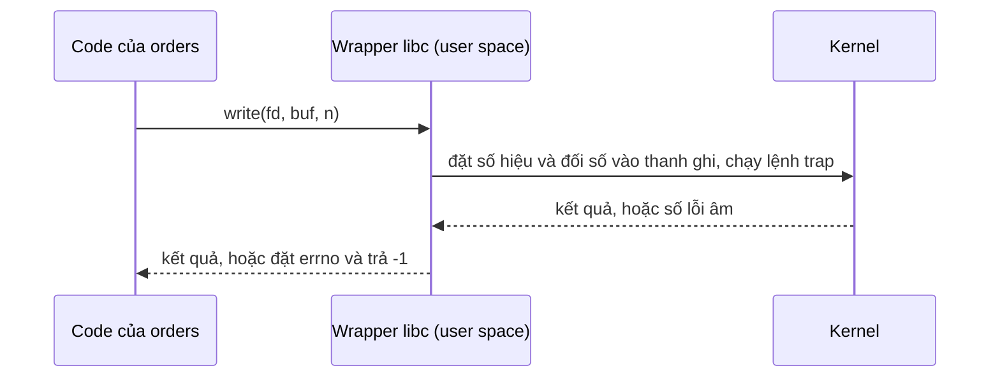
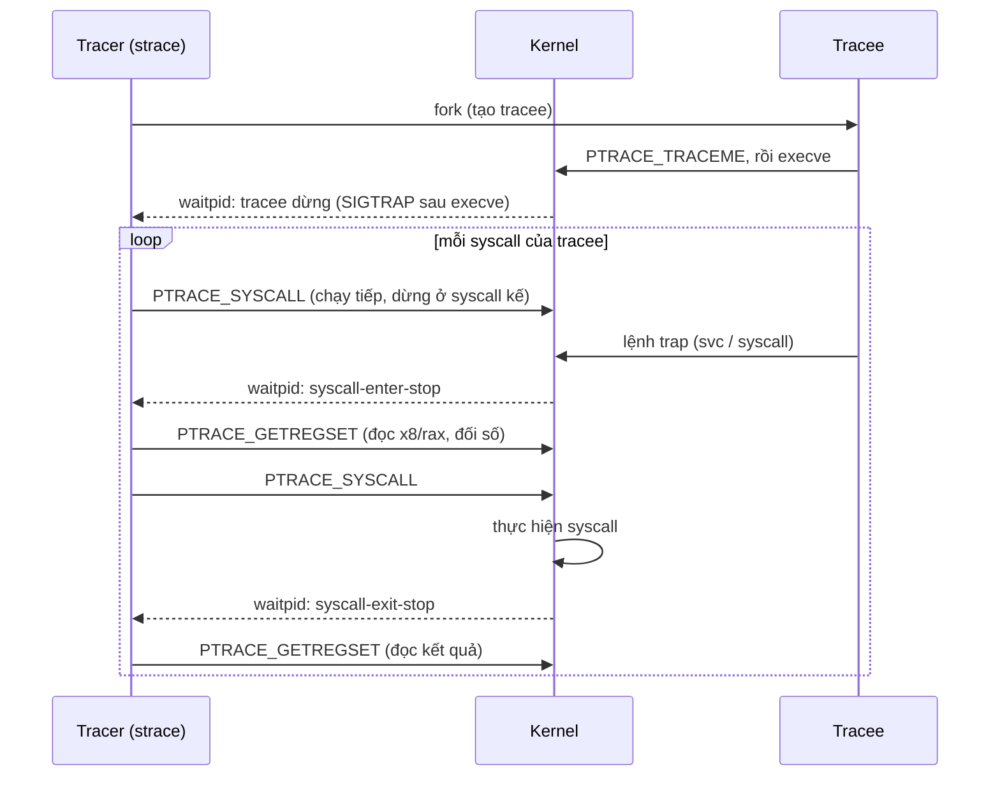

# P1 · Chương 02 — System call

> Phạm vi: mọi điều về kernel và syscall trong chương này là về **Linux** (man page Debian bookworm, man-pages 6.03). Các ví dụ "đã chạy thật" chạy trong container lab trên **aarch64**; kết quả chỉ là *quan sát* một lần chạy, không phải bảo đảm của tài liệu. Chỗ nào x86-64 khác thì chương nói rõ và chỉ dựa vào nguồn, không dựa vào lần chạy. macOS và BSD khác ở nhiều chỗ nên không bàn ở đây.

## Bạn sẽ hiểu được gì

1. **Q1.** Khi `orders` ghi một dòng log bằng `write(fd, buf, n)`, CPU vào kernel bằng lệnh máy nào, số hiệu syscall và đối số nằm ở thanh ghi nào, kết quả quay về ra sao? Vì sao số hiệu khác nhau giữa arm64 và x86-64 (nên không được hard-code)? → mục 2
2. **Q2.** Hàm libc (wrapper) khác `syscall(2)` thô chỗ nào; vì sao tên hàm bạn gọi không phải lúc nào cũng là tên syscall trong `strace`; `errno` từ đâu ra và kernel thực sự trả lỗi thế nào? → mục 3
3. **Q3.** vDSO là gì, vì sao `clock_gettime` có thể không tạo syscall nào, và `Instant::now()` của Rust liên quan gì? → mục 4
4. **Q4.** `strace` quan sát syscall của process khác bằng cơ chế nào (`ptrace(2)`), và vì sao nó làm chương trình chạy chậm? → mục 6
5. **Q5.** Đọc man page đúng cách: section 2 khác section 3 ra sao, mục nào cho biết lỗi? → mục 7
6. **Q6.** Mục nào của man page cho biết một API là POSIX hay chỉ có trên Linux? → mục 8

## Kiến thức cần trước

- [Chương 01 — OS và kernel](01-os-va-kernel.md): user mode / kernel mode (mục 3), trap và return-from-trap (mục 4). Chương này dùng lại các khái niệm đó và không giải thích lại.
- Service ví dụ `orders` (giả định, viết bằng Rust, chạy trên Linux) là cùng service đã xuất hiện ở Chương 01. Chưa đọc chương đó cũng không sao, vì mục 1 giới thiệu lại.

## 1. Vấn đề: vào kernel bằng cửa nào?

Ở Chương 01, `orders` (một service Rust chạy trên Linux, xử lý request bằng vài handler thread) đã đi tới sát ranh giới user/kernel. Muốn nhờ kernel làm gì, thread của nó phải chạy một lệnh *trap* đặc biệt[^ostep-trap-instr]. Chỗ lệnh đó nhảy tới do kernel đặt sẵn trong *trap table* từ lúc boot[^ostep-trap-table]. Cơ chế ấy (trap, trap table, return-from-trap) đã nằm ở [Chương 01, mục 4](01-os-va-kernel.md) nên ở đây ta không nhắc lại. Với Linux, man page `syscalls(2)` gọi system call là giao diện cơ bản giữa ứng dụng và kernel[^syscalls-iface].

Nhưng lệnh trap chỉ có một, còn dịch vụ kernel thì nhiều: đọc file, tạo process, gửi gói tin… Kernel biết `orders` đang xin dịch vụ nào nhờ *số hiệu syscall*. Thread đặt số này vào một thanh ghi (hoặc một chỗ quy định trên stack) trước khi trap; kernel đọc số, kiểm tra hợp lệ rồi chạy code tương ứng[^ostep-syscall-num].

Để cụ thể, cả chương bám theo một dòng code trong `orders`: handler thread ghi một dòng log vào file bằng `log.write(line)` (ví dụ giả định của người soạn, không phải code trong repo). Với Rust đó là một lời gọi bình thường, nhưng cuối cùng nó phải thành `write(fd, buf, n)` bên trong kernel. Mục 2 xem lệnh nào chạy và số liệu nằm ở thanh ghi nào; mục 3 xem lỗi quay về ra sao. Hai chuyện quanh dòng đó cũng là của `orders`: mỗi request nó gọi `Instant::now()` để đo latency (mục 4), và khi staging chậm bạn gắn `strace` vào xem nó gọi gì (mục 6).

Sơ đồ dưới là chuỗi đầy đủ khi `orders` gọi `write`; nguồn của từng bước nằm ở mục 2 và 3:



## 2. Quy ước gọi ở mức máy và số hiệu syscall (Q1)

> **Trả lời ngắn.** Chương trình không nhảy thẳng vào kernel. Nó ghi *số hiệu* của dịch vụ cần dùng (ví dụ "ghi dữ liệu") và các đối số vào những ô nhớ cố định của CPU, gọi là *thanh ghi*, rồi chạy một lệnh đặc biệt để chuyển quyền sang kernel[^ostep-trap-instr]. Trên arm64 lệnh đó là `svc #0`, số hiệu để ở `w8` và kết quả quay về ở `x0`[^sc-table-arm64]. Trên x86-64 là lệnh `syscall`, số hiệu và kết quả đều ở `rax`[^sc-table-x86]. Mỗi loại CPU có bảng số hiệu riêng: `write` là 64 trên arm64[^generic-write]. Trên x86-64 nó là 1[^tbl-write], nên đừng ghi cứng con số vào code.

**Giải thích.**

*Với service `orders`.* Kernel không phải một hàm trong cùng chương trình, nên handler thread không "gọi" nó như gọi hàm thường. Để ghi dòng log, thread phải đặt vào thanh ghi những gì nó muốn (ghi, vào fd nào, từ buffer nào, bao nhiêu byte), chạy lệnh trap, rồi đọc kết quả ở một thanh ghi quy định. Mỗi hãng CPU tự quy ước thanh ghi nào giữ thứ gì, và mục này xem quy ước đó trên arm64 và x86-64.

### 2.1 Bảng thanh ghi trong `syscall(2)`

Mỗi kiến trúc có cách riêng để vào kernel và truyền đối số[^sc-arch-own], nên man page `syscall(2)` gom chúng vào hai bảng. Bảng thứ nhất liệt kê lệnh chuyển sang kernel mode, thanh ghi chứa số hiệu, thanh ghi trả kết quả và thanh ghi báo lỗi. Man page lưu ý lệnh trong bảng *có thể không phải cách nhanh nhất* để vào kernel và gợi ý xem `vdso(7)` (mục 4)[^sc-intro]. Bảng thứ hai liệt kê thanh ghi truyền đối số[^sc-intro2]. Các hàng liên quan nhất tới `orders`:

| | arm64 (AArch64) | x86-64 |
|---|---|---|
| Lệnh trap | `svc #0`[^sc-table-arm64] | `syscall`[^sc-table-x86] |
| Số hiệu syscall | `w8`[^sc-table-arm64] | `rax`[^sc-table-x86] |
| Giá trị trả về | `x0`[^sc-table-arm64] | `rax`[^sc-table-x86] |
| Đối số 1…6 | `x0 x1 x2 x3 x4 x5`[^sc-args-arm64] | `rdi rsi rdx r10 r8 r9`[^sc-args-x86] |

Ghép với dòng log của `orders` trên arm64: ba đối số `fd`, `buf`, `n` đi vào `x0`, `x1`, `x2`, số hiệu vào `w8`, rồi `svc #0`; khi quay về, `x0` giữ kết quả[^sc-args-arm64]. Trên x86-64, ba đối số đó đi vào `rdi`, `rsi`, `rdx`, còn số hiệu và kết quả cùng nằm ở `rax`.

Ba điểm đáng nhớ:

1. **Không có thanh ghi báo lỗi riêng.** Cột thanh ghi báo lỗi của arm64 trong bảng là `-`[^sc-table-arm64]. Cột của x86-64 cũng là `-`[^sc-table-x86]. Nghĩa là hai kiến trúc này không có thanh ghi hay cờ riêng cho lỗi. Man page chỉ nêu rằng *một vài kiến trúc khác* dùng một thanh ghi như cờ boolean để báo lỗi, còn mã lỗi thật vẫn nằm trong thanh ghi kết quả[^sc-bool-reg].
2. **Kết quả chỉ cần nhìn `x0`/`rax`.** Bảng còn có cột "giá trị trả về thứ hai" (`x1`, `rdx`), nhưng chú thích của nó chỉ nhắc `pipe(2)` và vài syscall riêng của Alpha, và nói các kiến trúc khác không dùng thanh ghi thứ hai trong giao diện syscall[^sc-retval2].
3. **Đối số thứ tư trên x86-64 là `r10`**[^sc-args-x86]. Khi viết assembly tay cho syscall, hãy tra bảng này thay vì giả định nó trùng quy ước gọi hàm C (nhận xét của người soạn).

<details><summary>Đi sâu: bảng số hiệu theo kiến trúc và thí nghiệm viết lệnh trap tay</summary>

### 2.2 Số hiệu syscall khác nhau theo kiến trúc

Số hiệu không chung cho mọi kiến trúc: mỗi kiến trúc có bảng riêng. Lấy kernel v6.8 làm ví dụ. Bảng x86-64 có định dạng `<number> <abi> <name> <entry point>`[^tbl-format]. Trong đó `read`=0, `write`=1, `open`=2[^tbl-write]. Riêng `openat` là 257[^tbl-open]. arm64 thì không có bảng riêng mà `#include` bảng dùng chung `asm-generic/unistd.h`[^arm64-generic]. Trong bảng chung ấy `read`=63 và `write`=64[^generic-write]. Còn `openat` là 56[^generic-openat].

Có một điểm lạ: bảng chung có `openat` nhưng người soạn không tìm thấy `__NR_open` (đã tìm trong tệp tải về, không có định nghĩa này; đây là kết quả tìm kiếm, không phải câu từ nguồn). Từ đó suy ra (suy luận của người soạn) một chương trình arm64 64-bit "mở file" sẽ kết thúc ở syscall `openat`, kể cả khi code C gọi `open()`. Suy luận này khớp với quan sát `strace` trên aarch64 in ra `openat(AT_FDCWD, ...)` (mục 6.4).

Hệ quả thực tế: số `1` là `write` trên x86-64 nhưng trên arm64 là `io_destroy`[^generic-iodestroy]. Vì vậy asm viết tay, hay `syscall(2)` với số hard-code, không portable. Header `<sys/syscall.h>` có sẵn các hằng `SYS_*`[^sc-symbolic]; hãy dùng hằng của đúng target thay vì con số (nhận xét của người soạn).

### 2.3 Chạy thử: viết lệnh trap bằng tay

Để thấy cơ chế trần trụi, đây là ba cách gọi `write` trong một chương trình Rust trên aarch64 (container lab, `rustc` 1.95.0): lệnh `svc 0` viết tay, hàm `write` của libc, và hàm `syscall()` của libc với số hiệu `64`.

```rust
use std::arch::asm;
extern "C" {
    fn syscall(num: i64, ...) -> i64;
    fn write(fd: i32, buf: *const u8, n: usize) -> isize;
}

// aarch64: số hiệu vào x8 (=64), đối số vào x0, x1, x2, kết quả ra x0
unsafe fn raw_write(fd: i64, buf: *const u8, n: usize) -> i64 {
    let ret: i64;
    asm!("svc 0", in("x8") 64i64,
         inlateout("x0") fd => ret, in("x1") buf, in("x2") n, options(nostack));
    ret
}
```

Kết quả chạy (rút gọn): `raw asm -> 6`, `libc wrap -> 6`, `syscall() -> 6`; cả ba cùng ghi 6 byte. Khi truyền `fd = 99` (không mở), asm thô cho `raw asm bad fd -> -9`, còn hàm `write` của libc trả `-1` và `io::Error::last_os_error()` là `Os { code: 9, kind: Uncategorized, message: "Bad file descriptor" }`. Chạy dưới `strace`, cả hai lời gọi lỗi đều hiện là `write(99, "hello\n", 6) = -1 EBADF (Bad file descriptor)`. Vậy kernel trả `-9` (âm của `EBADF`) ngay trong thanh ghi kết quả, và chính wrapper của libc mới biến nó thành `-1` cùng `errno = 9`. Quan sát này khớp với man page ở mục 3.3; nhớ rằng nó chỉ là một lần chạy trên aarch64, còn lý do chung nằm ở nguồn.

</details>

**Quay lại Q1:** để ghi một dòng log, `orders` đặt số hiệu và đối số vào thanh ghi rồi chạy lệnh trap (`svc #0` trên arm64, `syscall` trên x86-64); lệnh, thanh ghi và bảng số hiệu đều phụ thuộc kiến trúc nên phải tra bảng của đúng target.

## 3. Wrapper, `syscall(2)` và lỗi (Q2)

> **Trả lời ngắn.** Bạn hiếm khi gọi thẳng vào kernel. Thường bạn gọi một hàm trong libc (thư viện C chuẩn) gọi là *wrapper*[^syscalls-wrapper]. Wrapper chép đối số vào đúng thanh ghi, chạy lệnh vào kernel, rồi đặt biến `errno` (biến cho biết lỗi gì) khi có lỗi[^syscalls-thin]. Trên kiến trúc không có thanh ghi báo lỗi riêng (arm64 và x86-64 đều vậy, xem mục 2.1), kernel báo lỗi bằng một số âm; wrapper đổi thành số dương, ghi vào `errno` và trả `-1`[^syscalls-neg]. Còn `syscall(2)` gọi thẳng theo số hiệu, dùng khi syscall chưa có wrapper[^sc-nowrapper]. Vì tên wrapper không phải lúc nào cũng trùng tên syscall[^syscalls-name], tên hàm bạn gọi có thể khác tên mà `strace` in ra.

**Giải thích.**

*Với service `orders`.* Khi code `orders` gọi `log.write(...)`, lời gọi đi xuống hàm `write` của libc, và chính hàm đó mới chạy lệnh trap (mục 9 cho thấy đường đi trong source `std`). Kết quả từ kernel cũng không về thẳng tay `orders`: kernel đưa một số, libc đổi số đó thành `-1` cùng `errno`, rồi `std` đổi tiếp thành `io::Result`. Mục này đi theo chặng giữa đó.

### 3.1 libc wrapper

Khi bạn gọi `open()` hay `write()`, thực ra bạn đang gọi một procedure trong thư viện C[^ostep-libc]. Wrapper thường rất mỏng: chép đối số vào đúng thanh ghi, gọi syscall, rồi đặt `errno`[^syscalls-thin]. Nhưng đôi khi nó làm thêm việc trước khi gọi kernel[^syscalls-extra]. Chẳng hạn `truncate()` của glibc kiểm tra kernel có `truncate64` hay không để chọn syscall dùng[^syscalls-extra-trunc].

Vì vậy tên hàm C bạn gọi không phải lúc nào cũng là tên syscall. Ví dụ rõ nhất là `fork()`: từ glibc 2.3.3, nó gọi `clone(2)` với các cờ cho hiệu quả như syscall `fork` truyền thống, chứ không gọi syscall `fork`[^fork-glibc] (chi tiết `fork`/`clone` ở [Chương 03](03-process.md)). Quan sát trên aarch64: một chương trình gọi `fork()` rồi chạy dưới `strace -f` in ra `clone(child_stack=NULL, flags=CLONE_CHILD_CLEARTID|CLONE_CHILD_SETTID|SIGCHLD...` và không có dòng `fork` nào. Với `orders`, nếu bạn `grep fork` trong output `strace` rồi không thấy gì thì đây là lý do (nhận xét của người soạn). Muốn biết một hàm khác syscall thô ở chỗ nào, man-pages quy ước mục `C library/kernel differences` trong trang section 2 để ghi các khác biệt đó[^mp7-cdiff].

### 3.2 `syscall(2)`: gọi theo số hiệu

`syscall()` là một hàm thư viện nhỏ gọi syscall có số hiệu và đối số bạn đưa vào[^sc-desc]. Nó hữu ích khi syscall chưa có wrapper trong libc[^sc-nowrapper]. Nó lưu thanh ghi trước khi gọi, khôi phục sau đó và đặt lỗi vào `errno`[^sc-saves]. Giá trị trả về do syscall quy định; nói chung 0 là thành công, `-1` là lỗi kèm mã lỗi trong `errno`[^sc-ret]. (Lưu ý "0 là thành công" chỉ là quy ước chung: `write` trả số byte đã ghi, như ở mục 2.3.)

Có một khác biệt về công sức. Với syscall có wrapper glibc, chính glibc lo việc chép đối số vào đúng thanh ghi theo từng kiến trúc; còn khi dùng `syscall()`, người gọi có thể phải tự xử lý các chi tiết phụ thuộc kiến trúc, phổ biến nhất ở một số kiến trúc 32-bit[^sc-arch-req].

### 3.3 Kernel trả lỗi như thế nào, và `errno` từ đâu ra

`errno` là một biến số nguyên do system call và một số hàm thư viện đặt khi có lỗi, để cho biết đã xảy ra lỗi gì[^errno-def]. Còn phía kernel, trên các kiến trúc không có thanh ghi hay cờ lỗi riêng, syscall báo lỗi bằng cách trả một **số lỗi âm**. Wrapper sẽ đảo dấu thành dương, chép vào `errno` và trả `-1` cho người gọi[^syscalls-neg]. Đó đúng là điều ta thấy ở mục 2.3: kernel đưa `-9` vào thanh ghi kết quả, libc đổi thành `errno = 9` (`EBADF`) và `-1`.

Với `orders`, nghĩa là thông báo lỗi `Bad file descriptor` bạn đọc trong log đã đi qua hai lần biến đổi (số âm của kernel, rồi `-1` + `errno` của libc) trước khi thành `io::Error`; `std` lo phần cuối (mục 9).

<details><summary>Đi sâu: quy tắc của <code>errno</code></summary>

Các quy tắc sau lấy từ `errno(3)`.

- `errno` chỉ có ý nghĩa khi giá trị trả về *báo lỗi* (`-1` với phần lớn syscall; `-1` hoặc `NULL` với phần lớn hàm thư viện). Hàm *thành công* vẫn được phép đổi `errno`[^errno-signif]. Ngược lại, không syscall hay hàm thư viện nào đặt `errno` về 0[^errno-nonzero].
- Có hàm mà `-1` cũng là giá trị hợp lệ khi thành công, ví dụ `getpriority(2)`. Với loại này, muốn phân biệt thì đặt `errno = 0` trước lời gọi, rồi chỉ khi kết quả cho thấy có thể lỗi mới kiểm tra `errno` khác 0[^errno-getpriority].
- Theo chuẩn ISO C, `errno` là một lvalue kiểu `int` sửa được (tức thứ gán giá trị vào được, như một biến), có thể là macro và không được tự khai báo[^errno-macro]. Nó là **thread-local**: đặt ở thread này không ảnh hưởng thread khác[^errno-thread]. Với `orders` (nhận xét của người soạn): các handler thread không giẫm lên `errno` của nhau, nhưng trong một thread bạn vẫn phải đọc `errno` *ngay* sau lời gọi lỗi, không chen lời gọi nào ở giữa, kể cả `printf`, vì hàm thành công cũng được phép đổi nó.
- **Số** ứng với mỗi tên lỗi thay đổi giữa các hệ UNIX và thậm chí giữa các kiến trúc của Linux, nên man page không ghi số. Hãy dùng tên (và `strerror`/`perror` để đổi ra thông báo chữ) thay vì số[^errno-numbers].
- Một lỗi bạn sẽ gặp trong service chạy lâu là `EINTR`, tức lời gọi bị gián đoạn; man page ghi chú xem `signal(7)`[^errno-eintr]. Vì sao syscall bị signal ngắt thì thuộc [Chương 05, mục 5](05-signal.md).

Mục `ERRORS` của trang section 2 và 3 liệt kê các giá trị có thể đặt vào `errno` kèm nguyên nhân[^mp7-errors] (xem thêm mục 7).

</details>

**Quay lại Q2:** wrapper che chi tiết thanh ghi và số lỗi âm của kernel, trả lại `-1` + `errno` cho code của `orders`; tên hàm C có thể khác tên syscall.

## 4. vDSO: gọi "syscall" mà không vào kernel (Q3)

> **Trả lời ngắn.** vDSO là một thư viện nhỏ do kernel tự gắn vào bộ nhớ của mọi chương trình[^vdso-def], cho phép một số lời gọi chạy ngay trong user space mà không cần vào kernel. Ví dụ `gettimeofday`: kernel đặt sẵn dữ liệu thời gian ở vùng nhớ mà process đọc được, nên lời gọi chỉ còn là gọi hàm thường cộng vài lần đọc bộ nhớ[^vdso-time]. Danh sách hàm vDSO của x86-64 có `clock_gettime`[^vdso-x86-syms]. Danh sách của aarch64 cũng có[^vdso-aarch64]. Vì vậy khi gọi qua libc, `clock_gettime` có thể không tạo syscall nào và không hiện trong `strace`[^vdso-strace]. Docs của `Instant` ghi rằng trên UNIX, `now()` dùng `clock_gettime` với `CLOCK_MONOTONIC`[^rs-instant-doc], nên `Instant::now()` cũng có thể không vào kernel (suy luận của người soạn; quan sát ở phần Đi sâu, không phải bảo đảm của `std`).

**Giải thích.**

*Với service `orders`.* Mỗi request, `orders` đọc đồng hồ ít nhất hai lần để tính latency: lúc nhận request và lúc trả lời. Nếu mỗi lần đọc là một chuyến vào kernel thì số chuyến nhân lên theo số request, và `vdso(7)` nói đúng về loại tình huống này. Mục này giải thích cơ chế, rồi giải thích vì sao khi `strace` `orders` bạn có thể không thấy dòng `clock_gettime` nào.

`vdso(7)` nêu lý do vDSO tồn tại: có những syscall mà code user dùng dày đến mức chúng có thể chi phối hiệu năng chung, do cả tần suất gọi lẫn chi phí chuyển ngữ cảnh khi rời user space để vào kernel[^vdso-why]. Trang đó còn kể một đoạn lịch sử. Trên x86 32-bit, syscall bằng `int $0x80` là lệnh đắt vì đi qua toàn bộ đường xử lý ngắt trong microcode của CPU lẫn trong kernel. CPU mới có lệnh nhanh hơn nhưng không tương thích ngược, nên thay vì bắt libc tự dò, libc có thể dùng hàm do kernel cung cấp trong vDSO[^vdso-int80].

Vậy vDSO (virtual dynamic shared object) là gì? Đó là một shared library (thư viện chia sẻ) nhỏ mà kernel tự động map vào không gian địa chỉ của mọi ứng dụng user-space[^vdso-def]. Bạn thường không gọi nó trực tiếp: libc gọi vDSO hộ, nên `orders` vẫn dùng hàm chuẩn như bình thường[^vdso-libc]. Lấy ví dụ đọc đồng hồ. Thời gian không phải thông tin bí mật, mọi process (root hay không) nhận cùng một đáp án, nên kernel đặt sẵn dữ liệu cần thiết vào vùng nhớ mà process đọc được[^vdso-notsecret]. Nhờ vậy `gettimeofday(2)` từ một system call trở thành một lời gọi hàm thường cộng vài lần truy cập bộ nhớ[^vdso-time]. Có một hệ quả khi quan sát: hàm do vDSO cung cấp không hiện trong kết quả `strace`[^vdso-strace], và đó là lý do `strace` không thấy `clock_gettime` ở thí nghiệm bên dưới.

<details><summary>Đi sâu: chi tiết vDSO, thí nghiệm <code>strace</code> và <code>Instant</code> trong Rust</summary>

**Chi tiết kỹ thuật có nguồn.**

- Kernel truyền địa chỉ cơ sở của vDSO cho mỗi chương trình qua *auxiliary vector* ban đầu (xem `getauxval(3)`), bằng tag `AT_SYSINFO_EHDR`; không được giả định vị trí cố định[^vdso-find]. Địa chỉ này thường được ngẫu nhiên hóa mỗi lần `execve` để chống tấn công return-to-libc[^vdso-aslr]. Trong container aarch64, một chương trình gọi `getauxval(33)` (33 là `AT_SYSINFO_EHDR`, giá trị dùng trong thí nghiệm) nhận được một địa chỉ khác không (`0xf75a7bf00000` ở lần chạy đó), tức vDSO có mặt.
- vDSO là một ELF image hoàn chỉnh nên tra được symbol trong đó: symbol mới có thể được thêm ở kernel mới, và libc dò được tính năng sẵn có lúc chạy[^vdso-elf]. Mọi symbol còn mang version theo định dạng GNU, để kernel đổi chữ ký hàm mà không phá tương thích[^vdso-versioned].
- Tập hàm export phụ thuộc kiến trúc. x86-64 có `clock_gettime`, `getcpu`, `gettimeofday`, `time`[^vdso-x86-syms]. aarch64 có `__kernel_rt_sigreturn`, `__kernel_gettimeofday`, `__kernel_clock_gettime`, `__kernel_clock_getres`[^vdso-aarch64]. Đây là bảng của man-pages 6.03; kernel mới hơn có thể export thêm (suy luận của người soạn).

**Thí nghiệm.** Trên aarch64, chương trình gọi `clock_gettime(CLOCK_MONOTONIC, ...)` 5 lần qua hàm libc và chạy dưới `strace -f`: **không có dòng `clock_gettime` nào**, chỉ có `exit_group`. Cùng chương trình đổi sang `syscall(113, CLOCK_MONOTONIC, &ts)` (113 là `__NR_clock_gettime` trong bảng chung[^generic-clockgettime]) 5 lần thì `strace` in đúng 5 dòng `clock_gettime(CLOCK_MONOTONIC, {tv_sec=…, tv_nsec=…}) = 0`. Nghĩa là cùng một việc đọc giờ, một đường đi qua vDSO (không trap), một đường trap thật.

**Áp vào Rust.** Docs của `std::time::Instant` (1.95.0) có mục *Underlying System calls*: trên UNIX, `now()` dùng `clock_gettime` với `CLOCK_MONOTONIC`, riêng Darwin dùng `CLOCK_UPTIME_RAW`[^rs-instant-doc]. Docs kèm lưu ý rằng các lời gọi này có thể đổi theo thời gian[^rs-instant-disclaimer]. Về cài đặt trong source std 1.95.0 (chi tiết có thể đổi): `Instant::now()` gọi `Timespec::now(CLOCK_ID)`[^rs-instant-now]. Còn `Timespec::now` gọi `libc::clock_gettime`[^rs-timespec-now]. Riêng glibc 32-bit thử `__clock_gettime64` trước; comment trong source nói hàm đó tự xử lý cả lời gọi vDSO lẫn fallback khi `ENOSYS`[^rs-clock64].

Vì thế `Instant::now()` có thể không tạo syscall, và quan sát khớp: chương trình gọi `Instant::now()` 5 lần, `strace -f ./d 2>&1 | grep -c clock_gettime` in `0` trên aarch64 (strace ghi ra stderr nên cần `2>&1`). Lần chạy lại cho cùng kết quả với `./c` gọi `clock_gettime` của libc (0 dòng), còn `./c x` gọi `syscall(SYS_clock_gettime, …)` cho 5 dòng. Đây là quan sát cho aarch64/glibc của lab, không phải bảo đảm của `std`.

</details>

**Quay lại Q3:** vDSO đưa những lời gọi chỉ cần đọc dữ liệu có sẵn, như lấy thời gian, vào user space nên không cần trap; `Instant::now()` của `orders` gọi `clock_gettime` nên có thể hưởng lợi từ vDSO, dù `std` không hứa điều đó.

## 5. Chi phí của một syscall

Chương này không đưa con số nanosecond cho một syscall: chưa có nguồn đo ổn định cho phần cứng cụ thể, và con số lấy từ trí nhớ sẽ là ảo giác. Điều nguồn xác nhận được là chi phí đến từ việc rời user space để vào kernel, và khi gọi quá dày nó có thể chi phối hiệu năng[^vdso-why]. Cách vào kernel cũng không đồng đều. `int $0x80` trên x86 32-bit là đường chậm[^vdso-int80]. Còn lệnh ghi trong bảng `syscall(2)` có thể không phải đường nhanh nhất[^sc-intro].

Với `orders`, hệ quả thực tế (nhận xét của người soạn) là đừng ghi log từng mẩu nhỏ qua từng lời gọi `write`. Docs Rust nói I/O theo từng byte có thể kém hiệu quả vì phải gọi hệ điều hành gần như liên tục, nên có `BufReader`/`BufWriter`[^rs-bufwriter]. Gộp nhiều lần ghi nhỏ thành ít lần ghi lớn là cách giảm số lần trap (nhận xét của người soạn). Muốn đo trên máy của bạn, `strace -c` thống kê thời gian, số lần gọi và lỗi của mỗi syscall khi process kết thúc[^strace-c]. Nhớ rằng tracing làm đắt thêm rất nhiều, xem mục 6.3.

## 6. `strace` và `ptrace(2)`: quan sát syscall từ bên ngoài (Q4)

> **Trả lời ngắn.** `strace` in ra các system call và signal của một chương trình đang chạy[^strace-intercept]. Nó làm được vậy nhờ `ptrace(2)`, giao diện kernel cho một process (*tracer*) quan sát và điều khiển process khác (*tracee*), kể cả đọc thanh ghi của nó[^ptrace-def]. Với system call, tracer dùng lệnh `PTRACE_SYSCALL` để tracee dừng ở lần vào và lần ra khỏi mỗi syscall[^ptrace-syscall]. Như vậy mỗi syscall có hai lần dừng[^ptrace-twice]. Vì thế chương trình bị theo dõi chạy chậm. Man page `strace` ghi thẳng điều này[^strace-slow]; còn việc quy nguyên nhân cho hai lần dừng là suy luận của người soạn.

**Giải thích.**

*Với service `orders`.* Giả sử staging chậm bất thường và log không nói gì, nên bạn gắn `strace` vào `orders` để xem nó gọi syscall nào. Mục này giải thích `strace` lấy thông tin đó từ đâu, và vì sao chính việc xem làm `orders` chạy chậm đi.

### 6.1 strace làm gì

`strace` chặn và ghi lại các system call mà một process gọi, cùng các signal nó nhận; tên syscall, đối số và giá trị trả về được `strace` in ra stderr hoặc ra file `-o`[^strace-intercept]. Cờ `-f` theo cả process con tạo qua `fork`, `vfork`, `clone`[^strace-f]. Còn `-e trace=` lọc ra những syscall cần xem[^strace-e]. Nếu chỉ theo dõi một tập con syscall, man page cảnh báo phải cẩn thận khi suy luận về ranh giới user/kernel[^strace-subset]. Về cơ chế bên dưới, man page `strace` nhắc tới các lần dừng `ptrace` (*ptrace-stop*) của process bị theo dõi[^strace-seccomp]; đó là nội dung mục 6.2.

### 6.2 `ptrace(2)`: giao diện kernel để quan sát process khác

`ptrace(2)` cho một process (tracer) quan sát và điều khiển process khác (tracee), kể cả đọc và sửa bộ nhớ và thanh ghi của tracee; man page nói nó chủ yếu dùng để cài breakpoint khi debug và để theo dõi system call[^ptrace-def].

Quan hệ tracer/tracee bắt đầu theo một trong hai cách. Cách thứ nhất: một process `fork`, để process con gọi `PTRACE_TRACEME` rồi (thường) `execve`. Cách thứ hai: tracer gắn vào process có sẵn bằng `PTRACE_ATTACH` hoặc `PTRACE_SEIZE`[^ptrace-traceme]. Việc gắn và các lệnh sau đó tính **theo từng thread**, nên "tracee" luôn là một thread chứ không phải cả process đa luồng[^ptrace-perthread]. Với `orders`, nghĩa là mỗi handler thread có thể là một tracee riêng.

Khi bị trace, tracee dừng mỗi lần có signal được chuyển tới (kể cả signal đang bị ignore, trừ `SIGKILL`)[^ptrace-stop]. Tracer biết chuyện này ở lần gọi `waitpid(2)` kế tiếp[^ptrace-wait]. Nếu không bật `PTRACE_O_TRACEEXEC`, mỗi `execve` thành công của tracee làm nó nhận `SIGTRAP`, cho cha cơ hội kiểm soát trước khi chương trình mới chạy[^ptrace-execve].

Phần dành riêng cho system call tracing là `PTRACE_SYSCALL`. Nó khởi động lại tracee nhưng sắp đặt để tracee **dừng ở lần vào (entry) tiếp theo hoặc lần ra (exit) khỏi syscall**[^ptrace-syscall]. Hai điểm dừng đó gọi là syscall-enter-stop và syscall-exit-stop, và chúng xảy ra rất thường xuyên: hai lần cho mỗi syscall[^ptrace-twice]. Từ bên ngoài, tracer không phân biệt được hai loại dừng này, nên phải tự đếm thứ tự các *ptrace-stop* để khỏi nhầm[^ptrace-enter-exit].

Cả hai điểm dừng được tracer thấy qua `waitpid` trả về với `WIFSTOPPED(status)` đúng và `WSTOPSIG(status)` bằng `SIGTRAP`; nếu tracer đã đặt `PTRACE_O_TRACESYSGOOD` thì giá trị đó là `(SIGTRAP | 0x80)`[^ptrace-sigtrap80]. Man page khuyến nghị chính tùy chọn này để phân biệt syscall-stop với các dừng khác, vì nó đáng tin và không tốn thêm chi phí[^ptrace-sysgood]. Để đọc thanh ghi của tracee (số hiệu và đối số), dùng `PTRACE_GETREGSET`; loại thanh ghi được chỉ định theo kiến trúc[^ptrace-getregset]. Phần ptrace dành cho debugger (breakpoint, single-step) và điều kiện attach vào process đang chạy (`ptrace_scope`, container) nằm ở [P11 Chương 04](../11-do-dac-va-go-loi/04-debugger-va-dwarf.md).

Gộp lại, một vòng theo dõi syscall của tracee diễn ra như sau:



### 6.3 Hệ quả: vì sao tracing chậm

Mỗi syscall của tracee bị dừng hai lần[^ptrace-twice]. Ở mỗi lần dừng, tracer phải được đánh thức qua `waitpid`, thường đọc thanh ghi bằng `PTRACE_GETREGSET`, rồi cho tracee chạy tiếp bằng một lệnh `ptrace` nữa (các bước ở mục 6.2; coi đó là nguồn chính của chi phí là suy luận của người soạn). Man page `strace` ghi thẳng trong mục BUGS rằng process bị trace chạy chậm, và gợi ý xem `--seccomp-bpf`[^strace-slow].

Tùy chọn `--seccomp-bpf` thử dùng seccomp-bpf (bộ lọc syscall của kernel, xem `seccomp(2)`) để chỉ tạo ptrace-stop khi syscall *đang được trace* xảy ra, và chỉ có tác dụng khi kèm `-f`[^strace-seccomp]. Nó không áp dụng cho process gắn bằng `-p`, và có thể thất bại; khi đó strace vẫn chạy như thường và dừng tracee ở mọi syscall[^strace-seccomp-fail].

Với backend (nhận xét của người soạn): đừng `strace` một service đang chịu tải production ở chế độ mặc định rồi đọc latency từ đó, vì bạn đang đo "service + hai lần dừng mỗi syscall".

<details><summary>Đi sâu: giới hạn khác của strace và mini-strace chạy thật</summary>

Một giới hạn khác: chương trình dùng bit setuid không có đặc quyền effective UID khi bị trace[^strace-setuid] (bit setuid xem [Chương 06](06-user-quyen-proc-sys.md)).

### 6.4 Một bản mini-strace chạy thật

Người soạn viết một tracer Rust khoảng 40 dòng: gọi qua FFI `fork`, `ptrace(PTRACE_TRACEME)`, `execvp("/bin/true")`, rồi vòng lặp `PTRACE_SYSCALL` → `waitpid` → `PTRACE_GETREGSET` và in `x8`, `x0` (aarch64, vì bảng 2.1 nói số hiệu ở `w8` và kết quả ở `x0`). Trích từ lần chạy:

```text
enter: x8 = 214, x0 = 0x0                  (brk)
enter: x8 = 222, x0 = 0x0                  (mmap)
enter: x8 = 48,  x0 = 0xffffffffffffff9c   (faccessat; x0 = AT_FDCWD)
exit : x0 = -2                             (-ENOENT, thô)
enter: x8 = 56,  x0 = 0xffffffffffffff9c   (openat)
exit : x0 = 3                              (fd mới)
```

Đối chiếu độc lập với bảng chung: `__NR_brk` = 214[^generic-brk]. `__NR3264_mmap` = 222[^generic-mmap]. Trên cấu hình 64-bit, `__NR_mmap` là bí danh của hằng này[^generic-mmap-alias]. `__NR_faccessat` = 48[^generic-faccessat]. `__NR_openat` = 56[^generic-openat]. Còn `strace /bin/true` thật in `brk(NULL)`, `mmap(...)`, `faccessat(AT_FDCWD, "/etc/ld.so.preload", R_OK) = -1 ENOENT`, `openat(AT_FDCWD, "/etc/ld.so.cache", O_RDONLY|O_CLOEXEC) = 3`. Ở tầng `ptrace` ta thấy **giá trị thô `-2`**, còn `strace` giải mã thành `-1 ENOENT`; tên syscall và đối số dạng chữ là việc của strace, vì kernel chỉ đưa số và thanh ghi.

</details>

**Quay lại Q4:** `strace` là một tracer dùng `ptrace`; mỗi syscall của `orders` bị dừng hai lần nên nó chạy chậm.

## 7. Cách đọc man page (và các section) (Q5)

> **Trả lời ngắn.** Man page chia thành các *section* đánh số: section 2 mô tả system call (các hàm bọc quanh thao tác do kernel thực hiện), section 3 mô tả các hàm thư viện còn lại[^mp7-sections]. `man 2 write` hay `man 3 printf` chọn section cần đọc[^man1-usage]. Muốn biết một lời gọi có thể lỗi vì những lý do gì, đọc mục `ERRORS` của trang: nó liệt kê các giá trị lỗi (đặt vào `errno`) kèm nguyên nhân[^mp7-errors].

**Giải thích.**

*Với service `orders`.* Khi viết nhánh xử lý lỗi cho dòng ghi log, bạn cần biết `write` có thể thất bại vì những lý do nào, và hàm nào bạn đang gọi là syscall hay hàm thư viện. Cả hai câu hỏi đều có chỗ trả lời cố định trong man page; mục này chỉ cách tìm.

`man-pages(7)` định nghĩa các section: 1 là lệnh người dùng, 2 là system call (các hàm bọc thao tác do kernel thực hiện), 3 là library call (mọi hàm thư viện trừ wrapper của syscall)[^mp7-sections]. Section 4 là special file (thiết bị trong `/dev`)[^mp7-sect-rest]. Section 7 là overview và quy ước, section 8 là lệnh quản trị hệ thống[^mp7-sect-78]. `man(1)` chọn section bằng cú pháp `man [section] page`[^man1-usage], nên `man 2 write` mở trang của syscall `write`, còn `man 3 printf` mở trang của hàm thư viện `printf`. Trang khái niệm như `vdso(7)` hay `standards(7)` nằm ở section 7.

Với một trang section 2 hoặc 3, thứ tự đọc gợi ý (của người soạn) là `SYNOPSIS` → `DESCRIPTION` → `RETURN VALUE` → `ERRORS` → `NOTES`:

- `SYNOPSIS` tóm tắt giao diện của hàm[^mp7-synopsis].
- `RETURN VALUE` liệt kê các giá trị hàm trả về cho người gọi và điều kiện dẫn tới từng giá trị[^mp7-retval].
- `ERRORS` liệt kê các giá trị có thể có trong `errno` cùng nguyên nhân[^mp7-errors]. Đọc mục này khi viết nhánh xử lý lỗi.

<details><summary>Đi sâu: <code>VERSIONS</code>, <code>NOTES</code>, và man page trên macOS</summary>

- `VERSIONS` tóm tắt phiên bản kernel hoặc glibc mà syscall hay hàm xuất hiện, hoặc thay đổi đáng kể[^mp7-versions]. Riêng `syscalls(2)` có danh sách syscall Linux, với cột Kernel cho biết phiên bản kernel của các syscall mới từ Linux 2.2 trở đi[^syscalls-list].
- `NOTES`, ở section 2, có tiểu mục `C library/kernel differences` đánh dấu khác biệt giữa wrapper và syscall thô[^mp7-cdiff]. Đó chính là mục để đọc khi `strace` hiện tên khác với hàm bạn gọi.
- `STANDARDS`: xem mục 8.

Các man page này mô tả Linux/glibc. Trên macOS, `man` là bản BSD riêng nên cùng tên trang có thể mô tả hành vi khác (nhận xét của người soạn; chương này không kiểm).

</details>

**Quay lại Q5:** section 2 là syscall, section 3 là hàm thư viện, và `ERRORS` là mục đọc khi viết nhánh xử lý lỗi cho `orders`.

## 8. POSIX vs Linux-specific (Q6)

> **Trả lời ngắn.** Mỗi trang man của một hàm có mục `STANDARDS` cho biết hàm đó tuân theo những chuẩn nào[^std-purpose]. POSIX là họ chuẩn về giao diện hệ điều hành, tên gốc là "Portable Operating System Interface"[^std-posix]. Theo hướng dẫn viết man page, trang section 2 và 3 nên ghi phiên bản POSIX.1 mà lời gọi tuân thủ[^mp7-standards]. Nếu lời gọi chỉ có trên Linux (Linux-specific) thì cũng nên ghi rõ[^mp7-linuxspec]. Ví dụ `write(2)` có POSIX.1-2001 trong mục này[^write-std]. Còn API `epoll` được ghi là riêng của Linux[^epoll-linux].

**Giải thích.**

*Với service `orders`.* Giả sử bạn dev `orders` trên macOS rồi deploy lên container Linux (nhận xét của người soạn). Câu hỏi cần trả lời là: hàm này chạy được ở cả hai nơi, hay chỉ ở Linux? `STANDARDS` là chỗ trả lời, và ta xem hai trang làm ví dụ.

- `write(2)`: mục `STANDARDS` liệt kê SVr4, 4.3BSD và POSIX.1-2001[^write-std]. Tức là `write` nằm trong chuẩn POSIX, thuộc nhóm giao diện portable (nhận xét của người soạn).
- `epoll`: man page nói API epoll là riêng của Linux, còn các hệ khác có cơ chế tương tự dưới tên khác[^epoll-linux].

<details><summary>Đi sâu: POSIX.1-2001 so với 2008, tên SVr4/4.3BSD, <code>epoll_create*</code> và ý nghĩa thực tế</summary>

- `standards(7)` nói thêm: nếu một trang ghi POSIX.1-2001 thì mặc định có thể coi giao diện cũng tuân theo POSIX.1-2008, trừ khi có ghi chú khác[^std-2008].
- `SVr4` là System V release 4, ra năm 1989[^std-svr4]. `4.3BSD` là bản BSD ra năm 1986[^std-43bsd]. Đó là hai bản UNIX cũ được liệt kê cùng POSIX trong `write(2)`.
- Với `epoll`, FreeBSD có `kqueue` và Solaris có `/dev/poll` làm cơ chế tương tự[^epoll-linux]. `epoll_create()` và `epoll_create1()` cũng được ghi là Linux-specific[^epoll-create-linux].

Ý nghĩa thực tế (nhận xét của người soạn): khi viết dịch vụ chỉ chạy trên Linux (container production), dùng giao diện Linux-specific như `epoll` là hợp lý. Khi viết thư viện muốn chạy cả macOS, hãy đọc `STANDARDS` trước và tách phần Linux-specific khỏi phần portable.

</details>

**Quay lại Q6:** đọc `STANDARDS` để biết API portable hay chỉ của Linux.

## 9. Liên hệ với Rust

Ở các điểm dưới đây, Rust `std` đi tới kernel qua hàm libc chứ không tự chạy lệnh trap (suy luận của người soạn từ các đoạn source được trích). Kiểu lỗi `io::Error` (`raw_os_error`, `ErrorKind`), `OwnedFd` và FFI (`unsafe extern`, `libc`, `nix`, `rustix`) được giải thích kỹ ở [Chương 07](07-rust-tren-giao-dien-he-thong.md) (mục 1, 2 và 7); phần này chỉ nêu các điểm nối với chương System call.

- **`write` thường qua wrapper libc.** Trong source std 1.95.0, `FileDesc::write` gọi `libc::write(self.as_raw_fd(), buf.as_ptr() as *const c_void, ...)`, bọc bằng `cvt(...)`[^rs-fd-write]. Đó là đường `log.write(...)` của `orders` đi xuống.
- **`-1` + `errno` → `Result`.** Hàm trợ giúp `cvt` kiểm `is_minus_one()` rồi trả `Err(io::Error::last_os_error())`[^rs-cvt]. `cvt_r` thêm vòng retry khi `errno` là `EINTR`[^rs-cvt-r]. Đây là mẫu "kiểm kết quả `-1`, rồi đọc `errno`" của mục 3.3, đóng gói thành `Result`. Docs của `last_os_error` dặn gọi nó *ngay* sau lời gọi nền tảng, nếu không giá trị lỗi sẽ không xác định[^rs-last-os-error], cùng lời dặn như mục 3.3. Bên trong std có hàm `errno()` đọc giá trị `errno` của nền tảng[^rs-errno-fn]. Còn vì sao thí nghiệm 2.3 in `kind: Uncategorized` cho `EBADF` thì xem [Chương 07, mục 2](07-rust-tren-giao-dien-he-thong.md).
- **Có chỗ std gọi `syscall` thô.** Trên Linux, phần futex của std gọi `libc::syscall(libc::SYS_futex, ...)` ở đường chờ[^rs-futex-wait]. Đường đánh thức gọi `libc::syscall(libc::SYS_futex, ptr, op, 1)`[^rs-futex-wake]. Đây là trường hợp dùng `syscall()` theo số hiệu như mục 3.2 (suy luận của người soạn), nên std phụ thuộc vào việc `libc::SYS_futex` đúng với từng target.
- **`Instant::now()`.** Đường đi từ `Instant::now()` xuống `clock_gettime` và vDSO nằm ở mục 4.
- **FFI là `unsafe`.** Hàm khai báo trong khối `extern` (như `write` và `syscall` ở thí nghiệm 2.3) nói chung unsafe để gọi, vì ngôn ngữ khác không tuân các quy tắc của Rust và compiler không kiểm được; trách nhiệm thuộc về lập trình viên[^rs-unsafe-extern]. Cách bọc an toàn và các crate `nix`/`rustix` ở [Chương 07, mục 7](07-rust-tren-giao-dien-he-thong.md).

<details><summary>Đi sâu: hằng <code>SYS_*</code> trong crate <code>libc</code> được chọn theo target</summary>

`libc` 0.2.178 là bản mà `library/Cargo.lock` của Rust 1.95.0 ghim[^libc-pin]. Crate này là các binding FFI thô tới thư viện hệ thống[^libc-crate]. Nó chọn thư mục `aarch64` hay `x86_64` theo `target_arch`[^libc-arch-cfg].

Ví dụ `SYS_futex`. Trên aarch64, nó là 98 trong bảng của `libc`[^libc-aarch64-futex]. Con số này khớp `__NR_futex` = 98 của bảng chung kernel v6.8[^generic-futex]. Trên x86_64, nó là 202[^libc-x86-futex]. Con số này khớp dòng `202 common futex` của bảng x86-64[^tbl-futex].

Cùng cách đó, file aarch64 của `libc` có `SYS_openat` = 56[^libc-aarch64-openat] (grep file đó không thấy `SYS_open`: quan sát của người soạn, không phải câu từ nguồn). File x86_64 thì có `SYS_open` = 2[^libc-x86-open]. Cả hai nhất quán với mục 2.2, vốn suy ra từ kernel.

</details>

## 10. Tóm tắt

- System call vào kernel bằng một **lệnh trap**: `svc #0` trên arm64, `syscall` trên x86-64. Số hiệu ở `w8`/`rax`, đối số ở `x0…x5` hay `rdi, rsi, rdx, r10, r8, r9`, kết quả ở `x0`/`rax`. Cơ chế trap và trap table nằm ở [Chương 01](01-os-va-kernel.md).
- **Số hiệu syscall khác nhau theo kiến trúc** (`write` là 64 trên arm64, 1 trên x86-64). Bảng chung của arm64 có `openat` nhưng (theo tìm kiếm của người soạn) không có `__NR_open`, còn x86-64 có cả `open`. Đừng hard-code số.
- Kernel trả lỗi bằng số âm trong thanh ghi kết quả (trên kiến trúc không có thanh ghi lỗi riêng, như arm64 và x86-64). **Wrapper libc** đổi dấu, đặt `errno` và trả `-1`. Quan sát: asm thô cho `-9`, `write` của libc cho `-1` + `EBADF`.
- `errno` là thread-local, chỉ có nghĩa khi hàm báo lỗi, hệ thống không bao giờ đặt nó về 0, và hàm thành công vẫn có thể đổi nó, nên phải đọc ngay sau lời gọi lỗi.
- Wrapper có thể làm thêm việc: `fork()` của glibc gọi `clone`, nên tên hàm C khác tên syscall trong `strace`.
- **vDSO** đưa một số lời gọi (như `clock_gettime`) vào user space không cần trap, và `vdso(7)` nói chúng không hiện trong `strace`. Quan sát: `strace` không in dòng nào cho `clock_gettime` qua libc, nhưng in đủ khi gọi bằng `syscall()`.
- `strace` dựa trên `ptrace(2)`: dừng tracee hai lần mỗi syscall (enter/exit) và đọc thanh ghi nên chậm; `--seccomp-bpf` giảm bớt (chỉ với `-f`).
- Đọc man page: section 2 khác section 3; các mục `ERRORS`, `VERSIONS`, `C library/kernel differences`, `STANDARDS` (epoll được ghi là Linux-specific).
- Rust: `cvt` + `io::Error::last_os_error` đóng gói mẫu "`-1` rồi đọc `errno`" ([Chương 07, mục 2](07-rust-tren-giao-dien-he-thong.md)); `Instant::now()` đứng trên `clock_gettime`; gọi hàm `extern` là `unsafe`.

## 11. Câu hỏi tự kiểm tra

1. Trên arm64 số hiệu syscall nằm ở thanh ghi nào, kết quả ở đâu, và lệnh trap là gì? Trên x86-64 thì sao?
<details><summary>Đáp án</summary>

arm64: lệnh `svc #0`, số hiệu ở `w8`, kết quả ở `x0`[^sc-table-arm64]. x86-64: lệnh `syscall`, số hiệu và kết quả đều ở `rax`[^sc-table-x86]. Đối số trên arm64 là `x0…x5`[^sc-args-arm64]. Trên x86-64 là `rdi, rsi, rdx, r10, r8, r9`[^sc-args-x86].

</details>

2. Vì sao một chương trình arm64 mở file kết thúc ở syscall `openat`, kể cả khi code gọi `open()`? Bạn kiểm chứng thế nào?
<details><summary>Đáp án</summary>

arm64 dùng bảng chung `asm-generic/unistd.h`[^arm64-generic]. Bảng đó có `openat`[^generic-openat], còn `__NR_open` thì người soạn không tìm thấy trong tệp tải về (đây là kết quả tìm kiếm, không phải câu từ nguồn). Kiểm chứng bằng quan sát: `strace` trên aarch64 in `openat(AT_FDCWD, ...)` (mục 2.2, 6.4).

</details>

3. Kernel trả lỗi cho `write(99, ...)` thế nào, và ai biến nó thành `-1` với `errno = EBADF`?
<details><summary>Đáp án</summary>

Kernel trả số lỗi âm (quan sát `-9` trong thanh ghi kết quả khi dùng asm thô). Wrapper của libc đảo dấu thành dương, chép vào `errno` và trả `-1`[^syscalls-neg].

</details>

4. Khi nào đọc `errno` là hợp lệ? Làm sao phân biệt lỗi với thành công cho hàm như `getpriority` có thể trả `-1` hợp lệ?
<details><summary>Đáp án</summary>

`errno` chỉ có nghĩa khi giá trị trả về báo lỗi; hàm thành công được phép đổi nó[^errno-signif]. Với `getpriority`, đặt `errno = 0` trước lời gọi rồi kiểm tra khác 0 sau đó[^errno-getpriority].

</details>

5. `fork()` trong glibc có gọi syscall `fork` không? Bằng chứng?
<details><summary>Đáp án</summary>

Không: từ glibc 2.3.3, wrapper gọi `clone(2)` với cờ tương đương[^fork-glibc]. Quan sát `strace -f` trên aarch64 chỉ có `clone(...)`.

</details>

6. vDSO là gì và vì sao `clock_gettime` qua libc có thể không tạo dòng nào trong `strace`?
<details><summary>Đáp án</summary>

vDSO là shared library nhỏ do kernel map vào mọi process[^vdso-def]. Dữ liệu thời gian nằm trong vùng nhớ process đọc được, nên lời gọi thành lời gọi hàm thường cộng vài lần truy cập bộ nhớ[^vdso-time]. `vdso(7)` nói rõ hàm do vDSO cung cấp không hiện trong kết quả `strace`[^vdso-strace]. Quan sát của người soạn: 0 dòng `clock_gettime` với hàm libc và 5 dòng với `syscall(113, ...)`.

</details>

7. `PTRACE_SYSCALL` làm gì và vì sao strace chậm?
<details><summary>Đáp án</summary>

Nó khởi động lại tracee và dừng tracee ở lần vào hoặc lần ra syscall kế tiếp[^ptrace-syscall]. Syscall-stop xảy ra hai lần mỗi syscall[^ptrace-twice]. Man page strace ghi process bị trace chạy chậm[^strace-slow].

</details>

8. Trang man section 2 và 3 khác nhau thế nào, và mục nào cho biết một API là Linux-specific?
<details><summary>Đáp án</summary>

Section 2 là hàm bọc thao tác kernel (syscall), section 3 là hàm thư viện không phải wrapper syscall[^mp7-sections]. Theo hướng dẫn của man-pages, mục `STANDARDS` nên ghi phiên bản POSIX.1 mà lời gọi tuân thủ[^mp7-standards]. Nếu lời gọi là Linux-specific thì cũng nên ghi rõ[^mp7-linuxspec]. Ví dụ epoll được ghi là riêng của Linux[^epoll-linux].

</details>

9. Trong Rust std, lỗi syscall thành `io::Error` ra sao?
<details><summary>Đáp án</summary>

`cvt` kiểm `-1` rồi gọi `io::Error::last_os_error()`[^rs-cvt]. `cvt_r` retry khi `EINTR`[^rs-cvt-r]. `last_os_error` đọc `errno` và phải được gọi ngay sau lời gọi nền tảng[^rs-last-os-error].

</details>

10. `Instant::now()` có chắc chắn không tạo syscall không? Dựa vào đâu để nói?
<details><summary>Đáp án</summary>

Không chắc chắn. Docs của `Instant` ghi trên UNIX `now()` dùng `clock_gettime` với `CLOCK_MONOTONIC`[^rs-instant-doc]. Docs cũng lưu ý các lời gọi này có thể đổi[^rs-instant-disclaimer]. Trong source std, `Instant::now()` gọi `Timespec::now(CLOCK_ID)`[^rs-instant-now]. Hàm đó gọi tiếp `libc::clock_gettime`[^rs-timespec-now]. `vdso(7)` liệt kê `clock_gettime` trong vDSO của x86-64[^vdso-x86-syms]. Danh sách của aarch64 cũng có[^vdso-aarch64]. Trang đó còn nói libc là bên thường gọi vDSO[^vdso-libc]. Vì vậy nó có thể không vào kernel. Nhưng `std` không hứa điều đó; người soạn chỉ quan sát 0 dòng `clock_gettime` trên aarch64/glibc của lab.

</details>

## 12. Đọc thêm

- [`syscall(2)`](https://manpages.debian.org/bookworm/manpages-dev/syscall.2.en.html): hai bảng quy ước thanh ghi cho mọi kiến trúc, không chỉ arm64 và x86-64.
- [`syscalls(2)`](https://manpages.debian.org/bookworm/manpages-dev/syscalls.2.en.html): danh sách syscall kèm phiên bản kernel, và mô tả wrapper so với syscall.
- [`vdso(7)`](https://manpages.debian.org/bookworm/manpages/vdso.7.en.html): bảng symbol vDSO theo kiến trúc, lịch sử `int $0x80` và `vsyscall`.
- [`errno(3)`](https://manpages.debian.org/bookworm/manpages-dev/errno.3.en.html): danh sách tên lỗi đầy đủ với chú thích POSIX.
- [`ptrace(2)`](https://manpages.debian.org/bookworm/manpages-dev/ptrace.2.en.html): các mục "Syscall-stops" và `PTRACE_O_*` nếu bạn muốn tự viết tracer.
- [`man-pages(7)`](https://manpages.debian.org/bookworm/manpages/man-pages.7.en.html) và [`standards(7)`](https://manpages.debian.org/bookworm/manpages/standards.7.en.html): quy ước các mục và từ điển các chuẩn.
- [Chương 01 — OS và kernel, mục 4](01-os-va-kernel.md): trap, trap table và return-from-trap mà chương này dùng lại.
- [Chương 03 — Process, mục 3](03-process.md): `fork`/`execve`/`wait`, nơi `clone` xuất hiện.
- [Chương 05 — Signal, mục 5](05-signal.md): vì sao syscall có thể bị ngắt (`EINTR`).
- [Chương 07 — Rust trên giao diện hệ thống, mục 2 và 7](07-rust-tren-giao-dien-he-thong.md): `io::Error`/`errno`, và FFI với `libc`, `nix`, `rustix`.

[^ostep-trap-instr]: OSTEP, ch.6 Mechanism: Limited Direct Execution — <https://pages.cs.wisc.edu/~remzi/OSTEP/cpu-mechanisms.pdf> — "To execute a system call, a program must execute a special trap instruction."
[^ostep-trap-table]: OSTEP, ch.6 Mechanism: Limited Direct Execution — <https://pages.cs.wisc.edu/~remzi/OSTEP/cpu-mechanisms.pdf> — "The kernel does so by setting up a trap table at boot time. When the machine boots up, it does so in privileged (kernel) mode, and thus is free to configure machine hardware as need be."
[^ostep-syscall-num]: OSTEP, ch.6 Mechanism: Limited Direct Execution — <https://pages.cs.wisc.edu/~remzi/OSTEP/cpu-mechanisms.pdf> — "To specify the exact system call, a system-call number is usually assigned to each system call. The user code is thus responsible for placing the desired system-call number in a register or at a specified location on the stack; the OS, when handling the system call inside the trap handler, examines this number, ensures it is valid, and, if it is, executes the corresponding code."
[^ostep-libc]: OSTEP, ch.6 Mechanism: Limited Direct Execution — <https://pages.cs.wisc.edu/~remzi/OSTEP/cpu-mechanisms.pdf> — "when you call open() (for example), you are executing a procedure call into the C library."
[^syscalls-iface]: syscalls(2), Linux man-pages (Debian bookworm) — <https://manpages.debian.org/bookworm/manpages-dev/syscalls.2.en.html> — "The system call is the fundamental interface between an application and the Linux kernel."
[^sc-intro]: syscall(2), Linux man-pages (Debian bookworm) — <https://manpages.debian.org/bookworm/manpages-dev/syscall.2.en.html> — "The first table lists the instruction used to transition to kernel mode (which might not be the fastest or best way to transition to the kernel, so you might have to refer to vdso(7)), the register used to indicate the system call number, the register(s) used to return the system call result, and the register used to signal an error."
[^sc-intro2]: syscall(2), Linux man-pages (Debian bookworm) — <https://manpages.debian.org/bookworm/manpages-dev/syscall.2.en.html> — "The second table shows the registers used to pass the system call arguments."
[^sc-table-arm64]: syscall(2), Linux man-pages (Debian bookworm) — <https://manpages.debian.org/bookworm/manpages-dev/syscall.2.en.html> — "arm64 svc #0 w8 x0 x1 - blackfin excpt 0x0 P0 R0"
[^sc-table-x86]: syscall(2), Linux man-pages (Debian bookworm) — <https://manpages.debian.org/bookworm/manpages-dev/syscall.2.en.html> — "x86-64 syscall rax rax rdx - 5 x32 syscall rax rax rdx - 5"
[^sc-args-arm64]: syscall(2), Linux man-pages (Debian bookworm) — <https://manpages.debian.org/bookworm/manpages-dev/syscall.2.en.html> — "arm64 x0 x1 x2 x3 x4 x5 - blackfin R0 R1 R2 R3 R4 R5"
[^sc-args-x86]: syscall(2), Linux man-pages (Debian bookworm) — <https://manpages.debian.org/bookworm/manpages-dev/syscall.2.en.html> — "x86-64 rdi rsi rdx r10 r8 r9 - x32 rdi rsi rdx r10 r8 r9"
[^sc-bool-reg]: syscall(2), Linux man-pages (Debian bookworm) — <https://manpages.debian.org/bookworm/manpages-dev/syscall.2.en.html> — "On a few architectures, a register is used as a boolean (0 indicating no error, and -1 indicating an error) to signal that the system call failed. The actual error value is still contained in the return register."
[^tbl-format]: Linux v6.8, arch/x86/entry/syscalls/syscall_64.tbl — <https://raw.githubusercontent.com/torvalds/linux/v6.8/arch/x86/entry/syscalls/syscall_64.tbl> — "The format is: \<number> \<abi> \<name> \<entry point>"
[^tbl-write]: Linux v6.8, arch/x86/entry/syscalls/syscall_64.tbl — <https://raw.githubusercontent.com/torvalds/linux/v6.8/arch/x86/entry/syscalls/syscall_64.tbl> — "0 common read sys_read 1 common write sys_write 2 common open sys_open"
[^tbl-open]: Linux v6.8, arch/x86/entry/syscalls/syscall_64.tbl — <https://raw.githubusercontent.com/torvalds/linux/v6.8/arch/x86/entry/syscalls/syscall_64.tbl> — "257 common openat sys_openat"
[^arm64-generic]: Linux v6.8, arch/arm64/include/uapi/asm/unistd.h — <https://raw.githubusercontent.com/torvalds/linux/v6.8/arch/arm64/include/uapi/asm/unistd.h> — "#include \<asm-generic/unistd.h>"
[^generic-write]: Linux v6.8, include/uapi/asm-generic/unistd.h — <https://raw.githubusercontent.com/torvalds/linux/v6.8/include/uapi/asm-generic/unistd.h> — "#define __NR_read 63 __SYSCALL(__NR_read, sys_read) #define __NR_write 64 __SYSCALL(__NR_write, sys_write)"
[^generic-openat]: Linux v6.8, include/uapi/asm-generic/unistd.h — <https://raw.githubusercontent.com/torvalds/linux/v6.8/include/uapi/asm-generic/unistd.h> — "#define __NR_openat 56 __SYSCALL(__NR_openat, sys_openat)"
[^generic-iodestroy]: Linux v6.8, include/uapi/asm-generic/unistd.h — <https://raw.githubusercontent.com/torvalds/linux/v6.8/include/uapi/asm-generic/unistd.h> — "#define __NR_io_destroy 1 __SYSCALL(__NR_io_destroy, sys_io_destroy)"
[^generic-clockgettime]: Linux v6.8, include/uapi/asm-generic/unistd.h — <https://raw.githubusercontent.com/torvalds/linux/v6.8/include/uapi/asm-generic/unistd.h> — "#define __NR_clock_gettime 113"
[^generic-brk]: Linux v6.8, include/uapi/asm-generic/unistd.h — <https://raw.githubusercontent.com/torvalds/linux/v6.8/include/uapi/asm-generic/unistd.h> — "#define __NR_brk 214 __SYSCALL(__NR_brk, sys_brk)"
[^generic-mmap]: Linux v6.8, include/uapi/asm-generic/unistd.h — <https://raw.githubusercontent.com/torvalds/linux/v6.8/include/uapi/asm-generic/unistd.h> — "#define __NR3264_mmap 222 __SC_3264(__NR3264_mmap, sys_mmap2, sys_mmap)"
[^generic-faccessat]: Linux v6.8, include/uapi/asm-generic/unistd.h — <https://raw.githubusercontent.com/torvalds/linux/v6.8/include/uapi/asm-generic/unistd.h> — "#define __NR_faccessat 48 __SYSCALL(__NR_faccessat, sys_faccessat)"
[^syscalls-wrapper]: syscalls(2), Linux man-pages (Debian bookworm) — <https://manpages.debian.org/bookworm/manpages-dev/syscalls.2.en.html> — "System calls are generally not invoked directly, but rather via wrapper functions in glibc (or perhaps some other library)."
[^syscalls-thin]: syscalls(2), Linux man-pages (Debian bookworm) — <https://manpages.debian.org/bookworm/manpages-dev/syscalls.2.en.html> — "Often the glibc wrapper function is quite thin, doing little work other than copying arguments to the right registers before invoking the system call, and then setting errno appropriately after the system call has returned."
[^syscalls-extra]: syscalls(2), Linux man-pages (Debian bookworm) — <https://manpages.debian.org/bookworm/manpages-dev/syscalls.2.en.html> — "Sometimes, however, the wrapper function does some extra work before invoking the system call."
[^syscalls-extra-trunc]: syscalls(2), Linux man-pages (Debian bookworm) — <https://manpages.debian.org/bookworm/manpages-dev/syscalls.2.en.html> — "the glibc truncate() wrapper function checks which of those system calls are provided by the kernel and determines which should be employed."
[^fork-glibc]: fork(2), Linux man-pages (Debian bookworm) — <https://manpages.debian.org/bookworm/manpages-dev/fork.2.en.html> — "C library/kernel differences Since glibc 2.3.3, rather than invoking the kernel's fork() system call, the glibc fork() wrapper that is provided as part of the NPTL threading implementation invokes clone(2) with flags that provide the same effect as the traditional system call."
[^mp7-cdiff]: man-pages(7), Linux man-pages (Debian bookworm) — <https://manpages.debian.org/bookworm/manpages/man-pages.7.en.html> — "In Section 2, use the heading C library/kernel differences to mark off notes that describe the differences (if any) between the C library wrapper function for a system call and the raw system call interface provided by the kernel."
[^sc-desc]: syscall(2), Linux man-pages (Debian bookworm) — <https://manpages.debian.org/bookworm/manpages-dev/syscall.2.en.html> — "syscall() is a small library function that invokes the system call whose assembly language interface has the specified number with the specified arguments."
[^sc-nowrapper]: syscall(2), Linux man-pages (Debian bookworm) — <https://manpages.debian.org/bookworm/manpages-dev/syscall.2.en.html> — "Employing syscall() is useful, for example, when invoking a system call that has no wrapper function in the C library."
[^sc-saves]: syscall(2), Linux man-pages (Debian bookworm) — <https://manpages.debian.org/bookworm/manpages-dev/syscall.2.en.html> — "syscall() saves CPU registers before making the system call, restores the registers upon return from the system call, and stores any error returned by the system call in errno(3)."
[^sc-ret]: syscall(2), Linux man-pages (Debian bookworm) — <https://manpages.debian.org/bookworm/manpages-dev/syscall.2.en.html> — "The return value is defined by the system call being invoked. In general, a 0 return value indicates success. A -1 return value indicates an error, and an error number is stored in errno."
[^sc-arch-req]: syscall(2), Linux man-pages (Debian bookworm) — <https://manpages.debian.org/bookworm/manpages-dev/syscall.2.en.html> — "For system calls that have a glibc wrapper (e.g., most system calls), glibc handles the details of copying arguments to the right registers in a manner suitable for the architecture. However, when using syscall() to make a system call, the caller might need to handle architecture-dependent details; this requirement is most commonly encountered on certain 32-bit architectures."
[^syscalls-neg]: syscalls(2), Linux man-pages (Debian bookworm) — <https://manpages.debian.org/bookworm/manpages-dev/syscalls.2.en.html> — "the wrapper function negates the returned error number (to make it positive), copies it to errno, and returns -1 to the caller of the wrapper."
[^errno-signif]: errno(3), Linux man-pages (Debian bookworm) — <https://manpages.debian.org/bookworm/manpages-dev/errno.3.en.html> — "The value in errno is significant only when the return value of the call indicated an error (i.e., -1 from most system calls; -1 or NULL from most library functions); a function that succeeds is allowed to change errno."
[^errno-nonzero]: errno(3), Linux man-pages (Debian bookworm) — <https://manpages.debian.org/bookworm/manpages-dev/errno.3.en.html> — "The value of errno is never set to zero by any system call or library function."
[^errno-getpriority]: errno(3), Linux man-pages (Debian bookworm) — <https://manpages.debian.org/bookworm/manpages-dev/errno.3.en.html> — "In such cases, a successful return can be distinguished from an error return by setting errno to zero before the call, and then, if the call returns a status that indicates that an error may have occurred, checking to see if errno has a nonzero value."
[^errno-macro]: errno(3), Linux man-pages (Debian bookworm) — <https://manpages.debian.org/bookworm/manpages-dev/errno.3.en.html> — "errno is defined by the ISO C standard to be a modifiable lvalue of type int, and must not be explicitly declared; errno may be a macro."
[^errno-thread]: errno(3), Linux man-pages (Debian bookworm) — <https://manpages.debian.org/bookworm/manpages-dev/errno.3.en.html> — "errno is thread-local; setting it in one thread does not affect its value in any other thread."
[^errno-numbers]: errno(3), Linux man-pages (Debian bookworm) — <https://manpages.debian.org/bookworm/manpages-dev/errno.3.en.html> — "The error numbers that correspond to each symbolic name vary across UNIX systems, and even across different architectures on Linux. Therefore, numeric values are not included as part of the list of error names below. The perror(3) and strerror(3) functions can be used to convert these names to corresponding textual error messages."
[^errno-eintr]: errno(3), Linux man-pages (Debian bookworm) — <https://manpages.debian.org/bookworm/manpages-dev/errno.3.en.html> — "Interrupted function call (POSIX.1-2001); see signal(7)."
[^mp7-errors]: man-pages(7), Linux man-pages (Debian bookworm) — <https://manpages.debian.org/bookworm/manpages/man-pages.7.en.html> — "For Section 2 and 3 manual pages, this is a list of the values that may be placed in errno in the event of an error, along with information about the cause of the errors."
[^vdso-why]: vdso(7), Linux man-pages (Debian bookworm) — <https://manpages.debian.org/bookworm/manpages/vdso.7.en.html> — "There are some system calls the kernel provides that user-space code ends up using frequently, to the point that such calls can dominate overall performance. This is due both to the frequency of the call as well as the context-switch overhead that results from exiting user space and entering the kernel."
[^vdso-int80]: vdso(7), Linux man-pages (Debian bookworm) — <https://manpages.debian.org/bookworm/manpages/vdso.7.en.html> — "However, this instruction is expensive: it goes through the full interrupt-handling paths in the processor's microcode as well as in the kernel. Newer processors have faster (but backward incompatible) instructions to initiate system calls. Rather than require the C library to figure out if this functionality is available at run time, the C library can use functions provided by the kernel in the vDSO."
[^vdso-def]: vdso(7), Linux man-pages (Debian bookworm) — <https://manpages.debian.org/bookworm/manpages/vdso.7.en.html> — "is a small shared library that the kernel automatically maps into the address space of all user-space applications."
[^vdso-time]: vdso(7), Linux man-pages (Debian bookworm) — <https://manpages.debian.org/bookworm/manpages/vdso.7.en.html> — "Now a call to gettimeofday(2) changes from a system call to a normal function call and a few memory accesses."
[^vdso-notsecret]: vdso(7), Linux man-pages (Debian bookworm) — <https://manpages.debian.org/bookworm/manpages/vdso.7.en.html> — "This information is also not secret—any application in any privilege mode (root or any unprivileged user) will get the same answer. Thus the kernel arranges for the information required to answer this question to be placed in memory the process can access."
[^vdso-find]: vdso(7), Linux man-pages (Debian bookworm) — <https://manpages.debian.org/bookworm/manpages/vdso.7.en.html> — "The base address of the vDSO (if one exists) is passed by the kernel to each program in the initial auxiliary vector (see getauxval(3)), via the AT_SYSINFO_EHDR tag. You must not assume the vDSO is mapped at any particular location in the user's memory map."
[^vdso-aslr]: vdso(7), Linux man-pages (Debian bookworm) — <https://manpages.debian.org/bookworm/manpages/vdso.7.en.html> — "The base address will usually be randomized at run time every time a new process image is created (at execve(2) time)."
[^vdso-elf]: vdso(7), Linux man-pages (Debian bookworm) — <https://manpages.debian.org/bookworm/manpages/vdso.7.en.html> — "Since the vDSO is a fully formed ELF image, you can do symbol lookups on it. This allows new symbols to be added with newer kernel releases, and allows the C library to detect available functionality at run time when running under different kernel versions."
[^vdso-x86-syms]: vdso(7), Linux man-pages (Debian bookworm) — <https://manpages.debian.org/bookworm/manpages/vdso.7.en.html> — "symbol version __vdso_clock_gettime LINUX_2.6 __vdso_getcpu LINUX_2.6 __vdso_gettimeofday LINUX_2.6 __vdso_time LINUX_2.6"
[^vdso-aarch64]: vdso(7), Linux man-pages (Debian bookworm) — <https://manpages.debian.org/bookworm/manpages/vdso.7.en.html> — "symbol version __kernel_rt_sigreturn LINUX_2.6.39 __kernel_gettimeofday LINUX_2.6.39 __kernel_clock_gettime LINUX_2.6.39 __kernel_clock_getres LINUX_2.6.39"
[^rs-timespec-now]: rust-lang/rust tag 1.95.0, library/std/src/sys/pal/unix/time.rs — <https://raw.githubusercontent.com/rust-lang/rust/1.95.0/library/std/src/sys/pal/unix/time.rs> — "cvt(unsafe { libc::clock_gettime(clock, t.as_mut_ptr()) }).unwrap();"
[^rs-bufwriter]: Rust std 1.95.0, `std::io` (BufReader and BufWriter) — <https://doc.rust-lang.org/1.95.0/std/io/index.html> — "Byte-based interfaces are unwieldy and can be inefficient, as we’d need to be making near-constant calls to the operating system."
[^strace-c]: strace(1) (Debian bookworm) — <https://manpages.debian.org/bookworm/strace/strace.1.en.html> — "Count time, calls, and errors for each system call and report a summary on program exit, suppressing the regular output."
[^strace-intercept]: strace(1) (Debian bookworm) — <https://manpages.debian.org/bookworm/strace/strace.1.en.html> — "It intercepts and records the system calls which are called by a process and the signals which are received by a process. The name of each system call, its arguments and its return value are printed on standard error or to the file specified with the -o option."
[^strace-f]: strace(1) (Debian bookworm) — <https://manpages.debian.org/bookworm/strace/strace.1.en.html> — "Trace child processes as they are created by currently traced processes as a result of the fork(2), vfork(2) and clone(2) system calls."
[^strace-e]: strace(1) (Debian bookworm) — <https://manpages.debian.org/bookworm/strace/strace.1.en.html> — "By contrast, -e trace=!open means to trace every system call except open."
[^strace-subset]: strace(1) (Debian bookworm) — <https://manpages.debian.org/bookworm/strace/strace.1.en.html> — "Be careful when making inferences about the user/kernel boundary if only a subset of system calls are being monitored."
[^strace-slow]: strace(1) (Debian bookworm) — <https://manpages.debian.org/bookworm/strace/strace.1.en.html> — "A traced process runs slowly (but check out the --seccomp-bpf option)."
[^strace-seccomp]: strace(1) (Debian bookworm) — <https://manpages.debian.org/bookworm/strace/strace.1.en.html> — "Try to enable use of seccomp-bpf (see seccomp(2)) to have ptrace(2)-stops only when system calls that are being traced occur in the traced processes. This option has no effect unless -f/--follow-forks is also specified."
[^strace-setuid]: strace(1) (Debian bookworm) — <https://manpages.debian.org/bookworm/strace/strace.1.en.html> — "Programs that use the setuid bit do not have effective user ID privileges while being traced."
[^ptrace-def]: ptrace(2), Linux man-pages (Debian bookworm) — <https://manpages.debian.org/bookworm/manpages-dev/ptrace.2.en.html> — "The ptrace() system call provides a means by which one process (the \"tracer\") may observe and control the execution of another process (the \"tracee\"), and examine and change the tracee's memory and registers. It is primarily used to implement breakpoint debugging and system call tracing."
[^ptrace-traceme]: ptrace(2), Linux man-pages (Debian bookworm) — <https://manpages.debian.org/bookworm/manpages-dev/ptrace.2.en.html> — "A process can initiate a trace by calling fork(2) and having the resulting child do a PTRACE_TRACEME, followed (typically) by an execve(2). Alternatively, one process may commence tracing another process using PTRACE_ATTACH or PTRACE_SEIZE."
[^ptrace-perthread]: ptrace(2), Linux man-pages (Debian bookworm) — <https://manpages.debian.org/bookworm/manpages-dev/ptrace.2.en.html> — "Attachment and subsequent commands are per thread: in a multithreaded process, every thread can be individually attached to a (potentially different) tracer, or left not attached and thus not debugged. Therefore, \"tracee\" always means \"(one) thread\", never \"a (possibly multithreaded) process\"."
[^ptrace-stop]: ptrace(2), Linux man-pages (Debian bookworm) — <https://manpages.debian.org/bookworm/manpages-dev/ptrace.2.en.html> — "While being traced, the tracee will stop each time a signal is delivered, even if the signal is being ignored. (An exception is SIGKILL, which has its usual effect.)"
[^ptrace-wait]: ptrace(2), Linux man-pages (Debian bookworm) — <https://manpages.debian.org/bookworm/manpages-dev/ptrace.2.en.html> — "The tracer will be notified at its next call to waitpid(2)"
[^ptrace-execve]: ptrace(2), Linux man-pages (Debian bookworm) — <https://manpages.debian.org/bookworm/manpages-dev/ptrace.2.en.html> — "If the PTRACE_O_TRACEEXEC option is not in effect, all successful calls to execve(2) by the traced process will cause it to be sent a SIGTRAP signal, giving the parent a chance to gain control before the new program begins execution."
[^ptrace-syscall]: ptrace(2), Linux man-pages (Debian bookworm) — <https://manpages.debian.org/bookworm/manpages-dev/ptrace.2.en.html> — "Restart the stopped tracee as for PTRACE_CONT, but arrange for the tracee to be stopped at the next entry to or exit from a system call, or after execution of a single instruction, respectively."
[^ptrace-twice]: ptrace(2), Linux man-pages (Debian bookworm) — <https://manpages.debian.org/bookworm/manpages-dev/ptrace.2.en.html> — "However, syscall-stops happen very often (twice per system call), and performing PTRACE_GETSIGINFO for every syscall-stop may be somewhat expensive."
[^ptrace-enter-exit]: ptrace(2), Linux man-pages (Debian bookworm) — <https://manpages.debian.org/bookworm/manpages-dev/ptrace.2.en.html> — "Syscall-enter-stop and syscall-exit-stop are indistinguishable from each other by the tracer. The tracer needs to keep track of the sequence of ptrace-stops in order to not misinterpret syscall-enter-stop as syscall-exit-stop or vice versa."
[^ptrace-sysgood]: ptrace(2), Linux man-pages (Debian bookworm) — <https://manpages.debian.org/bookworm/manpages-dev/ptrace.2.en.html> — "Using the PTRACE_O_TRACESYSGOOD option is the recommended method to distinguish syscall-stops from other kinds of ptrace-stops, since it is reliable and does not incur a performance penalty."
[^ptrace-getregset]: ptrace(2), Linux man-pages (Debian bookworm) — <https://manpages.debian.org/bookworm/manpages-dev/ptrace.2.en.html> — "Read the tracee's registers. addr specifies, in an architecture-dependent way, the type of registers to be read."
[^mp7-sections]: man-pages(7), Linux man-pages (Debian bookworm) — <https://manpages.debian.org/bookworm/manpages/man-pages.7.en.html> — "1 User commands (Programs) Commands that can be executed by the user from within a shell. 2 System calls Functions which wrap operations performed by the kernel. 3 Library calls All library functions excluding the system call wrappers (Most of the libc functions)."
[^mp7-sect-rest]: man-pages(7), Linux man-pages (Debian bookworm) — <https://manpages.debian.org/bookworm/manpages/man-pages.7.en.html> — "4 Special files (devices) Files found in /dev which allow to access to devices through the kernel."
[^mp7-sect-78]: man-pages(7), Linux man-pages (Debian bookworm) — <https://manpages.debian.org/bookworm/manpages/man-pages.7.en.html> — "7 Overview, conventions, and miscellaneous Overviews or descriptions of various topics, conventions, and protocols, character set standards, the standard filesystem layout, and miscellaneous other things. 8 System management commands Commands like mount(8), many of which only root can execute."
[^man1-usage]: man(1), man-db (Debian bookworm) — <https://manpages.debian.org/bookworm/man-db/man.1.en.html> — "man [man options] [[section] page ...] ..."
[^mp7-versions]: man-pages(7), Linux man-pages (Debian bookworm) — <https://manpages.debian.org/bookworm/manpages/man-pages.7.en.html> — "A brief summary of the Linux kernel or glibc versions where a system call or library function appeared, or changed significantly in its operation."
[^syscalls-list]: syscalls(2), Linux man-pages (Debian bookworm) — <https://manpages.debian.org/bookworm/manpages-dev/syscalls.2.en.html> — "Below is a list of the Linux system calls. In the list, the Kernel column indicates the kernel version for those system calls that were new in Linux 2.2, or have appeared since that kernel version."
[^std-purpose]: standards(7), Linux man-pages (Debian bookworm) — <https://manpages.debian.org/bookworm/manpages/standards.7.en.html> — "The STANDARDS section that appears in many manual pages identifies various standards to which the documented interface conforms."
[^mp7-standards]: man-pages(7), Linux man-pages (Debian bookworm) — <https://manpages.debian.org/bookworm/manpages/man-pages.7.en.html> — "For a page in Section 2 or 3, this section should note the POSIX.1 version(s) that the call conforms to, and also whether the call is specified in C99."
[^mp7-linuxspec]: man-pages(7), Linux man-pages (Debian bookworm) — <https://manpages.debian.org/bookworm/manpages/man-pages.7.en.html> — "If the call is Linux-specific, note this."
[^write-std]: write(2), Linux man-pages (Debian bookworm) — <https://manpages.debian.org/bookworm/manpages-dev/write.2.en.html> — "SVr4, 4.3BSD, POSIX.1-2001."
[^std-2008]: standards(7), Linux man-pages (Debian bookworm) — <https://manpages.debian.org/bookworm/manpages/standards.7.en.html> — "In general, where the STANDARDS section of a manual page lists POSIX.1-2001, it can be assumed that the interface also conforms to POSIX.1-2008, unless otherwise noted."
[^epoll-linux]: epoll(7), Linux man-pages (Debian bookworm) — <https://manpages.debian.org/bookworm/manpages/epoll.7.en.html> — "The epoll API is Linux-specific. Some other systems provide similar mechanisms, for example, FreeBSD has kqueue, and Solaris has /dev/poll."
[^epoll-create-linux]: epoll_create(2), Linux man-pages (Debian bookworm) — <https://manpages.debian.org/bookworm/manpages-dev/epoll_create.2.en.html> — "epoll_create() and epoll_create1() are Linux-specific."
[^rs-fd-write]: rust-lang/rust tag 1.95.0, library/std/src/sys/fd/unix.rs — <https://raw.githubusercontent.com/rust-lang/rust/1.95.0/library/std/src/sys/fd/unix.rs> — "libc::write( self.as_raw_fd(), buf.as_ptr() as *const libc::c_void, cmp::min(buf.len(), READ_LIMIT), )"
[^rs-cvt]: rust-lang/rust tag 1.95.0, library/std/src/sys/pal/unix/mod.rs — <https://raw.githubusercontent.com/rust-lang/rust/1.95.0/library/std/src/sys/pal/unix/mod.rs> — "if t.is_minus_one() { Err(io::Error::last_os_error()) } else { Ok(t) }"
[^rs-cvt-r]: rust-lang/rust tag 1.95.0, library/std/src/sys/pal/unix/mod.rs — <https://raw.githubusercontent.com/rust-lang/rust/1.95.0/library/std/src/sys/pal/unix/mod.rs> — "-1 → look at errno → retry on EINTR. Otherwise Ok()-wrap the closure return value."
[^rs-last-os-error]: Rust std 1.95.0, `std::io::Error` — <https://doc.rust-lang.org/1.95.0/std/io/struct.Error.html> — "This function reads the value of errno for the target platform (e.g. GetLastError on Windows) and will return a corresponding instance of Error for the error code. This should be called immediately after a call to a platform function, otherwise the state of the error value is indeterminate."
[^rs-errno-fn]: rust-lang/rust tag 1.95.0, library/std/src/sys/io/error/unix.rs — <https://raw.githubusercontent.com/rust-lang/rust/1.95.0/library/std/src/sys/io/error/unix.rs> — "Returns the platform-specific value of errno"
[^rs-futex-wait]: rust-lang/rust tag 1.95.0, library/std/src/sys/pal/unix/futex.rs — <https://raw.githubusercontent.com/rust-lang/rust/1.95.0/library/std/src/sys/pal/unix/futex.rs> — "libc::syscall( libc::SYS_futex, futex as *const Atomic\<u32>, libc::FUTEX_WAIT_BITSET | libc::FUTEX_PRIVATE_FLAG,"
[^rs-futex-wake]: rust-lang/rust tag 1.95.0, library/std/src/sys/pal/unix/futex.rs — <https://raw.githubusercontent.com/rust-lang/rust/1.95.0/library/std/src/sys/pal/unix/futex.rs> — "unsafe { libc::syscall(libc::SYS_futex, ptr, op, 1) > 0 }"
[^rs-unsafe-extern]: The Rust Programming Language 1.95.0, ch.20.1 Unsafe Rust — <https://doc.rust-lang.org/1.95.0/book/ch20-01-unsafe-rust.html> — "Functions declared within extern blocks are generally unsafe to call from Rust code, so extern blocks must also be marked unsafe. The reason is that other languages don’t enforce Rust’s rules and guarantees, and Rust can’t check them, so responsibility falls on the programmer to ensure safety."
[^libc-crate]: libc 0.2.178 crate docs — <https://docs.rs/libc/0.2.178/libc/> — "Raw FFI bindings to platforms’ system libraries"
[^generic-mmap-alias]: Linux v6.8, include/uapi/asm-generic/unistd.h — <https://raw.githubusercontent.com/torvalds/linux/v6.8/include/uapi/asm-generic/unistd.h> — "#define __NR_mmap __NR3264_mmap"
[^generic-futex]: Linux v6.8, include/uapi/asm-generic/unistd.h — <https://raw.githubusercontent.com/torvalds/linux/v6.8/include/uapi/asm-generic/unistd.h> — "#define __NR_futex 98 __SC_3264(__NR_futex, sys_futex_time32, sys_futex)"
[^tbl-futex]: Linux v6.8, arch/x86/entry/syscalls/syscall_64.tbl — <https://raw.githubusercontent.com/torvalds/linux/v6.8/arch/x86/entry/syscalls/syscall_64.tbl> — "202 common futex sys_futex"
[^ptrace-sigtrap80]: ptrace(2), Linux man-pages (Debian bookworm) — <https://manpages.debian.org/bookworm/manpages-dev/ptrace.2.en.html> — "Syscall-enter-stop and syscall-exit-stop are observed by the tracer as waitpid(2) returning with WIFSTOPPED(status) true, and WSTOPSIG(status) giving SIGTRAP. If the PTRACE_O_TRACESYSGOOD option was set by the tracer, then WSTOPSIG(status) will give the value (SIGTRAP | 0x80)."
[^libc-pin]: rust-lang/rust tag 1.95.0, library/Cargo.lock — <https://raw.githubusercontent.com/rust-lang/rust/1.95.0/library/Cargo.lock> — "name = \"libc\" version = \"0.2.178\""
[^libc-arch-cfg]: rust-lang/libc tag 0.2.178, src/unix/linux_like/linux/gnu/b64/mod.rs — <https://raw.githubusercontent.com/rust-lang/libc/0.2.178/src/unix/linux_like/linux/gnu/b64/mod.rs> — "} else if #[cfg(target_arch = \"x86_64\")] { mod x86_64; pub use self::x86_64::*;"
[^libc-aarch64-futex]: rust-lang/libc tag 0.2.178, src/unix/linux_like/linux/gnu/b64/aarch64/mod.rs — <https://raw.githubusercontent.com/rust-lang/libc/0.2.178/src/unix/linux_like/linux/gnu/b64/aarch64/mod.rs> — "pub const SYS_futex: c_long = 98;"
[^libc-aarch64-openat]: rust-lang/libc tag 0.2.178, src/unix/linux_like/linux/gnu/b64/aarch64/mod.rs — <https://raw.githubusercontent.com/rust-lang/libc/0.2.178/src/unix/linux_like/linux/gnu/b64/aarch64/mod.rs> — "pub const SYS_openat: c_long = 56;"
[^libc-x86-futex]: rust-lang/libc tag 0.2.178, src/unix/linux_like/linux/gnu/b64/x86_64/not_x32.rs — <https://raw.githubusercontent.com/rust-lang/libc/0.2.178/src/unix/linux_like/linux/gnu/b64/x86_64/not_x32.rs> — "pub const SYS_futex: c_long = 202;"
[^libc-x86-open]: rust-lang/libc tag 0.2.178, src/unix/linux_like/linux/gnu/b64/x86_64/not_x32.rs — <https://raw.githubusercontent.com/rust-lang/libc/0.2.178/src/unix/linux_like/linux/gnu/b64/x86_64/not_x32.rs> — "pub const SYS_open: c_long = 2;"
[^sc-arch-own]: syscall(2), Linux man-pages (Debian bookworm) — <https://manpages.debian.org/bookworm/manpages-dev/syscall.2.en.html> — "Every architecture has its own way of invoking and passing arguments to the kernel. The details for various architectures are listed in the two tables below."
[^sc-retval2]: syscall(2), Linux man-pages (Debian bookworm) — <https://manpages.debian.org/bookworm/manpages-dev/syscall.2.en.html> — "to pass back a second return value from the pipe(2) system call; Alpha uses this technique in the architecture-specific getxpid(2), getxuid(2), and getxgid(2) system calls as well. Other architectures do not use the second return value register in the system call interface, even if it is defined in the System V ABI."
[^sc-symbolic]: syscall(2), Linux man-pages (Debian bookworm) — <https://manpages.debian.org/bookworm/manpages-dev/syscall.2.en.html> — "Symbolic constants for system call numbers can be found in the header file \<sys/syscall.h>."
[^syscalls-name]: syscalls(2), Linux man-pages (Debian bookworm) — <https://manpages.debian.org/bookworm/manpages-dev/syscalls.2.en.html> — "Often, but not always, the name of the wrapper function is the same as the name of the system call that it invokes."
[^errno-def]: errno(3), Linux man-pages (Debian bookworm) — <https://manpages.debian.org/bookworm/manpages-dev/errno.3.en.html> — "The \<errno.h> header file defines the integer variable errno, which is set by system calls and some library functions in the event of an error to indicate what went wrong."
[^vdso-libc]: vdso(7), Linux man-pages (Debian bookworm) — <https://manpages.debian.org/bookworm/manpages/vdso.7.en.html> — "Applications usually do not need to concern themselves with these details as the vDSO is most commonly called by the C library. This way you can code in the normal way using standard functions and the C library will take care of using any functionality that is available via the vDSO."
[^vdso-strace]: vdso(7), Linux man-pages (Debian bookworm) — <https://manpages.debian.org/bookworm/manpages/vdso.7.en.html> — "When tracing systems calls with strace(1), symbols (system calls) that are exported by the vDSO will not appear in the trace output."
[^vdso-versioned]: vdso(7), Linux man-pages (Debian bookworm) — <https://manpages.debian.org/bookworm/manpages/vdso.7.en.html> — "All symbols are also versioned (using the GNU version format). This allows the kernel to update the function signature without breaking backward compatibility."
[^rs-instant-now]: rust-lang/rust tag 1.95.0, library/std/src/sys/time/unix.rs — <https://raw.githubusercontent.com/rust-lang/rust/1.95.0/library/std/src/sys/time/unix.rs> — "Instant { t: Timespec::now(Self::CLOCK_ID) }"
[^rs-clock64]: rust-lang/rust tag 1.95.0, library/std/src/sys/pal/unix/time.rs — <https://raw.githubusercontent.com/rust-lang/rust/1.95.0/library/std/src/sys/pal/unix/time.rs> — "__clock_gettime64 was added to 32-bit arches in glibc 2.34, // and it handles both vDSO calls and ENOSYS fallbacks itself."
[^strace-seccomp-fail]: strace(1) (Debian bookworm) — <https://manpages.debian.org/bookworm/strace/strace.1.en.html> — "--seccomp-bpf is also not applicable to processes attached using -p/--attach option. An attempt to enable system calls filtering using seccomp-bpf may fail for various reasons, e.g. there are too many system calls to filter, the seccomp API is not available, or strace itself is being traced. In cases when seccomp-bpf filter setup failed, strace proceeds as usual and stops traced processes on every system call."
[^mp7-synopsis]: man-pages(7), Linux man-pages (Debian bookworm) — <https://manpages.debian.org/bookworm/manpages/man-pages.7.en.html> — "A brief summary of the command or function's interface."
[^mp7-retval]: man-pages(7), Linux man-pages (Debian bookworm) — <https://manpages.debian.org/bookworm/manpages/man-pages.7.en.html> — "For Section 2 and 3 pages, this section gives a list of the values the library routine will return to the caller and the conditions that cause these values to be returned."
[^std-posix]: standards(7), Linux man-pages (Debian bookworm) — <https://manpages.debian.org/bookworm/manpages/standards.7.en.html> — "POSIX.1-1990 \"Portable Operating System Interface for Computing Environments\"."
[^std-svr4]: standards(7), Linux man-pages (Debian bookworm) — <https://manpages.debian.org/bookworm/manpages/standards.7.en.html> — "System V release 4 (SVr4) This was the successor to SVr3, released in 1989."
[^std-43bsd]: standards(7), Linux man-pages (Debian bookworm) — <https://manpages.debian.org/bookworm/manpages/standards.7.en.html> — "4.3BSD The successor to 4.2BSD, released in 1986."
[^rs-instant-doc]: Rust std 1.95.0, `std::time::Instant`, Underlying System calls — <https://doc.rust-lang.org/1.95.0/std/time/struct.Instant.html> — "UNIX clock_gettime with CLOCK_MONOTONIC Darwin clock_gettime with CLOCK_UPTIME_RAW"
[^rs-instant-disclaimer]: Rust std 1.95.0, `std::time::Instant`, Underlying System calls — <https://doc.rust-lang.org/1.95.0/std/time/struct.Instant.html> — "Disclaimer: These system calls might change over time."
