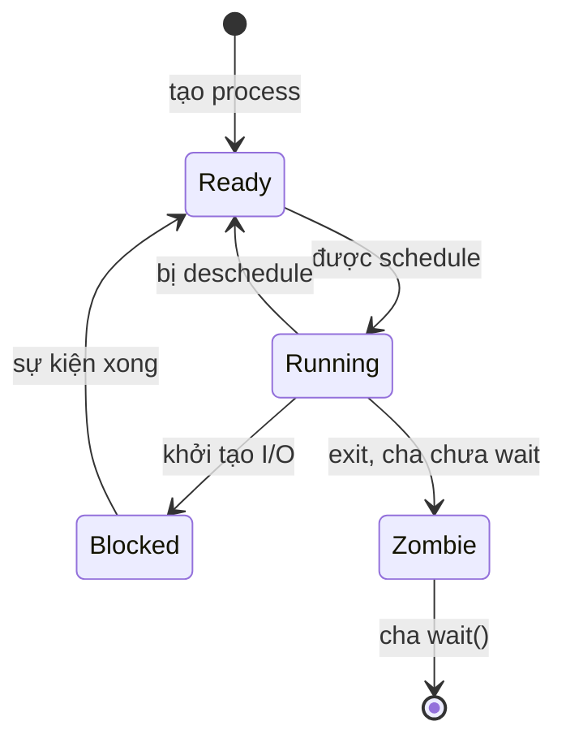
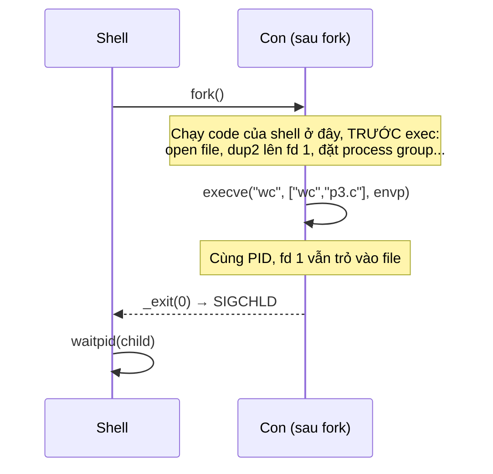
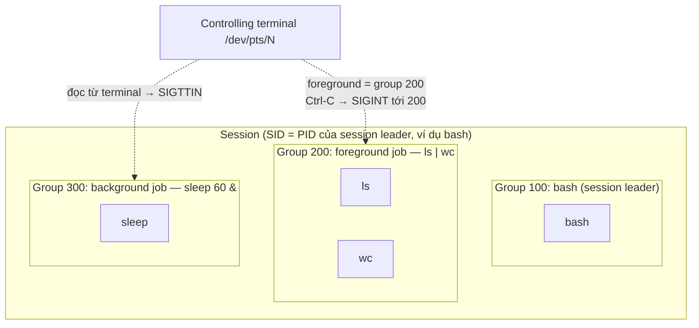

# P1 · Chương 03 — Process

> Mọi điều về kernel/syscall ở đây là về **Linux** (man page Debian bookworm). Ví dụ "đã chạy" được chạy trong container Linux aarch64 của `labs/linux.sh` (kernel 6.8, rustc 1.95.0): đó là quan sát một lần chạy, không phải bảo đảm. Câu không có chú thích là nhận xét hoặc suy luận của người soạn.

## Bạn sẽ hiểu được gì

1. **Q1.** Process khác chương trình ở đâu, và kernel lưu gì để dừng rồi chạy tiếp một process? → mục 1
2. **Q2.** `fork` làm gì, vì sao nhân bản process 1 GiB không tốn 1 GiB? → mục 3
3. **Q3.** `exec` giữ nguyên và thay đổi những gì (PID, fd, signal, environment)? → mục 4
4. **Q4.** Vì sao tách `fork` khỏi `exec`? → mục 5
5. **Q5.** `wstatus` của `wait` nghĩa là gì: exit code 300 thành mấy, "chết vì signal" nhìn ra sao? → mục 6
6. **Q6.** Zombie, orphan, reaping là gì; PID 1 đặc biệt ở đâu, nhất là trong container? → mục 7
7. **Q7.** Process group, session, controlling terminal và job control liên hệ nhau thế nào; vì sao Ctrl-C giết cả pipeline? → mục 8
8. **Q8.** `argv`, environment đi vào process ra sao? (`clone(2)` ở mục 10, Rust `Command` ở mục 11 là mục phụ trợ.) → mục 9

## Kiến thức cần trước

- [Chương 01 — OS và kernel](01-os-va-kernel.md): user mode/kernel mode, trap, limited direct execution, context switch.
- [Chương 02 — System call](02-system-call.md): lời gọi `fork`/`execve` là syscall đi qua wrapper libc, lỗi trả về qua `errno`.

## 1. Từ chương trình đến process (Q1)

> **Trả lời ngắn.** Chương trình là một dãy lệnh nằm yên trên đĩa[^ostep-program-disk]; process là chương trình đang chạy[^ostep-proc]. Để dừng rồi chạy tiếp một process, kernel giữ một cấu trúc riêng cho nó và lưu các thanh ghi (những ô nhớ nhỏ trong CPU, xem [Phase 2 · Chương 01, mục 3](../02-cpu/01-mo-hinh-may-va-isa.md)) vào đó; khôi phục các thanh ghi ấy là cách cho process chạy tiếp[^ostep-regctx].

**Giải thích.** Hình dung (nhận xét của người soạn): file thực thi giống công thức nấu ăn, còn process là một căn bếp đang nấu theo công thức đó — cùng công thức có thể có nhiều bếp chạy cùng lúc, mỗi bếp một trạng thái riêng.

### 1.1 Process gồm gì

OSTEP mô tả process qua *machine state*: trước hết là bộ nhớ nó địa chỉ hóa được (*address space*), chứa lệnh và dữ liệu[^ostep-machine-state]; các thanh ghi, trong đó program counter chỉ lệnh kế tiếp[^ostep-regs]; và thông tin I/O như danh sách file đang mở[^ostep-io-info].

Biến chương trình thành process gồm: nạp code và dữ liệu tĩnh từ đĩa vào bộ nhớ[^ostep-load] (OS hiện đại nạp *lazily*, khi cần[^ostep-lazy]), cấp stack và khởi tạo nó bằng `argc`/`argv` cho `main()`[^ostep-argv], và thiết lập I/O — trên Unix mỗi process mặc định có ba fd cho stdin, stdout, stderr[^ostep-std-fds]. Trên Linux, việc thay chương trình đang chạy của một process bằng chương trình mới là việc của `execve` (mục 4)[^exec-replace].

### 1.2 PCB và process list

OSTEP: OS giữ một *process list* chứa thông tin về mọi process trong hệ thống; mỗi mục của danh sách gọi là *Process Control Block* (PCB)[^ostep-pcb-list] — một C struct chứa thông tin về một process, còn gọi là process descriptor[^ostep-pcb]. Struct này chứa *register context*: khi process bị dừng, thanh ghi của nó được lưu ở đó, và khôi phục chúng là cách cho process chạy tiếp, kỹ thuật gọi là *context switch*[^ostep-regctx] (cơ chế ở [Chương 01](01-os-va-kernel.md), mục 5).

Trên Linux, fork(2) nhắc tới một *task structure* riêng được tạo cho mỗi con[^fork-cow] (suy luận của người soạn: đó là cấu trúc đóng vai PCB của Linux). `/proc` là giao diện của kernel tới các cấu trúc dữ liệu của nó[^proc-iface]; thông tin theo từng process nằm dưới `/proc/<pid>/…` ([Chương 06](06-user-quyen-proc-sys.md), mục 4).

### 1.3 Trạng thái

OSTEP đơn giản hóa còn ba trạng thái: *running* (đang chạy trên một CPU)[^ostep-states], *ready* (sẵn sàng chạy nhưng OS chưa chọn nó lúc này)[^ostep-ready], *blocked* (đã làm việc khiến nó chưa chạy được cho đến khi có sự kiện khác)[^ostep-blocked-def]. Ready → running là được *schedule*, running → ready là bị *deschedule*; process blocked (ví dụ vì I/O) ở yên cho tới khi sự kiện xảy ra rồi về ready[^ostep-blocked]. OSTEP còn nhắc một trạng thái khởi tạo lúc process đang được tạo[^ostep-initfinal] và một trạng thái cuối: process đã thoát nhưng chưa được dọn — trên Unix gọi là *zombie* — để cha còn xem được return code[^ostep-zombie].



(Sơ đồ là bản rút gọn của người soạn: gộp trạng thái khởi tạo vào Ready; hai mũi tên quanh Zombie theo man page `wait(2)`[^wait-zombie], xem mục 7.)

<details><summary>Đi sâu: các ký tự trạng thái trong /proc trên Linux</summary>

Linux chi tiết hơn: trường `state` của `/proc/<pid>/stat` là một ký tự — `R` Running, `S` sleeping (interruptible), `D` uninterruptible disk sleep, `Z` Zombie, `T` stopped, `t` tracing stop, `X` Dead (man page còn liệt kê vài ký tự khác)[^proc-stat-state]; `/proc/<pid>/status` có dòng `State` ghi cùng thông tin[^proc-state] (cách đọc `/proc`: [Chương 06](06-user-quyen-proc-sys.md), mục 4).

</details>

**Quay lại Q1:** process là chương trình đang chạy cùng trạng thái máy (bộ nhớ, thanh ghi, I/O) mà kernel giữ trong PCB để dừng và tiếp tục.

## 2. Danh tính của process

Mỗi process có PID duy nhất, không âm, gán khi tạo bằng `fork(2)` và lấy bằng `getpid(2)`[^cred-pid]. PID cha (PPID) lấy bằng `getppid`[^getpid-ppid]. Cả PID và PPID được giữ nguyên qua `execve`[^cred-pid-exec][^cred-ppid-exec] — điều này sẽ quan trọng ở mục 4: `exec` không tạo process mới.

PID không vô hạn: `fork` có thể lỗi `EAGAIN` khi chạm `RLIMIT_NPROC` (giới hạn số process của một user), `/proc/sys/kernel/threads-max` (trần toàn hệ thống) hoặc số PID tối đa `/proc/sys/kernel/pid_max`[^fork-eagain]; rò rỉ process (kể cả zombie, mục 7) vì thế có thể làm cạn các giới hạn đó (suy luận của người soạn). UID/GID và capabilities thuộc [Chương 06](06-user-quyen-proc-sys.md); process group và session ở mục 8.

## 3. `fork`: nhân bản một process (Q2)

> **Trả lời ngắn.** `fork` tạo process mới bằng cách nhân bản chính process đang gọi nó[^fork-copy]. Nó rẻ vì Linux không chép ngay bộ nhớ: theo man page, chi phí chỉ là sao chép *page table* của cha (bảng ánh xạ địa chỉ của process) và tạo *task structure* (cấu trúc quản lý process) cho con, nhờ kỹ thuật *copy-on-write*[^fork-cow]. Ý tưởng của copy-on-write: hai bên dùng chung các trang bộ nhớ, trang nào có bên ghi vào thì mới được chép riêng (giải thích của người soạn).

**Giải thích.** Hình dung (nhận xét của người soạn): hai người cùng đọc một cuốn sổ chung; ai muốn viết vào trang nào thì trang ấy mới được photocopy riêng.

### 3.1 Ngữ nghĩa

`fork()` tạo process mới bằng cách nhân bản process gọi[^fork-copy]. Hai bên chạy trong hai không gian bộ nhớ riêng, lúc fork nội dung giống nhau, và ghi/map/unmap ở một bên không ảnh hưởng bên kia[^fork-mem]. Trả về: PID của con ở cha, `0` ở con, `-1` ở cha khi lỗi (không có con nào được tạo)[^fork-ret]. OSTEP gọi nó là routine kỳ lạ nhất bạn từng gọi[^ostep-fork-strange]. Con là bản sao gần như y hệt[^ostep-fork-copy] và không bắt đầu từ `main`, mà chạy tiếp từ sau lời gọi `fork` như thể chính nó vừa gọi `fork`[^ostep-fork-nomain].

Con "gần như" y hệt: man page nói con là bản sao y hệt của cha *trừ* một danh sách khác biệt[^fork-exact]. Ba khác biệt đáng nhớ: PID riêng, không trùng process group hay session nào[^fork-pid]; tập signal pending ([Chương 05](05-signal.md)) ban đầu rỗng[^fork-pending]; không thừa hưởng timer của cha[^fork-timers]. Những thứ con thừa hưởng và đáng chú ý nhất cho backend:

- **fd**: con nhận bản sao bảng fd, mỗi fd trỏ cùng *open file description* với fd của cha — hai bên chia sẻ offset và status flags[^fork-fds] ([Chương 04](04-file-descriptor-va-vfs.md), mục 2).
- **signal disposition** (cách xử lý mỗi signal)[^signal-fork] ([Chương 05](05-signal.md)); **UID/GID**[^cred-ids-fork] ([Chương 06](06-user-quyen-proc-sys.md)); **process group và session**[^cred-pgid] (mục 8).

Riêng với thread (mục 10): con chỉ có một thread (thread đã gọi `fork`) nhưng không gian địa chỉ được nhân bản nguyên, kể cả trạng thái mutex và condition variable[^fork-thread]. Hệ quả: sau `fork` trong chương trình đa luồng, con chỉ được gọi an toàn các hàm *async-signal-safe* (tập hàm liệt kê trong signal-safety(7); xem [Chương 05](05-signal.md)) cho đến khi gọi `execve`[^fork-signalsafe].

```mermaid
sequenceDiagram
  participant P as Cha
  participant K as Kernel
  participant C as Con
  P->>K: fork()
  K->>K: task struct mới, nhân page table (COW)
  K-->>P: PID của con
  K-->>C: 0
  C->>K: _exit(status)
  K-->>P: SIGCHLD
  P->>K: waitpid(child)
  K-->>P: wstatus; con rời process table
```

(Sơ đồ rút gọn: `SIGCHLD` là termination signal của con sinh bởi `fork`[^fork-sigchld]; cha chưa `wait` thì con thành zombie, xem mục 6–7.)

Thứ tự chạy của cha và con **không xác định**[^ostep-nondet] — scheduler (phần của kernel quyết định process nào được chạy) chọn process chạy tại mỗi thời điểm[^ostep-scheduler]. Muốn có thứ tự phải đồng bộ, thường bằng `wait` — OSTEP ghi rằng thêm lời gọi `wait()` ở cha làm output xác định[^ostep-wait-det].

### 3.2 Vì sao `fork` rẻ: copy-on-write

Nhân bản toàn bộ bộ nhớ từng là cách làm cũ và thường lãng phí, vì ngay sau đó thường có `exec`[^vfork-hist]. Trên Linux, `fork()` dùng các trang copy-on-write (COW); chi phí chỉ là thời gian và bộ nhớ để sao chép *page table* của cha và tạo task structure cho con[^fork-cow]. Ý tưởng (giải thích của người soạn về COW): sau fork hai bên dùng chung trang vật lý; khi một bên *ghi*, kernel mới chép riêng trang đó. Cơ chế chi tiết, kể cả thí nghiệm đo bộ nhớ dùng chung bằng PSS, ở [Phase 3 · Chương 05, mục 4](../03-memory/05-bo-nho-tien-trinh-linux.md).

<details><summary>Đi sâu: thí nghiệm 1 GiB và vfork/posix_spawn/clone</summary>

Thử nghiệm đã chạy (Rust gọi `fork` qua FFI; aarch64, kernel 6.8; một lần chạy): cấp `Vec<u8>` 1 GiB và ghi hết cho resident, rồi `fork`.

- `fork()` trả về ở cha sau **2,3 ms**.
- Trong con, `VmRSS` ≈ 1.049.140 kB — RSS *tính cả trang dùng chung* (RSS so với PSS: [Phase 3 · Chương 05, mục 4](../03-memory/05-bo-nho-tien-trinh-linux.md)), nên không cho biết con tốn thêm bao nhiêu bộ nhớ vật lý.
- Con ghi 1 byte vào mỗi trang 4 KiB của 256 MiB đầu (65.536 lần) mất ~70 ms (≈1 µs/trang, gồm page fault COW).
- Cha vẫn thấy `v[0] == 1` trong khi con ghi `2` — đúng ngữ nghĩa "ghi ở một bên không ảnh hưởng bên kia"[^fork-mem].

Vì chi phí gồm sao chép page table[^fork-cow], (suy luận của người soạn) thời gian `fork` tăng theo lượng bộ nhớ đã map; số 2,3 ms là quan sát, không phải công thức.

### 3.3 `vfork`, `posix_spawn`, `clone`

`vfork` là trường hợp đặc biệt của `clone(2)`, tạo process mới *không sao chép page table của cha*[^vfork-desc]; đổi lại thread gọi bị treo đến khi con thoát hoặc `execve`, và trong thời gian đó con dùng chung toàn bộ bộ nhớ với cha, kể cả stack[^vfork-susp]. Từ glibc 2.24, `posix_spawn()` bắt đầu bằng `clone(2)` với cờ `CLONE_VM` và `CLONE_VFORK` (bản cũ hơn dùng `fork(2)`, hoặc có thể `vfork(2)`)[^posix-spawn-clone]; cách `Command` của Rust chọn giữa `posix_spawn` và `fork`+`exec` ở [Chương 07](07-rust-tren-giao-dien-he-thong.md), mục 3. Còn wrapper `fork` của glibc từ 2.3.3 không gọi syscall `fork` mà gọi `clone(2)` với flags cho cùng hiệu quả[^fork-glibc] ([Chương 02](02-system-call.md), mục 3); về ngữ nghĩa, man page nói `fork()` tương đương `clone(2)` với flags chỉ là `SIGCHLD`[^fork-clone-eq] (mục 10).

</details>

**Quay lại Q2:** `fork` nhân bản process với bộ nhớ riêng, và nhờ copy-on-write nó chỉ sao chép page table chứ không chép dữ liệu.

## 4. `exec`: thay chương trình đang chạy (Q3)

> **Trả lời ngắn.** `execve` thay chương trình đang chạy trong process bằng chương trình khác, với stack, heap và dữ liệu khởi tạo lại[^exec-replace]; process vẫn là process cũ[^ostep-exec-transform] nên PID giữ nguyên[^cred-pid-exec]. fd đang mở vẫn mở, trừ fd được đánh dấu "đóng khi exec" (close-on-exec)[^exec-fds-default][^exec-fds]; hàm xử lý signal đã cài (signal handler) bị đặt lại về mặc định[^exec-handlers]. Environment của chương trình mới là mảng `envp` mà bên gọi truyền vào[^exec-envp]; process group và session cũng giữ nguyên[^cred-pgid] (job control, mục 8).

**Giải thích.** Hình dung (nhận xét của người soạn): như thay toàn bộ đầu bếp và công thức trong cùng một căn bếp, nhưng giữ nguyên số bếp và các đường ống đã nối sẵn.

Theo OSTEP, `exec` **không tạo process mới**, mà biến chương trình đang chạy thành chương trình khác[^ostep-exec-transform]; `exec` thành công thì không bao giờ return[^exec-noreturn] (nên mã sau `exec` chỉ chạy khi `exec` lỗi).

### 4.1 Cái gì sống sót qua `exec`, cái gì không

Man page nói tất cả thuộc tính process được giữ nguyên, **trừ** một danh sách[^exec-preserved]. Phần quan trọng cho người viết server:

| Thuộc tính | Qua `execve` | Nguồn |
|---|---|---|
| PID, PPID | giữ nguyên | [^cred-pid-exec][^cred-ppid-exec] |
| process group ID, session ID | giữ nguyên | [^cred-pgid] |
| fd | **giữ mở** mặc định; fd đánh dấu close-on-exec thì đóng | [^exec-fds-default][^exec-fds] |
| signal handler đã cài | reset về mặc định | [^exec-handlers] |
| signal bị ignore | giữ nguyên (ignore) | [^signal-exec] |
| memory mapping | không giữ | [^exec-mmap] |
| thread khác ngoài thread gọi | bị hủy | [^exec-threads] |
| real UID/GID, supplementary groups | giữ nguyên | [^exec-ids] |
| effective UID | đổi sang chủ file nếu file có bit set-user-ID, trừ khi `nosuid`, `no_new_privs` hoặc ptrace (chi tiết: [Chương 06](06-user-quyen-proc-sys.md), mục 2) | [^exec-suid][^exec-suid-ignored] |
| environment | do bên gọi quyết định, qua tham số `envp` (mục 9) | [^exec-envp] |

Tác động cho backend (nhận xét của người soạn): socket/file mở không có `O_CLOEXEC` bị mọi chương trình `exec` sau đó thừa hưởng (fd rò rỉ), và signal bị ignore cũng vậy. Cờ `O_CLOEXEC` và lý do `open` + `fcntl` không đủ khi đa luồng: [Chương 04](04-file-descriptor-va-vfs.md), mục 4.

<details><summary>Đi sâu: script và ELF interpreter</summary>

`pathname` phải là file thực thi nhị phân hoặc script bắt đầu bằng `#!interpreter`[^exec-script]; với ELF liên kết động, interpreter ghi trong segment `PT_INTERP` nạp các shared object cần thiết; man page ghi interpreter này thường là `/lib/ld-linux.so.2` với chương trình liên kết glibc[^exec-elf-interp].

</details>

**Quay lại Q3:** `exec` biến process hiện tại thành chương trình khác, giữ PID, group, session và fd không close-on-exec, còn reset handler và bỏ memory mapping.

## 5. Vì sao tách `fork` khỏi `exec` (Q4)

> **Trả lời ngắn.** Tách đôi để shell chạy code của chính nó trong con, sau `fork` và trước `exec`, nhằm đổi môi trường của chương trình sắp chạy[^ostep-fork-exec]. Ví dụ *redirect* (chuyển hướng, như `cmd > file`) dựa vào việc fd mở được giữ qua `exec`[^ostep-redirect]. Theo ví dụ OSTEP ngay dưới, shell nối stdout của con vào file rồi mới `exec`, nên chương trình mới ghi ra stdout mà không biết đó là file.

**Giải thích.** Hình dung (nhận xét của người soạn): thợ sửa nhà vào phòng, đổi ổ cắm và biển hiệu trước, rồi mới để người thuê mới dọn vào; nếu thuê và dọn vào cùng một bước thì không có chỗ để sửa.

Tạo process bằng hai bước (nhân bản rồi thay ruột) thoạt nhìn là thừa. Nhưng shell chạy được code *giữa* `fork` và `exec`, code đó đổi môi trường của chương trình sắp chạy[^ostep-fork-exec]. Ví dụ `wc p3.c > newfile.txt` theo OSTEP: trong con, trước `exec`, shell đóng stdout rồi mở file đích; vì Unix tìm fd trống bắt đầu từ số 0, file mới nhận đúng fd của stdout[^ostep-fd-lowest], và vì fd mở được giữ qua `exec`[^ostep-redirect], `wc` ghi stdout vào file mà không biết gì. Pipe được làm tương tự bằng `pipe()`: output một process nối vào pipe trong kernel, input process kia nối vào cùng pipe[^ostep-pipe]. Chuỗi syscall thật (`open`, `dup2`, `close`) và pipe: [Chương 04](04-file-descriptor-va-vfs.md), mục 7–8.

<details><summary>Đi sâu: sơ đồ trình tự của shell</summary>



Sơ đồ là mô hình khái niệm theo OSTEP; shell thật có thể khác chi tiết (ví dụ dash áp redirect ngay trong shell rồi khôi phục: quan sát `strace` ở [Chương 04](04-file-descriptor-va-vfs.md), mục 7). OSTEP gọi tổ hợp `fork` + `exec` là đơn giản mà cực kỳ mạnh[^ostep-lampson].

</details>

**Quay lại Q4:** vì giữa `fork` và `exec` shell sắp đặt fd và môi trường cho con, và `exec` giữ nguyên các sắp đặt đó.

## 6. Kết thúc, `wait` và exit status (Q5)

> **Trả lời ngắn.** Khi con kết thúc, cha gọi `wait` và nhận một số nguyên `wstatus` gói cả cách con kết thúc (tự thoát hay bị signal giết) lẫn mã thoát[^wait-wstatus-int]; nên đọc bằng macro `WIFEXITED`, `WEXITSTATUS`, `WIFSIGNALED`, `WTERMSIG` thay vì tự tách bit (nhận xét của người soạn). Mã thoát chỉ giữ 8 bit thấp, nên con gọi `exit(300)` thì cha thấy 44[^exit-status-mask]. Con bị signal (một thông báo gửi tới process, [Chương 05](05-signal.md)) giết thì `WIFSIGNALED` đúng và `WTERMSIG` cho số signal đó[^wait-wifsignaled].

**Giải thích.** Hình dung (nhận xét của người soạn): `wstatus` như phiếu báo cáo của công nhân gửi về quản đốc; quản đốc phải đọc đúng ô (thoát bình thường hay bị chặn giữa chừng) thay vì nhìn con số thô.

### 6.1 `exit` và `_exit`

Khác biệt giữa hai hàm: `exit(3)` gọi các hàm đăng ký bằng `atexit`/`on_exit` theo thứ tự ngược[^exit3-atexit] và flush (đẩy dữ liệu còn trong bộ đệm ra) rồi đóng mọi stdio stream[^exit3-flush]; `_exit` thì không gọi các hàm đó và không flush stdio[^exit-no-atexit]. Cả hai chuyển `status & 0xFF` cho cha làm exit status[^exit3-status][^exit-status-mask]; `_exit` đóng mọi fd, giao các con của process cho `init(1)` (hoặc "subreaper" gần nhất) và gửi `SIGCHLD` cho cha[^exit-status].

Lưu ý: syscall `_exit` thô của Linux chỉ kết thúc thread gọi; việc reparent con và gửi `SIGCHLD` chỉ xảy ra khi đó là thread cuối của nhóm[^exit-thread], còn wrapper libc `_exit` kết thúc cả process (glibc từ 2.3 gọi `exit_group(2)`)[^exit-wrapper].

### 6.2 `wait`, `waitpid`

`wait` và họ hàng chờ *thay đổi trạng thái* của con: con thoát, bị signal làm dừng, hoặc được signal làm chạy tiếp[^wait-desc]; mặc định `waitpid` chỉ chờ con *thoát*, muốn chờ cả dừng/tiếp tục phải chỉ định thêm option[^wait-default-term]. Nếu con đã đổi trạng thái thì gọi trả về ngay; không thì chặn cho đến khi có con đổi trạng thái hoặc một signal handler làm gián đoạn[^wait-already]. Với con đã thoát, `wait` cho phép hệ thống giải phóng tài nguyên của con[^wait-release].

Lựa chọn con bằng `pid` của `waitpid`: `-1` là mọi con[^wait-any]; `< -1` là mọi con có process group ID bằng |pid|[^wait-pgid]; `WNOHANG` trả về ngay nếu chưa có con nào thoát[^wait-nohang]. Không có con chưa-wait thì `wait()` lỗi `ECHILD`[^wait-echild].

### 6.3 Đọc `wstatus`

`wstatus` là một `int` nhồi nhiều thông tin[^wait-wstatus-int]; dùng macro, đừng tự tách bit (nhận xét của người soạn):

| Macro | Nghĩa |
|---|---|
| `WIFEXITED(s)` | con kết thúc bình thường: `exit`, `_exit` hoặc return khỏi `main`[^wait-wifexited] |
| `WEXITSTATUS(s)` | 8 bit thấp của giá trị con truyền cho `exit`; chỉ dùng khi `WIFEXITED` đúng[^wait-wexitstatus] |
| `WIFSIGNALED(s)`, `WTERMSIG(s)` | con bị signal giết, và số signal đó[^wait-wifsignaled] |
| `WCOREDUMP(s)` | có core dump không; chỉ dùng khi `WIFSIGNALED` đúng; không có trong POSIX.1-2001 và không phải hệ UNIX nào cũng có[^wait-wcoredump] |
| `WIFSTOPPED(s)` | con bị dừng bởi signal; chỉ khi dùng `WUNTRACED` hoặc con đang bị trace[^wait-wifstopped] |

<details><summary>Đi sâu: ví dụ đã chạy với wstatus thô</summary>

Ví dụ đã chạy (Rust gọi `fork`/`waitpid`/`_exit` qua FFI; mỗi dòng một con). Cột `raw` là quan sát trên glibc/Linux aarch64, không phải thứ man page hứa:

| Con làm gì | `raw` | Đọc bằng macro |
|---|---|---|
| `_exit(7)` | `0x0700` | `WIFEXITED`, status 7 |
| `_exit(300)` | `0x2c00` | `WIFEXITED`, status **44** (= 300 & 0xFF) |
| bị `kill(pid, 9)` | `0x0009` | `WIFSIGNALED`, `WTERMSIG` = 9 |

`waitpid` trả đúng PID con ở cả ba dòng, và biến `x` của cha vẫn là 100 dù con đã tăng bản sao của nó. 300 → 44 khớp "`status & 0xFF`"[^exit-status-mask]. Nhận xét của người soạn: worker bị OOM killer giết (SIGKILL) khác worker tự `exit(137)` ở `WIFSIGNALED`; supervisor tốt log hai trường hợp riêng.

</details>

**Quay lại Q5:** `wstatus` phân biệt thoát bình thường (8 bit thấp) với chết vì signal; luôn đọc bằng macro.

## 7. Zombie, orphan, reaping và PID 1 (Q6)

> **Trả lời ngắn.** Con kết thúc mà cha chưa gọi `wait` thì thành *zombie*: kernel vẫn giữ lại PID, trạng thái thoát và thông tin tài nguyên đã dùng để cha lấy sau[^wait-zombie]. Nếu cha chết trước, các con thành *orphan* (mồ côi) và được `init(1)` (process PID 1) — hoặc một "subreaper" gần nhất, tức process đã tự nhận vai trò đó — nhận làm con nuôi[^exit-status]. Trong container, process PID 1 của PID namespace (không gian PID riêng) là cha của mọi orphan trong đó[^pidns-init]; vì vậy nó cần tự `wait` để dọn zombie (suy luận của người soạn) và, từ trong namespace, chỉ nhận được signal mà nó đã cài handler[^pidns-sig].

**Giải thích.** Hình dung (nhận xét của người soạn): zombie như hồ sơ nhân viên đã nghỉ việc nhưng chưa ai ký nhận bàn giao; hồ sơ vẫn chiếm một ngăn tủ cho đến khi quản lý (cha) ký. Nếu quản lý biến mất, phòng nhân sự (init) nhận ký thay.

### 7.1 Zombie

Con kết thúc mà chưa được `wait` thì thành *zombie*: kernel giữ lại một lượng tối thiểu thông tin (PID, termination status, resource usage) để cha lấy sau[^wait-zombie]. Zombie vẫn chiếm một slot trong process table; bảng đầy thì không tạo được process mới[^wait-table], và `/proc/<pid>/cmdline` của nó rỗng[^proc-cmdline]. Thử nghiệm đã chạy: cha `fork` ra con rồi ngủ không `wait`; `/proc/<pid>/status` của con hiện `State: Z (zombie)` với `PPid` là PID cha, `cmdline` rỗng, và sau `waitpid` thư mục `/proc/<pid>` biến mất.

**Reaping** (thu hoạch) là việc cha gọi `wait*` để xóa zombie. Một cách tự động hóa theo man page: đặt disposition (cách xử lý, [Chương 05](05-signal.md)) của `SIGCHLD` thành `SIG_IGN` hoặc cờ `SA_NOCLDWAIT`, khi đó con kết thúc không thành zombie[^wait-sigign] — nhưng cha mất khả năng lấy exit status của con (khi ấy `wait` chờ hết con rồi lỗi `ECHILD`[^wait-sigign-echild]). Chi tiết về `SIGCHLD` và bẫy nhiều con chết cùng lúc: [Chương 05](05-signal.md), mục 7.

### 7.2 Orphan và reparenting

Khi cha chết trước, các con trở thành *orphan* và được `init(1)` thừa hưởng (hoặc "subreaper" gần nhất)[^exit-status]. `init` tự động `wait` để dọn zombie của chúng[^wait-init]. Thử nghiệm đã chạy: cha `fork` ra con, cha ngủ 0,2 s rồi `_exit`; con ghi lại `getppid()` lúc đầu và sau 0,6 s: `before=7 after=1` — PID cha đổi sang 1 sau khi cha chết. (PID 1 ở đây là `bash` của lab trong PID namespace của container, xem 7.3.)

### 7.3 Subreaper và PID 1 trong container

PID namespace thêm một lớp: process đầu tiên trong namespace có PID 1, là "init" của namespace và là cha của mọi orphan trong đó[^pidns-init]. Hai điều có nguồn cần biết khi chạy service trong container: nếu init của namespace chết, kernel giết mọi process trong namespace bằng `SIGKILL`[^pidns-kill]; và từ trong namespace, chỉ signal mà init đã cài handler mới gửi tới nó được, kể cả từ process đặc quyền[^pidns-sig]. Luật signal đầy đủ của PID 1 (kể cả ngoại lệ `SIGKILL`/`SIGSTOP` gửi từ namespace tổ tiên) và graceful shutdown: [Chương 05](05-signal.md), mục 8; cơ chế namespace: [Phase 8 · Namespaces](../08-containers/02-namespaces.md).

Suy luận của người soạn: chương trình của bạn làm PID 1 mà không `wait` orphan được giao thì chúng thành zombie không ai dọn, và không cài handler `SIGTERM` thì `kill -TERM 1` gửi từ trong namespace không có tác dụng như với process thường.

**Liên hệ backend (nhận xét của người soạn).** Service spawn subprocess (`ffmpeg`, `git`) mà quên `wait` sẽ tích zombie cho tới khi chạm các giới hạn ở mục 2 (`pid_max`, `RLIMIT_NPROC`…); khi đó `fork` lỗi `EAGAIN`[^fork-eagain], mà mô tả chuẩn của `EAGAIN` là "Resource temporarily unavailable"[^errno-eagain].

<details><summary>Đi sâu: prctl(PR_SET_CHILD_SUBREAPER)</summary>

`prctl(PR_SET_CHILD_SUBREAPER)` (Linux ≥ 3.4) cho process đóng vai `init(1)` với hậu duệ: orphan được gắn vào subreaper sống gần nhất[^subreaper]; sau đó `getppid` của orphan trả PID subreaper, và khi orphan kết thúc thì subreaper nhận `SIGCHLD` để `wait`[^subreaper-ppid]. Thuộc tính này không thừa hưởng qua `fork`/`clone` nhưng giữ qua `execve`[^subreaper-inherit].

</details>

**Quay lại Q6:** zombie là con đã chết chưa được reap, orphan được init/subreaper nhận, và PID 1 trong container đóng vai init của namespace nên cũng gánh việc reap đó (suy luận của người soạn).

## 8. Process group, session, controlling terminal, job control (Q7)

> **Trả lời ngắn.** Shell xếp các process của một lệnh (hoặc cả pipeline như `ls | wc`) vào cùng một *process group*, còn gọi là *job*[^cred-pgrp-def]. Các group nằm trong một *session*, và mọi process trong session dùng chung một terminal điều khiển (*controlling terminal*)[^cred-ctty]. Bấm Ctrl-C thì signal được gửi tới các process của job đang ở foreground[^cred-ctrlc] — job duy nhất được phép đọc từ terminal[^cred-fg]; vì cả pipeline cùng một group nên tất cả đều nhận signal.

**Giải thích.** Hình dung (nhận xét của người soạn): khi bạn gõ `ls | wc` rồi Ctrl-C, cả hai process phải dừng; khi chạy `vim &` ở nền, nó không được cướp bàn phím. Cần một đơn vị "công việc" lớn hơn process. Man page credentials(7): session và process group là các abstraction sinh ra để hỗ trợ *shell job control*[^cred-pgrp].

### 8.1 Các khái niệm

- **Process group** (còn gọi *job*): tập process chung process group ID; shell tạo một group mới cho process(es) chạy một lệnh hoặc pipeline — ví dụ hai process của `ls | wc` nằm cùng một group[^cred-pgrp-def]. Process có PID bằng PGID là *group leader*[^cred-leader].
- **Session**: tập process chung session ID; mọi thành viên của một group cùng một session, nên session và group tạo thành phân cấp hai tầng chặt chẽ[^cred-hier]. Session mới tạo khi gọi `setsid(2)`; session ID bằng PID của người gọi, người đó là *session leader*[^cred-session].
- **Controlling terminal**: mọi process trong session dùng chung một terminal điều khiển, được thiết lập khi session leader mở terminal lần đầu (trừ khi dùng `O_NOCTTY`); một terminal là controlling terminal của tối đa một session[^cred-ctty].
- **Foreground/background**: tối đa một job trong session là foreground; chỉ foreground job được đọc từ terminal — background job đọc thì cả group bị `SIGTTIN` và bị dừng[^cred-fg]. Phím sinh signal (như Ctrl-C) gửi signal tới các process của foreground job[^cred-ctrlc]. `tcsetpgrp(3)` đặt foreground process group của terminal[^tcsetpgrp].



(Số 100, 200, 300 chỉ để minh họa; group ID bằng PID của group leader[^cred-leader]. Ctrl-C ứng với signal `SIGINT`[^termios-intr]; background job đọc terminal bị `SIGTTIN`[^cred-fg].)

<details><summary>Đi sâu: setpgid, setsid và thí nghiệm</summary>

### 8.2 API

`setpgid(pid, pgid)` đặt PGID: `pid == 0` nghĩa là chính mình, `pgid == 0` nghĩa là PGID = PID của process đó[^setpgid-desc]. Chuyển process sang group khác chỉ được khi cả hai group cùng session[^setpgid-same-session]. `bash` dùng `setpgid`/`getpgrp` để làm job control[^setpgid-bash].

Có một cái bẫy ghi trong `ERRORS`: sửa PGID của một *con* đã gọi `execve` thì lỗi `EACCES`[^setpgid-eacces]. Vì vậy (suy luận của người soạn) cha không thể đợi tới lúc con đã `exec` mới xếp con vào group; hướng dẫn "Implementing a Shell" của glibc cho cả shell lẫn từng con cùng gọi `setpgid`: mỗi con phải vào group trước khi chạy chương trình mới, shell cần mọi con đã trong group trước khi chạy tiếp, và nếu cả hai cùng gọi thì kết quả đúng bất kể bên nào đến trước[^glibc-shell-race].

`setsid()` tạo session mới nếu người gọi chưa là process group leader; người gọi thành leader của session mới lẫn của một group mới[^setsid-leader], và là process duy nhất trong cả hai; session mới ban đầu không có controlling terminal[^setsid-new]. Nếu đã là group leader thì `setsid` lỗi `EPERM`[^setsid-eperm]. Nên cách chắc chắn: `fork`, cha `_exit`, con (không thể là group leader) gọi `setsid`[^setsid-daemon] — (nhận xét của người soạn) đây là bước đầu của kỹ thuật "daemonize" cổ điển.

Chiều ngược lại: nếu terminal bị hangup (và cờ `CLOCAL` của terminal chưa đặt) thì session leader nhận `SIGHUP`; nếu session leader kết thúc thì mọi process trong foreground group của controlling terminal nhận `SIGHUP`[^setsid-hup]. (Nhận xét của người soạn: vì vậy job chạy dưới một session gắn terminal có thể bị `SIGHUP` khi terminal đóng, và `nohup`/`setsid` thường được dùng để tách job khỏi nó.)

Thử nghiệm đã chạy: trong script không tương tác (không job control), `ps` cho thấy `sh`, `ps`, `cat` đều `PGID=1 SID=1` (suy luận của người soạn: shell không bật job control nên không tạo group mới); còn `setsid -w sh -c 'ps -o pid,ppid,pgid,sid,tty,comm -p $$'` in `PID=PGID=SID=19` và `TT=?` — session mới, không có terminal (đúng với man page về session mới[^setsid-new]).

`/proc/<pid>/stat` có các trường `pgrp`, `session`, `tty_nr`[^proc-stat-pgrp] và `tpgid` (foreground group của terminal)[^proc-stat-tpgid].

</details>

**Quay lại Q7:** Ctrl-C nhắm vào foreground process group của terminal, và shell xếp cả pipeline vào cùng một group nên tất cả nhận SIGINT.

## 9. `argv` và environment (Q8)

> **Trả lời ngắn.** Bên gọi `execve` quyết định cả hai thứ đưa vào chương trình mới: `argv` là mảng chuỗi tham số dòng lệnh kết thúc bằng con trỏ `NULL`[^exec-argv][^exec-argv-null], còn `envp` là mảng chuỗi môi trường, theo quy ước dạng `key=value`[^exec-envp]. `fork` cho con một bản sao environment của cha[^environ-inherit]. `argv[0]` theo quy ước là tên file được chạy[^exec-argv], nhưng đó chỉ là quy ước nên bên gọi có thể đặt khác (mục 9.2).

**Giải thích.** Hình dung (nhận xét của người soạn): `argv` là phiếu yêu cầu đưa cho đầu bếp mới, `envp` là các biển báo dán trong bếp; người gọi `execve` quyết định viết gì lên chúng.

### 9.1 Chúng đi vào process thế nào

Ở phía chương trình mới, theo OSTEP, OS khởi tạo stack bằng `argc`/`argv` cho `main`[^ostep-argv]. Tham số thứ ba `envp` của `main` không có trong POSIX; theo POSIX đọc environment qua biến ngoài `environ(7)`[^exec-main3].

Environment được thừa hưởng: `fork` cho con bản sao[^environ-inherit], còn `execve` truyền `envp` do bên gọi chọn[^exec-envp]; vì thế `NAME=value command` của shell chỉ đặt biến trong phạm vi process chạy lệnh đó[^environ-shell].

Tổng kích thước `argv`+`envp` bị giới hạn, vượt thì `execve` lỗi `E2BIG`[^exec-e2big]; từ Linux 2.6.23 giới hạn dẫn xuất từ `RLIMIT_STACK` mềm[^exec-argmax]. Thử nghiệm đã chạy:

```text
$ env -i A=1 B=two sh -c 'tr "\0" "\n" < /proc/self/environ'
A=1
B=two
$ Y=only-for-child sh -c 'echo $Y'      # con thấy Y: in only-for-child
$ echo "parent Y=[$Y]"                  # shell cha không thấy: parent Y=[]
```

<details><summary>Đi sâu: argv[0] và /proc</summary>

### 9.2 `argv[0]` là quy ước, không phải sự thật

`argv[0]` theo quy ước chứa tên file[^exec-argv], nhưng bên gọi `execve` đặt gì cũng được (suy luận của người soạn từ chữ "theo quy ước" của man page). Thử nghiệm đã chạy: `bash -c 'exec -a fancy-name sh -c "echo pid=$$ argv0=$0 ..."'` in cùng PID với shell trước `exec` (7), `argv0=fancy-name`, và `/proc/<pid>/cmdline` hiện `fancy-name -c …`. Docs Rust xác nhận ở phía nhận: phần tử đầu của `env::args_os()` có thể bị đặt thành văn bản tùy ý, thậm chí có thể không tồn tại, nên không nên dựa vào nó cho bảo mật[^rs-args-os].

### 9.3 Nhìn từ ngoài: `/proc`

- `/proc/<pid>/cmdline`: command line của process, các chuỗi cách nhau bằng byte null; nếu sau `exec` process sửa chuỗi argv thì thay đổi hiện ở đây[^proc-cmdline-fmt]; với zombie, file này rỗng[^proc-cmdline].
- `/proc/<pid>/environ`: environment *ban đầu* khi chương trình được `execve`[^proc-environ-init]; sửa bằng `putenv` sau đó **không** hiện ở file này[^proc-environ].

</details>

**Quay lại Q8:** bên gọi `execve` chọn `argv` và `envp`; `argv[0]` là quy ước, và `/proc/<pid>/environ` chỉ cho thấy environment ban đầu.

## 10. `clone(2)`: nền chung của process và thread (giới thiệu)

`clone` tạo process con giống `fork`, nhưng cho kiểm soát chính xác phần ngữ cảnh nào dùng chung: không gian địa chỉ, bảng fd, bảng signal handler, và còn cho đặt con vào namespace riêng[^clone-desc][^clone-share]. Một vài cờ cho thấy mô hình:

| Cờ | Tác dụng |
|---|---|
| (không cờ, chỉ `SIGCHLD`) | tương đương `fork`[^fork-clone-eq] |
| `CLONE_VM` | cha và con chạy trong cùng không gian bộ nhớ[^clone-vm] |
| `CLONE_FILES` | chia sẻ cùng bảng fd[^clone-files] |
| `CLONE_THREAD` | con thuộc cùng *thread group* với cha[^clone-thread] |
| `CLONE_NEWPID` | tạo con trong PID namespace mới[^clone-newpid] |

Trong kernel Linux, thread không phải cấu trúc riêng mà là một process tạo bằng `clone(2)`, và `pthread_create(3)` được cài bằng `clone(2)`[^wait-linux-thread]; `getpid(2)` trả TGID (thread group ID) của nhóm thread, và mỗi thread có TID riêng toàn hệ thống[^clone-getpid]. `clone3()` là bản mới, tập hợp cha của `clone()`, kèm vài cải tiến API như thêm chỗ cho cờ mới và tách rõ hơn cách dùng các đối số[^clone3]. Chi tiết thread thuộc [Phase 4 · Chương 01](../04-concurrency/01-thread.md), namespace thuộc [Phase 8](../08-containers/02-namespaces.md). Điều cần nhớ: `fork`, `vfork` và tạo thread là biến thể của `clone`, khác nhau ở cờ chia sẻ; cờ `CLONE_NEW*` thêm namespace.

## 11. Liên hệ với Rust

Module `std::process` chủ yếu lo việc spawn và làm việc với process con, cộng thêm `abort` và `exit` để kết thúc process hiện tại[^rs-process-mod]. Chương này chỉ nối khái niệm của mục 3–9 với kiểu Rust tương ứng: cơ chế bên trong `Command::spawn` (chọn `posix_spawn` hay `fork`+`exec`, vì sao `pre_exec` là `unsafe`) và việc `Stdio` ánh xạ lên `dup2` nằm ở [Chương 07](07-rust-tren-giao-dien-he-thong.md), mục 3 và 4. Các thí nghiệm `fork`/`waitpid` ở mục 3 và 6 gọi thẳng `libc` qua FFI ([Chương 07](07-rust-tren-giao-dien-he-thong.md), mục 7).

### 11.1 `Command`: các tùy chọn ứng với khái niệm của chương

`Command` là *process builder*, kiểm soát chi tiết cách spawn[^rs-command]. Các tùy chọn dưới đây ứng với khái niệm đã học:

| Khái niệm | API Rust | Ghi chú |
|---|---|---|
| environment thừa hưởng (mục 9.1) | mặc định của `Command` | con thừa hưởng environment của cha[^rs-env-inherit] |
| `argv[0]` là quy ước (mục 9.2) | `CommandExt::arg0` | đặt `argv[0]` khác đường dẫn mặc định[^rs-arg0] (cùng ý với `exec -a` ở mục 9.2 — nhận xét của người soạn) |
| `setpgid` (mục 8.2) | `CommandExt::process_group` | `process_group(0)` đặt PGID của con, tương đương `setpgid` trong con nhưng có thể hiệu quả hơn[^rs-process-group] |
| `setsid` (mục 8.2) | `CommandExt::setsid` | chỉ là API nightly-only[^rs-setsid] |
| `execve` không return (mục 4) | `CommandExt::exec` | làm hết phần setup rồi gọi `execvp`; thành công thì không return[^rs-exec] |
| chỉ gọi hàm async-signal-safe sau `fork` (mục 3.1) | `CommandExt::pre_exec` (`unsafe`) | closure chạy trong con, môi trường rất hạn chế: không bảo đảm `malloc`, `std::env`, mutex[^rs-preexec-safety]; cùng gốc với ràng buộc ở mục 3.1[^fork-signalsafe] (nhận xét của người soạn) |

### 11.2 `Child`: không tự `wait`

`Child` **không** có `Drop` dọn process: nếu bạn không bảo đảm nó đã thoát thì nó tiếp tục chạy kể cả khi handle ra khỏi scope[^rs-child-nodrop]. Docs nói thẳng: để lại quá nhiều zombie có thể cạn tài nguyên toàn cục như PID, và thư viện chuẩn không tự `wait` con (kể cả khi `Child` bị drop) mà để lập trình viên tự làm[^rs-child-zombie]. Thử nghiệm đã chạy: `Command::new("true").spawn()`, ngủ 200 ms rồi `drop(child)`; `/proc/<id>/status` vẫn hiện `State: Z (zombie)`. `Child::wait` chờ con thoát hẳn rồi trả status[^rs-wait]; `try_wait` không chặn và, nếu con đã thoát, thì trên Unix PID được reaped[^rs-try-wait]; `kill` tương đương gửi `SIGKILL` trên Unix[^rs-kill]. Hiểu lầm cần tránh: "drop `Child` thì con được dọn" — sai theo docs; dịch vụ chạy lâu phải tự `wait`/`try_wait` (nhận xét của người soạn). Phân tích `Child` và zombie đầy đủ hơn: [Chương 07](07-rust-tren-giao-dien-he-thong.md), mục 4.

### 11.3 `ExitStatus` ánh xạ `wstatus`

`ExitStatus::code()` trên Unix trả `None` nếu process bị signal kết thúc[^rs-exitstatus-code]; exit status bị cắt còn 8 bit[^rs-exitstatus-8bit]. `ExitStatusExt` (Unix) cho phần còn lại: trên Unix `ExitStatus` có thể biểu diễn *bất kỳ wait status nào*, không chỉ exit status[^rs-esx-any]; `signal()` trả signal giết process, nghĩa là `WIFSIGNALED` → `WTERMSIG`[^rs-esx-sig]. Thử nghiệm đã chạy: `sh -c "exit 300"` cho `code=Some(44) signal=None raw=0x2c00`; `sh -c "kill -9 $$"` cho `code=None signal=Some(9) success=false` — khớp bảng ở mục 6.3.

`std::process::exit(code)` kết thúc process ngay: không chạy destructor trên stack hiện tại hay của thread khác[^rs-exit]; docs khuyến nghị trả `ExitCode`/`Result` từ `main` thay vì gọi nó[^rs-exit-rec]. Theo cài đặt hiện tại, nó vẫn chạy các exit handler đăng ký bằng `atexit`[^rs-exit-atexit] — tức gần với `exit(3)` hơn `_exit` ở mục 6.1 (suy luận của người soạn).

## Tóm tắt

- Process là chương trình đang chạy; kernel giữ trạng thái trong PCB (trên Linux, man page `fork(2)` nhắc *task structure*), gồm register context để dừng/tiếp tục.
- `fork` nhân bản: bộ nhớ riêng (COW nên rẻ), bản sao bảng fd cùng trỏ một open file description, một thread. Trả về PID ở cha, 0 ở con.
- `exec` thay chương trình *trong cùng process*: giữ PID, process group, session, fd không-CLOEXEC; reset handler signal, bỏ mapping; environment do bên gọi truyền qua `envp`.
- Tách `fork`/`exec` cho shell chạy code giữa hai bước — nền của redirect và pipe.
- Đọc status bằng macro: `WEXITSTATUS` chỉ 8 bit (300 → 44); chết vì signal là `WIFSIGNALED`.
- Con thoát chưa được `wait` là zombie; cha chết thì con được `init`/subreaper nhận; PID 1 trong container là cha của mọi orphan trong namespace (nên cần reap — suy luận của người soạn) và, từ trong namespace, chỉ nhận signal đã cài handler.
- Process group = job, session gắn với một controlling terminal; foreground group nhận Ctrl-C; `setsid` tạo session không có terminal.
- `argv` và environment do bên gọi `execve` chọn; `argv[0]` chỉ là quy ước.
- `clone(2)` là cơ chế chung của `fork` và thread; Rust `Command`/`Child`/`ExitStatus` ánh xạ lên `fork`+`exec`/`wait`/`wstatus`, và `Child` không tự `wait` (chi tiết ở Chương 07).

## Câu hỏi tự kiểm tra

1. Con ghi biến toàn cục sau `fork`; cha có thấy không? Vì sao `fork` 1 GiB không tốn 1 GiB?

<details><summary>Đáp án</summary>

Không: bộ nhớ riêng[^fork-mem]. Copy-on-write: chỉ sao chép page table và tạo task structure[^fork-cow]; trang chỉ được chép khi có bên ghi.

</details>

2. Nêu ít nhất bốn thứ giữ nguyên và hai thứ mất qua `execve`.

<details><summary>Đáp án</summary>

Giữ: PID[^cred-pid-exec], process group/session[^cred-pgid], fd không close-on-exec[^exec-fds-default][^exec-fds], real UID/GID[^exec-ids], signal bị ignore[^signal-exec]. Mất: handler signal[^exec-handlers], memory mapping[^exec-mmap], thread khác[^exec-threads].

</details>

3. Vì sao shell cần `fork` và `exec` tách rời?

<details><summary>Đáp án</summary>

Để chạy code giữa hai bước đổi môi trường chương trình sắp chạy[^ostep-fork-exec], ví dụ redirect: đóng stdout, mở file nhận fd nhỏ nhất[^ostep-fd-lowest], fd được giữ qua `exec`[^ostep-redirect].

</details>

4. Con `exit(300)`: cha thấy gì qua `WEXITSTATUS`? Khác gì khi con bị SIGKILL?

<details><summary>Đáp án</summary>

44, vì chỉ `status & 0xFF` được trả[^exit-status-mask]. Bị SIGKILL: `WIFEXITED` sai, `WIFSIGNALED` đúng, `WTERMSIG` = 9[^wait-wifsignaled]. Rust: `code()` là `None`, `signal()` là `Some(9)`[^rs-exitstatus-code][^rs-esx-sig].

</details>

5. Zombie là gì, hậu quả khi tích tụ, ai dọn khi cha đã chết?

<details><summary>Đáp án</summary>

Con đã thoát chưa được wait; kernel giữ PID, status, resource usage[^wait-zombie]. Tích tụ làm đầy process table[^wait-table]. Cha chết thì `init`/subreaper nhận và dọn[^wait-init][^subreaper].

</details>

6. Những rủi ro của PID 1 trong container có nguồn từ man page?

<details><summary>Đáp án</summary>

PID 1 là cha của mọi orphan trong namespace[^pidns-init] (không `wait` thì thành zombie — suy luận); chỉ signal có handler mới tới được nó từ trong namespace[^pidns-sig]; init chết thì cả namespace bị SIGKILL[^pidns-kill].

</details>

7. Ctrl-C gửi SIGINT cho ai? `setsid()` làm gì, khi nào lỗi?

<details><summary>Đáp án</summary>

Cho process của foreground job[^cred-ctrlc]. `setsid` tạo session mới và một group mới, người gọi là leader của cả hai[^setsid-leader], chưa có controlling terminal[^setsid-new]; lỗi `EPERM` nếu người gọi đã là group leader[^setsid-eperm].

</details>

8. `argv[0]` có đáng tin không? `/proc/<pid>/environ` có phản ánh `setenv` sau khi chạy không?

<details><summary>Đáp án</summary>

Không, chỉ là quy ước[^exec-argv][^rs-args-os]. File `environ` chỉ chứa environment ban đầu lúc `execve`[^proc-environ-init]; thay đổi sau đó (như `putenv`) không hiện ở đó[^proc-environ].

</details>

9. Drop `Child` mà không `wait` thì sao?

<details><summary>Đáp án</summary>

`Child` không có `Drop` dọn process[^rs-child-nodrop]; con thoát mà không ai wait thì thành zombie (đã chạy: `State: Z`); std khuyến nghị tự `wait`/`try_wait`[^rs-child-zombie][^rs-try-wait].

</details>

10. Vì sao shell gọi `setpgid` cho mỗi con ở cả process cha lẫn process con?

<details><summary>Đáp án</summary>

Mỗi con phải vào group trước khi chạy chương trình mới, và shell cần mọi con đã trong group trước khi chạy tiếp; nếu cả hai cùng gọi thì kết quả đúng bất kể bên nào đến trước[^glibc-shell-race]. Cha không thể trì hoãn quá lúc con `execve`, vì sửa PGID của con đã `execve` thì lỗi `EACCES`[^setpgid-eacces].

</details>

## Đọc thêm

- OSTEP ch.4 ([cpu-intro.pdf](https://pages.cs.wisc.edu/~remzi/OSTEP/cpu-intro.pdf)) và ch.5 ([cpu-api.pdf](https://pages.cs.wisc.edu/~remzi/OSTEP/cpu-api.pdf)) — mô hình trạng thái và cách shell dùng `fork`/`exec`/`wait`.
- [fork(2)](https://manpages.debian.org/bookworm/manpages-dev/fork.2.en.html), [execve(2)](https://manpages.debian.org/bookworm/manpages-dev/execve.2.en.html), [wait(2)](https://manpages.debian.org/bookworm/manpages-dev/wait.2.en.html) — danh sách đầy đủ thuộc tính và macro `W*`.
- [credentials(7)](https://manpages.debian.org/bookworm/manpages/credentials.7.en.html) — định nghĩa PID, process group, session, controlling terminal và foreground job dùng ở mục 2 và 8.
- [pid_namespaces(7)](https://manpages.debian.org/bookworm/manpages/pid_namespaces.7.en.html) — init của namespace; nền cho Phase 8.
- [Chương 04 — File descriptor và VFS](04-file-descriptor-va-vfs.md) — `dup2`, pipe và redirect ở mức syscall: phần tiếp nối của mục 5.
- [Chương 05 — Signal](05-signal.md) — `SIGCHLD`, `SIGTERM` và graceful shutdown của PID 1: phần tiếp nối của mục 6–7.
- [Chương 07 — Rust trên giao diện hệ thống](07-rust-tren-giao-dien-he-thong.md) — `Command::spawn`, `Child`, `Stdio`, FFI chi tiết: phần tiếp nối của mục 11.

[^ostep-proc]: OSTEP, ch.4 The Abstraction: The Process — <https://pages.cs.wisc.edu/~remzi/OSTEP/cpu-intro.pdf> — "The definition of a process, informally, is quite simple: it is a running program"
[^ostep-program-disk]: OSTEP, ch.4 The Abstraction: The Process — <https://pages.cs.wisc.edu/~remzi/OSTEP/cpu-intro.pdf> — "The program itself is a lifeless thing: it just sits there on the disk, a bunch of instructions (and maybe some static data), waiting to spring into action."
[^ostep-machine-state]: OSTEP, ch.4 The Abstraction: The Process — <https://pages.cs.wisc.edu/~remzi/OSTEP/cpu-intro.pdf> — "One obvious component of machine state that comprises a process is its memory. Instructions lie in memory; the data that the running program reads and writes sits in memory as well. Thus the memory that the process can address (called its address space) is part of the process."
[^ostep-regs]: OSTEP, ch.4 The Abstraction: The Process — <https://pages.cs.wisc.edu/~remzi/OSTEP/cpu-intro.pdf> — "the program counter (PC) (sometimes called the instruction pointer or IP) tells us which instruction of the program will execute next"
[^ostep-io-info]: OSTEP, ch.4 The Abstraction: The Process — <https://pages.cs.wisc.edu/~remzi/OSTEP/cpu-intro.pdf> — "Such I/O information might include a list of the files the process currently has open."
[^ostep-load]: OSTEP, ch.4 The Abstraction: The Process — <https://pages.cs.wisc.edu/~remzi/OSTEP/cpu-intro.pdf> — "the process of loading a program and static data into memory requires the OS to read those bytes from disk and place them in memory somewhere"
[^ostep-lazy]: OSTEP, ch.4 The Abstraction: The Process — <https://pages.cs.wisc.edu/~remzi/OSTEP/cpu-intro.pdf> — "modern OSes perform the process lazily, i.e., by loading pieces of code or data only as they are needed during program execution."
[^ostep-argv]: OSTEP, ch.4 The Abstraction: The Process — <https://pages.cs.wisc.edu/~remzi/OSTEP/cpu-intro.pdf> — "The OS will also likely initialize the stack with arguments; specifically, it will fill in the parameters to the main() function, i.e., argc and the argv array."
[^ostep-std-fds]: OSTEP, ch.4 The Abstraction: The Process — <https://pages.cs.wisc.edu/~remzi/OSTEP/cpu-intro.pdf> — "each process by default has three open file descriptors, for standard input, output, and error"
[^ostep-pcb]: OSTEP, ch.4 The Abstraction: The Process — <https://pages.cs.wisc.edu/~remzi/OSTEP/cpu-intro.pdf> — "Sometimes people refer to the individual structure that stores information about a process as a Process Control Block (PCB), a fancy way of talking about a C structure that contains information about each process (also sometimes called a process descriptor)."
[^ostep-pcb-list]: OSTEP, ch.4 The Abstraction: The Process — <https://pages.cs.wisc.edu/~remzi/OSTEP/cpu-intro.pdf> — "A process list contains information about all processes in the system. Each entry is found in what is sometimes called a process control block (PCB), which is really just a structure that contains information about a specific process."
[^ostep-regctx]: OSTEP, ch.4 The Abstraction: The Process — <https://pages.cs.wisc.edu/~remzi/OSTEP/cpu-intro.pdf> — "When a process is stopped, its registers will be saved to this memory location; by restoring these registers (i.e., placing their values back into the actual physical registers), the OS can resume running the process. We’ll learn more about this technique known as a context switch in future chapters."
[^fork-cow]: fork(2), Linux man-pages (Debian bookworm) — <https://manpages.debian.org/bookworm/manpages-dev/fork.2.en.html> — "Under Linux, fork() is implemented using copy-on-write pages, so the only penalty that it incurs is the time and memory required to duplicate the parent's page tables, and to create a unique task structure for the child."
[^ostep-states]: OSTEP, ch.4 The Abstraction: The Process — <https://pages.cs.wisc.edu/~remzi/OSTEP/cpu-intro.pdf> — "In a simplified view, a process can be in one of three states: Running: In the running state, a process is running on a processor. This means it is executing instructions."
[^ostep-ready]: OSTEP, ch.4 The Abstraction: The Process — <https://pages.cs.wisc.edu/~remzi/OSTEP/cpu-intro.pdf> — "Ready: In the ready state, a process is ready to run but for some reason the OS has chosen not to run it at this given moment."
[^ostep-blocked-def]: OSTEP, ch.4 The Abstraction: The Process — <https://pages.cs.wisc.edu/~remzi/OSTEP/cpu-intro.pdf> — "Blocked: In the blocked state, a process has performed some kind of operation that makes it not ready to run until some other event takes place."
[^ostep-blocked]: OSTEP, ch.4 The Abstraction: The Process — <https://pages.cs.wisc.edu/~remzi/OSTEP/cpu-intro.pdf> — "Being moved from ready to running means the process has been scheduled; being moved from running to ready means the process has been descheduled. Once a process has become blocked (e.g., by initiating an I/O operation), the OS will keep it as such until some event occurs (e.g., I/O completion); at that point, the process moves to the ready state again"
[^ostep-initfinal]: OSTEP, ch.4 The Abstraction: The Process — <https://pages.cs.wisc.edu/~remzi/OSTEP/cpu-intro.pdf> — "Sometimes a system will have an initial state that the process is in when it is being created."
[^ostep-zombie]: OSTEP, ch.4 The Abstraction: The Process — <https://pages.cs.wisc.edu/~remzi/OSTEP/cpu-intro.pdf> — "this is called the zombie state1 ). This final state can be useful as it allows other processes (usually the parent that created the process) to examine the return code of the process"
[^proc-stat-state]: proc(5), Linux man-pages (Debian bookworm) — <https://manpages.debian.org/bookworm/manpages/proc.5.en.html> — "R Running S Sleeping in an interruptible wait D Waiting in uninterruptible disk sleep Z Zombie T Stopped (on a signal) or (before Linux 2.6.33) trace stopped t Tracing stop (Linux 2.6.33 onward) W Paging (only before Linux 2.6.0) X Dead (from Linux 2.6.0 onward)"
[^proc-state]: proc(5), Linux man-pages (Debian bookworm) — <https://manpages.debian.org/bookworm/manpages/proc.5.en.html> — "Current state of the process. One of \"R (running)\", \"S (sleeping)\", \"D (disk sleep)\", \"T (stopped)\", \"t (tracing stop)\", \"Z (zombie)\", or \"X (dead)\"."
[^proc-iface]: proc(5), Linux man-pages (Debian bookworm) — <https://manpages.debian.org/bookworm/manpages/proc.5.en.html> — "The proc filesystem is a pseudo-filesystem which provides an interface to kernel data structures."
[^cred-pid]: credentials(7), Linux man-pages (Debian bookworm) — <https://manpages.debian.org/bookworm/manpages/credentials.7.en.html> — "Each process has a unique nonnegative integer identifier that is assigned when the process is created using fork(2). A process can obtain its PID using getpid(2)."
[^getpid-ppid]: getpid(2), Linux man-pages (Debian bookworm) — <https://manpages.debian.org/bookworm/manpages-dev/getpid.2.en.html> — "getppid() returns the process ID of the parent of the calling process."
[^cred-pid-exec]: credentials(7), Linux man-pages (Debian bookworm) — <https://manpages.debian.org/bookworm/manpages/credentials.7.en.html> — "A process's PID is preserved across an execve(2)."
[^cred-ppid-exec]: credentials(7), Linux man-pages (Debian bookworm) — <https://manpages.debian.org/bookworm/manpages/credentials.7.en.html> — "A process's PPID is preserved across an execve(2)."
[^fork-eagain]: fork(2), Linux man-pages (Debian bookworm) — <https://manpages.debian.org/bookworm/manpages-dev/fork.2.en.html> — "the RLIMIT_NPROC soft resource limit (set via setrlimit(2)), which limits the number of processes and threads for a real user ID, was reached; the kernel's system-wide limit on the number of processes and threads, /proc/sys/kernel/threads-max, was reached (see proc(5)); the maximum number of PIDs, /proc/sys/kernel/pid_max, was reached (see proc(5))"
[^errno-eagain]: errno(3), Linux man-pages (Debian bookworm) — <https://manpages.debian.org/bookworm/manpages-dev/errno.3.en.html> — "EAGAIN Resource temporarily unavailable (may be the same value as EWOULDBLOCK)"
[^fork-copy]: fork(2), Linux man-pages (Debian bookworm) — <https://manpages.debian.org/bookworm/manpages-dev/fork.2.en.html> — "fork() creates a new process by duplicating the calling process."
[^fork-mem]: fork(2), Linux man-pages (Debian bookworm) — <https://manpages.debian.org/bookworm/manpages-dev/fork.2.en.html> — "The child process and the parent process run in separate memory spaces. At the time of fork() both memory spaces have the same content. Memory writes, file mappings (mmap(2)), and unmappings (munmap(2)) performed by one of the processes do not affect the other."
[^fork-ret]: fork(2), Linux man-pages (Debian bookworm) — <https://manpages.debian.org/bookworm/manpages-dev/fork.2.en.html> — "On success, the PID of the child process is returned in the parent, and 0 is returned in the child. On failure, -1 is returned in the parent, no child process is created, and errno is set to indicate the error."
[^ostep-fork-strange]: OSTEP, ch.5 Interlude: Process API — <https://pages.cs.wisc.edu/~remzi/OSTEP/cpu-api.pdf> — "However, be forewarned: it is certainly the strangest routine you will ever call1"
[^ostep-fork-copy]: OSTEP, ch.5 Interlude: Process API — <https://pages.cs.wisc.edu/~remzi/OSTEP/cpu-api.pdf> — "the process that is created is an (almost) exact copy of the calling process."
[^ostep-fork-nomain]: OSTEP, ch.5 Interlude: Process API — <https://pages.cs.wisc.edu/~remzi/OSTEP/cpu-api.pdf> — "doesn’t start running at main(), like you might expect (note, the “hello” message only got printed out once); rather, it just comes into life as if it had called fork() itself."
[^fork-pid]: fork(2), Linux man-pages (Debian bookworm) — <https://manpages.debian.org/bookworm/manpages-dev/fork.2.en.html> — "The child has its own unique process ID, and this PID does not match the ID of any existing process group (setpgid(2)) or session."
[^fork-exact]: fork(2), Linux man-pages (Debian bookworm) — <https://manpages.debian.org/bookworm/manpages-dev/fork.2.en.html> — "The child process is an exact duplicate of the parent process except for the following points:"
[^fork-pending]: fork(2), Linux man-pages (Debian bookworm) — <https://manpages.debian.org/bookworm/manpages-dev/fork.2.en.html> — "The child's set of pending signals is initially empty (sigpending(2))."
[^fork-timers]: fork(2), Linux man-pages (Debian bookworm) — <https://manpages.debian.org/bookworm/manpages-dev/fork.2.en.html> — "The child does not inherit timers from its parent (setitimer(2), alarm(2), timer_create(2))."
[^fork-sigchld]: fork(2), Linux man-pages (Debian bookworm) — <https://manpages.debian.org/bookworm/manpages-dev/fork.2.en.html> — "The termination signal of the child is always SIGCHLD (see clone(2))."
[^fork-fds]: fork(2), Linux man-pages (Debian bookworm) — <https://manpages.debian.org/bookworm/manpages-dev/fork.2.en.html> — "The child inherits copies of the parent's set of open file descriptors. Each file descriptor in the child refers to the same open file description (see open(2)) as the corresponding file descriptor in the parent. This means that the two file descriptors share open file status flags, file offset, and signal-driven I/O attributes"
[^signal-fork]: signal(7), Linux man-pages (Debian bookworm) — <https://manpages.debian.org/bookworm/manpages/signal.7.en.html> — "A child created via fork(2) inherits a copy of its parent's signal dispositions."
[^cred-ids-fork]: credentials(7), Linux man-pages (Debian bookworm) — <https://manpages.debian.org/bookworm/manpages/credentials.7.en.html> — "A child process created by fork(2) inherits copies of its parent's user and groups IDs."
[^cred-pgid]: credentials(7), Linux man-pages (Debian bookworm) — <https://manpages.debian.org/bookworm/manpages/credentials.7.en.html> — "A child created by fork(2) inherits its parent's session ID and process group ID. A process's session ID and process group ID are preserved across an execve(2)."
[^fork-thread]: fork(2), Linux man-pages (Debian bookworm) — <https://manpages.debian.org/bookworm/manpages-dev/fork.2.en.html> — "The child process is created with a single thread—the one that called fork(). The entire virtual address space of the parent is replicated in the child, including the states of mutexes, condition variables, and other pthreads objects"
[^fork-signalsafe]: fork(2), Linux man-pages (Debian bookworm) — <https://manpages.debian.org/bookworm/manpages-dev/fork.2.en.html> — "After a fork() in a multithreaded program, the child can safely call only async-signal-safe functions (see signal-safety(7)) until such time as it calls execve(2)."
[^ostep-nondet]: OSTEP, ch.5 Interlude: Process API — <https://pages.cs.wisc.edu/~remzi/OSTEP/cpu-api.pdf> — "You might also have noticed: the output (of p1.c) is not deterministic."
[^ostep-scheduler]: OSTEP, ch.5 Interlude: Process API — <https://pages.cs.wisc.edu/~remzi/OSTEP/cpu-api.pdf> — "The CPU scheduler, a topic we’ll discuss in great detail soon, determines which process runs at a given moment in time"
[^ostep-wait-det]: OSTEP, ch.5 Interlude: Process API — <https://pages.cs.wisc.edu/~remzi/OSTEP/cpu-api.pdf> — "Adding a wait() call to the code above makes the output deterministic."
[^vfork-desc]: vfork(2), Linux man-pages (Debian bookworm) — <https://manpages.debian.org/bookworm/manpages-dev/vfork.2.en.html> — "vfork() is a special case of clone(2). It is used to create new processes without copying the page tables of the parent process."
[^vfork-hist]: vfork(2), Linux man-pages (Debian bookworm) — <https://manpages.debian.org/bookworm/manpages-dev/vfork.2.en.html> — "in the bad old days a fork(2) would require making a complete copy of the caller's data space, often needlessly, since usually immediately afterward an exec(3) is done."
[^vfork-susp]: vfork(2), Linux man-pages (Debian bookworm) — <https://manpages.debian.org/bookworm/manpages-dev/vfork.2.en.html> — "vfork() differs from fork(2) in that the calling thread is suspended until the child terminates (either normally, by calling _exit(2), or abnormally, after delivery of a fatal signal), or it makes a call to execve(2). Until that point, the child shares all memory with its parent, including the stack."
[^posix-spawn-clone]: posix_spawn(3), Linux man-pages (Debian bookworm) — <https://manpages.debian.org/bookworm/manpages-dev/posix_spawn.3.en.html> — "Since glibc 2.24, the posix_spawn() function commences by calling clone(2) with CLONE_VM and CLONE_VFORK flags. Older implementations use fork(2), or possibly vfork(2) (see below)."
[^fork-glibc]: fork(2), Linux man-pages (Debian bookworm) — <https://manpages.debian.org/bookworm/manpages-dev/fork.2.en.html> — "Since glibc 2.3.3, rather than invoking the kernel's fork() system call, the glibc fork() wrapper that is provided as part of the NPTL threading implementation invokes clone(2) with flags that provide the same effect as the traditional system call."
[^exec-replace]: execve(2), Linux man-pages (Debian bookworm) — <https://manpages.debian.org/bookworm/manpages-dev/execve.2.en.html> — "This causes the program that is currently being run by the calling process to be replaced with a new program, with newly initialized stack, heap, and (initialized and uninitialized) data segments."
[^ostep-exec-transform]: OSTEP, ch.5 Interlude: Process API — <https://pages.cs.wisc.edu/~remzi/OSTEP/cpu-api.pdf> — "Thus, it does not create a new process; rather, it transforms the currently running program (formerly p3) into a different running program (wc)."
[^exec-noreturn]: execve(2), Linux man-pages (Debian bookworm) — <https://manpages.debian.org/bookworm/manpages-dev/execve.2.en.html> — "On success, execve() does not return, on error -1 is returned, and errno is set to indicate the error."
[^glibc-shell-race]: glibc manual (source job.texi, tag glibc-2.39), Implementing a Shell — <https://raw.githubusercontent.com/bminor/glibc/glibc-2.39/manual/job.texi> — "each child process must be put in the process group before it begins executing a new program, and the shell depends on having all the child processes in the group before it continues executing. If both the child processes and the shell call @code{setpgid}, this ensures that the right things happen no matter which process gets to it first."
[^exec-script]: execve(2), Linux man-pages (Debian bookworm) — <https://manpages.debian.org/bookworm/manpages-dev/execve.2.en.html> — "pathname must be either a binary executable, or a script starting with a line of the form: #!interpreter [optional-arg]"
[^exec-elf-interp]: execve(2), Linux man-pages (Debian bookworm) — <https://manpages.debian.org/bookworm/manpages-dev/execve.2.en.html> — "If the executable is a dynamically linked ELF executable, the interpreter named in the PT_INTERP segment is used to load the needed shared objects. This interpreter is typically /lib/ld-linux.so.2 for binaries linked with glibc (see ld-linux.so(8))."
[^exec-preserved]: execve(2), Linux man-pages (Debian bookworm) — <https://manpages.debian.org/bookworm/manpages-dev/execve.2.en.html> — "All process attributes are preserved during an execve(), except the following:"
[^exec-fds-default]: execve(2), Linux man-pages (Debian bookworm) — <https://manpages.debian.org/bookworm/manpages-dev/execve.2.en.html> — "By default, file descriptors remain open across an execve()."
[^exec-fds]: execve(2), Linux man-pages (Debian bookworm) — <https://manpages.debian.org/bookworm/manpages-dev/execve.2.en.html> — "File descriptors that are marked close-on-exec are closed; see the description of FD_CLOEXEC in fcntl(2)."
[^exec-handlers]: execve(2), Linux man-pages (Debian bookworm) — <https://manpages.debian.org/bookworm/manpages-dev/execve.2.en.html> — "The dispositions of any signals that are being caught are reset to the default (signal(7))."
[^signal-exec]: signal(7), Linux man-pages (Debian bookworm) — <https://manpages.debian.org/bookworm/manpages/signal.7.en.html> — "A child created via fork(2) inherits a copy of its parent's signal dispositions. During an execve(2), the dispositions of handled signals are reset to the default; the dispositions of ignored signals are left unchanged."
[^exec-mmap]: execve(2), Linux man-pages (Debian bookworm) — <https://manpages.debian.org/bookworm/manpages-dev/execve.2.en.html> — "Memory mappings are not preserved (mmap(2))."
[^exec-threads]: execve(2), Linux man-pages (Debian bookworm) — <https://manpages.debian.org/bookworm/manpages-dev/execve.2.en.html> — "All threads other than the calling thread are destroyed during an execve()."
[^exec-ids]: execve(2), Linux man-pages (Debian bookworm) — <https://manpages.debian.org/bookworm/manpages-dev/execve.2.en.html> — "The process's real UID and real GID, as well as its supplementary group IDs, are unchanged by a call to execve()."
[^exec-suid]: execve(2), Linux man-pages (Debian bookworm) — <https://manpages.debian.org/bookworm/manpages-dev/execve.2.en.html> — "If the set-user-ID bit is set on the program file referred to by pathname, then the effective user ID of the calling process is changed to that of the owner of the program file."
[^exec-suid-ignored]: execve(2), Linux man-pages (Debian bookworm) — <https://manpages.debian.org/bookworm/manpages-dev/execve.2.en.html> — "The aforementioned transformations of the effective IDs are not performed (i.e., the set-user-ID and set-group-ID bits are ignored) if any of the following is true: the no_new_privs attribute is set for the calling thread (see prctl(2)); the underlying filesystem is mounted nosuid (the MS_NOSUID flag for mount(2)); or the calling process is being ptraced."
[^ostep-fork-exec]: OSTEP, ch.5 Interlude: Process API — <https://pages.cs.wisc.edu/~remzi/OSTEP/cpu-api.pdf> — "it lets the shell run code after the call to fork() but before the call to exec(); this code can alter the environment of the about-to-be-run program"
[^ostep-fd-lowest]: OSTEP, ch.5 Interlude: Process API — <https://pages.cs.wisc.edu/~remzi/OSTEP/cpu-api.pdf> — "start looking for free file descriptors at zero. In this case, STDOUT_FILENO will be the first available one and thus get assigned when open() is called."
[^ostep-redirect]: OSTEP, ch.5 Interlude: Process API — <https://pages.cs.wisc.edu/~remzi/OSTEP/cpu-api.pdf> — "open file descriptors are kept open across the exec() call, thus enabling this behavior"
[^ostep-pipe]: OSTEP, ch.5 Interlude: Process API — <https://pages.cs.wisc.edu/~remzi/OSTEP/cpu-api.pdf> — "In this case, the output of one process is connected to an inkernel pipe (i.e., queue), and the input of another process is connected to that same pipe"
[^ostep-lampson]: OSTEP, ch.5 Interlude: Process API — <https://pages.cs.wisc.edu/~remzi/OSTEP/cpu-api.pdf> — "however, the combination of fork() and exec() are simple and immensely powerful."
[^exit3-atexit]: exit(3), Linux man-pages (Debian bookworm) — <https://manpages.debian.org/bookworm/manpages-dev/exit.3.en.html> — "All functions registered with atexit(3) and on_exit(3) are called, in the reverse order of their registration."
[^exit3-flush]: exit(3), Linux man-pages (Debian bookworm) — <https://manpages.debian.org/bookworm/manpages-dev/exit.3.en.html> — "All open stdio(3) streams are flushed and closed."
[^exit3-status]: exit(3), Linux man-pages (Debian bookworm) — <https://manpages.debian.org/bookworm/manpages-dev/exit.3.en.html> — "The exit() function causes normal process termination and the least significant byte of status (i.e., status & 0xFF) is returned to the parent (see wait(2))."
[^exit-no-atexit]: _exit(2), Linux man-pages (Debian bookworm) — <https://manpages.debian.org/bookworm/manpages-dev/_exit.2.en.html> — "The function _exit() is like exit(3), but does not call any functions registered with atexit(3) or on_exit(3). Open stdio(3) streams are not flushed."
[^exit-status-mask]: _exit(2), Linux man-pages (Debian bookworm) — <https://manpages.debian.org/bookworm/manpages-dev/_exit.2.en.html> — "The value status & 0xFF is returned to the parent process as the process's exit status"
[^exit-status]: _exit(2), Linux man-pages (Debian bookworm) — <https://manpages.debian.org/bookworm/manpages-dev/_exit.2.en.html> — "Any open file descriptors belonging to the process are closed. Any children of the process are inherited by init(1) (or by the nearest \"subreaper\" process as defined through the use of the prctl(2) PR_SET_CHILD_SUBREAPER operation). The process's parent is sent a SIGCHLD signal."
[^exit-thread]: _exit(2), Linux man-pages (Debian bookworm) — <https://manpages.debian.org/bookworm/manpages-dev/_exit.2.en.html> — "By contrast with the C library wrapper function, the raw Linux _exit() system call terminates only the calling thread, and actions such as reparenting child processes or sending SIGCHLD to the parent process are performed only if this is the last thread in the thread group."
[^exit-wrapper]: _exit(2), Linux man-pages (Debian bookworm) — <https://manpages.debian.org/bookworm/manpages-dev/_exit.2.en.html> — "Since glibc 2.3, the wrapper function invokes exit_group(2), in order to terminate all of the threads in a process."
[^wait-desc]: wait(2), Linux man-pages (Debian bookworm) — <https://manpages.debian.org/bookworm/manpages-dev/wait.2.en.html> — "A state change is considered to be: the child terminated; the child was stopped by a signal; or the child was resumed by a signal."
[^wait-already]: wait(2), Linux man-pages (Debian bookworm) — <https://manpages.debian.org/bookworm/manpages-dev/wait.2.en.html> — "If a child has already changed state, then these calls return immediately. Otherwise, they block until either a child changes state or a signal handler interrupts the call"
[^wait-release]: wait(2), Linux man-pages (Debian bookworm) — <https://manpages.debian.org/bookworm/manpages-dev/wait.2.en.html> — "performing a wait allows the system to release the resources associated with the child"
[^wait-default-term]: wait(2), Linux man-pages (Debian bookworm) — <https://manpages.debian.org/bookworm/manpages-dev/wait.2.en.html> — "By default, waitpid() waits only for terminated children, but this behavior is modifiable via the options argument, as described below."
[^wait-wstatus-int]: wait(2), Linux man-pages (Debian bookworm) — <https://manpages.debian.org/bookworm/manpages-dev/wait.2.en.html> — "If wstatus is not NULL, wait() and waitpid() store status information in the int to which it points. This integer can be inspected with the following macros"
[^wait-any]: wait(2), Linux man-pages (Debian bookworm) — <https://manpages.debian.org/bookworm/manpages-dev/wait.2.en.html> — "meaning wait for any child process."
[^wait-pgid]: wait(2), Linux man-pages (Debian bookworm) — <https://manpages.debian.org/bookworm/manpages-dev/wait.2.en.html> — "meaning wait for any child process whose process group ID is equal to the absolute value of pid."
[^wait-nohang]: wait(2), Linux man-pages (Debian bookworm) — <https://manpages.debian.org/bookworm/manpages-dev/wait.2.en.html> — "return immediately if no child has exited."
[^wait-echild]: wait(2), Linux man-pages (Debian bookworm) — <https://manpages.debian.org/bookworm/manpages-dev/wait.2.en.html> — "(for wait()) The calling process does not have any unwaited-for children."
[^wait-wifexited]: wait(2), Linux man-pages (Debian bookworm) — <https://manpages.debian.org/bookworm/manpages-dev/wait.2.en.html> — "WIFEXITED(wstatus) returns true if the child terminated normally, that is, by calling exit(3) or _exit(2), or by returning from main()."
[^wait-wexitstatus]: wait(2), Linux man-pages (Debian bookworm) — <https://manpages.debian.org/bookworm/manpages-dev/wait.2.en.html> — "returns the exit status of the child. This consists of the least significant 8 bits of the status argument that the child specified in a call to exit(3) or _exit(2) or as the argument for a return statement in main(). This macro should be employed only if WIFEXITED returned true."
[^wait-wifsignaled]: wait(2), Linux man-pages (Debian bookworm) — <https://manpages.debian.org/bookworm/manpages-dev/wait.2.en.html> — "WIFSIGNALED(wstatus) returns true if the child process was terminated by a signal. WTERMSIG(wstatus) returns the number of the signal that caused the child process to terminate."
[^wait-wcoredump]: wait(2), Linux man-pages (Debian bookworm) — <https://manpages.debian.org/bookworm/manpages-dev/wait.2.en.html> — "WCOREDUMP(wstatus) returns true if the child produced a core dump (see core(5)). This macro should be employed only if WIFSIGNALED returned true. This macro is not specified in POSIX.1-2001 and is not available on some UNIX implementations"
[^wait-wifstopped]: wait(2), Linux man-pages (Debian bookworm) — <https://manpages.debian.org/bookworm/manpages-dev/wait.2.en.html> — "WIFSTOPPED(wstatus) returns true if the child process was stopped by delivery of a signal; this is possible only if the call was done using WUNTRACED or when the child is being traced (see ptrace(2))."
[^wait-zombie]: wait(2), Linux man-pages (Debian bookworm) — <https://manpages.debian.org/bookworm/manpages-dev/wait.2.en.html> — "A child that terminates, but has not been waited for becomes a \"zombie\". The kernel maintains a minimal set of information about the zombie process (PID, termination status, resource usage information) in order to allow the parent to later perform a wait to obtain information about the child."
[^proc-cmdline]: proc(5), Linux man-pages (Debian bookworm) — <https://manpages.debian.org/bookworm/manpages/proc.5.en.html> — "This read-only file holds the complete command line for the process, unless the process is a zombie. In the latter case, there is nothing in this file: that is, a read on this file will return 0 characters."
[^proc-cmdline-fmt]: proc(5), Linux man-pages (Debian bookworm) — <https://manpages.debian.org/bookworm/manpages/proc.5.en.html> — "The command-line arguments appear in this file as a set of strings separated by null bytes ('\0'), with a further null byte after the last string. If, after an execve(2), the process modifies its argv strings, those changes will show up here."
[^wait-table]: wait(2), Linux man-pages (Debian bookworm) — <https://manpages.debian.org/bookworm/manpages-dev/wait.2.en.html> — "As long as a zombie is not removed from the system via a wait, it will consume a slot in the kernel process table, and if this table fills, it will not be possible to create further processes."
[^wait-sigign]: wait(2), Linux man-pages (Debian bookworm) — <https://manpages.debian.org/bookworm/manpages-dev/wait.2.en.html> — "POSIX.1-2001 specifies that if the disposition of SIGCHLD is set to SIG_IGN or the SA_NOCLDWAIT flag is set for SIGCHLD (see sigaction(2)), then children that terminate do not become zombies"
[^wait-sigign-echild]: wait(2), Linux man-pages (Debian bookworm) — <https://manpages.debian.org/bookworm/manpages-dev/wait.2.en.html> — "a call to wait() or waitpid() will block until all children have terminated, and then fail with errno set to ECHILD"
[^wait-init]: wait(2), Linux man-pages (Debian bookworm) — <https://manpages.debian.org/bookworm/manpages-dev/wait.2.en.html> — "init(1) automatically performs a wait to remove the zombies."
[^subreaper]: prctl(2), Linux man-pages (Debian bookworm) — <https://manpages.debian.org/bookworm/manpages-dev/prctl.2.en.html> — "PR_SET_CHILD_SUBREAPER (since Linux 3.4) If arg2 is nonzero, set the \"child subreaper\" attribute of the calling process; if arg2 is zero, unset the attribute. A subreaper fulfills the role of init(1) for its descendant processes. When a process becomes orphaned (i.e., its immediate parent terminates), then that process will be reparented to the nearest still living ancestor subreaper."
[^subreaper-ppid]: prctl(2), Linux man-pages (Debian bookworm) — <https://manpages.debian.org/bookworm/manpages-dev/prctl.2.en.html> — "Subsequently, calls to getppid(2) in the orphaned process will now return the PID of the subreaper process, and when the orphan terminates, it is the subreaper process that will receive a SIGCHLD signal and will be able to wait(2) on the process to discover its termination status."
[^subreaper-inherit]: prctl(2), Linux man-pages (Debian bookworm) — <https://manpages.debian.org/bookworm/manpages-dev/prctl.2.en.html> — "The setting of the \"child subreaper\" attribute is not inherited by children created by fork(2) and clone(2). The setting is preserved across execve(2)."
[^pidns-init]: pid_namespaces(7), Linux man-pages (Debian bookworm) — <https://manpages.debian.org/bookworm/manpages/pid_namespaces.7.en.html> — "has the PID 1, and is the \"init\" process for the namespace (see init(1)). This process becomes the parent of any child processes that are orphaned because a process that resides in this PID namespace terminated"
[^pidns-kill]: pid_namespaces(7), Linux man-pages (Debian bookworm) — <https://manpages.debian.org/bookworm/manpages/pid_namespaces.7.en.html> — "If the \"init\" process of a PID namespace terminates, the kernel terminates all of the processes in the namespace via a SIGKILL signal."
[^pidns-sig]: pid_namespaces(7), Linux man-pages (Debian bookworm) — <https://manpages.debian.org/bookworm/manpages/pid_namespaces.7.en.html> — "Only signals for which the \"init\" process has established a signal handler can be sent to the \"init\" process by other members of the PID namespace. This restriction applies even to privileged processes, and prevents other members of the PID namespace from accidentally killing the \"init\" process."
[^cred-pgrp]: credentials(7), Linux man-pages (Debian bookworm) — <https://manpages.debian.org/bookworm/manpages/credentials.7.en.html> — "Sessions and process groups are abstractions devised to support shell job control."
[^cred-pgrp-def]: credentials(7), Linux man-pages (Debian bookworm) — <https://manpages.debian.org/bookworm/manpages/credentials.7.en.html> — "A process group (sometimes called a \"job\") is a collection of processes that share the same process group ID; the shell creates a new process group for the process(es) used to execute single command or pipeline (e.g., the two processes created to execute the command \"ls | wc\" are placed in the same process group)."
[^cred-leader]: credentials(7), Linux man-pages (Debian bookworm) — <https://manpages.debian.org/bookworm/manpages/credentials.7.en.html> — "The process whose process ID is the same as its process group ID is the process group leader for that group."
[^cred-hier]: credentials(7), Linux man-pages (Debian bookworm) — <https://manpages.debian.org/bookworm/manpages/credentials.7.en.html> — "A session is a collection of processes that share the same session ID. All of the members of a process group also have the same session ID (i.e., all of the members of a process group always belong to the same session, so that sessions and process groups form a strict two-level hierarchy of processes.)"
[^cred-session]: credentials(7), Linux man-pages (Debian bookworm) — <https://manpages.debian.org/bookworm/manpages/credentials.7.en.html> — "A new session is created when a process calls setsid(2), which creates a new session whose session ID is the same as the PID of the process that called setsid(2). The creator of the session is called the session leader."
[^cred-ctty]: credentials(7), Linux man-pages (Debian bookworm) — <https://manpages.debian.org/bookworm/manpages/credentials.7.en.html> — "All of the processes in a session share a controlling terminal. The controlling terminal is established when the session leader first opens a terminal (unless the O_NOCTTY flag is specified when calling open(2)). A terminal may be the controlling terminal of at most one session."
[^cred-fg]: credentials(7), Linux man-pages (Debian bookworm) — <https://manpages.debian.org/bookworm/manpages/credentials.7.en.html> — "At most one of the jobs in a session may be the foreground job; other jobs in the session are background jobs. Only the foreground job may read from the terminal; when a process in the background attempts to read from the terminal, its process group is sent a SIGTTIN signal, which suspends the job."
[^cred-ctrlc]: credentials(7), Linux man-pages (Debian bookworm) — <https://manpages.debian.org/bookworm/manpages/credentials.7.en.html> — "When terminal keys that generate a signal (such as the interrupt key, normally control-C) are pressed, the signal is sent to the processes in the foreground job."
[^tcsetpgrp]: tcsetpgrp(3), Linux man-pages (Debian bookworm) — <https://manpages.debian.org/bookworm/manpages-dev/tcsetpgrp.3.en.html> — "makes the process group with process group ID pgrp the foreground process group on the terminal associated to fd, which must be the controlling terminal of the calling process"
[^setpgid-desc]: setpgid(2), Linux man-pages (Debian bookworm) — <https://manpages.debian.org/bookworm/manpages-dev/setpgid.2.en.html> — "If pid is zero, then the process ID of the calling process is used. If pgid is zero, then the PGID of the process specified by pid is made the same as its process ID."
[^setpgid-same-session]: setpgid(2), Linux man-pages (Debian bookworm) — <https://manpages.debian.org/bookworm/manpages-dev/setpgid.2.en.html> — "If setpgid() is used to move a process from one process group to another (as is done by some shells when creating pipelines), both process groups must be part of the same session (see setsid(2) and credentials(7))."
[^setpgid-bash]: setpgid(2), Linux man-pages (Debian bookworm) — <https://manpages.debian.org/bookworm/manpages-dev/setpgid.2.en.html> — "The setpgid() and getpgrp() calls are used by programs such as bash(1) to create process groups in order to implement shell job control."
[^setpgid-eacces]: setpgid(2), Linux man-pages (Debian bookworm) — <https://manpages.debian.org/bookworm/manpages-dev/setpgid.2.en.html> — "An attempt was made to change the process group ID of one of the children of the calling process and the child had already performed an execve(2)"
[^setsid-new]: setsid(2), Linux man-pages (Debian bookworm) — <https://manpages.debian.org/bookworm/manpages-dev/setsid.2.en.html> — "The calling process will be the only process in the new process group and in the new session. Initially, the new session has no controlling terminal."
[^setsid-leader]: setsid(2), Linux man-pages (Debian bookworm) — <https://manpages.debian.org/bookworm/manpages-dev/setsid.2.en.html> — "setsid() creates a new session if the calling process is not a process group leader. The calling process is the leader of the new session (i.e., its session ID is made the same as its process ID). The calling process also becomes the process group leader of a new process group in the session (i.e., its process group ID is made the same as its process ID)."
[^setsid-eperm]: setsid(2), Linux man-pages (Debian bookworm) — <https://manpages.debian.org/bookworm/manpages-dev/setsid.2.en.html> — "Thus, in particular, setsid() fails if the calling process is already a process group leader."
[^setsid-daemon]: setsid(2), Linux man-pages (Debian bookworm) — <https://manpages.debian.org/bookworm/manpages-dev/setsid.2.en.html> — "In order to be sure that setsid() will succeed, call fork(2) and have the parent _exit(2), while the child (which by definition can't be a process group leader) calls setsid()."
[^setsid-hup]: setsid(2), Linux man-pages (Debian bookworm) — <https://manpages.debian.org/bookworm/manpages-dev/setsid.2.en.html> — "If a session has a controlling terminal, and the CLOCAL flag for that terminal is not set, and a terminal hangup occurs, then the session leader is sent a SIGHUP signal. If a process that is a session leader terminates, then a SIGHUP signal is sent to each process in the foreground process group of the controlling terminal."
[^proc-stat-pgrp]: proc(5), Linux man-pages (Debian bookworm) — <https://manpages.debian.org/bookworm/manpages/proc.5.en.html> — "(5) pgrp %d The process group ID of the process. (6) session %d The session ID of the process. (7) tty_nr %d The controlling terminal of the process."
[^proc-stat-tpgid]: proc(5), Linux man-pages (Debian bookworm) — <https://manpages.debian.org/bookworm/manpages/proc.5.en.html> — "The ID of the foreground process group of the controlling terminal of the process."
[^termios-intr]: termios(3), Linux man-pages (Debian bookworm) — <https://manpages.debian.org/bookworm/manpages-dev/termios.3.en.html> — "VINTR (003, ETX, Ctrl-C, or also 0177, DEL, rubout) Interrupt character (INTR). Send a SIGINT signal. Recognized when ISIG is set"
[^exec-argv]: execve(2), Linux man-pages (Debian bookworm) — <https://manpages.debian.org/bookworm/manpages-dev/execve.2.en.html> — "argv is an array of pointers to strings passed to the new program as its command-line arguments. By convention, the first of these strings (i.e., argv[0]) should contain the filename associated with the file being executed."
[^exec-argv-null]: execve(2), Linux man-pages (Debian bookworm) — <https://manpages.debian.org/bookworm/manpages-dev/execve.2.en.html> — "The argv array must be terminated by a NULL pointer."
[^exec-envp]: execve(2), Linux man-pages (Debian bookworm) — <https://manpages.debian.org/bookworm/manpages-dev/execve.2.en.html> — "envp is an array of pointers to strings, conventionally of the form key=value, which are passed as the environment of the new program."
[^exec-main3]: execve(2), Linux man-pages (Debian bookworm) — <https://manpages.debian.org/bookworm/manpages-dev/execve.2.en.html> — "Note, however, that the use of a third argument to the main function is not specified in POSIX.1; according to POSIX.1, the environment should be accessed via the external variable environ(7)."
[^environ-inherit]: environ(7), Linux man-pages (Debian bookworm) — <https://manpages.debian.org/bookworm/manpages/environ.7.en.html> — "When a child process is created via fork(2), it inherits a copy of its parent's environment."
[^environ-shell]: environ(7), Linux man-pages (Debian bookworm) — <https://manpages.debian.org/bookworm/manpages/environ.7.en.html> — "to create an environment variable definition only in the scope of the process that executes command."
[^exec-e2big]: execve(2), Linux man-pages (Debian bookworm) — <https://manpages.debian.org/bookworm/manpages-dev/execve.2.en.html> — "The total number of bytes in the environment (envp) and argument list (argv) is too large."
[^exec-argmax]: execve(2), Linux man-pages (Debian bookworm) — <https://manpages.debian.org/bookworm/manpages-dev/execve.2.en.html> — "On Linux 2.6.23 and later, most architectures support a size limit derived from the soft RLIMIT_STACK resource limit (see getrlimit(2)) that is in force at the time of the execve() call."
[^rs-args-os]: Rust std 1.95.0, `std::env::args_os` — <https://doc.rust-lang.org/1.95.0/std/env/fn.args_os.html> — "The first element is traditionally the path of the executable, but it can be set to arbitrary text, and might not even exist. This means this property should not be relied upon for security purposes."
[^proc-environ]: proc(5), Linux man-pages (Debian bookworm) — <https://manpages.debian.org/bookworm/manpages/proc.5.en.html> — "If, after an execve(2), the process modifies its environment (e.g., by calling functions such as putenv(3) or modifying the environ(7) variable directly), this file will not reflect those changes."
[^proc-environ-init]: proc(5), Linux man-pages (Debian bookworm) — <https://manpages.debian.org/bookworm/manpages/proc.5.en.html> — "This file contains the initial environment that was set when the currently executing program was started via execve(2)."
[^clone-desc]: clone(2), Linux man-pages (Debian bookworm) — <https://manpages.debian.org/bookworm/manpages-dev/clone.2.en.html> — "By contrast with fork(2), these system calls provide more precise control over what pieces of execution context are shared between the calling process and the child process."
[^clone-share]: clone(2), Linux man-pages (Debian bookworm) — <https://manpages.debian.org/bookworm/manpages-dev/clone.2.en.html> — "the caller can control whether or not the two processes share the virtual address space, the table of file descriptors, and the table of signal handlers. These system calls also allow the new child process to be placed in separate namespaces(7)."
[^fork-clone-eq]: fork(2), Linux man-pages (Debian bookworm) — <https://manpages.debian.org/bookworm/manpages-dev/fork.2.en.html> — "A call to fork() is equivalent to a call to clone(2) specifying flags as just SIGCHLD."
[^clone-vm]: clone(2), Linux man-pages (Debian bookworm) — <https://manpages.debian.org/bookworm/manpages-dev/clone.2.en.html> — "If CLONE_VM is set, the calling process and the child process run in the same memory space."
[^clone-files]: clone(2), Linux man-pages (Debian bookworm) — <https://manpages.debian.org/bookworm/manpages-dev/clone.2.en.html> — "If CLONE_FILES is set, the calling process and the child process share the same file descriptor table."
[^clone-thread]: clone(2), Linux man-pages (Debian bookworm) — <https://manpages.debian.org/bookworm/manpages-dev/clone.2.en.html> — "If CLONE_THREAD is set, the child is placed in the same thread group as the calling process."
[^clone-newpid]: clone(2), Linux man-pages (Debian bookworm) — <https://manpages.debian.org/bookworm/manpages-dev/clone.2.en.html> — "If CLONE_NEWPID is set, then create the process in a new PID namespace."
[^wait-linux-thread]: wait(2), Linux man-pages (Debian bookworm) — <https://manpages.debian.org/bookworm/manpages-dev/wait.2.en.html> — "In the Linux kernel, a kernel-scheduled thread is not a distinct construct from a process. Instead, a thread is simply a process that is created using the Linux-unique clone(2) system call; other routines such as the portable pthread_create(3) call are implemented using clone(2)."
[^clone-getpid]: clone(2), Linux man-pages (Debian bookworm) — <https://manpages.debian.org/bookworm/manpages-dev/clone.2.en.html> — "Since Linux 2.4, calls to getpid(2) return the TGID of the caller. The threads within a group can be distinguished by their (system-wide) unique thread IDs (TID)."
[^clone3]: clone(2), Linux man-pages (Debian bookworm) — <https://manpages.debian.org/bookworm/manpages-dev/clone.2.en.html> — "The clone3() system call provides a superset of the functionality of the older clone() interface. It also provides a number of API improvements, including: space for additional flags bits; cleaner separation in the use of various arguments; and the ability to specify the size of the child's stack area."
[^rs-process-mod]: Rust std 1.95.0, `std::process` — <https://doc.rust-lang.org/1.95.0/std/process/index.html> — "A module for working with processes. This module is mostly concerned with spawning and interacting with child processes, but it also provides abort and exit for terminating the current process."
[^rs-command]: Rust std 1.95.0, `std::process::Command` — <https://doc.rust-lang.org/1.95.0/std/process/struct.Command.html> — "A process builder, providing fine-grained control over how a new process should be spawned."
[^rs-env-inherit]: Rust std 1.95.0, `std::process::Command` — <https://doc.rust-lang.org/1.95.0/std/process/struct.Command.html> — "Child processes will inherit environment variables from their parent process by default."
[^rs-arg0]: Rust std 1.95.0, `std::os::unix::process::CommandExt` — <https://doc.rust-lang.org/1.95.0/std/os/unix/process/trait.CommandExt.html> — "Set the first process argument, argv[0], to something other than the default executable path."
[^rs-process-group]: Rust std 1.95.0, `std::os::unix::process::CommandExt` — <https://doc.rust-lang.org/1.95.0/std/os/unix/process/trait.CommandExt.html> — "Sets the process group ID (PGID) of the child process. Equivalent to a setpgid call in the child process, but may be more efficient."
[^rs-setsid]: Rust std 1.95.0, `std::os::unix::process::CommandExt` — <https://doc.rust-lang.org/1.95.0/std/os/unix/process/trait.CommandExt.html> — "nightly-only experimental API. (process_setsid #105376)"
[^rs-exec]: Rust std 1.95.0, `std::os::unix::process::CommandExt` — <https://doc.rust-lang.org/1.95.0/std/os/unix/process/trait.CommandExt.html> — "Performs all the required setup by this Command, followed by calling the execvp syscall. On success this function will not return, and otherwise it will return an error indicating why the exec (or another part of the setup of the Command) failed."
[^rs-preexec-safety]: Rust std 1.95.0, `std::os::unix::process::CommandExt` — <https://doc.rust-lang.org/1.95.0/std/os/unix/process/trait.CommandExt.html> — "This is often a very constrained environment where normal operations like malloc, accessing environment variables through std::env or acquiring a mutex are not guaranteed to work (due to other threads perhaps still running when the fork was run)."
[^rs-child-nodrop]: Rust std 1.95.0, `std::process::Child` — <https://doc.rust-lang.org/1.95.0/std/process/struct.Child.html> — "There is no implementation of Drop for child processes, so if you do not ensure the Child has exited then it will continue to run, even after the Child handle to the child process has gone out of scope."
[^rs-child-zombie]: Rust std 1.95.0, `std::process::Child` — <https://doc.rust-lang.org/1.95.0/std/process/struct.Child.html> — "Leaving too many zombies around may exhaust global resources (for example process IDs). The standard library does not automatically wait on child processes (not even if the Child is dropped), it is up to the application developer to do so."
[^rs-wait]: Rust std 1.95.0, `std::process::Child` — <https://doc.rust-lang.org/1.95.0/std/process/struct.Child.html> — "Waits for the child to exit completely, returning the status that it exited with."
[^rs-try-wait]: Rust std 1.95.0, `std::process::Child` — <https://doc.rust-lang.org/1.95.0/std/process/struct.Child.html> — "This function will not block the calling thread and will only check to see if the child process has exited or not. If the child has exited then on Unix the process ID is reaped."
[^rs-kill]: Rust std 1.95.0, `std::process::Child` — <https://doc.rust-lang.org/1.95.0/std/process/struct.Child.html> — "This is equivalent to sending a SIGKILL on Unix platforms."
[^rs-exitstatus-code]: Rust std 1.95.0, `std::process::ExitStatus` — <https://doc.rust-lang.org/1.95.0/std/process/struct.ExitStatus.html> — "On Unix, this will return None if the process was terminated by a signal."
[^rs-exitstatus-8bit]: Rust std 1.95.0, `std::process::ExitStatus` — <https://doc.rust-lang.org/1.95.0/std/process/struct.ExitStatus.html> — "Note that on Unix the exit status is truncated to 8 bits"
[^rs-esx-any]: Rust std 1.95.0, `std::os::unix::process::ExitStatusExt` — <https://doc.rust-lang.org/1.95.0/std/os/unix/process/trait.ExitStatusExt.html> — "It represents any wait status as returned by one of the wait family of system calls."
[^rs-esx-sig]: Rust std 1.95.0, `std::os::unix::process::ExitStatusExt` — <https://doc.rust-lang.org/1.95.0/std/os/unix/process/trait.ExitStatusExt.html> — "If the process was terminated by a signal, returns that signal. In other words, if WIFSIGNALED, this returns WTERMSIG."
[^rs-exit]: Rust std 1.95.0, `std::process::exit` — <https://doc.rust-lang.org/1.95.0/std/process/fn.exit.html> — "This function will never return and will immediately terminate the current process. The exit code is passed through to the underlying OS and will be available for consumption by another process. Note that because this function never returns, and that it terminates the process, no destructors on the current stack or any other thread’s stack will be run."
[^rs-exit-rec]: Rust std 1.95.0, `std::process::exit` — <https://doc.rust-lang.org/1.95.0/std/process/fn.exit.html> — "If a clean shutdown is needed it is recommended to only call this function at a known point where there are no more destructors left to run; or, preferably, simply return a type implementing Termination (such as ExitCode or Result) from the main function and avoid this function altogether"
[^rs-exit-atexit]: Rust std 1.95.0, `std::process::exit` — <https://doc.rust-lang.org/1.95.0/std/process/fn.exit.html> — "In its current implementation, this function will execute exit handlers registered with atexit as well as other platform-specific exit handlers"
