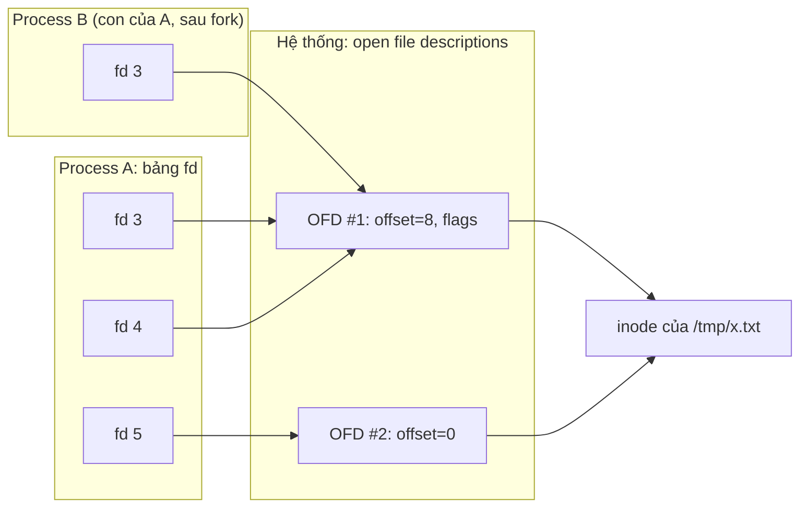
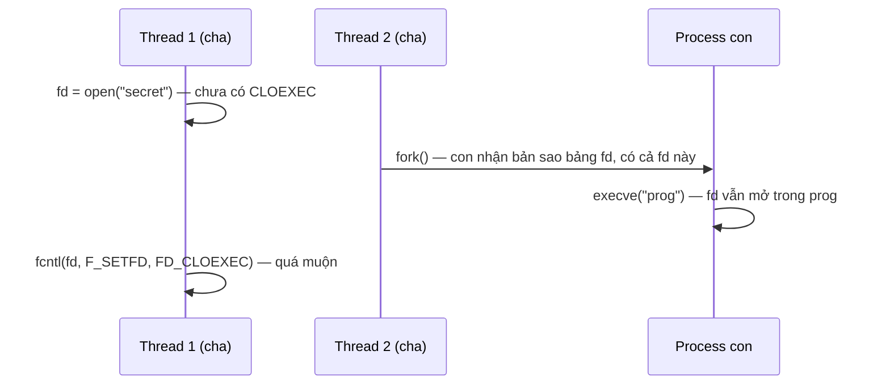

# P1 · Chương 04 — File descriptor và VFS

> Mọi khẳng định về kernel/syscall là về **Linux** (man page Debian bookworm, kernel docs). Thí nghiệm chạy trong container lab (`./labs/linux.sh`, kernel 6.8, `rustc 1.95.0`); kết quả là *quan sát* một lần chạy, không phải bảo đảm của tài liệu.

## Bạn sẽ hiểu được gì

- **Q1.** fd, open file description (OFD) và inode khác nhau thế nào? → mục 1
- **Q2.** Vì sao `fork`/`dup` chia sẻ offset còn hai lần `open` thì không? → mục 2
- **Q3.** `dup`/`dup2`/`dup3`/`fcntl(F_DUPFD)` khác nhau chỗ nào; vì sao `dup2` phải nguyên tử? → mục 3
- **Q4.** `O_CLOEXEC` giải quyết lỗi gì, và vì sao `open` + `fcntl` là không đủ khi đa luồng? → mục 4
- **Q5.** Quy tắc "fd là số nhỏ nhất chưa dùng" gây hệ quả gì? → mục 5
- **Q6.** VFS là gì; "everything is a file" đúng đến đâu (ví dụ `/dev`; pipe, FIFO, socket xem Q8)? → mục 6
- **Q7.** `cmd > out.txt` và `a | b` ở mức syscall là chuỗi lời gọi nào? → mục 7
- **Q8.** Pipe, FIFO và Unix domain socket khác nhau ở đâu, và pipe cư xử thế nào khi hết đầu ghi/đầu đọc? → mục 8

## Kiến thức cần trước

- [Chương 02 — System call](02-system-call.md): trap vào kernel, libc wrapper, `errno`; mục 6 giải thích `strace`, công cụ chương này dùng để quan sát syscall.
- [Chương 03 — Process](03-process.md): `fork`, `exec`, `wait`; chương này dùng lại việc con thừa hưởng bảng fd của cha.

(Cấu trúc filesystem *trên đĩa* thuộc Phase 5. `SIGPIPE` ở mục 8 chỉ nêu đủ để hiểu pipe; signal được nói đầy đủ ở [Chương 05](05-signal.md).)

## 1. Ba tầng: fd → open file description → inode (Q1)

> **Trả lời ngắn.** fd chỉ là một con số, dùng làm chỉ số vào bảng riêng của mỗi process[^open-fd]. Con số đó dẫn tới một *open file description* (OFD): bản ghi nằm trong bảng toàn hệ thống, giữ vị trí đọc/ghi hiện tại (offset) và các cờ trạng thái của lần mở đó[^open-ofd]. OFD lại ứng với một *inode* — đối tượng đại diện cho chính file trong filesystem[^vfs-inode], chứa metadata của file[^inode-def]; nhiều OFD có thể cùng ứng với một inode[^open-each].

**Giải thích.**

Hình dung (nhận xét của người soạn): bạn vào thư viện. fd là số ngăn tủ bạn được phát — mỗi người có dãy số riêng, nên "ngăn 3" của bạn khác "ngăn 3" của người bên cạnh. Trong ngăn tủ là một *phiếu mượn* (OFD) ghi bạn đang đọc đến trang nào. Phiếu mượn trỏ tới *cuốn sách* (inode). Hai phiếu mượn có thể cùng trỏ tới một cuốn sách, mỗi phiếu một trang đang đọc.

*Tầng 1 — fd.* `open(2)` trả về một *file descriptor*: một số nguyên nhỏ, không âm, làm chỉ số vào bảng các file đang mở của process[^open-fd]. Vì là chỉ số vào bảng của *một* process, số `3` ở process A và số `3` ở process B là hai chỉ số vào hai bảng khác nhau. `close(2)` làm fd không còn trỏ tới file nào và có thể được cấp lại[^close-desc]. Theo quy ước, 0/1/2 là stdin/stdout/stderr[^proc-fd]; shell chỉ cần đặt đúng file vào ba chỉ số đó trước khi `exec` (mục 7).

*Tầng 2 — OFD.* Mỗi lần gọi `open()`, kernel tạo một *open file description*: một mục trong bảng các file đang mở của toàn hệ thống, ghi lại offset và cờ trạng thái; fd chỉ là một tham chiếu tới nó[^open-ofd]. Tham chiếu này không bị ảnh hưởng nếu đường dẫn sau đó bị xóa hoặc bị đổi sang trỏ file khác, tức là fd gắn với *đối tượng đã mở*, không gắn với *đường dẫn*[^open-ref]. Hai thông tin nằm ở OFD (chứ không ở fd): **file offset** (vị trí `read`/`write` kế tiếp) và **file status flags** (như `O_APPEND`, `O_NONBLOCK`[^fcntl-setfl]). Vì mỗi `open()` tạo một OFD *mới*, một inode có thể có nhiều OFD; hai lần `open` cùng đường dẫn cho hai offset độc lập[^open-each].

*Tầng 3 — inode.* Mỗi file có một inode chứa metadata của file — thứ ứng dụng lấy được bằng `stat(2)`[^inode-def]; tài liệu VFS mô tả inode là đối tượng của filesystem như file thường, thư mục, FIFO…[^vfs-inode]. Một inode có thể được nhiều *dentry* (directory entry, mục nhập thư mục; xem mục 6) trỏ tới — hard link là ví dụ[^vfs-inode-multi] — nên tên file không phải thuộc tính của inode: tên nằm ở mục nhập thư mục trỏ tới inode (suy luận của người soạn; chi tiết on-disk ở Phase 5).



(Sơ đồ rút gọn: sau `fork`, B có bản sao cả fd 3, 4, 5; chỉ vẽ fd 3 cho gọn. fd 4 là `dup` của fd 3; fd 5 là lần `open` thứ hai nên có OFD riêng.)

<details><summary>Đi sâu: tên gọi của OFD, hai nhóm cờ, số inode, giới hạn số fd</summary>

- "Open file description" là thuật ngữ của POSIX; người viết kernel gọi nó là `struct file`[^open-ofd-term][^vfs-fileobj].
- `open(2)` chia cờ làm hai nhóm: cờ tạo file ảnh hưởng chính thao tác open, còn cờ trạng thái ảnh hưởng ngữ nghĩa các thao tác I/O về sau[^open-flaggroups].
- Số inode chỉ bảo đảm duy nhất trong phạm vi một filesystem[^inode-unique].
- Số fd mỗi process mở được là hữu hạn: chạm trần thì `open` lỗi `EMFILE`[^emfile]; trần toàn hệ thống ứng với `ENFILE`[^enfile]. Cách đọc và chỉnh giới hạn (`ulimit`, `RLIMIT_NOFILE`) ở [Chương 06, mục 6](06-user-quyen-proc-sys.md). (Nhận xét của người soạn: với server nhiều kết nối, `EMFILE` là lỗi vận hành kinh điển — mỗi socket là một fd.)

</details>

**Quay lại Q1:** fd là số trong bảng của process, OFD giữ offset và cờ trạng thái, inode là bản thân file — ba thứ khác nhau, nối với nhau bằng con trỏ.

## 2. Chia sẻ offset: `dup` và `fork` (Q2)

> **Trả lời ngắn.** `dup` (nhân bản một fd) và `fork` (nhân bản cả process) không tạo file đang mở mới: chúng chỉ tạo thêm fd trỏ vào *cùng* OFD, nên các fd đó chung offset[^dup-share][^open-fork-share]. Mỗi lần `open` thì kernel tạo OFD mới, nên mỗi lần có offset riêng[^open-each].

**Giải thích.**

Hình dung (nhận xét của người soạn, nối tiếp hình dung ở mục 1): hai người cầm *chung một phiếu mượn* (một cái kẹp sách) — ai lật trang thì người kia cũng thấy trang đã đổi (`dup`, `fork`); còn nếu mỗi người tự đi mượn thì được hai phiếu, mỗi phiếu một kẹp riêng dù vẫn là cùng một cuốn sách (`open` hai lần).

Với `dup(2)`: hai fd cùng trỏ một OFD nên chia sẻ offset và cờ trạng thái; nếu `lseek` trên fd này thì offset của fd kia cũng đổi[^dup-share]. Nhưng hai fd không chia sẻ *cờ của fd* — cờ close-on-exec, tức cờ bảo kernel tự đóng fd khi `exec` (mục 4)[^dup-flags]. Cờ này nằm ở tầng 1, không ở OFD: man page xếp nó vào nhóm cờ gắn với *file descriptor*[^fcntl-fdflags] (suy luận của người soạn từ hai chú thích).

Qua process cũng vậy: con tạo bởi `fork(2)` thừa hưởng bản sao các fd của cha, và các bản sao đó trỏ tới cùng OFD[^open-fork-share].

**Thí nghiệm** (chạy thật; file `x.txt` chứa `0123456789abcdef`, mỗi lần đọc 4 byte, FFI trực tiếp `dup`/`fork`):

```text
a fd=3 b fd=4                      # hai lần File::open
closed 3, next open gets fd=3      # đóng 3 → open kế tiếp lấy lại 3
f1 fd=3 dup fd=5                   # dup lấy số thấp nhất còn trống
f1 read 0123
f2 (dup) read 4567                 # dup: CHIA SẺ offset
b (separate open) read 0123        # open riêng: offset riêng
child read 89ab                    # fork: con đọc tiếp ở offset chung
parent read after child cdef       # cha thấy offset đã bị con đẩy đi
F_GETFD: f1=1 dup=0                # f1 có FD_CLOEXEC, bản dup không
```

Đọc ra: `dup` → cùng OFD → đọc nối tiếp; `open` lần hai → OFD riêng; `fork` → cha và con chung offset; cờ `FD_CLOEXEC` không đi theo `dup`.

<details><summary>Đi sâu: <code>fork(2)</code>, <code>O_APPEND</code>, và <code>fcntl</code> — cờ của fd khác cờ của OFD</summary>

Chính `fork(2)` cũng ghi như vậy: con thừa hưởng bản sao tập fd đang mở của cha, và mỗi fd của con trỏ cùng OFD với fd tương ứng của cha[^fork-fds].

`O_APPEND` là một cờ trạng thái nằm ở OFD: trước mỗi `write`, offset được đặt về cuối file như bằng `lseek`, và việc đổi offset cùng thao tác ghi diễn ra như một bước nguyên tử duy nhất[^open-append]. Vì offset nằm ở OFD dùng chung, bước nguyên tử này là thứ giúp nhiều bên cùng ghi nối đuôi một file mà không giẫm lên nhau (suy luận của người soạn).

`fcntl(2)` gom nhiều thao tác lên fd vào một lời gọi. Hai nhóm lệnh quan trọng ở đây ứng với hai tầng:

- **Cờ của fd (tầng 1):** `F_GETFD`/`F_SETFD`. Hiện chỉ có một cờ như vậy là `FD_CLOEXEC`, cờ close-on-exec[^fcntl-fdflags]. Cờ này riêng cho từng fd — vì thế `dup` không copy[^dup-flags].
- **Cờ trạng thái của OFD (tầng 2):** `F_GETFL`/`F_SETFL`. Man page: trên Linux `F_SETFL` chỉ đổi được `O_APPEND`, `O_ASYNC`, `O_DIRECT`, `O_NOATIME`, `O_NONBLOCK`; access mode và cờ tạo file bị bỏ qua[^fcntl-setfl]. Vì cờ này nằm ở OFD nên *mọi fd dùng chung OFD* (qua `dup`, `fork`…) *đều thấy*[^fcntl-status-share].

Thí nghiệm: tạo pipe, `dup` đầu đọc, bật `O_NONBLOCK` bằng `F_SETFL` trên fd gốc, rồi `F_GETFL` trên bản `dup` — `O_NONBLOCK` đã bật (quan sát; khớp việc cờ nằm ở OFD). Bẫy thật: bật non-blocking cho "fd của tôi" có thể đổi hành vi code khác giữ bản `dup`/bản kế thừa của cùng OFD (suy luận của người soạn).

</details>

**Quay lại Q2:** `dup` và `fork` thêm fd vào *cùng* OFD nên chung offset; mỗi `open` tạo OFD mới nên offset riêng.

## 3. Nhân bản fd: `dup`, `dup2`, `dup3`, `fcntl` (Q3)

> **Trả lời ngắn.** Cả bốn đều tạo thêm một fd trỏ tới cùng OFD; khác nhau ở cách *chọn số cho fd mới*: `dup` lấy số nhỏ nhất chưa dùng, `dup2`/`dup3` lấy đúng số bạn chỉ định, `fcntl(F_DUPFD)` lấy số nhỏ nhất không bé hơn mức bạn đưa ra[^dup-lowest][^dup2-desc][^fcntl-dupfd]. `dup2` phải *nguyên tử* — làm trọn việc "đóng số đích rồi dùng lại nó" trong một bước — vì nếu tự ghép `close` rồi `dup` thì giữa hai bước, thread khác (hoặc code xử lý signal) có thể chen vào lấy mất số đó[^dup2-atomic].

**Giải thích.**

Hình dung (nhận xét của người soạn): bạn muốn chuyển xe sang ô đỗ số 1 vốn đang có xe khác. `dup2` là "đuổi xe cũ và đỗ xe bạn vào" trong một động tác liền mạch. Nếu tách thành "đuổi xe" rồi "đi tìm chỗ", trong khoảnh khắc ô 1 trống, người khác có thể chiếm.

| Lời gọi | Số fd mới | Ghi chú |
|---|---|---|
| `dup(old)` | thấp nhất chưa dùng | không copy `FD_CLOEXEC` |
| `dup2(old, new)` | đúng `new` | nếu `new` đang mở thì đóng trước (âm thầm), nguyên tử |
| `dup3(old, new, flags)` | đúng `new` | như `dup2` + cho đặt `O_CLOEXEC`; `old == new` thì lỗi |
| `fcntl(fd, F_DUPFD, min)` | thấp nhất `>= min` | |
| `fcntl(fd, F_DUPFD_CLOEXEC, min)` | như trên | đặt luôn `FD_CLOEXEC` |

Nguồn của bảng: số trả về của `dup` được bảo đảm là số nhỏ nhất chưa dùng trong process gọi[^dup-lowest]. `dup2` thì không lấy số nhỏ nhất mà dùng đúng số `newfd` bạn chỉ định[^dup2-desc]; nếu `newfd` đang mở, nó bị đóng trước khi được dùng lại, và việc đóng này diễn ra âm thầm (lỗi lúc đóng không được báo)[^dup2-silent]. `F_DUPFD` dùng số nhỏ nhất còn trống mà không bé hơn `arg`[^fcntl-dupfd]; `F_DUPFD_CLOEXEC` làm như vậy và đặt thêm cờ close-on-exec ngay[^fcntl-dupfd-cloexec]. `dup3` giống `dup2` nhưng cho ép `O_CLOEXEC`[^dup3-flag].

**Vì sao `dup2` phải nguyên tử.** Ai cũng có thể nghĩ "`close(new)` rồi `dup(old)`" là tương đương. Man page giải thích vì sao không: hai bước đóng và dùng lại `newfd` của `dup2` được thực hiện nguyên tử. Nếu tự ghép bằng `close(2)` và `dup()` thì có thể dính race condition, trong đó `newfd` bị dùng lại giữa hai bước — chẳng hạn vì chương trình chính bị ngắt bởi một signal handler có cấp phát fd, hoặc vì một thread song song cấp phát fd[^dup2-atomic]. Quy tắc "số nhỏ nhất chưa dùng" (mục 5) làm race này có thật: vừa `close(new)` xong thì `new` là một số trống, và một `open`/`dup` xen vào có thể nhận chính số đó (suy luận của người soạn). Cũng theo quy tắc ấy, `dup(old)` chỉ trả đúng `new` khi `new` là số trống nhỏ nhất[^dup-lowest], nên ghép tay còn có thể ra sai số ngay cả khi không có race (suy luận của người soạn).

<details><summary>Đi sâu: <code>dup2</code>/<code>dup3</code> khi <code>old == new</code>, và phiên bản của <code>dup3</code></summary>

- Nếu `oldfd` không hợp lệ thì `dup2` lỗi và `newfd` không bị đóng; nếu `oldfd` hợp lệ và bằng `newfd` thì `dup2` không làm gì và trả `newfd`[^dup2-points]. Còn `dup3()` với `oldfd` bằng `newfd` thì lỗi `EINVAL`[^dup3-einval].
- `dup3` được thêm vào Linux 2.6.27[^dup3-linux].

</details>

**Quay lại Q3:** các lời gọi chỉ khác cách chọn số fd mới; `dup2` gộp "đóng số đích và dùng lại nó" thành một bước nguyên tử để không ai chen vào giữa.

## 4. `O_CLOEXEC` và vì sao quan trọng (Q4)

> **Trả lời ngắn.** Mặc định, fd vẫn mở sau `exec` (lúc process nạp một chương trình mới)[^open-default-exec], nên chương trình con chạy sau `fork`+`exec` thừa hưởng cả những fd nó không nên biết (socket, file nhạy cảm). `O_CLOEXEC` bảo kernel tự đóng fd khi `exec` thành công[^open-cloexec][^fcntl-cloexec]. Nếu `open` xong mới gọi `fcntl` để đặt cờ thì không đủ khi có nhiều thread: giữa hai lời gọi, thread khác có thể `fork`+`exec` và fd rò ra[^open-cloexec-mt].

**Giải thích.**

Hình dung (nhận xét của người soạn): bạn thuê thầu phụ sửa điện và vô tình để nguyên chùm chìa khóa nhà kho trong túi áo bạn giao cho họ. Cờ `O_CLOEXEC` là "chìa này tự thu hồi khi đổi người". Và nếu bạn để chìa vào túi áo trước rồi mới nhớ gắn nhãn thu hồi, trong khoảng chờ thợ đã nhận áo.

*Vấn đề.* Mặc định fd mới được đặt để vẫn mở qua `execve(2)`[^open-default-exec]. Theo `fcntl(2)`, nếu bit `FD_CLOEXEC` được đặt thì fd tự đóng khi `execve` thành công (nếu `execve` thất bại, fd vẫn mở); nếu bit không được đặt, fd vẫn mở qua `execve`[^fcntl-cloexec]. Mặc định đó hữu ích — shell dựa vào việc fd giữ mở qua `exec` để dựng redirect[^ostep-redirect] — nhưng với mọi fd *khác* (socket kết nối, listening socket) nó là rò rỉ: chương trình con thừa hưởng chúng mà không hề biết. Hậu quả có thể gặp (suy luận của người soạn, từ chỗ OFD chỉ được giải phóng khi fd cuối cùng trỏ tới nó đóng[^close-last]): server đóng socket kết nối nhưng con còn giữ một bản sao thì bên kia có thể không thấy kết thúc kết nối; listening socket lọt vào con có thể giữ cổng mở ngay cả khi server đã chết.

**Thí nghiệm.** Chương trình Rust mở `/etc/hostname` bằng `File::open` (std tự đặt close-on-exec, xem mục 9), rồi tạo bản `dup` thô (fd 4), rồi `Command::new("sh")` chạy `ls -l /proc/self/fd`:

```text
File fd=3 dup fd=4
child sees:
0 -> /dev/null
1 -> pipe:[155608]
2 -> pipe:[157997]
3 -> /proc/25/fd      # fd của chính `ls` đang đọc thư mục
4 -> /etc/hostname    # RÒ: bản dup không có FD_CLOEXEC
```

Dòng `3 -> /proc/25/fd` là fd của chính `ls` (nó đang đọc thư mục), không phải `File` của cha. Vậy fd 3 của cha (từ `File::open`, có `FD_CLOEXEC`) không lọt vào con, còn fd 4 (từ `dup`, không có cờ) thì lọt vào.

*Vì sao `open` rồi `fcntl(F_SETFD)` không đủ.* Cách "cũ" là `fd = open(...)` rồi `fcntl(fd, F_SETFD, FD_CLOEXEC)`. Giữa hai lời gọi có một khe hở. Man page nói thẳng rằng cờ `O_CLOEXEC` là thiết yếu trong một số chương trình đa luồng, vì dùng một thao tác `fcntl(2)` `F_SETFD` riêng để đặt `FD_CLOEXEC` không đủ tránh race: một thread vừa mở fd và định đặt cờ thì thread khác đồng thời `fork(2)` rồi `execve(2)`[^open-cloexec-mt]. Dòng thời gian:



*Lời giải* là đặt cờ **nguyên tử lúc tạo fd**: `O_CLOEXEC` trong `open` cho phép tránh thêm thao tác `fcntl` `F_SETFD`[^open-cloexec]. Mẫu chung (nhận xét của người soạn): syscall tạo fd có biến thể "tạo kèm cờ".

*Đánh đổi.* Khi *cố ý* truyền fd cho con (như shell truyền stdin/stdout, hoặc một process giám sát mở sẵn socket rồi giao cho con), phải tắt cờ trên đúng fd đó (`F_SETFD`) hoặc `dup2` nó lên số đích (nhận xét của người soạn). Cờ close-on-exec của descriptor nhân bản bằng `dup` là tắt[^dup-cloexec-off], còn `dup3` cho ép bật `O_CLOEXEC`[^dup3-flag]; vì `dup2` làm cùng việc như `dup` nhưng chọn số đích[^dup2-desc] và không có tham số cờ, fd do `dup2` tạo ra không có `FD_CLOEXEC` (suy luận của người soạn từ các chú thích này).

<details><summary>Đi sâu: danh sách biến thể "tạo kèm cờ" và cảnh báo trong <code>fcntl(2)</code></summary>

- `fcntl(2)` lặp lại cảnh báo race: dùng `F_SETFD` để đặt close-on-exec cùng lúc thread khác `fork`+`execve` có thể rò fd vào chương trình chạy trong con[^fcntl-race].
- Các biến thể đặt cờ nguyên tử: `O_CLOEXEC` trong `open`[^open-cloexec]; `F_DUPFD_CLOEXEC`[^fcntl-dupfd-cloexec]; `dup3(…, O_CLOEXEC)`[^dup3-flag]; `pipe2(…, O_CLOEXEC)`, đặt cờ close-on-exec trên cả hai fd mới[^pipe2-cloexec].
- Chốt bằng chạy thử (quan sát): `os.dup2(fd, 20)` trong Python 3 trên lab, với `fd` mở bằng `O_CLOEXEC` (`F_GETFD` = 1), cho `F_GETFD` của fd 20 là 0.

</details>

**Quay lại Q4:** `O_CLOEXEC` chặn fd rò sang chương trình con sau `exec`; phải đặt nó nguyên tử lúc tạo fd, vì đặt sau bằng `fcntl` luôn để lại một khe hở cho thread khác `fork`+`exec`.

## 5. Quy tắc "số nhỏ nhất chưa dùng" và hệ quả (Q5)

> **Trả lời ngắn.** Kernel luôn cấp cho `open`/`dup` số fd nhỏ nhất chưa dùng trong process, và đây là *bảo đảm* của man page chứ không phải chi tiết cài đặt[^open-lowest][^dup-lowest]. Hệ quả: số fd vừa đóng sẽ sớm được cấp lại (ngay lần cấp kế tiếp nếu không còn số nào thấp hơn đang trống), nên shell có thể dựng redirect dựa vào đó; nhưng hai nơi cùng tin mình sở hữu một số fd sẽ đọc/ghi nhầm file, và đóng stdin/stdout/stderr (0/1/2) rồi chạy tiếp rất nguy hiểm.

**Giải thích.**

Hình dung (nhận xét của người soạn): khách sạn luôn xếp phòng trống số nhỏ nhất. Giả sử các phòng số nhỏ hơn đều đang có khách: bạn trả phòng 7 thì người kế tiếp nhận ngay phòng 7. Nếu bạn quên rằng mình đã trả phòng và vẫn cầm chìa cũ, bạn mở nhầm phòng của người khác.

Từ quy tắc đó có ít nhất ba hệ quả:

1. **Redirect bằng cách đóng rồi mở** (kiểu OSTEP): nếu đóng stdout (fd 1) rồi `open` file, file sẽ nhận fd 1. OSTEP mô tả shell redirect đúng như vậy: trong con, trước `exec`, shell đóng stdout rồi mở file đích[^ostep-close-open]; việc fd giữ mở qua `exec` làm điều này khả thi[^ostep-redirect]. Trong các quan sát ở mục 7, dash và bash dùng `dup3` thay vì dựa vào quy tắc này.
2. **Fd bị tái sử dụng khi hai nơi cùng tin mình sở hữu nó** (suy luận của người soạn từ quy tắc trên): A `close(7)`, một `open` khác nhận lại 7, B vẫn cầm 7 và đọc/ghi nhầm file. Docs `std::io` của Rust mô tả đúng tình huống này — fd đã đóng có thể được cấp lại nên chủ cũ đang thao tác nhầm file — và coi việc không giữ kỷ luật sở hữu là vi phạm *I/O safety*[^rs-iosafety-realloc] (mục 9).
3. **Đóng stdin/stdout/stderr rồi chạy chương trình:** các lần `open` sau sẽ lấy 0/1/2 và ghi log vào file dữ liệu (hệ quả trực tiếp của quy tắc).

Thí nghiệm mục 2 cũng cho thấy: đóng fd 3 thì `open` kế tiếp lấy lại fd 3.

<details><summary>Đi sâu: std của Rust đề phòng việc 0/1/2 bị đóng</summary>

Std của Rust đề phòng đúng chuyện ở hệ quả 3. Mã nguồn giải thích: các stream chuẩn có thể đã bị đóng lúc ứng dụng khởi động, và để các đối tượng `stdin`/`stdout`/`stderr` của std không dùng nhầm các tài nguyên file không liên quan được mở sau đó, std mở lại các stream chuẩn khi thấy chúng bị đóng[^rs-std-fds]. (Các kiểu fd khác của std: [Chương 07, mục 1](07-rust-tren-giao-dien-he-thong.md).)

</details>

**Quay lại Q5:** số nhỏ nhất chưa dùng được bảo đảm, nên số fd vừa đóng sớm bị cấp lại — hữu ích cho redirect, nguy hiểm khi hai nơi cùng giữ một số.

## 6. VFS và "everything is a file" (Q6)

> **Trả lời ngắn.** VFS (Virtual File System) là lớp phần mềm trong kernel cung cấp giao diện filesystem cho chương trình và cho phép nhiều loại filesystem cùng tồn tại[^vfs-def]. "Everything is a file" đúng ở chỗ nhiều loại đối tượng (file thường, pipe, terminal, kết nối mạng…) được truy cập qua fd[^beej-fd][^beej-kinds]; nhưng không có nghĩa mọi thao tác hợp lệ với mọi fd (ví dụ `lseek` không dùng được với pipe)[^lseek-espipe].

**Giải thích.**

Hình dung (nhận xét của người soạn): VFS giống ổ cắm đa năng — chương trình luôn cắm vào bằng cùng một kiểu phích `read(fd, …)`; còn đằng sau, ext4, tmpfs hay `/proc` mỗi loại tự lo phần việc của mình.

VFS thực hiện các syscall `open`, `stat`, `chmod`…[^vfs-syscalls]; phần việc riêng của từng filesystem được gọi qua các phương thức do filesystem đó cài (bước 2–3 dưới đây), nên cùng một `read(fd, …)` chạy được trên ext4, tmpfs hay `/proc` (suy luận của người soạn).

*Đường đi của `open(path)` theo tài liệu VFS*, từng bước:

1. VFS dùng *pathname* để tìm trong **dentry cache** (dcache) — một cơ chế tra cứu rất nhanh biến pathname thành một *dentry* (viết tắt của *directory entry*); dentry nằm trong RAM, không bao giờ lưu xuống đĩa, chỉ tồn tại vì hiệu năng[^vfs-dcache]. Một dentry thường có con trỏ tới một inode[^vfs-dentry-inode].
2. Cache không chứa hết mọi dentry; khi thiếu, VFS có thể phải tạo dentry dọc đường rồi nạp inode[^vfs-dcache-miss]. Để tra inode, VFS gọi phương thức `lookup()` của inode thư mục cha — phương thức do từng filesystem cài[^vfs-lookup].
3. Mở file cần cấp phát một `file` structure — tài liệu VFS gọi nó là phần hiện thực phía kernel của file descriptor. Nó được khởi tạo với con trỏ tới dentry và tập hàm thao tác lấy từ dữ liệu inode, rồi phương thức `open()` của file được gọi để filesystem cụ thể làm phần việc của nó[^vfs-file]. (Nhận xét của người soạn: tài liệu dùng chữ "file descriptor" khá lỏng ở đây; theo mục 1, `file` structure chính là OFD[^vfs-fileobj], còn fd là con số trỏ tới nó.)
4. `file` structure được đặt vào bảng fd của process[^vfs-file-table]: mục đó trong bảng là fd mà `open` trả về cho bạn (mục 1).
5. `read`/`write`/`close` sau đó dùng fd để lấy lại `file` structure và gọi phương thức tương ứng; chừng nào file còn mở, nó giữ dentry — và do đó inode — còn dùng[^vfs-fd-use].

`struct file_operations` mô tả cách VFS thao tác trên một file đang mở[^vfs-fops] — (nhận xét của người soạn) một cái "công tắc" cho phép một `read` rẽ nhánh theo loại đối tượng.

*"Everything is a file": đúng đến đâu.* Beej viết rằng khi chương trình Unix làm bất kỳ I/O nào, chúng đọc hoặc ghi vào một file descriptor[^beej-fd], và fd đó có thể là kết nối mạng, FIFO, pipe, terminal, file thật trên đĩa, hay gần như bất cứ thứ gì khác[^beej-kinds].

**Giới hạn (nhận xét của người soạn, dựa trên các nguồn trên).** "Mọi thứ là file" nghĩa là *truy cập qua fd và nhóm syscall chung* (`read`, `write`, `close`, `dup`, `fcntl`…), không phải mọi thao tác có nghĩa với mọi fd: pipe/socket/FIFO không `lseek` được[^lseek-espipe]; socket được tạo bằng `socket(2)` chứ không phải `open`[^socket-create]; thao tác riêng của thiết bị (như đặc tính vận hành của terminal) đi qua `ioctl`[^ioctl-desc]. Cũng không phải mọi thứ có tên trong filesystem: socket `AF_UNIX` trừu tượng không có tên trong filesystem[^unix-desc], pipe ẩn danh không có tên nào.

<details><summary>Đi sâu: device node, <code>/dev</code>, <code>/proc/&lt;pid&gt;/fd</code></summary>

- Dấu vết kiểm chứng được khác: `open()` mở được cả device special file[^open-device]; danh sách thiết bị của tài liệu kernel liệt kê `/dev/stdin`, `/dev/stdout`, `/dev/stderr` trong các link *nên có* trên mọi hệ thống, dạng symlink tới `fd/0`, `fd/1`, `fd/2`[^kdoc-devfd]; còn `/proc/<pid>/fd` liệt kê mọi fd đang mở như symlink, pipe/socket hiện dạng `loại:[inode]`[^proc-fd] — chính các dòng `pipe:[155608]` ở mục 4. Cách dùng nó để chẩn đoán xem [Chương 06, mục 4](06-user-quyen-proc-sys.md).
- Khi mở một device node, phần lớn filesystem gọi các hàm hỗ trợ đặc biệt của VFS để tìm thông tin driver cần dùng; các hàm này thay tập thao tác file của filesystem bằng tập thao tác của device driver rồi gọi phương thức `open()` mới. Nhờ vậy, mở một device file rốt cuộc gọi tới phương thức `open()` của driver[^vfs-devopen].
- `/dev/null` và `/dev/zero`: dữ liệu ghi vào cả hai bị bỏ; đọc `/dev/null` luôn trả EOF (`read` trả 0), đọc `/dev/zero` luôn trả byte 0[^null-def]. Hai device này thường được tạo bằng `mknod` (lệnh mẫu trong man page: `c 1 3`, `c 1 5`)[^null-mknod].
- Quan sát trong lab: `ls -l /dev/null` hiện `crw-rw-rw- 1 root root 1, 3` (chữ `c` đầu dòng, cặp major/minor thay cho kích thước); `/dev/stdin -> /proc/self/fd/0`, `/dev/fd -> /proc/self/fd`.

</details>

**Quay lại Q6:** VFS cho một giao diện chung (fd + `read`/`write`/…) trên nhiều loại đối tượng, nhưng "mọi thứ là file" chỉ nói về cách *truy cập*, không phải về việc mọi thao tác đều hợp lệ.

## 7. Redirect của shell ở mức syscall (Q7)

> **Trả lời ngắn.** Về khái niệm, `cmd > out.txt` là: `fork`, trong con `open` file, `dup2` nó lên fd 1, `close` số thừa rồi `exec` — chương trình mới ghi vào fd 1 mà không hề biết nó là file; cách làm này dựa vào việc shell chạy được code giữa `fork` và `exec`[^ostep-fork-exec]. `a | b` cũng vậy, chỉ khác là fd 1 của `a` và fd 0 của `b` được nối vào hai đầu của một pipe[^ostep-pipe]. Các redirect được xử lý từ trái sang phải[^bash-order], nên thứ tự viết là thứ tự các `dup2` (một số shell, như dash trong quan sát ở dưới, áp redirect ngay trong shell rồi khôi phục — cùng bộ syscall).

**Giải thích.**

Hình dung (nhận xét của người soạn): shell như nhân viên lễ tân cắm lại dây điện thoại trước khi chuyển máy cho người nghe: người nghe vẫn "nói vào ống nghe số 1" như mọi khi, chỉ là dây đã được nối sang chỗ khác.

*Vấn đề.* `ls > out.txt` phải làm `ls` ghi vào `out.txt` mà `ls` không biết gì về file đó. Cơ chế dựa trên đúng ba mảnh đã học: con thừa hưởng bảng fd (mục 2), fd giữ mở qua `exec` (mục 4), và `dup2` đặt OFD vào đúng số fd (mục 3). OSTEP: tách `fork` khỏi `exec` cho shell chạy mã *sau* `fork` nhưng *trước* `exec`; mã này có thể thay đổi môi trường của chương trình sắp chạy[^ostep-fork-exec].

Trình tự khái niệm cho `cmd > out.txt`:

1. `fork()` → con có bản sao bảng fd.
2. Trong con: `fd = open("out.txt", O_WRONLY|O_CREAT|O_TRUNC, 0666)` (nhận số thấp nhất, giả sử 3).
3. `dup2(fd, 1)` → fd 1 giờ cùng OFD với fd 3 và không còn trỏ tới stdout cũ (OFD cũ chỉ được giải phóng khi fd cuối cùng trỏ tới nó đóng[^close-last]; ở đây shell cha vẫn giữ nó).
4. `close(fd)` → bỏ số 3 thừa.
5. `execve("cmd")` → chương trình mới ghi vào fd 1 và ghi vào file.

**Quan sát thật.** `strace -f` (công cụ liệt kê các syscall của một process, xem [Chương 02, mục 6](02-system-call.md)) trên `sh -c '/bin/echo hi > o.txt'` (dash trong container):

```text
openat(AT_FDCWD, "o.txt", O_WRONLY|O_CREAT|O_TRUNC, 0666) = 3
fcntl(1, F_DUPFD, 10)                   = 10     # cất stdout cũ sang fd 10
close(1)                                = 0
fcntl(10, F_SETFD, FD_CLOEXEC)          = 0      # fd 10 không lọt vào con
dup3(3, 1, 0)                           = 1      # fd 1 := OFD của o.txt
close(3)                                = 0
clone(... CLONE_VM|CLONE_VFORK|SIGCHLD) = 12     # sinh con
[pid 12] execve("/bin/echo", ["/bin/echo", "hi"], ...) = 0
dup3(10, 1, 0)                          = 1      # (cha) khôi phục stdout
close(10)                               = 0
```

Bài học: (a) thứ tự `open → dup2/dup3 → close` đúng mô hình; (b) ở đây dash/libc dùng syscall `dup3(…, 0)` để làm việc của `dup2` — man page nói `dup3` giống `dup2` trừ việc cho ép `O_CLOEXEC`[^dup3-flag] và lỗi khi `old == new`[^dup3-einval] (quan sát, không phải bảo đảm cho mọi shell hay kiến trúc); (c) dash áp redirect *trong shell* rồi khôi phục sau khi sinh con — khác sơ đồ "làm trong con" nhưng cùng bộ syscall. Fd 10 được cất kèm `FD_CLOEXEC` — đúng kỹ thuật mục 4.

*Còn `a | b`?* OSTEP mô tả shell nối đầu ra của một process vào một pipe trong kernel (một hàng đợi), và đầu vào của process kia vào cùng pipe đó[^ostep-pipe]. Với `echo hi | cat >/dev/null`, bash sinh một con cho mỗi vế và mỗi con có `dup3(pipe_end, 0|1, 0)` rồi `close(pipe_end)` trước `execve` (quan sát từ strace). Pipe xem mục 8.

*Thứ tự redirect là thứ tự dup.* Bash manual: các redirect được xử lý theo thứ tự xuất hiện, từ trái sang phải[^bash-order]. Ví dụ trong manual: `ls > dirlist 2>&1` đưa cả stdout lẫn stderr vào file `dirlist`, còn `ls 2>&1 > dirlist` chỉ đưa stdout vào file, vì stderr đã được làm bản sao của stdout *trước* khi stdout bị chuyển sang `dirlist`[^bash-order-ex].

Bash manual mô tả `[n]>&word` là cách nhân bản fd *đầu ra*, dùng tương tự `[n]<&word` cho fd đầu vào: nếu `word` là số thì fd `n` trở thành bản sao của fd đó[^bash-dup-out][^bash-dup-in]. Ở mức syscall, `2>&1` là kiểu `dup2(1, 2)` (suy luận từ các `dup3` đã quan sát ở trên): "fd 2 trỏ cùng OFD với fd 1 *tại thời điểm này*". Nó sao chép *tham chiếu hiện tại*, không phải "liên kết tương lai".

<details><summary>Đi sâu: kiểm chứng đếm byte và <code>dup2</code> trong Rust</summary>

- Kiểm chứng (đếm byte của thông báo lỗi `ls /nonexist`): `ls /nonexist 2>&1 >o1.txt | wc -c` in 57 và `o1.txt` có 0 byte (stderr đi vào pipe, vì lúc `dup2(1,2)` fd 1 còn là pipe); `ls /nonexist >o2.txt 2>&1` cho `o2.txt` 57 byte.
- Rust spawn cũng vậy: ở đường `fork`+`exec`, trong con std chạy `cvt_r(|| libc::dup2(fd, libc::STDOUT_FILENO))` trước `exec`[^rs-do-exec-dup2]; việc `Command` chọn `posix_spawn` hay `fork`+`exec` và cách `Stdio` ánh xạ lên `dup2` nằm ở [Chương 07, mục 3–4](07-rust-tren-giao-dien-he-thong.md).

</details>

**Quay lại Q7:** về khái niệm, redirect và pipe đều là `open`/`pipe` + `dup2` lên 0/1/2 + `close` + `exec`, các redirect xử lý từ trái sang phải; chương trình đích chỉ thấy fd 0/1/2 như thường.

## 8. Pipe, FIFO, Unix domain socket (Q8)

> **Trả lời ngắn.** Cả ba là kênh giao tiếp liên process, khác ở cách các process có được fd của kênh: pipe ẩn danh (không có tên) nối các process có quan hệ với nhau, thường qua `fork` thừa hưởng fd[^pipe-related]; FIFO là pipe có tên trong filesystem nên process không quan hệ cũng mở được[^fifo-def0]; Unix socket là socket cho các process cùng máy và còn truyền được cả fd sang process khác[^unix-passfd]. Với pipe: khi mọi đầu ghi đã đóng thì `read` trả 0, tức hết dữ liệu (EOF); khi mọi đầu đọc đã đóng thì `write` làm kernel gửi signal `SIGPIPE` (hành động mặc định của nó là kết thúc process[^sig-tbl-pipe][^sig-term-def]), hoặc trả lỗi `EPIPE` nếu process đã chọn bỏ qua signal đó[^pipe-eof][^pipe-epipe].

**Giải thích.**

Hình dung (nhận xét của người soạn): pipe ẩn danh là ống nước nối giữa hai phòng do chủ nhà lắp, ai ở trong nhà dùng được; FIFO là ống có biển tên ở sảnh, người lạ biết tên (và được phép) cũng nối vào được; Unix socket là đường dây điện thoại nội bộ hai chiều.

### 8.1 Pipe ẩn danh

`pipe(2)` tạo một pipe, kênh dữ liệu một chiều dùng cho giao tiếp liên process[^pipe-chan]; nó trả hai fd: `pipefd[0]` là đầu đọc, `pipefd[1]` là đầu ghi[^pipe-pipefd]. Man page nói pipe dùng để tạo kênh giữa các process có quan hệ[^pipe-related]; vì pipe ẩn danh không có tên, cách nó đến được process khác là *qua thừa kế fd* (`fork`) (suy luận của người soạn).

Tính chất (theo pipe(7); man page nói khác biệt duy nhất giữa pipe và FIFO là cách tạo và mở, còn I/O trên chúng có đúng cùng ngữ nghĩa[^pipe-fifo-same]):

- **Byte stream:** kênh pipe là một dòng byte, không có khái niệm ranh giới message[^pipe-bytestream].
- **EOF và SIGPIPE.** Mọi fd đầu ghi đã đóng → `read` trả 0 (EOF); mọi fd đầu đọc đã đóng → `write` sinh `SIGPIPE`[^pipe-eof], hoặc lỗi `EPIPE` nếu process ignore signal đó[^pipe-epipe]. (Signal nói đầy đủ ở [Chương 05, mục 7](05-signal.md).)
- **Quên `close` thì treo.** Hệ quả của mục 2: sau `fork`, cả hai bên giữ cả hai đầu; man page dặn phải `close` các bản sao thừa để EOF và `SIGPIPE`/`EPIPE` được báo đúng lúc[^pipe-close]. Quên đóng đầu ghi ở bên đọc là nguồn của lỗi "chương trình đọc pipe treo mãi" (nhận xét của người soạn: vì chính nó còn giữ một đầu ghi nên không bao giờ thấy EOF).
- **Chặn:** mặc định, đọc pipe rỗng thì chặn và ghi pipe đầy thì chặn; bật `O_NONBLOCK` bằng `F_SETFL` (mục 2) thì I/O không chặn[^pipe-block].

### 8.2 FIFO (named pipe)

FIFO giống pipe, trừ việc được truy cập như một phần của filesystem[^fifo-def0]. Dữ liệu đi trong kernel: file FIFO không có nội dung trên filesystem; mục trong filesystem chỉ là điểm tham chiếu để process truy cập pipe bằng tên[^fifo-def]. Nghĩa là: *tên* nằm trong filesystem (một inode loại FIFO[^vfs-inode]), *dữ liệu* nằm trong kernel.

Khác pipe ẩn danh: FIFO phải được mở ở cả hai đầu (đọc và ghi) trước khi dữ liệu đi qua, và bình thường thì `open` chặn cho tới khi đầu kia cũng được mở[^fifo-open]. Ghi vào FIFO không có đầu đọc → `SIGPIPE`[^fifo-sigpipe]. Hai process *không quan hệ* giao tiếp được vì chỉ cần biết tên (suy luận của người soạn từ định nghĩa trên).

### 8.3 Unix domain socket

`AF_UNIX` (còn gọi `AF_LOCAL`) là họ socket dùng để giao tiếp hiệu quả giữa các process trên cùng máy. Truyền thống, socket loại này có thể không tên hoặc gắn với một pathname trong filesystem (đánh dấu là loại socket); Linux còn hỗ trợ abstract namespace độc lập với filesystem[^unix-desc]. So với pipe một chiều (mục 8.1): socket kiểu stream là hai chiều[^sock-twoway], và Unix socket còn có kiểu giữ ranh giới message[^unix-types]. Điểm riêng so với pipe/FIFO trong các man page đã dẫn: Unix socket truyền được fd hoặc thông tin xác thực (credentials) của process sang process khác qua *ancillary data* — dữ liệu phụ gửi/nhận bằng `sendmsg`/`recvmsg`[^unix-ancillary][^unix-passfd]. Cái được truyền thật ra là tham chiếu tới một OFD (bên nhận thường nhận số fd khác), về ngữ nghĩa tương đương `dup` vào bảng fd của process kia[^unix-scm-ofd]; nhờ vậy có thể trao một fd cho process *không phải con cháu* (suy luận của người soạn). (Nhận xét của người soạn: ví dụ quen thuộc là `/var/run/docker.sock`, nơi daemon Docker mặc định lắng nghe[^docker-sock].)

<details><summary>Đi sâu: dung lượng, nguyên tử, <code>lseek</code>, exit status 141, tạo FIFO, kiểu và quyền của Unix socket</summary>

- **Dung lượng hữu hạn:** ứng dụng không nên dựa vào một dung lượng cụ thể; nên thiết kế sao cho bên đọc tiêu thụ dữ liệu ngay khi có, để bên ghi không bị chặn mãi[^pipe-cap]. Linux: mặc định 16 page, đổi/đọc bằng `F_SETPIPE_SZ`/`F_GETPIPE_SZ`[^pipe-cap-linux]. Man page ghi rõ 16 page là 65.536 byte khi page size 4096[^pipe-cap-bytes]; quan sát trong lab: `F_GETPIPE_SZ` = 65536 (mặc định, không phải bảo đảm).
- **Atomicity:** POSIX nói ghi *dưới* `PIPE_BUF` byte phải nguyên tử, ghi lớn hơn có thể bị xen với process khác[^pipe-atomic]; bảng ngữ nghĩa trong pipe(7) của Linux xếp cả trường hợp n ≤ `PIPE_BUF` vào nhóm nguyên tử[^pipe-atomic-table]. Trên Linux `PIPE_BUF` = 4096[^pipe-bufsize].
- **Không `lseek`:** không thể áp dụng `lseek(2)` cho pipe[^pipe-seek] — `lseek` lỗi `ESPIPE` với pipe, socket, FIFO[^lseek-espipe].
- **Cờ trạng thái:** chỉ `O_NONBLOCK` và `O_ASYNC` có nghĩa với pipe/FIFO[^pipe-statusflags].
- **Exit status 141.** Quan sát: `yes | head -1` — `head` thoát, `yes` ghi vào pipe không còn người đọc, bị `SIGPIPE`; `PIPESTATUS` là `141 0` (`141` cho `yes`). Con số 141 giải thích được từ hai nguồn: bash dùng `128+N` làm exit status khi lệnh chết vì signal `N`[^bash-128n], và `SIGPIPE` là signal 13 (signal(7))[^sigpipe-num] — 128+13 = 141. Ở mức `wait(2)` (xem [Chương 03, mục 6](03-process.md)), trạng thái này là "bị signal giết" (`WIFSIGNALED`, `WTERMSIG`)[^wait-wifsignaled]; con số 141 là cách shell biểu diễn nó.
- **Tạo FIFO:** bằng `mkfifo(3)`, hiện loại `p` trong `ls -l`[^fifo-mkfifo] (hoặc `mknod` với `S_IFIFO`[^mknod-types]). Quan sát: `mkfifo ff` → `ls -l` đầu dòng là `p`; `echo hello > ff &` rồi `cat ff` in `hello`.
- **Kiểu socket:** `SOCK_STREAM` (hướng stream), `SOCK_DGRAM` (giữ ranh giới message) và `SOCK_SEQPACKET` (có kết nối, giữ ranh giới message)[^unix-types].
- **Quyền:** socket gắn đường dẫn chịu quyền của thư mục chứa nó[^unix-perm]; trên Linux, connect tới stream socket còn cần quyền ghi trên chính socket đó[^unix-sockperm].

</details>

**Quay lại Q8:** pipe ẩn danh nối các process có quan hệ (qua thừa kế fd), FIFO thêm cái tên trong filesystem, Unix socket thêm hai chiều và khả năng truyền fd; cả ba đều là fd nên (suy luận của người soạn) chịu cùng các quy tắc của mục 1–5.

## 9. Liên hệ với Rust

Rust (std 1.95.0) đặt kiểu lên đúng các tầng ở trên. [Chương 07](07-rust-tren-giao-dien-he-thong.md) giải thích kỹ từng kiểu (mục 1: `OwnedFd`/`BorrowedFd`/`RawFd` và `Drop`; mục 4: `Stdio` ↔ `dup2`; mục 5: `SIGPIPE`); ở đây chỉ nối từng khái niệm của chương này với kiểu tương ứng.

| Khái niệm | Kiểu Rust | Bảo đảm |
|---|---|---|
| fd là số nguyên (tầng 1) | `RawFd = c_int`[^rs-rawfd] | không sở hữu, không tự đóng |
| fd là tài nguyên cần `close` | `OwnedFd` | tự đóng khi drop, và được bảo đảm không ai khác đóng fd đó[^rs-ownedfd] |
| mượn fd tạm thời | `BorrowedFd<'fd>` | lifetime buộc vào chủ sở hữu[^rs-borrowedfd] |
| file | `std::fs::File` | tự đóng khi ra khỏi scope; lỗi `close` bị bỏ qua[^rs-file] |
| `dup` | `OwnedFd::try_clone` | tạo `OwnedFd` mới dùng chung file description bên dưới[^rs-ownedfd-clone] — chung offset như `f1`/`f2` ở mục 2 |
| `pipe` | `std::io::pipe()` | kênh dữ liệu một chiều do OS cung cấp[^rs-pipe] |

- **Vì sao fd cần ownership.** Vì số fd bị cấp lại sau `close` (mục 5), docs `std::io` định nghĩa fd được sở hữu độc quyền là fd mà không code nào khác được truy cập, còn chủ thì được dùng và đóng nó bất cứ lúc nào[^rs-iosafety-own]. Một hàm safe nhận số nguyên trần, coi nó là fd và thao tác trên đó là unsound[^rs-iosafety-unsound]; nên `FromRawFd::from_raw_fd` là `unsafe`: fd truyền vào phải là fd được sở hữu và đang mở[^rs-fromraw-safety]. Docs còn ví fd như `Arc` trỏ tới OFD: có một fd sở hữu rồi vẫn không biết còn fd nào khác cùng trỏ tới OFD đó[^rs-iosafety-arc] — đúng bức tranh ở mục 1–2.
- **`O_CLOEXEC` là mặc định của std.** `File::open` ghép sẵn `libc::O_CLOEXEC` vào cờ: `let flags = libc::O_CLOEXEC | opts.get_access_mode()?`[^rs-fs-cloexec]. `try_clone` dùng `F_DUPFD_CLOEXEC`; chú thích trong mã nguồn nói muốn nhân bản fd và đặt `CLOEXEC` một cách nguyên tử[^rs-tryclone]. Đó là lý do trong thí nghiệm mục 4, fd 3 từ `File::open` không rò sang con còn `dup` thô thì rò. Gọi FFI `dup`/`pipe` trực tiếp thì phải tự lo cờ này (suy luận của người soạn).
- **Drop không báo lỗi close.** Lỗi lúc đóng fd khi thả `File`/`OwnedFd` bị bỏ qua[^rs-file][^rs-drop-close]. Man page `close(2)` nhắc rằng lỗi của lần `write` trước đó có thể chỉ hiện ở lần `close` cuối cùng, và bỏ qua nó có thể làm mất dữ liệu âm thầm[^close-errors]; docs `File` chỉ dùng `sync_all` khi cần tự xử lý các lỗi này[^rs-file] (durability thuộc Phase 5).
- **`SIGPIPE`.** Runtime `std` đặt `SIGPIPE` về ignore lúc khởi động[^rs-rt-sigpipe] để chương trình không bị giết khi ghi vào pipe đã đóng[^rs-sigpipe-ignore]. Theo mục 8.1, `write` vào pipe không còn người đọc khi đó trả `EPIPE`[^pipe-epipe], và std ánh xạ nó thành `ErrorKind::BrokenPipe`[^rs-epipe-kind] — nên chương trình Rust ghi vào `| head` nhận lỗi ở chỗ gọi `write` thay vì chết như `yes` (exit status 141). Đây là chi tiết cài đặt của std và không được bảo đảm chạy khi code Rust được gọi từ bên ngoài[^rs-sigpipe-notguaranteed]; process con do `Command` sinh ra được std đặt lại `SIGPIPE` về mặc định (khi không dùng `-Zon-broken-pipe`)[^rs-child-sigpipe-dfl]. Lý do và quan sát `/proc/self/status`: [Chương 07, mục 5](07-rust-tren-giao-dien-he-thong.md); cơ chế signal: [Chương 05, mục 7](05-signal.md).

**Chạy thật** (chạy lại bởi người review, 2026-10-11; máy: container lab `./labs/linux.sh`, Linux 6.8.0-117-generic aarch64, `rustc 1.95.0 (59807616e 2026-04-14)`; chương trình lặp `stdout().lock().write_all(b"y\n")` và tự `exit(3)` khi nhận lỗi; chạy `./m | head -n 1`):

```text
write_all -> kind=BrokenPipe raw=Some(32)
y
PIPESTATUS 3 0
```

`raw=Some(32)` là `EPIPE` (kernel 6.8 định nghĩa `EPIPE` là 32[^errno-epipe]) và `PIPESTATUS` là `3 0` — status 3 là do chính chương trình gọi `exit(3)`, không phải 141 như `yes`. Cùng chương trình trên macOS (rustc 1.95.0) cho cùng kết quả `kind=BrokenPipe raw=Some(32)`, `PIPESTATUS 3 0` (do người điều phối báo lại, người soạn không tự chạy trên macOS).

## Tóm tắt

- fd là chỉ số trong bảng *của process* → OFD (`struct file`, giữ offset và status flags) → inode.
- `dup` và `fork` thêm tham chiếu tới *cùng* OFD ⇒ chung offset; mỗi `open()` tạo OFD mới ⇒ offset riêng.
- `FD_CLOEXEC` thuộc từng fd (không đi theo `dup`); `O_NONBLOCK`, `O_APPEND` thuộc OFD.
- `open`/`dup` trả số nhỏ nhất chưa dùng ⇒ fd bị tái dùng, `dup2` phải nguyên tử.
- `O_CLOEXEC`/`F_DUPFD_CLOEXEC`/`dup3`/`pipe2` đặt close-on-exec nguyên tử lúc tạo, vì `open`+`fcntl` có race với `fork`+`exec`.
- Redirect shell = `open` + `dup2` lên 0/1/2 + `close` + `exec`, xử lý trái → phải.
- Pipe: một chiều, byte stream, EOF khi hết đầu ghi, `SIGPIPE`/`EPIPE` khi hết đầu đọc; FIFO = pipe có tên; Unix socket truyền được fd.
- VFS: `open` đi dcache → dentry → inode → `struct file` → bảng fd. "Everything is a file" = truy cập thống nhất qua fd, không phải mọi thao tác hợp lệ với mọi fd.
- Rust: `OwnedFd`/`BorrowedFd`/`RawFd`; `File::open` mặc định `O_CLOEXEC`; `from_raw_fd` là `unsafe`.

## Câu hỏi tự kiểm tra

1. Hai lần `open` cùng file và một `open` + `dup` khác nhau thế nào về offset? Nếu cha `fork` rồi cả hai `read` cùng một fd thì sao?
<details><summary>Đáp án</summary>

Mỗi `open` tạo OFD mới nên offset riêng[^open-each]; `dup` và `fork` cho fd cùng OFD nên chung offset[^dup-share][^open-fork-share]. Thí nghiệm mục 2: dup đọc `4567`, open riêng đọc `0123`, con đọc `89ab` rồi cha `cdef`.

</details>

2. `FD_CLOEXEC` và `O_NONBLOCK` nằm ở tầng nào? Hệ quả với `dup`?
<details><summary>Đáp án</summary>

`FD_CLOEXEC` là cờ fd, không chia sẻ qua `dup`[^dup-flags][^fcntl-fdflags]; `O_NONBLOCK` là cờ trạng thái của OFD, mọi fd cùng OFD thấy[^fcntl-setfl].

</details>

3. Vì sao `dup2(old, new)` không thay được bằng `close(new); dup(old)`?
<details><summary>Đáp án</summary>

Giữa hai bước, signal handler hoặc thread khác có thể chen vào dùng lại số `new`[^dup2-atomic]; quy tắc số nhỏ nhất chưa dùng[^open-lowest] làm chuyện đó dễ xảy ra (suy luận của người soạn).

</details>

4. Vì sao `open` rồi `fcntl(F_SETFD, FD_CLOEXEC)` vẫn có thể rò fd?
<details><summary>Đáp án</summary>

Thread khác `fork`+`exec` giữa hai lời gọi[^open-cloexec-mt][^fcntl-race]; `O_CLOEXEC` đặt cờ nguyên tử[^open-cloexec].

</details>

5. `ls 2>&1 > f` khác `ls > f 2>&1` ở mức syscall thế nào?
<details><summary>Đáp án</summary>

Xử lý trái → phải[^bash-order]; `2>&1` là `dup2(1,2)` tại thời điểm đó. Dạng đầu chép stdout *cũ* sang stderr rồi mới đổi stdout[^bash-order-ex].

</details>

6. Khi nào `read` pipe trả 0, khi nào `write` nhận `SIGPIPE`/`EPIPE`, và vì sao quên `close` gây treo?
<details><summary>Đáp án</summary>

Hết đầu ghi → `read` trả 0; hết đầu đọc → `SIGPIPE`/`EPIPE`[^pipe-eof][^pipe-epipe]. Còn bản sao thừa của đầu ghi sau `fork` thì EOF không tới[^pipe-close].

</details>

7. FIFO khác pipe ẩn danh và Unix socket ở đâu?
<details><summary>Đáp án</summary>

FIFO có tên trong filesystem, dữ liệu trong kernel[^fifo-def], mở phải đủ hai đầu[^fifo-open]; Unix socket truyền được fd[^unix-passfd]; pipe ẩn danh nối các process có quan hệ[^pipe-related], tức đến được process khác qua thừa kế fd (suy luận của người soạn).

</details>

8. Đường đi của `open(path)` trong VFS, và "everything is a file" sai ở đâu?
<details><summary>Đáp án</summary>

dcache → dentry → inode → `struct file` → bảng fd[^vfs-dcache][^vfs-file][^vfs-file-table]. Không phải mọi thao tác hợp lệ với mọi fd: `lseek` lỗi `ESPIPE` với pipe/socket/FIFO[^lseek-espipe].

</details>

9. Vì sao `File::open` không rò fd sang `Command` còn `dup` FFI thô thì có; vì sao `from_raw_fd` là `unsafe`?
<details><summary>Đáp án</summary>

std đặt `O_CLOEXEC`[^rs-fs-cloexec], `dup` không copy `FD_CLOEXEC`[^dup-flags]. `from_raw_fd` đòi fd sở hữu và đang mở[^rs-fromraw-safety]; hàm an toàn nhận số trần là unsound[^rs-iosafety-unsound].

</details>

10. Khi truyền một fd sang process khác qua Unix socket, thật ra cái gì được truyền?
<details><summary>Đáp án</summary>

Một tham chiếu tới OFD, không phải con số fd; bên nhận thường có số fd khác, và về ngữ nghĩa giống `dup` vào bảng fd của process kia[^unix-scm-ofd].

</details>

## Đọc thêm

- [open(2)](https://manpages.debian.org/bookworm/manpages-dev/open.2.en.html): định nghĩa fd/OFD và race đa luồng của `O_CLOEXEC`.
- [dup(2)](https://manpages.debian.org/bookworm/manpages-dev/dup.2.en.html) và [fcntl(2)](https://manpages.debian.org/bookworm/manpages-dev/fcntl.2.en.html): `dup2` nguyên tử và các trường hợp biên, `dup3`; `F_DUPFD`, cờ fd so với cờ trạng thái OFD (fcntl(2) còn có mục khóa gắn với OFD, chương này không bàn).
- [pipe(7)](https://manpages.debian.org/bookworm/manpages/pipe.7.en.html): ngữ nghĩa pipe/FIFO đầy đủ.
- [unix(7)](https://manpages.debian.org/bookworm/manpages/unix.7.en.html): `AF_UNIX`, kiểu socket, quyền, và truyền fd bằng ancillary data.
- [Kernel docs — VFS](https://docs.kernel.org/filesystems/vfs.html): dcache, inode, `file_operations`.
- [Chương 03 — Process](03-process.md): `fork`/`exec`/`wait` mà redirect dựa vào (mục 5: vì sao tách `fork` khỏi `exec`).
- [Chương 05 — Signal](05-signal.md): mục 7, `SIGPIPE`/`EPIPE` và `SIGCHLD`.
- [Chương 06 — User, quyền, /proc, /sys](06-user-quyen-proc-sys.md): mục 4 (`/proc/<pid>/fd`) và mục 6 (`RLIMIT_NOFILE`, `EMFILE`/`ENFILE`).
- [Chương 07 — Rust trên giao diện hệ thống](07-rust-tren-giao-dien-he-thong.md): mục 1 (`OwnedFd`/`BorrowedFd`, I/O safety), mục 4 (`Stdio` ↔ `dup2`), mục 5 (`SIGPIPE` trong Rust).
- [Bash manual — Redirections](https://www.gnu.org/software/bash/manual/html_node/Redirections.html): toàn bộ toán tử redirect.
- [std::io — I/O Safety](https://doc.rust-lang.org/1.95.0/std/io/index.html): thiết kế ownership của fd trong Rust.

[^open-fd]: open(2), Linux man-pages (Debian bookworm) — <https://manpages.debian.org/bookworm/manpages-dev/open.2.en.html> — "The return value of open() is a file descriptor, a small, nonnegative integer that is an index to an entry in the process's table of open file descriptors."
[^close-desc]: close(2), Linux man-pages (Debian bookworm) — <https://manpages.debian.org/bookworm/manpages-dev/close.2.en.html> — "close() closes a file descriptor, so that it no longer refers to any file and may be reused."
[^close-last]: close(2), Linux man-pages (Debian bookworm) — <https://manpages.debian.org/bookworm/manpages-dev/close.2.en.html> — "If fd is the last file descriptor referring to the underlying open file description (see open(2)), the resources associated with the open file description are freed"
[^close-errors]: close(2), Linux man-pages (Debian bookworm) — <https://manpages.debian.org/bookworm/manpages-dev/close.2.en.html> — "it is quite possible that errors on a previous write(2) operation are reported only on the final close() that releases the open file description. Failing to check the return value when closing a file may lead to silent loss of data."
[^proc-fd]: proc(5), Linux man-pages (Debian bookworm) — <https://manpages.debian.org/bookworm/manpages/proc.5.en.html> — "This is a subdirectory containing one entry for each file which the process has open, named by its file descriptor, and which is a symbolic link to the actual file. Thus, 0 is standard input, 1 standard output, 2 standard error, and so on. For file descriptors for pipes and sockets, the entries will be symbolic links whose content is the file type with the inode."
[^emfile]: open(2), Linux man-pages (Debian bookworm) — <https://manpages.debian.org/bookworm/manpages-dev/open.2.en.html> — "The per-process limit on the number of open file descriptors has been reached"
[^enfile]: open(2), Linux man-pages (Debian bookworm) — <https://manpages.debian.org/bookworm/manpages-dev/open.2.en.html> — "The system-wide limit on the total number of open files has been reached."
[^open-ofd]: open(2), Linux man-pages (Debian bookworm) — <https://manpages.debian.org/bookworm/manpages-dev/open.2.en.html> — "A call to open() creates a new open file description, an entry in the system-wide table of open files. The open file description records the file offset and the file status flags (see below). A file descriptor is a reference to an open file description"
[^open-ref]: open(2), Linux man-pages (Debian bookworm) — <https://manpages.debian.org/bookworm/manpages-dev/open.2.en.html> — "A file descriptor is a reference to an open file description; this reference is unaffected if pathname is subsequently removed or modified to refer to a different file."
[^open-ofd-term]: open(2), Linux man-pages (Debian bookworm) — <https://manpages.debian.org/bookworm/manpages-dev/open.2.en.html> — "The term open file description is the one used by POSIX to refer to the entries in the system-wide table of open files. In other contexts, this object is variously also called an "open file object", a "file handle", an "open file table entry", or—in kernel-developer parlance—a struct file."
[^vfs-fileobj]: Linux kernel docs, Overview of the Linux Virtual File System — <https://docs.kernel.org/filesystems/vfs.html> — "A file object represents a file opened by a process. This is also known as an “open file description” in POSIX parlance."
[^open-flaggroups]: open(2), Linux man-pages (Debian bookworm) — <https://manpages.debian.org/bookworm/manpages-dev/open.2.en.html> — "The distinction between these two groups of flags is that the file creation flags affect the semantics of the open operation itself, while the file status flags affect the semantics of subsequent I/O operations."
[^open-each]: open(2), Linux man-pages (Debian bookworm) — <https://manpages.debian.org/bookworm/manpages-dev/open.2.en.html> — "Each open() of a file creates a new open file description; thus, there may be multiple open file descriptions corresponding to a file inode."
[^inode-def]: inode(7), Linux man-pages (Debian bookworm) — <https://manpages.debian.org/bookworm/manpages/inode.7.en.html> — "Each file has an inode containing metadata about the file. An application can retrieve this metadata using stat(2) (or related calls), which returns a stat structure, or statx(2), which returns a statx structure."
[^inode-unique]: inode(7), Linux man-pages (Debian bookworm) — <https://manpages.debian.org/bookworm/manpages/inode.7.en.html> — "Each file in a filesystem has a unique inode number. Inode numbers are guaranteed to be unique only within a filesystem"
[^vfs-inode]: Linux kernel docs, Overview of the Linux Virtual File System — <https://docs.kernel.org/filesystems/vfs.html> — "Inodes are filesystem objects such as regular files, directories, FIFOs and other beasts."
[^vfs-inode-multi]: Linux kernel docs, Overview of the Linux Virtual File System — <https://docs.kernel.org/filesystems/vfs.html> — "A single inode can be pointed to by multiple dentries (hard links, for example, do this)."
[^vfs-dentry-inode]: Linux kernel docs, Overview of the Linux Virtual File System — <https://docs.kernel.org/filesystems/vfs.html> — "An individual dentry usually has a pointer to an inode."
[^vfs-dcache-miss]: Linux kernel docs, Overview of the Linux Virtual File System — <https://docs.kernel.org/filesystems/vfs.html> — "some bits of the cache are missing. In order to resolve your pathname into a dentry, the VFS may have to resort to creating dentries along the way, and then loading the inode."
[^dup-share]: dup(2), Linux man-pages (Debian bookworm) — <https://manpages.debian.org/bookworm/manpages-dev/dup.2.en.html> — "Since the two file descriptors refer to the same open file description, they share file offset and file status flags; for example, if the file offset is modified by using lseek(2) on one of the file descriptors, the offset is also changed for the other file descriptor."
[^dup-flags]: dup(2), Linux man-pages (Debian bookworm) — <https://manpages.debian.org/bookworm/manpages-dev/dup.2.en.html> — "The two file descriptors do not share file descriptor flags (the close-on-exec flag)."
[^open-fork-share]: open(2), Linux man-pages (Debian bookworm) — <https://manpages.debian.org/bookworm/manpages-dev/open.2.en.html> — "Such sharing can also occur between processes: a child process created via fork(2) inherits duplicates of its parent's file descriptors, and those duplicates refer to the same open file descriptions."
[^fork-fds]: fork(2), Linux man-pages (Debian bookworm) — <https://manpages.debian.org/bookworm/manpages-dev/fork.2.en.html> — "The child inherits copies of the parent's set of open file descriptors. Each file descriptor in the child refers to the same open file description (see open(2)) as the corresponding file descriptor in the parent."
[^open-append]: open(2), Linux man-pages (Debian bookworm) — <https://manpages.debian.org/bookworm/manpages-dev/open.2.en.html> — "Before each write(2), the file offset is positioned at the end of the file, as if with lseek(2). The modification of the file offset and the write operation are performed as a single atomic step."
[^dup-lowest]: dup(2), Linux man-pages (Debian bookworm) — <https://manpages.debian.org/bookworm/manpages-dev/dup.2.en.html> — "The new file descriptor number is guaranteed to be the lowest-numbered file descriptor that was unused in the calling process."
[^dup2-desc]: dup(2), Linux man-pages (Debian bookworm) — <https://manpages.debian.org/bookworm/manpages-dev/dup.2.en.html> — "The dup2() system call performs the same task as dup(), but instead of using the lowest-numbered unused file descriptor, it uses the file descriptor number specified in newfd. In other words, the file descriptor newfd is adjusted so that it now refers to the same open file description as oldfd."
[^fcntl-dupfd]: fcntl(2), Linux man-pages (Debian bookworm) — <https://manpages.debian.org/bookworm/manpages-dev/fcntl.2.en.html> — "Duplicate the file descriptor fd using the lowest-numbered available file descriptor greater than or equal to arg."
[^fcntl-dupfd-cloexec]: fcntl(2), Linux man-pages (Debian bookworm) — <https://manpages.debian.org/bookworm/manpages-dev/fcntl.2.en.html> — "As for F_DUPFD, but additionally set the close-on-exec flag for the duplicate file descriptor."
[^dup3-flag]: dup(2), Linux man-pages (Debian bookworm) — <https://manpages.debian.org/bookworm/manpages-dev/dup.2.en.html> — "dup3() is the same as dup2(), except that: The caller can force the close-on-exec flag to be set for the new file descriptor by specifying O_CLOEXEC in flags."
[^dup3-einval]: dup(2), Linux man-pages (Debian bookworm) — <https://manpages.debian.org/bookworm/manpages-dev/dup.2.en.html> — "If oldfd equals newfd, then dup3() fails with the error EINVAL."
[^dup3-linux]: dup(2), Linux man-pages (Debian bookworm) — <https://manpages.debian.org/bookworm/manpages-dev/dup.2.en.html> — "dup3() was added in Linux 2.6.27; glibc support is available since glibc 2.9."
[^dup2-atomic]: dup(2), Linux man-pages (Debian bookworm) — <https://manpages.debian.org/bookworm/manpages-dev/dup.2.en.html> — "The steps of closing and reusing the file descriptor newfd are performed atomically. This is important, because trying to implement equivalent functionality using close(2) and dup() would be subject to race conditions, whereby newfd might be reused between the two steps. Such reuse could happen because the main program is interrupted by a signal handler that allocates a file descriptor, or because a parallel thread allocates a file descriptor."
[^dup2-silent]: dup(2), Linux man-pages (Debian bookworm) — <https://manpages.debian.org/bookworm/manpages-dev/dup.2.en.html> — "If the file descriptor newfd was previously open, it is closed before being reused; the close is performed silently (i.e., any errors during the close are not reported by dup2())."
[^dup2-points]: dup(2), Linux man-pages (Debian bookworm) — <https://manpages.debian.org/bookworm/manpages-dev/dup.2.en.html> — "If oldfd is not a valid file descriptor, then the call fails, and newfd is not closed. If oldfd is a valid file descriptor, and newfd has the same value as oldfd, then dup2() does nothing, and returns newfd."
[^fcntl-fdflags]: fcntl(2), Linux man-pages (Debian bookworm) — <https://manpages.debian.org/bookworm/manpages-dev/fcntl.2.en.html> — "The following commands manipulate the flags associated with a file descriptor. Currently, only one such flag is defined: FD_CLOEXEC, the close-on-exec flag."
[^fcntl-setfl]: fcntl(2), Linux man-pages (Debian bookworm) — <https://manpages.debian.org/bookworm/manpages-dev/fcntl.2.en.html> — "Set the file status flags to the value specified by arg. File access mode (O_RDONLY, O_WRONLY, O_RDWR) and file creation flags (i.e., O_CREAT, O_EXCL, O_NOCTTY, O_TRUNC) in arg are ignored. On Linux, this command can change only the O_APPEND, O_ASYNC, O_DIRECT, O_NOATIME, and O_NONBLOCK flags."
[^fcntl-status-share]: fcntl(2), Linux man-pages (Debian bookworm) — <https://manpages.debian.org/bookworm/manpages-dev/fcntl.2.en.html> — "Duplicated file descriptors (made with dup(2), fcntl(F_DUPFD), fork(2), etc.) refer to the same open file description, and thus share the same file status flags."
[^open-lowest]: open(2), Linux man-pages (Debian bookworm) — <https://manpages.debian.org/bookworm/manpages-dev/open.2.en.html> — "The file descriptor returned by a successful call will be the lowest-numbered file descriptor not currently open for the process."
[^ostep-redirect]: OSTEP, ch.5 Interlude: Process API — <https://pages.cs.wisc.edu/~remzi/OSTEP/cpu-api.pdf> — "open file descriptors are kept open across the exec() call, thus enabling this behavior"
[^ostep-close-open]: OSTEP, ch.5 Interlude: Process API — <https://pages.cs.wisc.edu/~remzi/OSTEP/cpu-api.pdf> — "the shell (specifically, the code executed in the child process) closes standard output and opens the file newfile.txt."
[^rs-std-fds]: rust-lang/rust tag 1.95.0, library/std/src/sys/pal/unix/mod.rs — <https://raw.githubusercontent.com/rust-lang/rust/1.95.0/library/std/src/sys/pal/unix/mod.rs> — "The standard streams might be closed on application startup. To prevent std::io::{stdin, stdout,stderr} objects from using other unrelated file resources opened later, we reopen standards streams when they are closed."
[^open-default-exec]: open(2), Linux man-pages (Debian bookworm) — <https://manpages.debian.org/bookworm/manpages-dev/open.2.en.html> — "By default, the new file descriptor is set to remain open across an execve(2)"
[^fcntl-cloexec]: fcntl(2), Linux man-pages (Debian bookworm) — <https://manpages.debian.org/bookworm/manpages-dev/fcntl.2.en.html> — "If the FD_CLOEXEC bit is set, the file descriptor will automatically be closed during a successful execve(2). (If the execve(2) fails, the file descriptor is left open.) If the FD_CLOEXEC bit is not set, the file descriptor will remain open across an execve(2)."
[^open-cloexec-mt]: open(2), Linux man-pages (Debian bookworm) — <https://manpages.debian.org/bookworm/manpages-dev/open.2.en.html> — "Note that the use of this flag is essential in some multithreaded programs, because using a separate fcntl(2) F_SETFD operation to set the FD_CLOEXEC flag does not suffice to avoid race conditions where one thread opens a file descriptor and attempts to set its close-on-exec flag using fcntl(2) at the same time as another thread does a fork(2) plus execve(2)."
[^fcntl-race]: fcntl(2), Linux man-pages (Debian bookworm) — <https://manpages.debian.org/bookworm/manpages-dev/fcntl.2.en.html> — "In multithreaded programs, using fcntl() F_SETFD to set the close-on-exec flag at the same time as another thread performs a fork(2) plus execve(2) is vulnerable to a race condition that may unintentionally leak the file descriptor to the program executed in the child process."
[^open-cloexec]: open(2), Linux man-pages (Debian bookworm) — <https://manpages.debian.org/bookworm/manpages-dev/open.2.en.html> — "Enable the close-on-exec flag for the new file descriptor. Specifying this flag permits a program to avoid additional fcntl(2) F_SETFD operations to set the FD_CLOEXEC flag."
[^pipe2-cloexec]: pipe(2), Linux man-pages (Debian bookworm) — <https://manpages.debian.org/bookworm/manpages-dev/pipe.2.en.html> — "Set the close-on-exec (FD_CLOEXEC) flag on the two new file descriptors."
[^ostep-fork-exec]: OSTEP, ch.5 Interlude: Process API — <https://pages.cs.wisc.edu/~remzi/OSTEP/cpu-api.pdf> — "it lets the shell run code after the call to fork() but before the call to exec(); this code can alter the environment of the about-to-be-run program"
[^bash-order]: Bash Reference Manual, Redirections — <https://www.gnu.org/software/bash/manual/html_node/Redirections.html> — "Redirections are processed in the order they appear, from left to right."
[^bash-order-ex]: Bash Reference Manual, Redirections — <https://www.gnu.org/software/bash/manual/html_node/Redirections.html> — "directs only the standard output to file dirlist, because the standard error was made a copy of the standard output before the standard output was redirected to dirlist."
[^bash-dup-in]: Bash Reference Manual, Redirections — <https://www.gnu.org/software/bash/manual/html_node/Redirections.html> — "If word expands to one or more digits, file descriptor n is made to be a copy of that file descriptor."
[^bash-dup-out]: Bash Reference Manual, Redirections — <https://www.gnu.org/software/bash/manual/html_node/Redirections.html> — "[n]>&word is used similarly to duplicate output file descriptors."
[^rs-do-exec-dup2]: rust-lang/rust tag 1.95.0, library/std/src/sys/process/unix/unix.rs — <https://raw.githubusercontent.com/rust-lang/rust/1.95.0/library/std/src/sys/process/unix/unix.rs> — "if let Some(fd) = stdio.stdout.fd() { cvt_r(|| libc::dup2(fd, libc::STDOUT_FILENO))?; }"
[^pipe-chan]: pipe(2), Linux man-pages (Debian bookworm) — <https://manpages.debian.org/bookworm/manpages-dev/pipe.2.en.html> — "pipe() creates a pipe, a unidirectional data channel that can be used for interprocess communication."
[^pipe-pipefd]: pipe(2), Linux man-pages (Debian bookworm) — <https://manpages.debian.org/bookworm/manpages-dev/pipe.2.en.html> — "pipefd[0] refers to the read end of the pipe. pipefd[1] refers to the write end of the pipe."
[^ostep-pipe]: OSTEP, ch.5 Interlude: Process API — <https://pages.cs.wisc.edu/~remzi/OSTEP/cpu-api.pdf> — "In this case, the output of one process is connected to an inkernel pipe (i.e., queue), and the input of another process is connected to that same pipe"
[^pipe-fifo-same]: pipe(7), Linux man-pages (Debian bookworm) — <https://manpages.debian.org/bookworm/manpages/pipe.7.en.html> — "The only difference between pipes and FIFOs is the manner in which they are created and opened. Once these tasks have been accomplished, I/O on pipes and FIFOs has exactly the same semantics."
[^pipe-related]: pipe(7), Linux man-pages (Debian bookworm) — <https://manpages.debian.org/bookworm/manpages/pipe.7.en.html> — "Pipes can be used to create a communication channel between related processes; see pipe(2) for an example."
[^pipe-bytestream]: pipe(7), Linux man-pages (Debian bookworm) — <https://manpages.debian.org/bookworm/manpages/pipe.7.en.html> — "The communication channel provided by a pipe is a byte stream: there is no concept of message boundaries."
[^pipe-eof]: pipe(7), Linux man-pages (Debian bookworm) — <https://manpages.debian.org/bookworm/manpages/pipe.7.en.html> — "If all file descriptors referring to the write end of a pipe have been closed, then an attempt to read(2) from the pipe will see end-of-file (read(2) will return 0). If all file descriptors referring to the read end of a pipe have been closed, then a write(2) will cause a SIGPIPE signal to be generated for the calling process."
[^pipe-epipe]: pipe(7), Linux man-pages (Debian bookworm) — <https://manpages.debian.org/bookworm/manpages/pipe.7.en.html> — "If the calling process is ignoring this signal, then write(2) fails with the error EPIPE."
[^pipe-close]: pipe(7), Linux man-pages (Debian bookworm) — <https://manpages.debian.org/bookworm/manpages/pipe.7.en.html> — "An application that uses pipe(2) and fork(2) should use suitable close(2) calls to close unnecessary duplicate file descriptors; this ensures that end-of-file and SIGPIPE/EPIPE are delivered when appropriate."
[^pipe-block]: pipe(7), Linux man-pages (Debian bookworm) — <https://manpages.debian.org/bookworm/manpages/pipe.7.en.html> — "If a process attempts to read from an empty pipe, then read(2) will block until data is available. If a process attempts to write to a full pipe (see below), then write(2) blocks until sufficient data has been read from the pipe to allow the write to complete. Nonblocking I/O is possible by using the fcntl(2) F_SETFL operation to enable the O_NONBLOCK open file status flag."
[^pipe-cap]: pipe(7), Linux man-pages (Debian bookworm) — <https://manpages.debian.org/bookworm/manpages/pipe.7.en.html> — "Applications should not rely on a particular capacity: an application should be designed so that a reading process consumes data as soon as it is available, so that a writing process does not remain blocked."
[^pipe-cap-bytes]: pipe(7), Linux man-pages (Debian bookworm) — <https://manpages.debian.org/bookworm/manpages/pipe.7.en.html> — "Since Linux 2.6.11, the pipe capacity is 16 pages (i.e., 65,536 bytes in a system with a page size of 4096 bytes)."
[^pipe-cap-linux]: pipe(7), Linux man-pages (Debian bookworm) — <https://manpages.debian.org/bookworm/manpages/pipe.7.en.html> — "Since Linux 2.6.35, the default pipe capacity is 16 pages, but the capacity can be queried and set using the fcntl(2) F_GETPIPE_SZ and F_SETPIPE_SZ operations."
[^pipe-atomic]: pipe(7), Linux man-pages (Debian bookworm) — <https://manpages.debian.org/bookworm/manpages/pipe.7.en.html> — "POSIX.1 says that writes of less than PIPE_BUF bytes must be atomic: the output data is written to the pipe as a contiguous sequence. Writes of more than PIPE_BUF bytes may be nonatomic: the kernel may interleave the data with data written by other processes."
[^pipe-bufsize]: pipe(7), Linux man-pages (Debian bookworm) — <https://manpages.debian.org/bookworm/manpages/pipe.7.en.html> — "POSIX.1 requires PIPE_BUF to be at least 512 bytes. (On Linux, PIPE_BUF is 4096 bytes.)"
[^pipe-seek]: pipe(7), Linux man-pages (Debian bookworm) — <https://manpages.debian.org/bookworm/manpages/pipe.7.en.html> — "It is not possible to apply lseek(2) to a pipe."
[^lseek-espipe]: lseek(2), Linux man-pages (Debian bookworm) — <https://manpages.debian.org/bookworm/manpages-dev/lseek.2.en.html> — "ESPIPE fd is associated with a pipe, socket, or FIFO."
[^pipe-statusflags]: pipe(7), Linux man-pages (Debian bookworm) — <https://manpages.debian.org/bookworm/manpages/pipe.7.en.html> — "The only open file status flags that can be meaningfully applied to a pipe or FIFO are O_NONBLOCK and O_ASYNC."
[^fifo-def0]: fifo(7), Linux man-pages (Debian bookworm) — <https://manpages.debian.org/bookworm/manpages/fifo.7.en.html> — "A FIFO special file (a named pipe) is similar to a pipe, except that it is accessed as part of the filesystem. It can be opened by multiple processes for reading or writing."
[^fifo-def]: fifo(7), Linux man-pages (Debian bookworm) — <https://manpages.debian.org/bookworm/manpages/fifo.7.en.html> — "When processes are exchanging data via the FIFO, the kernel passes all data internally without writing it to the filesystem. Thus, the FIFO special file has no contents on the filesystem; the filesystem entry merely serves as a reference point so that processes can access the pipe using a name in the filesystem."
[^fifo-mkfifo]: fifo(7), Linux man-pages (Debian bookworm) — <https://manpages.debian.org/bookworm/manpages/fifo.7.en.html> — "FIFO special files can be created by mkfifo(3), and are indicated by ls -l with the file type 'p'."
[^mknod-types]: mknod(2), Linux man-pages (Debian bookworm) — <https://manpages.debian.org/bookworm/manpages-dev/mknod.2.en.html> — "The file type must be one of S_IFREG, S_IFCHR, S_IFBLK, S_IFIFO, or S_IFSOCK to specify a regular file (which will be created empty), character special file, block special file, FIFO (named pipe), or UNIX domain socket, respectively."
[^fifo-open]: fifo(7), Linux man-pages (Debian bookworm) — <https://manpages.debian.org/bookworm/manpages/fifo.7.en.html> — "The FIFO must be opened on both ends (reading and writing) before data can be passed. Normally, opening the FIFO blocks until the other end is opened also."
[^fifo-sigpipe]: fifo(7), Linux man-pages (Debian bookworm) — <https://manpages.debian.org/bookworm/manpages/fifo.7.en.html> — "When a process tries to write to a FIFO that is not opened for read on the other side, the process is sent a SIGPIPE signal."
[^unix-desc]: unix(7), Linux man-pages (Debian bookworm) — <https://manpages.debian.org/bookworm/manpages/unix.7.en.html> — "The AF_UNIX (also known as AF_LOCAL) socket family is used to communicate between processes on the same machine efficiently. Traditionally, UNIX domain sockets can be either unnamed, or bound to a filesystem pathname (marked as being of type socket). Linux also supports an abstract namespace which is independent of the filesystem."
[^unix-types]: unix(7), Linux man-pages (Debian bookworm) — <https://manpages.debian.org/bookworm/manpages/unix.7.en.html> — "Valid socket types in the UNIX domain are: SOCK_STREAM, for a stream-oriented socket; SOCK_DGRAM, for a datagram-oriented socket that preserves message boundaries (as on most UNIX implementations, UNIX domain datagram sockets are always reliable and don't reorder datagrams); and (since Linux 2.6.4) SOCK_SEQPACKET, for a sequenced-packet socket that is connection-oriented, preserves message boundaries, and delivers messages in the order that they were sent."
[^unix-passfd]: unix(7), Linux man-pages (Debian bookworm) — <https://manpages.debian.org/bookworm/manpages/unix.7.en.html> — "UNIX domain sockets support passing file descriptors or process credentials to other processes using ancillary data."
[^unix-ancillary]: unix(7), Linux man-pages (Debian bookworm) — <https://manpages.debian.org/bookworm/manpages/unix.7.en.html> — "Ancillary data is sent and received using sendmsg(2) and recvmsg(2)."
[^unix-scm-ofd]: unix(7), Linux man-pages (Debian bookworm) — <https://manpages.debian.org/bookworm/manpages/unix.7.en.html> — "what is being passed is a reference to an open file description (see open(2)), and in the receiving process it is likely that a different file descriptor number will be used. Semantically, this operation is equivalent to duplicating (dup(2)) a file descriptor into the file descriptor table of another process."
[^sock-twoway]: socket(2), Linux man-pages (Debian bookworm) — <https://manpages.debian.org/bookworm/manpages-dev/socket.2.en.html> — "Provides sequenced, reliable, two-way, connection-based byte streams."
[^unix-perm]: unix(7), Linux man-pages (Debian bookworm) — <https://manpages.debian.org/bookworm/manpages/unix.7.en.html> — "In the Linux implementation, pathname sockets honor the permissions of the directory they are in. Creation of a new socket fails if the process does not have write and search (execute) permission on the directory in which the socket is created."
[^unix-sockperm]: unix(7), Linux man-pages (Debian bookworm) — <https://manpages.debian.org/bookworm/manpages/unix.7.en.html> — "On Linux, connecting to a stream socket object requires write permission on that socket; sending a datagram to a datagram socket likewise requires write permission on that socket."
[^docker-sock]: Docker Docs, dockerd CLI reference — <https://docs.docker.com/reference/cli/dockerd/> — "With -H it's possible to make the Docker daemon to listen on a specific IP and port. By default, it listens on unix:///var/run/docker.sock to allow only local connections by the root user."
[^vfs-def]: Linux kernel docs, Overview of the Linux Virtual File System — <https://docs.kernel.org/filesystems/vfs.html> — "The Virtual File System (also known as the Virtual Filesystem Switch) is the software layer in the kernel that provides the filesystem interface to userspace programs. It also provides an abstraction within the kernel which allows different filesystem implementations to coexist."
[^vfs-syscalls]: Linux kernel docs, Overview of the Linux Virtual File System — <https://docs.kernel.org/filesystems/vfs.html> — "The VFS implements the open(2), stat(2), chmod(2), and similar system calls."
[^vfs-dcache]: Linux kernel docs, Overview of the Linux Virtual File System — <https://docs.kernel.org/filesystems/vfs.html> — "This provides a very fast look-up mechanism to translate a pathname (filename) into a specific dentry. Dentries live in RAM and are never saved to disc: they exist only for performance."
[^vfs-lookup]: Linux kernel docs, Overview of the Linux Virtual File System — <https://docs.kernel.org/filesystems/vfs.html> — "To look up an inode requires that the VFS calls the lookup() method of the parent directory inode. This method is installed by the specific filesystem implementation that the inode lives in."
[^vfs-file]: Linux kernel docs, Overview of the Linux Virtual File System — <https://docs.kernel.org/filesystems/vfs.html> — "Opening a file requires another operation: allocation of a file structure (this is the kernel-side implementation of file descriptors). The freshly allocated file structure is initialized with a pointer to the dentry and a set of file operation member functions. These are taken from the inode data. The open() file method is then called so the specific filesystem implementation can do its work."
[^vfs-file-table]: Linux kernel docs, Overview of the Linux Virtual File System — <https://docs.kernel.org/filesystems/vfs.html> — "The file structure is placed into the file descriptor table for the process."
[^vfs-fd-use]: Linux kernel docs, Overview of the Linux Virtual File System — <https://docs.kernel.org/filesystems/vfs.html> — "For as long as the file is open, it keeps the dentry in use, which in turn means that the VFS inode is still in use."
[^vfs-fops]: Linux kernel docs, Overview of the Linux Virtual File System — <https://docs.kernel.org/filesystems/vfs.html> — "This describes how the VFS can manipulate an open file."
[^beej-fd]: Beej's Guide to Network Programming, What is a socket? — <https://beej.us/guide/bgnet/html/split/what-is-a-socket.html> — "when Unix programs do any sort of I/O, they do it by reading or writing to a file descriptor."
[^beej-kinds]: Beej's Guide to Network Programming, What is a socket? — <https://beej.us/guide/bgnet/html/split/what-is-a-socket.html> — "that file can be a network connection, a FIFO, a pipe, a terminal, a real on-the-disk file, or just about anything else."
[^socket-create]: socket(2), Linux man-pages (Debian bookworm) — <https://manpages.debian.org/bookworm/manpages-dev/socket.2.en.html> — "socket() creates an endpoint for communication and returns a file descriptor that refers to that endpoint."
[^ioctl-desc]: ioctl(2), Linux man-pages (Debian bookworm) — <https://manpages.debian.org/bookworm/manpages-dev/ioctl.2.en.html> — "The ioctl() system call manipulates the underlying device parameters of special files. In particular, many operating characteristics of character special files (e.g., terminals) may be controlled with ioctl() requests."
[^open-device]: open(2), Linux man-pages (Debian bookworm) — <https://manpages.debian.org/bookworm/manpages-dev/open.2.en.html> — "Note that open() can open device special files, but creat() cannot create them; use mknod(2) instead."
[^vfs-devopen]: Linux kernel docs, Overview of the Linux Virtual File System — <https://docs.kernel.org/filesystems/vfs.html> — "When opening a device node (character or block special) most filesystems will call special support routines in the VFS which will locate the required device driver information. These support routines replace the filesystem file operations with those for the device driver, and then proceed to call the new open() method for the file."
[^null-def]: null(4), Linux man-pages (Debian bookworm) — <https://manpages.debian.org/bookworm/manpages/null.4.en.html> — "Data written to the /dev/null and /dev/zero special files is discarded. Reads from /dev/null always return end of file (i.e., read(2) returns 0), whereas reads from /dev/zero always return bytes containing zero ('\0' characters)."
[^null-mknod]: null(4), Linux man-pages (Debian bookworm) — <https://manpages.debian.org/bookworm/manpages/null.4.en.html> — "These devices are typically created by: mknod -m 666 /dev/null c 1 3 mknod -m 666 /dev/zero c 1 5"
[^kdoc-devfd]: Linux kernel docs, Linux allocated devices — <https://docs.kernel.org/admin-guide/devices.html> — "These links should exist on all systems: /dev/fd /proc/self/fd symbolic File descriptors /dev/stdin fd/0 symbolic stdin file descriptor /dev/stdout fd/1 symbolic stdout file descriptor /dev/stderr fd/2 symbolic stderr file descriptor"
[^rs-rawfd]: Rust std 1.95.0, `std::os::fd::RawFd` — <https://doc.rust-lang.org/1.95.0/std/os/fd/type.RawFd.html> — "pub type RawFd = c_int;"
[^rs-ownedfd]: Rust std 1.95.0, `std::os::fd::OwnedFd` — <https://doc.rust-lang.org/1.95.0/std/os/fd/struct.OwnedFd.html> — "An owned file descriptor. This closes the file descriptor on drop. It is guaranteed that nobody else will close the file descriptor."
[^rs-borrowedfd]: Rust std 1.95.0, `std::os::fd::BorrowedFd` — <https://doc.rust-lang.org/1.95.0/std/os/fd/struct.BorrowedFd.html> — "This has a lifetime parameter to tie it to the lifetime of something that owns the file descriptor. For the duration of that lifetime, it is guaranteed that nobody will close the file descriptor."
[^rs-file]: Rust std 1.95.0, `std::fs::File` — <https://doc.rust-lang.org/1.95.0/std/fs/struct.File.html> — "Files are automatically closed when they go out of scope. Errors detected on closing are ignored by the implementation of Drop. Use the method sync_all if these errors must be manually handled."
[^rs-ownedfd-clone]: Rust std 1.95.0, `std::os::fd::OwnedFd` — <https://doc.rust-lang.org/1.95.0/std/os/fd/struct.OwnedFd.html> — "Creates a new OwnedFd instance that shares the same underlying file description as the existing OwnedFd instance."
[^rs-pipe]: Rust std 1.95.0, `std::io::pipe` — <https://doc.rust-lang.org/1.95.0/std/io/fn.pipe.html> — "A pipe is a one-way data channel provided by the OS, which works across processes."
[^rs-iosafety-own]: Rust std 1.95.0, `std::io` (I/O Safety) — <https://doc.rust-lang.org/1.95.0/std/io/index.html> — "An exclusively owned file descriptor is one that no other code is allowed to access in any way, but the owner is allowed to access and even close it any time."
[^rs-iosafety-unsound]: Rust std 1.95.0, `std::io` (I/O Safety) — <https://doc.rust-lang.org/1.95.0/std/io/index.html> — "In other words, a safe function that takes a regular integer, treats it as a file descriptor, and acts on it, is unsound."
[^rs-iosafety-realloc]: Rust std 1.95.0, `std::io` (I/O Safety) — <https://doc.rust-lang.org/1.95.0/std/io/index.html> — "Not upholding I/O safety and acting on a file descriptor without proof of ownership can lead to misbehavior and even Undefined Behavior in code that relies on ownership of its file descriptors: a closed file descriptor could be re-allocated, so the original owner of that file descriptor is now working on the wrong file."
[^rs-iosafety-arc]: Rust std 1.95.0, `std::io` (I/O Safety) — <https://doc.rust-lang.org/1.95.0/std/io/index.html> — "File descriptors basically work like Arc: when you receive an owned file descriptor, you cannot know whether there are any other file descriptors that reference the same kernel object."
[^rs-fromraw-safety]: Rust std 1.95.0, `std::os::fd::FromRawFd` — <https://doc.rust-lang.org/1.95.0/std/os/fd/trait.FromRawFd.html> — "The fd passed in must be an owned file descriptor; in particular, it must be open."
[^rs-fs-cloexec]: rust-lang/rust tag 1.95.0, library/std/src/sys/fs/unix.rs — <https://raw.githubusercontent.com/rust-lang/rust/1.95.0/library/std/src/sys/fs/unix.rs> — "let flags = libc::O_CLOEXEC | opts.get_access_mode()?"
[^rs-tryclone]: rust-lang/rust tag 1.95.0, library/std/src/os/fd/owned.rs — <https://raw.githubusercontent.com/rust-lang/rust/1.95.0/library/std/src/os/fd/owned.rs> — "We want to atomically duplicate this file descriptor and set the CLOEXEC flag, and currently that's done via F_DUPFD_CLOEXEC."
[^rs-drop-close]: rust-lang/rust tag 1.95.0, library/std/src/os/fd/owned.rs — <https://raw.githubusercontent.com/rust-lang/rust/1.95.0/library/std/src/os/fd/owned.rs> — "Note that errors are ignored when closing a file descriptor."
[^dup-cloexec-off]: dup(2), Linux man-pages (Debian bookworm) — <https://manpages.debian.org/bookworm/manpages-dev/dup.2.en.html> — "The close-on-exec flag (FD_CLOEXEC; see fcntl(2)) for the duplicate descriptor is off."
[^bash-128n]: bash(1), Linux man-pages (Debian bookworm) — <https://manpages.debian.org/bookworm/bash/bash.1.en.html> — "When a command terminates on a fatal signal N, bash uses the value of 128+N as the exit status."
[^sigpipe-num]: signal(7), Linux man-pages (Debian bookworm) — <https://manpages.debian.org/bookworm/manpages/signal.7.en.html> — "SIGPIPE 13 13 13 13"
[^sig-tbl-pipe]: signal(7), Linux man-pages (Debian bookworm) — <https://manpages.debian.org/bookworm/manpages/signal.7.en.html> — "SIGPIPE P1990 Term Broken pipe: write to pipe with no readers; see pipe(7)"
[^sig-term-def]: signal(7), Linux man-pages (Debian bookworm) — <https://manpages.debian.org/bookworm/manpages/signal.7.en.html> — "The entries in the "Action" column of the table below specify the default disposition for each signal, as follows: Term Default action is to terminate the process."
[^wait-wifsignaled]: wait(2), Linux man-pages (Debian bookworm) — <https://manpages.debian.org/bookworm/manpages-dev/wait.2.en.html> — "WIFSIGNALED(wstatus) returns true if the child process was terminated by a signal. WTERMSIG(wstatus) returns the number of the signal that caused the child process to terminate."
[^pipe-atomic-table]: pipe(7), Linux man-pages (Debian bookworm) — <https://manpages.debian.org/bookworm/manpages/pipe.7.en.html> — "O_NONBLOCK disabled, n <= PIPE_BUF All n bytes are written atomically; write(2) may block if there is not room for n bytes to be written immediately"
[^rs-sigpipe-ignore]: rust-lang/rust tag 1.95.0, library/std/src/sys/pal/unix/mod.rs — <https://raw.githubusercontent.com/rust-lang/rust/1.95.0/library/std/src/sys/pal/unix/mod.rs> — "Hence, we set SIGPIPE to ignore when the program starts up in order to prevent this problem."
[^rs-rt-sigpipe]: rust-lang/rust tag 1.95.0, library/std/src/rt.rs — <https://raw.githubusercontent.com/rust-lang/rust/1.95.0/library/std/src/rt.rs> — "Since 2014, the Rust runtime on Unix has set the `SIGPIPE` handler to `SIG_IGN`."
[^rs-sigpipe-notguaranteed]: rust-lang/rust tag 1.95.0, library/std/src/sys/pal/unix/mod.rs — <https://raw.githubusercontent.com/rust-lang/rust/1.95.0/library/std/src/sys/pal/unix/mod.rs> — "NOTE: this is not guaranteed to run, for example when Rust code is called externally."
[^rs-epipe-kind]: rust-lang/rust tag 1.95.0, library/std/src/sys/io/error/unix.rs — <https://raw.githubusercontent.com/rust-lang/rust/1.95.0/library/std/src/sys/io/error/unix.rs> — "libc::EPIPE => BrokenPipe, libc::EROFS => ReadOnlyFilesystem,"
[^rs-child-sigpipe-dfl]: rust-lang/rust tag 1.95.0, library/std/src/sys/process/unix/unix.rs — <https://raw.githubusercontent.com/rust-lang/rust/1.95.0/library/std/src/sys/process/unix/unix.rs> — "If -Zon-broken-pipe is not used, reset SIGPIPE to SIG_DFL for backward compatibility."
[^errno-epipe]: Linux kernel v6.8, include/uapi/asm-generic/errno-base.h — <https://raw.githubusercontent.com/torvalds/linux/v6.8/include/uapi/asm-generic/errno-base.h> — "#define EPIPE 32 /* Broken pipe */"
