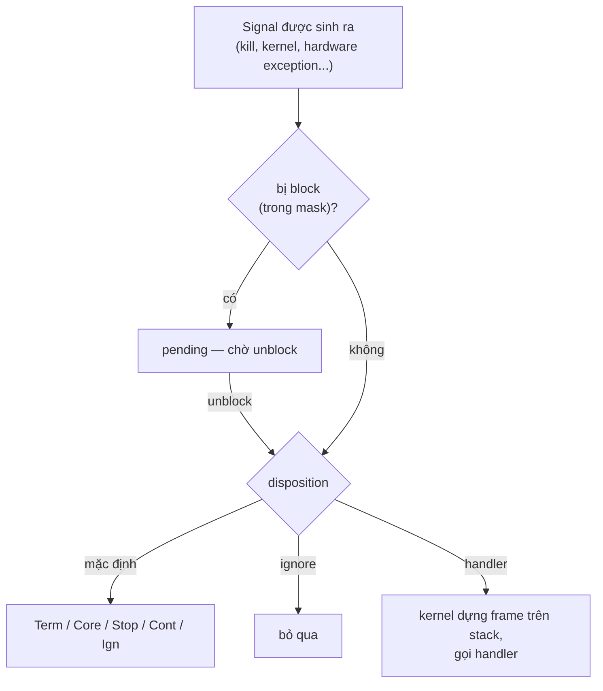

# P1 · Chương 05 — Signal

> Mọi khẳng định về kernel/syscall là về **Linux** (man-pages 6.03, Debian bookworm). Ví dụ "đã chạy" chạy trong container Linux aarch64 của `./labs/linux.sh`; kết quả là *quan sát* một lần chạy, không phải bảo đảm của tài liệu.

## Bạn sẽ hiểu được gì

- **Q1.** Disposition, default action, pending, mask, delivery khác nhau ở đâu; handler thực sự chạy lúc nào? → mục 2
- **Q2.** Signal chuẩn khác signal real-time thế nào? → mục 3
- **Q3.** `sigaction`, `sigprocmask`, `pthread_sigmask` làm gì? → mục 4
- **Q4.** `EINTR` từ đâu ra và `SA_RESTART` cứu được gì? → mục 5
- **Q5.** Vì sao handler chỉ được gọi hàm async-signal-safe? → mục 6
- **Q6.** Vì sao handler `SIGCHLD` phải lặp `waitpid`; `SIGPIPE`/`EPIPE` hoạt động ra sao? → mục 7
- **Q7.** `SIGTERM` khác `SIGKILL` thế nào; graceful shutdown dựa vào đâu; PID 1 trong container đặc biệt chỗ nào? → mục 8
- **Q8.** `signalfd(2)` và `sigwaitinfo(2)` giải quyết vấn đề gì; signal tương tác với thread ra sao? → mục 9

## Kiến thức cần trước

- [Chương 01 — OS và kernel](01-os-va-kernel.md): user mode/kernel mode, trap, interrupt (cần cho mục 2).
- [Chương 02 — System call](02-system-call.md): trap, `errno`, wrapper libc.
- [Chương 03 — Process](03-process.md): `fork`/`exec`/`wait`, zombie, orphan, process group.
- [Chương 04 — File descriptor và VFS](04-file-descriptor-va-vfs.md): fd, pipe (cần cho `SIGPIPE` và `signalfd`).

## 1. Signal giải quyết vấn đề gì

Một process cần được báo về những sự kiện *không do nó chủ động hỏi*: Ctrl-C, con vừa chết, ghi vào pipe không còn reader, orchestrator muốn dừng nó. Hệ signal là hạ tầng chuyển những sự kiện bên ngoài như vậy tới process, kèm cách nhận và xử lý chúng trong process[^ostep-signals]; `kill()` gửi signal tới một process hoặc một process group[^kill-send]. Theo nhận xét của người soạn, signal *bất đồng bộ* (đến lúc nào không báo trước) và khó dùng đúng vì hai điều, sẽ gặp ở các mục sau: handler (hàm bạn đăng ký để chạy khi signal tới) chạy chen vào chương trình ở chỗ không báo trước (mục 2 và mục 6), và signal chuẩn có thể bị gộp (mục 3).

## 2. Mô hình: disposition, pending, mask, delivery (Q1)

> **Trả lời ngắn.** Mỗi signal có một *disposition* — cách process phản ứng khi signal được *deliver* (giao tới nó): làm hành động mặc định, bỏ qua, hoặc chạy một hàm do bạn đăng ký, gọi là *handler*[^sig-disp][^sig-choose]. Signal đã sinh ra nhưng đang bị chặn (block) thì nằm chờ ở trạng thái *pending* cho đến khi được bỏ chặn[^sig-pending]. Disposition thuộc về cả process, còn danh sách signal đang bị chặn (*mask*) thuộc về từng thread[^sig-perproc][^sig-thread-mask]. Handler được gọi vào lúc kernel quay thread về user mode[^sig-delivery-check].

**Giải thích.**

Hình dung (nhận xét của người soạn): signal giống cuộc gọi đến một công ty. Disposition là quy định của công ty cho từng loại cuộc gọi (chuyển cho nhân viên nào, hay bỏ qua); mask là chế độ "không làm phiền" của từng nhân viên: cuộc gọi đến lúc đó không mất, chỉ nằm chờ đến khi nhân viên tắt chế độ này.

**Bước 1: disposition và hành động mặc định.** Mỗi signal có một disposition hiện tại, quyết định process phản ứng ra sao khi signal được *deliver* (giao tới process)[^sig-disp]. Hành động mặc định là một trong năm loại: `Term` (kết thúc process), `Ign` (bỏ qua), `Core` (kết thúc và ghi core dump), `Stop` (dừng process), `Cont` (tiếp tục nếu đang dừng)[^sig-actions]. Process đổi disposition bằng `sigaction(2)` (hoặc `signal(2)`, kém portable khi đặt handler) để chọn một trong ba: làm mặc định, bỏ qua, hoặc *bắt* bằng *signal handler* — một hàm do lập trình viên viết, tự động được gọi khi signal được deliver[^sig-choose].

**Bước 2: phạm vi và thừa kế.** Disposition là thuộc tính **theo process**: process nhiều thread thì disposition của một signal giống nhau cho mọi thread[^sig-perproc]. `fork` cho con bản sao disposition của cha; `execve` đặt lại disposition của signal *có handler* về mặc định, còn signal *bị ignore* thì giữ nguyên[^sig-fork-exec]. Lý do có lẽ là địa chỉ code handler của chương trình cũ không còn tồn tại sau `execve` (suy luận của người soạn, man page không nêu lý do).

**Bước 3: hai signal không thể can thiệp.** `SIGKILL` và `SIGSTOP` không thể bị catch, block hay ignore[^sig-uncatchable]. `sigaction` trả `EINVAL` nếu bạn thử đổi hành động của chúng[^sigaction-einval].

**Bước 4: pending và mask.** Một signal có thể bị *block*: nó sẽ không được deliver cho đến khi được unblock. Khoảng thời gian từ lúc signal được sinh ra đến lúc được deliver gọi là *pending*[^sig-pending]. Mỗi thread có *signal mask* riêng, là tập signal thread đó đang block[^sig-thread-mask].

**Bước 5: signal đi tới đâu.** Có hai kiểu đích. *Process-directed*: nhắm vào cả process (do `kill(2)`, `sigqueue(3)`, hoặc kernel sinh ra không vì hardware exception)[^sig-procdir]. *Thread-directed*: nhắm một thread cụ thể, ví dụ vì một lệnh máy gây hardware exception (`SIGSEGV` do truy cập bộ nhớ sai, `SIGFPE` do lỗi số học) hoặc vì gửi tới một thread cụ thể bằng `tgkill(2)`/`pthread_kill(3)`[^sig-hw][^sig-tgkill]. Signal process-directed có thể được deliver cho *bất kỳ* thread nào đang không block nó; nếu nhiều thread cùng không block, kernel chọn một thread tùy ý[^sig-directed].



**Bước 6: khi nào handler thực sự chạy.** Theo man page: mỗi khi có chuyển từ kernel mode sang user mode (ví dụ khi return từ system call, hoặc khi một thread được lên lịch chạy lại), kernel kiểm tra xem có signal pending, không bị block, mà process đã đặt handler hay không[^sig-delivery-check]. Nếu có, kernel làm các bước sau (nhận xét của người soạn: đây không phải interrupt phần cứng; về trap, interrupt và chuyển giữa kernel mode với user mode xem [Chương 01, mục 3 và 4](01-os-va-kernel.md)):

```mermaid
sequenceDiagram
  participant K as Kernel
  participant U as Thread (user mode)
  participant H as handler()
  participant T as signal trampoline
  K->>K: kiểm tra pending & unblocked khi quay về user mode
  K->>K: gỡ signal khỏi tập pending
  K->>U: lưu PC, thanh ghi, signal mask vào frame trên stack
  K->>K: thêm sa_mask và chính signal đó vào mask
  K->>H: nhảy vào handler; địa chỉ return trỏ tới trampoline
  H-->>T: handler return
  T->>K: sigreturn(2)
  K->>U: khôi phục thanh ghi + mask, chạy tiếp chỗ bị ngắt
```

Hệ quả: mặc định handler chạy trên stack bình thường của chính thread bị ngắt[^sig-stack-default], và sau khi handler return thì thread chạy tiếp ở đúng chỗ nó bị ngắt[^sig-resume]. Từ đó (suy luận của người soạn) handler có thể được gọi khi thread đang ở giữa một hàm thư viện, và đó là gốc của vấn đề ở mục 6.

<details><summary>Đi sâu: frame trên stack, trampoline, số hiệu signal</summary>

Signal bị gỡ khỏi tập pending trước khi handler chạy; nếu handler được cài bằng `sigaction(2)` với cờ `SA_ONSTACK` và thread đã khai báo stack thay thế bằng `sigaltstack(2)` thì kernel dùng stack đó[^sig-frame]. Ngữ cảnh được lưu vào một frame trên stack gồm PC, trạng thái thanh ghi cần để chạy lại chương trình, signal mask và thiết lập stack thay thế của thread[^sig-frame-list]. Trong lúc handler chạy, `sa_mask` và chính signal đang deliver bị thêm vào mask (trừ khi dùng `SA_NODEFER`)[^sig-mask-during]. Khi handler return, signal trampoline gọi `sigreturn(2)` để khôi phục trạng thái, kể cả mask[^sig-trampoline]. Kernel không ghi lại trạng thái đặc biệt nào cho biết thread "đang ở trong handler"[^sig-nokernelstate].

Số hiệu signal phụ thuộc kiến trúc: bảng của man page có cột riêng cho x86/ARM (và đa số kiến trúc khác), Alpha/SPARC, MIPS, PARISC[^sig-num-arch]; code portable nên dùng tên macro (nhận xét của người soạn). Ở cột x86/ARM, `SIGKILL` là 9[^sig-num-kill], `SIGTERM` là 15[^sig-num-term], `SIGCHLD` là 17[^sig-num-chld]. `SIGCHLD` mặc định là `Ign`[^sig-tbl-chld], `SIGINT` là `Term`[^sig-tbl-int].

</details>

**Quay lại Q1:** disposition (theo process) quyết định phản ứng, mask (theo thread) quyết định signal nào phải chờ ở trạng thái pending, và handler được gọi lúc kernel quay thread về user mode khi thấy signal pending, không bị block và có handler.

## 3. Signal chuẩn và signal real-time (Q2)

> **Trả lời ngắn.** Signal chuẩn (như `SIGINT`, `SIGTERM`, `SIGCHLD`) không xếp hàng: nếu cùng loại gửi nhiều lần trong lúc đang bị chặn thì chỉ còn một cái đang chờ[^sig-noqueue]. Signal real-time (dải `SIGRTMIN`…`SIGRTMAX`) thì xếp hàng được, giữ thứ tự gửi và mang theo được một giá trị[^sig-rt-queue][^sig-rt-order][^sig-rt-sigqueue]. Vì thế (nhận xét của người soạn), với signal chuẩn đừng dùng số lần nhận signal làm số lần sự kiện.

**Giải thích.**

Hình dung (nhận xét của người soạn): signal chuẩn như một lá cờ trên hộp thư: cờ đã dựng thì có thêm mười người bấm chuông cũng chỉ thấy một lá cờ. Signal real-time như một chồng thư: mỗi lá được giữ lại và đọc theo thứ tự.

| | Signal chuẩn (standard) | Real-time |
|---|---|---|
| Hàng đợi | không queue: nhiều lần sinh khi đang bị block chỉ còn một pending[^sig-noqueue] | nhiều instance cùng loại được queue[^sig-rt-queue] |
| Thứ tự deliver | không xác định[^sig-order-std] | có bảo đảm: cùng loại theo thứ tự gửi[^sig-rt-order]; khác loại thì số thấp trước[^sig-rt-order2] |
| Dữ liệu đi kèm | lần đến sau không ghi đè `siginfo_t` của lần đang pending: process nhận thông tin của lần đầu[^sig-siginfo-first] | `sigqueue(3)` gửi kèm một số nguyên hoặc con trỏ[^sig-rt-sigqueue] |

Signal real-time không có ý nghĩa định sẵn[^sig-rt-meaning] và nếu không có handler thì mặc định cũng kết thúc process[^sig-rt-default].

**Thí nghiệm: signal chuẩn bị gộp, real-time thì không.** Đã chạy trong container Linux aarch64: block `SIGUSR1` và `SIGRTMIN`, gửi mỗi loại 3 lần (`raise` cho `SIGUSR1`, `sigqueue` cho `SIGRTMIN`), rồi `sigpending`, rồi unblock. Kết quả:

```text
pending USR1=1 RTMIN=1
handler calls after unblock (3 USR1 + 3 RT sent) = 4
```

3 lần `SIGUSR1` thành đúng **1** lần gọi handler, 3 lần `SIGRTMIN` thành **3**: tổng 4. Đây là **quan sát một lần chạy** khớp với bảo đảm của man page, không phải bằng chứng độc lập.

<details><summary>Đi sâu: dải số real-time, SIGRTMIN, giới hạn hàng đợi</summary>

Kernel Linux hỗ trợ 33 signal real-time đánh số 32 đến 64, nhưng glibc dùng nội bộ một số và điều chỉnh `SIGRTMIN`[^sig-rt-range], nên chương trình phải dùng `SIGRTMIN+n` thay vì số cứng[^sig-rt-hard]. Số signal có thể queue bị giới hạn theo từng user bằng `RLIMIT_SIGPENDING`[^sig-rtlimit] (về giới hạn tài nguyên nói chung: [Chương 06, mục 6](06-user-quyen-proc-sys.md)).

</details>

**Quay lại Q2:** signal chuẩn bị gộp khi chờ, real-time thì xếp hàng có thứ tự và mang dữ liệu; vì vậy một `SIGCHLD` có thể đại diện cho nhiều sự kiện.

## 4. Các system call điều khiển: `sigaction`, `sigprocmask`, `pthread_sigmask` (Q3)

> **Trả lời ngắn.** `sigaction` cho process đổi cách phản ứng với một signal (đặt handler, cờ, các signal bị chặn trong lúc handler chạy)[^sigaction-desc]. `sigprocmask` và `pthread_sigmask` đổi danh sách signal đang bị chặn của thread gọi[^sigprocmask-desc]. Chương trình nhiều thread nên dùng `pthread_sigmask`[^sigprocmask-mt][^pthsig-same].

**Giải thích.**

Theo hình dung ở mục 2 (nhận xét của người soạn): `sigaction` là sửa quy định của công ty, còn `pthread_sigmask` là bật/tắt chế độ "không làm phiền" của riêng một nhân viên.

**`sigaction(2)`.** Nó đổi hành động của process khi nhận một signal; `signum` là signal hợp lệ bất kỳ trừ `SIGKILL` và `SIGSTOP`[^sigaction-desc]. Gọi với `act` là `NULL` để *đọc* hành động hiện tại[^sigaction-query]. Trong `struct sigaction`:

- `sa_handler`: `SIG_DFL`, `SIG_IGN`, hoặc con trỏ hàm nhận số signal làm đối số duy nhất[^sigaction-handler].
- `sa_sigaction` + cờ `SA_SIGINFO`: handler nhận ba đối số, thứ hai là con trỏ `siginfo_t` chứa thông tin thêm về signal[^sigaction-siginfo][^sigaction-info-arg]. Với `SIGCHLD`, nó điền `si_pid`, `si_uid`, `si_status`… cho con liên quan[^sigaction-chld-info].
- `sa_mask`: signal bị block *trong khi handler chạy*; signal gây ra handler cũng bị block trừ khi dùng `SA_NODEFER`[^sigaction-mask].
- `sa_flags`: đáng nhớ là `SA_RESTART` (mục 5)[^sigaction-restart], `SA_ONSTACK` (chạy handler trên stack thay thế khai báo bằng `sigaltstack(2)`, xem phần Đi sâu ở mục 2)[^sig-frame], `SA_NOCLDSTOP` và `SA_NOCLDWAIT` (chỉ có nghĩa với `SIGCHLD`)[^sigaction-nocldstop][^sigaction-nocldwait], `SA_RESETHAND` (về mặc định khi vào handler)[^sigaction-resethand].

**Vì sao không dùng `signal(2)`?** signal(7) ghi `signal(2)` kém portable khi thiết lập handler[^sig-signal-portable]; chi tiết nằm ở man page signal(2), chương này chưa đối chiếu trang đó. Quy tắc thực dụng (nhận xét của người soạn): dùng `sigaction` để mask, restart, one-shot do bạn chỉ định.

**`sigprocmask(2)` và `pthread_sigmask(3)`.** `sigprocmask()` đọc/đổi signal mask của thread gọi[^sigprocmask-desc]. Tham số `how` chọn cách đổi: `SIG_BLOCK` đặt mask mới là hợp của mask hiện tại và `set`[^sigprocmask-block]; `SIG_UNBLOCK` bỏ các signal trong `set` khỏi mask, còn `SIG_SETMASK` đặt mask bằng đúng `set`[^sigprocmask-others]. Với `set = NULL`, mask không đổi nhưng giá trị hiện tại vẫn trả về trong `oldset`[^sigprocmask-query]. Cách này dùng để lưu mask cũ rồi khôi phục sau đó (nhận xét của người soạn).

Ở chương trình đa thread, hành vi của `sigprocmask` là *unspecified* (chuẩn không quy định); hãy dùng `pthread_sigmask(3)`, giống hệt nhưng POSIX quy định rõ cho đa thread[^sigprocmask-mt][^pthsig-same]. Thread mới thừa kế bản sao mask của thread tạo ra nó[^pthsig-inherit]; con `fork` thừa kế mask của cha và mask được giữ qua `execve`[^sig-maskinherit]. Tập pending thì khác: con `fork` bắt đầu rỗng, còn `execve` giữ nguyên[^sig-pendfork].

Mẫu chống race (nhận xét của người soạn, dựa trên các sự thật trên): `SIG_BLOCK` *trước* khi tạo thread hoặc child để mọi thread mới thừa kế mask đã block, rồi dành một thread hoặc một fd (mục 9) nhận signal đồng bộ.

<details><summary>Đi sâu: các bẫy với signal phần cứng</summary>

Theo POSIX, hành vi của process là *không xác định* sau khi nó ignore `SIGFPE`, `SIGILL` hoặc `SIGSEGV` không do `kill(2)`/`raise(3)` sinh ra. Man page nêu ví dụ: chia số nguyên cho 0 có thể sinh `SIGFPE` trên một số kiến trúc, và ignore signal này có thể dẫn tới vòng lặp vô tận[^sigaction-hwignore]. Hiểu đơn giản (nhận xét của người soạn): ignore các signal này không làm lỗi phần cứng biến mất.

Với `sigprocmask`: block `SIGKILL`/`SIGSTOP` bị lờ đi *âm thầm*[^sigprocmask-silent]; `SIGBUS`/`SIGFPE`/`SIGILL`/`SIGSEGV` sinh ra khi đang bị block (không do `kill`/`sigqueue`/`raise`) cho kết quả undefined[^sigprocmask-hw].

</details>

**Quay lại Q3:** `sigaction` đặt *cách phản ứng* của cả process; `pthread_sigmask` đặt *cái gì tạm chờ* của từng thread; nên block trước khi tạo thread/child.

## 5. `EINTR` và `SA_RESTART` (Q4)

> **Trả lời ngắn.** Nếu signal đến lúc thread đang ngủ trong một system call chặn và handler được gọi, thì khi handler chạy xong, call đó hoặc tự chạy lại, hoặc báo lỗi `EINTR` (nghĩa là "bị ngắt"), tùy call và tùy handler có cờ `SA_RESTART` hay không[^sig-eintr]. `SA_RESTART` chỉ cứu được một số call; một số khác, như `epoll_wait`, `poll`, `select`, không bao giờ được chạy lại[^sig-norestart]. Vì vậy (nhận xét của người soạn) code gọi syscall phải luôn sẵn sàng thử lại khi gặp `EINTR`.

**Giải thích.**

Hình dung (nhận xét của người soạn): bạn đang chờ tổng đài trả lời thì có người vỗ vai (signal). Bạn quay lại xử lý xong thì có hai khả năng: tự gọi lại ngay (restart), hoặc đặt máy xuống và báo "bị gián đoạn" (`EINTR`) để chương trình quyết định.

**Vấn đề.** Thread đang ngủ trong một system call chặn (ví dụ `read` trên pipe rỗng) thì signal đến và handler được gọi. Sau khi handler return, call đó nên làm gì? Theo signal(7): hoặc tự được khởi động lại, hoặc lỗi `EINTR`, tùy interface và tùy handler có `SA_RESTART` hay không[^sig-eintr]. `SA_RESTART` làm "một số" system call restartable qua signal, tương thích ngữ nghĩa BSD[^sigaction-restart].

**Ba nhóm theo signal(7):**

- *Restart nếu có `SA_RESTART`, ngược lại `EINTR`*[^sig-restart-rule] — gồm `read`/`write` trên thiết bị chậm (terminal, pipe, socket)[^sig-slowdev]; họ `wait`[^sig-restart-wait]; `accept`/`connect`/`recv`/`send` trên socket, *trừ khi* socket có timeout[^sig-restart-list]. Danh sách trong signal(7) còn dài hơn.
- *Không bao giờ restart dù có `SA_RESTART`, luôn `EINTR`*[^sig-norestart-rule] — gồm **`epoll_wait`, `epoll_pwait`, `poll`, `ppoll`, `select`, `pselect`**[^sig-norestart]; các call nhận dữ liệu (`accept`, `recv`…) trên socket đã đặt timeout `SO_RCVTIMEO`[^sig-norestart-sock]; các call chờ signal (`pause`, `sigsuspend`, `sigtimedwait`, `sigwaitinfo`)[^sig-norestart-wait]; các hàm sleep (`nanosleep`…)[^sig-norestart-sleep].
- `read`/`write` thiết bị chậm đã chuyển được một phần dữ liệu thì khi bị ngắt trả *thành công* với số byte đã chuyển[^sig-partial]; I/O đĩa cục bộ không bị signal ngắt[^sig-disk].

**Thí nghiệm: `read` trên pipe với và không có `SA_RESTART`.** Đã chạy (C, container Linux aarch64): handler rỗng cho `SIGALRM`, `alarm(1)`, `read` trên pipe rỗng (ở trường hợp có `SA_RESTART`, một child ghi byte sau 2 giây):

```text
SA_RESTART=0: read returned -1 errno=Interrupted system call
SA_RESTART=1: read returned 1 errno=-
```

**Hệ quả (nhận xét của người soạn).** `SA_RESTART` không phải thuốc chữa mọi thứ: event loop dùng `epoll_wait`/`poll` vẫn nhận `EINTR`[^sig-norestart], phải lặp lại. Mọi chỗ gọi syscall thô nên có vòng retry-on-`EINTR`. `wait` cũng có thể trả `EINTR`[^wait-eintr].

<details><summary>Đi sâu: helper retry của std</summary>

std có helper `cvt_r` làm đúng việc retry khi `EINTR`[^rs-cvt-r]; dùng ở đâu thì xem [Chương 07, mục 2](07-rust-tren-giao-dien-he-thong.md).

</details>

**Quay lại Q4:** `EINTR` là cách kernel báo "call bị signal cắt ngang"; `SA_RESTART` chỉ che được một phần, nên vòng retry-on-`EINTR` vẫn cần.

## 6. Async-signal-safety: vì sao handler nguy hiểm (Q5)

> **Trả lời ngắn.** Handler chạy chen vào chương trình chính, nên có thể ngắt một hàm thư viện đang sửa dữ liệu dở dang. Nếu handler gọi lại chính hàm đó, nó chạy trên dữ liệu chưa nhất quán và kết quả không đoán trước được[^safety-stdio]. Vì vậy handler chỉ nên gọi những hàm được đánh dấu là *async-signal-safe* — gọi an toàn được từ trong handler[^safety-def].

**Giải thích.**

Hình dung (nhận xét của người soạn): bạn đang giữa chừng sửa một sổ cái (ghi dòng mới nhưng chưa cập nhật tổng); có người chen vào đọc sổ cái và tính toán dựa trên con số tạm. Kết quả sai, vì sổ chưa ở trạng thái hợp lệ.

**Định nghĩa.** Man page signal-safety(7): hàm async-signal-safe là hàm có thể gọi an toàn từ trong signal handler; nhiều hàm không như vậy, đặc biệt là các hàm không reentrant[^safety-def].

**Ví dụ kinh điển.** Thư viện stdio phải duy trì một buffer cấp phát tĩnh cùng các bộ đếm và con trỏ cho vị trí hiện tại[^safety-stdio-all]. Giả sử chương trình chính đang ở giữa `printf(3)`, buffer và biến liên quan mới cập nhật một phần; nếu lúc đó handler cũng gọi `printf`, lời gọi thứ hai chạy trên dữ liệu không nhất quán và kết quả không đoán trước được[^safety-stdio]. Một hàm an toàn khi nó *reentrant* (gọi lại được khi lần gọi trước chưa xong, vì không dùng trạng thái dùng chung đang dở dang), hoặc *atomic đối với signal* (không thể bị handler ngắt giữa chừng)[^safety-why].

**Hai cách đối phó** theo man page: (a) handler chỉ gọi hàm async-signal-safe *và* bản thân handler reentrant đối với biến toàn cục của chương trình chính; (b) block signal trong chương trình chính mỗi khi gọi hàm không an toàn hoặc đụng dữ liệu toàn cục mà handler cũng dùng[^safety-choices]. Cách (b) khó áp dụng ở chương trình phức tạp, nên thực tế chọn (a)[^safety-choice-a].

**Hai chi tiết dễ bị bỏ sót**, đều có trong man page:

1. **`errno`.** Đọc/ghi `errno` là async-signal-safe *với điều kiện* handler lưu `errno` lúc vào và khôi phục trước khi return[^safety-errno].
2. **`longjmp` ra khỏi handler.** Nếu handler ngắt một hàm không an toàn rồi thoát bằng `longjmp`/`siglongjmp`, mà sau đó chương trình gọi tiếp hàm không an toàn, hành vi là undefined[^safety-longjmp].

**Mẫu handler tối thiểu** (nhận xét của người soạn): handler chỉ đặt một cờ hoặc ghi một byte vào pipe rồi return (`write(2)` có trong bảng hàm async-signal-safe[^safety-write]); việc thật (log, giải phóng tài nguyên, đóng kết nối) do vòng lặp chính làm. Giới lập trình thường gọi mẫu ghi-một-byte-vào-pipe này là *self-pipe trick* (tên thông dụng; các nguồn đã tải không dùng tên này). Mục 9 cho thấy `signalfd` bỏ hẳn handler, mục 10 cho thấy tokio làm đúng mẫu này.

<details><summary>Đi sâu: bảng hàm của POSIX, vì sao <code>printf</code>/<code>malloc</code> không có trong đó</summary>

POSIX.1 quy định tập hàm bắt buộc phải async-signal-safe[^safety-posix]. Bảng của man page có, ví dụ, `write(2)`[^safety-write], `_exit(2)`[^safety-exit], `sem_post(3)`[^safety-sem], `wait(2)`/`waitpid(2)`[^safety-wait]. `printf` và `malloc` **không** có trong bảng đó: người soạn đã tìm văn bản man page bookworm (6.03) và `malloc`/`free` không xuất hiện ở bất kỳ đâu, còn `printf` chỉ xuất hiện trong đoạn giải thích ví dụ phía trên, không nằm trong bảng. Với `printf`, man page nói thẳng hơn: chọn thư viện stdio làm ví dụ vì mọi hàm của nó đều không async-signal-safe[^safety-stdio-all].

Đọc cho đúng mức: bảng liệt kê các hàm POSIX *bắt buộc* async-signal-safe, và man page nói một bản cài đặt *có thể* cung cấp thêm hàm an toàn nhưng chuẩn không đòi hỏi[^safety-posix]. Vì vậy, với `malloc`, kết luận có nguồn chỉ là "POSIX không bảo đảm"; còn "không an toàn" là suy luận của người soạn (lấy từ cơ chế: `malloc` giữ cấu trúc dữ liệu chung của allocator, cùng loại vấn đề với buffer stdio ở trên) — hãy coi nó là không an toàn trong code portable.

</details>

**Quay lại Q5:** handler chạy chen giữa chương trình, nên chỉ hàm không dựa vào trạng thái dở dang (async-signal-safe) mới được gọi; cách an toàn nhất là chỉ đặt cờ hoặc ghi một byte.

## 7. `SIGCHLD` và `SIGPIPE` (Q6)

> **Trả lời ngắn.** `SIGCHLD` là signal chuẩn[^sig-tbl-chld] nên không xếp hàng[^sig-noqueue]: nhiều con chết gần nhau có thể chỉ để lại một `SIGCHLD` đang chờ, và handler chỉ `waitpid` một lần sẽ bỏ sót con. Vì vậy (nhận xét của người soạn, rút ra từ hai điều trên) handler phải gọi `waitpid` lặp lại, mỗi lần với cờ `WNOHANG` (trả về ngay thay vì chờ), cho đến khi không còn con nào để thu[^wait-nohang]. Còn `SIGPIPE`: ghi vào pipe không còn ai đọc thì process nhận `SIGPIPE`, mặc định bị kết thúc[^sig-tbl-pipe]; nếu ignore thì `write` trả lỗi `EPIPE`[^pipe-sigpipe].

**Giải thích.**

Hình dung (nhận xét của người soạn): `SIGCHLD` như chuông cửa: nếu nhiều khách bấm liên tiếp lúc bạn đang bận, bạn chỉ nghe được một hồi chuông; ra mở cửa thì phải đón hết hàng người đứng chờ, không chỉ người đầu tiên.

**`SIGCHLD` báo gì, và cha phải làm gì.** `SIGCHLD` báo rằng một con vừa dừng hoặc kết thúc; hành động mặc định của nó là `Ign` (bỏ qua)[^sig-tbl-chld]. Con kết thúc mà cha chưa `wait` thì thành zombie, chiếm một slot trong bảng process của kernel[^wait-zombie]; cơ chế zombie, orphan và việc `init` nhận con mồ côi: [Chương 03, mục 7](03-process.md).

**Hai cách thu hoạch con.** (1) *Bắt* `SIGCHLD` rồi gọi `wait`/`waitpid`: hành vi lịch sử của BSD và System V về việc ignore `SIGCHLD` khác nhau, nên đây là cách portable duy nhất để con không thành zombie[^sigaction-ignchld]. (2) Đặt disposition của `SIGCHLD` là `SIG_IGN`, hoặc dùng cờ `SA_NOCLDWAIT`: con kết thúc không thành zombie, nhưng `wait`/`waitpid` sẽ chặn đến khi mọi con kết thúc rồi lỗi `ECHILD`[^wait-sigign], nghĩa là cha không còn lấy được exit status của từng con (suy luận của người soạn). Lưu ý riêng của man page: dù disposition mặc định của `SIGCHLD` là "ignore", đặt tường minh `SIG_IGN` cho kết quả khác về zombie[^wait-sigign-default].

**Bẫy: một signal = nhiều con chết.** Vì signal chuẩn không queue (mục 3)[^sig-noqueue], nhiều con chết gần nhau có thể chỉ cho **một** lần `SIGCHLD`. Handler chỉ `waitpid` một lần sẽ bỏ sót zombie. Cách đúng (nhận xét của người soạn, rút ra từ hai điều trên) là **lặp `waitpid(-1, ..., WNOHANG)` đến khi hết**; `WNOHANG` làm call trả ngay nếu chưa có con nào kết thúc[^wait-nohang], nên vòng lặp dừng lại thay vì chặn.

Đã chạy: block `SIGCHLD`, tạo 3 con thoát ngay, đợi chúng chết, rồi unblock để handler chạy. Hai biến thể handler:

```text
single-waitpid handler: reaped inside handler=1, left as zombie after handler=2
loop handler: reaped inside handler=3, left as zombie after handler=0
```

Handler `waitpid` một lần thu 1 con, để 2 zombie; handler lặp với `WNOHANG` thu đủ 3. Block/unblock dùng để *tái hiện* việc gộp một cách xác định; thực tế việc gộp phụ thuộc thời điểm (suy luận của người soạn).

**SIGPIPE.** Hình dung (nhận xét của người soạn): nói vào điện thoại khi đầu dây bên kia đã cúp máy; hệ thống báo bạn bằng một tiếng chuông to (signal) thay vì chỉ một thông báo lỗi nhỏ. Nếu mọi fd của đầu *đọc* một pipe đã đóng, `write(2)` làm sinh `SIGPIPE` cho process gọi; nếu process đang ignore signal này thì `write` lỗi `EPIPE`[^pipe-sigpipe] (pipe và EOF: [Chương 04, mục 8](04-file-descriptor-va-vfs.md)). Mặc định của `SIGPIPE` là `Term`[^sig-tbl-pipe]; số hiệu của nó là 13 ở mọi cột kiến trúc của bảng[^sig-num-pipe].

Mục này chỉ khẳng định hành vi với **pipe**; với socket (kết nối đã đóng) và cờ `MSG_NOSIGNAL`, xem [P6 — Socket API, mục 6](../06-networking/07-socket-va-kernel.md). Nhận xét của người soạn: server dài hạn thường không muốn bị giết bởi một đầu kết nối hỏng, nên ignore `SIGPIPE` để lỗi hiện ra là `EPIPE`.

Đã chạy (C): con ghi vào pipe không còn reader.

```text
ign=0: child killed by signal 13
ign=1: child exit 0        (write returned -1, errno=Broken pipe)
```

Không ignore → con chết vì signal 13; ignore → `write` trả `-1` với `EPIPE`. (Output thật của thử nghiệm bị in lặp do buffer stdio bị `fork` nhân đôi: lỗi của chương trình thử, không phải hành vi signal.)

<details><summary>Đi sâu: <code>SIGCHLD</code> và trạng thái con, <code>SA_NOCLDSTOP</code>, <code>Child</code> của Rust</summary>

Cách đọc exit status của con (`WIFEXITED`, `WEXITSTATUS`, `WIFSIGNALED`, `WTERMSIG`, và việc status chỉ giữ 8 bit thấp): [Chương 03, mục 6](03-process.md). Hai chi tiết riêng cho `SIGCHLD`: mặc định `waitpid` chỉ đợi con *kết thúc*[^wait-options], và `SA_NOCLDSTOP` tắt `SIGCHLD` khi con dừng hoặc tiếp tục[^sigaction-nocldstop].

Rust: std không tự `wait` con kể cả khi `Child` bị drop[^rs-child-zombie] ([Chương 07, mục 4](07-rust-tren-giao-dien-he-thong.md)).

</details>

**Quay lại Q6:** `SIGCHLD` có thể gộp nhiều cái chết thành một lần, nên handler phải lặp `waitpid(-1, WNOHANG)`; `SIGPIPE` bị ignore thì lỗi hiện ra ở `write` là `EPIPE`.

## 8. `SIGTERM` vs `SIGKILL`, graceful shutdown và PID 1 (Q7)

> **Trả lời ngắn.** `SIGTERM` là signal yêu cầu process kết thúc, nhưng process bắt (catch) được nó để dọn dẹp rồi mới thoát[^sigaction-desc]; `SIGKILL` thì không bắt, không chặn, không bỏ qua được nên process không có cơ hội dọn[^sig-uncatchable]. "Graceful shutdown" là quy ước của ứng dụng đứng trên cơ chế đó, không phải tính năng kernel (nhận xét của người soạn). Trong container, process PID 1 (process đầu tiên trong không gian PID riêng của container, gọi là *PID namespace*) có luật riêng: signal gửi từ bên trong namespace chỉ tới được nó nếu nó đã cài handler[^pidns-onlyhandled].

**Giải thích.**

Hình dung (nhận xét của người soạn): `SIGTERM` như tiếng chuông báo hết giờ làm: nhân viên nghe thấy thì lưu việc, tắt máy rồi ra về. `SIGKILL` như ngắt cầu dao cả tòa nhà: không ai kịp lưu gì.

**`SIGTERM` và `SIGKILL`.** `SIGTERM` mặc định là `Term`[^sig-tbl-term] và bắt được, nên process có thể coi nó là yêu cầu để dọn dẹp rồi thoát có trật tự (nhận xét của người soạn). `SIGKILL` cũng mặc định `Term`[^sig-tbl-kill] nhưng không thể bắt nên process không có cơ hội dọn dẹp (suy luận của người soạn từ việc handler không thể được đặt cho `SIGKILL`[^sig-uncatchable]). "Graceful shutdown" vì thế là **quy ước ứng dụng đứng trên cơ chế signal**, không phải tính năng của kernel (nhận xét của người soạn): bắt `SIGTERM` (và thường `SIGINT`), ngừng nhận việc mới, chờ việc đang chạy xong trong hạn, đóng tài nguyên, rồi thoát.

**Kubernetes.** Khi một Pod bị dừng có thứ tự (graceful), kubelet yêu cầu container runtime dừng các container bằng cách trước hết gửi `TERM` (SIGTERM), kèm một thời hạn (grace period), tới main process của mỗi container[^k8s-term]; phần mô tả luồng dừng Pod nói rõ đó là process 1 bên trong container[^k8s-pid1]. Thời hạn mặc định là 30 giây[^k8s-grace-default]; hết hạn thì runtime gửi `KILL` tới các process còn chạy[^k8s-kill]. Nhiều runtime tôn trọng `STOPSIGNAL` của image và gửi signal đó thay vì `TERM`[^k8s-stopsignal]. Nhận xét của người soạn: ứng dụng backend chạy trong Kubernetes nên coi `SIGTERM` là *lệnh bắt đầu* graceful shutdown và phải hoàn tất *trong grace period*; sau đó không còn cơ hội.

**PID 1 trong container.** Hình dung (nhận xét của người soạn): PID 1 như quản đốc của một nhà xưởng; nhân viên trong xưởng không được tự ý "tắt" quản đốc, trừ khi quản đốc đã đăng ký cách xử lý tín hiệu đó. PID namespace cô lập không gian số PID (process ở namespace khác nhau có thể trùng PID)[^pidns-isolate], và PID trong namespace mới bắt đầu từ 1[^pidns-start]. Process đầu tiên trong namespace là "init" của namespace đó và nhận nuôi các process mồ côi[^pidns-orphan] (chi tiết: [Chương 03, mục 7](03-process.md) và [P8 — Namespaces](../08-containers/02-namespaces.md)).

PID 1 có luật signal riêng:

1. Từ *bên trong* namespace, chỉ những signal mà init đã cài handler mới gửi tới init được; hạn chế này áp dụng cả với process đặc quyền, để chặn việc vô tình giết init[^pidns-onlyhandled]. Tương tự trên hệ thống thường: `kill(2)` ghi rằng chỉ những signal mà init đã cài handler mới gửi được tới process ID 1[^kill-init].
2. Từ *namespace tổ tiên*, quy tắc giống nhưng có ngoại lệ: `SIGKILL` và `SIGSTOP` được deliver cưỡng bức khi gửi từ namespace tổ tiên[^pidns-sigkill-ancestor]. Còn signal khác chỉ tới được init khi init có handler cho nó[^pidns-ancestor].
3. Nếu init của namespace kết thúc, kernel kết thúc mọi process trong namespace bằng `SIGKILL`[^pidns-initdie].

**Hệ quả với `SIGTERM`.** PID 1 *không có handler* `SIGTERM` sẽ không bị `SIGTERM` từ bên trong namespace giết (luật 1); có handler thì nhận bình thường (suy luận của người soạn từ luật 1).

**Liên hệ thực tế (nhận xét của người soạn).** Kubelet nhờ runtime gửi `SIGTERM` tới process 1 của container[^k8s-pid1]. Runtime nằm ngoài PID namespace của container, tức ở namespace tổ tiên (suy luận của người soạn), nên theo luật 2 signal chỉ tới được ứng dụng PID 1 nếu ứng dụng có handler; không có thì container sống tới hết grace period rồi bị `SIGKILL` (deliver cưỡng bức)[^k8s-kill][^pidns-sigkill-ancestor]. [P8·08, mục 3](../08-containers/08-rust-trong-container.md) đo trường hợp này với `docker stop`. Vì vậy ứng dụng làm PID 1 cần tự cài handler `SIGTERM`, hoặc container nên chạy một chương trình init nhỏ làm PID 1 để chuyển signal cho ứng dụng. PID 1 còn phải `wait` các con mồ côi được giao ([Chương 03, mục 7](03-process.md)); cơ chế PID namespace đầy đủ (`--fork`, `/proc`, lồng nhau): [P8 Chương 02, mục 4](../08-containers/02-namespaces.md).

<details><summary>Đi sâu: quyền gửi signal, <code>kill(pid, 0)</code> và thí nghiệm PID 1</summary>

**Quyền gửi signal.** Theo `kill(2)`: người gửi phải có đặc quyền (trên Linux là `CAP_KILL` trong user namespace của đích), hoặc real/effective UID của người gửi bằng real/saved set-user-ID của đích[^kill-perm]. Tham số `pid` dương/0: một process / cả process group[^kill-pid]. `kill(pid, 0)` không gửi gì nhưng vẫn kiểm tra tồn tại và quyền[^kill-sig0]; man page nhắc rằng process "tồn tại" có thể là một zombie chưa được `wait`[^kill-zombie], nên `kill(pid, 0)` thành công không chứng minh process còn *chạy* (suy luận của người soạn). Về các loại ID và capability: [Chương 06](06-user-quyen-proc-sys.md).

**Thí nghiệm PID 1.** Đã chạy (C, trong container Linux aarch64 của lab, chương trình là PID 1 qua `exec`, một child gửi `kill(1, SIGTERM)` cho nó):

```text
my pid = 1
child: kill(1,TERM)=0
PID1: got SIGTERM in handler
PID1 still alive
```

Ở một lần chạy khác, *không đặt handler* và child gửi cả `SIGTERM` lẫn `SIGKILL`: cả hai `kill` trả `0` và PID 1 vẫn sống. Khớp với luật 1; `kill` trả `0` chỉ cho biết lời gọi được chấp nhận, không nói signal có tác dụng (suy luận của người soạn). Cả hai đều là **quan sát một lần chạy**.

</details>

**Quay lại Q7:** `SIGTERM` bắt được nên là chỗ để graceful shutdown; `SIGKILL` thì không; riêng PID 1 chỉ nhận signal mà nó có handler (trừ `SIGKILL`/`SIGSTOP` từ namespace tổ tiên).

## 9. `signalfd(2)`, `sigwaitinfo(2)` và signal với thread (Q8)

> **Trả lời ngắn.** Ngoài handler (chạy bất đồng bộ và bị ràng buộc bởi async-signal-safety, mục 6), Linux cho nhận signal *đồng bộ*: `sigwaitinfo` chặn thread gọi đến khi có signal[^sig-sync-wait], còn `signalfd` biến signal thành một fd để `read`[^sig-sync]. fd này dùng chung được với `poll`/`epoll`[^sfd-def], nên signal trở thành một nguồn sự kiện trong event loop. Với thread: disposition chung cả process, mask riêng từng thread[^sig-perproc][^sig-thread-mask].

**Giải thích.**

Hình dung (nhận xét của người soạn): thay vì để chuông điện thoại bất ngờ reo giữa lúc bạn đang làm việc (handler), bạn tắt chuông và định kỳ mở hộp thư thoại (đọc fd) lúc thuận tiện.

**Vấn đề.** Handler bất đồng bộ buộc bạn tuân thủ async-signal-safety (mục 6) và không phải là một fd để đưa vào `poll`/`epoll` (nhận xét của người soạn). Hai cách nhận signal *đồng bộ* có sẵn: `sigwaitinfo(2)`/`sigtimedwait(2)`/`sigwait(3)` chặn đến khi một signal trong tập được deliver rồi trả thông tin về nó[^sig-sync-wait]; hoặc `signalfd(2)` trả về một fd để đọc thông tin signal được deliver cho caller, mỗi `read` chặn đến khi có signal trong tập[^sig-sync].

**Cơ chế `signalfd`.**

1. Block các signal muốn nhận bằng `sigprocmask(2)`, để chúng không bị xử lý theo disposition mặc định[^sfd-block].
2. Gọi `signalfd(-1, &mask, flags)`: `-1` nghĩa là tạo fd mới gắn với tập signal; truyền một signalfd có sẵn thay cho `-1` thì thay tập signal của fd đó[^sfd-replace]. `SFD_NONBLOCK` đặt `O_NONBLOCK` ngay lúc tạo (đỡ một lần `fcntl`), `SFD_CLOEXEC` đặt close-on-exec[^sfd-flags] (về `O_CLOEXEC`: [Chương 04, mục 4](04-file-descriptor-va-vfs.md)).
3. `read(2)` trả một hoặc nhiều `struct signalfd_siginfo`[^sfd-read-struct] (128 byte[^sfd-128]) mô tả signal; đọc *tiêu thụ* signal: nó không còn pending, handler sẽ không chạy cho nó và `sigwaitinfo` cũng không nhận được[^sfd-read]. Nếu không signal nào pending, `read` chặn, hoặc trả `EAGAIN` nếu fd non-blocking[^sfd-read2].
4. fd đọc được (với `select`/`poll`) khi có signal trong tập đang pending[^sfd-readable], và cũng dùng được với `epoll`[^sfd-def]. Đây là lợi ích chính: signal trở thành một nguồn sự kiện như socket trong cùng event loop (xem [P7 — select/poll/epoll](../07-io-async/02-select-poll-epoll.md)).

Đã chạy: block `SIGUSR2`, `signalfd`, `sigqueue` một lần, `read` một `struct signalfd_siginfo`:

```text
signalfd read 128 bytes (sizeof=128) signo=12 pid_matches=1
```

`SIGUSR2` là số 12 ở cột x86/ARM của bảng số hiệu (mục 2)[^sig-num-usr2]; `ssi_pid` khớp PID người gửi.

**`sigwaitinfo` và thread.** `sigwaitinfo` cùng ý tưởng nhưng chặn thread gọi. Trong chương trình đa thread, signal cần được block ở **mọi thread**, kẻo bị xử lý theo disposition mặc định ở thread không gọi `sigwaitinfo`[^sigwait-mt]; nhiều thread cùng chờ một signal thì chỉ một thread nhận, không xác định thread nào[^sigwait-multi].

**Signal và thread nói chung.** Disposition theo process[^sig-perproc], mask theo thread[^sig-thread-mask], thread mới thừa kế mask của thread tạo ra nó[^pthsig-inherit]. Hệ quả: một handler đặt bởi bất kỳ thread nào có hiệu lực cho cả process, và signal gửi cho process có thể rơi vào *bất kỳ* thread nào không block nó[^sig-directed]. Nếu không kiểm soát mask, handler có thể chạy giữa lúc một thread worker đang giữ lock hoặc đang trong `malloc` (nhận xét của người soạn, từ mục 6 và mục 2).

**Mẫu có nguồn: thread chuyên xử lý signal.** Ví dụ trong `pthread_sigmask(3)`: block một số signal ở main thread rồi tạo một thread riêng lấy chúng bằng `sigwait(3)`[^pthsig-example]. Thread tạo sau thừa kế mask đã block (mục 4), nên (suy luận của người soạn) chỉ thread chuyên trách chờ bằng `sigwait` nhận chúng. Đây là mô hình thay thế handler, cùng họ với `signalfd`.

Thread nói chung: [P4 — Thread](../04-concurrency/01-thread.md).

<details><summary>Đi sâu: giới hạn của signalfd</summary>

- Không nhận được signal sinh *đồng bộ* như `SIGSEGV`, `SIGFPE`; chúng chỉ bắt được bằng handler[^sfd-limits]. `SIGKILL`/`SIGSTOP` bị lờ âm thầm[^sfd-kill].
- Signal phải được block và mask được thừa kế qua `fork`/`exec`, nên child chạy chương trình khác thường phải unblock chúng trước `execve`[^sfd-exec]; không làm được khi child do hàm thư viện tự spawn ngầm, lúc đó phải dùng handler ghi vào một fd (cùng ý tưởng với *self-pipe* ở mục 6)[^sfd-lib].
- Nếu cha đã thêm signalfd vào một `epoll` instance rồi `fork`, child thừa kế fd và `read` được signal gửi cho child, nhưng `epoll_wait` không báo fd đó sẵn sàng[^sfd-fork][^sfd-epoll].
- Trong chương trình đa thread, thread đọc signalfd nhận signal nhắm vào chính nó và signal nhắm vào cả process, không nhận signal nhắm vào thread khác[^sfd-thread].
- API **chỉ có trên Linux**[^sfd-linux]. Hệ BSD có filter `EVFILT_SIGNAL` của kqueue cho việc tương tự ([P7 — kqueue](../07-io-async/03-kqueue-io-uring.md); nguồn ở đó là man page FreeBSD, chưa kiểm chứng trên macOS).

</details>

**Quay lại Q8:** `signalfd` và `sigwaitinfo` đưa signal về dạng đồng bộ, tránh hạn chế của handler; vì mask theo thread còn disposition theo process, hãy block signal trước khi tạo thread và để một nơi duy nhất nhận.

## 10. Liên hệ với Rust

**`SIGPIPE` trong Rust** (cơ chế đầy đủ, hai đường spawn và bẫy `println!`: [Chương 07, mục 5](07-rust-tren-giao-dien-he-thong.md)). Từ 2014 runtime Rust trên Unix đặt `SIGPIPE` là `SIG_IGN` lúc khởi động[^rs-rt-sigpipe], vì nếu không thì một số nền tảng sẽ giết chương trình khi gặp `EPIPE`[^rs-sigpipe-comment]. Hệ quả quan sát được (đã chạy, rustc 1.95.0, Linux): ghi vào `std::io::pipe()` đã đóng reader trả `Err` thay vì giết process, với `kind=BrokenPipe raw=Some(32)`. Runtime init "không bảo đảm chạy" khi Rust code được gọi từ bên ngoài[^rs-init-notrun], nên đừng giả định `SIGPIPE` luôn bị ignore ở đó.

Con do `Command` spawn thì không thừa kế việc ignore: std đặt lại `SIGPIPE` về `SIG_DFL` trong con trước khi `exec` (nếu không dùng `-Zon-broken-pipe`)[^rs-child-sigpipe-reset][^rs-child-sigpipe-fork]. Việc ignore sống sót qua `execve`[^sig-fork-exec] là lý do dễ hiểu cho bước này, nhưng comment của std chỉ nói "tương thích ngược" (suy luận của người soạn).

**`Child::kill` là `SIGKILL`.** `Child::kill` buộc child thoát và tương đương gửi `SIGKILL` trên Unix[^rs-child-kill]; vì vậy nó *không phải* graceful shutdown. Muốn gửi `SIGTERM` phải dùng `libc::kill` (FFI, cần `unsafe`) hoặc thư viện bọc (nhận xét của người soạn). Việc `Child` không tự `wait`: [Chương 07, mục 4](07-rust-tren-giao-dien-he-thong.md).

**std không có API signal cấp cao** (người soạn đã tìm văn bản trang chủ tài liệu `std` 1.95.0, gồm danh sách module và macro: không có mục nào nhắc tới signal; đây là kết quả tìm kiếm, không phải trích dẫn). Bắt signal trong Rust nghĩa là FFI tới `sigaction`/`signalfd` qua crate `libc` (hàm extern gọi là `unsafe`[^rs-unsafe-extern]; xem [Chương 07, mục 7](07-rust-tren-giao-dien-he-thong.md)) hoặc crate bọc. Hạn chế async-signal-safety của mục 6 vẫn đúng với handler viết bằng Rust (suy luận của người soạn).

**tokio.** `tokio::signal` nhắc rằng signal handling nói chung là một chủ đề rất rắc rối, cần dùng cẩn thận[^tokio-warn]. Trong source tokio 1.53.2, handler ở mức thấp làm đúng mẫu handler tối thiểu của mục 6: đặt cờ báo signal đã đến rồi ghi một byte để đánh thức driver của tokio; comment trong source nói hai thao tác này đều phải async-signal-safe[^tokio-selfpipe]. Comment nói "pipe", còn code ghi byte vào một `UnixStream` ghép đôi (socket pair) do `UnixStream::pair()` tạo ra[^tokio-pair], cùng ý tưởng self-pipe (nhận xét của người soạn). Tài liệu `signal()` nêu: signal có thể bị gộp *nhiều hơn* mức kernel đã gộp[^tokio-coalesce], và handler libc đã đăng ký *không bao giờ được gỡ*[^tokio-unregister]. Nghĩa là (suy luận của người soạn) sau khi đăng ký `SignalKind::terminate()`, `SIGTERM` không còn tự kết thúc process; chương trình *phải* chủ động thoát. Dùng `tokio::signal` cho graceful shutdown: [P7·08 — Tokio](../07-io-async/08-tokio.md) và [P8·08, mục 4](../08-containers/08-rust-trong-container.md).

Vòng retry `EINTR` (`cvt_r`) của std: [Chương 07, mục 2](07-rust-tren-giao-dien-he-thong.md).

## Tóm tắt

- Disposition theo process, mask theo thread; signal pending giữa lúc sinh và lúc deliver.
- Kernel chạy handler khi quay về user mode: dựng frame trên stack, thêm `sa_mask` và chính signal vào mask, `sigreturn` khôi phục.
- Signal chuẩn không queue; real-time queue được, có thứ tự, mang được dữ liệu.
- Dùng `sigaction`, `pthread_sigmask`; block signal *trước* khi tạo thread/child.
- `SA_RESTART` không restart `epoll_wait`/`poll`/`select`/sleep: luôn retry khi `EINTR`.
- Handler chỉ gọi hàm async-signal-safe, lưu/khôi phục `errno`; tốt nhất chỉ đặt cờ hoặc ghi một byte.
- Handler `SIGCHLD` phải lặp `waitpid(-1, WNOHANG)`; `SIGPIPE` ignore thì `write` lỗi `EPIPE` (runtime Rust ignore sẵn).
- `SIGTERM` bắt được, `SIGKILL` không; graceful shutdown là quy ước ứng dụng.
- PID 1 chỉ nhận signal nó có handler (trừ `SIGKILL`/`SIGSTOP` từ namespace tổ tiên).
- `signalfd` (chỉ Linux) và `sigwaitinfo` nhận signal đồng bộ, tránh handler.

## Câu hỏi tự kiểm tra

1. Disposition và signal mask thuộc process hay thread? Qua `fork` và `execve` chúng ra sao?
<details><summary>Đáp án</summary>

Disposition theo process[^sig-perproc], mask theo thread[^sig-thread-mask]. `fork` thừa kế cả hai; `execve` đặt lại handler về mặc định, giữ ignore[^sig-fork-exec], và giữ mask[^sig-maskinherit]. Tập pending: con `fork` rỗng, `execve` giữ[^sig-pendfork].

</details>

2. Gửi `SIGUSR1` 5 lần khi bị block rồi unblock: handler chạy mấy lần? Với `SIGRTMIN` qua `sigqueue` thì sao?
<details><summary>Đáp án</summary>

1 lần với signal chuẩn[^sig-noqueue]; 5 lần với real-time[^sig-rt-queue].

</details>

3. Vì sao `printf` trong handler nguy hiểm, và hai cách khắc phục?
<details><summary>Đáp án</summary>

stdio có buffer và biến trạng thái tĩnh; bị ngắt giữa chừng rồi gọi lại chạy trên dữ liệu không nhất quán[^safety-stdio]. (a) chỉ gọi hàm async-signal-safe và handler reentrant, (b) block signal quanh chỗ không an toàn[^safety-choices]; thực tế chọn (a)[^safety-choice-a].

</details>

4. `SA_RESTART` có bảo đảm `epoll_wait` không trả `EINTR`?
<details><summary>Đáp án</summary>

Không; `epoll_wait`, `poll`, `select` không bao giờ được restart[^sig-norestart].

</details>

5. Handler `SIGCHLD` gọi `waitpid` một lần mà vẫn còn zombie: vì sao, sửa sao?
<details><summary>Đáp án</summary>

Signal chuẩn không queue nên nhiều con chết có thể chỉ cho một `SIGCHLD`[^sig-noqueue]; lặp `waitpid(-1, ..., WNOHANG)` đến hết[^wait-nohang].

</details>

6. Ghi vào pipe không còn reader: mặc định và khi ignore `SIGPIPE` xảy ra gì?
<details><summary>Đáp án</summary>

Mặc định process nhận `SIGPIPE` và (Term) kết thúc[^sig-tbl-pipe]; ignore thì `write` lỗi `EPIPE`[^pipe-sigpipe].

</details>

7. Vì sao `signalfd` đi cùng `sigprocmask(SIG_BLOCK)`, và nó không nhận loại signal nào?
<details><summary>Đáp án</summary>

Để signal không bị xử lý theo disposition mặc định[^sfd-block]. Không nhận signal đồng bộ như `SIGSEGV`/`SIGFPE`[^sfd-limits], và `SIGKILL`/`SIGSTOP`[^sfd-kill].

</details>

8. PID 1 trong PID namespace không có handler `SIGTERM`: `SIGTERM` từ trong namespace thì sao? `SIGKILL` từ namespace tổ tiên thì sao?
<details><summary>Đáp án</summary>

`SIGTERM` từ bên trong không tới được init[^pidns-onlyhandled]; `SIGKILL` từ namespace tổ tiên được deliver cưỡng bức[^pidns-sigkill-ancestor].

</details>

9. Kubernetes dừng một Pod: signal nào được gửi tới đâu, bao lâu thì bị `SIGKILL`, và ứng dụng nên làm gì với `SIGTERM`?
<details><summary>Đáp án</summary>

Kubelet nhờ container runtime gửi `TERM` kèm grace period tới main process của mỗi container[^k8s-term], tức process 1 trong container[^k8s-pid1]; mặc định 30 giây[^k8s-grace-default], hết hạn thì gửi `KILL` cho các process còn chạy[^k8s-kill]. Ứng dụng nên coi `TERM` là lệnh bắt đầu graceful shutdown và hoàn tất trong grace period (nhận xét của người soạn).

</details>

10. Process nhiều thread: signal gửi cho cả process sẽ rơi vào thread nào, và làm sao để chỉ một thread xử lý nó?
<details><summary>Đáp án</summary>

Signal process-directed có thể tới bất kỳ thread nào không block nó; nếu nhiều thread cùng không block, kernel chọn tùy ý[^sig-directed]. Block signal ở mọi thread rồi để một thread chuyên trách chờ bằng `sigwait`/`sigwaitinfo`[^sigwait-mt][^pthsig-example], hoặc đọc `signalfd` (suy luận của người soạn từ mục 4 và mục 9).

</details>

## Đọc thêm

- [signal(7)](https://manpages.debian.org/bookworm/manpages/signal.7.en.html) — mô hình đầy đủ, danh sách syscall bị/không bị restart.
- [signal-safety(7)](https://manpages.debian.org/bookworm/manpages/signal-safety.7.en.html) — bảng hàm async-signal-safe và ghi chú về `errno`, `longjmp`.
- [signalfd(2)](https://manpages.debian.org/bookworm/manpages-dev/signalfd.2.en.html) — ví dụ hoàn chỉnh và giới hạn với epoll/fork.
- [pid_namespaces(7)](https://manpages.debian.org/bookworm/manpages/pid_namespaces.7.en.html) — luật init và signal giữa namespace; tiếp tục ở [P8 — Namespaces](../08-containers/02-namespaces.md).
- [Kubernetes — Pod lifecycle](https://kubernetes.io/docs/concepts/workloads/pods/pod-lifecycle/) — luồng TERM rồi KILL khi Pod bị xóa.
- [P6 — Socket API, mục 6](../06-networking/07-socket-va-kernel.md) — `SIGPIPE` và `MSG_NOSIGNAL` khi ghi vào socket đã đóng.
- [P8·08 — Rust trong container, mục 3 và 4](../08-containers/08-rust-trong-container.md) — PID 1 không handler với số đo `docker stop`, và graceful shutdown bằng `tokio::signal`.

[^ostep-signals]: OSTEP, ch.5 Interlude: Process API — <https://pages.cs.wisc.edu/~remzi/OSTEP/cpu-api.pdf> — "The entire signals subsystem provides a rich infrastructure to deliver external events to processes, including ways to receive and process those signals within individual processes"
[^kill-send]: kill(2), Linux man-pages (Debian bookworm) — <https://manpages.debian.org/bookworm/manpages-dev/kill.2.en.html> — "The kill() system call can be used to send any signal to any process group or process."
[^sig-disp]: signal(7), Linux man-pages (Debian bookworm) — <https://manpages.debian.org/bookworm/manpages/signal.7.en.html> — "Each signal has a current disposition, which determines how the process behaves when it is delivered the signal."
[^sig-actions]: signal(7), Linux man-pages (Debian bookworm) — <https://manpages.debian.org/bookworm/manpages/signal.7.en.html> — "Term Default action is to terminate the process. Ign Default action is to ignore the signal. Core Default action is to terminate the process and dump core (see core(5)). Stop Default action is to stop the process. Cont Default action is to continue the process if it is currently stopped."
[^sig-choose]: signal(7), Linux man-pages (Debian bookworm) — <https://manpages.debian.org/bookworm/manpages/signal.7.en.html> — "A process can change the disposition of a signal using sigaction(2) or signal(2). (The latter is less portable when establishing a signal handler; see signal(2) for details.) Using these system calls, a process can elect one of the following behaviors to occur on delivery of the signal: perform the default action; ignore the signal; or catch the signal with a signal handler, a programmer-defined function that is automatically invoked when the signal is delivered."
[^sig-perproc]: signal(7), Linux man-pages (Debian bookworm) — <https://manpages.debian.org/bookworm/manpages/signal.7.en.html> — "The signal disposition is a per-process attribute: in a multithreaded application, the disposition of a particular signal is the same for all threads."
[^sig-fork-exec]: signal(7), Linux man-pages (Debian bookworm) — <https://manpages.debian.org/bookworm/manpages/signal.7.en.html> — "A child created via fork(2) inherits a copy of its parent's signal dispositions. During an execve(2), the dispositions of handled signals are reset to the default; the dispositions of ignored signals are left unchanged."
[^sig-uncatchable]: signal(7), Linux man-pages (Debian bookworm) — <https://manpages.debian.org/bookworm/manpages/signal.7.en.html> — "The signals SIGKILL and SIGSTOP cannot be caught, blocked, or ignored."
[^sigaction-einval]: sigaction(2), Linux man-pages (Debian bookworm) — <https://manpages.debian.org/bookworm/manpages-dev/sigaction.2.en.html> — "This will also be generated if an attempt is made to change the action for SIGKILL or SIGSTOP, which cannot be caught or ignored."
[^sig-tbl-int]: signal(7), Linux man-pages (Debian bookworm) — <https://manpages.debian.org/bookworm/manpages/signal.7.en.html> — "SIGINT P1990 Term Interrupt from keyboard"
[^sig-tbl-kill]: signal(7), Linux man-pages (Debian bookworm) — <https://manpages.debian.org/bookworm/manpages/signal.7.en.html> — "SIGKILL P1990 Term Kill signal"
[^sig-num-kill]: signal(7), Linux man-pages (Debian bookworm) — <https://manpages.debian.org/bookworm/manpages/signal.7.en.html> — "SIGKILL 9 9 9 9"
[^sig-tbl-pipe]: signal(7), Linux man-pages (Debian bookworm) — <https://manpages.debian.org/bookworm/manpages/signal.7.en.html> — "SIGPIPE P1990 Term Broken pipe: write to pipe with no readers; see pipe(7)"
[^sig-tbl-term]: signal(7), Linux man-pages (Debian bookworm) — <https://manpages.debian.org/bookworm/manpages/signal.7.en.html> — "SIGTERM P1990 Term Termination signal"
[^sig-num-term]: signal(7), Linux man-pages (Debian bookworm) — <https://manpages.debian.org/bookworm/manpages/signal.7.en.html> — "SIGTERM 15 15 15 15"
[^sig-tbl-chld]: signal(7), Linux man-pages (Debian bookworm) — <https://manpages.debian.org/bookworm/manpages/signal.7.en.html> — "SIGCHLD P1990 Ign Child stopped or terminated"
[^sig-num-chld]: signal(7), Linux man-pages (Debian bookworm) — <https://manpages.debian.org/bookworm/manpages/signal.7.en.html> — "SIGCHLD 17 20 18 18"
[^sig-num-usr2]: signal(7), Linux man-pages (Debian bookworm) — <https://manpages.debian.org/bookworm/manpages/signal.7.en.html> — "SIGUSR2 12 31 17 17"
[^sig-num-arch]: signal(7), Linux man-pages (Debian bookworm) — <https://manpages.debian.org/bookworm/manpages/signal.7.en.html> — "The numeric value for each signal is given in the table below. As shown in the table, many signals have different numeric values on different architectures. The first numeric value in each table row shows the signal number on x86, ARM, and most other architectures; the second value is for Alpha and SPARC; the third is for MIPS; and the last is for PARISC."
[^sig-num-pipe]: signal(7), Linux man-pages (Debian bookworm) — <https://manpages.debian.org/bookworm/manpages/signal.7.en.html> — "SIGPIPE 13 13 13 13"
[^sig-pending]: signal(7), Linux man-pages (Debian bookworm) — <https://manpages.debian.org/bookworm/manpages/signal.7.en.html> — "A signal may be blocked, which means that it will not be delivered until it is later unblocked. Between the time when it is generated and when it is delivered a signal is said to be pending."
[^sig-thread-mask]: signal(7), Linux man-pages (Debian bookworm) — <https://manpages.debian.org/bookworm/manpages/signal.7.en.html> — "Each thread in a process has an independent signal mask, which indicates the set of signals that the thread is currently blocking."
[^sig-hw]: signal(7), Linux man-pages (Debian bookworm) — <https://manpages.debian.org/bookworm/manpages/signal.7.en.html> — "A signal may be thread-directed because it was generated as a consequence of executing a specific machine-language instruction that triggered a hardware exception (e.g., SIGSEGV for an invalid memory access, or SIGFPE for a math error)"
[^sig-procdir]: signal(7), Linux man-pages (Debian bookworm) — <https://manpages.debian.org/bookworm/manpages/signal.7.en.html> — "A process-directed signal is one that is targeted at (and thus pending for) the process as a whole. A signal may be process-directed because it was generated by the kernel for reasons other than a hardware exception, or because it was sent using kill(2) or sigqueue(3)."
[^sig-directed]: signal(7), Linux man-pages (Debian bookworm) — <https://manpages.debian.org/bookworm/manpages/signal.7.en.html> — "A process-directed signal may be delivered to any one of the threads that does not currently have the signal blocked. If more than one of the threads has the signal unblocked, then the kernel chooses an arbitrary thread to which to deliver the signal."
[^sig-delivery-check]: signal(7), Linux man-pages (Debian bookworm) — <https://manpages.debian.org/bookworm/manpages/signal.7.en.html> — "Whenever there is a transition from kernel-mode to user-mode execution (e.g., on return from a system call or scheduling of a thread onto the CPU), the kernel checks whether there is a pending unblocked signal for which the process has established a signal handler."
[^sig-frame]: signal(7), Linux man-pages (Debian bookworm) — <https://manpages.debian.org/bookworm/manpages/signal.7.en.html> — "The signal is removed from the set of pending signals. (1.2) If the signal handler was installed by a call to sigaction(2) that specified the SA_ONSTACK flag and the thread has defined an alternate signal stack (using sigaltstack(2)), then that stack is installed. (1.3) Various pieces of signal-related context are saved into a special frame that is created on the stack."
[^sig-frame-list]: signal(7), Linux man-pages (Debian bookworm) — <https://manpages.debian.org/bookworm/manpages/signal.7.en.html> — "The saved information includes: the program counter register (i.e., the address of the next instruction in the main program that should be executed when the signal handler returns); architecture-specific register state required for resuming the interrupted program; the thread's current signal mask; the thread's alternate signal stack settings."
[^sig-stack-default]: signal(7), Linux man-pages (Debian bookworm) — <https://manpages.debian.org/bookworm/manpages/signal.7.en.html> — "By default, a signal handler is invoked on the normal process stack. It is possible to arrange that the signal handler uses an alternate stack; see sigaltstack(2) for a discussion of how to do this and when it might be useful."
[^sig-mask-during]: signal(7), Linux man-pages (Debian bookworm) — <https://manpages.debian.org/bookworm/manpages/signal.7.en.html> — "The signal being delivered is also added to the signal mask, unless SA_NODEFER was specified when registering the handler. These signals are thus blocked while the handler executes."
[^sig-trampoline]: signal(7), Linux man-pages (Debian bookworm) — <https://manpages.debian.org/bookworm/manpages/signal.7.en.html> — "The signal trampoline calls sigreturn(2), a system call that uses the information in the stack frame created in step 1 to restore the thread to its state before the signal handler was called. The thread's signal mask and alternate signal stack settings are restored as part of this procedure."
[^sig-resume]: signal(7), Linux man-pages (Debian bookworm) — <https://manpages.debian.org/bookworm/manpages/signal.7.en.html> — "Upon completion of the call to sigreturn(2), the kernel transfers control back to user space, and the thread recommences execution at the point where it was interrupted by the signal handler."
[^sig-nokernelstate]: signal(7), Linux man-pages (Debian bookworm) — <https://manpages.debian.org/bookworm/manpages/signal.7.en.html> — "the kernel does not record any special state information indicating that the thread is currently executing inside a signal handler."
[^sig-noqueue]: signal(7), Linux man-pages (Debian bookworm) — <https://manpages.debian.org/bookworm/manpages/signal.7.en.html> — "Standard signals do not queue. If multiple instances of a standard signal are generated while that signal is blocked, then only one instance of the signal is marked as pending (and the signal will be delivered just once when it is unblocked)."
[^sig-siginfo-first]: signal(7), Linux man-pages (Debian bookworm) — <https://manpages.debian.org/bookworm/manpages/signal.7.en.html> — "In the case where a standard signal is already pending, the siginfo_t structure (see sigaction(2)) associated with that signal is not overwritten on arrival of subsequent instances of the same signal. Thus, the process will receive the information associated with the first instance of the signal."
[^sig-rt-queue]: signal(7), Linux man-pages (Debian bookworm) — <https://manpages.debian.org/bookworm/manpages/signal.7.en.html> — "Multiple instances of real-time signals can be queued. By contrast, if multiple instances of a standard signal are delivered while that signal is currently blocked, then only one instance is queued."
[^sig-order-std]: signal(7), Linux man-pages (Debian bookworm) — <https://manpages.debian.org/bookworm/manpages/signal.7.en.html> — "If multiple standard signals are pending for a process, the order in which the signals are delivered is unspecified."
[^sig-rt-order]: signal(7), Linux man-pages (Debian bookworm) — <https://manpages.debian.org/bookworm/manpages/signal.7.en.html> — "Real-time signals are delivered in a guaranteed order. Multiple real-time signals of the same type are delivered in the order they were sent."
[^sig-rt-sigqueue]: signal(7), Linux man-pages (Debian bookworm) — <https://manpages.debian.org/bookworm/manpages/signal.7.en.html> — "If the signal is sent using sigqueue(3), an accompanying value (either an integer or a pointer) can be sent with the signal."
[^sig-rt-meaning]: signal(7), Linux man-pages (Debian bookworm) — <https://manpages.debian.org/bookworm/manpages/signal.7.en.html> — "Unlike standard signals, real-time signals have no predefined meanings: the entire set of real-time signals can be used for application-defined purposes."
[^sig-rt-hard]: signal(7), Linux man-pages (Debian bookworm) — <https://manpages.debian.org/bookworm/manpages/signal.7.en.html> — "programs should never refer to real-time signals using hard-coded numbers, but instead should always refer to real-time signals using the notation SIGRTMIN+n"
[^sig-rt-default]: signal(7), Linux man-pages (Debian bookworm) — <https://manpages.debian.org/bookworm/manpages/signal.7.en.html> — "The default action for an unhandled real-time signal is to terminate the receiving process."
[^sig-rtlimit]: signal(7), Linux man-pages (Debian bookworm) — <https://manpages.debian.org/bookworm/manpages/signal.7.en.html> — "In Linux 2.6.8, these /proc interfaces were replaced by the RLIMIT_SIGPENDING resource limit, which specifies a per-user limit for queued signals"
[^sigaction-desc]: sigaction(2), Linux man-pages (Debian bookworm) — <https://manpages.debian.org/bookworm/manpages-dev/sigaction.2.en.html> — "The sigaction() system call is used to change the action taken by a process on receipt of a specific signal. (See signal(7) for an overview of signals.) signum specifies the signal and can be any valid signal except SIGKILL and SIGSTOP."
[^sigaction-handler]: sigaction(2), Linux man-pages (Debian bookworm) — <https://manpages.debian.org/bookworm/manpages-dev/sigaction.2.en.html> — "SIG_DFL for the default action. SIG_IGN to ignore this signal. A pointer to a signal handling function. This function receives the signal number as its only argument."
[^sigaction-siginfo]: sigaction(2), Linux man-pages (Debian bookworm) — <https://manpages.debian.org/bookworm/manpages-dev/sigaction.2.en.html> — "SA_SIGINFO (since Linux 2.2) The signal handler takes three arguments, not one."
[^sigaction-info-arg]: sigaction(2), Linux man-pages (Debian bookworm) — <https://manpages.debian.org/bookworm/manpages-dev/sigaction.2.en.html> — "info A pointer to a siginfo_t, which is a structure containing further information about the signal, as described below."
[^sigaction-chld-info]: sigaction(2), Linux man-pages (Debian bookworm) — <https://manpages.debian.org/bookworm/manpages-dev/sigaction.2.en.html> — "SIGCHLD fills in si_pid, si_uid, si_status, si_utime, and si_stime, providing information about the child."
[^sigaction-mask]: sigaction(2), Linux man-pages (Debian bookworm) — <https://manpages.debian.org/bookworm/manpages-dev/sigaction.2.en.html> — "sa_mask specifies a mask of signals which should be blocked (i.e., added to the signal mask of the thread in which the signal handler is invoked) during execution of the signal handler. In addition, the signal which triggered the handler will be blocked, unless the SA_NODEFER flag is used."
[^sigaction-resethand]: sigaction(2), Linux man-pages (Debian bookworm) — <https://manpages.debian.org/bookworm/manpages-dev/sigaction.2.en.html> — "SA_RESETHAND Restore the signal action to the default upon entry to the signal handler."
[^sigaction-query]: sigaction(2), Linux man-pages (Debian bookworm) — <https://manpages.debian.org/bookworm/manpages-dev/sigaction.2.en.html> — "sigaction() can be called with a NULL second argument to query the current signal handler."
[^sigaction-hwignore]: sigaction(2), Linux man-pages (Debian bookworm) — <https://manpages.debian.org/bookworm/manpages-dev/sigaction.2.en.html> — "According to POSIX, the behavior of a process is undefined after it ignores a SIGFPE, SIGILL, or SIGSEGV signal that was not generated by kill(2) or raise(3). Integer division by zero has undefined result. On some architectures it will generate a SIGFPE signal. (Also dividing the most negative integer by -1 may generate SIGFPE.) Ignoring this signal might lead to an endless loop."
[^sigaction-restart]: sigaction(2), Linux man-pages (Debian bookworm) — <https://manpages.debian.org/bookworm/manpages-dev/sigaction.2.en.html> — "SA_RESTART Provide behavior compatible with BSD signal semantics by making certain system calls restartable across signals."
[^sigaction-ignchld]: sigaction(2), Linux man-pages (Debian bookworm) — <https://manpages.debian.org/bookworm/manpages-dev/sigaction.2.en.html> — "Nevertheless, the historical BSD and System V behaviors for ignoring SIGCHLD differ, so that the only completely portable method of ensuring that terminated children do not become zombies is to catch the SIGCHLD signal and perform a wait(2) or similar."
[^sigaction-nocldstop]: sigaction(2), Linux man-pages (Debian bookworm) — <https://manpages.debian.org/bookworm/manpages-dev/sigaction.2.en.html> — "SA_NOCLDSTOP If signum is SIGCHLD, do not receive notification when child processes stop (i.e., when they receive one of SIGSTOP, SIGTSTP, SIGTTIN, or SIGTTOU) or resume (i.e., they receive SIGCONT) (see wait(2)). This flag is meaningful only when establishing a handler for SIGCHLD."
[^sigaction-nocldwait]: sigaction(2), Linux man-pages (Debian bookworm) — <https://manpages.debian.org/bookworm/manpages-dev/sigaction.2.en.html> — "If signum is SIGCHLD, do not transform children into zombies when they terminate."
[^sigprocmask-desc]: sigprocmask(2), Linux man-pages (Debian bookworm) — <https://manpages.debian.org/bookworm/manpages-dev/sigprocmask.2.en.html> — "sigprocmask() is used to fetch and/or change the signal mask of the calling thread."
[^sigprocmask-block]: sigprocmask(2), Linux man-pages (Debian bookworm) — <https://manpages.debian.org/bookworm/manpages-dev/sigprocmask.2.en.html> — "SIG_BLOCK The set of blocked signals is the union of the current set and the set argument."
[^sigprocmask-others]: sigprocmask(2), Linux man-pages (Debian bookworm) — <https://manpages.debian.org/bookworm/manpages-dev/sigprocmask.2.en.html> — "SIG_UNBLOCK The signals in set are removed from the current set of blocked signals. It is permissible to attempt to unblock a signal which is not blocked. SIG_SETMASK The set of blocked signals is set to the argument set."
[^sigprocmask-query]: sigprocmask(2), Linux man-pages (Debian bookworm) — <https://manpages.debian.org/bookworm/manpages-dev/sigprocmask.2.en.html> — "If set is NULL, then the signal mask is unchanged (i.e., how is ignored), but the current value of the signal mask is nevertheless returned in oldset (if it is not NULL)."
[^sigprocmask-silent]: sigprocmask(2), Linux man-pages (Debian bookworm) — <https://manpages.debian.org/bookworm/manpages-dev/sigprocmask.2.en.html> — "It is not possible to block SIGKILL or SIGSTOP. Attempts to do so are silently ignored."
[^sigprocmask-hw]: sigprocmask(2), Linux man-pages (Debian bookworm) — <https://manpages.debian.org/bookworm/manpages-dev/sigprocmask.2.en.html> — "If SIGBUS, SIGFPE, SIGILL, or SIGSEGV are generated while they are blocked, the result is undefined, unless the signal was generated by kill(2), sigqueue(3), or raise(3)."
[^sigprocmask-mt]: sigprocmask(2), Linux man-pages (Debian bookworm) — <https://manpages.debian.org/bookworm/manpages-dev/sigprocmask.2.en.html> — "The use of sigprocmask() is unspecified in a multithreaded process; see pthread_sigmask(3)."
[^pthsig-same]: pthread_sigmask(3), Linux man-pages (Debian bookworm) — <https://manpages.debian.org/bookworm/manpages-dev/pthread_sigmask.3.en.html> — "The pthread_sigmask() function is just like sigprocmask(2), with the difference that its use in multithreaded programs is explicitly specified by POSIX.1."
[^pthsig-inherit]: pthread_sigmask(3), Linux man-pages (Debian bookworm) — <https://manpages.debian.org/bookworm/manpages-dev/pthread_sigmask.3.en.html> — "A new thread inherits a copy of its creator's signal mask."
[^pthsig-example]: pthread_sigmask(3), Linux man-pages (Debian bookworm) — <https://manpages.debian.org/bookworm/manpages-dev/pthread_sigmask.3.en.html> — "The program below blocks some signals in the main thread, and then creates a dedicated thread to fetch those signals via sigwait(3)."
[^sig-maskinherit]: signal(7), Linux man-pages (Debian bookworm) — <https://manpages.debian.org/bookworm/manpages/signal.7.en.html> — "A child created via fork(2) inherits a copy of its parent's signal mask; the signal mask is preserved across execve(2)."
[^sig-pendfork]: signal(7), Linux man-pages (Debian bookworm) — <https://manpages.debian.org/bookworm/manpages/signal.7.en.html> — "A child created via fork(2) initially has an empty pending signal set; the pending signal set is preserved across an execve(2)."
[^safety-def]: signal-safety(7), Linux man-pages (Debian bookworm) — <https://manpages.debian.org/bookworm/manpages/signal-safety.7.en.html> — "An async-signal-safe function is one that can be safely called from within a signal handler. Many functions are not async-signal-safe. In particular, nonreentrant functions are generally unsafe to call from a signal handler."
[^safety-stdio]: signal-safety(7), Linux man-pages (Debian bookworm) — <https://manpages.debian.org/bookworm/manpages/signal-safety.7.en.html> — "Suppose that the main program is in the middle of a call to a stdio function such as printf(3) where the buffer and associated variables have been partially updated. If, at that moment, the program is interrupted by a signal handler that also calls printf(3), then the second call to printf(3) will operate on inconsistent data, with unpredictable results."
[^safety-why]: signal-safety(7), Linux man-pages (Debian bookworm) — <https://manpages.debian.org/bookworm/manpages/signal-safety.7.en.html> — "In general, a function is async-signal-safe either because it is reentrant or because it is atomic with respect to signals (i.e., its execution can't be interrupted by a signal handler)."
[^safety-choices]: signal-safety(7), Linux man-pages (Debian bookworm) — <https://manpages.debian.org/bookworm/manpages/signal-safety.7.en.html> — "(a) Ensure that (1) the signal handler calls only async-signal-safe functions, and (2) the signal handler itself is reentrant with respect to global variables in the main program. (b) Block signal delivery in the main program when calling functions that are unsafe or operating on global data that is also accessed by the signal handler."
[^safety-choice-a]: signal-safety(7), Linux man-pages (Debian bookworm) — <https://manpages.debian.org/bookworm/manpages/signal-safety.7.en.html> — "Generally, the second choice is difficult in programs of any complexity, so the first choice is taken."
[^safety-posix]: signal-safety(7), Linux man-pages (Debian bookworm) — <https://manpages.debian.org/bookworm/manpages/signal-safety.7.en.html> — "POSIX.1 specifies a set of functions that an implementation must make async-signal-safe. (An implementation may provide safe implementations of additional functions, but this is not required by the standard and other implementations may not provide the same guarantees.)"
[^safety-write]: signal-safety(7), Linux man-pages (Debian bookworm) — <https://manpages.debian.org/bookworm/manpages/signal-safety.7.en.html> — "wmemset(3) Added in POSIX.1-2008 TC2 write(2) Notes:"
[^safety-exit]: signal-safety(7), Linux man-pages (Debian bookworm) — <https://manpages.debian.org/bookworm/manpages/signal-safety.7.en.html> — "execve(2) _exit(2) _Exit(2) faccessat(2) Added in POSIX.1-2008"
[^safety-sem]: signal-safety(7), Linux man-pages (Debian bookworm) — <https://manpages.debian.org/bookworm/manpages/signal-safety.7.en.html> — "rmdir(2) select(2) sem_post(3) send(2) sendmsg(2) sendto(2) setgid(2)"
[^safety-wait]: signal-safety(7), Linux man-pages (Debian bookworm) — <https://manpages.debian.org/bookworm/manpages/signal-safety.7.en.html> — "wait(2) waitpid(2) wcpcpy(3) Added in POSIX.1-2008 TC2"
[^safety-errno]: signal-safety(7), Linux man-pages (Debian bookworm) — <https://manpages.debian.org/bookworm/manpages/signal-safety.7.en.html> — "Fetching and setting the value of errno is async-signal-safe provided that the signal handler saves errno on entry and restores its value before returning."
[^safety-longjmp]: signal-safety(7), Linux man-pages (Debian bookworm) — <https://manpages.debian.org/bookworm/manpages/signal-safety.7.en.html> — "If a signal handler interrupts the execution of an unsafe function, and the handler terminates via a call to longjmp(3) or siglongjmp(3) and the program subsequently calls an unsafe function, then the behavior of the program is undefined."
[^sig-eintr]: signal(7), Linux man-pages (Debian bookworm) — <https://manpages.debian.org/bookworm/manpages/signal.7.en.html> — "If a signal handler is invoked while a system call or library function call is blocked, then either: the call is automatically restarted after the signal handler returns; or the call fails with the error EINTR. Which of these two behaviors occurs depends on the interface and whether or not the signal handler was established using the SA_RESTART flag (see sigaction(2))."
[^sig-restart-list]: signal(7), Linux man-pages (Debian bookworm) — <https://manpages.debian.org/bookworm/manpages/signal.7.en.html> — "Socket interfaces: accept(2), connect(2), recv(2), recvfrom(2), recvmmsg(2), recvmsg(2), send(2), sendto(2), and sendmsg(2), unless a timeout has been set on the socket (see below)."
[^sig-restart-rule]: signal(7), Linux man-pages (Debian bookworm) — <https://manpages.debian.org/bookworm/manpages/signal.7.en.html> — "If a blocked call to one of the following interfaces is interrupted by a signal handler, then the call is automatically restarted after the signal handler returns if the SA_RESTART flag was used; otherwise the call fails with the error EINTR:"
[^sig-slowdev]: signal(7), Linux man-pages (Debian bookworm) — <https://manpages.debian.org/bookworm/manpages/signal.7.en.html> — "read(2), readv(2), write(2), writev(2), and ioctl(2) calls on "slow" devices. A "slow" device is one where the I/O call may block for an indefinite time, for example, a terminal, pipe, or socket."
[^sig-restart-wait]: signal(7), Linux man-pages (Debian bookworm) — <https://manpages.debian.org/bookworm/manpages/signal.7.en.html> — "wait(2), wait3(2), wait4(2), waitid(2), and waitpid(2)."
[^sig-norestart]: signal(7), Linux man-pages (Debian bookworm) — <https://manpages.debian.org/bookworm/manpages/signal.7.en.html> — "File descriptor multiplexing interfaces: epoll_wait(2), epoll_pwait(2), poll(2), ppoll(2), select(2), and pselect(2)."
[^sig-norestart-rule]: signal(7), Linux man-pages (Debian bookworm) — <https://manpages.debian.org/bookworm/manpages/signal.7.en.html> — "The following interfaces are never restarted after being interrupted by a signal handler, regardless of the use of SA_RESTART; they always fail with the error EINTR when interrupted by a signal handler:"
[^sig-norestart-wait]: signal(7), Linux man-pages (Debian bookworm) — <https://manpages.debian.org/bookworm/manpages/signal.7.en.html> — "Interfaces used to wait for signals: pause(2), sigsuspend(2), sigtimedwait(2), and sigwaitinfo(2)."
[^sig-norestart-sock]: signal(7), Linux man-pages (Debian bookworm) — <https://manpages.debian.org/bookworm/manpages/signal.7.en.html> — ""Input" socket interfaces, when a timeout (SO_RCVTIMEO) has been set on the socket using setsockopt(2): accept(2), recv(2), recvfrom(2), recvmmsg(2) (also with a non-NULL timeout argument), and recvmsg(2)."
[^sig-norestart-sleep]: signal(7), Linux man-pages (Debian bookworm) — <https://manpages.debian.org/bookworm/manpages/signal.7.en.html> — "Sleep interfaces: clock_nanosleep(2), nanosleep(2), and usleep(3)."
[^sig-partial]: signal(7), Linux man-pages (Debian bookworm) — <https://manpages.debian.org/bookworm/manpages/signal.7.en.html> — "If an I/O call on a slow device has already transferred some data by the time it is interrupted by a signal handler, then the call will return a success status (normally, the number of bytes transferred)."
[^sig-disk]: signal(7), Linux man-pages (Debian bookworm) — <https://manpages.debian.org/bookworm/manpages/signal.7.en.html> — "Note that a (local) disk is not a slow device according to this definition; I/O operations on disk devices are not interrupted by signals."
[^wait-eintr]: wait(2), Linux man-pages (Debian bookworm) — <https://manpages.debian.org/bookworm/manpages-dev/wait.2.en.html> — "EINTR WNOHANG was not set and an unblocked signal or a SIGCHLD was caught; see signal(7)."
[^wait-zombie]: wait(2), Linux man-pages (Debian bookworm) — <https://manpages.debian.org/bookworm/manpages-dev/wait.2.en.html> — "As long as a zombie is not removed from the system via a wait, it will consume a slot in the kernel process table, and if this table fills, it will not be possible to create further processes."
[^wait-sigign-default]: wait(2), Linux man-pages (Debian bookworm) — <https://manpages.debian.org/bookworm/manpages-dev/wait.2.en.html> — "Note that even though the default disposition of SIGCHLD is "ignore", explicitly setting the disposition to SIG_IGN results in different treatment of zombie process children."
[^wait-sigign]: wait(2), Linux man-pages (Debian bookworm) — <https://manpages.debian.org/bookworm/manpages-dev/wait.2.en.html> — "POSIX.1-2001 specifies that if the disposition of SIGCHLD is set to SIG_IGN or the SA_NOCLDWAIT flag is set for SIGCHLD (see sigaction(2)), then children that terminate do not become zombies and a call to wait() or waitpid() will block until all children have terminated, and then fail with errno set to ECHILD."
[^wait-nohang]: wait(2), Linux man-pages (Debian bookworm) — <https://manpages.debian.org/bookworm/manpages-dev/wait.2.en.html> — "WNOHANG return immediately if no child has exited."
[^wait-options]: wait(2), Linux man-pages (Debian bookworm) — <https://manpages.debian.org/bookworm/manpages-dev/wait.2.en.html> — "By default, waitpid() waits only for terminated children, but this behavior is modifiable via the options argument, as described below."
[^rs-child-zombie]: Rust std 1.95.0, `std::process::Child` — <https://doc.rust-lang.org/1.95.0/std/process/struct.Child.html> — "The standard library does not automatically wait on child processes (not even if the Child is dropped), it is up to the application developer to do so."
[^pipe-sigpipe]: pipe(7), Linux man-pages (Debian bookworm) — <https://manpages.debian.org/bookworm/manpages/pipe.7.en.html> — "If all file descriptors referring to the read end of a pipe have been closed, then a write(2) will cause a SIGPIPE signal to be generated for the calling process. If the calling process is ignoring this signal, then write(2) fails with the error EPIPE."
[^kill-perm]: kill(2), Linux man-pages (Debian bookworm) — <https://manpages.debian.org/bookworm/manpages-dev/kill.2.en.html> — "For a process to have permission to send a signal, it must either be privileged (under Linux: have the CAP_KILL capability in the user namespace of the target process), or the real or effective user ID of the sending process must equal the real or saved set-user-ID of the target process."
[^kill-sig0]: kill(2), Linux man-pages (Debian bookworm) — <https://manpages.debian.org/bookworm/manpages-dev/kill.2.en.html> — "If sig is 0, then no signal is sent, but existence and permission checks are still performed"
[^kill-pid]: kill(2), Linux man-pages (Debian bookworm) — <https://manpages.debian.org/bookworm/manpages-dev/kill.2.en.html> — "If pid is positive, then signal sig is sent to the process with the ID specified by pid. If pid equals 0, then sig is sent to every process in the process group of the calling process."
[^kill-zombie]: kill(2), Linux man-pages (Debian bookworm) — <https://manpages.debian.org/bookworm/manpages-dev/kill.2.en.html> — "Note that an existing process might be a zombie, a process that has terminated execution, but has not yet been wait(2)ed for."
[^kill-init]: kill(2), Linux man-pages (Debian bookworm) — <https://manpages.debian.org/bookworm/manpages-dev/kill.2.en.html> — "The only signals that can be sent to process ID 1, the init process, are those for which init has explicitly installed signal handlers."
[^k8s-term]: Kubernetes docs, Pod Lifecycle (Termination of Pods) — <https://kubernetes.io/docs/concepts/workloads/pods/pod-lifecycle/> — "kubelet makes requests to the container runtime to attempt to stop the containers in the pod by first sending a TERM (aka. SIGTERM) signal, with a grace period timeout, to the main process in each container."
[^k8s-kill]: Kubernetes docs, Pod Lifecycle (Termination of Pods) — <https://kubernetes.io/docs/concepts/workloads/pods/pod-lifecycle/> — "Once the grace period has expired, the KILL signal is sent to any remaining processes, and the Pod is then deleted from the API Server."
[^k8s-pid1]: Kubernetes docs, Pod Lifecycle (Pod Termination Flow) — <https://kubernetes.io/docs/concepts/workloads/pods/pod-lifecycle/> — "The kubelet triggers the container runtime to send a TERM signal to process 1 inside each container."
[^k8s-grace-default]: Kubernetes docs, Pod Lifecycle (Pod Termination Flow) — <https://kubernetes.io/docs/concepts/workloads/pods/pod-lifecycle/> — "The default terminationGracePeriodSeconds setting is 30 seconds."
[^k8s-stopsignal]: Kubernetes docs, Pod Lifecycle (Termination of Pods) — <https://kubernetes.io/docs/concepts/workloads/pods/pod-lifecycle/> — "Many container runtimes respect the STOPSIGNAL value defined in the container image and, if different, send the container image configured STOPSIGNAL instead of TERM."
[^sig-sync-wait]: signal(7), Linux man-pages (Debian bookworm) — <https://manpages.debian.org/bookworm/manpages/signal.7.en.html> — "it is possible to synchronously accept the signal, that is, to block execution until the signal is delivered, at which point the kernel returns information about the signal to the caller. There are two general ways to do this: sigwaitinfo(2), sigtimedwait(2), and sigwait(3) suspend execution until one of the signals in a specified set is delivered."
[^sig-sync]: signal(7), Linux man-pages (Debian bookworm) — <https://manpages.debian.org/bookworm/manpages/signal.7.en.html> — "signalfd(2) returns a file descriptor that can be used to read information about signals that are delivered to the caller. Each read(2) from this file descriptor blocks until one of the signals in the set specified in the signalfd(2) call is delivered to the caller."
[^sfd-def]: signalfd(2), Linux man-pages (Debian bookworm) — <https://manpages.debian.org/bookworm/manpages-dev/signalfd.2.en.html> — "This provides an alternative to the use of a signal handler or sigwaitinfo(2), and has the advantage that the file descriptor may be monitored by select(2), poll(2), and epoll(7)."
[^sfd-block]: signalfd(2), Linux man-pages (Debian bookworm) — <https://manpages.debian.org/bookworm/manpages-dev/signalfd.2.en.html> — "Normally, the set of signals to be received via the file descriptor should be blocked using sigprocmask(2), to prevent the signals being handled according to their default dispositions."
[^sfd-flags]: signalfd(2), Linux man-pages (Debian bookworm) — <https://manpages.debian.org/bookworm/manpages-dev/signalfd.2.en.html> — "SFD_NONBLOCK Set the O_NONBLOCK file status flag on the open file description (see open(2)) referred to by the new file descriptor. Using this flag saves extra calls to fcntl(2) to achieve the same result. SFD_CLOEXEC Set the close-on-exec (FD_CLOEXEC) flag on the new file descriptor."
[^sfd-replace]: signalfd(2), Linux man-pages (Debian bookworm) — <https://manpages.debian.org/bookworm/manpages-dev/signalfd.2.en.html> — "If the fd argument is -1, then the call creates a new file descriptor and associates the signal set specified in mask with that file descriptor. If fd is not -1, then it must specify a valid existing signalfd file descriptor, and mask is used to replace the signal set associated with that file descriptor."
[^sfd-read-struct]: signalfd(2), Linux man-pages (Debian bookworm) — <https://manpages.debian.org/bookworm/manpages-dev/signalfd.2.en.html> — "If one or more of the signals specified in mask is pending for the process, then the buffer supplied to read(2) is used to return one or more signalfd_siginfo structures (see below) that describe the signals."
[^sfd-read]: signalfd(2), Linux man-pages (Debian bookworm) — <https://manpages.debian.org/bookworm/manpages-dev/signalfd.2.en.html> — "As a consequence of the read(2), the signals are consumed, so that they are no longer pending for the process (i.e., will not be caught by signal handlers, and cannot be accepted using sigwaitinfo(2))."
[^sfd-read2]: signalfd(2), Linux man-pages (Debian bookworm) — <https://manpages.debian.org/bookworm/manpages-dev/signalfd.2.en.html> — "If none of the signals in mask is pending for the process, then the read(2) either blocks until one of the signals in mask is generated for the process, or fails with the error EAGAIN if the file descriptor has been made nonblocking."
[^sfd-readable]: signalfd(2), Linux man-pages (Debian bookworm) — <https://manpages.debian.org/bookworm/manpages-dev/signalfd.2.en.html> — "The file descriptor is readable (the select(2) readfds argument; the poll(2) POLLIN flag) if one or more of the signals in mask is pending for the process."
[^sfd-limits]: signalfd(2), Linux man-pages (Debian bookworm) — <https://manpages.debian.org/bookworm/manpages-dev/signalfd.2.en.html> — "The signalfd mechanism can't be used to receive signals that are synchronously generated, such as the SIGSEGV signal that results from accessing an invalid memory address or the SIGFPE signal that results from an arithmetic error. Such signals can be caught only via signal handler."
[^sfd-kill]: signalfd(2), Linux man-pages (Debian bookworm) — <https://manpages.debian.org/bookworm/manpages-dev/signalfd.2.en.html> — "It is not possible to receive SIGKILL or SIGSTOP signals via a signalfd file descriptor; these signals are silently ignored if specified in mask."
[^sfd-exec]: signalfd(2), Linux man-pages (Debian bookworm) — <https://manpages.debian.org/bookworm/manpages-dev/signalfd.2.en.html> — "If spawning a child process to execute a helper program (that does not need the signalfd file descriptor), then, after the call to fork(2), you will normally want to unblock those signals before calling execve(2), so that the helper program can see any signals that it expects to see."
[^sfd-lib]: signalfd(2), Linux man-pages (Debian bookworm) — <https://manpages.debian.org/bookworm/manpages-dev/signalfd.2.en.html> — "In such cases, one must fall back to using a traditional signal handler that writes to a file descriptor monitored by select(2), poll(2), or epoll(7)."
[^sfd-fork]: signalfd(2), Linux man-pages (Debian bookworm) — <https://manpages.debian.org/bookworm/manpages-dev/signalfd.2.en.html> — "After a fork(2), the child inherits a copy of the signalfd file descriptor. A read(2) from the file descriptor in the child will return information about signals queued to the child."
[^sfd-epoll]: signalfd(2), Linux man-pages (Debian bookworm) — <https://manpages.debian.org/bookworm/manpages-dev/signalfd.2.en.html> — "then the child will be able to read(2) signals that are sent to it using the signalfd file descriptor, but epoll_wait(2) will not indicate that the signalfd file descriptor is ready."
[^sfd-thread]: signalfd(2), Linux man-pages (Debian bookworm) — <https://manpages.debian.org/bookworm/manpages-dev/signalfd.2.en.html> — "when a thread reads from a signalfd file descriptor, it will read the signals that are directed to the thread itself and the signals that are directed to the process (i.e., the entire thread group)."
[^sfd-linux]: signalfd(2), Linux man-pages (Debian bookworm) — <https://manpages.debian.org/bookworm/manpages-dev/signalfd.2.en.html> — "signalfd() and signalfd4() are Linux-specific."
[^sigwait-mt]: sigwaitinfo(2), Linux man-pages (Debian bookworm) — <https://manpages.debian.org/bookworm/manpages-dev/sigwaitinfo.2.en.html> — "In a multithreaded program, the signal should be blocked in all threads, in order to prevent the signal being treated according to its default disposition in a thread other than the one calling sigwaitinfo() or sigtimedwait())."
[^sigwait-multi]: sigwaitinfo(2), Linux man-pages (Debian bookworm) — <https://manpages.debian.org/bookworm/manpages-dev/sigwaitinfo.2.en.html> — "If multiple threads of a process are blocked waiting for the same signal(s) in sigwaitinfo() or sigtimedwait(), then exactly one of the threads will actually receive the signal if it becomes pending for the process as a whole; which of the threads receives the signal is indeterminate."
[^rs-rt-sigpipe]: rust-lang/rust tag 1.95.0, library/std/src/rt.rs — <https://raw.githubusercontent.com/rust-lang/rust/1.95.0/library/std/src/rt.rs> — "Since 2014, the Rust runtime on Unix has set the `SIGPIPE` handler to `SIG_IGN`."
[^rs-sigpipe-comment]: rust-lang/rust tag 1.95.0, library/std/src/sys/pal/unix/mod.rs — <https://raw.githubusercontent.com/rust-lang/rust/1.95.0/library/std/src/sys/pal/unix/mod.rs> — "By default, some platforms will send a *signal* when an EPIPE error would otherwise be delivered. This runtime doesn't install a SIGPIPE handler, causing it to kill the program, which isn't exactly what we want! Hence, we set SIGPIPE to ignore when the program starts up in order to prevent this problem."
[^rs-init-notrun]: rust-lang/rust tag 1.95.0, library/std/src/rt.rs — <https://raw.githubusercontent.com/rust-lang/rust/1.95.0/library/std/src/rt.rs> — "NOTE: this is not guaranteed to run, for example when Rust code is called externally."
[^rs-child-sigpipe-reset]: rust-lang/rust tag 1.95.0, library/std/src/sys/process/unix/unix.rs — <https://raw.githubusercontent.com/rust-lang/rust/1.95.0/library/std/src/sys/process/unix/unix.rs> — "If -Zon-broken-pipe is not used, reset SIGPIPE to SIG_DFL for backward compatibility."
[^rs-child-sigpipe-fork]: rust-lang/rust tag 1.95.0, library/std/src/sys/process/unix/unix.rs — <https://raw.githubusercontent.com/rust-lang/rust/1.95.0/library/std/src/sys/process/unix/unix.rs> — "let ret = sys::signal(libc::SIGPIPE, libc::SIG_DFL);"
[^rs-child-kill]: Rust std 1.95.0, `std::process::Child` — <https://doc.rust-lang.org/1.95.0/std/process/struct.Child.html> — "This is equivalent to sending a SIGKILL on Unix platforms."
[^rs-unsafe-extern]: The Rust Programming Language 1.95.0, ch.20.1 Unsafe Rust — <https://doc.rust-lang.org/1.95.0/book/ch20-01-unsafe-rust.html> — "Functions declared within extern blocks are generally unsafe to call from Rust code, so extern blocks must also be marked unsafe."
[^tokio-warn]: tokio 1.53.2, `tokio::signal` — <https://docs.rs/tokio/1.53.2/tokio/signal/index.html> — "Note that signal handling is in general a very tricky topic and should be used with great care."
[^tokio-selfpipe]: tokio-rs/tokio tag tokio-1.53.2, tokio/src/signal/unix.rs — <https://raw.githubusercontent.com/tokio-rs/tokio/tokio-1.53.2/tokio/src/signal/unix.rs> — "Flag that our specific signal was received (e.g. store an atomic flag) 2. Wake up the driver by writing a byte to a pipe Those two operations should both be async-signal safe."
[^tokio-pair]: tokio-rs/tokio tag tokio-1.53.2, tokio/src/signal/unix.rs — <https://raw.githubusercontent.com/tokio-rs/tokio/tokio-1.53.2/tokio/src/signal/unix.rs> — "let (receiver, sender) = UnixStream::pair().expect("failed to create UnixStream");"
[^tokio-coalesce]: tokio 1.53.2, `tokio::signal::unix::signal` — <https://docs.rs/tokio/1.53.2/tokio/signal/unix/fn.signal.html> — "Signals may be coalesced beyond what the kernel already does."
[^tokio-unregister]: tokio 1.53.2, `tokio::signal::unix::signal` — <https://docs.rs/tokio/1.53.2/tokio/signal/unix/fn.signal.html> — "Once a signal handler is registered with the process the underlying libc signal handler is never unregistered."
[^pidns-isolate]: pid_namespaces(7), Linux man-pages (Debian bookworm) — <https://manpages.debian.org/bookworm/manpages/pid_namespaces.7.en.html> — "PID namespaces isolate the process ID number space, meaning that processes in different PID namespaces can have the same PID."
[^pidns-start]: pid_namespaces(7), Linux man-pages (Debian bookworm) — <https://manpages.debian.org/bookworm/manpages/pid_namespaces.7.en.html> — "PIDs in a new PID namespace start at 1, somewhat like a standalone system"
[^pidns-orphan]: pid_namespaces(7), Linux man-pages (Debian bookworm) — <https://manpages.debian.org/bookworm/manpages/pid_namespaces.7.en.html> — "has the PID 1, and is the "init" process for the namespace (see init(1)). This process becomes the parent of any child processes that are orphaned because a process that resides in this PID namespace terminated"
[^pidns-onlyhandled]: pid_namespaces(7), Linux man-pages (Debian bookworm) — <https://manpages.debian.org/bookworm/manpages/pid_namespaces.7.en.html> — "Only signals for which the "init" process has established a signal handler can be sent to the "init" process by other members of the PID namespace. This restriction applies even to privileged processes, and prevents other members of the PID namespace from accidentally killing the "init" process."
[^pidns-sigkill-ancestor]: pid_namespaces(7), Linux man-pages (Debian bookworm) — <https://manpages.debian.org/bookworm/manpages/pid_namespaces.7.en.html> — "SIGKILL or SIGSTOP are treated exceptionally: these signals are forcibly delivered when sent from an ancestor PID namespace."
[^pidns-ancestor]: pid_namespaces(7), Linux man-pages (Debian bookworm) — <https://manpages.debian.org/bookworm/manpages/pid_namespaces.7.en.html> — "send signals to the "init" process of a child PID namespace only if the "init" process has established a handler for that signal."
[^pidns-initdie]: pid_namespaces(7), Linux man-pages (Debian bookworm) — <https://manpages.debian.org/bookworm/manpages/pid_namespaces.7.en.html> — "If the "init" process of a PID namespace terminates, the kernel terminates all of the processes in the namespace via a SIGKILL signal."
[^sig-tgkill]: signal(7), Linux man-pages (Debian bookworm) — <https://manpages.debian.org/bookworm/manpages/signal.7.en.html> — "or because it was targeted at a specific thread using interfaces such as tgkill(2) or pthread_kill(3)."
[^sig-rt-order2]: signal(7), Linux man-pages (Debian bookworm) — <https://manpages.debian.org/bookworm/manpages/signal.7.en.html> — "If different real-time signals are sent to a process, they are delivered starting with the lowest-numbered signal."
[^sig-rt-range]: signal(7), Linux man-pages (Debian bookworm) — <https://manpages.debian.org/bookworm/manpages/signal.7.en.html> — "The Linux kernel supports a range of 33 different real-time signals, numbered 32 to 64. However, the glibc POSIX threads implementation internally uses two (for NPTL) or three (for LinuxThreads) real-time signals (see pthreads(7)), and adjusts the value of SIGRTMIN suitably (to 34 or 35)."
[^sig-signal-portable]: signal(7), Linux man-pages (Debian bookworm) — <https://manpages.debian.org/bookworm/manpages/signal.7.en.html> — "(The latter is less portable when establishing a signal handler; see signal(2) for details.)"
[^safety-stdio-all]: signal-safety(7), Linux man-pages (Debian bookworm) — <https://manpages.debian.org/bookworm/manpages/signal-safety.7.en.html> — "The kinds of issues that render a function unsafe can be quickly understood when one considers the implementation of the stdio library, all of whose functions are not async-signal-safe. When performing buffered I/O on a file, the stdio functions must maintain a statically allocated data buffer along with associated counters and indexes (or pointers) that record the amount of data and the current position in the buffer."
[^sfd-128]: signalfd(2), Linux man-pages (Debian bookworm) — <https://manpages.debian.org/bookworm/manpages-dev/signalfd.2.en.html> — "Pad size to 128 bytes (allow for additional fields in the future)"
[^rs-cvt-r]: rust-lang/rust tag 1.95.0, library/std/src/sys/pal/unix/mod.rs — <https://raw.githubusercontent.com/rust-lang/rust/1.95.0/library/std/src/sys/pal/unix/mod.rs> — "`-1` → look at `errno` → retry on `EINTR`. Otherwise `Ok()`-wrap the closure return value."
