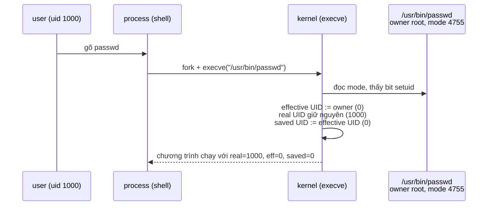

# P1 · Chương 06 — User, quyền, /proc, /sys và giới hạn tài nguyên

> Mọi điều trong chương nói về **Linux** (man page Debian bookworm, man-pages 6.03; docs.kernel.org). Các ví dụ "chạy thật" chạy trong container Linux aarch64 của `./labs/linux.sh` với `rustc 1.95.0`; đó là quan sát một lần chạy, không phải bảo đảm của tài liệu. macOS và BSD nằm ngoài phạm vi chương này.

## Bạn sẽ hiểu được gì

1. **Q1.** Một process trên Linux mang những ID nào (real, effective, saved, filesystem, supplementary), và khi service mở file thì kernel dựa vào ID nào để cho phép hay từ chối? → mục 1
2. **Q2.** Chín bit quyền cộng ba bit đặc biệt (setuid, setgid, sticky) làm gì với file và thư mục; `umask` biến mode bạn xin thành mode file thực tế ra sao? → mục 2
3. **Q3.** Vì sao "root hay không root" là cách nghĩ cũ; capabilities chia đặc quyền thế nào, và một service nghe cổng 80 cần đúng cái gì? → mục 3
4. **Q4.** Service đang chạy mà có chuyện lạ: đọc `/proc/<pid>/status`, `fd`, `maps`, `limits`, `stat` để biết điều gì? → mục 4
5. **Q5.** `/sys` khác `/proc` ra sao, và `sysctl` chỉnh tham số kernel bằng cơ chế gì? → mục 5
6. **Q6.** `ulimit -n`, `RLIMIT_NOFILE`, `fs.nr_open`, `fs.file-max` quan hệ với nhau thế nào, và lỗi `EMFILE` / `ENFILE` xuất hiện ở đâu? → mục 6

## Kiến thức cần trước

- [Chương 02 — System call](02-system-call.md): trap, `errno`, wrapper libc.
- [Chương 03 — Process](03-process.md): `fork`, `exec`, `wait`, PID.
- [Chương 04 — File descriptor và VFS](04-file-descriptor-va-vfs.md): fd, open file description, inode. Chương này dùng lại các khái niệm đó khi nói về `/proc/<pid>/fd` và giới hạn fd.

## 1. Process mang những ID nào, và kernel dùng ID nào? (Q1)

> **Trả lời ngắn.** Mỗi process mang một bộ số nguyên làm danh tính: UID/GID thật (ai sở hữu process), effective (danh tính đang dùng khi xin quyền), saved set (bản lưu để chuyển qua lại), filesystem (chỉ có trên Linux) và danh sách group phụ (các group bổ sung mà process thuộc về). Khi mở file, Linux dùng filesystem ID cùng group phụ[^cred-fs]. Kernel tự đặt filesystem ID bằng effective ID mỗi lần effective ID đổi, nên hai loại này thường bằng nhau và việc kiểm tra quyền file giống các UNIX khác[^cred-fsauto]. Vì vậy khi đọc quyền file trong thực tế, bạn coi "effective UID + group" là đủ, trừ khi chương trình gọi `setfsuid` (nhận xét của người soạn).

**Giải thích.**

*Với service của bạn.* Hãy hình dung `orders`, một service viết bằng Rust, do systemd khởi động dưới một user riêng tên `orders` (trong các ví dụ chạy thật của chương này là uid 1000). Mỗi request nó mở file, ghi log; thỉnh thoảng nó bind một cổng hay nhận một signal. Việc nào cũng khiến kernel hỏi cùng một câu: process này là ai, có được làm việc này không? Ta sẽ bám theo `orders` suốt chương (nhận xét của người soạn: đây là ví dụ giả định, không phải code trong repo). Mục này trả lời nửa đầu của câu hỏi: kernel biểu diễn "là ai" bằng những con số nào, và khi `orders` mở file thì nó xét con số nào.

### 1.1 Năm loại ID

Unix gắn cho mỗi process một danh tính dưới dạng số nguyên kiểu `uid_t` và `gid_t`[^cred-types]. Trên Linux, danh tính đó gồm năm loại ID, mỗi loại có syscall đọc riêng:

| ID | Dùng để | Đọc bằng |
|---|---|---|
| Real UID/GID | xác định ai *sở hữu* process[^cred-real] | `getuid(2)`, `getgid(2)` |
| Effective UID/GID | kernel dùng để quyết định quyền khi process truy cập tài nguyên chia sẻ như message queue, shared memory, semaphore; trên hầu hết UNIX nó còn quyết định quyền file, còn Linux giao việc đó cho filesystem ID[^cred-eff] | `geteuid(2)`, `getegid(2)` |
| Saved set-user-ID / set-group-ID | bản sao effective ID tại lúc chương trình được `exec`[^cred-saved-def] | `getresuid(2)`, `getresgid(2)`[^cred-saved-get] |
| Filesystem UID/GID (riêng Linux) | cùng group phụ, quyết định quyền truy cập *file*[^cred-fs] | `setfsuid(2)`, `setfsgid(2)` để đổi cho khác effective ID[^cred-fsauto] |
| Supplementary group IDs | tập group phụ dùng khi kiểm tra quyền truy cập file và các tài nguyên chia sẻ khác[^cred-supp-def] | `getgroups(2)`[^cred-supp-get] |

### 1.2 Khi mở file, kernel xét ID nào

Trong bảng, hai loại dễ lẫn nhất là effective và filesystem. Trên Linux, ID quyết định quyền file là filesystem ID chứ không phải effective ID[^cred-eff]. Tuy vậy hai số này thường bằng nhau, vì mỗi lần effective ID đổi, kernel tự đặt filesystem ID theo giá trị mới; chúng chỉ lệch nhau khi chương trình gọi `setfsuid(2)` hoặc `setfsgid(2)`[^cred-fsauto]. Với `orders` chạy dưới user `orders`, điều bạn cần nhớ chỉ là: muốn biết `orders` mở được file nào, hãy nhìn effective UID và các group của nó.

### 1.3 ID đi theo process qua fork và exec

`orders` có thể sinh process con (ví dụ chạy một script bằng `Command`), nên ta cần biết các ID đi đâu. Con do `fork` nhận bản sao mọi user/group ID của cha, còn qua `execve` thì real UID/GID và group phụ được giữ nguyên, effective và saved có thể đổi[^cred-inherit]. Chữ "có thể đổi" chính là cơ chế setuid ở mục 2; bảng đầy đủ các thuộc tính sống sót qua `exec` nằm ở [Chương 03, mục 4.1](03-process.md).

Còn saved set-user-ID để làm gì? Nhờ nó, một chương trình setuid không-phải-root có thể bỏ hết đặc quyền, làm việc không đặc quyền, rồi nhận lại effective UID ban đầu một cách an toàn[^setuid-saved]. Cách làm là chuyển effective UID qua lại giữa real UID và saved set-user-ID[^cred-saved-switch].

### 1.4 Xem tận mắt

Muốn biết `orders` đang mang ID nào, đọc `/proc/<pid>/status`. Dòng `Uid:` và `Gid:` có bốn số theo thứ tự real, effective, saved set, filesystem, còn `Groups:` là danh sách group phụ[^proc-status-uid]. Ví dụ chạy thật trong container Linux (aarch64, rustc 1.95.0) khi chạy một chương trình Rust dưới `setpriv --reuid=1000 --regid=1000 --clear-groups`:

```text
Uid:	1000	1000	1000	1000
Gid:	1000	1000	1000	1000
Groups:	
```

Bốn số bằng nhau và `Groups:` trống. `--reuid` đặt cả UID thực lẫn UID hiệu dụng[^setpriv-reuid]. `--clear-groups` xóa group phụ[^setpriv-clear]. Việc saved set cũng ra 1000 là quan sát; man page `setpriv` không nói thẳng.

<details><summary>Đi sâu: đổi ID, thread, giới hạn group phụ</summary>

- **Số group phụ:** từ Linux 2.6.4 một process thuộc được tới 65536 group phụ (trước đó là 32)[^cred-supp].
- **`setuid(2)`:** đặt effective UID của bên gọi; nếu bên gọi có `CAP_SETUID` trong user namespace của nó thì real UID và saved set-user-ID cũng bị đặt[^setuid-def]. Với root hoặc chương trình setuid-root, `setuid()` đặt mọi ID liên quan về giá trị mới, và sau đó chương trình không lấy lại được đặc quyền root, nên phải đọc kỹ `setuid(2)` trước khi viết code bỏ đặc quyền[^setuid-root].
- **Credentials theo thread:** điều này đáng để ý với `orders` nhiều thread. POSIX đòi mọi thread trong process chia sẻ credentials, nhưng kernel Linux giữ credentials riêng cho từng thread[^cred-threads]. Để thỏa yêu cầu của POSIX, cài đặt thread NPTL bọc các syscall đổi UID/GID trong hàm wrapper dùng kỹ thuật dựa trên signal, nhờ đó khi một thread đổi credentials thì mọi thread khác trong process đổi theo[^setuid-nptl]. Từ hai điều trên suy ra (suy luận của người soạn): một lời gọi `setuid` thô, không qua wrapper (ví dụ `syscall(SYS_setuid, …)`), chỉ đổi credentials của thread gọi. Vì vậy chương trình đa luồng muốn bỏ đặc quyền nên gọi `setuid` của libc, hoặc bỏ đặc quyền trước khi tạo thread.
- **UID còn dùng ở đâu:** ngoài quyền file, UID còn dùng để kiểm tra quyền gửi signal (quy tắc chi tiết ở [Chương 05, mục 8](05-signal.md)), quyền đổi tham số lập lịch và kiểm tra resource limit[^cred-other]. Ở mục 6 ta sẽ thấy `RLIMIT_NPROC` đếm theo **real UID**.

</details>

**Quay lại Q1:** process mang real, effective, saved, filesystem ID và group phụ; khi `orders` mở file, kernel xét filesystem ID cùng group phụ, và hai thứ này thường trùng với effective ID.


## 2. Chín bit quyền, setuid/setgid/sticky và umask (Q2)

> **Trả lời ngắn.** Mode của file gồm chín bit quyền (đọc/ghi/chạy cho chủ file, cho group của file và cho mọi người còn lại) cộng ba bit đặc biệt: setuid, setgid và sticky (giải thích ở §2.3)[^chmod-mode]. Với mỗi lần truy cập, kernel chọn đúng một trong ba nhóm ba bit để kiểm tra: nhóm của chủ file; nếu không phải thì nhóm của group; nếu cũng không thì nhóm của mọi người còn lại[^perm-bits]. `umask` là mặt nạ của process: nó tắt bớt bit khỏi mode bạn xin khi tạo file, nên file thực tế thường có ít quyền hơn mode xin[^umask-use].

**Giải thích.**

*Với service `orders`.* `orders` ghi mỗi đơn hàng ra một file và ghi log ra một file khác. Hai chuyện dễ gặp ở đây: ops hỏi vì sao file log ra mode 644 trong khi code xin 666, và một process khác không đọc được file của `orders`. Cả hai quy về ba thứ: chín bit quyền, ba bit đặc biệt và `umask` của process. Ta đi lần lượt.

### 2.1 Kernel chọn nhóm bit nào

Chín bit quyền chia thành ba nhóm, mỗi nhóm ba bit, và mỗi lần truy cập kernel chỉ xét một nhóm. Nhóm đầu áp dụng khi effective user ID của bên gọi bằng owner của file; nhóm hai áp dụng khi group của file bằng effective group ID của process hoặc nằm trong group phụ của nó; nếu cả hai đều không thì dùng nhóm ba[^perm-bits]. Nói chính xác hơn, Linux so bằng filesystem ID thay cho effective ID, và như ở mục 1 hai số này thường bằng nhau[^perm-fsuid]. Ba bit trong mỗi nhóm là read, write, execute; riêng với thư mục, bit cuối là **search**, tức quyền đi qua thư mục để tra tên bên trong[^perm-bits2].

### 2.2 Thư mục cha cũng bị kiểm tra

Kernel không chỉ xét file cuối cùng mà xét từng thành phần của đường dẫn. Nếu process không có quyền search trên thư mục đang tra cứu thì lỗi trả về là `EACCES`[^pr-search]. Hệ quả (nhận xét của người soạn): để `orders` mở `/a/b/c` thì cần quyền `x` trên `/`, `/a` và `/a/b`; thiếu `x` ở một thư mục cha thì dù file `c` mode 777 vẫn không mở được.

Chạy thật: một file `/tmp/secret` mode `600` do root tạo; một chương trình Rust chạy với uid 1000 mở nó ra:

```text
open secret: Permission denied (os error 13) raw=Some(13) kind=PermissionDenied
```

Chạy với root thì mở được (quan sát lần chạy này; vì sao root không bị chặn: xem phần Đi sâu).

### 2.3 Ba bit đặc biệt

Ngoài chín bit còn ba bit đặc biệt. Chúng đổi hành vi của `execve` hoặc của thư mục:

| Bit | Mã octal | Trên file thực thi | Trên thư mục |
|---|---|---|---|
| set-user-ID | 04000 | đổi effective UID của process thành owner của file khi `execve`[^exec-suid] | — (chương này không đề cập) |
| set-group-ID | 02000 | đổi effective GID thành group của file[^exec-suid] | file mới tạo trong thư mục thừa hưởng group của thư mục (không lấy group của process tạo), và thư mục con mới tạo cũng được đặt setgid[^inode-sgid] |
| sticky | 01000 | — | file trong thư mục chỉ bị đổi tên/xóa bởi owner của file, owner của thư mục, hoặc process privileged[^inode-sticky] |

Sau khi `execve` chạy một file setuid/setgid, kernel chép effective ID sang saved set-user-ID/saved set-group-ID, và việc chép này xảy ra *sau* mọi thay đổi do bit setuid/setgid[^exec-saved]. Real UID thì **không đổi**[^cred-inherit], nên chương trình phân biệt được "ai thực sự gọi mình" (`getuid`) với "mình đang chạy dưới quyền ai" (`geteuid`).



(Sơ đồ theo mô tả của `execve(2)`; `passwd` thuộc root với mode 4755 chỉ là ví dụ minh họa. Trong container thử nghiệm, `stat -c %A` cho `/usr/bin/passwd` là `-rwsr-xr-x`, `/usr/bin/chage` là `-rwxr-sr-x`, `/tmp` là `drwxrwxrwt`. Cách đọc chữ `s`/`t` là quy ước hiển thị của `ls`/`stat`, không phải khẳng định của man page đã trích; theo quy ước đó `/tmp` có bit sticky nên áp dụng quy tắc ở hàng sticky của bảng.)

### 2.4 `umask`: vì sao log ra mode 644

Quay lại câu hỏi của ops, đây là việc của `umask`. `umask(2)` đặt mask của process thành `mask & 0777` và trả về mask cũ[^umask-def]. `open(2)`, `mkdir(2)` và các lời gọi tạo file khác dùng mask này để **tắt** những bit tương ứng khỏi `mode` bạn truyền vào[^umask-use]. Giá trị mặc định điển hình là `022`[^umask-typical]. Vì vậy xin mode `0666` thì ra `0644`, do `0666 & ~022 = 0644`[^umask-default]. Process con do `fork` thừa hưởng umask của cha, còn `execve` không đổi umask[^umask-inherit].

Chạy thật (Rust, `OpenOptions::mode(0o666)` + `create_new`): umask `022` cho file mode `644`, umask `077` cho `600`, với cả uid 0 lẫn uid 1000. Docs Rust khớp với quan sát: `mode` mặc định là `0o666` và hệ điều hành che bằng umask[^rs-optmode]. Vì vậy (nhận xét của người soạn) file log hay socket tạo ra với mode "lạ" thường do service chạy với umask khác shell của bạn; hãy kiểm tra dòng `Umask:` trong `/proc/<pid>/status`, dòng này có từ Linux 4.7[^proc-umask].

<details><summary>Đi sâu: chmod, nosuid/no_new_privs, race của umask, root và ACL</summary>

- **Ai được `chmod`:** `chmod(2)` đòi effective UID của bên gọi khớp owner của file, hoặc bên gọi là privileged (trên Linux: có `CAP_FOWNER`)[^chmod-owner]. Nếu bên gọi không có `CAP_FSETID` và group của file không khớp effective GID hay group phụ nào của nó, kernel âm thầm tắt bit setgid, không báo lỗi[^chmod-sgid]. Man page `chmod(2)` gọi bit sticky là cờ hạn chế xóa (restricted deletion flag)[^chmod-bits].
- **Ghi file làm mất bit setuid:** tùy filesystem, bit setuid/setgid có thể bị tắt khi file bị ghi; trên Linux điều này xảy ra nếu bên ghi không có `CAP_FSETID`[^chmod-write]. Ý nghĩa thực tế (suy luận của người soạn từ câu trên): ghi đè tại chỗ một binary setuid bằng user không có `CAP_FSETID` có thể làm mất bit setuid, nên sau khi deploy bằng user thường cần kiểm tra lại mode.
- **Khi nào setuid/setgid bị bỏ qua:** việc đổi effective ID bị **bỏ qua** nếu thread có thuộc tính `no_new_privs`, nếu filesystem mount `nosuid`, hoặc nếu process đang bị ptrace[^exec-ignored]. Capabilities của file cũng bị bỏ qua trong cùng các trường hợp đó[^exec-ignored-caps].
- **Race của umask:** không có cách đọc umask mà không đồng thời đổi nó; hai bước "đọc rồi khôi phục" không nguyên tử nên có race trong chương trình đa luồng[^umask-race]. Từ Linux 4.7, đọc dòng `Umask` trong `/proc/self/status` tránh được vấn đề này[^umask-proc].
- **Phạm vi của umask:** umask cũng áp dụng cho POSIX IPC object, FIFO và UNIX domain socket do process tạo, nhưng **không** áp dụng cho System V IPC[^umask-ipc].
- **Root có bỏ qua mọi thứ không?** Theo truyền thống, process privileged (effective UID 0) bỏ qua mọi kiểm tra quyền của kernel, còn process không privileged chịu kiểm tra đầy đủ[^caps-priv]. Với file, trên Linux đặc quyền superuser được chia thành capabilities, và hai capability liên quan là `CAP_DAC_OVERRIDE` và `CAP_DAC_READ_SEARCH`[^pr-caps]. `CAP_DAC_OVERRIDE` vượt mọi kiểm tra quyền nhưng chỉ cấp quyền *execute* khi ít nhất một trong ba bit execute của file được bật[^pr-dac]. Suy ra (suy luận của người soạn, giả định root đang có `CAP_DAC_OVERRIDE`): root không chạy được file `0600` không có bit `x` nào. Capabilities được giải thích ở mục 3.
- **ACL (tóm tắt):** POSIX ACL cho quyền chi tiết hơn bộ chín bit[^acl-desc]. Có access ACL và default ACL, loại sau là ACL ban đầu cho các object tạo trong thư mục[^acl-types]. Nếu thư mục cha có default ACL thì umask bị bỏ qua và ACL được thừa hưởng[^umask-acl]. Chương này không đi sâu hơn về ACL.

</details>

**Quay lại Q2:** kernel chọn một nhóm trong chín bit (owner → group → other), ba bit đặc biệt đổi hành vi `execve` và thư mục, còn `umask` che bớt bit khỏi mode mà `orders` xin khi tạo file.


## 3. Capabilities: tách "root" thành từng mảnh (Q3)

> **Trả lời ngắn.** Linux chia đặc quyền của superuser (root) thành nhiều đơn vị gọi là capabilities; mỗi đơn vị bật/tắt độc lập và là thuộc tính của từng thread[^caps-split]. Service muốn nghe cổng dưới 1024 (như cổng 80) cần capability `CAP_NET_BIND_SERVICE`[^caps-netbind], không cần cả quyền root. Ngưỡng "cổng đặc quyền" còn tùy một giá trị sysctl của *network namespace* nơi service chạy, nên có môi trường không cần capability này[^sysctl-unpriv-port]. (Network namespace là một phạm vi mạng tách biệt, có thiết bị mạng, bảng route và số cổng riêng[^netns-def].)

**Giải thích.**

*Với service `orders`.* Ta muốn `orders` nghe cổng 80. Cách dễ nhất là chạy nó bằng root, nhưng khi đó một lỗi trong `orders` thành lỗi của root. Mục này cho thấy Linux có cách khác: chỉ trao cho `orders` đúng một đặc quyền là bind cổng thấp, và trả lời hai câu hỏi đi kèm: đặc quyền đó nằm ở đâu trên process, và nó có sống sót qua `exec` không.

### 3.1 Vì sao phải tách root

Nếu đặc quyền chỉ có hai mức (UID 0 hay không), một web server chỉ cần bind cổng 80 cũng phải chạy root, và lỗi trong nó là lỗi root (nhận xét của người soạn). Vì vậy từ Linux 2.2 kernel chia đặc quyền của superuser thành các đơn vị riêng, gọi là capabilities[^caps-split].

Vài capability điển hình:

- `CAP_NET_BIND_SERVICE`: bind socket vào cổng Internet đặc quyền (số cổng dưới 1024)[^caps-netbind]. Đây là thứ `orders` cần.
- `CAP_SYS_RESOURCE`: gồm nâng resource limit và ghi đè giới hạn `RLIMIT_NPROC`[^caps-sysres].
- `CAP_SYS_ADMIN`: man page tự ghi là "overloaded" (gánh quá nhiều việc), gồm mount, `sethostname` và nhiều thao tác quản trị khác[^caps-sysadmin]. Gặp yêu cầu "cho container `--cap-add SYS_ADMIN`" thì nên coi gần như cấp root (nhận xét của người soạn).

### 3.2 Năm tập capability của một thread

Mỗi thread mang năm tập capability, với vai trò như sau:

| Tập | Ý nghĩa |
|---|---|
| Permitted | tập bao (superset) giới hạn cho effective[^caps-permitted]; bỏ một capability khỏi permitted là mất vĩnh viễn, trừ khi `execve` một chương trình setuid-root hoặc chương trình có file capability cấp lại capability đó[^caps-permitted-drop] |
| Effective | tập kernel dùng để kiểm tra quyền cho thread[^caps-effective] |
| Inheritable | tập được giữ qua `execve`[^caps-inheritable] |
| Bounding | cơ chế giới hạn capability có thể nhận qua `execve`; theo thread từ Linux 2.6.25[^caps-bounding] |
| Ambient (từ Linux 4.3) | tập giữ qua `execve` của chương trình không privileged; luôn là tập con của permitted ∩ inheritable[^caps-ambient] |

Muốn kiểm tra trên `orders` đang chạy, đọc `/proc/<pid>/status`: có `CapInh`, `CapPrm`, `CapEff` (mask dạng hex), `CapBnd`, `CapAmb`, và thêm `NoNewPrivs`[^proc-cap].

### 3.3 Capability sau `execve`

Phần này quan trọng với người deploy `orders`, vì quyết định capability có tới được process hay không. Capabilities gắn được vào chính *file* thực thi: chúng lưu trong extended attribute `security.capability`, đặt bằng `setcap(8)`, và ghi attribute này cần `CAP_SETFCAP`. Tập capability của file cùng tập của thread quyết định capability của thread sau `execve`[^caps-file]. File còn có một bit effective riêng: bật thì mọi capability permitted mới cũng được nâng lên effective, tắt thì không capability mới nào nằm ở effective[^caps-file-eff].

Từ công thức ở phần Đi sâu rút ra hai điều cho người vận hành (nhận xét của người soạn):

1. Gắn vào binary `orders` một file capability có `F(permitted)` chứa `CAP_NET_BIND_SERVICE` và bit effective bật, thì process không-root chạy binary đó có capability này ở cả permitted lẫn effective sau `exec`, đủ để bind cổng thấp, miễn là bounding set của process còn chứa nó[^caps-formula]. Cần nhớ file capability cũng bị bỏ qua trong các trường hợp setuid bị bỏ qua ở mục 2[^exec-ignored-caps]. Đó là khi thread có `no_new_privs`, filesystem mount `nosuid`, hoặc process đang bị ptrace[^exec-ignored].
2. Ambient capability là cách để capability sống sót qua `exec` của chương trình thường (không privileged), với điều kiện capability đó đang ở cả permitted và inheritable[^caps-ambient]. Ngược lại, chạy chương trình đổi UID/GID nhờ setuid/setgid, hoặc chương trình có file capability, thì xóa ambient set[^caps-ambient-clear]. systemd có directive `AmbientCapabilities=` cho service chạy bằng user không đặc quyền mà vẫn cần vài capability[^systemd-ambient]; với `orders` đó là chỗ để khai `CAP_NET_BIND_SERVICE`.

### 3.4 Đổi UID kéo theo đổi capabilities

Đổi user/group ID của process có thể làm capabilities của nó đổi theo[^cred-caps]. Cụ thể, nếu real, effective hoặc saved UID từng có giá trị 0 và sau lần đổi cả ba đều khác 0, kernel xóa hết capabilities khỏi permitted, effective và ambient[^caps-uid-clear]; ví dụ là process root gọi `setuid(1000)` (nhận xét của người soạn). Ngoài ra, bit `SECBIT_NOROOT` là công tắc để kernel không cấp capabilities khi chạy chương trình setuid-root, hoặc khi process có effective hay real UID 0 gọi `execve`[^caps-noroot].

### 3.5 Cổng 80 trong thực tế

Docs kernel mô tả tham số `ip_unprivileged_port_start` như sau: nó định nghĩa cổng không đặc quyền đầu tiên trong network namespace; bind vào cổng đặc quyền cần root hoặc `CAP_NET_BIND_SERVICE`; đặt `0` là tắt toàn bộ cổng đặc quyền; mặc định là `1024`; và tham số này theo từng namespace[^sysctl-unpriv-port].

Quan sát (một lần chạy trong container thử nghiệm, không phải bảo đảm): process uid 1000 với `CapEff = 0` **bind được** `0.0.0.0:80`, đồng thời `/proc/sys/net/ipv4/ip_unprivileged_port_start` đọc ra `0`. Hai điều này khớp nhau: bind được vì ngưỡng bằng 0 trong namespace của container đó (suy luận của người soạn). Bài học: câu "`orders` cần `CAP_NET_BIND_SERVICE`" phụ thuộc giá trị sysctl của network namespace nơi nó chạy, nên đừng suy ra kết luận chung từ một thử nghiệm trong một container.

<details><summary>Đi sâu: công thức chuyển capability qua execve và quan sát trong container</summary>

Công thức chuyển capability qua `execve` theo man page[^caps-formula]:

```text
P'(ambient)     = (file is privileged) ? 0 : P(ambient)
P'(permitted)   = (P(inheritable) & F(inheritable)) | (F(permitted) & P(bounding)) | P'(ambient)
P'(effective)   = F(effective) ? P'(permitted) : P'(ambient)
P'(inheritable) = P(inheritable)
P'(bounding)    = P(bounding)
```

Ở đây `P` là tập của thread trước `execve`, `P'` sau `execve`, `F` là tập của file.

Quan sát chạy thật trong container: process root có `CapPrm = CapEff = CapBnd = 00000000a80c35fb`, còn process uid 1000 có `CapPrm = CapEff = 0000000000000000` nhưng `CapBnd` vẫn là `a80c35fb`. Đây là quan sát chứ không phải bảo đảm của docs. Giá trị này không phải tập đầy đủ vì container của lab không chạy `--privileged`: so với tập mặc định của Docker `a80425fb` (14 capability, giải mã ở [P8 Chương 05, mục 3](../08-containers/05-bao-mat-container.md)), nó hơn đúng `0x81000`, tức bit 12 (`CAP_NET_ADMIN`) và bit 19 (`CAP_SYS_PTRACE`), hai capability mà `labs/linux.sh` thêm bằng `--cap-add` (phép trừ hex và việc gán bit ↔ tên là suy luận của người soạn, khớp bản giải mã ở P8 Chương 02 và 05).

Các con số trên khớp với công thức. Khi process có real và effective UID đều là 0 gọi `execve`, kernel coi file như có mọi capability, nên permitted mới = inheritable | bounding và effective = permitted, tức process nhận mọi capability trừ phần bị bounding set che[^caps-root-exec]. Nếu tập inheritable nằm trong bounding set (giả định), đó chính là `CapPrm = CapEff = CapBnd` đã quan sát. Với uid 1000 chạy chương trình không có file capability (và ambient rỗng, cũng là giả định), các số hạng lấy từ file bằng 0 nên `P'(permitted)` = 0 theo công thức, còn `P'(bounding) = P(bounding)` nên `CapBnd` giữ nguyên (suy luận của người soạn từ công thức).

</details>

**Quay lại Q3:** đặc quyền root được tách thành capabilities theo thread; `orders` nghe cổng 80 cần `CAP_NET_BIND_SERVICE` (hoặc ngưỡng cổng đặc quyền được hạ trong namespace của nó), không cần chạy root.


## 4. Chẩn đoán process bằng `/proc/<pid>` (Q4)

> **Trả lời ngắn.** `/proc` là một "filesystem giả" (pseudo-filesystem) làm giao diện tới cấu trúc dữ liệu của kernel[^proc5-pseudo]; với người dùng, nó trông như một cây thư mục và file (nhận xét của người soạn). Mỗi process có thư mục `/proc/<pid>`[^proc-pid-dir]. Trong đó `status` là bản tóm tắt dễ đọc cho người[^proc-status]. `fd/` liệt kê file đang mở[^proc-fd]. `maps` cho các vùng nhớ[^proc-maps]. `limits` cho resource limit[^proc-limits]. Còn `stat` là thông tin trạng thái mà `ps` dùng[^proc-stat].

**Giải thích.**

*Với service `orders`.* Giả sử `orders` đột ngột ngừng nhận kết nối. Bạn SSH vào máy, và điều cần biết lúc đó là: process còn sống không, đang mang quyền gì, đang mở bao nhiêu fd, giới hạn là bao nhiêu. Tất cả có trong `/proc/<pid>`. Mục này đi qua từng file.

### 4.1 `/proc` là gì

`/proc` là một pseudo-filesystem cung cấp giao diện tới cấu trúc dữ liệu của kernel[^proc5-pseudo]. Chữ "pseudo" nghĩa là nó không phải thư mục lưu trên đĩa (nhận xét của người soạn). Phần lớn file trong đó chỉ đọc, một số ghi được để đổi biến kernel[^proc5-rw]. Mỗi process đang chạy có một thư mục con đặt theo PID[^proc-pid-dir]. `/proc/self` là symlink "ma thuật" trỏ tới thư mục của chính process đang truy cập[^proc-self].

### 4.2 `/proc/<pid>/status`: tổng quan

`status` là bản "dễ đọc cho người" của `stat` và `statm`[^proc-status]. Với `orders`, các dòng đáng xem là:

| Dòng | Ý nghĩa |
|---|---|
| `State` | một trong R (running), S (sleeping), D (disk sleep), T (stopped), t (tracing stop), Z (zombie), X (dead)[^proc-state]; các trạng thái process nói kỹ hơn ở [Chương 03, mục 1](03-process.md) |
| `Uid`, `Gid`, `Groups` | xem mục 1[^proc-status-uid] |
| `FDSize` | số slot file descriptor đang được cấp[^proc-fdsize] |
| `VmRSS` | resident set size, bằng tổng `RssAnon + RssFile + RssShmem`[^proc-vmrss]; `proc(5)` ghi chú một số giá trị bộ nhớ là không chính xác vì một tối ưu scalability trong kernel, cần giá trị chính xác thì dùng `smaps`/`smaps_rollup`[^proc-inaccurate] (đọc RSS kỹ hơn: [P3 Chương 05, mục 6](../03-memory/05-bo-nho-tien-trinh-linux.md)) |
| `Threads` | số thread của process chứa thread này[^proc-threads] |
| `CapInh/Prm/Eff/Bnd/Amb`, `NoNewPrivs`, `Seccomp` | trạng thái đặc quyền (mục 3)[^proc-cap] |
| `Umask` | umask, từ Linux 4.7 (mục 2)[^proc-umask] |
| `voluntary_ctxt_switches`, `nonvoluntary_ctxt_switches` | số lần context switch tự nguyện / không tự nguyện[^proc-ctxt] (ý nghĩa hai bộ đếm: [Chương 01, mục 5.5](01-os-va-kernel.md)) |

### 4.3 `fd`, `maps`, `limits`, `stat`

`/proc/<pid>/fd/` có một entry cho mỗi file process đang mở, đặt tên theo số fd và là symlink tới file thật[^proc-fd]. Với pipe và socket, nội dung link là loại file kèm inode, dạng `type:[inode]`, ví dụ `socket:[2248868]`[^proc-fd-sock]. Vì mỗi file đang mở là một entry, đếm số entry cho biết `orders` đang dùng bao nhiêu fd (suy luận của người soạn từ định nghĩa trên); số đó đem so với `Max open files` ở mục 6.

`/proc/<pid>/maps` liệt kê các vùng nhớ đang map và quyền của chúng[^proc-maps]. Mỗi dòng có dạng `address perms offset dev inode pathname`[^proc-maps-fmt]. Cách đọc sâu (VMA, `smaps`, pathname giả như `[heap]`, `[stack]`, `[vdso]`, ASLR) thuộc Phase 3, xem [P3 Chương 05 — Bộ nhớ của tiến trình trên Linux, mục 3](../03-memory/05-bo-nho-tien-trinh-linux.md).

`/proc/<pid>/limits` cho soft limit, hard limit và đơn vị của từng resource limit (từ Linux 2.6.24); từ 2.6.36 mọi user đọc được[^proc-limits]. Đây là chỗ trả lời nhanh câu "`orders` đang chạy với `nofile` bao nhiêu?"; mục 6 sẽ dùng tới.

`/proc/<pid>/stat` là thông tin trạng thái mà `ps(1)` dùng[^proc-stat].

### 4.4 Kịch bản: `orders` báo `Too many open files`

Thứ tự đọc nên là (đề xuất của người soạn): xem `/proc/<pid>/limits` để biết soft/hard limit thực tế, đếm `ls /proc/<pid>/fd | wc -l`, rồi `ls -l` để xem loại fd nào chiếm nhiều. Nếu `socket:[…]` chiếm phần lớn thì nghi `orders` đang leak connection.

<details><summary>Đi sâu: parser của stat, fdinfo, hidepid, trạng thái D</summary>

- **`stat`:** ví dụ trường (14) `utime` đo bằng clock tick, chia cho `sysconf(_SC_CLK_TCK)`[^proc-utime]. Trường (2) `comm` nằm trong ngoặc đơn[^proc-comm], nên (nhận xét của người soạn) parser an toàn phải tìm dấu `)` **cuối cùng**, hoặc dùng `status`.
- **`fd` và `fdinfo`:** với fd kiểu socket, inode có thể dùng để tra thêm trong `/proc/net/`[^proc-fd-sock]. `/proc/<pid>/fdinfo/` cho thông tin từng fd, nội dung phụ thuộc loại file; chỉ chủ process đọc được[^proc-fdinfo].
- **`hidepid=2`:** mount option này làm thư mục `/proc/<pid>` của user khác vô hình[^proc-hidepid]. Hệ quả (nhận xét của người soạn): tool monitoring chạy non-root có thể "không thấy" process vì thế.
- **Trạng thái `D`:** `proc(5)` gọi nó là "disk sleep"[^proc-state]; `ps(1)` mô tả mã `D` là uninterruptible sleep, thường do I/O[^ps-d]. Chữ "uninterruptible" (không bị ngắt) gợi ý rằng signal không đánh thức process ngay, nên process ở `D` có thể không thoát ngay dù đã bị `kill`; đây là suy luận của người soạn, man page không nói thẳng.

</details>

**Quay lại Q4:** với `orders` đang chạy, `status` cho tổng quan (ID, trạng thái, số fd slot, capabilities), `fd` để đếm và phân loại fd, `maps` cho vùng nhớ, `limits` cho giới hạn, `stat` cho thông tin trạng thái mà `ps` dùng.


## 5. `/sys` khác `/proc` thế nào, và `sysctl` chỉnh kernel ra sao? (Q5)

> **Trả lời ngắn.** `/sys` (sysfs) là một filesystem nằm trong RAM, xuất cấu trúc dữ liệu của kernel cùng thuộc tính và liên kết giữa chúng ra user space[^sysfs-what]. Trong thực tế đó là cây thiết bị, bus, driver ở dạng thư mục và file[^sysfs-dev]. `/proc` thì có thư mục theo từng process[^proc-pid-dir]. `/proc/sys` chứa các biến kernel[^proc-sys]. `sysctl` không phải cơ chế riêng: nó là công cụ chỉnh tham số kernel lúc chạy, các tham số đó là những gì nằm dưới `/proc/sys/`, và nó cần procfs để hoạt động[^sysctl-desc].

**Giải thích.**

*Với service `orders`.* Khi vận hành `orders` bạn sẽ hỏi hai câu. Một là thiết bị mà máy đang dùng (card mạng, đĩa) hiện ra ở đâu để xem. Hai là muốn chỉnh một tham số kernel, như ngưỡng cổng đặc quyền ở mục 3 hay `somaxconn` ở phần Đi sâu, thì chỉnh ở đâu và bằng công cụ gì (nhận xét của người soạn). Câu một thuộc về `/sys`, câu hai thuộc về `/proc/sys` và `sysctl`.

### 5.1 sysfs

`sysfs` là filesystem nằm trong RAM, ban đầu dựa trên ramfs. Nó xuất cấu trúc dữ liệu kernel, thuộc tính của chúng và liên kết giữa chúng ra user space, và gắn chặt với hạ tầng *kobject* (đối tượng kernel đăng ký trong hệ thống)[^sysfs-what]. Với mỗi kobject đã đăng ký, kernel tạo một thư mục trong sysfs[^sysfs-dir]. Bạn mount nó bằng `mount -t sysfs sysfs /sys`[^sysfs-mount]. Thuộc tính của kobject được xuất thành file thường: sysfs chuyển I/O file thành lời gọi method của attribute, và theo quy ước đó là file ASCII, tốt nhất mỗi file một giá trị[^sysfs-attr].

### 5.2 So với `/proc`

Cả hai đều là filesystem giả, nhưng tổ chức khác nhau. `/proc` có một thư mục cho mỗi process đang chạy[^proc-pid-dir]. `/proc/sys` chứa các file ứng với biến kernel[^proc-sys]. Mỗi file `/proc` còn có định dạng riêng, như `status`, `stat`, `maps` ở mục 4 (nhận xét của người soạn). `/sys` thì là cây theo đối tượng kernel, mỗi kobject một thư mục[^sysfs-dir]. Theo quy ước, mỗi file `/sys` chứa một giá trị[^sysfs-attr]. Chương này chỉ nêu các thư mục cấp cao của `/sys` ở phần Đi sâu, không liệt kê tên file cụ thể bên trong vì chưa có nguồn trích cho chúng.

### 5.3 sysctl

`/proc/sys` chứa các file và thư mục ứng với biến kernel; bạn đọc được, và một số ghi được, qua proc filesystem hoặc qua syscall `sysctl(2)` (syscall này đã bị deprecated)[^proc-sys]. Docs kernel mô tả `/proc/sys/` là chỗ để chỉnh một số khía cạnh của kernel lúc chạy mà không cần công cụ đặc biệt[^ksysctl-intro]. Nếu muốn có công cụ thì có `sysctl(8)` (gói procps): nó sửa tham số kernel lúc chạy, các tham số có sẵn là những gì dưới `/proc/sys/`, và nó cần procfs để hoạt động[^sysctl-desc]. Tên khóa dùng dấu `.` thay cho `/` (ví dụ `kernel.ostype`), dù dấu `/` cũng được chấp nhận[^sysctl-param]. Để dùng các cấu hình này cần có root access[^ksysctl-need]. Còn trong container thì runtime quyết định tham số nào chỉnh được (nhận xét của người soạn).

<details><summary>Đi sâu: cấu trúc sysfs, cấu hình bền vững, các tham số sysctl liên quan backend</summary>

- **Cấu trúc thư mục** cấp cao nhất của sysfs theo docs kernel: `block/ bus/ class/ dev/ devices/ firmware/ fs/ hypervisor/ kernel/ module/ power/`[^sysfs-layout]. `devices/` là biểu diễn của cây thiết bị nội bộ kernel; `bus/` chứa các kiểu bus, mỗi bus có `devices/` (symlink tới thiết bị trong `/sys/devices`) và `drivers/`[^sysfs-dev]. Thuộc tính mới của sysfs phải được ghi vào `Documentation/ABI`[^sysfs-abi].
- **Cấu hình bền vững:** với `sysctl --system`, man page liệt kê thứ tự thư mục được đọc: `/etc/sysctl.d/*.conf`, `/run/sysctl.d/*.conf`, `/usr/local/lib/sysctl.d/*.conf`, `/usr/lib/sysctl.d/*.conf`, `/lib/sysctl.d/*.conf`, rồi `/etc/sysctl.conf`; file trùng tên ở thư mục sau bị bỏ qua[^sysctl-conf]. Mọi file được sắp theo thứ tự từ vựng bất kể thư mục[^sysctl-sort]. Cách persist khác nhau theo distro và hệ thống init, nên hãy đọc man page của chính hệ thống bạn.
- **Tham số liên quan trực tiếp đến backend** (trích từ `proc(5)` và `listen(2)`):

| Tham số | Ý nghĩa |
|---|---|
| `fs.file-max` | giới hạn toàn hệ thống về số file đang mở; vượt thì syscall lỗi `ENFILE`[^proc-filemax] |
| `fs.file-nr` | read-only, ba số: số file handle đã cấp, số rảnh, và mức tối đa (bằng `file-max`)[^proc-filenr] |
| `fs.nr_open` | trần mà `RLIMIT_NOFILE` có thể được nâng tới, áp dụng cả cho process privileged lẫn không; mặc định 1048576[^proc-nropen] |
| `net.core.somaxconn` | trần của đối số `backlog` của `listen(2)`[^proc-somaxconn]; `listen(2)` nói thêm backlog vượt giá trị này bị cắt âm thầm, mặc định 4096 từ Linux 5.4 (trước đó 128)[^listen-somaxconn]; hai hàng đợi của socket nghe và SYN cookies: [P6 Chương 07, mục 2](../06-networking/07-socket-va-kernel.md) |

Chạy thật trong container: `fs.nr_open = 1048576` và `file-nr` = `864 0 9223372036854775807`. Số handle rảnh bằng 0 khớp docs kernel: từ Linux 2.6 số file handle rảnh luôn được báo là 0 và đó không phải lỗi[^ksysctl-filenr].

</details>

**Quay lại Q5:** `/sys` là cây thiết bị/driver theo quy ước một giá trị mỗi file; `sysctl` là công cụ chỉnh các tham số nằm dưới `/proc/sys`.


## 6. `ulimit`, `RLIMIT_NOFILE`, `fs.nr_open`, `fs.file-max`, `EMFILE` và `ENFILE` (Q6)

> **Trả lời ngắn.** `ulimit -n` của bash đặt giới hạn số fd mở[^bash-ulimit-n]; giới hạn đó áp lên shell và mọi lệnh nó chạy vì process con thừa hưởng resource limit của shell[^rlim-shell]. Trong kernel, giới hạn này là `RLIMIT_NOFILE`, tính cho **mỗi process** (quan sát ở phần Đi sâu: `ulimit -n 64` thì `/proc/self/limits` ghi `Max open files` là 64); chạm nó thì `open`, `pipe`, `dup`… trả `EMFILE`[^rlim-nofile]. Chạm giới hạn tổng số file mở của **cả hệ thống** (`fs.file-max`) thì trả `ENFILE`[^proc-filemax]; còn hard limit của `RLIMIT_NOFILE` không nâng vượt được `fs.nr_open`[^rlim-eperm].

**Giải thích.**

*Với service `orders`.* Giả sử `orders` lên traffic và log bắt đầu có dòng `Too many open files (os error 24)`. Mỗi kết nối client là một fd, nên đây là chuyện sớm muộn gì cũng gặp. Có ba con số liên quan, và chúng chồng lên nhau: giới hạn mỗi process, trần của giới hạn đó, và giới hạn của cả máy. Mục này xếp chúng theo thứ tự để bạn biết cần nâng cái nào, ở đâu.

### 6.1 Soft limit và hard limit

`getrlimit(2)`/`setrlimit(2)` làm việc với một struct có `rlim_cur` (soft) và `rlim_max` (hard). **Soft limit** là giá trị kernel thực sự thi hành; **hard limit** là trần của soft. Về quy tắc đổi: process không privileged chỉ đặt soft trong khoảng từ 0 tới hard, và hạ hard (không đảo ngược được)[^rlim-soft]. Process privileged (trên Linux: có `CAP_SYS_RESOURCE` trong initial user namespace) đổi tùy ý cả hai[^rlim-priv].

### 6.2 Limit đi theo process con

Con do `fork` thừa hưởng resource limit, limit được giữ qua `execve`, và nó là thuộc tính theo process mà các thread chia sẻ[^rlim-inherit]. Vì vậy `ulimit` của shell (một builtin của shell) áp lên mọi lệnh shell chạy[^rlim-shell]. Với `orders` điều này có nghĩa là limit của nó đến từ bên đã khởi động nó (nhận xét của người soạn). Về cách đổi: user thường không nâng hard limit được, soft nâng được tới hard, và nếu không chỉ rõ `-H`/`-S` thì `ulimit` đặt cả hai[^bash-ulimit]. Còn xem limit của process bất kỳ thì đọc `/proc/<pid>/limits` (từ Linux 2.6.24)[^rlim-proc].

### 6.3 `EMFILE` và `ENFILE`

Hai lỗi này dễ lẫn nhau, nhưng chúng ứng với hai giới hạn khác nhau:

| Lỗi | Nghĩa | Phạm vi |
|---|---|---|
| `EMFILE` | đã chạm giới hạn số fd mở **của một process**[^open-emfile] | `RLIMIT_NOFILE` |
| `ENFILE` | đã chạm giới hạn tổng số file mở **toàn hệ thống**[^open-enfile] | `fs.file-max`[^proc-filemax] |

`accept(2)` cũng trả `EMFILE` khi chạm giới hạn per-process[^accept-emfile]. Với server như `orders`, đó là tình huống nguy hiểm: kết nối đang chờ trong hàng đợi accept nhưng `accept` thất bại. Với epoll level-triggered, vòng lặp có thể quay trống vì fd nghe vẫn báo sẵn sàng. Với edge-triggered thì ngược lại, kết nối có thể bị bỏ quên trong hàng đợi vì không còn edge mới ([P7 Chương 02, mục 5](../07-io-async/02-select-poll-epoll.md) về LT/ET). Cả hai là suy luận của người soạn từ hai sự kiện đã trích (backlog của `listen` ở mục 5 và `EMFILE` ở đây) cộng quy tắc LT/ET của epoll.

### 6.4 Thứ tự các trần

`RLIMIT_NOFILE` là một giá trị lớn hơn số fd lớn nhất có thể mở đúng một đơn vị, nên limit 64 thì fd cao nhất là 63[^rlim-nofile]. Nâng hard limit `RLIMIT_NOFILE` vượt `fs.nr_open` thì nhận `EPERM`[^rlim-eperm]; docs kernel mô tả `nr_open` là số file-handle tối đa một process có thể cấp phát[^ksysctl-nropen]. Tổng hợp lại (nhận xét của người soạn): soft ≤ hard ≤ `fs.nr_open`, còn `fs.file-max` là trần tổng của cả hệ thống.

### 6.5 Đặt limit cho `orders`

Trong shell bạn dùng `ulimit -n`. Trong unit systemd của `orders` thì dùng `LimitNOFILE=` (cùng `LimitNPROC=`, `LimitAS=`…); bảng trong docs systemd ghép `LimitNOFILE=` với `ulimit -n`[^systemd-ulimit-table]. Một giá trị đơn đặt soft và hard bằng nhau, cặp `soft:hard` đặt riêng từng giá trị, còn `infinity` là không giới hạn[^systemd-limit]. Trong chương trình thì gọi `setrlimit`/`prlimit`.

Có một lưu ý: ghi chú đi kèm `LimitNOFILE=` trong bảng đó mở đầu bằng lời khuyên đừng dùng nó, vì hard limit mặc định hiện nay đã cao (524288) và ứng dụng thường nên tự nâng soft limit lên hard limit nếu chấp nhận fd lớn hơn 1023[^systemd-nofile]. Vì vậy chỉ đặt `LimitNOFILE=` khi bạn có lý do cụ thể (nhận xét của người soạn).

<details><summary>Đi sâu: thí nghiệm EMFILE bằng Rust, prlimit, RLIMIT_NPROC/AS, lưu ý của systemd</summary>

**Thí nghiệm: tự gây `EMFILE` bằng Rust.** Chương trình mở `/dev/null` liên tục tới khi lỗi, in lỗi và `/proc/self/limits`; chạy bằng `rustc -O` (1.95.0) trong container aarch64 sau `ulimit -n 64`:

```rust
use std::fs::File;
fn main() {
    let mut keep = Vec::new();
    loop {
        match File::open("/dev/null") {
            Ok(f) => keep.push(f),
            Err(e) => {
                println!("opened {} files then: {e} | raw={:?} kind={:?}",
                         keep.len(), e.raw_os_error(), e.kind());
                break;
            }
        }
    }
}
```

Kết quả quan sát (chương trình đầy đủ cũng in dòng `Max open files`):

```text
Max open files            64                   64                   files
opened 61 files then: Too many open files (os error 24) | raw=Some(24) kind=Uncategorized
```

Giải thích: limit 64 gồm cả fd 0, 1, 2 nên mở được 61 file nữa. Con số này khớp định nghĩa của `RLIMIT_NOFILE` là giá trị lớn hơn số fd lớn nhất có thể mở đúng một đơn vị, tức fd cao nhất là 63[^rlim-nofile]. `kind=Uncategorized` là quan sát với Rust 1.95.0 ([Chương 07, mục 2](07-rust-tren-giao-dien-he-thong.md) giải thích cách `std` suy `kind` từ `errno`); cần phân biệt thì so `raw_os_error()` với `libc::EMFILE`. Quan sát thêm: ngay sau `EMFILE`, `fs::read_dir("/proc/self/fd")` trong cùng process cũng thất bại (`Err(Some(24))`). Nghĩa là hết fd thì chẩn đoán từ bên trong cũng hỏng, nên (nhận xét của người soạn) hãy chẩn đoán từ process ngoài.

Cùng container: `ulimit -Sn` = 1024, `ulimit -Hn` = 524288; root chạy `ulimit -n 100000` thành công (không có `-H`/`-S` thì đặt cả hai[^bash-ulimit]).

**Các giới hạn khác và công cụ:**

| Resource | Hiệu lực |
|---|---|
| `RLIMIT_NOFILE` | cố vượt (`open`, `pipe`, `dup`…) trả `EMFILE`[^rlim-nofile] |
| `RLIMIT_NPROC` | giới hạn số process (chính xác hơn, thread) của **real UID** của bên gọi; khi số process của real UID đó đã đạt tới limit thì `fork` lỗi `EAGAIN`[^rlim-nproc]; không áp dụng cho process có `CAP_SYS_ADMIN`, `CAP_SYS_RESOURCE` hoặc real UID 0[^rlim-nproc-exempt] |
| `RLIMIT_AS` | kích thước tối đa của virtual memory (address space); `brk`, `mmap`, `mremap` vượt thì `ENOMEM`[^rlim-as] |

- `RLIMIT_NPROC` đếm theo real UID của bên gọi[^rlim-nproc]. Docs systemd nói rõ `LimitNPROC=` giới hạn số process của một (real) UID chứ không phải số process do service fork ra, nên giới hạn cộng dồn cho mọi process cùng UID[^systemd-nproc]. Hệ quả: hai service chạy chung UID chia chung một ngân sách.
- `RLIM_INFINITY` nghĩa là không giới hạn[^rlim-inf].
- Hạ soft limit xuống thấp hơn mức đang dùng vẫn thành công, nhưng chặn process dùng thêm[^rlim-lower].
- `prlimit(2)` gộp và mở rộng get/set, cho phép đọc/đặt limit của **process tùy ý** theo `pid`[^prlimit]. Đây là syscall riêng Linux, có từ 2.6.36[^prlimit-ver].
- Process có `CAP_SYS_ADMIN` có thể vượt `file-max`[^proc-filemax-override].
- Vì sao ngưỡng 1023 đáng nhớ: docs systemd (bookworm) ghi `select()` không dùng được với fd từ 1023 trở lên trên Linux, nên cẩn thận khi nâng soft limit quá 1024; hard limit mặc định hiện nay là 524288, khớp quan sát ở trên[^systemd-nofile].

</details>

**Quay lại Q6:** `ulimit -n` đặt `RLIMIT_NOFILE` (per-process, chạm thì `EMFILE`); hard của nó bị chặn bởi `fs.nr_open`; `fs.file-max` là trần cả hệ thống (chạm thì `ENFILE`).


## 7. Liên hệ với Rust

Với `orders` viết bằng Rust, chương này không buộc bạn đổi dòng code nào. Nhưng có vài chỗ API của `std` chạm đúng vào các cơ chế ở trên. Các kiểu Rust đứng trên những cơ chế đó (fd, `io::Error`, `Command`, FFI) được giải thích ở [Chương 07 — Rust trên giao diện hệ thống](07-rust-tren-giao-dien-he-thong.md); ở đây chỉ nối từng điểm với mục tương ứng.

**Tạo file với mode (mục 2).** `OpenOptionsExt::mode` đặt mode xin, mặc định là `0o666`, và hệ điều hành che bằng umask[^rs-optmode]; điều này khớp quan sát ở mục 2. Mode của file có sẵn đọc và đặt bằng `PermissionsExt` ([Chương 07, phần Bổ sung](07-rust-tren-giao-dien-he-thong.md)). Chủ file thì đọc bằng `MetadataExt::uid()`[^rs-mduid].

**Đổi user cho process con (mục 1).** `CommandExt::uid` dịch thành một lời gọi `setuid` trong process con, và lỗi ở đó làm `spawn` thất bại[^rs-cmduid]. Chi tiết về `setgroups` và việc đặt `uid` buộc `Command` bỏ đường `posix_spawn` nằm ở [Chương 07, mục 3](07-rust-tren-giao-dien-he-thong.md).

**`EMFILE` (mục 6).** Lỗi hiện ra là một `io::Error`. `raw_os_error()` trả `Some(errno)` nếu lỗi tới từ `last_os_error` hoặc `from_raw_os_error`[^rs-raw-os-error], nên `os error 24` ở quan sát mục 6 so được với `libc::EMFILE`. Chi tiết về `ErrorKind` ở [Chương 07, mục 2](07-rust-tren-giao-dien-he-thong.md).

**Rlimit (mục 6).** Gọi `setrlimit` từ Rust cần một crate FFI như `libc`, mà docs mô tả là các binding FFI thô tới thư viện hệ thống[^libc-crate]. Cách chọn giữa `libc`, `nix` và `rustix` ở [Chương 07, mục 7](07-rust-tren-giao-dien-he-thong.md). Quan sát (tra mã nguồn, không phải bảo đảm của docs): trong `library/std/src` của Rust 1.95.0 (rust-src của toolchain 1.95.0, mọi `cfg`) không có lời gọi `setrlimit`; `RLIMIT_NOFILE` chỉ xuất hiện trong hai dòng comment ở `sys/pal/unix/mod.rs`, nói về việc `poll()` có thể bị chặn nên phải fallback sang `fcntl`[^rs-std-rlimit-comment]. Từ đó suy ra (suy luận của người soạn) `std` không tự nâng rlimit, nên server Rust chạy với `nofile` mặc định của môi trường; muốn nhiều hơn thì đặt ở `ulimit`/systemd hoặc tự gọi `setrlimit`.

**Đóng fd (mục 6).** `File` tự đóng khi ra khỏi scope[^rs-file]. Vì vậy leak fd thường do giữ `File` hay socket trong một cấu trúc sống lâu (nhận xét của người soạn). Kiểu sở hữu fd (`OwnedFd`) ở [Chương 07, mục 1](07-rust-tren-giao-dien-he-thong.md).


## Tóm tắt

- Process có real, effective, saved set, filesystem UID/GID và group phụ. Quyền file trên Linux dùng filesystem ID, thường bằng effective ID[^cred-fsauto].
- Kernel chọn nhóm quyền theo thứ tự owner → group → other[^perm-bits]. Thư mục cần bit search trên mọi cấp cha[^pr-search].
- Setuid/setgid đổi *effective* ID lúc `execve` và real ID giữ nguyên[^exec-suid]. Chúng bị vô hiệu bởi `nosuid`, `no_new_privs` và ptrace[^exec-ignored].
- `umask` che bit khỏi mode xin[^umask-use]. Nó được thừa kế qua `fork` và `exec`[^umask-inherit].
- Capabilities tách đặc quyền root theo thread[^caps-split]. Xem `CapEff` và các dòng tương tự trong `status`[^proc-cap].
- Service nghe cổng dưới 1024 cần `CAP_NET_BIND_SERVICE`[^caps-netbind]. Ngoại lệ là khi `ip_unprivileged_port_start` của network namespace được hạ xuống[^sysctl-unpriv-port].
- `/proc/<pid>/{status,fd,maps,limits,stat}` là bộ chẩn đoán chính[^proc-status]. `/sys` xuất cây kobject[^sysfs-what]. `/proc/sys` là bề mặt sysctl[^proc-sys].
- `RLIMIT_NOFILE` vượt thì `EMFILE`[^open-emfile]. Chạm `fs.file-max` thì `ENFILE`[^open-enfile]. Trần cứng của `RLIMIT_NOFILE` là `fs.nr_open`[^proc-nropen].

## Câu hỏi tự kiểm tra

1. Process có real UID 1000, effective UID 0, saved UID 0: tình huống nào tạo ra nó?
   <details><summary>Đáp án</summary>

   Chạy một file setuid-root dưới user 1000. Effective đổi thành owner của file khi `execve`[^exec-suid]. Real giữ nguyên[^cred-inherit]. Saved chép từ effective[^exec-saved].

   </details>

2. Vì sao `/a/b/c` mode `777` vẫn không mở được?
   <details><summary>Đáp án</summary>

   Thiếu quyền search trên một thành phần đường dẫn thì lỗi là `EACCES`[^pr-search]. Với thư mục, bit execute chính là search[^perm-bits2].

   </details>

3. `umask 027`, xin mode `0666`: mode file là gì, và đọc umask an toàn thế nào?
   <details><summary>Đáp án</summary>

   `0666 & ~027 = 0640`, theo cách umask tắt bit khỏi mode xin[^umask-use]. Phép tính này giống `0666 & ~022 = 0644`[^umask-default]. Đọc umask thì dùng dòng `Umask` trong `/proc/self/status` thay vì `umask(0)`, vì gọi `umask` để đọc sẽ đồng thời đổi nó và gây race[^umask-race]. Từ Linux 4.7 dòng đó đọc được mà không đổi gì[^umask-proc].

   </details>

4. Root chạy được file `600` không có bit `x` không?
   <details><summary>Đáp án</summary>

   Không (giả định root đang có `CAP_DAC_OVERRIDE`): capability này chỉ cấp quyền execute khi ít nhất một bit execute của file được bật[^pr-dac].

   </details>

5. Phân biệt Permitted, Effective, Bounding.
   <details><summary>Đáp án</summary>

   Permitted là trần của effective[^caps-permitted]. Effective là tập kernel dùng khi kiểm tra[^caps-effective]. Bounding giới hạn capability nhận qua `execve`[^caps-bounding].

   </details>

6. `orders` báo `os error 24`: kiểm tra gì?
   <details><summary>Đáp án</summary>

   `os error 24` là `EMFILE` (quan sát ở mục 6). Xem `/proc/<pid>/limits`[^proc-limits]. Rồi đếm `/proc/<pid>/fd`[^proc-fd].

   </details>

7. `EMFILE` khác `ENFILE` thế nào, và `ulimit -n 2000000` của root vì sao thất bại?
   <details><summary>Đáp án</summary>

   `EMFILE` là chạm giới hạn của một process[^open-emfile]. `ENFILE` là chạm giới hạn toàn hệ thống[^open-enfile]. Hard `RLIMIT_NOFILE` không vượt được `fs.nr_open` kể cả với process privileged[^proc-nropen]. Vượt thì nhận `EPERM`[^rlim-eperm]. Mặc định `fs.nr_open` là 1048576, nhỏ hơn 2000000.

   </details>

8. Hai service cùng UID cùng bị `fork` lỗi `EAGAIN`: nghi rlimit nào?
   <details><summary>Đáp án</summary>

   `RLIMIT_NPROC`, đếm theo real UID, vượt thì `fork` lỗi `EAGAIN`[^rlim-nproc].

   </details>

9. `orders` chạy bằng user thường muốn nghe cổng 80: cần gì, và vì sao container thử nghiệm ở mục 3 bind được dù `CapEff = 0`?
   <details><summary>Đáp án</summary>

   Cần `CAP_NET_BIND_SERVICE` nếu cổng nằm dưới ngưỡng đặc quyền[^caps-netbind]. Ngưỡng là sysctl `ip_unprivileged_port_start` theo từng network namespace, đặt `0` thì không còn cổng đặc quyền[^sysctl-unpriv-port]. Container thử nghiệm đọc ra ngưỡng `0` nên bind được (suy luận ở mục 3).

   </details>

10. `sysctl`, `/proc/sys` và `/sys` quan hệ thế nào?
    <details><summary>Đáp án</summary>

    `sysctl` chỉnh các tham số nằm dưới `/proc/sys/`[^sysctl-desc]. `/sys` là sysfs, xuất cấu trúc dữ liệu kernel theo kobject, mỗi kobject một thư mục[^sysfs-dir].

    </details>

## Đọc thêm

- `credentials(7)`, mục "User and group identifiers": <https://manpages.debian.org/bookworm/manpages/credentials.7.en.html> — saved set-ID và cách đổi ID.
- `capabilities(7)`, mục "Thread capability sets" và "Transformation of capabilities during execve()": <https://manpages.debian.org/bookworm/manpages/capabilities.7.en.html>.
- `proc(5)`: <https://manpages.debian.org/bookworm/manpages/proc.5.en.html> — `status`, `stat`, `maps`, `/proc/sys`.
- `getrlimit(2)`: <https://manpages.debian.org/bookworm/manpages-dev/getrlimit.2.en.html> — mọi `RLIMIT_*`, `prlimit`.
- Docs kernel *sysfs*: <https://docs.kernel.org/filesystems/sysfs.html>; `/proc/sys/fs`: <https://docs.kernel.org/admin-guide/sysctl/fs.html>.
- `systemd.exec(5)`: <https://manpages.debian.org/bookworm/systemd/systemd.exec.5.en.html> — `LimitNOFILE=`, `LimitNPROC=` và `AmbientCapabilities=` ở mục 3 và 6.
- [P3 · Chương 05 — Bộ nhớ của tiến trình trên Linux](../03-memory/05-bo-nho-tien-trinh-linux.md): đọc `maps`, `smaps`, RSS/VSZ mà mục 4 chỉ nhắc tới.
- Chương kế: [Chương 07 — Rust trên giao diện hệ thống](07-rust-tren-giao-dien-he-thong.md).

[^cred-types]: credentials(7), Linux man-pages (Debian bookworm) — <https://manpages.debian.org/bookworm/manpages/credentials.7.en.html> — "These IDs are integers, respectively represented using the types uid_t and gid_t (defined in \<sys/types.h>)."
[^cred-real]: credentials(7), Linux man-pages (Debian bookworm) — <https://manpages.debian.org/bookworm/manpages/credentials.7.en.html> — "Real user ID and real group ID. These IDs determine who owns the process. A process can obtain its real user (group) ID using getuid(2) (getgid(2))."
[^cred-eff]: credentials(7), Linux man-pages (Debian bookworm) — <https://manpages.debian.org/bookworm/manpages/credentials.7.en.html> — "Effective user ID and effective group ID. These IDs are used by the kernel to determine the permissions that the process will have when accessing shared resources such as message queues, shared memory, and semaphores. On most UNIX systems, these IDs also determine the permissions when accessing files. However, Linux uses the filesystem IDs described below for this task. A process can obtain its effective user (group) ID using geteuid(2) (getegid(2))."
[^cred-saved-def]: credentials(7), Linux man-pages (Debian bookworm) — <https://manpages.debian.org/bookworm/manpages/credentials.7.en.html> — "These IDs are used in set-user-ID and set-group-ID programs to save a copy of the corresponding effective IDs that were set when the program was executed"
[^cred-saved-switch]: credentials(7), Linux man-pages (Debian bookworm) — <https://manpages.debian.org/bookworm/manpages/credentials.7.en.html> — "A set-user-ID program can assume and drop privileges by switching its effective user ID back and forth between the values in its real user ID and saved set-user-ID."
[^cred-saved-get]: credentials(7), Linux man-pages (Debian bookworm) — <https://manpages.debian.org/bookworm/manpages/credentials.7.en.html> — "A process can obtain its saved set-user-ID (set-group-ID) using getresuid(2) (getresgid(2))."
[^cred-fs]: credentials(7), Linux man-pages (Debian bookworm) — <https://manpages.debian.org/bookworm/manpages/credentials.7.en.html> — "Filesystem user ID and filesystem group ID (Linux-specific). These IDs, in conjunction with the supplementary group IDs described below, are used to determine permissions for accessing files; see path_resolution(7) for details."
[^cred-fsauto]: credentials(7), Linux man-pages (Debian bookworm) — <https://manpages.debian.org/bookworm/manpages/credentials.7.en.html> — "Whenever a process's effective user (group) ID is changed, the kernel also automatically changes the filesystem user (group) ID to the same value. Consequently, the filesystem IDs normally have the same values as the corresponding effective ID, and the semantics for file-permission checks are thus the same on Linux as on other UNIX systems. The filesystem IDs can be made to differ from the effective IDs by calling setfsuid(2) and setfsgid(2)."
[^cred-supp-def]: credentials(7), Linux man-pages (Debian bookworm) — <https://manpages.debian.org/bookworm/manpages/credentials.7.en.html> — "Supplementary group IDs. This is a set of additional group IDs that are used for permission checks when accessing files and other shared resources."
[^cred-supp]: credentials(7), Linux man-pages (Debian bookworm) — <https://manpages.debian.org/bookworm/manpages/credentials.7.en.html> — "Before Linux 2.6.4, a process can be a member of up to 32 supplementary groups; since Linux 2.6.4, a process can be a member of up to 65536 supplementary groups."
[^cred-supp-get]: credentials(7), Linux man-pages (Debian bookworm) — <https://manpages.debian.org/bookworm/manpages/credentials.7.en.html> — "A process can obtain its set of supplementary group IDs using getgroups(2)."
[^cred-inherit]: credentials(7), Linux man-pages (Debian bookworm) — <https://manpages.debian.org/bookworm/manpages/credentials.7.en.html> — "A child process created by fork(2) inherits copies of its parent's user and groups IDs. During an execve(2), a process's real user and group ID and supplementary group IDs are preserved; the effective and saved set IDs may be changed, as described in execve(2)."
[^cred-threads]: credentials(7), Linux man-pages (Debian bookworm) — <https://manpages.debian.org/bookworm/manpages/credentials.7.en.html> — "The POSIX threads specification requires that credentials are shared by all of the threads in a process. However, at the kernel level, Linux maintains separate user and group credentials for each thread."
[^cred-other]: credentials(7), Linux man-pages (Debian bookworm) — <https://manpages.debian.org/bookworm/manpages/credentials.7.en.html> — "when determining the permissions for sending signals (see kill(2)); when determining the permissions for setting process-scheduling parameters (nice value, real time scheduling policy and priority, CPU affinity, I/O priority) using setpriority(2), sched_setaffinity(2), sched_setscheduler(2), sched_setparam(2), sched_setattr(2), and ioprio_set(2); when checking resource limits (see getrlimit(2));"
[^cred-caps]: credentials(7), Linux man-pages (Debian bookworm) — <https://manpages.debian.org/bookworm/manpages/credentials.7.en.html> — "Changes to process user and group IDs can affect the capabilities of the process, as described in capabilities(7)."
[^setuid-def]: setuid(2), Linux man-pages (Debian bookworm) — <https://manpages.debian.org/bookworm/manpages-dev/setuid.2.en.html> — "setuid() sets the effective user ID of the calling process. If the calling process is privileged (more precisely: if the process has the CAP_SETUID capability in its user namespace), the real UID and saved set-user-ID are also set."
[^setuid-saved]: setuid(2), Linux man-pages (Debian bookworm) — <https://manpages.debian.org/bookworm/manpages-dev/setuid.2.en.html> — "This allows a set-user-ID (other than root) program to drop all of its user privileges, do some un-privileged work, and then reengage the original effective user ID in a secure manner."
[^setuid-root]: setuid(2), Linux man-pages (Debian bookworm) — <https://manpages.debian.org/bookworm/manpages-dev/setuid.2.en.html> — "If the user is root or the program is set-user-ID-root, special care must be taken: setuid() checks the effective user ID of the caller and if it is the superuser, all process-related user ID's are set to uid. After this has occurred, it is impossible for the program to regain root privileges."
[^proc-status-uid]: proc(5), Linux man-pages (Debian bookworm) — <https://manpages.debian.org/bookworm/manpages/proc.5.en.html> — "Uid, Gid Real, effective, saved set, and filesystem UIDs (GIDs). FDSize Number of file descriptor slots currently allocated. Groups Supplementary group list."
[^setpriv-reuid]: setpriv(1), util-linux (Debian bookworm) — <https://manpages.debian.org/bookworm/util-linux/setpriv.1.en.html> — "--ruid uid, --euid uid, --reuid uid Set the real, effective, or both UIDs. The uid argument can be given as a textual login name."
[^setpriv-clear]: setpriv(1), util-linux (Debian bookworm) — <https://manpages.debian.org/bookworm/util-linux/setpriv.1.en.html> — "OPTIONS --clear-groups Clear supplementary groups."
[^chmod-mode]: chmod(2), Linux man-pages (Debian bookworm) — <https://manpages.debian.org/bookworm/manpages-dev/chmod.2.en.html> — "(The file mode consists of the file permission bits plus the set-user-ID, set-group-ID, and sticky bits.)"
[^perm-bits]: path_resolution(7), Linux man-pages (Debian bookworm) — <https://manpages.debian.org/bookworm/manpages/path_resolution.7.en.html> — "The first group of three is used when the effective user ID of the calling process equals the owner ID of the file. The second group of three is used when the group ID of the file either equals the effective group ID of the calling process, or is one of the supplementary group IDs of the calling process (as set by setgroups(2)). When neither holds, the third group is used."
[^perm-bits2]: path_resolution(7), Linux man-pages (Debian bookworm) — <https://manpages.debian.org/bookworm/manpages/path_resolution.7.en.html> — "Of the three bits used, the first bit determines read permission, the second write permission, and the last execute permission in case of ordinary files, or search permission in case of directories."
[^perm-fsuid]: path_resolution(7), Linux man-pages (Debian bookworm) — <https://manpages.debian.org/bookworm/manpages/path_resolution.7.en.html> — "Linux uses the fsuid instead of the effective user ID in permission checks. Ordinarily the fsuid will equal the effective user ID, but the fsuid can be changed by the system call setfsuid(2)."
[^pr-search]: path_resolution(7), Linux man-pages (Debian bookworm) — <https://manpages.debian.org/bookworm/manpages/path_resolution.7.en.html> — "If the process does not have search permission on the current lookup directory, an EACCES error is returned"
[^pr-caps]: path_resolution(7), Linux man-pages (Debian bookworm) — <https://manpages.debian.org/bookworm/manpages/path_resolution.7.en.html> — "On Linux, superuser privileges are divided into capabilities (see capabilities(7)). Two capabilities are relevant for file permissions checks: CAP_DAC_OVERRIDE and CAP_DAC_READ_SEARCH."
[^pr-dac]: path_resolution(7), Linux man-pages (Debian bookworm) — <https://manpages.debian.org/bookworm/manpages/path_resolution.7.en.html> — "The CAP_DAC_OVERRIDE capability overrides all permission checking, but grants execute permission only when at least one of the file's three execute permission bits is set."
[^chmod-owner]: chmod(2), Linux man-pages (Debian bookworm) — <https://manpages.debian.org/bookworm/manpages-dev/chmod.2.en.html> — "The effective UID of the calling process must match the owner of the file, or the process must be privileged (Linux: it must have the CAP_FOWNER capability)."
[^chmod-sgid]: chmod(2), Linux man-pages (Debian bookworm) — <https://manpages.debian.org/bookworm/manpages-dev/chmod.2.en.html> — "If the calling process is not privileged (Linux: does not have the CAP_FSETID capability), and the group of the file does not match the effective group ID of the process or one of its supplementary group IDs, the S_ISGID bit will be turned off, but this will not cause an error to be returned."
[^chmod-write]: chmod(2), Linux man-pages (Debian bookworm) — <https://manpages.debian.org/bookworm/manpages-dev/chmod.2.en.html> — "As a security measure, depending on the filesystem, the set-user-ID and set-group-ID execution bits may be turned off if a file is written. (On Linux, this occurs if the writing process does not have the CAP_FSETID capability.)"
[^chmod-bits]: chmod(2), Linux man-pages (Debian bookworm) — <https://manpages.debian.org/bookworm/manpages-dev/chmod.2.en.html> — "S_ISVTX (01000) sticky bit (restricted deletion flag, as described in unlink(2))"
[^inode-sgid]: inode(7), Linux man-pages (Debian bookworm) — <https://manpages.debian.org/bookworm/manpages/inode.7.en.html> — "For a directory, it indicates that BSD semantics are to be used for that directory: files created there inherit their group ID from the directory, not from the effective group ID of the creating process, and directories created there will also get the S_ISGID bit set."
[^inode-sticky]: inode(7), Linux man-pages (Debian bookworm) — <https://manpages.debian.org/bookworm/manpages/inode.7.en.html> — "The sticky bit (S_ISVTX) on a directory means that a file in that directory can be renamed or deleted only by the owner of the file, by the owner of the directory, and by a privileged process."
[^exec-suid]: execve(2), Linux man-pages (Debian bookworm) — <https://manpages.debian.org/bookworm/manpages-dev/execve.2.en.html> — "If the set-user-ID bit is set on the program file referred to by pathname, then the effective user ID of the calling process is changed to that of the owner of the program file. Similarly, if the set-group-ID bit is set on the program file, then the effective group ID of the calling process is set to the group of the program file."
[^exec-ignored]: execve(2), Linux man-pages (Debian bookworm) — <https://manpages.debian.org/bookworm/manpages-dev/execve.2.en.html> — "The aforementioned transformations of the effective IDs are not performed (i.e., the set-user-ID and set-group-ID bits are ignored) if any of the following is true: the no_new_privs attribute is set for the calling thread (see prctl(2)); the underlying filesystem is mounted nosuid (the MS_NOSUID flag for mount(2)); or the calling process is being ptraced."
[^exec-ignored-caps]: execve(2), Linux man-pages (Debian bookworm) — <https://manpages.debian.org/bookworm/manpages-dev/execve.2.en.html> — "The capabilities of the program file (see capabilities(7)) are also ignored if any of the above are true."
[^exec-saved]: execve(2), Linux man-pages (Debian bookworm) — <https://manpages.debian.org/bookworm/manpages-dev/execve.2.en.html> — "The effective user ID of the process is copied to the saved set-user-ID; similarly, the effective group ID is copied to the saved set-group-ID. This copying takes place after any effective ID changes that occur because of the set-user-ID and set-group-ID mode bits."
[^umask-def]: umask(2), Linux man-pages (Debian bookworm) — <https://manpages.debian.org/bookworm/manpages-dev/umask.2.en.html> — "umask() sets the calling process's file mode creation mask (umask) to mask & 0777 (i.e., only the file permission bits of mask are used), and returns the previous value of the mask."
[^umask-use]: umask(2), Linux man-pages (Debian bookworm) — <https://manpages.debian.org/bookworm/manpages-dev/umask.2.en.html> — "The umask is used by open(2), mkdir(2), and other system calls that create files to modify the permissions placed on newly created files or directories. Specifically, permissions in the umask are turned off from the mode argument to open(2) and mkdir(2)."
[^umask-default]: umask(2), Linux man-pages (Debian bookworm) — <https://manpages.debian.org/bookworm/manpages-dev/umask.2.en.html> — "(because 0666 & ~022 = 0644; i.e. rw-r--r--)."
[^umask-typical]: umask(2), Linux man-pages (Debian bookworm) — <https://manpages.debian.org/bookworm/manpages-dev/umask.2.en.html> — "The typical default value for the process umask is S_IWGRP | S_IWOTH (octal 022)."
[^umask-inherit]: umask(2), Linux man-pages (Debian bookworm) — <https://manpages.debian.org/bookworm/manpages-dev/umask.2.en.html> — "A child process created via fork(2) inherits its parent's umask. The umask is left unchanged by execve(2)."
[^umask-race]: umask(2), Linux man-pages (Debian bookworm) — <https://manpages.debian.org/bookworm/manpages-dev/umask.2.en.html> — "It is impossible to use umask() to fetch a process's umask without at the same time changing it. A second call to umask() would then be needed to restore the umask. The nonatomicity of these two steps provides the potential for races in multithreaded programs."
[^umask-proc]: umask(2), Linux man-pages (Debian bookworm) — <https://manpages.debian.org/bookworm/manpages-dev/umask.2.en.html> — "Since Linux 4.7, the umask of any process can be viewed via the Umask field of /proc/pid/status. Inspecting this field in /proc/self/status allows a process to retrieve its umask without at the same time changing it."
[^umask-ipc]: umask(2), Linux man-pages (Debian bookworm) — <https://manpages.debian.org/bookworm/manpages-dev/umask.2.en.html> — "The umask setting also affects the permissions assigned to POSIX IPC objects (mq_open(3), sem_open(3), shm_open(3)), FIFOs (mkfifo(3)), and UNIX domain sockets (unix(7)) created by the process. The umask does not affect the permissions assigned to System V IPC objects created by the process (using msgget(2), semget(2), shmget(2))."
[^umask-acl]: umask(2), Linux man-pages (Debian bookworm) — <https://manpages.debian.org/bookworm/manpages-dev/umask.2.en.html> — "if the parent directory has a default ACL (see acl(5)), the umask is ignored, the default ACL is inherited"
[^acl-desc]: acl(5), Debian bookworm — <https://manpages.debian.org/bookworm/acl/acl.5.en.html> — "This manual page describes POSIX Access Control Lists, which are used to define more fine-grained discretionary access rights for files and directories."
[^acl-types]: acl(5), Debian bookworm — <https://manpages.debian.org/bookworm/acl/acl.5.en.html> — "In addition, a directory may have an associated ACL that governs the initial access ACL for objects created within that directory; this ACL is referred to as a default ACL."
[^rs-optmode]: Rust std 1.95.0, `std::os::unix::fs::OpenOptionsExt` — <https://doc.rust-lang.org/1.95.0/std/os/unix/fs/trait.OpenOptionsExt.html> — "If no mode is set, the default of 0o666 will be used. The operating system masks out bits with the system’s umask, to produce the final permissions."
[^caps-priv]: capabilities(7), Linux man-pages (Debian bookworm) — <https://manpages.debian.org/bookworm/manpages/capabilities.7.en.html> — "privileged processes (whose effective user ID is 0, referred to as superuser or root), and unprivileged processes (whose effective UID is nonzero). Privileged processes bypass all kernel permission checks, while unprivileged processes are subject to full permission checking based on the process's credentials"
[^caps-split]: capabilities(7), Linux man-pages (Debian bookworm) — <https://manpages.debian.org/bookworm/manpages/capabilities.7.en.html> — "Starting with Linux 2.2, Linux divides the privileges traditionally associated with superuser into distinct units, known as capabilities, which can be independently enabled and disabled. Capabilities are a per-thread attribute."
[^caps-netbind]: capabilities(7), Linux man-pages (Debian bookworm) — <https://manpages.debian.org/bookworm/manpages/capabilities.7.en.html> — "CAP_NET_BIND_SERVICE Bind a socket to Internet domain privileged ports (port numbers less than 1024)."
[^caps-sysres]: capabilities(7), Linux man-pages (Debian bookworm) — <https://manpages.debian.org/bookworm/manpages/capabilities.7.en.html> — "increase resource limits (see setrlimit(2)); override RLIMIT_NPROC resource limit;"
[^caps-sysadmin]: capabilities(7), Linux man-pages (Debian bookworm) — <https://manpages.debian.org/bookworm/manpages/capabilities.7.en.html> — "CAP_SYS_ADMIN Note: this capability is overloaded; see Notes to kernel developers below. Perform a range of system administration operations including: quotactl(2), mount(2), umount(2), pivot_root(2), swapon(2), swapoff(2), sethostname(2), and setdomainname(2);"
[^caps-permitted]: capabilities(7), Linux man-pages (Debian bookworm) — <https://manpages.debian.org/bookworm/manpages/capabilities.7.en.html> — "Permitted This is a limiting superset for the effective capabilities that the thread may assume."
[^caps-permitted-drop]: capabilities(7), Linux man-pages (Debian bookworm) — <https://manpages.debian.org/bookworm/manpages/capabilities.7.en.html> — "If a thread drops a capability from its permitted set, it can never reacquire that capability (unless it execve(2)s either a set-user-ID-root program, or a program whose associated file capabilities grant that capability)."
[^caps-effective]: capabilities(7), Linux man-pages (Debian bookworm) — <https://manpages.debian.org/bookworm/manpages/capabilities.7.en.html> — "Effective This is the set of capabilities used by the kernel to perform permission checks for the thread."
[^caps-inheritable]: capabilities(7), Linux man-pages (Debian bookworm) — <https://manpages.debian.org/bookworm/manpages/capabilities.7.en.html> — "Inheritable This is a set of capabilities preserved across an execve(2)."
[^caps-bounding]: capabilities(7), Linux man-pages (Debian bookworm) — <https://manpages.debian.org/bookworm/manpages/capabilities.7.en.html> — "The capability bounding set is a mechanism that can be used to limit the capabilities that are gained during execve(2). Since Linux 2.6.25, this is a per-thread capability set."
[^caps-ambient]: capabilities(7), Linux man-pages (Debian bookworm) — <https://manpages.debian.org/bookworm/manpages/capabilities.7.en.html> — "Ambient (since Linux 4.3) This is a set of capabilities that are preserved across an execve(2) of a program that is not privileged. The ambient capability set obeys the invariant that no capability can ever be ambient if it is not both permitted and inheritable."
[^caps-ambient-clear]: capabilities(7), Linux man-pages (Debian bookworm) — <https://manpages.debian.org/bookworm/manpages/capabilities.7.en.html> — "Executing a program that changes UID or GID due to the set-user-ID or set-group-ID bits or executing a program that has any file capabilities set will clear the ambient set."
[^caps-file]: capabilities(7), Linux man-pages (Debian bookworm) — <https://manpages.debian.org/bookworm/manpages/capabilities.7.en.html> — "Since Linux 2.6.24, the kernel supports associating capability sets with an executable file using setcap(8). The file capability sets are stored in an extended attribute (see setxattr(2) and xattr(7)) named security.capability. Writing to this extended attribute requires the CAP_SETFCAP capability. The file capability sets, in conjunction with the capability sets of the thread, determine the capabilities of a thread after an execve(2)."
[^caps-file-eff]: capabilities(7), Linux man-pages (Debian bookworm) — <https://manpages.debian.org/bookworm/manpages/capabilities.7.en.html> — "Effective: This is not a set, but rather just a single bit. If this bit is set, then during an execve(2) all of the new permitted capabilities for the thread are also raised in the effective set. If this bit is not set, then after an execve(2), none of the new permitted capabilities is in the new effective set."
[^caps-formula]: capabilities(7), Linux man-pages (Debian bookworm) — <https://manpages.debian.org/bookworm/manpages/capabilities.7.en.html> — "P'(ambient) = (file is privileged) ? 0 : P(ambient) P'(permitted) = (P(inheritable) & F(inheritable)) | (F(permitted) & P(bounding)) | P'(ambient) P'(effective) = F(effective) ? P'(permitted) : P'(ambient) P'(inheritable) = P(inheritable) [i.e., unchanged] P'(bounding) = P(bounding) [i.e., unchanged]"
[^caps-root-exec]: capabilities(7), Linux man-pages (Debian bookworm) — <https://manpages.debian.org/bookworm/manpages/capabilities.7.en.html> — "Thus, when a process with nonzero UIDs execve(2)s a set-user-ID-root program that does not have capabilities attached, or when a process whose real and effective UIDs are zero execve(2)s a program, the calculation of the process's new permitted capabilities simplifies to: P'(permitted) = P(inheritable) | P(bounding) P'(effective) = P'(permitted) Consequently, the process gains all capabilities in its permitted and effective capability sets, except those masked out by the capability bounding set."
[^caps-noroot]: capabilities(7), Linux man-pages (Debian bookworm) — <https://manpages.debian.org/bookworm/manpages/capabilities.7.en.html> — "SECBIT_NOROOT If this bit is set, then the kernel does not grant capabilities when a set-user-ID-root program is executed, or when a process with an effective or real UID of 0 calls execve(2)."
[^caps-uid-clear]: capabilities(7), Linux man-pages (Debian bookworm) — <https://manpages.debian.org/bookworm/manpages/capabilities.7.en.html> — "If one or more of the real, effective, or saved set user IDs was previously 0, and as a result of the UID changes all of these IDs have a nonzero value, then all capabilities are cleared from the permitted, effective, and ambient capability sets."
[^proc5-pseudo]: proc(5), Linux man-pages (Debian bookworm) — <https://manpages.debian.org/bookworm/manpages/proc.5.en.html> — "The proc filesystem is a pseudo-filesystem which provides an interface to kernel data structures."
[^proc5-rw]: proc(5), Linux man-pages (Debian bookworm) — <https://manpages.debian.org/bookworm/manpages/proc.5.en.html> — "Most of the files in the proc filesystem are read-only, but some files are writable, allowing kernel variables to be changed."
[^proc-pid-dir]: proc(5), Linux man-pages (Debian bookworm) — <https://manpages.debian.org/bookworm/manpages/proc.5.en.html> — "There is a numerical subdirectory for each running process; the subdirectory is named by the process ID."
[^proc-self]: proc(5), Linux man-pages (Debian bookworm) — <https://manpages.debian.org/bookworm/manpages/proc.5.en.html> — "When a process accesses this magic symbolic link, it resolves to the process's own /proc/pid directory."
[^proc-hidepid]: proc(5), Linux man-pages (Debian bookworm) — <https://manpages.debian.org/bookworm/manpages/proc.5.en.html> — "2 As for mode 1, but in addition the /proc/pid directories belonging to other users become invisible."
[^proc-status]: proc(5), Linux man-pages (Debian bookworm) — <https://manpages.debian.org/bookworm/manpages/proc.5.en.html> — "Provides much of the information in /proc/pid/stat and /proc/pid/statm in a format that's easier for humans to parse."
[^proc-state]: proc(5), Linux man-pages (Debian bookworm) — <https://manpages.debian.org/bookworm/manpages/proc.5.en.html> — "Current state of the process. One of "R (running)", "S (sleeping)", "D (disk sleep)", "T (stopped)", "t (tracing stop)", "Z (zombie)", or "X (dead)"."
[^ps-d]: ps(1), procps-ng (Debian bookworm) — <https://manpages.debian.org/bookworm/procps/ps.1.en.html> — "D uninterruptible sleep (usually IO)"
[^proc-fdsize]: proc(5), Linux man-pages (Debian bookworm) — <https://manpages.debian.org/bookworm/manpages/proc.5.en.html> — "FDSize Number of file descriptor slots currently allocated."
[^proc-inaccurate]: proc(5), Linux man-pages (Debian bookworm) — <https://manpages.debian.org/bookworm/manpages/proc.5.en.html> — "Some of these values are inaccurate because of a kernel-internal scalability optimization. If accurate values are required, use /proc/pid/smaps or /proc/pid/smaps_rollup instead"
[^proc-vmrss]: proc(5), Linux man-pages (Debian bookworm) — <https://manpages.debian.org/bookworm/manpages/proc.5.en.html> — "VmRSS Resident set size. Note that the value here is the sum of RssAnon, RssFile, and RssShmem. This value is inaccurate; see /proc/pid/statm above."
[^proc-cap]: proc(5), Linux man-pages (Debian bookworm) — <https://manpages.debian.org/bookworm/manpages/proc.5.en.html> — "CapInh, CapPrm, CapEff Masks (expressed in hexadecimal) of capabilities enabled in inheritable, permitted, and effective sets (see capabilities(7)). CapBnd Capability bounding set, expressed in hexadecimal (since Linux 2.6.26, see capabilities(7)). CapAmb Ambient capability set, expressed in hexadecimal (since Linux 4.3, see capabilities(7)). NoNewPrivs Value of the no_new_privs bit (since Linux 4.10, see prctl(2)). Seccomp Seccomp mode of the process (since Linux 3.8, see seccomp(2))."
[^proc-umask]: proc(5), Linux man-pages (Debian bookworm) — <https://manpages.debian.org/bookworm/manpages/proc.5.en.html> — "Umask Process umask, expressed in octal with a leading zero; see umask(2). (Since Linux 4.7.)"
[^proc-fd]: proc(5), Linux man-pages (Debian bookworm) — <https://manpages.debian.org/bookworm/manpages/proc.5.en.html> — "This is a subdirectory containing one entry for each file which the process has open, named by its file descriptor, and which is a symbolic link to the actual file."
[^proc-fd-sock]: proc(5), Linux man-pages (Debian bookworm) — <https://manpages.debian.org/bookworm/manpages/proc.5.en.html> — "For file descriptors for pipes and sockets, the entries will be symbolic links whose content is the file type with the inode. A readlink(2) call on this file returns a string in the format: type:[inode] For example, socket:[2248868] will be a socket and its inode is 2248868. For sockets, that inode can be used to find more information in one of the files under /proc/net/."
[^proc-fdinfo]: proc(5), Linux man-pages (Debian bookworm) — <https://manpages.debian.org/bookworm/manpages/proc.5.en.html> — "The files in this directory are readable only by the owner of the process. The contents of each file can be read to obtain information about the corresponding file descriptor. The content depends on the type of file referred to by the corresponding file descriptor."
[^proc-maps]: proc(5), Linux man-pages (Debian bookworm) — <https://manpages.debian.org/bookworm/manpages/proc.5.en.html> — "A file containing the currently mapped memory regions and their access permissions."
[^proc-maps-fmt]: proc(5), Linux man-pages (Debian bookworm) — <https://manpages.debian.org/bookworm/manpages/proc.5.en.html> — "The format of the file is: address perms offset dev inode pathname"
[^proc-stat]: proc(5), Linux man-pages (Debian bookworm) — <https://manpages.debian.org/bookworm/manpages/proc.5.en.html> — "Status information about the process. This is used by ps(1). It is defined in the kernel source file fs/proc/array.c."
[^proc-utime]: proc(5), Linux man-pages (Debian bookworm) — <https://manpages.debian.org/bookworm/manpages/proc.5.en.html> — "(14) utime %lu Amount of time that this process has been scheduled in user mode, measured in clock ticks (divide by sysconf(_SC_CLK_TCK))."
[^proc-comm]: proc(5), Linux man-pages (Debian bookworm) — <https://manpages.debian.org/bookworm/manpages/proc.5.en.html> — "(2) comm %s The filename of the executable, in parentheses. Strings longer than TASK_COMM_LEN (16) characters (including the terminating null byte) are silently truncated."
[^proc-limits]: proc(5), Linux man-pages (Debian bookworm) — <https://manpages.debian.org/bookworm/manpages/proc.5.en.html> — "/proc/pid/limits (since Linux 2.6.24) This file displays the soft limit, hard limit, and units of measurement for each of the process's resource limits (see getrlimit(2)). Up to and including Linux 2.6.35, this file is protected to allow reading only by the real UID of the process. Since Linux 2.6.36, this file is readable by all users on the system."
[^proc-sys]: proc(5), Linux man-pages (Debian bookworm) — <https://manpages.debian.org/bookworm/manpages/proc.5.en.html> — "This directory (present since Linux 1.3.57) contains a number of files and subdirectories corresponding to kernel variables. These variables can be read and in some cases modified using the /proc filesystem, and the (deprecated) sysctl(2) system call."
[^proc-filemax]: proc(5), Linux man-pages (Debian bookworm) — <https://manpages.debian.org/bookworm/manpages/proc.5.en.html> — "This file defines a system-wide limit on the number of open files for all processes. System calls that fail when encountering this limit fail with the error ENFILE."
[^proc-filenr]: proc(5), Linux man-pages (Debian bookworm) — <https://manpages.debian.org/bookworm/manpages/proc.5.en.html> — "This (read-only) file contains three numbers: the number of allocated file handles (i.e., the number of open file descriptions; see open(2)); the number of free file handles; and the maximum number of file handles (i.e., the same value as /proc/sys/fs/file-max)."
[^proc-nropen]: proc(5), Linux man-pages (Debian bookworm) — <https://manpages.debian.org/bookworm/manpages/proc.5.en.html> — "This file imposes a ceiling on the value to which the RLIMIT_NOFILE resource limit can be raised (see getrlimit(2)). This ceiling is enforced for both unprivileged and privileged process. The default value in this file is 1048576."
[^proc-somaxconn]: proc(5), Linux man-pages (Debian bookworm) — <https://manpages.debian.org/bookworm/manpages/proc.5.en.html> — "This file defines a ceiling value for the backlog argument of listen(2)"
[^listen-somaxconn]: listen(2), Linux man-pages (Debian bookworm) — <https://manpages.debian.org/bookworm/manpages-dev/listen.2.en.html> — "then it is silently capped to that value. Since Linux 5.4, the default in this file is 4096; in earlier kernels, the default value is 128."
[^sysfs-what]: sysfs, The Linux Kernel documentation — <https://docs.kernel.org/filesystems/sysfs.html> — "sysfs is a RAM-based filesystem initially based on ramfs. It provides a means to export kernel data structures, their attributes, and the linkages between them to userspace. sysfs is tied inherently to the kobject infrastructure."
[^sysfs-dir]: sysfs, The Linux Kernel documentation — <https://docs.kernel.org/filesystems/sysfs.html> — "For every kobject that is registered with the system, a directory is created for it in sysfs."
[^sysfs-mount]: sysfs, The Linux Kernel documentation — <https://docs.kernel.org/filesystems/sysfs.html> — "mount -t sysfs sysfs /sys"
[^sysfs-layout]: sysfs, The Linux Kernel documentation — <https://docs.kernel.org/filesystems/sysfs.html> — "The sysfs directory arrangement exposes the relationship of kernel data structures. The top level sysfs directory looks like: block/ bus/ class/ dev/ devices/ firmware/ fs/ hypervisor/ kernel/ module/ power/"
[^sysfs-dev]: sysfs, The Linux Kernel documentation — <https://docs.kernel.org/filesystems/sysfs.html> — "devices/ contains a filesystem representation of the device tree. It maps directly to the internal kernel device tree, which is a hierarchy of struct device. bus/ contains flat directory layout of the various bus types in the kernel. Each bus's directory contains two subdirectories: devices/ drivers/ devices/ contains symlinks for each device discovered in the system that point to the device's directory under /sys/devices."
[^sysfs-attr]: sysfs, The Linux Kernel documentation — <https://docs.kernel.org/filesystems/sysfs.html> — "Attributes can be exported for kobjects in the form of regular files in the filesystem. sysfs forwards file I/O operations to methods defined for the attributes, providing a means to read and write kernel attributes. Attributes should be ASCII text files, preferably with only one value per file."
[^sysfs-abi]: sysfs, The Linux Kernel documentation — <https://docs.kernel.org/filesystems/sysfs.html> — "All new sysfs attributes must be documented in Documentation/ABI."
[^ksysctl-intro]: Documentation for /proc/sys, The Linux Kernel documentation — <https://docs.kernel.org/admin-guide/sysctl/index.html> — "Sysctl is a means of configuring certain aspects of the kernel at run-time, and the /proc/sys/ directory is there so that you don't even need special tools to do it!"
[^sysctl-desc]: sysctl(8), procps-ng (Debian bookworm) — <https://manpages.debian.org/bookworm/procps/sysctl.8.en.html> — "sysctl is used to modify kernel parameters at runtime. The parameters available are those listed under /proc/sys/. Procfs is required for sysctl support in Linux. You can use sysctl to both read and write sysctl data."
[^sysctl-param]: sysctl(8), procps-ng (Debian bookworm) — <https://manpages.debian.org/bookworm/procps/sysctl.8.en.html> — "An example is kernel.ostype. The '/' separator is also accepted in place of a '.'."
[^sysctl-conf]: sysctl(8), procps-ng (Debian bookworm) — <https://manpages.debian.org/bookworm/procps/sysctl.8.en.html> — "When using the --system option, sysctl will read files from directories in the following list in given order from top to bottom. Once a file of a given filename is loaded, any file of the same name in subsequent directories is ignored. /etc/sysctl.d/*.conf /run/sysctl.d/*.conf /usr/local/lib/sysctl.d/*.conf /usr/lib/sysctl.d/*.conf /lib/sysctl.d/*.conf /etc/sysctl.conf"
[^sysctl-sort]: sysctl(8), procps-ng (Debian bookworm) — <https://manpages.debian.org/bookworm/procps/sysctl.8.en.html> — "All configuration files are sorted in lexicographic order, regardless of the directory they reside in."
[^ksysctl-filenr]: Documentation for /proc/sys/fs, The Linux Kernel documentation — <https://docs.kernel.org/admin-guide/sysctl/fs.html> — "Linux 2.6 and later always reports 0 as the number of free file handles -- this is not an error, it just means that the number of allocated file handles exactly matches the number of used file handles."
[^ksysctl-need]: Documentation for /proc/sys, The Linux Kernel documentation — <https://docs.kernel.org/admin-guide/sysctl/index.html> — "In fact, there are only four things needed to use these config facilities: a running Linux system root access common sense (this is especially hard to come by these days) knowledge of what all those values mean"
[^ksysctl-nropen]: Documentation for /proc/sys/fs, The Linux Kernel documentation — <https://docs.kernel.org/admin-guide/sysctl/fs.html> — "This denotes the maximum number of file-handles a process can allocate."
[^rlim-soft]: getrlimit(2), Linux man-pages (Debian bookworm) — <https://manpages.debian.org/bookworm/manpages-dev/getrlimit.2.en.html> — "The soft limit is the value that the kernel enforces for the corresponding resource. The hard limit acts as a ceiling for the soft limit: an unprivileged process may set only its soft limit to a value in the range from 0 up to the hard limit, and (irreversibly) lower its hard limit."
[^rlim-priv]: getrlimit(2), Linux man-pages (Debian bookworm) — <https://manpages.debian.org/bookworm/manpages-dev/getrlimit.2.en.html> — "A privileged process (under Linux: one with the CAP_SYS_RESOURCE capability in the initial user namespace) may make arbitrary changes to either limit value."
[^rlim-inf]: getrlimit(2), Linux man-pages (Debian bookworm) — <https://manpages.debian.org/bookworm/manpages-dev/getrlimit.2.en.html> — "The value RLIM_INFINITY denotes no limit on a resource"
[^rlim-inherit]: getrlimit(2), Linux man-pages (Debian bookworm) — <https://manpages.debian.org/bookworm/manpages-dev/getrlimit.2.en.html> — "A child process created via fork(2) inherits its parent's resource limits. Resource limits are preserved across execve(2). Resource limits are per-process attributes that are shared by all of the threads in a process."
[^rlim-shell]: getrlimit(2), Linux man-pages (Debian bookworm) — <https://manpages.debian.org/bookworm/manpages-dev/getrlimit.2.en.html> — "The shell's resource limits are inherited by the processes that it creates to execute commands."
[^rlim-proc]: getrlimit(2), Linux man-pages (Debian bookworm) — <https://manpages.debian.org/bookworm/manpages-dev/getrlimit.2.en.html> — "Since Linux 2.6.24, the resource limits of any process can be inspected via /proc/pid/limits"
[^rlim-lower]: getrlimit(2), Linux man-pages (Debian bookworm) — <https://manpages.debian.org/bookworm/manpages-dev/getrlimit.2.en.html> — "Lowering the soft limit for a resource below the process's current consumption of that resource will succeed (but will prevent the process from further increasing its consumption of the resource)."
[^prlimit]: getrlimit(2), Linux man-pages (Debian bookworm) — <https://manpages.debian.org/bookworm/manpages-dev/getrlimit.2.en.html> — "The Linux-specific prlimit() system call combines and extends the functionality of setrlimit() and getrlimit(). It can be used to both set and get the resource limits of an arbitrary process."
[^prlimit-ver]: getrlimit(2), Linux man-pages (Debian bookworm) — <https://manpages.debian.org/bookworm/manpages-dev/getrlimit.2.en.html> — "The prlimit() system call is available since Linux 2.6.36. Library support is available since glibc 2.13."
[^rlim-nofile]: getrlimit(2), Linux man-pages (Debian bookworm) — <https://manpages.debian.org/bookworm/manpages-dev/getrlimit.2.en.html> — "RLIMIT_NOFILE This specifies a value one greater than the maximum file descriptor number that can be opened by this process. Attempts (open(2), pipe(2), dup(2), etc.) to exceed this limit yield the error EMFILE."
[^rlim-nproc]: getrlimit(2), Linux man-pages (Debian bookworm) — <https://manpages.debian.org/bookworm/manpages-dev/getrlimit.2.en.html> — "This is a limit on the number of extant process (or, more precisely on Linux, threads) for the real user ID of the calling process. So long as the current number of processes belonging to this process's real user ID is greater than or equal to this limit, fork(2) fails with the error EAGAIN."
[^rlim-nproc-exempt]: getrlimit(2), Linux man-pages (Debian bookworm) — <https://manpages.debian.org/bookworm/manpages-dev/getrlimit.2.en.html> — "The RLIMIT_NPROC limit is not enforced for processes that have either the CAP_SYS_ADMIN or the CAP_SYS_RESOURCE capability, or run with real user ID 0."
[^rlim-as]: getrlimit(2), Linux man-pages (Debian bookworm) — <https://manpages.debian.org/bookworm/manpages-dev/getrlimit.2.en.html> — "This is the maximum size of the process's virtual memory (address space). The limit is specified in bytes, and is rounded down to the system page size. This limit affects calls to brk(2), mmap(2), and mremap(2), which fail with the error ENOMEM upon exceeding this limit."
[^rlim-eperm]: getrlimit(2), Linux man-pages (Debian bookworm) — <https://manpages.debian.org/bookworm/manpages-dev/getrlimit.2.en.html> — "EPERM The caller tried to increase the hard RLIMIT_NOFILE limit above the maximum defined by /proc/sys/fs/nr_open (see proc(5))"
[^bash-ulimit]: bash(1) (Debian bookworm) — <https://manpages.debian.org/bookworm/bash/bash.1.en.html> — "A hard limit cannot be increased by a non-root user once it is set; a soft limit may be increased up to the value of the hard limit. If neither -H nor -S is specified, both the soft and hard limits are set."
[^bash-ulimit-n]: bash(1) (Debian bookworm) — <https://manpages.debian.org/bookworm/bash/bash.1.en.html> — "The maximum number of open file descriptors (most systems do not allow this value to be set)"
[^open-emfile]: open(2), Linux man-pages (Debian bookworm) — <https://manpages.debian.org/bookworm/manpages-dev/open.2.en.html> — "EMFILE The per-process limit on the number of open file descriptors has been reached (see the description of RLIMIT_NOFILE in getrlimit(2))."
[^open-enfile]: open(2), Linux man-pages (Debian bookworm) — <https://manpages.debian.org/bookworm/manpages-dev/open.2.en.html> — "ENFILE The system-wide limit on the total number of open files has been reached."
[^accept-emfile]: accept(2), Linux man-pages (Debian bookworm) — <https://manpages.debian.org/bookworm/manpages-dev/accept.2.en.html> — "EMFILE The per-process limit on the number of open file descriptors has been reached."
[^systemd-limit]: systemd.exec(5) (Debian bookworm) — <https://manpages.debian.org/bookworm/systemd/systemd.exec.5.en.html> — "Set soft and hard limits on various resources for executed processes. See setrlimit(2) for details on the process resource limit concept. Process resource limits may be specified in two formats: either as single value to set a specific soft and hard limit to the same value, or as colon-separated pair soft:hard to set both limits individually (e.g. "LimitAS=4G:16G"). Use the string infinity to configure no limit on a specific resource."
[^systemd-ulimit-table]: systemd.exec(5) (Debian bookworm) — <https://manpages.debian.org/bookworm/systemd/systemd.exec.5.en.html> — "LimitNOFILE= ulimit -n Number of File Descriptors"
[^systemd-nproc]: systemd.exec(5) (Debian bookworm) — <https://manpages.debian.org/bookworm/systemd/systemd.exec.5.en.html> — "Note that LimitNPROC= will limit the number of processes from one (real) UID and not the number of processes started (forked) by the service. Therefore the limit is cumulative for all processes running under the same UID."
[^libc-crate]: libc 0.2.190 crate docs — <https://docs.rs/libc/0.2.190/libc/> — "Raw FFI bindings to platform system libraries."
[^rs-std-rlimit-comment]: rust-lang/rust tag 1.95.0, library/std/src/sys/pal/unix/mod.rs — <https://raw.githubusercontent.com/rust-lang/rust/1.95.0/library/std/src/sys/pal/unix/mod.rs> — "RLIMIT_NOFILE or temporary allocation failures may be preventing use of poll(), fall back to fcntl"
[^rs-cmduid]: Rust std 1.95.0, `std::os::unix::process::CommandExt` — <https://doc.rust-lang.org/1.95.0/std/os/unix/process/trait.CommandExt.html> — "Sets the child process’s user ID. This translates to a setuid call in the child process. Failure in the setuid call will cause the spawn to fail."
[^rs-mduid]: Rust std 1.95.0, `std::os::unix::fs::MetadataExt` — <https://doc.rust-lang.org/1.95.0/std/os/unix/fs/trait.MetadataExt.html> — "Returns the user ID of the owner of this file."
[^rs-raw-os-error]: Rust std 1.95.0, `std::io::Error` — <https://doc.rust-lang.org/1.95.0/std/io/struct.Error.html> — "If this Error was constructed via last_os_error or from_raw_os_error, then this function will return Some, otherwise it will return None."
[^rs-file]: Rust std 1.95.0, `std::fs::File` — <https://doc.rust-lang.org/1.95.0/std/fs/struct.File.html> — "Files are automatically closed when they go out of scope. Errors detected on closing are ignored by the implementation of Drop."
[^proc-threads]: proc(5), Linux man-pages (Debian bookworm) — <https://manpages.debian.org/bookworm/manpages/proc.5.en.html> — "Threads Number of threads in process containing this thread."
[^proc-ctxt]: proc(5), Linux man-pages (Debian bookworm) — <https://manpages.debian.org/bookworm/manpages/proc.5.en.html> — "voluntary_ctxt_switches, nonvoluntary_ctxt_switches Number of voluntary and involuntary context switches (since Linux 2.6.23)."
[^proc-filemax-override]: proc(5), Linux man-pages (Debian bookworm) — <https://manpages.debian.org/bookworm/manpages/proc.5.en.html> — "Privileged processes (CAP_SYS_ADMIN) can override the file-max limit."
[^setuid-nptl]: setuid(2), Linux man-pages (Debian bookworm) — <https://manpages.debian.org/bookworm/manpages-dev/setuid.2.en.html> — "The NPTL threading implementation handles the POSIX requirements by providing wrapper functions for the various system calls that change process UIDs and GIDs. These wrapper functions (including the one for setuid()) employ a signal-based technique to ensure that when one thread changes credentials, all of the other threads in the process also change their credentials."
[^sysctl-unpriv-port]: Documentation for /proc/sys/net (ip-sysctl), The Linux Kernel documentation — <https://docs.kernel.org/networking/ip-sysctl.html> — "This is a per-namespace sysctl. It defines the first unprivileged port in the network namespace. Privileged ports require root or CAP_NET_BIND_SERVICE in order to bind to them. To disable all privileged ports, set this to 0. They must not overlap with the ip_local_port_range. Default: 1024"
[^netns-def]: network_namespaces(7), Linux man-pages (Debian bookworm) — <https://manpages.debian.org/bookworm/manpages/network_namespaces.7.en.html> — "Network namespaces provide isolation of the system resources associated with networking: network devices, IPv4 and IPv6 protocol stacks, IP routing tables, firewall rules, the /proc/net directory (which is a symbolic link to /proc/PID/net), the /sys/class/net directory, various files under /proc/sys/net, port numbers (sockets), and so on."
[^systemd-nofile]: systemd.exec(5) (Debian bookworm) — <https://manpages.debian.org/bookworm/systemd/systemd.exec.5.en.html> — "Don't use. Be careful when raising the soft limit above 1024, since select() cannot function with file descriptors above 1023 on Linux. Nowadays, the hard limit defaults to 524288, a very high value compared to historical defaults. Typically applications should increase their soft limit to the hard limit on their own, if they are OK with working with file descriptors above 1023, i.e. do not use select()."
[^systemd-ambient]: systemd.exec(5) (Debian bookworm) — <https://manpages.debian.org/bookworm/systemd/systemd.exec.5.en.html> — "Ambient capability sets are useful if you want to execute a process as a non-privileged user but still want to give it some capabilities."
