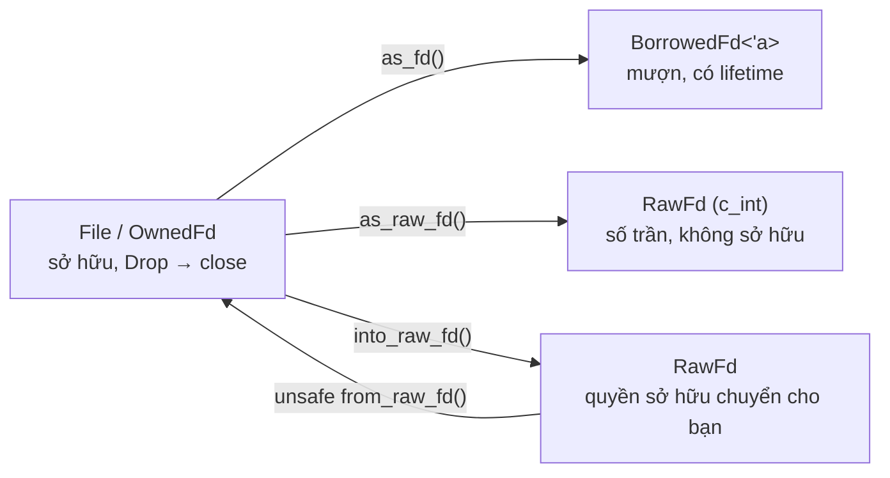
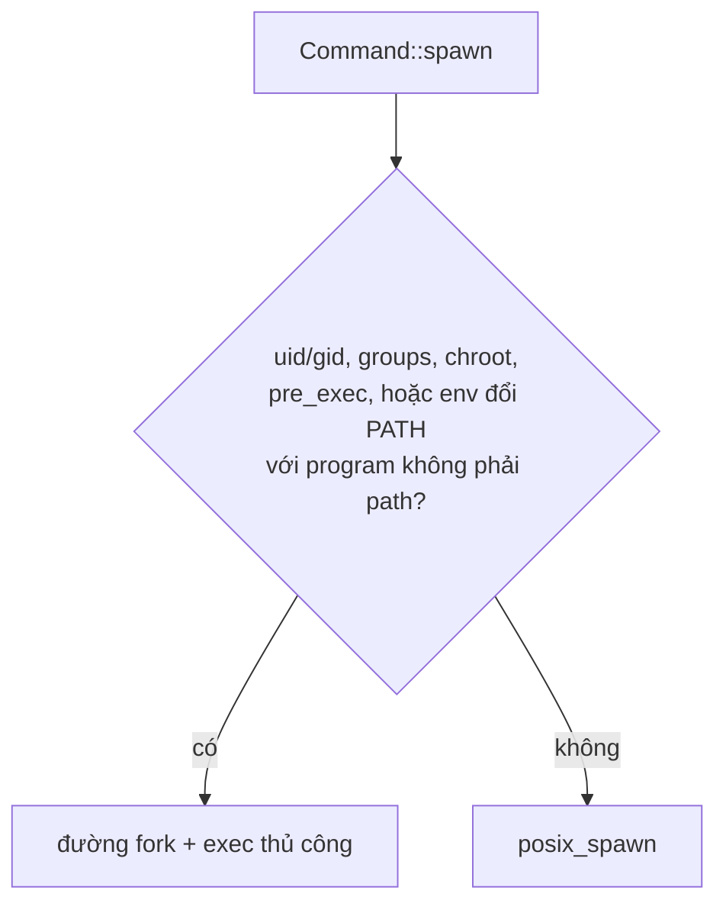
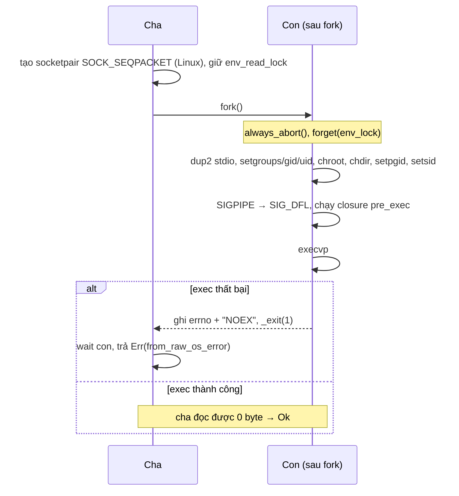

# P1 · Chương 07 — Rust trên giao diện hệ thống

## Bạn sẽ hiểu được gì

1. **Q1.** Vì sao `std` có `RawFd`, `OwnedFd`, `BorrowedFd` cho cùng một con số, và `Drop` của chúng làm gì với `close(2)`? → mục 1
2. **Q2.** `io::Error` mang gì từ `errno`; `raw_os_error`, `kind`, `last_os_error` khác nhau ra sao? → mục 2
3. **Q3.** `Command::spawn` gọi `posix_spawn` hay `fork`+`exec`; điều kiện nào đẩy nó sang đường thứ hai; vì sao `pre_exec` là `unsafe`? → mục 3
4. **Q4.** Bỏ `Child` mà không `wait` thì chuyện gì xảy ra; `Stdio` ánh xạ lên `dup2` thế nào? → mục 4
5. **Q5.** Vì sao process Rust khởi động với `SIGPIPE` bị ignore còn process con thì không? → mục 5
6. **Q6.** Vì sao `env::args()` có thể panic, `OsString` khác `String` ở đâu, `set_var` vì sao `unsafe`? → mục 6
7. **Q7.** Khi nào gọi `libc` trực tiếp, khi nào dùng `nix`/`rustix`? → mục 7

## Kiến thức cần trước

[Chương 02](02-system-call.md) (`errno`, wrapper libc), [Chương 03](03-process.md) (`fork`/`exec`/`wait`, zombie), [Chương 04](04-file-descriptor-va-vfs.md) (fd, open file description, `O_CLOEXEC`, pipe), [Chương 05](05-signal.md) (`SIGPIPE`, async-signal-safe).

Chương này **thuần Rust**: không dạy lại cơ chế kernel mà chỉ ra kiểu/hàm nào của `std` đứng trên cơ chế nào và bảo đảm gì; chỗ cần nhắc cơ chế OS thì chỉ vài câu rồi trỏ sang chương chính. Ví dụ chạy trong container Linux aarch64 của repo (rustc 1.95.0, chạy bằng root); kết quả *quan sát* được ghi rõ là quan sát, khác với bảo đảm của docs.

## Bản đồ: khái niệm hệ điều hành → kiểu Rust

| Khái niệm | Kiểu / hàm Rust | Điều cần nhớ |
|---|---|---|
| fd là số nguyên | `RawFd` = `c_int`[^rs-rawfd] | Số trần: lấy từ `as_raw_fd` thì không kèm quyền sở hữu[^rs-asrawfd] |
| fd là tài nguyên phải `close` | `OwnedFd` | Đóng khi drop; không ai khác được đóng nó[^rs-ownedfd] |
| dùng fd tạm thời | `BorrowedFd<'fd>` | Gắn lifetime vào chủ sở hữu[^rs-borrowedfd] |
| file đang mở | `std::fs::File` | Đóng khi ra khỏi scope, lỗi đóng bị bỏ qua[^rs-file] |
| `errno` | `io::Error` | `last_os_error()` đọc `errno`[^rs-last-os-error] |
| tạo process con (`posix_spawn` hoặc `fork`+`exec`), `wait` | `Command`, `Child`, `ExitStatus` | Builder; không tự `wait`[^rs-child-zombie] |
| `SIGPIPE` | runtime của `std` | Đặt `SIG_IGN` lúc khởi động[^rs-rt-sigpipe] |
| `argv`, `environ` | `env::args_os`, `env::vars_os` | Không kiểm Unicode[^env-args-os]; `args()`/`vars()` thì panic nếu không phải Unicode[^env-args][^env-vars-panic] |
| gọi thẳng libc | `unsafe extern "C"`, crate `libc` | Compiler không kiểm được hàm C có tuân quy tắc của Rust hay không[^rs-unsafe-extern] |

## 1. Fd trong Rust: `OwnedFd`, `BorrowedFd`, `RawFd` và `Drop` (Q1)

> **Trả lời ngắn.** Fd chỉ là một con số, và sau `close` số đó có thể được cấp lại cho file khác[^close-desc]. Vì vậy `std` tách ba vai: `OwnedFd` là chủ sở hữu, tự đóng fd khi bị hủy (drop) và bảo đảm không ai khác đóng nó[^rs-ownedfd]; `BorrowedFd<'fd>` là người mượn, bị buộc không sống lâu hơn chủ (lifetime)[^rs-borrowedfd]; `RawFd` chỉ là số nguyên `c_int`[^rs-rawfd]. Nếu `close` lỗi lúc drop thì lỗi bị bỏ qua[^rs-drop-close].

**Giải thích.**

Hình dung (nhận xét của người soạn): số ghế trong rạp: vé ghi "ghế 7" vẫn còn khi người ngồi đã đi và ghế đã xếp cho người khác. `OwnedFd` là người đang ngồi (được dùng ghế và được rời ghế), `BorrowedFd` là người được ngồi nhờ trong lúc chủ ghế còn đó, `RawFd` chỉ là tờ vé ghi số.

**Vấn đề: fd chỉ là số, và số bị cấp lại**

Fd là chỉ số vào bảng fd của process[^open-fd]; `open` trả số nhỏ nhất chưa dùng[^open-lowest]; sau `close` số đó có thể được dùng lại[^close-desc] (chi tiết: [Chương 04, mục 5](04-file-descriptor-va-vfs.md)). Docs `std::io` nói thẳng hậu quả: fd đã đóng có thể được cấp lại, nên chủ cũ của số đó giờ đang thao tác nhầm file[^rs-iosafety-realloc]. Ví dụ (suy luận của người soạn): hai đoạn code cùng tin mình sở hữu fd 7, đoạn thứ nhất đóng nó, một `open` khác nhận lại số 7, thì đoạn thứ hai sẽ đọc/ghi nhầm file — giống use-after-free nhưng cho tài nguyên kernel.

Quan sát một lần chạy (khớp quy tắc "số nhỏ nhất chưa dùng" ở trên):

```rust
let f = File::open("/etc/hostname").unwrap();
let n = f.as_raw_fd();
drop(f);
let g = File::open("/etc/passwd").unwrap();
println!("{} {}", n, g.as_raw_fd());   // 3 3  (số fd được dùng lại)
```

Giải pháp là kỷ luật *I/O safety* mà docs `std::io` đặt ra, tương đương với kỷ luật an toàn bộ nhớ của Rust: fd có thể được **sở hữu độc quyền**[^rs-iosafety-disc] — không code nào khác được truy cập, chủ được dùng và đóng bất kỳ lúc nào, và kiểu sở hữu thường đóng fd trong `drop`[^rs-iosafety-own]. Fd cũng có thể được **mượn**: quyền thao tác tạm thời, fd không bị đóng trong suốt thời gian mượn, nhưng không có quyền đóng[^rs-iosafety-borrow]. Hệ quả: một hàm *safe* nhận số nguyên rồi coi nó là fd là **unsound**[^rs-iosafety-unsound] — nghĩa là người gọi hàm safe đó có thể phá bảo đảm an toàn mà không cần viết `unsafe` (cách giải nghĩa "unsound" là của người soạn).

**`OwnedFd`, `BorrowedFd`, `RawFd`, `AsFd`**



- **`OwnedFd`** đóng fd khi drop và bảo đảm không ai khác đóng nó[^rs-ownedfd]. Nó `repr(transparent)` như fd của host, dùng được trong FFI (giao tiếp với code viết bằng ngôn ngữ khác, thường là C) khi fd được trao đi hoặc trả về như giá trị sở hữu, và không bao giờ bằng `-1`[^rs-ownedfd-repr].
- **`BorrowedFd<'fd>`**: lifetime buộc nó vào thứ sở hữu fd; trong lifetime đó không ai đóng được fd[^rs-borrowedfd]. Chỗ canh là borrow checker, thành phần của compiler so sánh phạm vi sống của các borrow lúc biên dịch[^book-borrowck]; chữ ký `as_fd(&self) -> BorrowedFd<'_>` gắn lifetime của kết quả vào `&self`[^rs-asfd-sig] (suy luận của người soạn: nên không thể drop chủ khi còn người mượn).
- **`AsFd::as_fd`** mượn fd từ một đối tượng[^rs-asfd]; **`AsRawFd::as_raw_fd`** lấy số mà không chuyển quyền sở hữu, và docs chỉ bảo đảm fd còn hợp lệ chừng nào đối tượng gốc chưa bị hủy[^rs-asrawfd] — số lấy ra không mang lifetime nên compiler không canh giúp, bạn tự chịu trách nhiệm (suy luận của người soạn).
- **`FromRawFd::from_raw_fd`** thường dùng để *nhận quyền sở hữu*: đối tượng mới đóng fd khi ra khỏi scope[^rs-fromrawfd]. Điều kiện: fd phải là fd được sở hữu, trong đó phải đang mở[^rs-fromraw-safety]. Compiler không kiểm được điều đó nên hàm là `unsafe`; gọi nó ngoài khối `unsafe` bị rustc từ chối với lỗi `E0133`[^rs-e0133] (lý do thiết kế là nhận xét của người soạn).
- **`IntoRawFd::into_raw_fd`** tiêu thụ đối tượng và trao quyền sở hữu cho bạn; bạn phải tự đóng[^rs-intoraw].

**`Drop` đóng fd và bỏ qua lỗi**

`File` được đóng khi ra khỏi scope; lỗi lúc đóng bị `Drop` bỏ qua, và docs chỉ `sync_all` nếu cần tự xử lý các lỗi đó[^rs-file]. `sync_all` thường đắt hơn việc đóng bằng drop, vì drop không bắt buộc chờ đến khi dữ liệu xuống filesystem[^rs-sync-all]. Trong source, `Drop` của `OwnedFd` gọi `libc::close` và bỏ kết quả[^rs-drop-close-call], kèm comment ghi rõ lỗi bị bỏ qua[^rs-drop-close]. Với WAL hay file cần độ bền, phải gọi `sync_all()` và kiểm lỗi (nhận xét của người soạn).

<details><summary>Đi sâu: <code>From</code> giữa <code>File</code>/<code>OwnedFd</code>/<code>Stdio</code>, đóng hai lần, <code>Read</code>/<code>Write</code>, close-on-exec</summary>

Trang docs của `File` liệt kê `impl From<OwnedFd> for File`[^file-from-owned] và `impl From<File> for OwnedFd`[^file-into-owned]; `Stdio` có `impl From<OwnedFd> for Stdio`[^stdio-from-owned]. Đóng hai lần để thấy hậu quả:

```rust
let raw = File::open("/etc/hostname").unwrap().into_raw_fd();
drop(unsafe { OwnedFd::from_raw_fd(raw) });      // OwnedFd đóng fd
let r = unsafe { close(raw) };                    // đóng lần hai qua FFI
// close again -> -1, Os { code: 9, kind: Uncategorized, message: "Bad file descriptor" }
```

Ở đây lần đóng thứ hai chỉ gặp `EBADF` vì chưa ai nhận lại số fd; nếu thread khác đã `open` xen giữa, nó sẽ đóng file của người khác (suy luận của người soạn, từ phần Vấn đề ở mục 1).

Comment trong source giải thích vì sao `Drop` bỏ qua lỗi chứ không thử lại khi `close` bị ngắt (`EINTR`, xem [Chương 05, mục 5](05-signal.md)): bỏ qua lỗi là chấp nhận được vì một số Unix lớn, trong đó có Linux, luôn đóng fd kể cả khi `close()` bị ngắt, và tình huống này hiếm; còn thử lại trên implementation không tuân thủ POSIX có thể có hậu quả rất tệ vì có thể đóng nhầm fd khác[^rs-drop-close-why].

Sở hữu độc quyền một fd không có nghĩa sở hữu độc quyền open file description bên dưới ([Chương 04, mục 1](04-file-descriptor-va-vfs.md)): docs ví fd như `Arc`, nên khi nhận một fd sở hữu bạn không biết còn fd nào khác trỏ cùng kernel object hay không[^rs-iosafety-arc]; theo cách ví đó, `OwnedFd` giống `Arc` còn `BorrowedFd<'a>` giống `&'a Arc`[^rs-iosafety-arc2].

**`Read`/`Write`, buffer và close-on-exec**

`Write::write` chỉ *cố* ghi và trả số byte đã ghi[^rs-write]; `Read::read` cố kéo byte vào buffer cho sẵn[^rs-read]; vì thế có `write_all`/`read_exact` (nhận xét của người soạn). `File` không buffer đọc/ghi, và docs khuyên bọc `BufReader`/`BufWriter` khi gọi nhiều lần nhỏ[^rs-file-nobuf], vì giao diện theo byte có thể kém hiệu quả khi gọi OS gần như liên tục[^rs-bufwriter]; mỗi lời gọi `read`/`write` trên `File` trần thường là một syscall (suy luận của người soạn).

`File::open` đặt `O_CLOEXEC` ngay trong lời gọi `open`: `flags` trong source bắt đầu bằng `libc::O_CLOEXEC`[^src-open-cloexec]. Cờ này cho phép tránh thêm một `fcntl(F_SETFD)` riêng[^open-cloexec], và đặt cờ cùng lúc với `open` là thiết yếu trong chương trình đa thread vì `fcntl` riêng không loại được race với thread khác đang `fork`+`execve`[^open-cloexec-mt] (cơ chế đầy đủ: [Chương 04, mục 4](04-file-descriptor-va-vfs.md)). Fd đánh dấu close-on-exec bị đóng khi `exec` thành công[^exec-fds], nên fd do `std` mở không còn mở trong chương trình mới. Nhân đôi fd (`OwnedFd::try_clone`, cài bằng `try_clone_to_owned` trong source) dùng `F_DUPFD_CLOEXEC` để vừa nhân đôi vừa đặt cờ nguyên tử[^src-dupfd]; fd mới chia sẻ cùng open file description, tức cùng offset[^rs-ownedfd-clone][^dup-share], nhưng không chia sẻ cờ close-on-exec[^dup-flags].

`std` còn mở lại stdin/stdout/stderr nếu chúng bị đóng lúc khởi động, để `stdout()` không vô tình dùng fd của tài nguyên khác[^rs-std-fds] — cùng bài toán fd bị cấp lại; source ghi việc này không bảo đảm chạy khi Rust được gọi từ bên ngoài[^rs-init-notrun].

</details>

**Quay lại Q1:** `OwnedFd` đóng khi drop, `BorrowedFd` mượn có lifetime, `RawFd` chỉ là số không kèm bảo đảm nào; lỗi `close` bị bỏ qua.

## 2. `io::Error`, `errno` và `ErrorKind` (Q2)

> **Trả lời ngắn.** `io::Error` là kiểu lỗi I/O của `std`: phần lớn đến từ hệ điều hành, nhưng cũng có thể tự dựng với một `ErrorKind`[^rs-error-origin]. `raw_os_error()` trả `Some(errno)` — mã lỗi mà OS để lại — khi lỗi được dựng từ mã đó (`last_os_error`, `from_raw_os_error`), còn lại trả `None`[^rs-raw-os-error]; `kind()` cho một danh mục lỗi chung (`ErrorKind`)[^errorkind-desc]; `last_os_error()` đọc `errno` hiện tại nên phải gọi ngay sau lời gọi hệ thống[^rs-last-os-error].

**Giải thích.**

Hình dung (nhận xét của người soạn): `errno` là tờ giấy nháp thread-local, lời gọi sau ghi đè được; `io::Error` là bản chụp phải chụp ngay.

**Mô hình**

`errno` là mã lỗi thread-local, chỉ có nghĩa ngay sau lời gọi báo lỗi, và hàm thành công vẫn được đổi nó[^errno-signif][^errno-thread] (nguồn gốc của `errno`: [Chương 02, mục 3](02-system-call.md)). `io::Error` là kiểu lỗi I/O của `std`: phần lớn đến từ OS, nhưng có thể tự chế với một `ErrorKind`[^rs-error-origin]. Ba cách nhìn:

- `raw_os_error()` → `Option<RawOsError>`: `Some` nếu tạo bằng `last_os_error` hoặc `from_raw_os_error`, ngược lại `None`[^rs-raw-os-error].
- `kind()` → `ErrorKind`, một danh sách danh mục lỗi chung[^errorkind-desc]; với lỗi từ OS, giá trị này được suy ra từ mã lỗi của hệ thống[^rs-error-kind]. Enum `#[non_exhaustive]`, `match` phải có nhánh `_`[^errorkind-nonex].
- `Display`/`Debug`: ví dụ `No such file or directory (os error 2)`; chuỗi lấy từ `strerror_r`[^src-strerror].

**`last_os_error` phải gọi ngay**

`Error::last_os_error()` đọc `errno` và dựng `io::Error`; docs yêu cầu gọi *ngay sau* lời gọi platform, nếu không trạng thái lỗi là không xác định (*indeterminate*)[^rs-last-os-error]. Trong `std`, mẫu này nằm trong `cvt`: nếu kết quả là `-1` thì `Err(io::Error::last_os_error())`[^rs-cvt]; `cvt_r` thêm vòng lặp thử lại khi `EINTR`[^rs-cvt-r] — xử lý điều [Chương 05, mục 5](05-signal.md) nói về syscall bị signal ngắt[^signal-eintr]; `ErrorKind::Interrupted` được docs mô tả là có thể retry[^errorkind-intr]. Vì sao thiết kế thế (nhận xét của người soạn): quy ước C "trả `-1` rồi đọc biến thread-local" dễ bị chen ngang bởi một lời gọi khác; `cvt` đọc `errno` ngay tại chỗ nên không có code nào chen vào.

<details><summary>Đi sâu: quan sát lỗi trên Linux và <code>decode_error_kind</code></summary>

Quan sát trên Linux:

```text
File::open("/nonexistent")  -> No such file or directory (os error 2)  kind=NotFound  raw=Some(2)
io::Error::other("custom")  -> custom                                  kind=Other     raw=None
read_dir("/etc/passwd")     -> Not a directory (os error 20)           kind=NotADirectory
ghi vào pipe mất đầu đọc    -> Broken pipe (os error 32)               kind=BrokenPipe raw=Some(32)
```

`kind` suy ra từ `errno` bằng `decode_error_kind`, một `match` trên hằng `libc::E*` (ví dụ `EACCES | EPERM => PermissionDenied`)[^src-decode-kind]; số lỗi ngoài bảng rơi vào nhánh cuối `_ => Uncategorized`[^src-decode-fallback]. Đó là lý do `EBADF` ở thí nghiệm đóng hai lần (mục 1) in `kind: Uncategorized` (quan sát trên 1.95.0, cộng với việc người soạn không thấy `EBADF` trong bảng `decode_error_kind`; chi tiết cài đặt có thể đổi). Khi cần phân biệt một `errno` mà `ErrorKind` không có, so `raw_os_error() == Some(libc::EBADF)` (nhận xét của người soạn).

</details>

**Quay lại Q2:** `raw_os_error` giữ `errno`, `kind` phân loại, `last_os_error` phải đọc ngay.

## 3. `Command::spawn`: `posix_spawn`, `fork`+`exec` và `pre_exec` (Q3)

> **Trả lời ngắn.** Khi nền tảng hỗ trợ, `Command::spawn` thử `posix_spawn` trước — hàm libc gộp `fork` và `exec` thành một lời gọi, kèm vài việc dọn dẹp trong con[^posix-spawn-desc]. Nó rơi xuống `fork`+`exec` thủ công khi đặt uid/gid, groups, chroot, có closure `pre_exec` (đoạn code do bạn gắn vào để chạy trong con), hoặc `env` đổi `PATH` với program không phải đường dẫn[^rs-spawn-first][^rs-spawn-conds] (còn vài điều kiện khác ở phần Giải thích). `pre_exec` là `unsafe` vì closure chạy ở process con giữa `fork` và `exec`, trong môi trường hạn chế mà compiler không kiểm được[^rs-preexec-safety][^cmdext-sig].

**Giải thích.**

Hình dung (nhận xét của người soạn): dịch vụ giao hàng có sẵn tùy chọn (`posix_spawn`) so với tự lái và chèn việc tùy ý giữa đường (`pre_exec`).

**`posix_spawn` hay `fork`+`exec`: đọc source 1.95.0**

`Command::spawn` (file `library/std/src/sys/process/unix/unix.rs`) **thử `posix_spawn` trước**: nếu `self.posix_spawn(...)` trả `Some` thì dùng ngay[^rs-spawn-first]. Hàm này chỉ có thân thật trên một danh sách nền tảng (Linux với libc gnu và musl, FreeBSD, illumos, Apple, cygwin, nto…[^src-spawn-platforms]); nơi khác nó là bản rỗng luôn trả `None`[^src-spawn-stub]. Source ghi lý do của danh sách này: chỉ hỗ trợ các nền tảng mà `posix_spawn()` trả được `ENOENT` trực tiếp (dịch comment)[^src-spawn-enoent]; riêng glibc phải từ 2.24 trở lên[^src-spawn-glibc], bản cũ hơn (hoặc không đọc được phiên bản) thì trả `None`[^src-spawn-glibc-ver]. Ngay cả trên nền tảng hỗ trợ, nó bỏ cuộc khi: đặt uid hoặc gid; `env` đổi `PATH` mà program không phải đường dẫn; có closure `pre_exec`; có groups hoặc chroot[^rs-spawn-conds].

Source `unix.rs` này **không có comment nào giải thích vì sao ưa `posix_spawn` hơn `fork`+`exec`**: người soạn đã tìm trong file các từ `efficien`, `vfork`, `faster`, `overhead`, `speed` và không thấy; từ `fast` chỉ xuất hiện trong comment về đường nhanh của pidfd, không liên quan. Lý do hiệu năng ở dưới là suy luận từ man page, không phải lời của `std`.



(Sơ đồ chỉ vẽ các điều kiện ở dòng trích dẫn; source còn các nhánh `return Ok(None)` khác: glibc cũ ở trên; `current_dir` khi libc thiếu hàm `posix_spawn_file_actions_addchdir`[^src-spawn-chdir]; `setsid` trên mọi nền tảng ngoài Linux-glibc[^src-spawn-setsid]; và nhánh dành cho tính năng pidfd, một API nightly-only không bàn ở đây[^src-spawn-pidfd][^src-pidfd-nightly].) `pre_exec` buộc rời `posix_spawn` vì docs định nghĩa closure chạy ngay trước khi hàm exec được gọi[^cmdext-preexec], trong con sau `fork`[^rs-preexec], còn `posix_spawn` chỉ hỗ trợ một tập nhỏ các việc xác định sẵn trong con[^posix-spawn-housekeeping] — không có chỗ chạy code tùy ý (suy luận của người soạn).

**Vì sao `pre_exec` là `unsafe`**

Docs của `pre_exec` nói closure chạy trong con ngay sau `fork`, một môi trường rất hạn chế: `malloc`, đọc biến môi trường qua `std::env` hay lấy mutex không được bảo đảm hoạt động, vì thread khác có thể còn chạy lúc `fork`[^rs-preexec-safety]. Docs dặn đọc thêm yêu cầu về async-signal-safety của POSIX `fork()`[^cmdext-asyncsafe]; bản `before_exec` cũ từng là hàm safe rồi bị deprecated, vì closure chỉ được làm các thao tác async-signal-safe[^cmdext-before-exec]. Cơ chế nền ở chương khác: con chỉ giữ một thread nhưng sao nguyên trạng thái mutex[^fork-thread], nên sau `fork` trong chương trình đa luồng con chỉ nên gọi hàm async-signal-safe cho đến khi `execve`[^fork-signalsafe] ([Chương 03, mục 3.1](03-process.md); async-signal-safe là gì: [Chương 05, mục 6](05-signal.md)).

Phần riêng của Rust:

- `Error::new` và `Error::other` cũng cấp phát, nên docs khuyên dùng `panic!` để báo lỗi không tầm thường[^cmdext-alloc]; riêng `panic!` chỉ an toàn khi đối số định dạng của thông báo format được an toàn, vì `Command` gọi `always_abort` trước hook nhưng thông báo vẫn được định dạng[^cmdext-panic].
- Mọi fd và vùng `mmap` đều bị nhân đôi; bạn phải tự bảo đảm không dùng bản nhân đôi phá bất biến thư viện[^cmdext-dupres].
- `std` không kiểm được các điều này bằng kiểu, nên `pre_exec` là `unsafe fn`[^cmdext-sig]. Dùng nó trong service đa thread nguy hiểm hơn vẻ ngoài (nhận xét của người soạn).

`CommandExt::exec()` thực hiện toàn bộ setup rồi `execvp`; thành công thì không return, lỗi thì trả `io::Error`[^cmdext-exec]. Quan sát: `Command::new("echo").arg("exec'd").exec()` in `exec'd` và không quay lại.

<details><summary>Đi sâu: quan sát <code>strace</code>, thứ tự việc và kênh báo lỗi ở đường <code>fork</code>+<code>exec</code></summary>

Quan sát bằng `strace -f` (aarch64, glibc):

- `Command` thường: `clone(... CLONE_VM|CLONE_VFORK|SIGCHLD)`, rồi trong con `dup3(4, 1, 0)`, `dup3(5, 2, 0)`, rồi `execve` thử từng thư mục `PATH` cho đến khi trúng `/usr/bin/sh`.
- Có `pre_exec` (kể cả rỗng): `clone(CLONE_CHILD_CLEARTID|CLONE_CHILD_SETTID|SIGCHLD)` — **không** có `CLONE_VM`/`CLONE_VFORK`, tức một `fork` đầy đủ.

Khớp man page glibc: từ glibc 2.24, `posix_spawn()` bắt đầu bằng `clone(2)` với `CLONE_VM` và `CLONE_VFORK`[^posix-spawn-clone], nên bên gọi bị treo đến khi con `execve` hoặc `_exit`[^clone-vfork] ([Chương 03, mục 3.3](03-process.md)). Suy luận của người soạn: con dùng chung không gian địa chỉ đến lúc `exec` nên tránh được chi phí sao page table của `fork`[^fork-cow] — đáng kể khi service giữ nhiều GB bộ nhớ mà phải spawn con.

**Đường `fork`+`exec`: thứ tự việc và kênh báo lỗi**



Cha tạo cặp socket Unix `SOCK_SEQPACKET` làm kênh lỗi trên Linux[^src-socketpair]; nền tảng khác dùng `pipe()` của `std`, hàm này đặt close-on-exec ngay lúc tạo bằng `pipe2` với `O_CLOEXEC` trên các nền tảng có hàm đó[^src-pipe-cloexec]. Cha giữ khóa đọc môi trường quanh `fork`[^src-envlock]. Trong con: `panic::always_abort()` và `mem::forget(env_lock)`, với comment nói để tránh việc mở khóa không async-signal-safe[^src-child-abort].

`do_exec` làm `dup2` stdio[^rs-do-exec-dup2], rồi đặt groups/gid/uid[^src-order-uidgid], `chroot`, `chdir`, `setpgid`, `setsid`[^src-order-chdir-setsid], reset `SIGPIPE` (mục 5) và chạy từng closure `pre_exec`[^src-closures], cuối cùng `execvp`[^src-execvp]. Thứ tự này là thứ tự câu lệnh trong source 1.95.0 (người soạn đọc trực tiếp; chi tiết cài đặt, có thể đổi). Docs xác nhận hệ quả: khi closure chạy, stdio và thư mục làm việc *đã* được đổi nên output từ closure có thể không ra nơi bạn mong[^cmdext-stdio-done].

Báo lỗi exec: nếu `exec` thất bại, con ghi `errno` kèm chuỗi `NOEX`[^src-noex-const] vào kênh rồi `_exit(1)`[^src-noex-exit]; nếu thành công, cha đọc được `Ok(0)` — source có nhánh `Ok(0) => return Ok((p, ours))`[^src-spawn-ok0] — tức EOF không kèm dữ liệu. Điều này chỉ đúng vì cặp socket được tạo với `SOCK_CLOEXEC`, nên đầu ghi của con tự đóng khi `exec` thành công[^src-socketpair-cloexec]. Khi nhận được thông báo lỗi, cha giải mã `errno`, `wait` con rồi trả `Err(Error::from_raw_os_error(errno))`[^src-parent-err]. Source gọi kênh này là `CLOEXEC pipe` trong thông báo lỗi của nó[^src-cloexec-name].

Lỗi từ closure cũng đi ngược về cha theo docs: closure trả `Err(io::Error::from_raw_os_error(13))` khiến `spawn()` trả `Permission denied (os error 13) kind=PermissionDenied`[^rs-preexec-err].

</details>

**Quay lại Q3:** khi nền tảng hỗ trợ, `posix_spawn` được thử trước; `pre_exec` (cùng uid/gid, groups, chroot…) buộc rơi xuống `fork`+`exec`, và nó `unsafe` vì chạy trong con giữa `fork` và `exec`.

## 4. `Child` không `wait` và `Stdio` ánh xạ lên `dup2` (Q4)

> **Trả lời ngắn.** Nếu bỏ `Child` mà không `wait`, process con không bị dừng và `std` cũng không thu dọn nó[^rs-child-nodrop][^rs-child-zombie]; khi con thoát, nó thành *zombie* — process đã chết nhưng kernel còn giữ một bản ghi nhỏ để cha đọc kết quả sau[^wait-zombie]. `Stdio::piped()` nối cha và con bằng một pipe[^rs-stdio-piped]; trước khi chạy chương trình mới, con dùng `dup2` (hoặc file action tương đương của `posix_spawn`) để đặt đầu pipe lên fd 0/1/2[^rs-do-exec-dup2][^rs-spawn-adddup2].

**Giải thích.**

Hình dung (nhận xét của người soạn): thợ xong việc nhưng hồ sơ nằm lại cho đến khi bạn ký nhận (`wait`).

`Command` là process builder cho phép điều khiển chi tiết cách spawn[^rs-command]. Mặc định `spawn`/`status` kế thừa stdin/stdout/stderr, còn `output` tạo pipe[^rs-command-default]; môi trường cũng được kế thừa, và biến đặt bằng `env` được ưu tiên hơn biến kế thừa[^cmd-env-inherit]. `Stdio::piped()` sắp xếp một pipe nối cha và con[^rs-stdio-piped].

Ánh xạ về [Chương 04, mục 7](04-file-descriptor-va-vfs.md): để con có stdout là pipe, trong con phải `dup2` đầu ghi lên fd 1 *trước* `exec`. Source ở đường `fork`+`exec` làm đúng thế: `do_exec` gọi `dup2(fd, STDOUT_FILENO)` (tương tự stdin, stderr) trong `cvt_r`[^rs-do-exec-dup2]. Đường `posix_spawn` khai báo việc đó dưới dạng file action `posix_spawn_file_actions_adddup2`[^rs-spawn-adddup2], và libc thực hiện các file action trong con theo thứ tự đã khai báo[^posix-spawn-fileactions].

**`Child`, zombie và `wait`**

`Child` không cài `Drop`: nếu bạn không bảo đảm con đã thoát thì nó cứ chạy tiếp, kể cả sau khi handle `Child` ra khỏi scope[^rs-child-nodrop]; `std` không tự `wait` kể cả khi drop[^rs-child-zombie]. Docs cảnh báo: trên một số hệ thống, gọi `wait` hoặc tương tự là cần thiết để OS giải phóng tài nguyên[^child-wait-resource]; process đã kết thúc mà chưa được `wait` vẫn còn đó dưới dạng zombie, và quá nhiều zombie có thể cạn tài nguyên toàn cục như PID[^child-zombie-ids]; vì vậy docs không khuyến khích drop `Child` mà không `wait` trong ứng dụng chạy lâu[^rs-child-longrunning]. Zombie ở đây chính là zombie của [Chương 03, mục 7](03-process.md)[^wait-zombie]. Quan sát (đọc `/proc/<pid>/stat`): `spawn` rồi ngủ 300 ms chưa `wait` → trạng thái `Z`, sau `wait()` thư mục `/proc/<pid>` biến mất; `drop(child)` ngay sau `spawn` → vẫn `Z`.

Với service chạy lâu, mỗi lần spawn phải có đường tới `wait`/`try_wait`/`wait_with_output` kể cả trên nhánh lỗi (nhận xét của người soạn, cùng hướng với lời dặn của docs ở trên). `Child::wait` đóng stdin của con trước khi chờ để tránh deadlock khi con chờ input còn cha chờ con[^child-wait-stdin]. Pipe có dung lượng hữu hạn: ghi vào pipe đầy chặn hoặc lỗi tùy `O_NONBLOCK`[^pipe-cap] ([Chương 04, mục 8](04-file-descriptor-va-vfs.md)); nên nếu con ghi nhiều hơn dung lượng pipe `piped` mà cha `wait` trước khi đọc, cả hai có thể chờ nhau mãi (suy luận của người soạn từ `pipe(7)`). `wait_with_output` vừa chờ con thoát vừa gom output từ stdout/stderr[^child-wait-with-output], nên tránh được tình huống này (suy luận của người soạn).

<details><summary>Đi sâu: ví dụ <code>Stdio::piped()</code> và <code>ExitStatus</code></summary>

```rust
let mut c = Command::new("sh").arg("-c").arg("echo out; echo err >&2")
    .stdout(Stdio::piped()).stderr(Stdio::null()).spawn().unwrap();
let mut s = String::new();
c.stdout.take().unwrap().read_to_string(&mut s).unwrap();
// captured "out\n"; status exit status: 0
```

Docs gợi ý `take()` handle để tránh *partial move* (di chuyển một phần) khỏi `child`, vốn chặn bạn gọi tiếp hàm trên `child` khi đang dùng stdin[^child-stdin-take].

**`ExitStatus`**

`code()` trả `None` trên Unix nếu process bị signal giết[^rs-exitstatus-code] — `WIFSIGNALED` ở [Chương 03, mục 6](03-process.md)[^wait-wifsignaled]; exit status Unix bị cắt còn 8 bit[^rs-exitstatus-8bit], khớp `status & 0xFF` của `_exit(2)`[^exit-status-mask].

</details>

**Quay lại Q4:** không `wait` thì có zombie; `Stdio::piped()` là `dup2` đầu pipe lên fd 0/1/2.

## 5. `SIGPIPE`: runtime ignore, process con reset (Q5)

> **Trả lời ngắn.** `SIGPIPE` là signal (thông báo kernel gửi cho process, xem [Chương 05](05-signal.md)) sinh ra khi ghi vào pipe mà mọi đầu đọc đã đóng; nếu process chọn bỏ qua (ignore) signal đó thì `write` chỉ trả lỗi `EPIPE`[^pipe-eof][^pipe-epipe]. Runtime Rust ignore `SIGPIPE` lúc khởi động[^rs-rt-sigpipe]. `std` đặt `SIGPIPE` về mặc định (`SIG_DFL`) trong process con trước khi chạy chương trình mới; source ghi lý do là "tương thích ngược"[^rs-child-sigpipe-reset]. Nếu không reset, trạng thái ignore sẽ sống sót qua `execve`[^signal-exec] (nối hai điều này là suy luận của người soạn, xem phần "Process con").

**Giải thích.**

Hình dung (nhận xét của người soạn): chuông báo cháy mặc định giết cả tòa nhà; Rust tắt chuông nhưng công tắc di truyền qua `exec`, nên bật lại cho process con.

**Process Rust**

Cơ chế gốc ở [Chương 04, mục 8](04-file-descriptor-va-vfs.md) và [Chương 05, mục 7](05-signal.md): ghi vào pipe mà mọi đầu đọc đã đóng thì sinh `SIGPIPE`[^pipe-eof], và nếu process ignore signal này thì `write` lỗi `EPIPE`[^pipe-epipe]. Phần riêng của Rust: từ 2014 runtime Rust trên Unix đặt `SIGPIPE` thành `SIG_IGN`[^rs-rt-sigpipe], và có cờ compiler `-Zon-broken-pipe` để chọn cách khác[^rs-onbrokenpipe-flag]. Lý do trong source: một số nền tảng gửi signal khi lẽ ra chỉ trả `EPIPE`, runtime không cài handler nên chương trình bị giết — không mong muốn, nên `std` ignore khi khởi động[^rs-sigpipe-comment]; nhánh mặc định (`sigpipe::DEFAULT`) chọn handler `SIG_IGN` để áp lên `SIGPIPE`[^rs-sigpipe-ign].

Hệ quả: với chương trình in 100000 dòng bằng `println!` chạy `./prog | head -1`, quan sát được `line 0`, rồi panic `failed printing to stdout: Broken pipe (os error 32)` và `PIPESTATUS` (mã thoát của từng lệnh trong pipeline) là `101 0` (docs của `println!` ghi: panic nếu ghi ra `io::stdout` thất bại[^println-panics]); còn `yes | head -1` (chương trình C) chạy xong mà không in thông báo lỗi nào (quan sát; cơ chế là `SIGPIPE` được sinh ra và hành động mặc định của nó là kết thúc process[^sig-pipe-term]). Với CLI Rust hay đặt sau `| head` (nhận xét của người soạn): dùng `writeln!` và coi `ErrorKind::BrokenPipe` là tín hiệu thoát bình thường thay vì `println!`.

**Process con**

Disposition (cách process xử lý một signal: mặc định, ignore hoặc chạy handler; xem [Chương 05, mục 2](05-signal.md)) kiểu *ignored* sống sót qua `execve`, chỉ disposition kiểu handler bị đặt lại về mặc định[^signal-exec]. Nếu `std` không làm gì, mọi chương trình do Rust spawn sẽ thừa hưởng `SIGPIPE` bị ignore[^signal-exec]. Source: nếu không dùng `-Zon-broken-pipe`, `std` **reset `SIGPIPE` về `SIG_DFL`** trong con vì tương thích ngược[^rs-child-sigpipe-reset], ở cả hai đường: `fork`+`exec` gọi `signal(SIGPIPE, SIG_DFL)` trong con[^rs-child-sigpipe-fork]; `posix_spawn` thêm `SIGPIPE` vào tập `sigdefault`[^rs-child-sigpipe-spawn]. Nối lý do "tương thích ngược" với việc "ignore sống sót qua exec" là suy luận của người soạn.

<details><summary>Đi sâu: quan sát <code>/proc/self/status</code> ở cha và con</summary>

Quan sát: process Rust có `SigIgn: 0000000000001000` trong `/proc/self/status`; `proc(5)` mô tả `SigIgn` là mask các signal bị ignore[^proc-sigign], và bit `0x1000` là bit 12, ứng với signal 13; `signal(7)` ghi `SIGPIPE` là 13 trên mọi kiến trúc trong bảng của nó (x86/ARM, Alpha/SPARC, MIPS, PARISC)[^sig-pipe-num]. Phép gán "signal *n* ↔ bit *n−1*" là suy luận của người soạn (proc(5) không nêu), nhưng khớp quan sát: bit 12 = `0x1000` = `SIGPIPE`.

Quan sát: con `grep /proc/self/status` do `Command` spawn in `SigIgn: 0000000180000000` (đường `posix_spawn`) và `SigIgn: 0000000000000000` (đường có `pre_exec`) — cả hai **không có** bit `0x1000`. Hai bit cao ở trường hợp đầu ứng với signal 32 và 33 theo phép gán trên; `signal(7)` ghi glibc dùng nội bộ hai signal real-time cho NPTL và đẩy `SIGRTMIN` lên 34[^sig-rt-nptl], còn mã `posix_spawn` của glibc 2.36 đặt các signal nội bộ đang bị chặn thành ignore trong con[^glibc-spawni-internal] (người soạn chọn 2.36 vì image lab là `rust:1.95-bookworm`; chưa kiểm phiên bản glibc thực tế trong container). Khớp quan sát, nhưng việc gán đúng số 32 và 33 cho hai signal nội bộ đó là suy luận của người soạn. Muốn con giữ ignore, `pre_exec` chạy sau bước reset (thứ tự ở phần Đi sâu của mục 3) nên có thể đặt lại, kèm rủi ro ở mục 3 (suy luận của người soạn).

</details>

**Quay lại Q5:** cha ignore → `EPIPE`; con reset về `SIG_DFL`.

## 6. `std::env`: `OsString`, `args()` panic và `set_var` (Q6)

> **Trả lời ngắn.** Trên Unix, string do OS trao cho process (đối số, biến môi trường…) thường là dãy byte khác 0 tùy ý, đôi khi được hiểu là UTF-8 nhưng không bảo đảm[^os-unix-bytes]; còn string Rust luôn là UTF-8 hợp lệ[^rust-str-utf8]. Vì vậy `args()` panic khi gặp đối số không phải Unicode[^env-args], và `OsString` là kiểu bắc cầu giữa hai thế giới[^os-bridge]. `set_var` là `unsafe` vì với chương trình đa thread (trên hệ không phải Windows), lựa chọn an toàn duy nhất là không dùng nó[^set-var-mt].

**Giải thích.**

Hình dung (nhận xét của người soạn): `String` là mẫu giấy chỉ nhận chữ hợp lệ, `OsString` là phong bì nhận mọi thứ OS đưa; môi trường là bảng tin chung, sửa khi người khác đang đọc gây rối.

**Dữ liệu từ OS không bảo đảm là UTF-8**

Docs `OsString`: trên Unix, string thường là dãy byte khác 0 tùy ý, trong nhiều trường hợp được diễn giải là UTF-8[^os-unix-bytes], còn string Rust luôn là UTF-8 hợp lệ và có thể chứa byte 0[^rust-str-utf8]. `OsString`/`OsStr` bắc cầu bằng cách biểu diễn đồng thời string Rust và string native của nền tảng[^os-bridge]; nhiều API của `std` trao chuỗi với OS dùng chúng thay cho string thường, ví dụ `env::var_os` trả `Option<OsString>`[^os-var-os]. Trên Unix, `OsStrExt` có `from_bytes`/`as_bytes` đổi qua lại với byte slice rẻ tiền[^os-bytes-ext].

Lời khuyên (nhận xét của người soạn): tool nhận path hoặc đối số từ người dùng nên dùng `args_os`/`Path`/`OsStr` suốt đường đi, chỉ đổi sang `String` ở biên cần hiển thị hay serialize; service đọc config từ biến môi trường thì biến `NotUnicode` thành lỗi cấu hình rõ ràng.

**Snapshot và `set_var` là `unsafe`**

`vars()` trả snapshot lúc gọi; thay đổi sau đó không phản ánh[^env-vars-snap].

`set_var` có chữ ký `pub unsafe fn set_var<K: AsRef<OsStr>, V: AsRef<OsStr>>(key: K, value: V)`[^set-var-sig]. Docs: trong chương trình đa thread trên hệ không phải Windows, lựa chọn an toàn duy nhất là không dùng `set_var` hay `remove_var` chút nào[^set-var-mt]. Điều kiện chính xác: không thread nào khác đang ghi *hoặc đọc* môi trường qua hàm hay biến toàn cục ngoài module này[^set-var-req]. Lý do docs nêu: các hệ điều hành này không có cách thread-safe để đọc môi trường, và hầu hết thư viện C, kể cả libc, không cho biết hàm nào đọc môi trường[^set-var-why]; kể cả thư viện chuẩn có thể đọc môi trường ngoài module `env`, ví dụ DNS lookup của `ToSocketAddrs`[^set-var-std]. Muốn truyền biến cho process con thì docs gợi ý dùng `Command::env`[^set-var-cmd].

Từ edition 2024 (mốc phiên bản của ngôn ngữ Rust, chọn bằng cờ `--edition`), gọi `set_var`/`remove_var` ngoài khối `unsafe` là lỗi biên dịch; hàm được đánh dấu `unsafe` bắt đầu từ edition 2024, còn các edition cũ không đòi `unsafe`[^ed-unsafe-fn] (đã chạy rustc 1.95.0: cùng một dòng `std::env::set_var("A", "b");` biên dịch được với `--edition 2021`, còn `--edition 2024` báo `E0133`).

Cùng gốc với mục 3: `Command` giữ khóa đọc môi trường quanh `fork`[^src-envlock], và docs `pre_exec` không bảo đảm việc đọc `std::env` hoạt động ở con[^rs-preexec-safety]; điểm chung là môi trường (`environ`) là trạng thái toàn cục dùng chung (suy luận của người soạn).

<details><summary>Đi sâu: quan sát với đối số <code>abc\xff</code> và biến <code>BAD</code></summary>

Quan sát khi truyền đối số `abc\xff`: `args_os()` thành công, `last = "abc\xFF"`, `bytes = [97, 98, 99, 255]`; còn `args().collect()` panic ở `library/std/src/env.rs`. Khớp docs: `args()` panic khi duyệt nếu đối số không phải Unicode[^env-args]; `args_os` không kiểm Unicode[^env-args-os]. Tương tự `vars()` panic khi gặp key/value không hợp lệ[^env-vars-panic]; `var` trả `VarError::NotUnicode`[^env-var-notunicode] — với `BAD=$'a\xffb'`: `var("BAD")` → `NotUnicode("a\xFFb")`, `var_os("BAD")` → `Some([97, 255, 98])`.

</details>

**Quay lại Q6:** dùng `args_os`/`var_os`/`OsString`; `set_var` `unsafe` vì thread khác.

## 7. FFI: gọi `libc` trực tiếp, `nix` và `rustix` (Q7)

> **Trả lời ngắn.** Ưu tiên `std`; thiếu syscall thì dùng crate đã bọc sẵn: `rustix` nhận và trả fd bằng `AsFd`/`OwnedFd`, docs hứa memory-safe và I/O-safe[^rustix-desc][^rustix-fd]; `nix` là binding thân thiện với Rust, module chia theo header C[^nix-desc][^nix-mod]. Chỉ khi thiếu cả hai mới gọi hàm C trực tiếp qua `libc` với `unsafe extern`, vì compiler không kiểm được hàm C và lời gọi phải nằm trong `unsafe`[^rs-unsafe-extern][^nomicon-unsafe]. Thứ tự ưu tiên này là gợi ý của người soạn, không phải điều docs nói.

**Giải thích.**

Hình dung (nhận xét của người soạn): `libc` là cầm dao thẳng vào bếp hệ điều hành; `rustix` là bộ dụng cụ đã bọc sẵn phần nguy hiểm (theo lời docs của nó); `nix` là bộ dụng cụ làm tên hàm C quen tay với Rust, còn an toàn đến đâu thì phải xem từng hàm.

**`unsafe extern`**

Crate `libc` là các binding FFI thô (khai báo để Rust gọi hàm C) tới thư viện hệ thống của nền tảng[^libc-crate]. Rust Book: hàm trong khối `extern` nói chung unsafe để gọi nên khối `extern` cũng phải đánh dấu `unsafe`, vì ngôn ngữ khác không thực thi quy tắc của Rust và compiler không kiểm được[^rs-unsafe-extern]; Nomicon: lời gọi phải nằm trong `unsafe {}` như lời hứa với compiler[^nomicon-unsafe].

Với `write(fd, ptr, len)`, compiler không biết `ptr` có hợp lệ cho `len` byte hay `fd` có thuộc về bạn không — cả memory safety lẫn I/O safety (mục 1) nằm ngoài tầm kiểm soát. Chiến lược (nhận xét của người soạn): bọc lời gọi `unsafe` trong một hàm safe nhỏ nhận `BorrowedFd` và `&[u8]`, đổi kết quả `-1` thành `io::Error::last_os_error()` ngay (như `cvt`, mục 2), để các bất biến tự chứng minh chỉ nằm một chỗ.

**`nix` và `rustix`**

Chỉ ghi điều docs nói (ghim `nix` 0.31.3, `rustix` 1.1.5):

- **nix**: binding thân thiện với Rust cho các hàm hệ thống *nix[^nix-desc]; module tổ chức theo header C chứa hàm đó[^nix-mod].
- **rustix**: wrapper an toàn bộ nhớ và an toàn I/O cho API syscall kiểu POSIX/Unix/Linux/Winsock, có backend cấu hình được[^rustix-desc]; fd được truyền và trả về bằng `AsFd` và `OwnedFd` thay vì số nguyên trần, bảo đảm I/O safety[^rustix-fd].
- Trang chủ docs của `nix` không nhắc `OwnedFd`/`AsFd`, nên đừng suy ra nó dùng kiểu I/O-safe; kiểm từng hàm ở phiên bản bạn dùng.

Gợi ý chọn (nhận xét của người soạn, không phải điều docs nói): thử `std` trước; thiếu syscall thì chọn crate đã bọc sẵn (`rustix` nếu muốn API nhận `AsFd` và trả `OwnedFd`, `nix` nếu muốn API bám theo tên hàm C, kèm việc kiểm kiểu fd của từng hàm); chỉ khi thiếu cả hai mới viết `unsafe extern`/`libc` tự bọc, với ranh giới `unsafe` nằm trong một module nhỏ có test.

<details><summary>Đi sâu: quy tắc <code>extern</code> theo edition và ví dụ gọi <code>getpid</code>/<code>write</code></summary>

Reference: gọi hàm unsafe hay truy cập `static` unsafe khai báo trong external block chỉ được trong ngữ cảnh unsafe[^ref-extern-ctx]; hàm trong khối mặc định unsafe trừ khi có qualifier `safe`[^ref-extern-implicit]; trước edition 2024, `unsafe` trước `extern` là tùy chọn[^ref-extern-2024]. Edition Guide: khối `extern` giờ phải được đánh dấu bằng từ khoá `unsafe` từ edition 2024[^ed-unsafe-extern]. Kiểm chứng bằng rustc 1.95.0: `extern "C" { fn getpid() -> i32; }` biên dịch được với `--edition 2021`, còn `--edition 2024` báo `error: extern blocks must be unsafe`.

Ví dụ chạy được, không cần crate `libc` (quan sát: `std` đã liên kết libc; docs của crate `libc` chỉ nói theo mặc định nó giả định thư viện chuẩn chứa link directive cần thiết[^libc-std-link]):

```rust
unsafe extern "C" {
    fn getpid() -> i32;
    fn write(fd: i32, buf: *const u8, n: usize) -> isize;
}
let pid = unsafe { getpid() };               // getpid = 48, std::process::id = 48
let msg = b"hello via raw write\n";
let n = unsafe { write(1, msg.as_ptr(), msg.len()) };   // in dòng chữ; n = 20
```

Khai báo `unsafe extern "C" { safe fn getpid() -> i32; }` cho phép gọi không cần `unsafe` ở nơi gọi (rustc 1.95.0 biên dịch và chạy): bạn tự chịu trách nhiệm rằng hàm thật sự an toàn với mọi đối số.

</details>

**Quay lại Q7:** ưu tiên `std`, rồi crate đã bọc sẵn (`rustix`, `nix`), cuối cùng mới tự bọc `unsafe`.

## Bổ sung: extension trait của `std::os::unix`

`std` giữ API chính đa nền tảng và đặt phần riêng của Unix thành *extension trait*[^permsext][^metaext]; bạn `use` trait để method xuất hiện trên kiểu quen thuộc (nhận xét của người soạn).

| Trait | Mở rộng | Method (từ docs) |
|---|---|---|
| `PermissionsExt` | `fs::Permissions`[^permsext] | `mode()`, `set_mode(u32)`, `from_mode(u32)`[^permsext-sig] |
| `MetadataExt` | `fs::Metadata`[^metaext] | `dev()` (ID của thiết bị chứa file[^metaext-dev]), `ino()`[^metaext-sig] |
| `CommandExt` | `process::Command` | `uid`, `gid`, `exec`, `arg0`, `process_group`, và `unsafe fn pre_exec`[^cmdext-methods1][^cmdext-methods2][^cmdext-sig] |

Trong docs 1.95.0, `groups`, `chroot` và `setsid` của `CommandExt` được đánh dấu là API thử nghiệm chỉ có ở nightly (nightly-only experimental)[^cmdext-nightly-groups][^cmdext-nightly-chroot][^cmdext-nightly-setsid], nên chưa dùng được trên toolchain stable (suy luận của người soạn).

```rust
let f = File::create("/tmp/x").unwrap();
let mut perm = f.metadata().unwrap().permissions();
println!("mode = {:o}", perm.mode());        // mode = 100644
perm.set_mode(0o640);
std::fs::set_permissions("/tmp/x", perm).unwrap();
let m = std::fs::metadata("/tmp/x").unwrap();
// mode = 100640 nlink=1 uid=0 size=0
```

`mode()` trả cả bit loại file (`100000` hệ bát phân là file thường[^inode-modetype]) lẫn bit quyền; ý nghĩa các bit xem [Chương 06](06-user-quyen-proc-sys.md) mục 2. `ino()` cho số inode (quan sát: `> 0`), vốn chỉ bảo đảm duy nhất trong một filesystem[^inode-unique] ([Chương 04](04-file-descriptor-va-vfs.md) mục 1).

`CommandExt::uid` dịch thành `setuid` trong con, lỗi làm `spawn` thất bại[^cmdext-uid-setuid]; docs thêm rằng nó gọi `setgroups(0, NULL)` nếu chưa chỉ định groups, để bỏ nhóm phụ có thể cho con quyền ngoài ý muốn[^cmdext-uid]. Code `do_exec` khớp: gọi `setgroups(0, …)` rồi bỏ qua riêng lỗi `EPERM` (trường hợp thiếu `CAP_SETGID`) trước khi `setuid`[^src-eperm]. Đặt `uid`/`gid` cũng là điều kiện làm `std` bỏ `posix_spawn` (mục 3). Về ID và capability: [Chương 06](06-user-quyen-proc-sys.md) mục 1 và 3. Code dùng các trait này tự khai báo chỉ chạy trên Unix, nên đặt sau `#[cfg(unix)]` (nhận xét của người soạn).

## Tóm tắt

- Fd chỉ là số và bị cấp lại sau `close`; I/O safety tách nó thành `OwnedFd` (đóng khi drop), `BorrowedFd<'a>` (mượn có lifetime), `RawFd` (số trần).
- `from_raw_fd` là `unsafe` vì compiler không kiểm được fd đang mở và thuộc về bạn; `Drop` của `File`/`OwnedFd` bỏ qua lỗi `close`, cần xử lý lỗi hay độ bền thì `sync_all`.
- `File::open`/`try_clone` đặt close-on-exec ngay từ đầu nên fd do `std` mở không còn mở trong chương trình mới sau `exec` (cơ chế: [Chương 04](04-file-descriptor-va-vfs.md) mục 4).
- `io::Error` chứa `errno` (`raw_os_error`) và `ErrorKind` (`#[non_exhaustive]`, errno lạ → `Uncategorized`); `last_os_error` phải gọi ngay, `std` gói trong `cvt`/`cvt_r`.
- `Command::spawn` thử `posix_spawn` trước, rơi xuống `fork`+`exec` khi có uid/gid/groups/chroot, `pre_exec`, đổi `PATH` với program không phải path (và vài điều kiện khác trong source); `groups`, `chroot`, `setsid` của `CommandExt` hiện là API nightly-only.
- `pre_exec` chạy ở con giữa `fork` và `exec`, môi trường hạn chế mà docs dặn tuân thủ yêu cầu async-signal-safety, vì thế `unsafe`; lỗi từ `exec` và closure quay về cha qua một kênh riêng.
- `Child` không có `Drop`, `std` không tự `wait`: bỏ `Child` để lại zombie (quan sát `Z`); `Stdio::piped()` là `dup2` đầu pipe lên fd 0/1/2 của con.
- Runtime Rust ignore `SIGPIPE` (`write` cho `EPIPE`, `println!` panic); `Command` reset `SIGPIPE` trong con vì tương thích ngược, và việc reset cần thiết vì ignore sống sót qua `exec` (nối hai nguồn là suy luận của người soạn).
- `args`/`vars` panic với dữ liệu không phải Unicode; dùng `args_os`/`var_os`/`OsString`. `set_var` `unsafe` vì các OS này không có cách thread-safe để đọc môi trường.
- FFI trực tiếp cần `unsafe extern` (bắt buộc từ edition 2024); `rustix` hứa memory-safe và I/O-safe theo docs, còn trang chủ docs của `nix` không nhắc `OwnedFd`/`AsFd`.

## Câu hỏi tự kiểm tra

1. Vì sao hàm safe nhận `i32` rồi `close` nó bị coi là unsound?
   <details><summary>Đáp án</summary>

   Docs `std::io`: hàm safe coi số nguyên là fd rồi thao tác là unsound[^rs-iosafety-unsound]; fd còn bị cấp lại sau `close`[^close-desc], nên chủ cũ của số đó có thể đang làm việc trên file khác[^rs-iosafety-realloc].

   </details>

2. `BorrowedFd<'fd>` bảo đảm gì, kiểm bằng cơ chế nào; và vì sao `from_raw_fd` là `unsafe`?
   <details><summary>Đáp án</summary>

   Trong lifetime, không ai đóng fd[^rs-borrowedfd]; cơ chế là tham số lifetime cộng borrow checker, bộ so sánh phạm vi sống của các borrow lúc biên dịch[^book-borrowck]. `from_raw_fd` nhận quyền sở hữu và đối tượng mới sẽ đóng fd[^rs-fromrawfd]; fd phải được sở hữu và đang mở[^rs-fromraw-safety]; compiler không kiểm được điều đó nên hàm là `unsafe`, gọi ngoài khối `unsafe` bị từ chối (E0133)[^rs-e0133].

   </details>

3. `drop(File)` có báo lỗi đóng hay bảo đảm dữ liệu xuống đĩa không?
   <details><summary>Đáp án</summary>

   Không; lỗi đóng bị bỏ qua, muốn tự xử lý thì dùng `sync_all`[^rs-file][^rs-drop-close]; drop cũng không bắt buộc chờ đến khi dữ liệu xuống filesystem[^rs-sync-all].

   </details>

4. `raw_os_error()` trả `None` khi nào?
   <details><summary>Đáp án</summary>

   Khi lỗi không tạo bằng `last_os_error`/`from_raw_os_error`[^rs-raw-os-error], ví dụ `io::Error::other("custom")`.

   </details>

5. Kể các điều kiện khiến `spawn` bỏ `posix_spawn`.
   <details><summary>Đáp án</summary>

   uid/gid, `pre_exec`, groups, chroot, hoặc `env` đổi `PATH` mà program không phải path[^rs-spawn-conds]; ngoài ra còn `current_dir` khi libc thiếu `addchdir`[^src-spawn-chdir], `setsid` ngoài Linux-glibc[^src-spawn-setsid], và nhánh pidfd[^src-spawn-pidfd].

   </details>

6. Vì sao closure `pre_exec` không nên cấp phát hay lấy mutex?
   <details><summary>Đáp án</summary>

   Nó chạy ở con sau `fork`; `malloc`, `std::env`, mutex không được bảo đảm do thread khác có thể còn chạy lúc fork[^rs-preexec-safety]; `fork` giữ một thread nhưng sao trạng thái mutex[^fork-thread], nên con chỉ nên gọi hàm async-signal-safe cho đến `execve`[^fork-signalsafe].

   </details>

7. Chuyện gì xảy ra với `Child` bị drop mà không `wait`; và `Stdio::piped()` được nối vào fd 0/1/2 của con bằng gì?
   <details><summary>Đáp án</summary>

   Con không bị dừng, không được thu hoạch[^rs-child-nodrop][^rs-child-zombie]; khi kết thúc thành zombie[^wait-zombie]; nhiều zombie có thể cạn PID[^child-zombie-ids]. `Stdio::piped()` là một pipe nối cha–con[^rs-stdio-piped]; con `dup2` đầu pipe lên fd 0/1/2 trước `exec` ở đường `fork`+`exec`[^rs-do-exec-dup2], còn đường `posix_spawn` khai báo file action `adddup2`[^rs-spawn-adddup2].

   </details>

8. Vì sao con do `Command` spawn không thừa hưởng `SIGPIPE` ignore của cha?
   <details><summary>Đáp án</summary>

   Ignore sống sót qua `exec`[^signal-exec], nên `std` reset về `SIG_DFL` trong con ở cả hai đường spawn[^rs-child-sigpipe-reset][^rs-child-sigpipe-fork][^rs-child-sigpipe-spawn].

   </details>

9. Vì sao `env::args()` có thể panic và tránh thế nào?
   <details><summary>Đáp án</summary>

   Đối số là byte tùy ý trên Unix[^os-unix-bytes], `args()` panic nếu không phải Unicode[^env-args]; dùng `args_os`[^env-args-os].

   </details>

10. Vì sao `env::set_var` là `unsafe`?
    <details><summary>Đáp án</summary>

    Phải bảo đảm không thread nào khác đọc/ghi môi trường, kể cả qua thư viện chuẩn[^set-var-req][^set-var-std]; lý do là các OS này không có cách thread-safe để đọc môi trường[^set-var-why]; với chương trình đa thread, lựa chọn an toàn duy nhất là không dùng[^set-var-mt].

    </details>

11. Edition 2024 yêu cầu gì với khối `extern`, và `safe fn` nghĩa là gì?
    <details><summary>Đáp án</summary>

    Khối phải là `unsafe extern`[^ed-unsafe-extern]; hàm trong khối mặc định unsafe trừ khi có qualifier `safe`[^ref-extern-implicit], khi đó người khai báo chịu trách nhiệm.

    </details>

12. Theo docs, `rustix` và `nix` khác nhau thế nào về cách truyền fd?
    <details><summary>Đáp án</summary>

    `rustix` nhận và trả fd bằng `AsFd`/`OwnedFd` và docs hứa memory-safe, I/O-safe[^rustix-desc][^rustix-fd]; `nix` là binding thân thiện với Rust, module theo header C[^nix-desc][^nix-mod], và trang chủ docs của nó không nhắc `OwnedFd`/`AsFd` (người soạn đã đọc trang), nên phải kiểm từng hàm ở phiên bản bạn dùng.

    </details>

## Đọc thêm

- [`std::io` — I/O Safety](https://doc.rust-lang.org/1.95.0/std/io/index.html): bản gốc kỷ luật I/O safety (mục 1).
- [`CommandExt`](https://doc.rust-lang.org/1.95.0/std/os/unix/process/trait.CommandExt.html): đọc trọn phần ghi chú về an toàn của `pre_exec`.
- [Source `unix.rs` của `Command` (1.95.0)](https://raw.githubusercontent.com/rust-lang/rust/1.95.0/library/std/src/sys/process/unix/unix.rs): `spawn`, `do_exec`, `posix_spawn` — thứ tự việc ở mục 3 (phần Đi sâu).
- [`std::env::set_var`](https://doc.rust-lang.org/1.95.0/std/env/fn.set_var.html): đoạn `Safety` đầy đủ.
- [The Rust Reference — External blocks](https://doc.rust-lang.org/1.95.0/reference/items/external-blocks.html): ngữ nghĩa `unsafe extern`, `safe fn`, ABI.
- [rustix 1.1.5](https://docs.rs/rustix/1.1.5/rustix/) và [nix 0.31.3](https://docs.rs/nix/0.31.3/nix/): mục giới thiệu và từng module bạn định dùng.
- [Chương 04 — File descriptor và VFS](04-file-descriptor-va-vfs.md): mục 4 (`O_CLOEXEC` và race đa luồng), mục 7 (redirect bằng `dup2`), mục 8 (pipe, `EPIPE`) — cơ chế OS đứng sau mục 1, 4 và 5 của chương này.
- [Chương 03 — Process](03-process.md): mục 3 (`fork`, `posix_spawn`), mục 4 (`exec`), mục 7 (zombie) — nền cho mục 3 và 4.
- [Chương 05 — Signal](05-signal.md): mục 2 (disposition), mục 5 (`EINTR`), mục 6 (async-signal-safe), mục 7 (`SIGPIPE`) — nền cho mục 2, 3 và 5.
- [Chương 02 — System call](02-system-call.md): mục 3 (wrapper libc và `errno`) — nền cho mục 2.

[^rs-rawfd]: Rust std 1.95.0, `std::os::fd::RawFd` — <https://doc.rust-lang.org/1.95.0/std/os/fd/type.RawFd.html> — "pub type RawFd = c_int;"
[^rs-ownedfd]: Rust std 1.95.0, `std::os::fd::OwnedFd` — <https://doc.rust-lang.org/1.95.0/std/os/fd/struct.OwnedFd.html> — "An owned file descriptor. This closes the file descriptor on drop. It is guaranteed that nobody else will close the file descriptor."
[^rs-borrowedfd]: Rust std 1.95.0, `std::os::fd::BorrowedFd` — <https://doc.rust-lang.org/1.95.0/std/os/fd/struct.BorrowedFd.html> — "This has a lifetime parameter to tie it to the lifetime of something that owns the file descriptor. For the duration of that lifetime, it is guaranteed that nobody will close the file descriptor."
[^rs-file]: Rust std 1.95.0, `std::fs::File` — <https://doc.rust-lang.org/1.95.0/std/fs/struct.File.html> — "Files are automatically closed when they go out of scope. Errors detected on closing are ignored by the implementation of Drop. Use the method sync_all if these errors must be manually handled."
[^rs-last-os-error]: Rust std 1.95.0, `std::io::Error` — <https://doc.rust-lang.org/1.95.0/std/io/struct.Error.html> — "This function reads the value of errno for the target platform (e.g. GetLastError on Windows) and will return a corresponding instance of Error for the error code. This should be called immediately after a call to a platform function, otherwise the state of the error value is indeterminate."
[^rs-child-zombie]: Rust std 1.95.0, `std::process::Child` — <https://doc.rust-lang.org/1.95.0/std/process/struct.Child.html> — "The standard library does not automatically wait on child processes (not even if the Child is dropped), it is up to the application developer to do so."
[^rs-rt-sigpipe]: rust-lang/rust tag 1.95.0, library/std/src/rt.rs — <https://raw.githubusercontent.com/rust-lang/rust/1.95.0/library/std/src/rt.rs> — "Since 2014, the Rust runtime on Unix has set the `SIGPIPE` handler to `SIG_IGN`."
[^open-fd]: open(2), Linux man-pages (Debian bookworm) — <https://manpages.debian.org/bookworm/manpages-dev/open.2.en.html> — "The return value of open() is a file descriptor, a small, nonnegative integer that is an index to an entry in the process's table of open file descriptors."
[^open-lowest]: open(2), Linux man-pages (Debian bookworm) — <https://manpages.debian.org/bookworm/manpages-dev/open.2.en.html> — "The file descriptor returned by a successful call will be the lowest-numbered file descriptor not currently open for the process."
[^close-desc]: close(2), Linux man-pages (Debian bookworm) — <https://manpages.debian.org/bookworm/manpages-dev/close.2.en.html> — "close() closes a file descriptor, so that it no longer refers to any file and may be reused."
[^rs-iosafety-disc]: Rust std 1.95.0, `std::io` (I/O Safety) — <https://doc.rust-lang.org/1.95.0/std/io/index.html> — "Rust follows an I/O safety discipline that is comparable to its memory safety discipline. This means that file descriptors can be exclusively owned."
[^rs-iosafety-own]: Rust std 1.95.0, `std::io` (I/O Safety) — <https://doc.rust-lang.org/1.95.0/std/io/index.html> — "An exclusively owned file descriptor is one that no other code is allowed to access in any way, but the owner is allowed to access and even close it any time. A type that owns its file descriptor should usually close it in its drop function."
[^rs-iosafety-borrow]: Rust std 1.95.0, `std::io` (I/O Safety) — <https://doc.rust-lang.org/1.95.0/std/io/index.html> — "Similarly, file descriptors can be borrowed, granting the temporary right to perform operations on this file descriptor. This indicates that the file descriptor will not be closed for the lifetime of the borrow, but it does not imply any right to close this file descriptor, since it will likely be owned by someone else."
[^rs-iosafety-unsound]: Rust std 1.95.0, `std::io` (I/O Safety) — <https://doc.rust-lang.org/1.95.0/std/io/index.html> — "To uphold I/O safety, it is crucial that no code acts on file descriptors it does not own or borrow, and no code closes file descriptors it does not own. In other words, a safe function that takes a regular integer, treats it as a file descriptor, and acts on it, is unsound."
[^book-borrowck]: The Rust Programming Language 1.95.0, ch.10.3 Validating References with Lifetimes — <https://doc.rust-lang.org/1.95.0/book/ch10-03-lifetime-syntax.html> — "The Rust compiler has a borrow checker that compares scopes to determine whether all borrows are valid."
[^rs-iosafety-realloc]: Rust std 1.95.0, `std::io` (I/O Safety) — <https://doc.rust-lang.org/1.95.0/std/io/index.html> — "a closed file descriptor could be re-allocated, so the original owner of that file descriptor is now working on the wrong file."
[^rs-iosafety-arc]: Rust std 1.95.0, `std::io` (I/O Safety) — <https://doc.rust-lang.org/1.95.0/std/io/index.html> — "File descriptors basically work like Arc: when you receive an owned file descriptor, you cannot know whether there are any other file descriptors that reference the same kernel object."
[^rs-iosafety-arc2]: Rust std 1.95.0, `std::io` (I/O Safety) — <https://doc.rust-lang.org/1.95.0/std/io/index.html> — "In that sense, OwnedFd is like Arc and BorrowedFd\<'a> is like &'a Arc (and similar for the Windows types)."
[^rs-ownedfd-repr]: Rust std 1.95.0, `std::os::fd::OwnedFd` — <https://doc.rust-lang.org/1.95.0/std/os/fd/struct.OwnedFd.html> — "This uses repr(transparent) and has the representation of a host file descriptor, so it can be used in FFI in places where a file descriptor is passed as a consumed argument or returned as an owned value, and it never has the value -1."
[^rs-asfd]: Rust std 1.95.0, `std::os::fd::AsFd` — <https://doc.rust-lang.org/1.95.0/std/os/fd/trait.AsFd.html> — "A trait to borrow the file descriptor from an underlying object."
[^rs-asfd-sig]: Rust std 1.95.0, `std::os::fd::AsFd` (trait definition) — <https://doc.rust-lang.org/1.95.0/std/os/fd/trait.AsFd.html> — "pub trait AsFd { // Required method fn as_fd(&self) -> BorrowedFd\<'_>; }"
[^rs-asrawfd]: Rust std 1.95.0, `std::os::fd::AsRawFd` — <https://doc.rust-lang.org/1.95.0/std/os/fd/trait.AsRawFd.html> — "When used in this way, this method does not pass ownership of the raw file descriptor to the caller, and the file descriptor is only guaranteed to be valid while the original object has not yet been destroyed."
[^rs-fromrawfd]: Rust std 1.95.0, `std::os::fd::FromRawFd` — <https://doc.rust-lang.org/1.95.0/std/os/fd/trait.FromRawFd.html> — "This function is typically used to consume ownership of the specified file descriptor. When used in this way, the returned object will take responsibility for closing it when the object goes out of scope."
[^rs-fromraw-safety]: Rust std 1.95.0, `std::os::fd::FromRawFd` — <https://doc.rust-lang.org/1.95.0/std/os/fd/trait.FromRawFd.html> — "The fd passed in must be an owned file descriptor; in particular, it must be open."
[^rs-e0133]: Rust compiler error index (1.95.0), E0133 — <https://doc.rust-lang.org/1.95.0/error_codes/E0133.html> — "Unsafe code was used outside of an unsafe block."
[^rs-intoraw]: Rust std 1.95.0, `std::os::fd::IntoRawFd` — <https://doc.rust-lang.org/1.95.0/std/os/fd/trait.IntoRawFd.html> — "Consumes this object, returning the raw underlying file descriptor. This function is typically used to transfer ownership of the underlying file descriptor to the caller. When used in this way, callers are then the unique owners of the file descriptor and must close it once it’s no longer needed."
[^file-from-owned]: Rust std 1.95.0, `std::fs::File` (trait implementations) — <https://doc.rust-lang.org/1.95.0/std/fs/struct.File.html> — "impl From\<OwnedFd> for File"
[^file-into-owned]: Rust std 1.95.0, `std::fs::File` (trait implementations) — <https://doc.rust-lang.org/1.95.0/std/fs/struct.File.html> — "impl From\<File> for OwnedFd"
[^stdio-from-owned]: Rust std 1.95.0, `std::process::Stdio` (trait implementations) — <https://doc.rust-lang.org/1.95.0/std/process/struct.Stdio.html> — "impl From\<OwnedFd> for Stdio"
[^rs-drop-close]: rust-lang/rust tag 1.95.0, library/std/src/os/fd/owned.rs — <https://raw.githubusercontent.com/rust-lang/rust/1.95.0/library/std/src/os/fd/owned.rs> — "Note that errors are ignored when closing a file descriptor."
[^rs-drop-close-call]: rust-lang/rust tag 1.95.0, library/std/src/os/fd/owned.rs (Drop for OwnedFd) — <https://raw.githubusercontent.com/rust-lang/rust/1.95.0/library/std/src/os/fd/owned.rs> — "let _ = libc::close(self.fd.as_inner());"
[^rs-drop-close-why]: rust-lang/rust tag 1.95.0, library/std/src/os/fd/owned.rs (Drop for OwnedFd) — <https://raw.githubusercontent.com/rust-lang/rust/1.95.0/library/std/src/os/fd/owned.rs> — "Ignoring errors is "fine" because some of the major Unices (in particular, Linux) do make sure to always close the FD, even when `close()` is interrupted, and the scenario is rare to begin with. If we retried on a not-POSIX-compliant implementation, the consequences could be really bad since we may close the wrong FD."
[^rs-sync-all]: Rust std 1.95.0, `std::fs::File::sync_all` — <https://doc.rust-lang.org/1.95.0/std/fs/struct.File.html> — "This can be used to handle errors that would otherwise only be caught when the File is closed, as dropping a File will ignore all errors. Note, however, that sync_all is generally more expensive than closing a file by dropping it, because the latter is not required to block until the data has been written to the filesystem."
[^rs-write]: Rust std 1.95.0, `std::io::Write` — <https://doc.rust-lang.org/1.95.0/std/io/trait.Write.html> — "The write method will attempt to write some data into the object, returning how many bytes were successfully written."
[^rs-read]: Rust std 1.95.0, `std::io::Read` — <https://doc.rust-lang.org/1.95.0/std/io/trait.Read.html> — "Each call to read() will attempt to pull bytes from this source into a provided buffer."
[^rs-bufwriter]: Rust std 1.95.0, `std::io` (BufReader and BufWriter) — <https://doc.rust-lang.org/1.95.0/std/io/index.html> — "Byte-based interfaces are unwieldy and can be inefficient, as we’d need to be making near-constant calls to the operating system."
[^rs-file-nobuf]: Rust std 1.95.0, `std::fs::File` — <https://doc.rust-lang.org/1.95.0/std/fs/struct.File.html> — "File does not buffer reads and writes. For efficiency, consider wrapping the file in a BufReader or BufWriter when performing many small read or write calls, unless unbuffered reads and writes are required."
[^src-open-cloexec]: rust-lang/rust tag 1.95.0, library/std/src/sys/fs/unix.rs (open_c) — <https://raw.githubusercontent.com/rust-lang/rust/1.95.0/library/std/src/sys/fs/unix.rs> — "let flags = libc::O_CLOEXEC | opts.get_access_mode()?"
[^open-cloexec]: open(2), Linux man-pages (Debian bookworm) — <https://manpages.debian.org/bookworm/manpages-dev/open.2.en.html> — "Enable the close-on-exec flag for the new file descriptor. Specifying this flag permits a program to avoid additional fcntl(2) F_SETFD operations to set the FD_CLOEXEC flag."
[^open-cloexec-mt]: open(2), Linux man-pages (Debian bookworm) — <https://manpages.debian.org/bookworm/manpages-dev/open.2.en.html> — "Note that the use of this flag is essential in some multithreaded programs, because using a separate fcntl(2) F_SETFD operation to set the FD_CLOEXEC flag does not suffice to avoid race conditions where one thread opens a file descriptor and attempts to set its close-on-exec flag using fcntl(2) at the same time as another thread does a fork(2) plus execve(2)."
[^src-dupfd]: rust-lang/rust tag 1.95.0, library/std/src/os/fd/owned.rs (try_clone_to_owned) — <https://raw.githubusercontent.com/rust-lang/rust/1.95.0/library/std/src/os/fd/owned.rs> — "We want to atomically duplicate this file descriptor and set the CLOEXEC flag, and currently that's done via F_DUPFD_CLOEXEC."
[^rs-ownedfd-clone]: Rust std 1.95.0, `std::os::fd::OwnedFd` — <https://doc.rust-lang.org/1.95.0/std/os/fd/struct.OwnedFd.html> — "Creates a new OwnedFd instance that shares the same underlying file description as the existing OwnedFd instance."
[^dup-share]: dup(2), Linux man-pages (Debian bookworm) — <https://manpages.debian.org/bookworm/manpages-dev/dup.2.en.html> — "Since the two file descriptors refer to the same open file description, they share file offset and file status flags; for example, if the file offset is modified by using lseek(2) on one of the file descriptors, the offset is also changed for the other file descriptor."
[^dup-flags]: dup(2), Linux man-pages (Debian bookworm) — <https://manpages.debian.org/bookworm/manpages-dev/dup.2.en.html> — "The two file descriptors do not share file descriptor flags (the close-on-exec flag)."
[^exec-fds]: execve(2), Linux man-pages (Debian bookworm) — <https://manpages.debian.org/bookworm/manpages-dev/execve.2.en.html> — "File descriptors that are marked close-on-exec are closed; see the description of FD_CLOEXEC in fcntl(2)."
[^rs-std-fds]: rust-lang/rust tag 1.95.0, library/std/src/sys/pal/unix/mod.rs — <https://raw.githubusercontent.com/rust-lang/rust/1.95.0/library/std/src/sys/pal/unix/mod.rs> — "The standard streams might be closed on application startup. To prevent std::io::{stdin, stdout,stderr} objects from using other unrelated file resources opened later, we reopen standards streams when they are closed."
[^rs-init-notrun]: rust-lang/rust tag 1.95.0, library/std/src/rt.rs — <https://raw.githubusercontent.com/rust-lang/rust/1.95.0/library/std/src/rt.rs> — "NOTE: this is not guaranteed to run, for example when Rust code is called externally."
[^errno-signif]: errno(3), Linux man-pages (Debian bookworm) — <https://manpages.debian.org/bookworm/manpages-dev/errno.3.en.html> — "The value in errno is significant only when the return value of the call indicated an error (i.e., -1 from most system calls; -1 or NULL from most library functions); a function that succeeds is allowed to change errno."
[^errno-thread]: errno(3), Linux man-pages (Debian bookworm) — <https://manpages.debian.org/bookworm/manpages-dev/errno.3.en.html> — "errno is thread-local; setting it in one thread does not affect its value in any other thread."
[^rs-error-origin]: Rust std 1.95.0, `std::io::Error` — <https://doc.rust-lang.org/1.95.0/std/io/struct.Error.html> — "Errors mostly originate from the underlying OS, but custom instances of Error can be created with crafted error messages and a particular value of ErrorKind."
[^rs-raw-os-error]: Rust std 1.95.0, `std::io::Error` — <https://doc.rust-lang.org/1.95.0/std/io/struct.Error.html> — "If this Error was constructed via last_os_error or from_raw_os_error, then this function will return Some, otherwise it will return None."
[^errorkind-nonex]: Rust std 1.95.0, `std::io::ErrorKind` — <https://doc.rust-lang.org/1.95.0/std/io/enum.ErrorKind.html> — "Non-exhaustive enums could have additional variants added in future. Therefore, when matching against variants of non-exhaustive enums, an extra wildcard arm must be added to account for any future variants."
[^errorkind-desc]: Rust std 1.95.0, `std::io::ErrorKind` — <https://doc.rust-lang.org/1.95.0/std/io/enum.ErrorKind.html> — "A list specifying general categories of I/O error."
[^rs-error-kind]: Rust std 1.95.0, `std::io::Error::kind` — <https://doc.rust-lang.org/1.95.0/std/io/struct.Error.html> — "Returns the corresponding ErrorKind for this error. This may be a value set by Rust code constructing custom io::Errors, or if this io::Error was sourced from the operating system, it will be a value inferred from the system’s error encoding."
[^src-strerror]: rust-lang/rust tag 1.95.0, library/std/src/sys/io/error/unix.rs (error_string) — <https://raw.githubusercontent.com/rust-lang/rust/1.95.0/library/std/src/sys/io/error/unix.rs> — "if strerror_r(errno as c_int, p, buf.len()) < 0 {"
[^src-decode-kind]: rust-lang/rust tag 1.95.0, library/std/src/sys/io/error/unix.rs (decode_error_kind) — <https://raw.githubusercontent.com/rust-lang/rust/1.95.0/library/std/src/sys/io/error/unix.rs> — "libc::EACCES | libc::EPERM => PermissionDenied, // These two constants can have the same value on some systems, but different values on others, so we can't use a match clause x if x == libc::EAGAIN || x == libc::EWOULDBLOCK => WouldBlock,"
[^src-decode-fallback]: rust-lang/rust tag 1.95.0, library/std/src/sys/io/error/unix.rs (decode_error_kind) — <https://raw.githubusercontent.com/rust-lang/rust/1.95.0/library/std/src/sys/io/error/unix.rs> — "x if x == libc::EAGAIN || x == libc::EWOULDBLOCK => WouldBlock, _ => Uncategorized,"
[^rs-cvt]: rust-lang/rust tag 1.95.0, library/std/src/sys/pal/unix/mod.rs — <https://raw.githubusercontent.com/rust-lang/rust/1.95.0/library/std/src/sys/pal/unix/mod.rs> — "if t.is_minus_one() { Err(io::Error::last_os_error()) } else { Ok(t) }"
[^rs-cvt-r]: rust-lang/rust tag 1.95.0, library/std/src/sys/pal/unix/mod.rs — <https://raw.githubusercontent.com/rust-lang/rust/1.95.0/library/std/src/sys/pal/unix/mod.rs> — "-1 → look at errno → retry on EINTR. Otherwise Ok()-wrap the closure return value."
[^signal-eintr]: signal(7), Linux man-pages (Debian bookworm) — <https://manpages.debian.org/bookworm/manpages/signal.7.en.html> — "If a signal handler is invoked while a system call or library function call is blocked, then either: the call is automatically restarted after the signal handler returns; or the call fails with the error EINTR. Which of these two behaviors occurs depends on the interface and whether or not the signal handler was established using the SA_RESTART flag"
[^errorkind-intr]: Rust std 1.95.0, `std::io::ErrorKind::Interrupted` — <https://doc.rust-lang.org/1.95.0/std/io/enum.ErrorKind.html> — "Interrupted operations can typically be retried."
[^rs-command]: Rust std 1.95.0, `std::process::Command` — <https://doc.rust-lang.org/1.95.0/std/process/struct.Command.html> — "A process builder, providing fine-grained control over how a new process should be spawned."
[^rs-command-default]: Rust std 1.95.0, `std::process::Command` — <https://doc.rust-lang.org/1.95.0/std/process/struct.Command.html> — "Inherit stdin/stdout/stderr for spawn or status, but create pipes for output"
[^cmd-env-inherit]: Rust std 1.95.0, `std::process::Command::env` — <https://doc.rust-lang.org/1.95.0/std/process/struct.Command.html> — "Child processes will inherit environment variables from their parent process by default. Environment variables explicitly set using Command::env take precedence over inherited variables."
[^rs-stdio-piped]: Rust std 1.95.0, `std::process::Stdio` — <https://doc.rust-lang.org/1.95.0/std/process/struct.Stdio.html> — "A new pipe should be arranged to connect the parent and child processes."
[^rs-do-exec-dup2]: rust-lang/rust tag 1.95.0, library/std/src/sys/process/unix/unix.rs — <https://raw.githubusercontent.com/rust-lang/rust/1.95.0/library/std/src/sys/process/unix/unix.rs> — "if let Some(fd) = stdio.stdout.fd() { cvt_r(|| libc::dup2(fd, libc::STDOUT_FILENO))?; }"
[^rs-spawn-adddup2]: rust-lang/rust tag 1.95.0, library/std/src/sys/process/unix/unix.rs (posix_spawn) — <https://raw.githubusercontent.com/rust-lang/rust/1.95.0/library/std/src/sys/process/unix/unix.rs> — "if let Some(fd) = stdio.stdout.fd() { cvt_nz(libc::posix_spawn_file_actions_adddup2( file_actions.0.as_mut_ptr(), fd, libc::STDOUT_FILENO, ))?; }"
[^child-stdin-take]: Rust std 1.95.0, `std::process::Child` (field stdin) — <https://doc.rust-lang.org/1.95.0/std/process/struct.Child.html> — "to avoid partially moving the child and thus blocking yourself from calling functions on child while using stdin."
[^rs-spawn-first]: rust-lang/rust tag 1.95.0, library/std/src/sys/process/unix/unix.rs — <https://raw.githubusercontent.com/rust-lang/rust/1.95.0/library/std/src/sys/process/unix/unix.rs> — "if let Some(ret) = self.posix_spawn(&theirs, envp.as_ref())? { return Ok((ret, ours)); }"
[^src-spawn-platforms]: rust-lang/rust tag 1.95.0, library/std/src/sys/process/unix/unix.rs (cfg của posix_spawn) — <https://raw.githubusercontent.com/rust-lang/rust/1.95.0/library/std/src/sys/process/unix/unix.rs> — "target_os = "freebsd", target_os = "illumos", all(target_os = "linux", target_env = "gnu"), all(target_os = "linux", target_env = "musl"), target_os = "nto", target_vendor = "apple", target_os = "cygwin","
[^src-spawn-stub]: rust-lang/rust tag 1.95.0, library/std/src/sys/process/unix/unix.rs (posix_spawn trên nền tảng không hỗ trợ) — <https://raw.githubusercontent.com/rust-lang/rust/1.95.0/library/std/src/sys/process/unix/unix.rs> — "fn posix_spawn( &mut self, _: &ChildPipes, _: Option<&CStringArray>, ) -> io::Result\<Option\<Process>> { Ok(None) }"
[^rs-spawn-conds]: rust-lang/rust tag 1.95.0, library/std/src/sys/process/unix/unix.rs — <https://raw.githubusercontent.com/rust-lang/rust/1.95.0/library/std/src/sys/process/unix/unix.rs> — "if self.get_gid().is_some() || self.get_uid().is_some() || (self.env_saw_path() && !self.program_is_path()) || !self.get_closures().is_empty() || self.get_groups().is_some() || self.get_chroot().is_some() { return Ok(None); }"
[^cmdext-preexec]: Rust std 1.95.0, `std::os::unix::process::CommandExt::pre_exec` — <https://doc.rust-lang.org/1.95.0/std/os/unix/process/trait.CommandExt.html> — "Schedules a closure to be run just before the exec function is invoked."
[^rs-preexec]: rust-lang/rust tag 1.95.0, library/std/src/os/unix/process.rs — <https://raw.githubusercontent.com/rust-lang/rust/1.95.0/library/std/src/os/unix/process.rs> — "This closure will be run in the context of the child process after a `fork`."
[^posix-spawn-clone]: posix_spawn(3), Linux man-pages (Debian bookworm) — <https://manpages.debian.org/bookworm/manpages-dev/posix_spawn.3.en.html> — "Since glibc 2.24, the posix_spawn() function commences by calling clone(2) with CLONE_VM and CLONE_VFORK flags."
[^posix-spawn-desc]: posix_spawn(3), Linux man-pages (Debian bookworm) — <https://manpages.debian.org/bookworm/manpages-dev/posix_spawn.3.en.html> — "The posix_spawn() and posix_spawnp() functions provide the functionality of a combined fork(2) and exec(3), with some optional housekeeping steps in the child process before the exec(3)."
[^posix-spawn-housekeeping]: posix_spawn(3), Linux man-pages (Debian bookworm) — <https://manpages.debian.org/bookworm/manpages-dev/posix_spawn.3.en.html> — "The posix_spawn() and posix_spawnp() functions support a small, well-defined set of system tasks that the child process can accomplish before it executes the executable file."
[^posix-spawn-fileactions]: posix_spawn(3), Linux man-pages (Debian bookworm) — <https://manpages.debian.org/bookworm/manpages-dev/posix_spawn.3.en.html> — "File actions, as specified in the file_actions argument, are performed in the order that they were specified using calls to the posix_spawn_file_actions_add*() functions."
[^clone-vfork]: clone(2), Linux man-pages (Debian bookworm) — <https://manpages.debian.org/bookworm/manpages-dev/clone.2.en.html> — "If CLONE_VFORK is set, the execution of the calling process is suspended until the child releases its virtual memory resources via a call to execve(2) or _exit(2) (as with vfork(2))."
[^fork-cow]: fork(2), Linux man-pages (Debian bookworm) — <https://manpages.debian.org/bookworm/manpages-dev/fork.2.en.html> — "Under Linux, fork() is implemented using copy-on-write pages, so the only penalty that it incurs is the time and memory required to duplicate the parent's page tables, and to create a unique task structure for the child."
[^src-socketpair]: rust-lang/rust tag 1.95.0, library/std/src/sys/process/unix/unix.rs (spawn) — <https://raw.githubusercontent.com/rust-lang/rust/1.95.0/library/std/src/sys/process/unix/unix.rs> — "#[cfg(target_os = "linux")] let (input, output) = sys::net::Socket::new_pair(libc::AF_UNIX, libc::SOCK_SEQPACKET)?;"
[^src-envlock]: rust-lang/rust tag 1.95.0, library/std/src/sys/process/unix/unix.rs (spawn) — <https://raw.githubusercontent.com/rust-lang/rust/1.95.0/library/std/src/sys/process/unix/unix.rs> — "let env_lock = sys::env::env_read_lock(); let pid = unsafe { self.do_fork()? };"
[^src-child-abort]: rust-lang/rust tag 1.95.0, library/std/src/sys/process/unix/unix.rs (spawn) — <https://raw.githubusercontent.com/rust-lang/rust/1.95.0/library/std/src/sys/process/unix/unix.rs> — "crate::panic::always_abort(); mem::forget(env_lock); // avoid non-async-signal-safe unlocking"
[^src-closures]: rust-lang/rust tag 1.95.0, library/std/src/sys/process/unix/unix.rs (do_exec) — <https://raw.githubusercontent.com/rust-lang/rust/1.95.0/library/std/src/sys/process/unix/unix.rs> — "let ret = sys::signal(libc::SIGPIPE, libc::SIG_DFL); if ret == libc::SIG_ERR { return Err(io::Error::last_os_error()); } } #[cfg(target_os = "hurd")] { let ret = sys::signal(libc::SIGLOST, libc::SIG_DFL); if ret == libc::SIG_ERR { return Err(io::Error::last_os_error()); } } } } for callback in self.get_closures().iter_mut() { callback()?; }"
[^src-execvp]: rust-lang/rust tag 1.95.0, library/std/src/sys/process/unix/unix.rs (do_exec) — <https://raw.githubusercontent.com/rust-lang/rust/1.95.0/library/std/src/sys/process/unix/unix.rs> — "libc::execvp(self.get_program_cstr().as_ptr(), self.get_argv().as_ptr());"
[^src-order-uidgid]: rust-lang/rust tag 1.95.0, library/std/src/sys/process/unix/unix.rs (do_exec) — <https://raw.githubusercontent.com/rust-lang/rust/1.95.0/library/std/src/sys/process/unix/unix.rs> — "if let Some(u) = self.get_gid() { cvt(libc::setgid(u as gid_t))?; } if let Some(u) = self.get_uid() {"
[^src-order-chdir-setsid]: rust-lang/rust tag 1.95.0, library/std/src/sys/process/unix/unix.rs (do_exec) — <https://raw.githubusercontent.com/rust-lang/rust/1.95.0/library/std/src/sys/process/unix/unix.rs> — "if let Some(cwd) = self.get_cwd() { cvt(libc::chdir(cwd.as_ptr()))?; } if let Some(pgroup) = self.get_pgroup() { cvt(libc::setpgid(0, pgroup))?; } if self.get_setsid() { cvt(libc::setsid())?; }"
[^cmdext-stdio-done]: Rust std 1.95.0, `std::os::unix::process::CommandExt::pre_exec` — <https://doc.rust-lang.org/1.95.0/std/os/unix/process/trait.CommandExt.html> — "When this closure is run, aspects such as the stdio file descriptors and working directory have successfully been changed, so output to these locations might not appear where intended."
[^src-spawn-ok0]: rust-lang/rust tag 1.95.0, library/std/src/sys/process/unix/unix.rs (spawn) — <https://raw.githubusercontent.com/rust-lang/rust/1.95.0/library/std/src/sys/process/unix/unix.rs> — "Ok(0) => return Ok((p, ours)),"
[^src-noex-const]: rust-lang/rust tag 1.95.0, library/std/src/sys/process/unix/unix.rs (spawn) — <https://raw.githubusercontent.com/rust-lang/rust/1.95.0/library/std/src/sys/process/unix/unix.rs> — "const CLOEXEC_MSG_FOOTER: [u8; 4] = *b"NOEX";"
[^src-noex-exit]: rust-lang/rust tag 1.95.0, library/std/src/sys/process/unix/unix.rs (spawn) — <https://raw.githubusercontent.com/rust-lang/rust/1.95.0/library/std/src/sys/process/unix/unix.rs> — "pipe I/O up to PIPE_BUF bytes should be atomic, and then we want to be sure we *don't* run at_exit destructors as we're being torn down regardless rtassert!(output.write(&bytes).is_ok()); unsafe { libc::_exit(1) }"
[^src-parent-err]: rust-lang/rust tag 1.95.0, library/std/src/sys/process/unix/unix.rs (spawn) — <https://raw.githubusercontent.com/rust-lang/rust/1.95.0/library/std/src/sys/process/unix/unix.rs> — "let errno = i32::from_be_bytes(errno.try_into().unwrap()); assert!(p.wait().is_ok(), "wait() should either return Ok or panic"); return Err(Error::from_raw_os_error(errno));"
[^rs-preexec-err]: Rust std 1.95.0, `std::os::unix::process::CommandExt` — <https://doc.rust-lang.org/1.95.0/std/os/unix/process/trait.CommandExt.html> — "The closure is allowed to return an I/O error whose OS error code will be communicated back to the parent and returned as an error from when the spawn was requested."
[^rs-preexec-safety]: Rust std 1.95.0, `std::os::unix::process::CommandExt` — <https://doc.rust-lang.org/1.95.0/std/os/unix/process/trait.CommandExt.html> — "This is often a very constrained environment where normal operations like malloc, accessing environment variables through std::env or acquiring a mutex are not guaranteed to work (due to other threads perhaps still running when the fork was run)."
[^cmdext-asyncsafe]: Rust std 1.95.0, `std::os::unix::process::CommandExt::pre_exec` — <https://doc.rust-lang.org/1.95.0/std/os/unix/process/trait.CommandExt.html> — "For further details refer to the POSIX fork() specification and the equivalent documentation for any targeted platform, especially the requirements around async-signal-safety."
[^cmdext-before-exec]: Rust std 1.95.0, `std::os::unix::process::CommandExt::before_exec` — <https://doc.rust-lang.org/1.95.0/std/os/unix/process/trait.CommandExt.html> — "before_exec used to be a safe method, but it needs to be unsafe since the closure may only perform operations that are async-signal-safe."
[^fork-signalsafe]: fork(2), Linux man-pages (Debian bookworm) — <https://manpages.debian.org/bookworm/manpages-dev/fork.2.en.html> — "After a fork() in a multithreaded program, the child can safely call only async-signal-safe functions (see signal-safety(7)) until such time as it calls execve(2)."
[^cmdext-panic]: Rust std 1.95.0, `std::os::unix::process::CommandExt::pre_exec` — <https://doc.rust-lang.org/1.95.0/std/os/unix/process/trait.CommandExt.html> — "Panicking in the closure is safe only if all the format arguments for the panic message can be safely formatted; this is because although Command calls std::panic::always_abort before calling the pre_exec hook, panic will still try to format the panic message."
[^fork-thread]: fork(2), Linux man-pages (Debian bookworm) — <https://manpages.debian.org/bookworm/manpages-dev/fork.2.en.html> — "The child process is created with a single thread—the one that called fork(). The entire virtual address space of the parent is replicated in the child, including the states of mutexes, condition variables, and other pthreads objects"
[^cmdext-alloc]: Rust std 1.95.0, `std::os::unix::process::CommandExt::pre_exec` — <https://doc.rust-lang.org/1.95.0/std/os/unix/process/trait.CommandExt.html> — "Note that the list of allocating functions includes Error::new and Error::other. To signal a non-trivial error, prefer panic!."
[^cmdext-dupres]: Rust std 1.95.0, `std::os::unix::process::CommandExt::pre_exec` — <https://doc.rust-lang.org/1.95.0/std/os/unix/process/trait.CommandExt.html> — "This also means that all resources such as file descriptors and memory-mapped regions got duplicated."
[^cmdext-sig]: Rust std 1.95.0, `std::os::unix::process::CommandExt` (trait definition) — <https://doc.rust-lang.org/1.95.0/std/os/unix/process/trait.CommandExt.html> — "unsafe fn pre_exec\<F>(&mut self, f: F) -> &mut Command where F: FnMut() -> Result<()> + Send + Sync + 'static;"
[^cmdext-exec]: Rust std 1.95.0, `std::os::unix::process::CommandExt::exec` — <https://doc.rust-lang.org/1.95.0/std/os/unix/process/trait.CommandExt.html> — "On success this function will not return, and otherwise it will return an error indicating why the exec (or another part of the setup of the Command) failed."
[^rs-child-nodrop]: Rust std 1.95.0, `std::process::Child` — <https://doc.rust-lang.org/1.95.0/std/process/struct.Child.html> — "There is no implementation of Drop for child processes, so if you do not ensure the Child has exited then it will continue to run, even after the Child handle to the child process has gone out of scope."
[^rs-child-longrunning]: Rust std 1.95.0, `std::process::Child` — <https://doc.rust-lang.org/1.95.0/std/process/struct.Child.html> — "As a consequence, dropping Child handles without waiting on them first is not recommended in long-running applications."
[^child-wait-resource]: Rust std 1.95.0, `std::process::Child` — <https://doc.rust-lang.org/1.95.0/std/process/struct.Child.html> — "On some systems, calling wait or similar is necessary for the OS to release resources."
[^child-zombie-ids]: Rust std 1.95.0, `std::process::Child` — <https://doc.rust-lang.org/1.95.0/std/process/struct.Child.html> — "A process that terminated but has not been waited on is still around as a “zombie”. Leaving too many zombies around may exhaust global resources (for example process IDs)."
[^wait-zombie]: wait(2), Linux man-pages (Debian bookworm) — <https://manpages.debian.org/bookworm/manpages-dev/wait.2.en.html> — "A child that terminates, but has not been waited for becomes a \"zombie\". The kernel maintains a minimal set of information about the zombie process (PID, termination status, resource usage information) in order to allow the parent to later perform a wait to obtain information about the child."
[^child-wait-stdin]: Rust std 1.95.0, `std::process::Child::wait` — <https://doc.rust-lang.org/1.95.0/std/process/struct.Child.html> — "The stdin handle to the child process, if any, will be closed before waiting. This helps avoid deadlock: it ensures that the child does not block waiting for input from the parent, while the parent waits for the child to exit."
[^child-wait-with-output]: Rust std 1.95.0, `std::process::Child::wait_with_output` — <https://doc.rust-lang.org/1.95.0/std/process/struct.Child.html> — "Simultaneously waits for the child to exit and collect all remaining output on the stdout/stderr handles, returning an Output instance."
[^pipe-cap]: pipe(7), Linux man-pages (Debian bookworm) — <https://manpages.debian.org/bookworm/manpages/pipe.7.en.html> — "A pipe has a limited capacity. If the pipe is full, then a write(2) will block or fail, depending on whether the O_NONBLOCK flag is set (see below). Different implementations have different limits for the pipe capacity. Applications should not rely on a particular capacity"
[^rs-exitstatus-code]: Rust std 1.95.0, `std::process::ExitStatus` — <https://doc.rust-lang.org/1.95.0/std/process/struct.ExitStatus.html> — "On Unix, this will return None if the process was terminated by a signal."
[^wait-wifsignaled]: wait(2), Linux man-pages (Debian bookworm) — <https://manpages.debian.org/bookworm/manpages-dev/wait.2.en.html> — "WIFSIGNALED(wstatus) returns true if the child process was terminated by a signal. WTERMSIG(wstatus) returns the number of the signal that caused the child process to terminate."
[^rs-exitstatus-8bit]: Rust std 1.95.0, `std::process::ExitStatus` — <https://doc.rust-lang.org/1.95.0/std/process/struct.ExitStatus.html> — "Note that on Unix the exit status is truncated to 8 bits"
[^exit-status-mask]: _exit(2), Linux man-pages (Debian bookworm) — <https://manpages.debian.org/bookworm/manpages-dev/_exit.2.en.html> — "The value status & 0xFF is returned to the parent process as the process's exit status"
[^pipe-eof]: pipe(7), Linux man-pages (Debian bookworm) — <https://manpages.debian.org/bookworm/manpages/pipe.7.en.html> — "If all file descriptors referring to the write end of a pipe have been closed, then an attempt to read(2) from the pipe will see end-of-file (read(2) will return 0). If all file descriptors referring to the read end of a pipe have been closed, then a write(2) will cause a SIGPIPE signal to be generated for the calling process."
[^pipe-epipe]: pipe(7), Linux man-pages (Debian bookworm) — <https://manpages.debian.org/bookworm/manpages/pipe.7.en.html> — "If the calling process is ignoring this signal, then write(2) fails with the error EPIPE."
[^rs-sigpipe-comment]: rust-lang/rust tag 1.95.0, library/std/src/sys/pal/unix/mod.rs — <https://raw.githubusercontent.com/rust-lang/rust/1.95.0/library/std/src/sys/pal/unix/mod.rs> — "By default, some platforms will send a *signal* when an EPIPE error would otherwise be delivered. This runtime doesn't install a SIGPIPE handler, causing it to kill the program, which isn't exactly what we want! Hence, we set SIGPIPE to ignore when the program starts up in order to prevent this problem."
[^rs-sigpipe-ign]: rust-lang/rust tag 1.95.0, library/std/src/sys/pal/unix/mod.rs — <https://raw.githubusercontent.com/rust-lang/rust/1.95.0/library/std/src/sys/pal/unix/mod.rs> — "sigpipe::DEFAULT => (false, Some(libc::SIG_IGN)),"
[^rs-onbrokenpipe-flag]: rust-lang/rust tag 1.95.0, library/std/src/rt.rs — <https://raw.githubusercontent.com/rust-lang/rust/1.95.0/library/std/src/rt.rs> — "there is a `-Zon-broken-pipe` compiler flag that can be used to select how `SIGPIPE` shall be setup (if changed at all) before `fn main()` is called."
[^proc-sigign]: proc(5), Linux man-pages (Debian bookworm) — <https://manpages.debian.org/bookworm/manpages/proc.5.en.html> — "Masks (expressed in hexadecimal) indicating signals being blocked, ignored, and caught"
[^sig-rt-nptl]: signal(7), Linux man-pages (Debian bookworm), mục Real-time signals — <https://manpages.debian.org/bookworm/manpages/signal.7.en.html> — "However, the glibc POSIX threads implementation internally uses two (for NPTL) or three (for LinuxThreads) real-time signals (see pthreads(7)), and adjusts the value of SIGRTMIN suitably (to 34 or 35)."
[^glibc-spawni-internal]: glibc 2.36 (bản của Debian bookworm), sysdeps/unix/sysv/linux/spawni.c — <https://raw.githubusercontent.com/bminor/glibc/glibc-2.36/sysdeps/unix/sysv/linux/spawni.c> — "else if (__sigismember (&hset, sig)) { if (is_internal_signal (sig)) sa.sa_handler = SIG_IGN;"
[^signal-exec]: signal(7), Linux man-pages (Debian bookworm) — <https://manpages.debian.org/bookworm/manpages/signal.7.en.html> — "A child created via fork(2) inherits a copy of its parent's signal dispositions. During an execve(2), the dispositions of handled signals are reset to the default; the dispositions of ignored signals are left unchanged."
[^rs-child-sigpipe-reset]: rust-lang/rust tag 1.95.0, library/std/src/sys/process/unix/unix.rs — <https://raw.githubusercontent.com/rust-lang/rust/1.95.0/library/std/src/sys/process/unix/unix.rs> — "If -Zon-broken-pipe is not used, reset SIGPIPE to SIG_DFL for backward compatibility."
[^rs-child-sigpipe-fork]: rust-lang/rust tag 1.95.0, library/std/src/sys/process/unix/unix.rs — <https://raw.githubusercontent.com/rust-lang/rust/1.95.0/library/std/src/sys/process/unix/unix.rs> — "let ret = sys::signal(libc::SIGPIPE, libc::SIG_DFL);"
[^rs-child-sigpipe-spawn]: rust-lang/rust tag 1.95.0, library/std/src/sys/process/unix/unix.rs — <https://raw.githubusercontent.com/rust-lang/rust/1.95.0/library/std/src/sys/process/unix/unix.rs> — "cvt(sigaddset(default_set.as_mut_ptr(), libc::SIGPIPE))?;"
[^os-unix-bytes]: Rust std 1.95.0, `std::ffi::OsString` — <https://doc.rust-lang.org/1.95.0/std/ffi/struct.OsString.html> — "On Unix systems, strings are often arbitrary sequences of non-zero bytes, in many cases interpreted as UTF-8."
[^rust-str-utf8]: Rust std 1.95.0, `std::ffi::OsString` — <https://doc.rust-lang.org/1.95.0/std/ffi/struct.OsString.html> — "In Rust, strings are always valid UTF-8, which may contain zeros."
[^os-bridge]: Rust std 1.95.0, `std::ffi::OsString` — <https://doc.rust-lang.org/1.95.0/std/ffi/struct.OsString.html> — "OsString and OsStr bridge this gap by simultaneously representing Rust and platform-native string values"
[^os-var-os]: Rust std 1.95.0, `std::ffi` (OsString and OsStr) — <https://doc.rust-lang.org/1.95.0/std/ffi/index.html> — "In the Rust standard library, various APIs that transfer strings to/from the operating system use OsString instead of plain strings. For example, env::var_os() is used to query environment variables; it returns an Option\<OsString>."
[^os-bytes-ext]: Rust std 1.95.0, `std::ffi` (Conversions, On Unix) — <https://doc.rust-lang.org/1.95.0/std/ffi/index.html> — "On Unix, OsStr implements the std::os::unix::ffi::OsStrExt trait, which augments it with two methods, from_bytes and as_bytes. These do inexpensive conversions from and to byte slices."
[^env-args]: Rust std 1.95.0, `std::env::args` — <https://doc.rust-lang.org/1.95.0/std/env/fn.args.html> — "The returned iterator will panic during iteration if any argument to the process is not valid Unicode."
[^env-args-os]: Rust std 1.95.0, `std::env::args_os` — <https://doc.rust-lang.org/1.95.0/std/env/fn.args_os.html> — "Note that the returned iterator will not check if the arguments to the process are valid Unicode."
[^env-vars-panic]: Rust std 1.95.0, `std::env::vars` — <https://doc.rust-lang.org/1.95.0/std/env/fn.vars.html> — "While iterating, the returned iterator will panic if any key or value in the environment is not valid unicode."
[^env-var-notunicode]: Rust std 1.95.0, `std::env::var` — <https://doc.rust-lang.org/1.95.0/std/env/fn.var.html> — "Returns VarError::NotUnicode if the variable’s value is not valid Unicode."
[^env-vars-snap]: Rust std 1.95.0, `std::env::vars` — <https://doc.rust-lang.org/1.95.0/std/env/fn.vars.html> — "The returned iterator contains a snapshot of the process’s environment variables at the time of this invocation. Modifications to environment variables afterwards will not be reflected in the returned iterator."
[^set-var-mt]: Rust std 1.95.0, `std::env::set_var` (Safety) — <https://doc.rust-lang.org/1.95.0/std/env/fn.set_var.html> — "In multi-threaded programs on other operating systems, the only safe option is to not use set_var or remove_var at all."
[^set-var-req]: Rust std 1.95.0, `std::env::set_var` (Safety) — <https://doc.rust-lang.org/1.95.0/std/env/fn.set_var.html> — "The exact requirement is: you must ensure that there are no other threads concurrently writing or reading(!) the environment through functions or global variables other than the ones in this module."
[^set-var-std]: Rust std 1.95.0, `std::env::set_var` (Safety) — <https://doc.rust-lang.org/1.95.0/std/env/fn.set_var.html> — "Even functions from the Rust standard library may read the environment without going through this module, e.g. for DNS lookups from std::net::ToSocketAddrs."
[^set-var-sig]: Rust std 1.95.0, `std::env::set_var` — <https://doc.rust-lang.org/1.95.0/std/env/fn.set_var.html> — "pub unsafe fn set_var\<K: AsRef\<OsStr>, V: AsRef\<OsStr>>(key: K, value: V)"
[^set-var-why]: Rust std 1.95.0, `std::env::set_var` (Safety) — <https://doc.rust-lang.org/1.95.0/std/env/fn.set_var.html> — "The problem is that these operating systems do not provide a thread-safe way to read the environment, and most C libraries, including libc itself, do not advertise which functions read from the environment."
[^set-var-cmd]: Rust std 1.95.0, `std::env::set_var` (Safety) — <https://doc.rust-lang.org/1.95.0/std/env/fn.set_var.html> — "To pass an environment variable to a child process, you can instead use Command::env."
[^permsext]: Rust std 1.95.0, `std::os::unix::fs::PermissionsExt` — <https://doc.rust-lang.org/1.95.0/std/os/unix/fs/trait.PermissionsExt.html> — "Unix-specific extensions to fs::Permissions."
[^permsext-sig]: Rust std 1.95.0, `std::os::unix::fs::PermissionsExt` (trait definition) — <https://doc.rust-lang.org/1.95.0/std/os/unix/fs/trait.PermissionsExt.html> — "fn mode(&self) -> u32; fn set_mode(&mut self, mode: u32); fn from_mode(mode: u32) -> Self;"
[^metaext]: Rust std 1.95.0, `std::os::unix::fs::MetadataExt` — <https://doc.rust-lang.org/1.95.0/std/os/unix/fs/trait.MetadataExt.html> — "Unix-specific extensions to fs::Metadata."
[^metaext-dev]: Rust std 1.95.0, `std::os::unix::fs::MetadataExt::dev` — <https://doc.rust-lang.org/1.95.0/std/os/unix/fs/trait.MetadataExt.html> — "Returns the ID of the device containing the file."
[^metaext-sig]: Rust std 1.95.0, `std::os::unix::fs::MetadataExt` (trait definition) — <https://doc.rust-lang.org/1.95.0/std/os/unix/fs/trait.MetadataExt.html> — "fn dev(&self) -> u64; fn ino(&self) -> u64;"
[^inode-modetype]: inode(7), Linux man-pages (Debian bookworm) — <https://manpages.debian.org/bookworm/manpages/inode.7.en.html> — "S_IFLNK 0120000 symbolic link S_IFREG 0100000 regular file S_IFBLK 0060000 block device"
[^inode-unique]: inode(7), Linux man-pages (Debian bookworm) — <https://manpages.debian.org/bookworm/manpages/inode.7.en.html> — "Each file in a filesystem has a unique inode number. Inode numbers are guaranteed to be unique only within a filesystem"
[^cmdext-methods1]: Rust std 1.95.0, `std::os::unix::process::CommandExt` (trait definition) — <https://doc.rust-lang.org/1.95.0/std/os/unix/process/trait.CommandExt.html> — "fn uid(&mut self, id: u32) -> &mut Command; fn gid(&mut self, id: u32) -> &mut Command; fn groups(&mut self, groups: &[u32]) -> &mut Command;"
[^cmdext-methods2]: Rust std 1.95.0, `std::os::unix::process::CommandExt` (trait definition) — <https://doc.rust-lang.org/1.95.0/std/os/unix/process/trait.CommandExt.html> — "fn exec(&mut self) -> Error; fn arg0\<S>(&mut self, arg: S) -> &mut Command where S: AsRef\<OsStr>; fn process_group(&mut self, pgroup: i32) -> &mut Command; fn chroot\<P: AsRef\<Path>>(&mut self, dir: P) -> &mut Command; fn setsid(&mut self, setsid: bool) -> &mut Command;"
[^cmdext-nightly-groups]: Rust std 1.95.0, `std::os::unix::process::CommandExt::groups` — <https://doc.rust-lang.org/1.95.0/std/os/unix/process/trait.CommandExt.html> — "This is a nightly-only experimental API. (setgroups #90747)"
[^cmdext-nightly-chroot]: Rust std 1.95.0, `std::os::unix::process::CommandExt::chroot` — <https://doc.rust-lang.org/1.95.0/std/os/unix/process/trait.CommandExt.html> — "This is a nightly-only experimental API. (process_chroot #141298)"
[^cmdext-nightly-setsid]: Rust std 1.95.0, `std::os::unix::process::CommandExt::setsid` — <https://doc.rust-lang.org/1.95.0/std/os/unix/process/trait.CommandExt.html> — "This is a nightly-only experimental API. (process_setsid #105376)"
[^cmdext-uid]: Rust std 1.95.0, `std::os::unix::process::CommandExt::uid` — <https://doc.rust-lang.org/1.95.0/std/os/unix/process/trait.CommandExt.html> — "This will also trigger a call to setgroups(0, NULL) in the child process if no groups have been specified. This removes supplementary groups that might have given the child unwanted permissions."
[^cmdext-uid-setuid]: Rust std 1.95.0, `std::os::unix::process::CommandExt::uid` — <https://doc.rust-lang.org/1.95.0/std/os/unix/process/trait.CommandExt.html> — "Sets the child process’s user ID. This translates to a setuid call in the child process. Failure in the setuid call will cause the spawn to fail."
[^src-eperm]: rust-lang/rust tag 1.95.0, library/std/src/sys/process/unix/unix.rs (do_exec) — <https://raw.githubusercontent.com/rust-lang/rust/1.95.0/library/std/src/sys/process/unix/unix.rs> — "Here we ignore the case of not having CAP_SETGID. An alternative would be to require CAP_SETGID (in addition to CAP_SETUID) for setting the UID. if e.raw_os_error() != Some(libc::EPERM) { return Err(e.into()); }"
[^libc-crate]: libc 0.2.190 crate docs — <https://docs.rs/libc/0.2.190/libc/> — "Raw FFI bindings to platform system libraries."
[^rs-unsafe-extern]: The Rust Programming Language 1.95.0, ch.20.1 Unsafe Rust — <https://doc.rust-lang.org/1.95.0/book/ch20-01-unsafe-rust.html> — "Functions declared within extern blocks are generally unsafe to call from Rust code, so extern blocks must also be marked unsafe. The reason is that other languages don’t enforce Rust’s rules and guarantees, and Rust can’t check them, so responsibility falls on the programmer to ensure safety."
[^nomicon-unsafe]: The Rustonomicon, Foreign Function Interface — <https://doc.rust-lang.org/1.95.0/nomicon/ffi.html> — "Foreign functions are assumed to be unsafe so calls to them need to be wrapped with unsafe {} as a promise to the compiler that everything contained within truly is safe."
[^ref-extern-ctx]: The Rust Reference 1.95.0, External blocks — <https://doc.rust-lang.org/1.95.0/reference/items/external-blocks.html> — "Calling unsafe functions or accessing unsafe statics that are declared in external blocks is only allowed in an unsafe context."
[^ref-extern-implicit]: The Rust Reference 1.95.0, External blocks — <https://doc.rust-lang.org/1.95.0/reference/items/external-blocks.html> — "A function declared in an extern block is implicitly unsafe unless the safe function qualifier is present."
[^ref-extern-2024]: The Rust Reference 1.95.0, External blocks (2024 Edition differences) — <https://doc.rust-lang.org/1.95.0/reference/items/external-blocks.html> — "Prior to the 2024 edition, the unsafe keyword is optional."
[^libc-std-link]: libc 0.2.190 crate docs (features) — <https://docs.rs/libc/0.2.190/libc/> — "std: by default libc assumes that the standard library contains link directives necessary to use the APIs in this crate."
[^nix-desc]: nix 0.31.3 crate docs — <https://docs.rs/nix/0.31.3/nix/> — "Rust friendly bindings to the various *nix system functions."
[^nix-mod]: nix 0.31.3 crate docs — <https://docs.rs/nix/0.31.3/nix/> — "Modules are structured according to the C header file that they would be defined in."
[^rustix-desc]: rustix 1.1.5 crate docs — <https://docs.rs/rustix/1.1.5/rustix/> — "rustix provides efficient memory-safe and I/O-safe wrappers to POSIX-like, Unix-like, Linux, and Winsock syscall-like APIs, with configurable backends."
[^rustix-fd]: rustix 1.1.5 crate docs — <https://docs.rs/rustix/1.1.5/rustix/> — "File descriptors are passed and returned via AsFd and OwnedFd instead of bare integers, ensuring I/O safety."
[^src-spawn-enoent]: rust-lang/rust tag 1.95.0, library/std/src/sys/process/unix/unix.rs (cfg của posix_spawn) — <https://raw.githubusercontent.com/rust-lang/rust/1.95.0/library/std/src/sys/process/unix/unix.rs> — "Only support platforms for which posix_spawn() can return ENOENT directly."
[^src-spawn-glibc]: rust-lang/rust tag 1.95.0, library/std/src/sys/process/unix/unix.rs (posix_spawn) — <https://raw.githubusercontent.com/rust-lang/rust/1.95.0/library/std/src/sys/process/unix/unix.rs> — "Only glibc 2.24+ posix_spawn() supports returning ENOENT directly."
[^src-spawn-glibc-ver]: rust-lang/rust tag 1.95.0, library/std/src/sys/process/unix/unix.rs (posix_spawn) — <https://raw.githubusercontent.com/rust-lang/rust/1.95.0/library/std/src/sys/process/unix/unix.rs> — "if let Some(version) = sys::os::glibc_version() { if version < (2, 24) { return Ok(None); } } else { return Ok(None); }"
[^src-spawn-setsid]: rust-lang/rust tag 1.95.0, library/std/src/sys/process/unix/unix.rs (posix_spawn) — <https://raw.githubusercontent.com/rust-lang/rust/1.95.0/library/std/src/sys/process/unix/unix.rs> — "all(target_os = "linux", target_env = "gnu") => { flags |= libc::POSIX_SPAWN_SETSID; } _ => { return Ok(None); }"
[^src-spawn-pidfd]: rust-lang/rust tag 1.95.0, library/std/src/sys/process/unix/unix.rs (posix_spawn) — <https://raw.githubusercontent.com/rust-lang/rust/1.95.0/library/std/src/sys/process/unix/unix.rs> — "if self.get_create_pidfd() { let mut support = PIDFD_SUPPORTED.load(Ordering::Relaxed); if support == FORK_EXEC { return Ok(None); }"
[^src-pidfd-nightly]: Rust std 1.95.0, `std::os::linux::process::CommandExt` — <https://doc.rust-lang.org/1.95.0/std/os/linux/process/trait.CommandExt.html> — "This is a nightly-only experimental API. (linux_pidfd #82971)"
[^src-spawn-chdir]: rust-lang/rust tag 1.95.0, library/std/src/sys/process/unix/unix.rs (posix_spawn) — <https://raw.githubusercontent.com/rust-lang/rust/1.95.0/library/std/src/sys/process/unix/unix.rs> — "Check for the availability of the posix_spawn addchdir function now. If it isn't available, bail and use the fork/exec path."
[^src-socketpair-cloexec]: rust-lang/rust tag 1.95.0, library/std/src/sys/net/connection/socket/unix.rs (Socket::new_pair) — <https://raw.githubusercontent.com/rust-lang/rust/1.95.0/library/std/src/sys/net/connection/socket/unix.rs> — "Like above, set cloexec atomically cvt(libc::socketpair(fam, ty | libc::SOCK_CLOEXEC, 0, fds.as_mut_ptr()))?;"
[^src-pipe-cloexec]: rust-lang/rust tag 1.95.0, library/std/src/sys/pipe/unix.rs (pipe) — <https://raw.githubusercontent.com/rust-lang/rust/1.95.0/library/std/src/sys/pipe/unix.rs> — "cvt(libc::pipe2(fds.as_mut_ptr(), libc::O_CLOEXEC))?;"
[^src-cloexec-name]: rust-lang/rust tag 1.95.0, library/std/src/sys/process/unix/unix.rs (spawn) — <https://raw.githubusercontent.com/rust-lang/rust/1.95.0/library/std/src/sys/process/unix/unix.rs> — "panic!("the CLOEXEC pipe failed: {e:?}")"
[^sig-pipe-num]: signal(7), Linux man-pages (Debian bookworm), bảng số signal — <https://manpages.debian.org/bookworm/manpages/signal.7.en.html> — "SIGUSR2 12 31 17 17 SIGPIPE 13 13 13 13 SIGALRM 14 14 14 14"
[^sig-pipe-term]: signal(7), Linux man-pages (Debian bookworm), bảng Standard signals — <https://manpages.debian.org/bookworm/manpages/signal.7.en.html> — "SIGPIPE P1990 Term Broken pipe: write to pipe with no readers; see pipe(7)"
[^println-panics]: Rust std 1.95.0, `println!` (Panics) — <https://doc.rust-lang.org/1.95.0/std/macro.println.html> — "Panics if writing to io::stdout fails."
[^ed-unsafe-fn]: Rust Edition Guide (1.95.0), Newly unsafe functions — <https://doc.rust-lang.org/1.95.0/edition-guide/rust-2024/newly-unsafe-functions.html> — "these functions are marked as unsafe starting in the 2024 Edition, while not requiring unsafe in previous editions."
[^ed-unsafe-extern]: Rust Edition Guide (1.95.0), Unsafe extern blocks — <https://doc.rust-lang.org/1.95.0/edition-guide/rust-2024/unsafe-extern.html> — "extern blocks must now be marked with the unsafe keyword."
