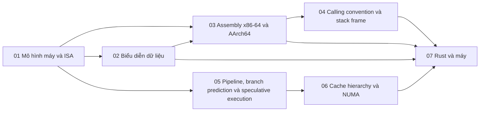

# P2 · Tổng quan — Kiến trúc CPU và assembly

> Trang này chỉ điều hướng: mục tiêu, bản đồ chương, thứ tự đọc, sách gốc và câu hỏi tổng hợp. Mọi khẳng định kỹ thuật có chú thích nằm trong từng chương; các lời khuyên về thứ tự đọc là của người soạn.

## Mục tiêu của phase

Phase này cho bạn mô hình máy đủ để đọc được assembly do `rustc` sinh ra: ISA, thanh ghi, biểu diễn dữ liệu, calling convention, pipeline và cache. Mục tiêu không phải viết assembly mà là hiểu vì sao cùng một đoạn Rust chạy nhanh hay chậm, vì sao có bounds check, false sharing, branch misprediction. Phase này cũng là nền cho ABI và layout ở P10.

## Bản đồ chương

Mũi tên nghĩa là chương đích dùng khái niệm của chương nguồn (nhận xét của người soạn về thứ tự học).

## Các chương

| Chương | Nội dung chính |
|---|---|
| [01 — Mô hình máy và ISA](01-mo-hinh-may-va-isa.md) | Mô hình von Neumann; ISA vs microarchitecture; thanh ghi; fetch-decode-execute; CISC vs RISC, load/store; x86-64 vs AArch64; mức đặc quyền. |
| [02 — Biểu diễn dữ liệu](02-bieu-dien-du-lieu.md) | Dãy bit và kiểu; two's complement và `as`; tràn số debug/release, `wrapping_*`/`checked_*`; endianness và network byte order; `f64`, NaN, vì sao `0.1 + 0.2 != 0.3`; UTF-8, `char`/`str`. |
| [03 — Assembly x86-64 và AArch64](03-assembly-x86-64-va-aarch64.md) | Cú pháp AT&T vs Intel; `rax/eax/ax/al` và `x0/w0`; thứ tự toán hạng, load/store, addressing mode; cờ điều kiện, `cmp` + nhảy, `cmov`/`csel`; `if`/`while`/`for`/`match` thành nhánh; `call`/`bl`/`ret`; đọc `--emit=asm`. |
| [04 — Calling convention và stack frame](04-calling-convention-va-stack-frame.md) | ABI vs API; System V AMD64: tham số, giá trị trả về; caller-/callee-saved; căn stack 16 byte, red zone; AAPCS64; prologue/epilogue, frame pointer; tail call; `extern "Rust"` vs `extern "C"`. |
| [05 — Pipeline, branch prediction và speculative execution](05-pipeline-va-speculation.md) | Pipeline: throughput vs latency; hazard, forwarding, stall, flush; branch prediction; superscalar, out-of-order, register renaming; speculative execution, Spectre/Meltdown; phòng thủ của kernel; branch khó đoán; `black_box`, `#[cold]`. |
| [06 — Cache hierarchy và NUMA](06-cache-va-numa.md) | Hệ phân cấp bộ nhớ và độ trễ; temporal/spatial locality, cache line; direct-mapped vs set-associative; replacement, write-through vs write-back; coherence/MESI; false sharing; prefetching; NUMA. |
| [07 — Rust và máy](07-rust-va-may.md) | Xem mã máy `rustc`, `opt-level`; `#[inline]`; bounds check của `v[i]`, `get_unchecked`; `target-cpu`/`target_feature`; `std::arch`, `asm!`; `black_box` trong benchmark; false sharing và `repr(align)`/`CachePadded`. |

## Thứ tự đọc

Đọc 01 → 07 theo số. Nếu đã quen assembly, đọc 01 và 02 nhanh rồi vào 04; chương 05 và 06 độc lập với 03–04 nên có thể đọc trước 03 nếu bạn quan tâm hiệu năng hơn ABI (nhận xét của người soạn). Chương 07 đọc cuối vì nó gom cả phase vào công cụ của Rust.

## Lộ trình đọc sách gốc

Các nguồn dưới đây đều là nguồn mà chương của phase đã dùng; mở đọc song song với chương tương ứng. Không bắt buộc: chương đã tự chứa phần cần thiết.

- [Dive Into Systems — Computer Architecture (ch.5)](https://diveintosystems.org/book/C5-Arch/index.html) — chương 01, 05.
- [Dive Into Systems — Assembly x86-64 (ch.7)](https://diveintosystems.org/book/C7-x86_64/basics.html) — chương 03, 04.
- [Dive Into Systems — Assembly ARM64 (ch.9)](https://diveintosystems.org/book/C9-ARM64/basics.html) — chương 03, 04.
- [Dive Into Systems — Storage and the Memory Hierarchy (caching)](https://diveintosystems.org/book/C11-MemHierarchy/caching.html) — chương 06.
- [RFC 3629 — UTF-8](https://www.rfc-editor.org/rfc/rfc3629.html) — chương 02.
- [The Rust Reference — Inline assembly](https://doc.rust-lang.org/1.95.0/reference/inline-assembly.html) — chương 07.
- [rustc-dev-guide — Code generation](https://rustc-dev-guide.rust-lang.org/backend/codegen.html) — chương 07.

## Câu hỏi tổng hợp xuyên chương

Không có đáp án ở đây; mỗi câu trỏ về chương cần đọc lại.

1. Đọc assembly của một hàm Rust 3 dòng trên x86-64 và AArch64: bạn nhận ra bounds check, overflow check và quy ước truyền tham số ở đâu? ([chương 03](03-assembly-x86-64-va-aarch64.md), [chương 04](04-calling-convention-va-stack-frame.md), [chương 07](07-rust-va-may.md)).
2. `u8` và `i8` cộng nhau có khác nhau trong phần cứng không, và Rust xử lý tràn số khác nhau thế nào giữa debug và release? ([chương 02](02-bieu-dien-du-lieu.md), [chương 07](07-rust-va-may.md)).
3. Hai atomic nằm cạnh nhau làm chương trình chậm đi: cache line, MESI và `repr(align)` nối với nhau ra sao? ([chương 06](06-cache-va-numa.md), [chương 07](07-rust-va-may.md)).
4. Vì sao `extern "C"` có ABI ổn định còn `extern "Rust"` thì không, và điều đó ảnh hưởng gì khi gọi qua ranh giới FFI? ([chương 04](04-calling-convention-va-stack-frame.md)).
5. Một nhánh khó đoán làm chậm vòng lặp: pipeline, branch prediction và speculative execution giải thích điều đó thế nào, và Spectre liên quan gì? ([chương 05](05-pipeline-va-speculation.md)).
6. Gửi một số nguyên qua mạng: endianness, `to_be_bytes` và "network byte order" khớp với biểu diễn trong bộ nhớ thế nào? ([chương 02](02-bieu-dien-du-lieu.md)).
7. CPU có mức đặc quyền, kernel dựa vào đó để làm gì, và điều này nối với system call ở P1 ra sao? ([chương 01](01-mo-hinh-may-va-isa.md)).

## Lab

Làm sau khi đã đọc lý thuyết:

- [Lab P2 — CPU: asm, calling convention, branch, cache, endianness](../labs/02-cpu-lab.md)
