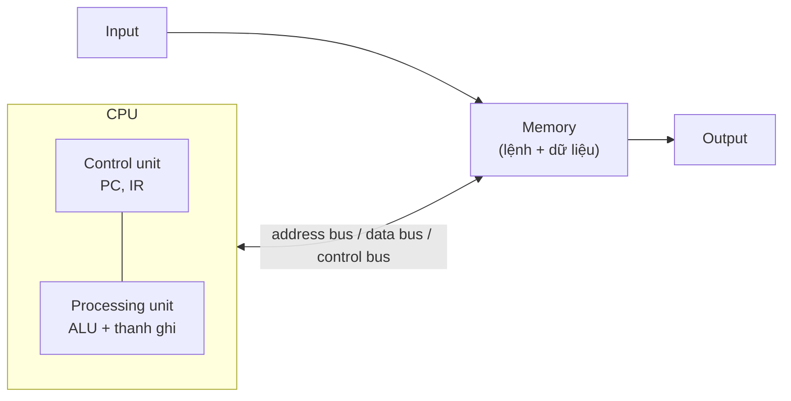
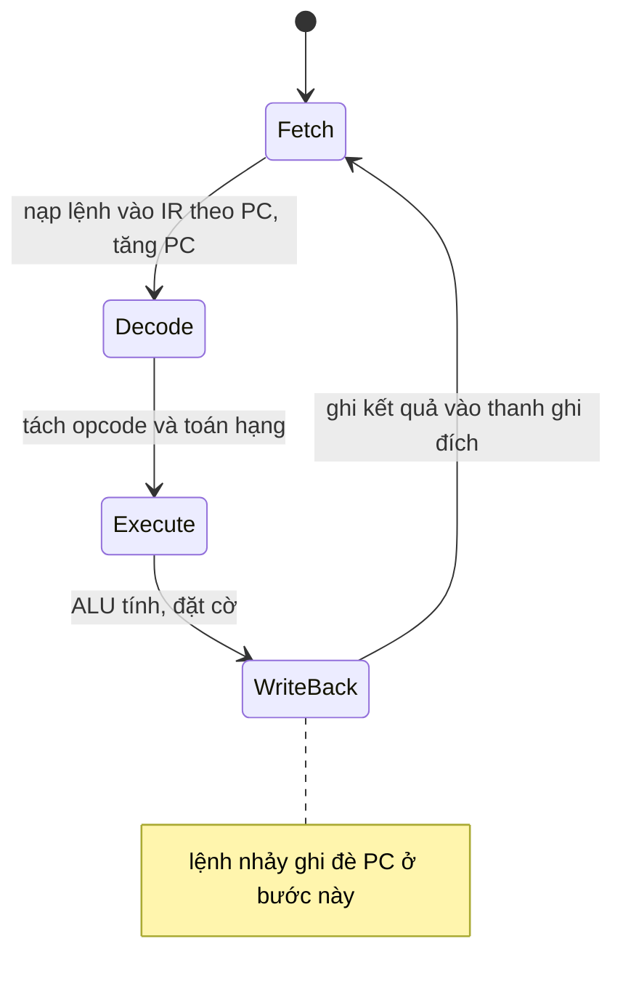

# P2 · Chương 01 — Mô hình máy và ISA

## Bạn sẽ hiểu được gì

- **Q1.** Một máy tính theo mô hình von Neumann gồm những khối nào, và vì sao câu "lệnh cũng là dữ liệu" quan trọng đến vậy? → mục 1
- **Q2.** ISA khác microarchitecture ở chỗ nào, và vì sao hai CPU của hai hãng khác nhau có thể chạy cùng một chương trình nhị phân? → mục 2
- **Q3.** Thanh ghi là gì; thanh ghi đa dụng, PC/IP, SP và thanh ghi cờ (flags) mỗi loại làm việc gì? → mục 3
- **Q4.** CPU thực thi một lệnh qua những bước nào (fetch → decode → execute → write-back), và lệnh nhảy thay đổi quy trình đó ra sao? → mục 4
- **Q5.** CISC và RISC khác nhau ở những trục nào; "load/store architecture" nghĩa là gì? → mục 5
- **Q6.** x86-64 và AArch64 khác nhau thế nào về số thanh ghi, độ dài lệnh, cách truy cập bộ nhớ — và khác trên một hàm Rust 3 dòng cụ thể ra sao? → mục 6
- **Q7.** "Mức đặc quyền" (privilege level) của CPU nằm ở đâu trong mô hình máy và liên hệ gì với kernel? → mục 7

## Kiến thức cần trước

- Bạn viết được service backend ở mức senior (biến, con trỏ/tham chiếu, hàm), nhưng chưa cần biết assembly.
- Ví dụ xuyên suốt chương là `orders`, service Rust giả định đã gặp ở Phase 1: nó nhận request, cộng dồn doanh thu, được build thành container image và chạy trên node Kubernetes (nhận xét của người soạn: đây là ví dụ giả định, không phải code trong repo). Mỗi mục bắt đầu bằng việc chương đó của CPU đụng vào `orders` ở chỗ nào.
- Mức đặc quyền chỉ nhắc ngắn ở mục 7; phần user mode / kernel mode đầy đủ nằm ở [Phase 1, Chương 01 — OS và kernel, mục 3](../01-linux/01-os-va-kernel.md).

## 1. Mô hình von Neumann (Q1)

> **Trả lời ngắn.** Máy gồm năm khối: xử lý, điều khiển, nhớ, nhập và xuất; hai khối xử lý và điều khiển hợp lại thành CPU.[^von-cpu] Bộ nhớ giữ cả dữ liệu lẫn lệnh của chương trình,[^von-mem] và trong mô hình này lệnh *là* dữ liệu.[^von-instrdata] Vì vậy một chương trình chẳng qua là nội dung nằm trong bộ nhớ, còn đơn vị điều khiển nạp từng lệnh ra để chạy.[^von-pcir]

**Giải thích.**

*Với service `orders`.* Khi bạn chạy `./orders`, file thực thi đang nằm trên ổ đĩa. Hệ điều hành nạp nó vào bộ nhớ, và lúc đó ổ đĩa đóng vai thiết bị nhập.[^von-exe] Từ đó CPU chỉ làm đi làm lại một việc: lấy một lệnh của `orders` từ bộ nhớ, thực hiện, rồi lấy lệnh kế tiếp. Mục này vẽ ra các khối đứng sau câu mô tả đó, và giải thích vì sao việc lệnh cũng là dữ liệu lại quan trọng.

### 1.1 Năm khối và bus

Khối xử lý (processing unit) tính toán. Khối điều khiển (control unit) điều khiển việc chạy lệnh trên khối xử lý, và hai khối này hợp lại là **CPU**.[^von-cpu] Khối nhớ (memory unit) giữ dữ liệu và lệnh. Cuối cùng là khối nhập (input) và khối xuất (output): khối nhập đưa dữ liệu, lệnh vào máy rồi khởi động việc chạy chương trình, khối xuất lưu hoặc nhận kết quả.[^von-io]

Các khối nói chuyện với nhau qua **bus**, tức kênh truyền các giá trị nhị phân giữa bên gửi và bên nhận.[^von-busdef] Thông thường có bus riêng cho dữ liệu, cho địa chỉ bộ nhớ và cho tín hiệu điều khiển.[^von-bus]



(Sơ đồ rút gọn của người soạn: sách chỉ nói các khối nối với nhau bằng bus; chiều mũi tên nhập → bộ nhớ → xuất là cách vẽ cho gọn.)

### 1.2 Bên trong CPU

Khối xử lý gồm hai phần. Phần thứ nhất là **ALU** (arithmetic/logic unit), làm các phép toán số học và logic như cộng, trừ, OR. Phần thứ hai là một tập **thanh ghi** (register), những ô lưu trữ nhỏ và nhanh giữ dữ liệu cùng lệnh mà ALU đang xử lý.[^von-alu]

Khối điều khiển nạp lệnh từ bộ nhớ rồi đưa toán hạng và phép toán qua khối xử lý. Nó giữ hai thanh ghi đặc biệt: **program counter (PC)** chứa địa chỉ bộ nhớ của lệnh kế tiếp cần chạy, còn **instruction register (IR)** chứa lệnh vừa nạp và đang được thực thi.[^von-pcir]

### 1.3 Lệnh cũng là dữ liệu

Trong mô hình này không có ranh giới giữa lệnh và dữ liệu: xét cho mọi mục đích, lệnh *là* dữ liệu.[^von-instrdata] Việc lưu lệnh của chương trình ngay trong bộ nhớ là điểm then chốt của mô hình stored-program (chương trình lưu trong bộ nhớ).[^von-mem] Với `orders`, hệ quả là muốn đổi hành vi của service bạn chỉ cần đổi nội dung bộ nhớ, tức nạp một binary khác, chứ không phải đổi mạch (nhận xét của người soạn). Cũng vì thế, "đâu là lệnh" do cách CPU *dùng* một vùng nhớ quyết định, không do vùng nhớ mang nhãn (suy luận của người soạn).

### 1.4 Địa chỉ và word size

Bộ nhớ đánh địa chỉ theo byte: trong các hệ thống hiện đại, đơn vị nhớ nhỏ nhất có địa chỉ là một byte (8 bit), và mỗi địa chỉ ứng với một vị trí lưu đúng một byte.[^von-byte] ISA giới hạn dải địa chỉ mà máy biểu diễn được,[^von-addr] chẳng hạn kiến trúc 32 bit thường hỗ trợ không gian địa chỉ tối đa $2^{32}$ byte, tức 4 GiB.[^von-addr32] Còn **word size** là số bit của kích thước dữ liệu chuẩn mà bộ xử lý xử lý như một đơn vị, và do ISA định nghĩa.[^von-word] Hệ phân cấp lưu trữ nằm ở [Chương 06 — Cache và NUMA](06-cache-va-numa.md).

<details><summary>Đi sâu: chu trình ở mức bus theo sách, và giới hạn của mô hình</summary>

Năm khối phối hợp thành chu trình *fetch–decode–execute–store*: bắt đầu từ lệnh đầu tiên của chương trình, rồi lặp lại cho đến khi chương trình thoát.[^von-cycle] Ở bước nạp lệnh, khối điều khiển đặt địa chỉ trong PC lên address bus và gửi lệnh đọc qua control bus; khối nhớ đọc các byte tại địa chỉ đó rồi gửi về qua data bus.[^von-fetchbus] Ở bước cuối, khối điều khiển ghi kết quả vào bộ nhớ: giá trị đặt lên data bus, địa chỉ lên address bus, lệnh ghi lên control bus.[^von-store] Mục 4 dùng cách chia bốn pha *Fetch, Decode, Execute, WriteBack* của §5.6 trong cùng cuốn sách. Ở đó ví dụ ADD ghi kết quả vào thanh ghi đích, còn ở đây nói chung là ghi vào bộ nhớ, nên hãy đọc hai mô tả như hai mức chi tiết của cùng một chu trình (nhận xét của người soạn).

Mọi bộ xử lý hiện đại, bất kể ISA, đều theo mô hình này.[^von-all] Tuy vậy, pipeline (Chương 05) làm việc thực thi thực tế khác xa vòng lặp tuần tự ở mục 4 (nhận xét của người soạn). Mô hình cho bạn bức tranh đúng về *ý nghĩa* của chương trình, không phải về cách mạch làm.

</details>

**Quay lại Q1:** máy có năm khối, CPU là xử lý cộng điều khiển, và vì lệnh nằm trong bộ nhớ như dữ liệu nên "chương trình" chỉ là nội dung bộ nhớ mà CPU nạp ra chạy; với `orders`, binary từ đĩa được nạp vào RAM rồi CPU lấy từng lệnh ra chạy.

## 2. ISA và microarchitecture (Q2)

> **Trả lời ngắn.** ISA là "hợp đồng" giữa phần mềm và CPU, gồm tập lệnh, mã hóa nhị phân của chúng, tập thanh ghi và tác dụng của từng lệnh lên trạng thái CPU.[^isa-def] Microarchitecture là mạch điện của một bản cài đặt cụ thể, và các bản cài đặt có thể khác nhau miễn là cùng đúng định nghĩa ISA.[^uarch] Chương trình nhị phân nhắm vào ISA chứ không nhắm vào mạch điện cụ thể, nên hai chip khác hãng nhưng cùng ISA chạy được cùng một binary (suy luận của người soạn; còn điều kiện về hệ điều hành và các phần mở rộng tùy chọn của ISA).

**Giải thích.**

*Với service `orders`.* Giả sử CI build `orders` thành container image ngay trên laptop Apple Silicon, rồi bạn deploy lên node Kubernetes chạy x86-64. Image đó chạy được hay không, và một node Intel với một node AMD có chạy chung image được không: cả hai câu hỏi đều xoay quanh việc binary nhắm vào ISA nào. Mục này tách ISA ra khỏi mạch điện để trả lời.

### 2.1 ISA là hợp đồng, microarchitecture là cách thực hiện

Mỗi CPU cài đặt một **instruction set architecture (ISA)**. ISA cho biết CPU có những lệnh nào và mã hóa nhị phân của chúng ra sao, CPU có những thanh ghi nào, và chạy một lệnh thì trạng thái bộ xử lý đổi thế nào.[^isa-def] **Microarchitecture** là mạch điện của một bản cài đặt cụ thể của ISA đó. Nhiều microarchitecture có thể khác nhau miễn là cùng cài đặt đúng định nghĩa ISA; chẳng hạn Intel và AMD sản xuất những vi xử lý khác nhau cho cùng ISA IA32.[^uarch]

Ranh giới trên thực tế nằm ở chỗ này (nhận xét của người soạn). Số thanh ghi *kiến trúc*, tức những thanh ghi mà lệnh gọi được tên như `rax` hay `x0`, thuộc ISA. Độ sâu pipeline, kích thước cache và số thanh ghi vật lý bên dưới thì thuộc cài đặt (Chương 05, mục 4 và Chương 06).

### 2.2 Vì sao image build trên Mac có thể không chạy trên node

Cùng ISA thì cùng binary: một binary x86-64 chạy được trên cả Intel lẫn AMD vì hai hãng cài đặt cùng ISA (suy luận của người soạn từ định nghĩa trên). Điều kiện kèm theo là cùng hệ điều hành/ABI, và chip có đủ các phần mở rộng tùy chọn mà binary dùng (xem Chương 07, mục 4).

Khác ISA thì không: ta không chạy trực tiếp binary ARM trên hệ x86, chỉ giả lập được bằng QEMU.[^arm-noexec] Chiều ngược lại cũng vậy (suy luận của người soạn). Vì thế image build trên laptop Apple Silicon (AArch64) có thể không chạy thẳng trên node x86-64 (nhận xét của người soạn), nên trước khi build image hãy xem node của cluster dùng kiến trúc nào.

<details><summary>Đi sâu: lịch sử x86, tương thích ngược và độ tin cậy của nguồn</summary>

x86-64 là phần mở rộng của x86 32 bit, bản thân x86 32 bit lại mở rộng từ một phiên bản 16 bit trước đó, nên ISA cho truy cập phần thấp 32/16/8 bit của mỗi thanh ghi.[^x86-ext] Intel ghi rõ lý do: nửa thấp của mỗi thanh ghi 32 bit của Intel386 giữ nguyên tính chất của thanh ghi 16 bit thế hệ trước, để tương thích ngược.[^sdm-386] Kết quả là `eax` và `ax` là các phần của `rax`.[^dis-x86-sub] ARM đi hướng ngược lại: A64 được mô tả là tập lệnh thiết kế "từ đầu".[^arm-clean] Khả năng chạy mã ARMv7-A cũ được giữ ở mức trạng thái thực thi: ARMv8 có hai trạng thái, AArch32 (tập lệnh A32/T32) và AArch64 (tập lệnh A64 mới).[^arm-aarch32]

Về nguồn: Intel SDM ở đây là bản *hiện hành* (Order Number 325462-093US, 09/2026), không ghim, nên số mục có thể đổi. Tài liệu Arm là white paper của Chris Shore (07/2014), không phải đặc tả; chi tiết cần chính xác thì phải tra Arm Architecture Reference Manual.

</details>

**Quay lại Q2:** ISA là hợp đồng mà phần mềm nhìn thấy, microarchitecture là cách mạch thực hiện hợp đồng đó; hai chip cùng ISA chạy chung binary, hai chip khác ISA thì không, nên image `orders` build trên Mac M-series không tự chạy được trên node x86-64.

## 3. Thanh ghi (Q3)

> **Trả lời ngắn.** Thanh ghi là ô lưu trữ nhỏ, nhanh, nằm ngay trong CPU, giữ dữ liệu mà ALU đang xử lý.[^von-alu] Có bốn họ cần phân biệt: thanh ghi đa dụng (chứa số nguyên hoặc địa chỉ), con trỏ lệnh PC/IP (địa chỉ lệnh kế tiếp), con trỏ stack SP (đỉnh stack) và cờ (ghi lại tính chất của kết quả phép toán, để lệnh sau dùng mà chọn hành động).[^cc]

**Giải thích.**

*Với service `orders`.* Handler của `orders` cộng giá các dòng hàng thành tổng tiền của đơn, và trong lúc cộng thì `total` với giá của dòng hàng đang xét phải nằm ở đâu đó để CPU lấy ra tính. Chỗ đó là thanh ghi, những ô lưu trữ đặt thẳng trên CPU,[^dis-reg-def] nhanh hơn RAM nhiều (chênh lệch tốc độ: Chương 06). Mỗi thanh ghi chứa được một word, tức một đơn vị dữ liệu chuẩn của CPU.[^von-regword] Mục này kể tên các loại thanh ghi và việc của từng loại.

### 3.1 Bốn họ thanh ghi

| Họ | Vai trò | x86-64 | AArch64 |
|---|---|---|---|
| Đa dụng (general-purpose) | Chứa số nguyên hoặc địa chỉ; bản thân thanh ghi không phân biệt hai loại đó | 16 thanh ghi 64 bit (gồm cả `rsp`) | 31 thanh ghi 64 bit `x0`–`x30`; `sp` và thanh ghi zero tách riêng |
| Con trỏ lệnh (PC / IP) | Địa chỉ lệnh kế tiếp | `rip` | `pc` |
| Con trỏ stack (SP) | Đỉnh stack của chương trình | `rsp` | `sp` |
| Cờ / mã điều kiện (flags) | Ghi lại tính chất kết quả phép toán | `RFLAGS` | cờ điều kiện NZCV (xem đoạn *Cờ trên AArch64* trong phần Đi sâu) |

(Mỗi ô của bảng được chú thích ở các đoạn ngay dưới.)

### 3.2 Đa dụng, PC và SP

Thanh ghi đa dụng chứa số nguyên hoặc địa chỉ, và bản thân thanh ghi không phân biệt hai loại đó: chương trình muốn xem nội dung là gì cũng được, và đọc ghi được mọi thanh ghi loại này. Trên x86-64, CPU Intel có 16 thanh ghi chứa dữ liệu 64 bit, đọc ghi được cả 16.[^dis-x86-regs] Trên AArch64, CPU ARMv8 có 31 thanh ghi chứa dữ liệu 64 bit là `x0`…`x30`, cũng đọc ghi được tất cả.[^dis-arm-regs] Ngoài 31 thanh ghi đó, ISA còn có các thanh ghi đặc biệt như `sp` và `pc`,[^dis-arm-special] và một thanh ghi zero luôn chứa 0.[^dis-arm-zr]

PC (hay IP) giữ địa chỉ lệnh kế tiếp. Trên x86-64 đó là `%rip` (instruction pointer, còn gọi là PC), và chương trình không ghi trực tiếp vào nó.[^dis-rip] Trên AArch64 `pc` cũng vậy.[^dis-arm-pc] Giá trị của PC chỉ đổi gián tiếp, qua lệnh nhảy hoặc gọi hàm (mục 4).

SP giữ đỉnh stack. Trình biên dịch dành `rsp` (x86-64, cùng với frame pointer `rbp`) để duy trì bố cục stack của chương trình, và `%rsp` luôn trỏ tới đỉnh stack.[^dis-rsp] AArch64 dành `sp` cho đúng việc đó.[^dis-arm-sp] Stack làm gì và frame được bố trí ra sao là nội dung Chương 04.

### 3.3 Cờ: cách `if` đọc kết quả phép toán

Mỗi khi ALU làm một phép toán, ngoài kết quả nó còn xuất ra các **condition code** mô tả kết quả đó: âm hay không, bằng 0 hay không, có carry-out hay không.[^cc-def] Lệnh đứng sau có thể dựa vào các mã này để chọn hành động.[^cc] Trên x86, các cờ trạng thái nằm trong thanh ghi EFLAGS,[^sdm-status] thanh ghi này được mở rộng thành 64 bit và gọi là RFLAGS ở chế độ 64 bit.[^sdm-rflags] Chẳng hạn ZF (zero flag) được đặt nếu kết quả bằng 0,[^sdm-zf] và các lệnh `Jcc` (nhảy theo điều kiện), `SETcc`, `LOOPcc`, `CMOVcc` dùng một hoặc nhiều cờ trạng thái làm mã điều kiện.[^sdm-jcc]

Đó cũng là cách một `if (x + 8 != 0)` trở thành "cộng rồi nhìn cờ": lệnh ADD tính `x + 8` và đặt cờ theo kết quả, rồi một lệnh nhảy có điều kiện đứng sau kiểm tra các bit đó để quyết định nhảy hay không.[^cc-if]

<details><summary>Đi sâu: 16 so với 31, thanh ghi con, PC/SP/zero trên AArch64, thực thi có điều kiện</summary>

**Số thanh ghi đa dụng.** Ở chế độ 64 bit, x86 có 16 thanh ghi đa dụng và kích thước toán hạng mặc định là 32 bit,[^sdm16] nhưng thanh ghi làm việc được với cả toán hạng 32 bit lẫn 64 bit.[^sdm-opsize] Tám trong 16 thanh ghi đó (`R8`–`R15`) là tám thanh ghi đa dụng *mới* của chế độ 64 bit.[^sdm-r8] Cần lưu ý 16 thanh ghi của Intel gồm cả `RSP`,[^sdm-rsp-in16] còn 31 thanh ghi của AArch64 không tính `sp` và thanh ghi zero,[^dis-arm-special] nên "16 so với 31" chưa cùng đơn vị.

Tài liệu của ARM (white paper 2014) mô tả 31 thanh ghi ấy: mỗi thanh ghi dùng được như `Xn` 64 bit hoặc `Wn` 32 bit chỉ tác động nửa thấp, và có thêm một thanh ghi zero riêng.[^arm-31] Nhiều thanh ghi hơn nghĩa là trình biên dịch ít phải "tràn" (spill) biến ra stack hơn; tài liệu ARM liệt kê đó là lợi ích rõ rệt của việc tăng số lượng và bề rộng thanh ghi.[^arm-spill] Tài liệu nói điều này khi bàn về việc chuyển từ ARM 32 bit sang 64 bit chứ không so với x86-64 (suy luận của người soạn từ ngữ cảnh).

**Thanh ghi con (sub-register).** Cả hai ISA cho truy cập nửa thấp của thanh ghi 64 bit, để xử lý kiểu `int` 32 bit. Trên x86-64, nửa thấp 32 bit của `rax` là `eax`, 16 bit thấp là `ax`.[^dis-x86-sub] Trên AArch64, nửa thấp của `x0` là `w0`.[^dis-arm-sub]

Có một chi tiết hay gây bất ngờ mà hai ISA **giống nhau**: ghi vào thanh ghi con 32 bit sẽ *xóa* nửa cao. Trên x86-64, kết quả của toán hạng 32 bit được zero-extend lên 64 bit trong thanh ghi đích;[^sdm-zext] trên AArch64, nếu ghi như một word 32 bit thì nửa cao của thanh ghi bị xóa.[^arm-zero-upper] Toán hạng 8 và 16 bit trên x86-64 thì khác: phần cao của thanh ghi đích không bị sửa.[^sdm-8-16] (Chương 03, mục 2 trình bày kỹ hơn, kèm tên các thanh ghi con.)

**PC trên AArch64.** PC không còn truy cập tổng quát được như thanh ghi đa dụng: bạn không đọc hay sửa nó như các thanh ghi khác, mà dùng các pseudo-instruction để dùng nó gián tiếp (ví dụ sinh địa chỉ tương đối theo PC).[^arm-pc]

**SP và thanh ghi zero trên AArch64.** SP và thanh ghi zero cùng được mã hóa bằng "thanh ghi lõi số 31", và chỉ một số ít lệnh hiểu mã này là SP, phần còn lại coi nó là thanh ghi zero.[^arm-r31] Thanh ghi zero (sách viết là `zr`; tên đầy đủ `xzr`/`wzr` xem Chương 03, mục 2) luôn đọc ra 0. *Dive into Systems* nói nó chỉ có ích làm toán hạng nguồn,[^dis-arm-zr] còn Arm white paper nói ghi vào nó bị bỏ qua, nên lệnh CMP có thể mã hóa thành SUB với thanh ghi zero làm đích.[^arm-zr] Vì vậy câu "chỉ làm toán hạng nguồn" của sách chưa tính cách dùng làm đích để bỏ kết quả (nhận xét của người soạn).

**Cờ trên AArch64.** AArch64 cũng có mã điều kiện: CPSR của A32 được thay bằng các trường có tên trong PSTATE,[^arm-pstate] và tài liệu nhắc tới các cờ điều kiện lõi `NZCV`.[^arm-nzcv] A64 không hỗ trợ thực thi có điều kiện cho từng lệnh riêng lẻ như tập lệnh ARM cũ. Thay vào đó nó có các lệnh mà hành vi phụ thuộc cờ, như `CSINC`, kết hợp với đầy đủ các lệnh nhảy có điều kiện.[^arm-nocond]

</details>

**Quay lại Q3:** thanh ghi là bộ nhớ nhỏ, nhanh trong CPU; đa dụng giữ giá trị đang tính (như `total` của `orders`), PC giữ địa chỉ lệnh kế, SP giữ đỉnh stack, cờ giữ tính chất của kết quả vừa tính.

## 4. Chu trình fetch–decode–execute (Q4)

> **Trả lời ngắn.** Đa số kiến trúc chia việc thực thi một lệnh thành các pha Fetch (nạp lệnh từ bộ nhớ vào IR theo địa chỉ trong PC), Decode (tách opcode và toán hạng), Execute (ALU tính) và WriteBack (ghi kết quả vào thanh ghi đích).[^fde] Lệnh nhảy chỉ làm PC chứa một địa chỉ khác, nên lệnh kế tiếp được nạp từ chỗ mới.[^jump]

**Giải thích.**

*Với service `orders`.* Giả sử handler có vòng `for item in &order.items { total += item.price }`. Ở mức CPU, vòng đó chỉ là vài lệnh lặp lại: lấy giá, cộng vào tổng, giảm biến đếm, rồi nhảy ngược về đầu vòng nếu chưa hết (nhận xét của người soạn). Mục này xem CPU chạy từng lệnh như vậy qua những bước nào, và "nhảy ngược" nghĩa là gì ở mức phần cứng.

### 4.1 Bốn pha của một lệnh

Mỗi kiến trúc chia việc thực thi một lệnh một kiểu, nhưng đa số có các pha Fetch, Decode, Execute và WriteBack trong bốn pha rời rạc trở lên.[^fde] Dưới đây là từng pha, theo ví dụ lệnh ADD ba thanh ghi (cộng hai thanh ghi nguồn, ghi vào thanh ghi đích):

1. **Fetch.** CPU nạp lệnh kế tiếp từ bộ nhớ vào thanh ghi lệnh IR, theo địa chỉ đang nằm trong PC.[^fetch] Ngay trong pha này PC được tăng để chứa địa chỉ của lệnh liền sau.[^pcinc]
2. **Decode.** CPU tách các bit của lệnh trong IR thành từng phần: các bit cao mã hóa opcode (phép toán cần làm), các bit còn lại chỉ ra nguồn của toán hạng và đích của kết quả.[^decode]
3. **Execute.** ALU làm phép toán trên các giá trị lấy từ thanh ghi nguồn, và đồng thời cho ra các condition code.[^exec]
4. **WriteBack.** Kết quả của ALU được ghi vào thanh ghi đích.[^wb]



(Sơ đồ của người soạn theo mô tả ở §5.6 của sách; ghi chú ở WriteBack theo câu của sách rằng giá trị PC cũng có thể đổi trong pha WriteBack.[^jump])

### 4.2 Lệnh nhảy và PC

PC tăng bao nhiêu thì tùy độ dài lệnh. Nếu mọi lệnh dài 32 bit thì sau mỗi lần fetch PC được cộng 4, vì mỗi byte có một địa chỉ riêng;[^pcinc4] còn kích thước thực tế thay đổi theo kiến trúc và loại lệnh.[^pcsize]

**Lệnh nhảy** làm PC chứa một địa chỉ khác, và PC có thể đổi ngay ở pha WriteBack.[^jump] Chẳng hạn để nhảy qua thân `if`, CPU ghi địa chỉ của lệnh đầu tiên sau thân `if` vào PC.[^pcwrite] Vòng `for` của `orders` làm điều tương tự theo chiều ngược lại: lệnh cuối vòng ghi địa chỉ đầu vòng vào PC (nhận xét của người soạn). Tóm lại `for`, `if`, `while` và lời gọi hàm đều hạ xuống thành "ghi giá trị mới vào PC, có điều kiện hoặc không" (suy luận của người soạn).

### 4.3 Clock và CPI

Cuối cùng là nhịp. Một clock điều khiển việc thực thi lệnh, mỗi pha bắt đầu theo nhịp của nó.[^clockdrive] Tốc độ clock là ước lượng số lệnh tối đa mỗi giây CPU thực thi được,[^clock] nhưng riêng nó không phải thước đo có ý nghĩa khi so sánh các bộ xử lý khác nhau.[^clock-warn] Thước đo tốt hơn là CPI (cycles per instruction): số chu kỳ trung bình mỗi lệnh, đo trên toàn bộ lần chạy của chương trình.[^cpi]

Vì mỗi pha tốn một chu kỳ clock, một CPU có chuỗi thực thi bốn pha như trên hoàn tất tối đa một lệnh mỗi bốn chu kỳ.[^four-cycles] (Chương 05, mục 1 cho thấy pipeline kéo con số này xuống gần một lệnh mỗi chu kỳ.) Vì vậy "CPU 3 GHz" không có nghĩa là "3 tỷ lệnh Rust mỗi giây", và con số GHz của node chưa đủ để nói `orders` sẽ chạy nhanh hay chậm (nhận xét của người soạn).

<details><summary>Đi sâu: CPU đồ chơi bằng Rust (đã chạy thật)</summary>

Máy giả lập có 4 thanh ghi, lệnh 4 byte dạng `opcode | rd | rs | imm`, chạy chương trình cộng 5+4+3+2+1, cũng là vòng lặp cộng dồn như ở đầu mục. Chương trình đã biên dịch và chạy bằng rustc 1.95.0.

```rust
// Máy giả lập: 4 thanh ghi, lệnh 32 bit = opcode(8) | rd(8) | rs(8) | imm(8)
const LOADI: u8 = 1; // rd = imm
const ADD: u8 = 2;   // rd = rd + rs
const DEC: u8 = 3;   // rd = rd - 1, đặt cờ Z
const JNZ: u8 = 4;   // nếu Z == 0 thì pc = imm (chỉ số lệnh)
const HALT: u8 = 0;

fn main() {
    // Bộ nhớ chứa chương trình (lệnh là dữ liệu): tính 5+4+3+2+1
    let prog: [[u8; 4]; 6] = [
        [LOADI, 0, 0, 0], // r0 = 0 (tổng)
        [LOADI, 1, 0, 5], // r1 = 5 (đếm)
        [ADD, 0, 1, 0],   // r0 += r1      <- đích nhảy (chỉ số 2)
        [DEC, 1, 0, 0],   // r1 -= 1
        [JNZ, 0, 0, 2],   // lặp nếu r1 != 0
        [HALT, 0, 0, 0],
    ];
    let mut r = [0u32; 4];
    let (mut pc, mut z, mut steps) = (0usize, false, 0);
    loop {
        let ir = prog[pc];                 // FETCH
        pc += 1;                           // PC trỏ tới lệnh kế
        let [op, rd, rs, imm] = ir;        // DECODE
        steps += 1;
        match op {                         // EXECUTE + WRITE-BACK
            LOADI => r[rd as usize] = imm as u32,
            ADD => r[rd as usize] += r[rs as usize],
            DEC => { r[rd as usize] -= 1; z = r[rd as usize] == 0; }
            JNZ => if !z { pc = imm as usize },
            _ => break,
        }
    }
    println!("r0={} r1={} pc={} steps={}", r[0], r[1], pc, steps);
}
```

Kết quả khi chạy: `r0=15 r1=0 pc=6 steps=18` (2 `LOADI` + 5 vòng × 3 lệnh + 1 `HALT` = 18). Chú ý: `prog` là *dữ liệu*; `JNZ` chỉ là phép gán vào `pc`; cờ `z` do `DEC` đặt và `JNZ` đọc. CPU thật là mạch, không phải `match`, và thực thi chồng lấn chứ không tuần tự — nội dung Chương 05 (ở đây là nhận xét của người soạn).

</details>

**Quay lại Q4:** mỗi lệnh được nạp (theo PC), giải mã, thực thi và ghi kết quả; lệnh nhảy chỉ là lệnh ghi địa chỉ mới vào PC, và vòng `for` của `orders` cũng vậy.

## 5. CISC và RISC (Q5)

> **Trả lời ngắn.** RISC có tập lệnh cơ bản nhỏ, mỗi lệnh chạy nhanh, khoảng một chu kỳ clock.[^risc] CISC có tập lệnh lớn hơn, lệnh cấp cao hơn, chế độ địa chỉ phức tạp hơn và lệnh có độ dài thay đổi.[^cisc] "Load/store" là kiểu máy mà dữ liệu phải nằm trong thanh ghi mới tính được, như AArch64.[^dis-arm-ls]

**Giải thích.**

*Với service `orders`.* Cùng một mã nguồn Rust của `orders`, build cho x86-64 và build cho AArch64 sẽ ra hai binary với hai chuỗi lệnh khác nhau (ví dụ cụ thể ở mục 6). Hai ISA đó đại diện cho hai trường phái thiết kế, và mục này nói trường phái nào chọn gì.

### 5.1 Hai trường phái

**RISC** (reduced instruction set computer) có một tập lệnh cơ bản nhỏ, mỗi lệnh chạy nhanh, khoảng một chu kỳ clock, và trình biên dịch ghép nhiều lệnh cơ bản lại để làm việc cấp cao hơn.[^risc] **CISC** thì ngược lại: lệnh mang chức năng cấp cao hơn, tập lệnh lớn hơn, addressing mode (cách diễn đạt vị trí bộ nhớ của dữ liệu) phức tạp hơn, và lệnh có độ dài thay đổi.[^cisc] Một lệnh CISC có thể làm cả một chuỗi việc mức thấp và mất nhiều chu kỳ.[^cisc2]

| Trục | RISC | CISC |
|---|---|---|
| Tập lệnh | nhỏ, lệnh đơn giản | lớn, lệnh cấp cao hơn |
| Độ dài lệnh | không bắt buộc trong định nghĩa của sách; ví dụ A64 cố định 32 bit (mục 6) | thay đổi |
| Addressing mode | đơn giản | phức tạp hơn |
| Chu kỳ mỗi lệnh | ~1 | có thể nhiều |
| Số lệnh của một chương trình | nhiều hơn | ít hơn, file thực thi thường nhỏ hơn |

Hàng cuối của bảng là một đánh đổi: chương trình CISC dùng ít lệnh hơn RISC nên file thực thi thường nhỏ hơn,[^codesize] còn RISC có nhiều lệnh hơn nhưng mỗi lệnh hiệu quả hơn, và cho phép microarchitecture đơn giản hơn.[^tradeoff]

### 5.2 Load/store

Load/store là một đặc điểm của máy kiểu RISC như AArch64: dữ liệu chỉ được tính trên thanh ghi, nên phải nạp từ bộ nhớ vào thanh ghi trước và ghi ngược lại sau khi tính xong.[^dis-arm-ls] Muốn cộng vào một ô nhớ thì phải nạp ra thanh ghi, cộng, rồi ghi lại. Ví dụ cụ thể ở mục 6.

<details><summary>Đi sâu: ranh giới ngày nay mờ</summary>

Đừng coi "x86 là CISC, ARM là RISC" là hai phe tách biệt. Một microarchitecture cài đặt ISA RISC hay CISC đều có thể trộn cả hai kiểu thiết kế bên trong.[^blur] Cụ thể là phần lớn CPU CISC dùng **microcode** để mã hóa một số lệnh CISC thành tập lệnh kiểu RISC hơn mà bộ xử lý bên dưới thực sự chạy, và một số ISA RISC hiện đại cũng có vài lệnh hay chế độ địa chỉ phức tạp hơn các ISA RISC ban đầu.[^blur]

Về thị trường, CISC (ví dụ x86 của Intel) vẫn thống trị máy bàn và nhiều máy chủ, trong khi RISC thường gặp ở máy chủ cao cấp (ví dụ SPARC) và thiết bị di động nhờ yêu cầu điện năng thấp.[^market] Phần mở đầu chương ARM của cùng cuốn sách ghi nhận RISC đã bắt đầu vào thị trường máy chủ và HPC, với ví dụ siêu máy tính Fugaku (nhanh nhất thế giới tính đến 2020) dùng bộ xử lý ARM.[^arm-server] Đây là nhận định của sách ở thời điểm viết (khoảng 2020), không phải số liệu thị phần hiện nay.

</details>

**Quay lại Q5:** CISC và RISC khác nhau ở cỡ tập lệnh, độ phức tạp của lệnh và addressing mode, độ dài lệnh và chu kỳ mỗi lệnh; load/store nghĩa là chỉ tính trên thanh ghi.

## 6. Hai ISA cụ thể: x86-64 và AArch64 (Q6)

> **Trả lời ngắn.** x86-64 có 16 thanh ghi đa dụng 64 bit.[^sdm16] Lệnh của nó dài thay đổi, tối đa 15 byte,[^sdm-len] và lệnh số học có thể lấy ô nhớ làm toán hạng.[^sdm-add] AArch64 có 31 thanh ghi 64 bit,[^arm-31] mọi lệnh dài cố định 32 bit,[^arm-fixed] và theo mô hình load/store.[^dis-arm-ls] Với hàm `*p += x` bạn thấy đúng khác biệt đó: một lệnh bên x86-64, ba lệnh bên AArch64 (xem phần Đi sâu, kết quả quan sát một lần chạy).

**Giải thích.**

*Với service `orders`.* Giả sử `orders` có một hàm nhỏ cộng số tiền của đơn vừa xử lý vào ô doanh thu cộng dồn: `*p += x`. Đó cũng là hàm `add_to_slot` ở phần Đi sâu. Build cho hai ISA thì trình biên dịch sinh một lệnh ở bên x86-64 và ba lệnh ở bên AArch64, và mục này cho thấy vì sao.

### 6.1 So sánh hai ISA

| | x86-64 | AArch64 (A64) |
|---|---|---|
| Thanh ghi đa dụng | 16 × 64 bit[^sdm16] | 31 × 64 bit (`x0`–`x30`) + thanh ghi zero + `sp` riêng[^arm-31] [^dis-arm-special] |
| Độ dài lệnh | thay đổi (quan sát trong phần Đi sâu: 1–4 byte), tối đa 15 byte[^sdm-format] [^sdm-len] | cố định 32 bit[^arm-fixed] |
| Mô hình truy cập bộ nhớ | lệnh số học có thể dùng toán hạng bộ nhớ[^sdm-add] | load/store: chỉ qua thanh ghi[^dis-arm-ls] |
| PC | `rip` (64 bit)[^sdm-rip64] | `pc` (không ghi trực tiếp)[^dis-arm-pc] |
| Cờ | `RFLAGS`[^sdm-rflags] | cờ điều kiện NZCV;[^arm-nzcv] có lệnh chọn theo cờ[^arm-nocond] |
| Mức đặc quyền | 4 mức (ring), đánh số 0–3[^sdm-levels] | EL0–EL3[^arm-el] |
| Endianness của dữ liệu | little-endian[^sdm-le] | little-endian ở giao diện lệnh/dữ liệu gốc; có thể build big-endian cho dữ liệu[^arm-endian] |

Có hai chỗ trong bảng dễ đọc nhầm. Chỗ thứ nhất là số thanh ghi: 16 thanh ghi của x86-64 đã gồm cả `rsp`,[^sdm-rsp-in16] còn 31 thanh ghi của AArch64 chưa tính `sp` và thanh ghi zero.[^dis-arm-special] Chỗ thứ hai là bộ nhớ: lệnh ADD của x86 cho đích là thanh ghi hoặc ô nhớ nhưng không cho hai toán hạng bộ nhớ trong một lệnh,[^sdm-add] còn A64 theo load/store nên dữ liệu phải nằm trong thanh ghi mới tính được.[^dis-arm-ls] Với `orders`, nghĩa là cộng doanh thu vào ô nhớ thì x86-64 làm một lệnh, còn AArch64 phải nạp, cộng rồi ghi lại.

<details><summary>Đi sâu: cùng một hàm Rust trên hai ISA (quan sát thật bằng llvm-objdump)</summary>

Ta biên dịch hàm sau bằng rustc 1.95.0, `-C opt-level=2`, một lần với `--target x86_64-unknown-linux-gnu` và một lần với `--target aarch64-apple-darwin` (`--crate-type=lib --emit=obj`, edition mặc định của rustc), rồi disassemble object file bằng `llvm-objdump` của toolchain rustc (kết quả đã được chạy lại và khớp bảng dưới):

```rust
#![no_std]
#[no_mangle]
pub extern "C" fn add_to_slot(p: &mut u64, x: u64) {
    *p += x;
}
#[no_mangle]
pub extern "C" fn sum3(a: u64, b: u64, c: u64) -> u64 {
    a + b + c
}
```

Kết quả quan sát được (đây là *quan sát* từ một lần biên dịch với đúng các cờ trên, không phải bảo đảm — trình biên dịch có thể sinh mã khác ở phiên bản/cờ khác):

x86-64 (offset: byte lệnh → assembly AT&T, toán hạng nguồn viết trước, đích viết sau — xem Chương 03, mục 1):

```text
add_to_slot:
   0: 48 01 37          addq  %rsi, (%rdi)
   3: c3                retq
sum3:
   0: 48 8d 04 37       leaq  (%rdi,%rsi), %rax
   4: 48 01 d0          addq  %rdx, %rax
   7: c3                retq
```

AArch64:

```text
add_to_slot:
   0: f9400008   ldr  x8, [x0]
   4: 8b010108   add  x8, x8, x1
   8: f9000008   str  x8, [x0]
   c: d65f03c0   ret
sum3:
  10: 8b000028   add  x8, x1, x0
  14: 8b020100   add  x0, x8, x2
  18: d65f03c0   ret
```

Đọc kết quả:

- **Độ dài lệnh.** Trên x86-64 các lệnh dài 3, 1, 4, 3, 1 byte (suy từ chênh offset); trên AArch64 mọi lệnh dài đúng 4 byte (offset tăng 4 mỗi lệnh). Khớp với bảng ở trên: x86-64 thay đổi, A64 cố định 32 bit.
- **Load/store so với toán hạng bộ nhớ.** `*p += x` là *một* lệnh trên x86-64: `addq %rsi, (%rdi)` cộng `rsi` vào ô nhớ tại địa chỉ `rdi`, đúng dạng "đích là bộ nhớ" mà ISA cho phép.[^sdm-add] Trên AArch64 phải ba lệnh: `ldr` nạp từ bộ nhớ vào `x8`, `add` cộng trong thanh ghi, `str` ghi lại, vì A64 theo mô hình load/store nên dữ liệu phải ở thanh ghi mới tính được.[^dis-arm-ls] Đây là bản thu nhỏ của khác biệt CISC/RISC ở mục 5 (nhận xét của người soạn).
- **`lea`.** x86-64 có `leaq (%rdi,%rsi), %rax`, lệnh tính địa chỉ hiệu dụng của toán hạng nguồn rồi lưu vào đích.[^sdm-lea] `lea` dùng cùng cấu trúc toán hạng như các lệnh khác nhưng không có bước tra cứu bộ nhớ,[^dis-lea] nên ở đây nó chỉ cộng `rdi + rsi` (chi tiết ở Chương 03, mục 3). A64 có sẵn dạng ba thanh ghi `add x8, x1, x0`.

</details>

**Quay lại Q6:** x86-64 ít thanh ghi hơn, lệnh dài thay đổi và cho toán hạng bộ nhớ; AArch64 nhiều thanh ghi hơn, lệnh 32 bit cố định và chỉ tính qua thanh ghi — nên `*p += x` của `orders` là một lệnh bên này và ba lệnh bên kia.

## 7. Mức đặc quyền (privilege level) (Q7)

> **Trả lời ngắn.** Mức đặc quyền là một *trạng thái của CPU*: ở user mode ứng dụng không có toàn quyền truy cập phần cứng, ở kernel mode OS có toàn quyền.[^ostep-mode] Chương trình muốn vào kernel (system call) phải chạy một lệnh trap đặc biệt, lệnh này vừa nhảy vào kernel vừa nâng mức đặc quyền.[^ostep-trap] Mỗi ISA hiện thực mô hình đó theo cách riêng: x86 có bốn ring đánh số 0–3,[^sdm-levels] còn AArch64 có các exception level EL0–EL3.[^arm-el]

**Giải thích.**

*Với service `orders`.* `orders` chạy ở user mode, nên mỗi lần `conn.read` hay `File::open` nó phải chạy lệnh trap để vào kernel; cách kernel và `orders` phối hợp đã nằm ở Phase 1. Câu hỏi còn lại ở mức CPU: "đặc quyền" ở đây là gì, nằm ở đâu trong mô hình máy mà ta vừa vẽ?

CPU không để mọi chương trình làm mọi việc. Phần cứng hỗ trợ OS bằng các chế độ thực thi: ở user mode ứng dụng không có toàn quyền truy cập tài nguyên phần cứng, còn ở kernel mode OS có toàn quyền.[^ostep-mode] Vì vậy "kernel mode" là *chế độ thực thi của CPU* chứ không phải một process đặc biệt (vế "không phải process" là nhận xét của người soạn). Muốn gọi system call, chương trình chạy một lệnh trap đặc biệt: lệnh này đồng thời nhảy vào kernel và nâng mức đặc quyền lên kernel mode.[^ostep-trap]

Mô hình đó được hiện thực khác nhau theo ISA:

- **x86:** Intel mô tả bốn mức đặc quyền đánh số từ 0 đến 3, số lớn hơn nghĩa là ít đặc quyền hơn.[^sdm-levels] Hình minh họa dạng vòng (ring) của SDM đặt mức 0, ở trung tâm, cho các module quan trọng nhất, thường là kernel của hệ điều hành.[^sdm-rings]
- **AArch64:** mô hình ngoại lệ gồm các exception level EL0–EL3. Tài liệu ARM mô tả đây là mô hình exception/privilege/security được mở rộng đáng kể, thành thứ bậc bốn cấp.[^arm-el] Chiều đánh số ngược với x86: tài liệu kernel Linux gọi EL3 là mức ưu tiên cao nhất,[^kernel-el] nên trên AArch64 số *lớn* là mức cao (suy luận của người soạn từ hai nguồn).

<details><summary>Đi sâu: CPL, IOPL và EL2/EL3</summary>

Trên x86, mức đặc quyền hiện hành của chương trình gọi là CPL. Ví dụ trường IOPL trong thanh ghi cờ EFLAGS/RFLAGS chỉ cho phép truy cập không gian I/O khi CPL nhỏ hơn hoặc bằng IOPL.[^sdm-cpl]

Trên AArch64, theo tài liệu kernel Linux, EL2 là mức hypervisor và EL3 là mức ưu tiên cao nhất, chỉ tồn tại ở secure mode; cả hai đều không bắt buộc về mặt kiến trúc.[^kernel-el] Linux yêu cầu CPU vào kernel ở trạng thái non-secure, tại EL2 (được khuyến nghị) hoặc EL1.[^kernel-el-boot] Cách kernel dùng các mức đặc quyền nằm ở [Phase 1, Chương 01, mục 3](../01-linux/01-os-va-kernel.md).

</details>

**Quay lại Q7:** mức đặc quyền là một phần trạng thái của CPU, quy định chương trình đang chạy được làm gì; kernel chạy ở mức đặc quyền cao, còn ứng dụng như `orders` ở mức thấp hơn và chỉ vào kernel qua lệnh trap.

## Liên hệ với Rust

Khi bạn build `orders`, Rust biên dịch ra mã máy cho một **target** cụ thể (x86-64 hay AArch64, tùy node bạn nhắm tới), và cho bạn công cụ để hỏi target đó, điều kiện hóa mã theo nó, hoặc nhúng assembly.

- **`usize`** là kiểu số nguyên không dấu cỡ con trỏ: docs nói kích thước của nó là số byte cần để tham chiếu bất kỳ vị trí nào trong bộ nhớ, tức 4 byte trên target 32 bit và 8 byte trên target 64 bit.[^rust-usize] Nó gắn với *độ rộng địa chỉ* ở mục 1 chứ docs không định nghĩa nó là "word size". Trên hai ISA của chương này, độ rộng đó trùng độ rộng thanh ghi 64 bit (suy luận của người soạn từ mục 3 và từ quan sát dưới đây). Chạy thử trên máy soạn (Apple Silicon, aarch64): `size_of::<usize>()` in ra `8`.
- **`cfg(target_arch = "...")`** và `cfg(target_pointer_width = "...")` chọn mã theo ISA lúc biên dịch. Rust Reference mô tả `target_arch` là tùy chọn khóa-giá trị đặt một lần theo kiến trúc CPU của target,[^rust-cfg] còn `target_pointer_width` là độ rộng con trỏ của target tính bằng bit.[^rust-ptrwidth] Khi chạy `rustc --target x86_64-unknown-linux-gnu --print cfg` trên máy soạn, kết quả có `target_arch="x86_64"`, `target_endian="little"`, `target_pointer_width="64"`.
- **`asm!`** nhúng assembly viết tay vào assembly mà trình biên dịch sinh ra,[^rust-asm] và trang tài liệu của Reference liệt kê các kiến trúc hỗ trợ ổn định, trong đó có x86/x86-64 và AArch64.[^rust-asm-arch] Vì assembly gắn với ISA, mã dùng `asm!` thường bọc trong `#[cfg(target_arch = ...)]` (nhận xét của người soạn). Reference cũng nói compiler báo lỗi nếu dùng macro assembly trên target không được hỗ trợ.[^rust-asm-err] Chương 07, mục 5 đi sâu vào chủ đề này cùng `std::arch`.

## Tóm tắt

- Mô hình von Neumann: CPU (xử lý + điều khiển), bộ nhớ, I/O, nối bằng bus; lệnh và dữ liệu cùng nằm trong bộ nhớ.
- CPU giữ trạng thái trong thanh ghi: đa dụng, PC/IP, SP, cờ/mã điều kiện.
- ISA là giao diện; microarchitecture là mạch cài đặt; nhiều microarchitecture có thể cùng một ISA.
- Lệnh đi qua fetch → decode → execute → write-back; lệnh nhảy ghi đè PC, nên `if`/`for`/gọi hàm đều thành thay đổi PC. Clock rate riêng không đủ để so sánh hiệu năng; CPI (chu kỳ trung bình mỗi lệnh) đo tốt hơn.
- RISC: lệnh đơn giản, nhiều lệnh hơn; CISC: lệnh phức tạp, độ dài thay đổi; ranh giới ngày nay mờ (microcode).
- x86-64: 16 thanh ghi 64 bit, lệnh dài thay đổi (tối đa 15 byte), có toán hạng bộ nhớ; AArch64: 31 thanh ghi 64 bit, lệnh 32 bit cố định, load/store.
- Ghi thanh ghi con 32 bit xóa nửa cao trên cả hai ISA.
- Mức đặc quyền là trạng thái CPU: ring 0–3 trên x86 (số nhỏ = nhiều đặc quyền), EL0–EL3 trên AArch64 (EL3 là mức ưu tiên cao nhất).
- Rust phơi bày ISA qua `usize`, `cfg(target_*)`, `--target` và `asm!`.

## Câu hỏi tự kiểm tra

1. Liệt kê năm khối của mô hình von Neumann và nói CPU gồm những khối nào.
<details><summary>Đáp án</summary>

Đơn vị xử lý, điều khiển, nhớ, nhập, xuất; CPU = xử lý + điều khiển.[^von-cpu]

</details>

2. ISA khác microarchitecture thế nào? Cho ví dụ hai bản cài đặt cùng ISA.
<details><summary>Đáp án</summary>

ISA = tập lệnh + mã hóa + thanh ghi + tác dụng lên trạng thái; microarchitecture = mạch cài đặt. Intel và AMD đều cài đặt cùng ISA IA32 (ví dụ của sách).[^isa-def] [^uarch]

</details>

3. Mô tả bốn pha thực thi một lệnh ADD ba thanh ghi.
<details><summary>Đáp án</summary>

Fetch (IR = mem[PC], PC tăng), Decode (tách opcode/toán hạng), Execute (ALU tính, đặt condition code), WriteBack (ghi thanh ghi đích).[^fetch] [^pcinc] [^decode] [^exec] [^wb]

</details>

4. Vì sao `if (x + 8 != 0)` có thể không cần lệnh so sánh riêng?
<details><summary>Đáp án</summary>

ALU của lệnh ADD đặt condition code, rồi lệnh nhảy có điều kiện đứng sau kiểm tra các bit đó — nên trong ví dụ của sách không cần lệnh so sánh riêng.[^cc] [^cc-if] Trên x86, `Jcc`/`SETcc`/`CMOVcc` dùng các cờ trạng thái làm mã điều kiện.[^sdm-jcc]

</details>

5. Nêu ít nhất ba khác biệt giữa CISC và RISC theo sách.
<details><summary>Đáp án</summary>

Cỡ tập lệnh (RISC nhỏ, CISC lớn hơn), độ phức tạp của addressing mode (CISC phức tạp hơn), chu kỳ mỗi lệnh (RISC khoảng 1, CISC có thể nhiều), độ dài lệnh (CISC thay đổi; định nghĩa RISC của sách không nêu độ dài cố định — xem bảng ở mục 5).[^risc] [^cisc] [^cisc2]

</details>

6. Trong ví dụ `*p += x`, vì sao x86-64 cần 1 lệnh còn AArch64 cần 3?
<details><summary>Đáp án</summary>

x86 cho đích là ô nhớ (không cho hai toán hạng nhớ); A64 là load/store nên phải `ldr`, `add`, `str`.[^sdm-add] [^dis-arm-ls]

</details>

7. Độ dài lệnh x86-64 và A64 là bao nhiêu?
<details><summary>Đáp án</summary>

x86-64: thay đổi, tối đa 15 byte; A64: cố định 32 bit.[^sdm-len] [^arm-fixed]

</details>

8. Ghi vào `eax` (x86-64) hoặc `w0` (AArch64) ảnh hưởng nửa cao 64 bit thế nào? Ghi vào `ax` hoặc `al` thì sao?
<details><summary>Đáp án</summary>

Ghi 32 bit: cả hai ISA đều xóa nửa cao (x86-64: zero-extend lên 64 bit).[^sdm-zext] [^arm-zero-upper] Trên x86-64, ghi toán hạng 8 hoặc 16 bit (`al`, `ax`) không sửa phần cao còn lại của thanh ghi đích.[^sdm-8-16]

</details>

9. "Kernel mode" là gì ở mức phần cứng? Hai ISA gọi các mức đó là gì?
<details><summary>Đáp án</summary>

Chế độ thực thi của CPU với đầy đủ quyền; x86: bốn mức ring 0–3 (số nhỏ = nhiều đặc quyền hơn); AArch64: EL0–EL3.[^ostep-mode] [^sdm-levels] [^arm-el]

</details>

10. Vì sao "CPU 3 GHz" chưa đủ để nói CPU chạy nhanh, và sách đề nghị thước đo nào?
<details><summary>Đáp án</summary>

Clock rate riêng không phải thước đo có ý nghĩa để so sánh các bộ xử lý khác nhau; sách đề nghị CPI — số chu kỳ trung bình mỗi lệnh, đo trên cả lần chạy.[^clock-warn] [^cpi]

</details>

## Đọc thêm

- *Dive into Systems*, [§5.2 von Neumann](https://diveintosystems.org/book/C5-Arch/von.html) và [§5.6 Instruction execution](https://diveintosystems.org/book/C5-Arch/instrexec.html) — các khối của máy và bốn pha thực thi.
- *Dive into Systems*, [§7 x86-64](https://diveintosystems.org/book/C7-x86_64/basics.html) và [§9 ARMv8](https://diveintosystems.org/book/C9-ARM64/basics.html) — thanh ghi và toán hạng, tiền đề cho Chương 03.
- Intel SDM (bản hiện hành, 325462-093US) [Vol. 1 §3.4](https://cdrdv2.intel.com/v1/dl/getContent/671200) — thanh ghi và cờ x86-64.
- Intel SDM (bản hiện hành, 325462-093US) [Vol. 1 §6.4.5](https://cdrdv2.intel.com/v1/dl/getContent/671200) — bốn mức đặc quyền và hình vòng bảo vệ (Figure 6-4).
- OSTEP, [Chương 6 — Limited Direct Execution](https://pages.cs.wisc.edu/~remzi/OSTEP/cpu-mechanisms.pdf) — user/kernel mode và trap.
- Chương kế: [Chương 02 — Biểu diễn dữ liệu](02-bieu-dien-du-lieu.md).

[^von-cpu]: Dive into Systems, §5.2 The von Neumann Architecture — <https://diveintosystems.org/book/C5-Arch/von.html> — "The von Neumann architecture (depicted in Figure 1) consists of five main components: The processing unit executes program instructions. The control unit drives program instruction execution on the processing unit. Together, the processing and control units make up the CPU. The memory unit stores program data and instructions. The input unit(s) load program data and instructions on the computer and initiate program execution. The output unit(s) store or receive program results."
[^von-mem]: Dive into Systems, §5.2.4 The Memory Unit — <https://diveintosystems.org/book/C5-Arch/von.html> — "The memory unit stores both program data and program instructions — storing program instructions is a key part of the stored-program model of the von Neumann architecture."
[^von-io]: Dive into Systems, §5.2 The von Neumann Architecture — <https://diveintosystems.org/book/C5-Arch/von.html> — "The input unit(s) load program data and instructions on the computer and initiate program execution. The output unit(s) store or receive program results."
[^von-exe]: Dive into Systems, §5.2.5 The Input and Output (I/O) Units — <https://diveintosystems.org/book/C5-Arch/von.html> — "These storage devices act as input devices when they store program executable files that the operating system loads into computer memory to run"
[^von-busdef]: Dive into Systems, §5.2 The von Neumann Architecture — <https://diveintosystems.org/book/C5-Arch/von.html> — "A bus is a communication channel that transfers binary values between communication endpoints (the senders and receivers of the values)."
[^von-bus]: Dive into Systems, §5.2 The von Neumann Architecture — <https://diveintosystems.org/book/C5-Arch/von.html> — "Typically, architectures have separate buses for sending data, memory addresses, and control between units."
[^von-alu]: Dive into Systems, §5.2.2 The Processing Unit — <https://diveintosystems.org/book/C5-Arch/von.html> — "The first is the arithmetic/logic unit (ALU), which performs mathematical operations such as addition, subtraction, and logical or, to name a few. Modern ALUs typically perform a large set of arithmetic operations. The second part of the processing unit is a set of registers. A register is a small, fast unit of storage used to hold program data and the instructions that are being executed by the ALU."
[^von-pcir]: Dive into Systems, §5.2.3 The Control Unit — <https://diveintosystems.org/book/C5-Arch/von.html> — "The control unit drives the execution of program instructions by loading them from memory and feeding instruction operands and operations through the processing unit. The control unit also includes some storage to keep track of execution state and to determine its next action to take: the program counter (PC) keeps the memory address of the next instruction to execute, and the instruction register (IR) stores the instruction, loaded from memory, that is currently being executed."
[^von-instrdata]: Dive into Systems, §5.2.2 The Processing Unit — <https://diveintosystems.org/book/C5-Arch/von.html> — "Crucially, there is no distinction between instructions and data in the von Neumann architecture. For all intents and purposes, instructions are data."
[^von-byte]: Dive into Systems, §5.2.4 The Memory Unit — <https://diveintosystems.org/book/C5-Arch/von.html> — "In modern systems, the smallest addressable unit of memory is one byte (8 bits), and thus each address corresponds to a unique memory location for one byte of storage."
[^von-addr]: Dive into Systems, §5.2.4 The Memory Unit — <https://diveintosystems.org/book/C5-Arch/von.html> — "a system’s ISA limits the range of addresses that it can express."
[^von-addr32]: Dive into Systems, §5.2.4 The Memory Unit (trong trang gốc, "232" là 2 mũ 32; chỉ số trên bị mất khi trích văn bản) — <https://diveintosystems.org/book/C5-Arch/von.html> — "As a result, 32-bit architectures typically support a maximum address space size of 232, which corresponds to 4 gigabytes (GiB) of addressable memory."
[^von-word]: Dive into Systems, §5.2.4 The Memory Unit — <https://diveintosystems.org/book/C5-Arch/von.html> — "Word size, which is defined by an ISA, is the number of bits of the standard data size that a processor handles as a single unit."
[^von-cycle]: Dive into Systems, §5.2.6 The von Neumann Machine in Action: Executing a Program — <https://diveintosystems.org/book/C5-Arch/von.html> — "The five units that make up the von Neumann architecture work together to implement a fetch-decode-execute-store cycle of actions that together execute program instructions. This cycle starts with a program’s first instruction, and is repeated until the program exits"
[^von-fetchbus]: Dive into Systems, §5.2.6 The von Neumann Machine in Action: Executing a Program — <https://diveintosystems.org/book/C5-Arch/von.html> — "It places that address on the address bus and places a read command on the control bus to the memory unit. The memory unit then reads the bytes stored at the specified address and sends them to the control unit on the data bus."
[^von-store]: Dive into Systems, §5.2.6 The von Neumann Machine in Action: Executing a Program — <https://diveintosystems.org/book/C5-Arch/von.html> — "The control unit writes the result to memory by placing the result value on the data bus, placing the address of the storage location on the address bus, and placing a write command on the control bus."
[^von-all]: Dive into Systems, Chapter 5 (What von Neumann Knew: Computer Architecture), introduction — <https://diveintosystems.org/book/C5-Arch/index.html> — "All modern processors, regardless of their ISA, adhere to the von Neumann architecture model."
[^isa-def]: Dive into Systems, Chapter 5 introduction — <https://diveintosystems.org/book/C5-Arch/index.html> — "which defines the set of instructions and their binary encoding, the set of CPU registers, and the effects of executing instructions on the state of the processor."
[^uarch]: Dive into Systems, Chapter 5 introduction — <https://diveintosystems.org/book/C5-Arch/index.html> — "A microarchitecture defines the circuitry of an implementation of a specific ISA. Microarchitecture implementations of the same ISA can differ as long as they implement the ISA definition. For example, Intel and AMD produce different microprocessor implementations of IA32 ISA."
[^arm-noexec]: Dive into Systems, §9 ARMv8 Assembly (chapter intro) — <https://diveintosystems.org/book/C9-ARM64/index.html> — "you cannot run ARM binaries directly on a x86 system. Readers interested in learning about ARM assembly directly on their laptops are encouraged to explore QEMU, which can emulate an ARM system."
[^x86-ext]: Dive into Systems, §7.1.2 Advanced Register Notation — <https://diveintosystems.org/book/C7-x86_64/basics.html> — "Since x86-64 is an extension of the 32-bit x86 architecture (which itself was an extension of an earlier 16-bit version), the ISA provides mechanisms to access the lower 32 bits, 16 bits, and lower bytes of each register."
[^sdm-386]: Intel 64 and IA-32 Architectures SDM (bản hiện hành, Order Number 325462-093US, 09/2026; URL không ghim phiên bản), §2.1.3 The Intel386 Processor — <https://cdrdv2.intel.com/v1/dl/getContent/671200> — "The lower half of each 32-bit Intel386 register retains the properties of the 16-bit registers of earlier generations, permitting backward compatibility."
[^dis-x86-sub]: Dive into Systems, §7.1.2 Advanced Register Notation — <https://diveintosystems.org/book/C7-x86_64/basics.html> — "Thus, the register corresponding to the lower 32 bits of register %rax is register %eax. To access the lower 16 bits of each of these eight registers, reference the last two letters of the register’s name. So, the mechanism to access the lower two bytes of register %rax is %ax."
[^arm-clean]: Arm, Porting to 64-bit ARM (white paper của Chris Shore, ARM, 07/2014; không phải Arm Architecture Reference Manual), Overview of AArch64 in ARMv8-A — <https://community.arm.com/cfs-file/__key/telligent-evolution-components-attachments/01-2142-00-00-00-00-52-01/Porting-to-ARM-64_2D00_bit.pdf> — "The A64 instruction set, defined in AArch64, has been designed from the ground up as a clean, modern instruction set"
[^arm-aarch32]: Arm, Porting to 64-bit ARM (white paper của Chris Shore, ARM, 07/2014; không phải Arm Architecture Reference Manual), Evolution of the ARM architecture — <https://community.arm.com/cfs-file/__key/telligent-evolution-components-attachments/01-2142-00-00-00-00-52-01/Porting-to-ARM-64_2D00_bit.pdf> — "ARMv8 supports two execution states: AArch32, in which the A32 and T32 instruction sets (ARM and Thumb in ARMv7-A) are supported and AArch64, in which the new A64 instruction set is introduced."
[^dis-reg-def]: Dive into Systems, §7.1.1 Registers — <https://diveintosystems.org/book/C7-x86_64/basics.html> — "a register is a word-sized storage unit located directly on the CPU."
[^dis-x86-regs]: Dive into Systems, §7.1.1 Registers — <https://diveintosystems.org/book/C7-x86_64/basics.html> — "the Intel CPU has a total of 16 registers for storing 64-bit data: %rax, %rbx, %rcx, %rdx, %rdi, %rsi, %rsp, %rbp, and %r8-%r15. All the registers save for %rsp and %rbp hold general-purpose 64-bit data. While a program may interpret a register’s contents as, say, an integer or an address, the register itself makes no distinction. Programs can read from or write to all sixteen registers."
[^sdm16]: Intel 64 and IA-32 Architectures SDM (bản hiện hành, Order Number 325462-093US, 09/2026; URL không ghim phiên bản), §3.4.1.1 General-Purpose Registers in 64-Bit Mode — <https://cdrdv2.intel.com/v1/dl/getContent/671200> — "In 64-bit mode, there are 16 general purpose registers and the default operand size is 32 bits."
[^sdm-opsize]: Intel 64 and IA-32 Architectures SDM (bản hiện hành, Order Number 325462-093US, 09/2026; URL không ghim phiên bản), §3.4.1.1 General-Purpose Registers in 64-Bit Mode — <https://cdrdv2.intel.com/v1/dl/getContent/671200> — "registers are able to work with either 32-bit or 64-bit operands."
[^sdm-r8]: Intel 64 and IA-32 Architectures SDM (bản hiện hành, Order Number 325462-093US, 09/2026; URL không ghim phiên bản), §3.4.1.1 General-Purpose Registers in 64-Bit Mode — <https://cdrdv2.intel.com/v1/dl/getContent/671200> — "R8D-R15D/R8-R15 represent eight new general-purpose registers."
[^dis-arm-regs]: Dive into Systems, §9.1.1 Registers — <https://diveintosystems.org/book/C9-ARM64/basics.html> — "The ARMv8 CPU has a total of 31 registers for storing general-purpose 64-bit data: x0 to x30. Whereas a program may interpret a register’s contents as integers or as addresses, the register itself makes no distinction. Programs can read from or write to all 31 registers."
[^arm-31]: Arm, Porting to 64-bit ARM (white paper của Chris Shore, ARM, 07/2014; không phải Arm Architecture Reference Manual), Register set — <https://community.arm.com/cfs-file/__key/telligent-evolution-components-attachments/01-2142-00-00-00-00-52-01/Porting-to-ARM-64_2D00_bit.pdf> — "The register set offers 31 64-bit general purpose registers. All can be used either as 64-bit “Xn” registers or 32-bit “Wn” registers operating on just the lower 32 bits. There is also a dedicated zero register which adds flexibility to many operations."
[^arm-spill]: Arm, Porting to 64-bit ARM (white paper của Chris Shore, ARM, 07/2014; không phải Arm Architecture Reference Manual), Register set — <https://community.arm.com/cfs-file/__key/telligent-evolution-components-attachments/01-2142-00-00-00-00-52-01/Porting-to-ARM-64_2D00_bit.pdf> — "The increased number and width of the registers offers some immediate and obvious advantages in greater ease of 64-bit data processing and less need to spill to the stack."
[^dis-arm-special]: Dive into Systems, §9.1.1 Registers — <https://diveintosystems.org/book/C9-ARM64/basics.html> — "The ARMv8-A ISA also specifies special-purpose registers. The first two worth noting are the stack pointer register (sp) and the program counter register (pc)."
[^dis-arm-sub]: Dive into Systems, §9.1.2 Advanced Register Notation — <https://diveintosystems.org/book/C9-ARM64/basics.html> — "the A64 ISA provides mechanisms to access the lower 32 bits of each of the general-purpose registers, or w0 through w30."
[^sdm-zext]: Intel 64 and IA-32 Architectures SDM (bản hiện hành, Order Number 325462-093US, 09/2026; URL không ghim phiên bản), §3.4.1.1 General-Purpose Registers in 64-Bit Mode — <https://cdrdv2.intel.com/v1/dl/getContent/671200> — "32-bit operands generate a 32-bit result, zero-extended to a 64-bit result in the destination general-purpose register."
[^arm-zero-upper]: Arm, Porting to 64-bit ARM (white paper của Chris Shore, ARM, 07/2014; không phải Arm Architecture Reference Manual), Overview of AArch64 in ARMv8-A — <https://community.arm.com/cfs-file/__key/telligent-evolution-components-attachments/01-2142-00-00-00-00-52-01/Porting-to-ARM-64_2D00_bit.pdf> — "If written as a 32-bit word, then the top half of the register is cleared."
[^sdm-8-16]: Intel 64 and IA-32 Architectures SDM (bản hiện hành, Order Number 325462-093US, 09/2026; URL không ghim phiên bản), §3.4.1.1 General-Purpose Registers in 64-Bit Mode — <https://cdrdv2.intel.com/v1/dl/getContent/671200> — "8-bit and 16-bit operands generate an 8-bit or 16-bit result. The upper 56 bits or 48 bits (respectively) of the destination general-purpose register are not modified by the operation."
[^dis-rip]: Dive into Systems, §7.1.1 Registers — <https://diveintosystems.org/book/C7-x86_64/basics.html> — "The last register worth mentioning is %rip or the instruction pointer, sometimes called the program counter (PC). It points to the next instruction to be executed by the CPU. Unlike the 16 registers mentioned previously, programs cannot write directly to register %rip."
[^dis-arm-pc]: Dive into Systems, §9.1.1 Registers — <https://diveintosystems.org/book/C9-ARM64/basics.html> — "The pc register points to the next instruction to be executed by the CPU; unlike the other registers, programs cannot write directly to the pc register."
[^arm-pc]: Arm, Porting to 64-bit ARM (white paper của Chris Shore, ARM, 07/2014; không phải Arm Architecture Reference Manual), Overview of AArch64 in ARMv8-A — <https://community.arm.com/cfs-file/__key/telligent-evolution-components-attachments/01-2142-00-00-00-00-52-01/Porting-to-ARM-64_2D00_bit.pdf> — "The Program Counter (PC) is no longer generally accessible. In particular, it can’t be read or modified like other general purpose registers. There are pseudo-instructions which can be used to use it indirectly (for instance, to generate PC-relative addresses at run-time)."
[^dis-rsp]: Dive into Systems, §7.1.1 Registers — <https://diveintosystems.org/book/C7-x86_64/basics.html> — "The registers %rsp and %rbp are known as the stack pointer and the frame pointer (or base pointer), respectively. The compiler reserves these registers for operations that maintain the layout of the program stack. For example, register %rsp always points to the top of the stack."
[^dis-arm-sp]: Dive into Systems, §9.1.1 Registers — <https://diveintosystems.org/book/C9-ARM64/basics.html> — "The compiler reserves the sp register for maintaining the layout of the program stack."
[^arm-r31]: Arm, Porting to 64-bit ARM (white paper của Chris Shore, ARM, 07/2014; không phải Arm Architecture Reference Manual), The Stack Pointer — <https://community.arm.com/cfs-file/__key/telligent-evolution-components-attachments/01-2142-00-00-00-00-52-01/Porting-to-ARM-64_2D00_bit.pdf> — "The Stack Pointer and the Zero Register are both encoded via ARM core register 31. Only a few instructions recognize this coding as the Stack Pointer (the remainder see it as the Zero Register)."
[^dis-arm-zr]: Dive into Systems, §9.1.1 Registers — <https://diveintosystems.org/book/C9-ARM64/basics.html> — "the zero register zr permanently stores the value 0, and is only useful as a source register."
[^arm-zr]: Arm, Porting to 64-bit ARM (white paper của Chris Shore, ARM, 07/2014; không phải Arm Architecture Reference Manual), The Zero Register — <https://community.arm.com/cfs-file/__key/telligent-evolution-components-attachments/01-2142-00-00-00-00-52-01/Porting-to-ARM-64_2D00_bit.pdf> — "Specifically, it always reads as zero and writes to it are ignored. This means that the CMP instruction can be encoded as a SUB with the Zero Register as the destination."
[^von-regword]: Dive into Systems, §5.2.2 The Processing Unit — <https://diveintosystems.org/book/C5-Arch/von.html> — "Each register is therefore capable of holding one data word."
[^cc]: Dive into Systems, §5.5.1 The ALU — <https://diveintosystems.org/book/C5-Arch/cpu.html> — "Condition codes, set by the ALU as part of its execution of an operation, are sometimes used by subsequent instructions that choose an action based on a particular condition."
[^cc-def]: Dive into Systems, §5.5.1 The ALU — <https://diveintosystems.org/book/C5-Arch/cpu.html> — "The ALU outputs the resulting value of performing the specified operation on the operand inputs and condition code values that encode information about the result of the operation. Common condition codes specify whether the ALU result is negative, zero, or if there is a carry-out bit from the operation."
[^cc-if]: Dive into Systems, §5.5.1 The ALU — <https://diveintosystems.org/book/C5-Arch/cpu.html> — "an ADD instruction can compute the (x + 8) part of the following if statement: if( (x + 8) != 0 ) { x++; } The ALU’s execution of the ADD instruction sets condition codes based on the result of adding (x + 8). A conditional jump instruction executed after the ADD instruction tests the condition code bits set by the ADD instruction and either jumps (skips over executing the instructions in the if body) or not based on their value."
[^sdm-status]: Intel 64 and IA-32 Architectures SDM (bản hiện hành, Order Number 325462-093US, 09/2026; URL không ghim phiên bản), §3.4.3.1 Status Flags — <https://cdrdv2.intel.com/v1/dl/getContent/671200> — "The status flags (bits 0, 2, 4, 6, 7, and 11) of the EFLAGS register indicate the results of arithmetic instructions, such as the ADD, SUB, MUL, and DIV instructions."
[^sdm-rflags]: Intel 64 and IA-32 Architectures SDM (bản hiện hành, Order Number 325462-093US, 09/2026; URL không ghim phiên bản), §3.2.1 64-Bit Mode Execution Environment — <https://cdrdv2.intel.com/v1/dl/getContent/671200> — "The EFLAGS register is extended to 64 bits wide, and is referred to as the RFLAGS register."
[^sdm-zf]: Intel 64 and IA-32 Architectures SDM (bản hiện hành, Order Number 325462-093US, 09/2026; URL không ghim phiên bản), §3.4.3.1 Status Flags — <https://cdrdv2.intel.com/v1/dl/getContent/671200> — "Zero flag — Set if the result is zero; cleared otherwise."
[^sdm-jcc]: Intel 64 and IA-32 Architectures SDM (bản hiện hành, Order Number 325462-093US, 09/2026; URL không ghim phiên bản), §3.4.3.1 Status Flags — <https://cdrdv2.intel.com/v1/dl/getContent/671200> — "use one or more of the status flags as condition codes and test them for branch, setbyte, or end-loop conditions."
[^arm-pstate]: Arm, Porting to 64-bit ARM (white paper của Chris Shore, ARM, 07/2014; không phải Arm Architecture Reference Manual), Assembly code — <https://community.arm.com/cfs-file/__key/telligent-evolution-components-attachments/01-2142-00-00-00-00-52-01/Porting-to-ARM-64_2D00_bit.pdf> — "CPSR is replaced by named fields within PSTATE"
[^arm-nzcv]: Arm, Porting to 64-bit ARM (white paper của Chris Shore, ARM, 07/2014; không phải Arm Architecture Reference Manual), Floating Point and NEON — <https://community.arm.com/cfs-file/__key/telligent-evolution-components-attachments/01-2142-00-00-00-00-52-01/Porting-to-ARM-64_2D00_bit.pdf> — "This means that these instructions set the core condition flags (NZCV) directly rather than having a separate set of status flags."
[^arm-nocond]: Arm, Porting to 64-bit ARM (white paper của Chris Shore, ARM, 07/2014; không phải Arm Architecture Reference Manual), Instruction set — <https://community.arm.com/cfs-file/__key/telligent-evolution-components-attachments/01-2142-00-00-00-00-52-01/Porting-to-ARM-64_2D00_bit.pdf> — "A64 does not support conditional execution of individual instructions (like the ARM instruction set) or groups of instructions (like the Thumb instruction set). Instead, it supports a range of instructions (like CSINC – Conditional Select and Increment) whose behavior is modified by the current state of the condition code flags. Coupled with the full set of conditional branches, these make for very compact and efficient control flow."
[^sdm-rsp-in16]: Intel 64 and IA-32 Architectures SDM (bản hiện hành, Order Number 325462-093US, 09/2026; URL không ghim phiên bản), §3.4.1.1 General-Purpose Registers in 64-Bit Mode — <https://cdrdv2.intel.com/v1/dl/getContent/671200> — "If a 64-bit operand size is specified: RAX, RBX, RCX, RDX, RDI, RSI, RBP, RSP, R8-R15 are available."
[^fde]: Dive into Systems, §5.6 The Processor’s Execution of Program Instructions — <https://diveintosystems.org/book/C5-Arch/instrexec.html> — "most implement the Fetch, Decode, Execute, and WriteBack phases of instruction execution in four or more discrete stages."
[^fetch]: Dive into Systems, §5.6 The Processor’s Execution of Program Instructions (pha Fetch) — <https://diveintosystems.org/book/C5-Arch/instrexec.html> — "To execute an instruction, the CPU first fetches the next instruction from memory into a special-purpose register, the instruction register (IR). The memory address of the instruction to fetch is stored in another special-purpose register, the program counter (PC)."
[^pcinc]: Dive into Systems, §5.6 The Processor’s Execution of Program Instructions (pha Fetch) — <https://diveintosystems.org/book/C5-Arch/instrexec.html> — "The PC keeps track of the memory address of the next instruction to fetch and is incremented as part of executing the fetch stage, so that it stores the value of the very next instruction’s memory address."
[^pcinc4]: Dive into Systems, §5.6 The Processor’s Execution of Program Instructions (pha Fetch) — <https://diveintosystems.org/book/C5-Arch/instrexec.html> — "For example, if all instructions are 32 bits long, then the PC’s value is incremented by 4 (each byte, 8 bits, has a unique address) to store the memory address of the instruction immediately following the one being fetched."
[^pcsize]: Dive into Systems, §5.6 The Processor’s Execution of Program Instructions (chú thích Hình 2) — <https://diveintosystems.org/book/C5-Arch/instrexec.html> — "the actual instruction size varies by architecture and instruction type"
[^jump]: Dive into Systems, §5.6 The Processor’s Execution of Program Instructions (pha Fetch) — <https://diveintosystems.org/book/C5-Arch/instrexec.html> — "The PC’s value may also change during the WriteBack stage. For example, some instructions jump to specific addresses, such as those associated with the execution of loops, if-else, or function calls."
[^pcwrite]: Dive into Systems, §5.5.1 The ALU — <https://diveintosystems.org/book/C5-Arch/cpu.html> — "To implement a jump past a set of instructions, the CPU writes the memory address of the first instruction after the if body instructions into the program counter (PC), which contains the address of the next instruction to execute."
[^decode]: Dive into Systems, §5.6 The Processor’s Execution of Program Instructions (pha Decode) — <https://diveintosystems.org/book/C5-Arch/instrexec.html> — "the high-order bits of an instruction encode the opcode, which specifies the operation to perform (e.g. ADD, SUB, OR, …), and the remaining bits are divided into three subsets that specify the two operand sources and the result destination."
[^exec]: Dive into Systems, §5.6 The Processor’s Execution of Program Instructions (pha Execute) — <https://diveintosystems.org/book/C5-Arch/instrexec.html> — "The ALU’s data inputs come from the two outputs of the register file, and its selection input comes from the opcode bits of the instruction. These inputs propagate through the ALU to produce a result that combines the operand values with the operation. In our example, the ALU outputs the result of adding the value stored in Reg1 to the value stored in Reg3, and outputs the condition code values associated with the result value."
[^wb]: Dive into Systems, §5.6 The Processor’s Execution of Program Instructions (pha WriteBack) — <https://diveintosystems.org/book/C5-Arch/instrexec.html> — "In the WriteBack stage, the ALU result is stored in the destination register."
[^clockdrive]: Dive into Systems, §5.6.1 Clock-Driven Execution — <https://diveintosystems.org/book/C5-Arch/instrexec.html> — "A clock drives the CPU’s execution of instructions, triggering the start of each stage."
[^clock]: Dive into Systems, §5.6.1 Clock-Driven Execution — <https://diveintosystems.org/book/C5-Arch/instrexec.html> — "The clock rate is a measure of how fast the CPU can run, and is an estimate of the maximum number of instructions per second a CPU can execute."
[^clock-warn]: Dive into Systems, §5.6.1 Clock-Driven Execution — <https://diveintosystems.org/book/C5-Arch/instrexec.html> — "clock rate alone is not a meaningful metric for comparing the performance of different processors"
[^cpi]: Dive into Systems, §5.6.1 Clock-Driven Execution — <https://diveintosystems.org/book/C5-Arch/instrexec.html> — "Instead, the average number of cycles per instruction (CPI) measured over a program’s full execution is a better measure of a CPU’s performance."
[^four-cycles]: Dive into Systems, §5.6.1 Clock-Driven Execution — <https://diveintosystems.org/book/C5-Arch/instrexec.html> — "Because it takes one clock cycle to complete one stage of CPU instruction execution, a processor with a four-stage instruction execution sequence (Fetch, Decode, Execute, WriteBack; see Figure 8) completes at most one instruction every four clock cycles."
[^risc]: Dive into Systems, Chapter 5 introduction — <https://diveintosystems.org/book/C5-Arch/index.html> — "RISC ISAs have a small set of basic instructions that each execute quickly; each instruction executes in about a single processor clock cycle, and compilers combine sequences of several basic RISC instructions to implement higher-level functionality."
[^cisc]: Dive into Systems, Chapter 5 introduction — <https://diveintosystems.org/book/C5-Arch/index.html> — "In contrast, a CISC ISA’s instructions provide higher-level functionality than RISC instructions. CISC architectures also define a larger set of instructions than RISC, support more complicated addressing modes (ways to express the memory locations of program data), and support variable-length instructions."
[^cisc2]: Dive into Systems, Chapter 5 introduction — <https://diveintosystems.org/book/C5-Arch/index.html> — "A single CISC instruction may perform a sequence of low-level functionality and may take several processor clock cycles to execute."
[^codesize]: Dive into Systems, Chapter 5 introduction — <https://diveintosystems.org/book/C5-Arch/index.html> — "CISC ISAs express programs in fewer instructions than RISC, often resulting in smaller program executables."
[^tradeoff]: Dive into Systems, Chapter 5 introduction — <https://diveintosystems.org/book/C5-Arch/index.html> — "RISC programs contain more total instructions to execute, but each instruction executes much more efficiently than most CISC instructions, and RISCs allow for simpler microarchitecture designs than CISC."
[^blur]: Dive into Systems, Chapter 5 introduction — <https://diveintosystems.org/book/C5-Arch/index.html> — "A particular microarchitecture implementation of a RISC or CISC ISA may incorporate both RISC and CISC design under the covers. For example, most CISC processors use microcode to encode some CISC instructions in a more RISC-like instruction set that the underlying processor executes, and some modern RISC instruction sets contain a few more complex instructions or addressing modes than the initial MIPS and Berkeley RISC instruction sets."
[^market]: Dive into Systems, Chapter 5 introduction — <https://diveintosystems.org/book/C5-Arch/index.html> — "Today, CISC remains the dominant ISA for desktop and many server-class computers. For example, Intel’s x86 ISAs are CISC-based. RISC ISAs are more commonly seen in high-end servers (e.g. SPARC) and in mobile devices (e.g. ARM) due to their low power requirements."
[^arm-server]: Dive into Systems, §9 ARMv8 Assembly (chapter intro) — <https://diveintosystems.org/book/C9-ARM64/index.html> — "In recent years, ARM and other RISC processors have begun making headway in the server and high performance computing (HPC) markets. For example, Japan’s Fugaku supercomputer, the fastest in the world as of 2020, uses ARM processors."
[^dis-arm-ls]: Dive into Systems, §9.1.4 An Example with Operands — <https://diveintosystems.org/book/C9-ARM64/basics.html> — "Data cannot be read or written to memory directly; instead, ARM follows a load/store model, which requires data to be operated on in registers. Thus, data must be transferred to registers before being operated on, and transferred back to memory after the operations are complete."
[^sdm-format]: Intel 64 and IA-32 Architectures SDM (bản hiện hành, Order Number 325462-093US, 09/2026; URL không ghim phiên bản), §2.1 Instruction Format for Protected Mode, Real-Address Mode, and Virtual-8086 Mode — <https://cdrdv2.intel.com/v1/dl/getContent/671200> — "Instructions consist of optional instruction prefixes (in any order), primary opcode bytes (up to three bytes), an addressing-form specifier (if required) consisting of the ModR/M byte and sometimes the SIB (Scale-Index-Base) byte, a displacement (if required), and an immediate data field (if required)."
[^sdm-len]: Intel 64 and IA-32 Architectures SDM (bản hiện hành, Order Number 325462-093US, 09/2026; URL không ghim phiên bản), §2.3.11 Intel AVX Instruction Length — <https://cdrdv2.intel.com/v1/dl/getContent/671200> — "The maximum length of an Intel 64 and IA-32 instruction remains 15 bytes."
[^arm-fixed]: Arm, Porting to 64-bit ARM (white paper của Chris Shore, ARM, 07/2014; không phải Arm Architecture Reference Manual), Overview of AArch64 in ARMv8-A — <https://community.arm.com/cfs-file/__key/telligent-evolution-components-attachments/01-2142-00-00-00-00-52-01/Porting-to-ARM-64_2D00_bit.pdf> — "A64 is a fixed-length instruction set in which all instructions are 32 bits in length."
[^sdm-add]: Intel 64 and IA-32 Architectures SDM (bản hiện hành, Order Number 325462-093US, 09/2026; URL không ghim phiên bản), ADD — Add — <https://cdrdv2.intel.com/v1/dl/getContent/671200> — "The destination operand can be a register or a memory location; the source operand can be an immediate, a register, or a memory location. (However, two memory operands cannot be used in one instruction.)"
[^sdm-rip64]: Intel 64 and IA-32 Architectures SDM (bản hiện hành, Order Number 325462-093US, 09/2026; URL không ghim phiên bản), §3.2.1 64-Bit Mode Execution Environment — <https://cdrdv2.intel.com/v1/dl/getContent/671200> — "The instruction pointer register becomes 64 bits."
[^sdm-le]: Intel 64 and IA-32 Architectures SDM (bản hiện hành, Order Number 325462-093US, 09/2026; URL không ghim phiên bản), §1.3.1 Bit and Byte Order — <https://cdrdv2.intel.com/v1/dl/getContent/671200> — "Intel 64 and IA-32 processors are “little endian” machines; this means the bytes of a word are numbered starting from the least significant byte."
[^arm-endian]: Arm, Porting to 64-bit ARM (white paper của Chris Shore, ARM, 07/2014; không phải Arm Architecture Reference Manual), Memory model — <https://community.arm.com/cfs-file/__key/telligent-evolution-components-attachments/01-2142-00-00-00-00-52-01/Porting-to-ARM-64_2D00_bit.pdf> — "The data and instruction interfaces are natively little-endian, although the data interface can be built for big-endian support."
[^sdm-lea]: Intel 64 and IA-32 Architectures SDM (bản hiện hành, Order Number 325462-093US, 09/2026; URL không ghim phiên bản), LEA — Load Effective Address — <https://cdrdv2.intel.com/v1/dl/getContent/671200> — "Computes the effective address of the second operand (the source operand) and stores it in the first operand (destination operand)."
[^dis-lea]: Dive into Systems, §7.3.3 The Load Effective Address Instruction — <https://diveintosystems.org/book/C7-x86_64/arithmetic.html> — "The lea instruction operates on the same operand structure that we’ve seen thus far but does not include a memory lookup."
[^ostep-mode]: OSTEP, Chapter 6 Limited Direct Execution — <https://pages.cs.wisc.edu/~remzi/OSTEP/cpu-mechanisms.pdf> — "In user mode, applications do not have full access to hardware resources. In kernel mode, the OS has access to the full resources of the machine."
[^ostep-trap]: OSTEP, Chapter 6 Limited Direct Execution — <https://pages.cs.wisc.edu/~remzi/OSTEP/cpu-mechanisms.pdf> — "To execute a system call, a program must execute a special trap instruction. This instruction simultaneously jumps into the kernel and raises the privilege level to kernel mode;"
[^sdm-levels]: Intel 64 and IA-32 Architectures SDM (bản hiện hành, Order Number 325462-093US, 09/2026; URL không ghim phiên bản), §6.4.5 Calls to Other Privilege Levels — <https://cdrdv2.intel.com/v1/dl/getContent/671200> — "The IA-32 architecture’s protection mechanism recognizes four privilege levels, numbered from 0 to 3, where a greater number mean less privilege."
[^sdm-rings]: Intel 64 and IA-32 Architectures SDM (bản hiện hành, Order Number 325462-093US, 09/2026; URL không ghim phiên bản), §6.4.5 Calls to Other Privilege Levels (Figure 6-4 Protection Rings) — <https://cdrdv2.intel.com/v1/dl/getContent/671200> — "the highest privilege level 0 (at the center of the diagram) is used for segments that contain the most critical code modules in the system, usually the kernel of an operating system."
[^arm-el]: Arm, Porting to 64-bit ARM (white paper của Chris Shore, ARM, 07/2014; không phải Arm Architecture Reference Manual), Evolution of the ARM architecture — <https://community.arm.com/cfs-file/__key/telligent-evolution-components-attachments/01-2142-00-00-00-00-52-01/Porting-to-ARM-64_2D00_bit.pdf> — "the exception, privilege and security model has been significantly extended and is now classified as a set of exception levels, EL0 to EL3, in a four-level hierarchy."
[^sdm-cpl]: Intel 64 and IA-32 Architectures SDM (bản hiện hành, Order Number 325462-093US, 09/2026; URL không ghim phiên bản), §3.4.3.3 System Flags and IOPL Field — <https://cdrdv2.intel.com/v1/dl/getContent/671200> — "The current privilege level (CPL) of the currently running program or task must be less than or equal to the I/O privilege level to access the I/O address space."
[^kernel-el]: Linux kernel documentation, Booting AArch64 Linux — <https://docs.kernel.org/arch/arm64/booting.html> — "EL2 is the hypervisor level, EL3 is the highest priority level and exists only in secure mode. Both are architecturally optional."
[^kernel-el-boot]: Linux kernel documentation, Booting AArch64 Linux, §4 Call the kernel image (CPU mode) — <https://docs.kernel.org/arch/arm64/booting.html> — "The CPU must be in non-secure state, either in EL2 (RECOMMENDED in order to have access to the virtualisation extensions), or in EL1."
[^rust-usize]: Rust std 1.95.0, primitive usize — <https://doc.rust-lang.org/1.95.0/std/primitive.usize.html> — "The pointer-sized unsigned integer type. The size of this primitive is how many bytes it takes to reference any location in memory. For example, on a 32 bit target, this is 4 bytes and on a 64 bit target, this is 8 bytes."
[^rust-cfg]: Rust Reference 1.95.0, Conditional compilation, target_arch — <https://doc.rust-lang.org/1.95.0/reference/conditional-compilation.html> — "Key-value option set once with the target’s CPU architecture."
[^rust-ptrwidth]: Rust Reference 1.95.0, Conditional compilation, target_pointer_width — <https://doc.rust-lang.org/1.95.0/reference/conditional-compilation.html> — "Key-value option set once with the target’s pointer width in bits."
[^rust-asm]: Rust Reference 1.95.0, Inline assembly — <https://doc.rust-lang.org/1.95.0/reference/inline-assembly.html> — "It can be used to embed handwritten assembly in the assembly output generated by the compiler."
[^rust-asm-arch]: Rust Reference 1.95.0, Inline assembly — <https://doc.rust-lang.org/1.95.0/reference/inline-assembly.html> — "Support for inline assembly is stable on the following architectures: x86 and x86-64 ARM AArch64 and Arm64EC RISC-V LoongArch s390x PowerPC and PowerPC64"
[^rust-asm-err]: Rust Reference 1.95.0, Inline assembly — <https://doc.rust-lang.org/1.95.0/reference/inline-assembly.html> — "The compiler will emit an error if an assembly macro is used on an unsupported target."
