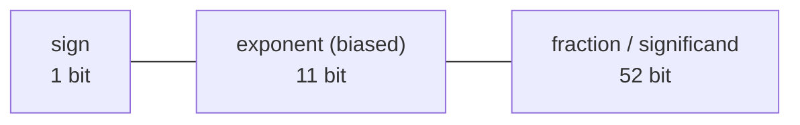

# P2 · Chương 02 — Biểu diễn dữ liệu

## Bạn sẽ hiểu được gì

1. **Q1.** Một dãy bit không có "kiểu" tự thân: cùng 8 bit `1111_1011` là `251` hay `-5` do ai? Hai phép cộng `u8` và `i8` có khác nhau trong phần cứng không? → mục 1
2. **Q2.** Two's complement hoạt động ra sao, vì sao `i8::MIN` không có số đối, và `as` giữa các kiểu số nguyên làm gì với bit? → mục 2
3. **Q3.** Khi cộng tràn, Rust làm gì ở build debug và release; chọn `wrapping_*`, `checked_*`, `overflowing_*` hay `saturating_*` khi nào? → mục 3
4. **Q4.** Little-endian và big-endian khác nhau thế nào, "network byte order" là gì, và khi nào `to_le_bytes`/`from_be_bytes` là công cụ đúng? → mục 4
5. **Q5.** `f64` gồm những trường nào; NaN, infinity, số subnormal, `-0.0` là gì; vì sao `0.1 + 0.2 != 0.3` và vì sao `f64` không `Ord`? → mục 5
6. **Q6.** UTF-8 mã hoá một code point thành 1–4 byte ra sao; `char`, `u8`, `&str` khác nhau thế nào trong Rust, và vì sao `&s[..n]` có thể panic? → mục 6

## Kiến thức cần trước

- [Chương 01 — Mô hình máy và ISA](01-mo-hinh-may-va-isa.md) (register, word, bộ nhớ đánh địa chỉ theo byte).
- Biết đọc số hex và dùng toán tử bit (`&`, `|`, `^`, `<<`, `>>`) ở mức cơ bản.

## 1. Bit, byte, word và cách diễn giải: không dấu, có dấu (Q1)

> **Trả lời ngắn.** Bit không mang nghĩa gì tự thân; nghĩa nằm ở cách chương trình đọc chúng[^dis-nomeaning]. Vì thế cùng `1111_1011` là `251` nếu đọc không dấu và `-5` nếu đọc có dấu. Nhờ cách mã hoá số nguyên, phép cộng không phụ thuộc việc đọc có dấu hay không dấu, nên `u8` và `i8` dùng chung một bộ thành phần phần cứng[^dis-arith]. Chỗ hai cách đọc khác nhau là việc nhận ra kết quả không vừa số bit (tràn)[^dis-interp].

**Giải thích.**

*Với service của bạn.* Xuyên suốt chương này ta bám theo `billing`, một service Rust nhận frame nhị phân từ gateway qua TCP rồi ghi hóa đơn (ví dụ giả định của người soạn, không phải code trong repo). Mỗi frame có trường `qty` dài 1 byte (số lượng hàng) và trường `delta` dài 1 byte (điều chỉnh số lượng, có thể âm). Trên dây, hai byte này trông hệt nhau; không chỗ nào ghi "byte này không dấu, byte kia có dấu". Câu hỏi của mục này: khi `billing` đọc được byte `0xFB`, đó là 251 hay −5, và ai quyết định?

### 1.1 Nghĩa của bit nằm ở cách đọc

Byte `0xFB` lấy từ socket chỉ là tám bit. Nó thành 251 hay −5 tùy kiểu mà code `billing` khai báo cho trường đó, `u8` hay `i8`. Đây là ý quan trọng nhất của cả chương và đúng với mọi loại dữ liệu: bộ nhớ chỉ chứa bit, còn nghĩa do chương trình gán vào khi diễn giải[^dis-nomeaning].

### 1.2 Số không dấu

Số không dấu $n$ bit là số nhị phân thường. Đi từ phải sang trái, mỗi bit đóng góp gấp đôi bit đứng trước nó[^dis-pos]. Phép cộng cũng là phép cộng cột có nhớ như hồi học tiểu học[^dis-pencil]. Chỉ có điều số bit hữu hạn: nếu có nhớ trào ra khỏi bit cao nhất thì bit thừa bị cắt bỏ và kết quả nhỏ đi[^dis-trunc]. Vì vậy với số không dấu, mọi phép tính số học thực chất là tính **modulo $2^n$** (wraparound)[^dis-modular]. Ví dụ với `u8`: nếu `qty` đang là 250 và cộng thêm 10 thì `250 + 10 = 260`, và $260 \bmod 256 = 4$.

### 1.3 Số có dấu

Cách trực quan nhất để thêm dấu là *signed magnitude*: bit cao nhất chỉ làm bit dấu, phần còn lại là độ lớn[^dis-sm]. Cách này chỉ để so sánh cho dễ hiểu; trên thực tế chỉ còn two's complement được dùng[^dis-signed]. Two's complement có một ưu điểm lớn về phần cứng: khi cộng, mạch không cần biết toán hạng có dấu hay không dấu. Người thiết kế vì thế chỉ cần xây một bộ thành phần dùng chung cho cả hai[^dis-arith]. Với `billing`, tức là cộng hai `u8` hay hai `i8` đều chạy qua cùng một mạch.

Dùng chung mạch không có nghĩa kết quả luôn đúng như nhau. Các bit kết quả chỉ có một dãy; còn câu hỏi "kết quả có còn đúng không" thì phụ thuộc cách đọc. Một phép tính có thể đúng khi đọc theo kiểu này mà tràn khi đọc theo kiểu kia, nên phần cứng phải nhận ra tràn riêng cho từng cách đọc[^dis-interp].

Ví dụ người soạn tự tính: trong 8 bit, `0xC8 + 0x64 = 0x12C`, giữ 8 bit thấp được `0x2C` = 44. Đọc không dấu, đó là $200 + 100$ nên 44 sai (cần 300, bit nhớ thứ chín bị cắt). Đọc có dấu, đó là $-56 + 100$ nên 44 đúng. Ở mức lệnh, hai cách nhận biết tràn này hiện ra thành các cờ khác nhau, xem [Chương 03, mục 4](03-assembly-x86-64-va-aarch64.md).

<details><summary>Đi sâu: byte, word, số giá trị của $n$ bit và cách phát hiện tràn</summary>

Bộ nhớ và register chỉ chứa các bit. **Byte** là nhóm tám bit, và trong các hệ thống hiện đại đó là đơn vị nhỏ nhất có địa chỉ trong bộ nhớ[^dis-byte]. **Word** do thiết kế phần cứng quyết định, thường là 32 hoặc 64 bit; đó là kích thước "mặc định" mà phần cứng dùng khi chuyển dữ liệu từ thành phần này sang thành phần khác, chẳng hạn giữa bộ nhớ và register[^dis-word]. [Chương 01, mục 1](01-mo-hinh-may-va-isa.md) nhìn khái niệm word từ phía ISA; tên và kích thước các register nằm ở [Chương 03, mục 2](03-assembly-x86-64-va-aarch64.md).

Register là đơn vị lưu trữ cỡ word nằm trực tiếp trên CPU, và CPU Intel 64 bit có 16 register lưu dữ liệu 64 bit[^dis-reg]. AArch64 cũng có register 64 bit (Chương 03, mục 2). Vì vậy phép toán trên `u64`/`usize` thường vừa một register (nhận xét của người soạn).

$n$ bit cho $2^n$ mẫu bit khác nhau, và các mẫu đó đọc được theo nhiều cách (không dấu hoặc có dấu)[^dis-2n]; một byte có $2^8 = 256$ mẫu. Số bit hữu hạn chính là gốc của mọi chuyện "tràn" ở mục 3.

Cách nhận ra tràn khác nhau theo cách đọc. Với số không dấu có đường tắt: bit nhớ ra (carry out) phải khớp bit nhớ vào (carry in), nếu không phép tính đã tràn[^dis-unsigned-detect]. Với số có dấu, cộng hoặc trừ bị coi là tràn khi bit cao nhất của các toán hạng so với bit cao nhất của kết quả cho thấy dấu đã đổi sai[^dis-signed-detect]. Vì thế phần cứng có cờ riêng cho hai cách đọc (suy luận của người soạn); xem [Chương 03, mục 4](03-assembly-x86-64-va-aarch64.md).

</details>

**Quay lại Q1:** kiểu quyết định cách đọc bit; `u8` và `i8` cộng bằng cùng một bộ thành phần, chỉ khác cách nhận ra tràn.

## 2. Two's complement, `i8::MIN` và `as` giữa số nguyên (Q2)

> **Trả lời ngắn.** Số âm $-X$ được biểu diễn bằng bổ số của $X$ theo $2^n$[^dis-neg]. Với số bit cố định, hệ này có nhiều số âm hơn số dương một đơn vị[^dis-moreneg]. Vì vậy `i8::MIN` không có số đối: phủ định nó giữ nguyên giá trị[^ref-neg]. Còn `as` giữa các số nguyên không tính lại giá trị, nó chỉ giữ nguyên, cắt bớt hoặc mở rộng bit (chi tiết ở 2.3).

**Giải thích.**

*Với service `billing`.* `billing` điều chỉnh tồn kho bằng `delta: i8`, và nhét số lượng từ phép tính `i32` vào trường `qty: u8` của frame. Hai việc đó dẫn tới hai câu hỏi: số âm nằm trong 8 bit ra sao, và `300_i32 as u8` thực sự cho ra gì?

### 2.1 Số âm là bổ số

Muốn phủ định một giá trị $n$ bit, ta lấy bổ số của nó theo $2^n$, và tên "two's complement" bắt nguồn từ đó. Nói cách khác, $-X$ là mẫu bit $Y$ sao cho $X + Y = 2^n$[^dis-neg]. Cùng ý này có thể nói bằng đồng dư: với $p$ bit, số trong dải $[-2^{p-1}, 2^{p-1}-1]$ được biểu diễn bằng số không âm nhỏ nhất đồng dư với nó modulo $2^p$[^gb-twos]. Khi tính tay, cách nhanh nhất là **đảo mọi bit rồi cộng 1**[^dis-flip]. Kết quả đã chạy với `i8` (rustc 1.95.0):

| giá trị | bit `i8` | ghi chú |
|---|---|---|
| `5` | `00000101` | |
| `!5` (đảo bit) | `11111010` | |
| `-5` = `!5 + 1` | `11111011` | = 251 nếu diễn giải không dấu |

Đọc ra: `-5 as u8` là `251`, cùng mẫu bit `11111011`. Đây chính là byte `0xFB` ở mục 1: nếu `delta` khai báo `i8` thì `billing` thấy −5, nếu nhầm thành `u8` thì thấy 251.

Rust cam kết biểu diễn này cho mọi kiểu số nguyên có dấu: số nguyên có dấu luôn được biểu diễn bằng two's complement[^ref-twos].

### 2.2 Vì sao `i8::MIN` không có số đối

Với $n$ bit, dải biểu diễn là $-2^{n-1}$ ..= $2^{n-1}-1$[^gb-twos]; với `i8` đó là −128..=127 (in từ `i8::MIN`/`i8::MAX`, đã chạy). Như vậy có $2^{n-1}$ số âm nhưng chỉ $2^{n-1}-1$ số dương, vì số 0 chiếm một chỗ ở nửa không âm. Kết quả là số âm nhiều hơn số dương đúng một số[^dis-moreneg].

Từ đó ra lý do `-i8::MIN` không biểu diễn được (suy luận của người soạn từ định nghĩa bổ số). Phủ định $X = 2^{n-1}$, tức mẫu `1000_0000` mà `i8` đọc là −128, cho $2^n - 2^{n-1} = 2^{n-1}$, chính mẫu đó, nên không có số dương nào tương ứng. Reference Rust ghi rõ: phủ định các giá trị âm nhất này giữ nguyên giá trị, do quy ước tràn của two's complement[^ref-neg]. (Đã chạy: `(-128i8).wrapping_neg()` = `-128`, `(-128i8).checked_neg()` = `None`.)

### 2.3 `as` giữa số nguyên: giữ, cắt hoặc mở rộng bit

Khi chuyển sang kiểu rộng hơn, ta phải điền các bit cao mới. **Zero-extend** điền 0, dùng cho số không dấu. **Sign-extend** lặp lại bit dấu bao nhiêu lần cần thiết để kéo dãy bit tới độ dài đích, dùng cho số có dấu[^dis-ext]. Chuyển sang kiểu hẹp hơn thì ngược lại: bỏ các bit cao. Mặt phần cứng của zero-extend khi ghi thanh ghi con 32 bit có ở [Chương 01, mục 3](01-mo-hinh-may-va-isa.md) và [Chương 03, mục 2](03-assembly-x86-64-va-aarch64.md).

`as` giữa hai số nguyên rơi vào đúng ba trường hợp đó. Cùng kích thước thì không làm gì với mẫu bit (no-op)[^ref-noop]. Từ kiểu lớn sang nhỏ thì cắt bớt (truncate), tức giữ các bit thấp[^ref-trunc]. Ví dụ `0xabcdu16 as u8` là `0xcd`[^ref-trunc-ex]. Từ kiểu nhỏ sang lớn thì zero-extend nếu **kiểu nguồn** không dấu, sign-extend nếu kiểu nguồn có dấu[^ref-ext]. Đã chạy:

| biểu thức | kết quả | giải thích |
|---|---|---|
| `300i32 as u8` | `44` | giữ 8 bit thấp: $300 - 256$ |
| `-1i32 as u32` | `4294967295` | cùng mẫu bit, diễn giải không dấu |
| `-1i8 as u32` | `4294967295` | nguồn có dấu ⇒ sign-extend rồi diễn giải |
| `255u8 as i8` | `-1` | bit `FF` đọc có dấu |
| `0xFFu8 as i8 as i32 as u32` | `4294967295` | sign-extend vì bước giữa là `i8` |

Dòng đầu trả lời câu hỏi của `billing`: số lượng 300 nhét vào `qty: u8` bằng `as` thành 44, không có lỗi hay cảnh báo nào. Cả ba quy tắc đều cho kết quả xác định, không có nhánh lỗi, nên `as` giữa số nguyên không panic và không báo tràn (suy luận của người soạn từ các quy tắc trên). Vì thế nó dễ che lỗi (nhận xét của người soạn). Khi cần biết giá trị có vừa kiểu đích hay không, dùng `u8::try_from(x)`: nó trả lỗi nếu giá trị nằm ngoài dải của kiểu đích[^std-tryfrom].

<details><summary>Đi sâu: phủ định tràn ở debug, và phép dịch bit</summary>

Ở build debug, chính phép phủ định `-x` với `x = i8::MIN` (không phải literal) cũng tràn: Reference liệt kê vào danh sách overflow việc áp dụng `-` một ngôi cho giá trị âm nhất của bất kỳ kiểu số nguyên có dấu nào, trừ khi toán hạng là biểu thức literal[^ref-negovf]. Đã chạy: `-x` với `x = i8::MIN` qua `black_box` (giải thích ở [Chương 07, mục 6](07-rust-va-may.md)) panic "attempt to negate with overflow" ở debug và cho `-128` ở `-O`.

**Phép dịch bit và các phép bit**

Dịch trái $k$ bit đẩy mỗi bit lên $k$ vị trí có trọng số lớn hơn, nên khi chưa tràn thì giá trị tăng lên[^dis-shl]; cụ thể là nhân với $2^k$ (suy luận của người soạn từ trọng số $2^i$ ở mục 1). Dịch phải có hai biến thể. *Logical* shift điền 0 vào các bit cao[^dis-lsr]. *Arithmetic* shift điền bản sao của bit cao nhất, tức bit dấu[^dis-asr]. Rust chọn biến thể theo kiểu: dịch phải số học với kiểu số nguyên có dấu, dịch phải logic với kiểu không dấu[^ref-shr].

- **Logical** shift: `0xF0u8 >> 1 = 0x78 = 120` (đã chạy).
- **Arithmetic** shift: `-8i32 >> 1 = -4` (đã chạy).

Dịch phải số học làm tròn về −∞ (suy luận của người soạn: các bit thấp bị bỏ đi còn bit dấu được giữ); đã chạy `-7i32 >> 1 = -4`. Phép chia số nguyên của Rust thì làm tròn về 0[^ref-divround], nên `-7 / 2 = -3` (đã chạy).

**Dịch quá độ rộng** là bẫy riêng. Reference liệt kê vào các trường hợp overflow việc dùng `<<` hoặc `>>` khi vế phải lớn hơn hoặc bằng số bit của kiểu vế trái, hoặc âm[^ref-shift]. Đã chạy: `1u32 << s` với `s = 33` panic "attempt to shift left with overflow" ở build debug, và cho `2` khi build `-O` (không bật overflow-checks); tức giá trị dịch bị lấy modulo độ rộng, `33 & 31 = 1`. Kết quả này khớp với mô tả của `wrapping_shl`: nó cho ra `self << mask(rhs)`, trong đó `mask` loại bỏ các bit cao của `rhs` có thể khiến phép dịch vượt quá độ rộng bit của kiểu[^std-shl]. Tài liệu còn nói hành vi này khớp với lệnh dịch của nhiều bộ xử lý, và cũng là điều toán tử `<<` làm khi overflow checks bị tắt[^std-shl2]. Nếu muốn một kết quả an toàn không panic, dùng `checked_shl` (`1u32.checked_shl(32)` = `None`, đã chạy).

Mẫu thường dùng: mask `x & 0xFF` lấy byte thấp; `(x >> 8) & 0xFF` lấy byte kế tiếp; `x | (1 << k)` bật bit $k$. Lập trình viên thường dùng toán tử bit để sửa những bit cụ thể trong một biến[^dis-bitwise-use]. Đây cũng là cách trích trường trong header giao thức; ví dụ giải mã từng byte header IP/TCP (byte `45` gồm version và IHL) có ở [P6 · Chương 01, mục 4](../06-networking/01-layering.md).

</details>

**Quay lại Q2:** bổ số theo $2^n$ nên có một số âm dư và `i8::MIN` không có số đối; `as` giữa số nguyên chỉ giữ, cắt hoặc mở rộng bit.

## 3. Tràn số: debug, release và bốn họ phương thức (Q3)

> **Trả lời ngắn.** Phần cứng cộng $n$ bit cho kết quả modulo $2^n$[^dis-modular]. Phần còn lại do Rust quyết định. Build debug thì panic khi tràn[^ref-ovf]. Build `--release` thì wrap theo two's complement[^book-ovf]. Cả hai đều không phải UB[^ref-ovf-wrap]. Muốn nêu rõ ý định, dùng một trong bốn họ `checked_*`, `wrapping_*`, `overflowing_*`, `saturating_*`[^book-families].

**Giải thích.**

*Với service `billing`.* `billing` giữ bộ đếm số byte đã nhận trên mỗi connection, và tính offset trong buffer từ trường `len` do client gửi. Cả hai đều là phép cộng số nguyên có thể tràn. Câu hỏi của mục này: tràn thì chuyện gì xảy ra, và code nên viết thế nào để kết quả không phụ thuộc cờ build?

### 3.1 Phần cứng không biết "tràn"

Mạch cộng $n$ bit không hề báo lỗi: bit nhớ ra khỏi bit cao nhất bị cắt bỏ[^dis-trunc], nên kết quả luôn nằm gọn trong $n$ bit. Việc báo tràn (thường) thuộc về các cờ trạng thái riêng, xem [Chương 03, mục 4](03-assembly-x86-64-va-aarch64.md). Kết quả "bọc vòng" (wrap) như $250_{u8}+10 = 4$ hay `i32::MAX + 1 = i32::MIN` là hệ quả trực tiếp của modulo $2^n$ (đã chạy: `i32::MAX.wrapping_add(1)` = `-2147483648`).

Vậy câu hỏi thực sự là **ngôn ngữ chọn làm gì khi tràn**.

### 3.2 Mặc định của Rust: debug panic, release wrap

Ở build debug, toán tử số nguyên panic khi tràn[^ref-ovf]. Hai cờ `-C overflow-checks` và `-C debug-assertions` cho phép chỉnh việc này trực tiếp[^ref-ovf2]. Phía release thì The Rust Book nói rõ: khi build `--release`, Rust không đưa vào kiểm tra tràn gây panic; nếu tràn xảy ra, nó wrap theo two's complement[^book-ovf]. Đã chạy với cùng đoạn `let b = a + 10` (`a: u8 = 250`, qua `black_box`):

| cách build | kết quả |
|---|---|
| `rustc b.rs` (debug) | panic: `attempt to add with overflow` |
| `rustc -O b.rs` | in `4` |
| `rustc -C overflow-checks=off b.rs` | in `4` |

Mặt mã máy của sự khác biệt này (ở `-O0` có nhánh tới hàm panic, ở `-O3` không có kiểm tra) được quan sát ở [Chương 07, mục 1](07-rust-va-may.md).

Tràn số là **lỗi lập trình nhưng không phải undefined behavior**: Reference viết rằng nếu chương trình có tràn số học thì lập trình viên đã mắc lỗi[^ref-ovf-err]. Khi bật debug assertions, implementation phải chèn kiểm tra động và panic khi tràn; các kiểu build khác có thể panic hoặc cho giá trị wrap im lặng, tùy implementation[^ref-ovf-disc]. Trường hợp wrap im lặng không phải UB, vì implementation phải cho kết quả xác định rõ (dù vẫn bị coi là sai) bằng quy ước tràn two's complement[^ref-ovf-wrap]. Tức bảo đảm của Reference là "panic hoặc wrap", không bao giờ UB.

Với `billing`, đây là cái bẫy "chỉ xuất hiện ở prod": cùng một biểu thức có thể panic ở test (build debug) nhưng wrap im lặng ở production, và những chỗ hay dính là đếm byte, tính offset, tính checksum (nhận xét của người soạn). Nếu muốn giữ kiểm tra ở release, bật `overflow-checks = true` trong profile của Cargo: setting này điều khiển cờ `-C overflow-checks`, và khi bật thì tràn sẽ panic[^cargo-ovf]. Ngược lại, nếu *cần* wrap (hash, checksum) thì dùng `wrapping_*`, họ phương thức wrap ở mọi chế độ build[^book-wrapall], để ý định không phụ thuộc cờ build.

### 3.3 Bốn họ phương thức tường minh

Để xử lý tràn một cách tường minh, thư viện chuẩn cung cấp các họ phương thức cho kiểu số nguyên nguyên thủy[^book-families]. Mỗi họ trả lời "tràn thì sao" theo một cách. Theo std docs 1.95.0 (ví dụ ở `u32`):

- `checked_add`: cộng có kiểm tra, tính `self + rhs` và trả `None` nếu tràn[^std-checked].
- `wrapping_add`: cộng theo modulo, tính `self + rhs` và quấn vòng ở biên của kiểu[^std-wrapping].
- `overflowing_add`: trả về một tuple gồm kết quả phép cộng và một boolean cho biết có tràn hay không[^std-ovf].
- `saturating_add`: cộng bão hòa, tính `self + rhs` và dừng ở biên số của kiểu thay vì tràn[^std-sat].

Cùng đầu vào `250u8` cộng `10` (đã chạy): `checked_add` → `None`; `overflowing_add` → `(4, true)`; `saturating_add` → `255`; `wrapping_add` → `4`.

Chọn họ nào là câu hỏi nghiệp vụ (nhận xét của người soạn):

- Độ dài hay offset đến từ input không tin cậy, như trường `len` của client: `checked_*`.
- Hash, checksum: `wrapping_*`.
- Bộ đếm metric không được quay vòng về 0: `saturating_*`.
- Cần cả giá trị đã wrap lẫn cờ báo tràn: `overflowing_*`.

<details><summary>Đi sâu: lint lúc biên dịch, các tràn luôn bị kiểm tra và họ <code>strict_*</code></summary>

Nếu toán hạng đều là hằng số, compiler còn chặn ngay lúc biên dịch: `let a: u8 = 250; a + 10` bị từ chối với lỗi `this arithmetic operation will overflow` (đã chạy). Đó là lint `arithmetic_overflow`, lint phát hiện một phép toán số học sẽ tràn[^rustc-lint]. Nó nằm trong nhóm lint đặt ở mức deny theo mặc định[^rustc-deny].

Vài tràn **luôn** bị kiểm tra: chia hoặc lấy dư `i32::MIN` cho `-1`. Reference nói các kiểm tra này xảy ra ngay cả khi `-C overflow-checks` bị tắt, "for legacy reasons" (vì lý do kế thừa từ lịch sử)[^ref-div]. Chia số nguyên cho 0 cũng panic[^ref-div0] (đã chạy `1/0` với biến → "attempt to divide by zero").

Từ Rust 1.91, std có thêm họ `strict_*` (ví dụ `strict_add`): panic khi tràn bất kể overflow checks có bật hay không[^std-strict]. Họ này nằm ngoài "bốn họ" ở trên; tài liệu `u32` ghi `strict_add` ổn định từ 1.91.0.

</details>

**Quay lại Q3:** debug panic, release wrap, không UB; chọn họ phương thức theo ý định.

## 4. Endianness và network byte order (Q4)

> **Trả lời ngắn.** Endianness (byte order) là cách phần cứng xếp các byte của một giá trị nhiều byte vào những địa chỉ liên tiếp[^dis-endian]. Little-endian đặt byte thấp nhất trước (x86 thuộc loại này), big-endian làm ngược lại[^dis-little]. Hai máy trao đổi dữ liệu thì phải thống nhất thứ tự[^dis-cross]. Trên Internet, thứ tự đó là big-endian, gọi là network byte order[^dis-netorder], nên với trường nhiều byte đọc từ mạng, dùng `from_be_bytes`/`to_be_bytes`. Dạng `ne` phụ thuộc nền tảng nên tránh[^std-ne]. `to_le_bytes`/`from_le_bytes` là công cụ đúng khi đặc tả của định dạng quy định little-endian (nhận xét của người soạn).

**Giải thích.**

*Với service `billing`.* Header mỗi frame mà gateway gửi cho `billing` có trường `len: u32` (4 byte) và `port: u16` (2 byte). Gateway và `billing` có thể chạy trên hai loại máy khác nhau, nên câu hỏi là: dãy byte `00 50` trên dây là port 80 hay 20480, và code nên đọc bằng hàm nào cho đúng trên mọi máy?

### 4.1 Cùng một số, hai cách xếp byte

Một giá trị nhiều byte như `u32` khi nằm trong bộ nhớ phải xếp các byte theo một thứ tự nào đó. Với `0x12345678`:

| quy ước | byte tại địa chỉ thấp → cao |
|---|---|
| **little-endian** (byte thấp trước) | `78 56 34 12` |
| **big-endian** (byte cao trước) | `12 34 56 78` |

(Kết quả từ `to_le_bytes`/`to_be_bytes`, đã chạy.) Hai cách xếp này khớp mô tả của Dive into Systems: x86 lưu số nguyên từ byte có nghĩa nhỏ nhất ("little end") đến byte có nghĩa lớn nhất ở các địa chỉ liên tiếp, còn các kiến trúc big-endian khác lưu theo thứ tự ngược lại[^dis-little].

### 4.2 Network byte order

Thứ tự byte thường chỉ ảnh hưởng chương trình giao tiếp giữa các máy (ví dụ qua mạng). Khi đó hai bên phải thống nhất thứ tự thì bên nhận mới hiểu đúng giá trị[^dis-cross]. IETF cuối cùng chọn big-endian làm chuẩn "network byte order"[^dis-netorder].

Quy ước này cũng nằm trong các RFC (RFC gọi byte 8 bit là *octet*; giải nghĩa của người soạn). RFC 1700 nói về cách vẽ dữ liệu: các trường được mô tả từ trái sang phải, octet có nghĩa lớn nhất ở bên trái và octet có nghĩa nhỏ nhất ở bên phải, tức kiểu big-endian[^rfc1700]. RFC 791 (IP) nói về việc truyền: khi một đại lượng nhiều octet được truyền đi, octet có nghĩa lớn nhất được truyền trước[^rfc791]. Man page `byteorder(3)` cũng ghi network byte order trên Internet là byte có nghĩa lớn nhất trước (xem phần Đi sâu).

Hệ quả thực tế (nhận xét của người soạn): lỗi endianness thường chỉ lộ ra khi đọc dữ liệu nhị phân từ mạng hoặc file do máy khác tạo. Chẳng hạn `billing` đọc `port` 80 (`00 50` trên dây) bằng cách ép con trỏ trên máy little-endian sẽ ra `0x5000 = 20480`. Cách an toàn là luôn giải mã từng trường từ byte.

### 4.3 Liên hệ Rust: `to_be_bytes` và `from_be_bytes`

`u32::to_be_bytes` trả mảng byte theo thứ tự big-endian (network)[^std-be]. Ngoài ra có `to_le_bytes` và `to_ne_bytes`. Bản "native endian" cần cẩn thận: nó dùng endianness của nền tảng đích, nên code portable nên dùng `to_be_bytes` hoặc `to_le_bytes` tùy trường hợp[^std-ne]. Đã chạy:

```rust
let x = 0x1234_5678u32;
x.to_le_bytes();                                  // [0x78, 0x56, 0x34, 0x12]
x.to_be_bytes();                                  // [0x12, 0x34, 0x56, 0x78]
u32::from_be_bytes([0x12, 0x34, 0x56, 0x78]);     // 305419896 (= 0x12345678)
u32::from_le_bytes([0x12, 0x34, 0x56, 0x78]);     // 0x78563412
```

Với trường network order như `len` và `port` của `billing`, chọn `from_be_bytes`: kết quả không phụ thuộc máy chạy. Dùng nhầm `from_le_bytes` sẽ ra giá trị đảo byte. Ngược lại, nếu đặc tả của định dạng hay giao thức quy định little-endian thì chọn `to_le_bytes`/`from_le_bytes`. Nguyên tắc là chọn theo đặc tả của dữ liệu chứ không theo CPU đang chạy (nhận xét của người soạn).

<details><summary>Đi sâu: man page <code>byteorder(3)</code>, tên hàm <code>htonl</code> và đọc từ slice</summary>

Man page `byteorder(3)` định nghĩa các hàm chuyển: `htonl()` đổi số nguyên không dấu `hostlong` từ host byte order sang network byte order[^man-byteorder]. Trang này nêu ví dụ: trên i386, host byte order là byte có nghĩa nhỏ nhất trước, còn network byte order dùng trên Internet là byte có nghĩa lớn nhất trước[^man-byteorder2]. Tên hàm ghép từ `h`ost, `n`etwork, `s`hort, `l`ong. Prototype trong man page cho thấy `htonl` làm việc với `uint32_t` còn `htons` với `uint16_t`[^man-byteorder-syn], tức "long" ở đây là 32 bit và "short" là 16 bit.

Để đọc một trường big-endian từ slice byte, docs của `u16::from_be_bytes` ghi rằng khi bắt đầu từ slice thay vì mảng thì có thể dùng các API chuyển đổi có thể thất bại[^std-slice-be]. Đoạn mã dưới lấy từ docs đó (chỉ để minh hoạ, không chạy lại):

```rust
fn read_be_u16(input: &mut &[u8]) -> u16 {
    let (int_bytes, rest) = input.split_at(size_of::<u16>());
    *input = rest;
    u16::from_be_bytes(int_bytes.try_into().unwrap())
}
```

Mã này không xử lý trường hợp slice ngắn hơn 2 byte; với dữ liệu từ mạng, bạn cần kiểm tra độ dài trước (nhận xét của người soạn).

</details>

**Quay lại Q4:** giải mã từng trường bằng `from_be_bytes`/`from_le_bytes` theo đặc tả của dữ liệu, không ép con trỏ.

## 5. `f64` (IEEE 754): trường bit, giá trị đặc biệt, làm tròn và thứ tự (Q5)

> **Trả lời ngắn.** `f64` là kiểu binary64 của IEEE 754[^ref-num]. Nó gồm 1 bit dấu, 11 bit exponent và 52 bit fraction[^gb-tbl]. Hai mẫu exponent đặc biệt dành cho ±0, số subnormal, ±∞ và NaN[^gb-special-list]. `0.1 + 0.2 != 0.3` vì các toán hạng đã bị làm tròn khi nạp[^gb-01]. Phép cộng lại làm tròn thêm một lần nữa[^gb-round]. NaN không bằng chính nó nên `f64` không `Eq`, và vì `Ord` đòi `Eq` nên cũng không `Ord`[^std-partialeq]. Muốn sắp xếp thì dùng `total_cmp`[^std-total-order].

**Giải thích.**

*Với service `billing`.* `billing` cộng tiền trên hóa đơn và tính p99 latency từ một `Vec<f64>`. Cả hai việc đụng đúng hai bẫy của `f64`: `0.1 + 0.2` không ra `0.3`, và gọi `sort()` trên `Vec<f64>` không biên dịch được. Mục này đi từ mẫu bit của `f64` tới hai bẫy đó.

### 5.1 Vì sao cần dấu phẩy động

Ta cần biểu diễn số có phần thập phân và dải giá trị rất rộng trong số bit cố định. Dấu phẩy cố định (fixed-point) giữ vị trí dấu chấm nhị phân bất động và không đổi được[^dis-fixed]. Dấu phẩy động (floating-point) cho phép toàn bộ dải bit góp vào giá trị bất kể ranh giới phần nguyên và phần thập phân nằm ở đâu, với cái giá là phức tạp hơn[^dis-float]. Một số dấu phẩy động có dạng $\pm 1.f \times 2^e$: giống ký hiệu khoa học nhưng cơ số là 2 (nhận xét của người soạn). Hầu như mọi phần cứng hiện đại theo chuẩn IEEE 754 để biểu diễn loại số này[^dis-fp]. Trong Rust, `f32` và `f64` là hai kiểu “binary32” và “binary64” của IEEE 754-2008[^ref-num].

### 5.2 Ba trường bit

Với `f32`, độ chính xác đơn IEEE 754 được mã hoá trong 32 bit gồm 1 bit dấu, 8 bit exponent và 23 bit significand[^gb-fmt]. Với `f64` (double), bảng TABLE D-1 của Goldberg cho cột Double có độ rộng exponent 11 bit và độ rộng format 64 bit (các cột theo thứ tự Single, Single-Extended, Double, Double-Extended)[^gb-tbl]. Độ chính xác là $p = 53$ cho double và $p = 24$ cho độ chính xác đơn[^gb-p]. Docs Rust ghi `f64::MANTISSA_DIGITS = 53` và nói kích thước mantissa trong biểu diễn bit nhỏ hơn con số này một, vì bit 1 đứng đầu không được lưu tường minh[^std-mant]. Từ đó suy ra $1 + 11 + 52 = 64$ bit (suy luận của người soạn).

Phần số hiện nay gọi là *significand*; thuật ngữ này nhìn chung đã thay thuật ngữ cũ mantissa[^gb-mantissa] (docs Rust vẫn dùng chữ mantissa trong tên hằng). Bit cao nhất là bit dấu: 0 là dương, 1 là âm (mô tả của Dive into Systems cho `float` 32 bit)[^dis-sign]. Giá trị chuẩn hoá (normalized) là $(-1)^s \times 1.f \times 2^{E - \text{bias}}$, trong đó phần $1.f \times 2^e$ khớp công thức Goldberg viết cho $e > e_{min} - 1$[^gb-denormformula]:



Hai khái niệm đi kèm cần nắm:

- **Bias.** Exponent có thể âm hoặc dương nên phải chọn cách biểu diễn dấu của nó. Chuẩn IEEE không dùng sign/magnitude hay two's complement mà dùng biểu diễn có bias[^gb-biasrep]. Với độ chính xác đơn, exponent lưu trong 8 bit và bias là 127 (với độ chính xác kép là 1023)[^gb-bias]. Mục đích của bias là cho số thực biểu diễn được cả giá trị rất lớn lẫn rất nhỏ[^dis-bias].
- **Hidden bit.** Số dấu phẩy động luôn được chuẩn hoá, nên bit có nghĩa lớn nhất của significand luôn là 1 và chẳng có lý do gì phí một bit lưu trữ để biểu diễn nó[^gb-hidden]. Vì vậy `f32` có significand 24 bit ($p = 24$) dù chỉ mã hoá 23 bit[^gb-24].

### 5.3 Giá trị đặc biệt

Ngoài số chuẩn hoá, chuẩn còn có ±0, số denormalized, ±∞ và NaN, và tất cả đều được mã hoá với exponent bằng `emax + 1` hoặc `emin − 1`[^gb-special-list]. Với `f64`, TABLE D-1 ghi `emax = +1023` và `emin = −1022`[^gb-tbl2]. Cùng bias 1023, điều đó cho (suy luận của người soạn) `emin − 1` ứng với trường exponent đã lưu toàn 0 và `emax + 1` ứng với trường lưu toàn 1 (2047). Bảng của Goldberg (TABLE D-2), viết lại:

| exponent `e` | fraction `f` | biểu diễn |
|---|---|---|
| `emin − 1` | `0` | ±0[^gb-zero0] |
| `emin − 1` | khác 0 | số denormalized (subnormal)[^gb-denormformula] |
| `emin ≤ e ≤ emax` | (bất kỳ) | số chuẩn hoá $1.f \times 2^e$[^gb-denormformula] |
| `emax + 1` | `0` | ±∞[^gb-infenc] |
| `emax + 1` | khác 0 | NaN[^gb-infenc] |

Đã chạy: `f64::INFINITY.to_bits()` = `0x7ff0000000000000`, `(-0.0f64).to_bits()` = `0x8000000000000000`. Rust gom các lớp này vào enum `FpCategory` với năm biến thể `Nan`, `Infinite`, `Zero`, `Subnormal`, `Normal`[^std-fpcat]. Ta xem lần lượt từng loại.

**Hai số không.** Bit dấu nhận hai giá trị nên có hai số không, +0 và -0[^gb-zero]. Phép so sánh vẫn coi chúng bằng nhau, vì chuẩn IEEE định nghĩa so sánh sao cho +0 = -0 chứ không phải -0 < +0[^gb-zerocmp]. (Đã chạy: `-0.0 == 0.0` là `true`; nhưng `(-0.0).total_cmp(&0.0)` là `Less`.)

**Infinity.** Đây là kết quả mặc định khi tràn và khi chia số khác 0 cho 0. Vô cực cho phép phép tính tiếp tục khi xảy ra tràn[^gb-infov]. Một số khác không chia cho 0 thì trả về vô cực[^gb-inf]. Đã chạy: `1.0/0.0 = inf`, `f64::MAX * 2.0 = inf`, `-1.0/0.0 = -inf`. Số thực khác số nguyên ở điểm này: Reference chỉ ghi chia số *nguyên* cho 0 mới panic[^ref-div0]. Với số thực, chuẩn IEEE mặc định đưa ra một kết quả rồi tiếp tục chạy[^gb-exc].

**NaN** (Not a Number). Phép chia 0 cho 0 cho ra NaN[^gb-nan0]. NaN thường được mã hoá bằng exponent `emax + 1` và fraction khác 0[^gb-nanenc]. Không có một NaN duy nhất mà là cả một họ NaN, vì chuẩn cho phép mỗi implementation đặt thông tin phụ thuộc hệ thống vào phần significand[^gb-nanfam]. Kết quả phép tính có NaN tham gia lại là NaN[^gb-nanprop]. NaN không bao giờ bằng số nào khác, kể cả một NaN khác[^gb-naneq]. (Đã chạy: `f64::NAN.to_bits()` = `0x7ff8000000000000`.) Chi tiết về payload của NaN ở phần Đi sâu.

**Subnormal (denormalized).** Đây là trường hợp exponent `emin − 1` (trường lưu toàn 0) với fraction khác 0. Số được biểu diễn là $0.b_1b_2\ldots b_{p-1} \times 2^{e+1}$, không còn hidden bit 1 ở đầu, còn khi $e > e_{min} - 1$ thì là $1.b_1b_2\ldots b_{p-1} \times 2^e$[^gb-denormformula]. Nhờ vậy chúng lấp khoảng trống giữa 0 và số chuẩn hoá nhỏ nhất. Nếu không có chúng, kết quả phép tính dấu phẩy động rơi vào khoảng trống này sẽ bị đưa về 0 (flush to zero)[^gb-gulf]. Hành vi khi có denormal gọi là "gradual underflow"[^gb-grad]. Docs Rust mô tả: số subnormal lớn hơn Zero về độ lớn nhưng nhỏ hơn mọi số Normal[^std-fpcat-sub]. Đã chạy: `f64::MIN_POSITIVE` (số chuẩn hoá dương nhỏ nhất)[^std-minpos] = `2.2250738585072014e-308`, bit `0x0010000000000000`; `f64::from_bits(1)` = `5e-324` (`is_subnormal()` là `true`).

### 5.4 Làm tròn và vì sao `0.1 + 0.2 != 0.3`

Một định dạng dấu phẩy động có số bit không đổi thì không thể biểu diễn chính xác mọi giá trị[^dis-fp-limit]. Sai số đến từ hai nguồn.

Nguồn thứ nhất: không phải số thập phân hữu hạn nào cũng có biểu diễn nhị phân hữu hạn. Ví dụ kinh điển là `0.1`, dù có biểu diễn thập phân hữu hạn, trong hệ nhị phân nó có biểu diễn lặp vô hạn[^gb-01]. `0.2` và `0.3` cũng vậy (suy luận của người soạn: $0.2 = 1/5$ và $0.3 = 3/10$ là các phân số tối giản có mẫu số chứa thừa số 5, không phải luỹ thừa của 2), nên cả ba bị làm tròn khi nạp vào `f64`.

Nguồn thứ hai: mỗi phép toán cơ bản lại làm tròn kết quả một lần nữa. Tiêu chuẩn yêu cầu kết quả phải được tính chính xác rồi làm tròn tới số dấu phẩy động gần nhất (dùng round to even)[^gb-round]. *Round to even* là quy tắc hoà khi đúng ở giữa: 12.5 làm tròn thành 12 chứ không phải 13 vì 2 là số chẵn[^gb-even].

Kết quả đã chạy với `f64`:

| biểu thức | giá trị |
|---|---|
| `0.1 + 0.2` | `0.30000000000000004` |
| `0.1 + 0.2 == 0.3` | `false` |
| `(0.1+0.2).to_bits()` | `0x3fd3333333333334` |
| `0.3f64.to_bits()` | `0x3fd3333333333333` |

Hai mẫu bit khác nhau đúng 1 ở bit cuối của fraction, tức là hai số kề nhau, cách nhau 1 ulp ("ulp" là viết tắt của "units in the last place", đơn vị ở vị trí cuối)[^gb-ulp]. Phép cộng tính chính xác từ hai giá trị đã bị làm tròn rồi làm tròn tiếp, ra số liền sau `0.3` đã lưu (suy luận của người soạn từ hai mẫu bit trên). Với `f32`, `0.1f32 + 0.2f32 == 0.3f32` cho `true` (đã chạy), vì làm tròn ở độ chính xác 24 bit rơi vào cùng số.

### 5.5 Liên hệ Rust: so sánh và sắp xếp `f64`

Đây là chỗ `billing` gặp vấn đề với `Vec<f64>` latency. Toán tử `==` theo IEEE: NaN không bằng chính nó, nên float chỉ có `PartialEq` mà không có `Eq`. Tài liệu `PartialEq` ghi rõ: với số dấu phẩy động, NaN != NaN, nên các kiểu dấu phẩy động cài đặt `PartialEq` mà không cài `Eq`[^std-partialeq]. Đã chạy: `NAN == NAN` → `false`, `NAN < 1.0` → `false`.

Hệ quả kéo theo: trait `Ord` có `Eq` làm supertrait, nghĩa là muốn cài `Ord` thì kiểu phải cài `Eq`[^std-ord], nên `f64` không `Ord`. Vì vậy `Vec<f64>::sort()` không dùng được, vì `[T]::sort` đòi `T: Ord`[^std-sortbound]. Với cùng lý do, `f64` cũng không làm khoá `BTreeMap` trực tiếp được: `BTreeMap` đòi khoá cài `Ord` để hai khoá luôn so sánh được[^std-btree].

Docs của `slice::sort` chỉ cách thoát: dùng một hàm so sánh định nghĩa thứ tự toàn phần, như `f64::total_cmp`, thay vì `sort()` mặc định[^std-sortnote]. Nếu chắc chắn mọi giá trị nằm trong tập con mà `partial_cmp` tạo thứ tự toàn phần (tức không có NaN), docs cũng cho phép `sort_by(|a, b| a.partial_cmp(b).unwrap())`[^std-sortalt].

`f64::total_cmp` cho thứ tự theo vị từ totalOrder như định nghĩa trong chuẩn dấu phẩy động IEEE 754 (bản 2008)[^std-total-order]. Nó khác `PartialOrd`/`PartialEq` ở chỗ phân biệt dấu của số 0: hai trait kia coi số không âm và số không dương là bằng nhau, còn `total_cmp` thì không[^std-total]. Đã chạy: `v.sort_by(|a, b| a.total_cmp(b))` với `[3.0, NaN, -1.0, inf]` cho `[-1.0, 3.0, inf, NaN]`. Docs xếp NaN dương quiet ở cuối dãy thứ tự[^std-total-seq], và `f64::NAN` của lần chạy này mang dấu dương (`0x7ff8…`).

<details><summary>Đi sâu: payload của NaN, subnormal chậm, tách bit của <code>0.1</code>, giới hạn số nguyên, <code>EPSILON</code>, và <code>as</code> giữa float với số nguyên</summary>

**Payload của NaN.** Docs Rust nói tương tự về họ NaN: IEEE 754 không chỉ định nghĩa một giá trị NaN mà có rất nhiều mẫu bit được coi là NaN, và chuẩn còn phân biệt NaN “signaling” với “quiet” và cho phép xem “payload” (các bit không được đặc tả trong mẫu bit) cùng dấu của nó[^std-nan1]. Docs `f64::NAN` bảo đảm nó là quiet NaN nhưng ngoài ra không bảo đảm gì về mẫu bit cụ thể: payload và dấu đều tuỳ ý và có thể đổi giữa các phiên bản Rust và target[^std-nan2].

**Subnormal: số mũ và hiệu năng.** Số mũ trong công thức subnormal là $e+1$ chứ không phải $e$ vì số denormal có exponent `emin` chứ không phải `emin − 1`[^gb-denormexp]. Về hiệu năng, Goldberg (1991) ghi: phần lớn phần cứng hiệu năng cao tự nhận tương thích IEEE không hỗ trợ trực tiếp số denormalized mà bẫy (trap) khi nhận hoặc tạo ra denormal[^gb-denormslow]. Mức độ áp dụng trên CPU hiện nay không được chương này khẳng định.

**Ví dụ đã chạy: tách bit của `0.1`.** `0.1f64.to_bits()` = `0x3fb999999999999a`: sign = 0, exponent field = 1019 (nên số mũ thật $1019 - 1023 = -4$), fraction = `0x999999999999a`. Tức $0.1 \approx 1.6 \times 2^{-4}$, khớp $0.1 = 1.6/16$. Dãy hex lặp `9` (nhị phân `1001` lặp) khớp với biểu diễn nhị phân lặp vô hạn của `0.1`; Goldberg cho xấp xỉ ở $p = 24$ là $1.10011001100110011001101 \times 2^{-4}$[^gb-01approx]. In với 20 chữ số, `0.1f64` hiển thị `0.10000000000000000555` (đã chạy), nghĩa là giá trị thực lưu hơi lớn hơn 0.1.

**Giới hạn số nguyên.** Hai hệ quả khác (đã chạy): `9007199254740992f64 + 1.0` vẫn là `9007199254740992`, vì vượt quá $2^{53}$ thì `f64` không còn biểu diễn được mọi số nguyên (suy luận của người soạn từ $p = 53$); và `16777216f32 + 1.0` giữ nguyên `16777216` ($2^{24}$ với `f32`, $p = 24$). Hệ quả cho backend (nhận xét của người soạn): không dùng float cho tiền. Với ID 64-bit trong JSON, RFC 8259 nói số nguyên trong khoảng [-(2**53)+1, (2**53)-1] là interoperable theo nghĩa các implementation đồng ý chính xác về giá trị[^rfc8259]. Bên nhận dùng `f64` có thể đọc sai ID lớn hơn khoảng đó (suy luận của người soạn).

**`EPSILON`.** Hằng số `f64::EPSILON` là hiệu giữa 1.0 và số biểu diễn được lớn hơn kế tiếp[^std-eps] (≈ 2.2×10⁻¹⁶, in ra `0.0000000000000002220446049250313`; đã chạy). Đây không phải dung sai so sánh chung (nhận xét của người soạn).

**Số thực → số nguyên.** Quy tắc của Reference: ép float sang integer sẽ làm tròn số thực về phía 0; NaN trả về 0; giá trị quá lớn, kể cả INFINITY, bão hoà về giá trị lớn nhất của kiểu số nguyên, và quá nhỏ (kể cả NEG_INFINITY) thì bão hoà về giá trị nhỏ nhất[^ref-f2i]. Đã chạy: `3.99f64 as u8 = 3`, `-5.0f64 as u8 = 0`, `1e10f64 as i32 = 2147483647`, `f64::NAN as i32 = 0`. Khác với `as` giữa số nguyên (cắt bit, mục 2), ở đây là bão hoà chứ không wrap.

**Số nguyên → số thực.** Reference: ép số nguyên sang float cho ra số thực gần nhất có thể[^ref-i2f]. Khi cần làm tròn thì theo chế độ roundTiesToEven[^ref-i2f-tie]. Hệ quả (đã chạy): `16777217i32 as f32` = `16777216`; `16777217` ($2^{24}+1$) nằm đúng giữa hai `f32` liền kề và được làm tròn về số chẵn.

</details>

**Quay lại Q5:** dấu + exponent có bias + fraction; mọi kết quả bị làm tròn; NaN chặn `Eq`/`Ord`.

## 6. Text: Unicode, UTF-8 và `u8`/`char`/`&str` (Q6)

> **Trả lời ngắn.** UTF-8 mã hoá mỗi code point thành dãy 1 đến 4 byte[^rfc-1to4]. Nó giữ nguyên ASCII[^rfc-ascii]. Trong Rust, `u8` là byte thô và `char` là Unicode scalar value[^std-char]. `&str` là chuỗi UTF-8 hợp lệ mà thư viện Rust được phép giả định[^std-str]. `len()` đếm byte[^std-strlen]. Vì vậy cắt `&s[..n]` giữa ký tự nhiều byte sẽ panic[^book-slice].

**Giải thích.**

*Với service `billing`.* Tên khách hàng đến `billing` dưới dạng text UTF-8, ví dụ "Nguyễn" hay "Đặng". `billing` cắt tên cho vừa cột 20 byte trên hóa đơn bằng `&name[..20]`. Với tên ASCII thì chạy tốt; một hôm gặp tên có dấu thì process panic. Mục này giải thích vì sao.

### 6.1 Vấn đề: từ ký tự ra byte

ASCII chỉ phủ các giá trị 7 bit, U+0000..U+007F[^rfc-ascii]. Để chứa mọi ngôn ngữ, **Unicode** gán mỗi ký tự một *code point*, nằm trong dải từ 0 đến 0x10FFFF[^std-char-range]. Tiếp theo cần một **encoding** để chuyển code point thành byte. UTF-8 (RFC 3629) mã hoá các code point trong dải U+0000..U+10FFFF bằng dãy 1 đến 4 octet[^rfc-1to4]. Nó giữ nguyên toàn dải US-ASCII, nên chuỗi ASCII thuần cũng là chuỗi UTF-8 hợp lệ[^rfc-ascii].

### 6.2 Cơ chế mã hoá

Bảng của RFC 3629 (x là bit của code point)[^rfc-table]:

| code point | byte |
|---|---|
| U+0000..U+007F | `0xxxxxxx` |
| U+0080..U+07FF | `110xxxxx 10xxxxxx` |
| U+0800..U+FFFF | `1110xxxx 10xxxxxx 10xxxxxx` |
| U+10000..U+10FFFF | `11110xxx 10xxxxxx 10xxxxxx 10xxxxxx` |

Thuật toán: chọn hàng theo dải code point, rồi điền các bit của code point vào chỗ `x`, bắt đầu bằng đặt bit thấp nhất của code point vào vị trí thấp nhất của byte cuối[^rfc-fill]. Mỗi code point có đúng một cách mã hoá hợp lệ: các hàng của bảng loại trừ lẫn nhau, nên chỉ có một cách hợp lệ để mã hoá một ký tự cho trước[^rfc-unique].

Cấu trúc này còn cho phép đọc chuỗi mà không cần đoán. Byte đầu của dãy nhiều byte cho biết độ dài dãy[^rfc-first]: `0…` là 1 byte, `110…` là 2, `1110…` là 3, `11110…` là 4. Các byte tiếp theo đều bắt đầu bằng `10`, chừa 6 bit cho code point[^rfc-tail]. Nhờ vậy tìm biên ký tự từ giữa luồng byte là dễ[^rfc-bound] (cách làm: bỏ qua các byte `10xxxxxx`; suy luận của người soạn từ bảng).

### 6.3 Liên hệ Rust: `u8`, `char`, `str`

| kiểu | là gì | kích thước |
|---|---|---|
| `u8` | một byte thô | 1 |
| `char` | một Unicode scalar value | 4 byte (`size_of::<char>() = 4`, đã chạy) |
| `&str` / `String` | dãy byte UTF-8 hợp lệ | độ dài biến đổi |
| `&[u8]` / `Vec<u8>` | byte bất kỳ | |

Kích thước 4 byte của `char` có trong hợp đồng: Reference bảo đảm `char` cùng size và alignment với `u32` trên mọi platform[^ref-char-size].

Về `char`: đó là một ‘Unicode scalar value’, tức bất kỳ ‘Unicode code point’ nào trừ surrogate code point[^std-char]. Tạo ra một `char` không phải Unicode scalar value, dù ở dạng literal hay lúc chạy, là undefined behavior[^std-char-ub]. Vì vậy hàm an toàn `char::from_u32` từ chối giá trị không hợp lệ: `char::from_u32(0xD800)` (một surrogate) trả `None` (đã chạy); `char::from_u32(0x1F600)` trả `Some` với `len_utf8() = 4`.

Về `str`: thư viện Rust có thể giả định rằng string slice luôn là UTF-8 hợp lệ[^std-str]. Vì vậy muốn đi từ byte sang `&str` phải qua `from_utf8`, hàm kiểm tra để bảo đảm các byte là UTF-8 hợp lệ rồi mới chuyển[^std-fromutf8]. `str::len()` là số byte, không phải số `char` hay grapheme[^std-strlen]. Và `char` cũng có thể không khớp với ý niệm của bạn về một ‘ký tự’[^std-char-idea]: một "ký tự người đọc thấy" (grapheme) có thể gồm nhiều `char`. Chương này không đi sâu vào grapheme.

### 6.4 Vì sao `&s[..n]` panic

Cắt chuỗi theo byte index thì index phải rơi vào biên ký tự. `is_char_boundary(i)` kiểm tra byte thứ `i` có phải byte đầu của một dãy mã hoá code point (hoặc điểm cuối chuỗi) hay không[^std-isboundary]. Ví dụ `"héllo".is_char_boundary(2)` là `false` (vì `é` chiếm byte 1–2), còn `&"héllo"[..3]` là `"hé"` (đã chạy).

Nếu cắt giữa một ký tự thì Rust panic lúc chạy, giống truy cập chỉ số không hợp lệ trong vector; The Rust Book minh hoạ bằng `&hello[0..1]` với ký tự 2 byte[^book-slice]. Ở đây `&s[..2]` panic: `end byte index 2 is not a char boundary; it is inside 'é' (bytes 1..3)` (đã chạy). Đó cũng là chuyện xảy ra với `&name[..20]` của `billing` khi byte thứ 20 rơi vào giữa một ký tự có dấu.

Muốn không panic, dùng `s.get(..n)`: nó trả `None` thay vì panic khi `n` không phải biên ký tự[^std-get]. Với dữ liệu từ mạng hay disk, dùng `&[u8]` / `Vec<u8>` cho dữ liệu chưa biết là text, và chỉ chuyển sang `String` sau khi validate (nhận xét của người soạn).

<details><summary>Đi sâu: ví dụ mã hoá bằng tay, sắp xếp, và chuỗi không hợp lệ</summary>

Ví dụ đã chạy: `€` (U+20AC = 8364) cần 3 byte `[226, 130, 172]` = `E2 82 AC`; `é` (U+00E9) là `[195, 169]` = `C3 A9`; `😀` (U+1F600) là `F0 9F 98 80` (4 byte). Kiểm tra bằng tay cho `€`: `0x20AC = 0010 0000 1010 1100` → chia `0010|000010|101100` → `1110 0010`, `10 000010`, `10 101100` = `E2 82 AC`.

Có hai tính chất đáng nhớ. Thứ nhất, thứ tự sắp xếp theo giá trị byte của chuỗi UTF-8 trùng với thứ tự theo số hiệu ký tự (code point); RFC nói thêm điều này ít có ý nghĩa vì thứ tự theo số hiệu ký tự hầu như không bao giờ đúng theo văn hoá[^rfc-sort]. Thứ hai, **độ dài tính theo byte khác độ dài theo ký tự**: ví dụ `"héllo"` có `len() = 6` byte nhưng `chars().count() = 5` (đã chạy).

**Chuỗi không hợp lệ và bảo mật**

Không phải mọi dãy byte là UTF-8. RFC cấm mã hoá các code point surrogate: U+D800..U+DFFF được dành riêng cho dạng mã hoá UTF-16 (dưới dạng surrogate pair) và không trực tiếp biểu diễn ký tự[^rfc-surr]. Cũng không hợp lệ là **overlong encoding**: mã hoá một code point bằng dãy dài hơn mức tối thiểu, ví dụ `C0 80` mã hoá U+0000 bằng 2 byte thay vì 1 byte `00` (giải nghĩa của người soạn từ bảng ở trên). Các byte `C0`, `C1`, `F5` đến `FF` không bao giờ xuất hiện trong UTF-8[^rfc-c0].

RFC bắt buộc bộ giải mã phải chặn các chuỗi này: cài đặt thuật toán giải mã trên PHẢI chặn việc giải mã chuỗi không hợp lệ[^rfc-must]. Lý do là cách giải mã ngây thơ có thể giải mã chuỗi UTF-8 overlong C0 80 thành ký tự U+0000[^rfc-over]. RFC nói thêm: giải mã chuỗi không hợp lệ có thể gây hệ quả bảo mật hoặc các vấn đề khác[^rfc-sec]. Đã chạy: `str::from_utf8(&[0xc0, 0x80])` và `&[0xff, 0x41]` đều lỗi.

</details>

**Quay lại Q6:** UTF-8 1–4 byte; `len()` là byte nên cắt phải đúng biên ký tự.

## Tóm tắt

- Bit không có nghĩa tự thân; kiểu dữ liệu là cách diễn giải. Byte là nhóm 8 bit và là đơn vị nhỏ nhất có địa chỉ; word là kích thước "mặc định" mà phần cứng dùng để chuyển dữ liệu, thường 32 hoặc 64 bit.
- Số có dấu dùng two's complement; phần cứng dùng chung bộ thành phần cộng cho có dấu/không dấu, chỉ cách nhận ra tràn là khác. `i8::MIN` không có số đối.
- Tràn là tính modulo $2^n$. Rust: debug panic, `--release` wrap two's complement (nếu không bật `overflow-checks`), không bao giờ UB; chia/lấy dư `MIN` cho `-1` luôn bị kiểm tra, và chia số nguyên cho 0 panic.
- Chọn `checked_`/`wrapping_`/`overflowing_`/`saturating_` theo ý nghĩa nghiệp vụ; `as` giữa số nguyên là giữ/cắt/mở rộng bit, float→int bão hoà.
- Endianness: little-endian là thứ tự byte thấp trước; network byte order là big-endian; dùng `to_be_bytes`/`from_be_bytes` cho trường network, `le` khi đặc tả định dạng yêu cầu, thay vì ép con trỏ.
- `f64` = 1 + 11 + 52 bit, bias 1023, hidden bit. Có ±0, ±∞, NaN (cả họ), subnormal. `0.1 + 0.2` ra `0.30000000000000004` vì cả hai toán hạng và phép cộng đều bị làm tròn.
- NaN ≠ NaN nên `f64` không `Eq`/`Ord`; dùng `total_cmp` khi cần sắp xếp.
- UTF-8: 1–4 byte, tương thích ASCII, từ chối surrogate và overlong; `char` = Unicode scalar value (4 byte), `str` = UTF-8 hợp lệ, `len()` là byte, cắt giữa ký tự panic.

## Câu hỏi tự kiểm tra

1. Vì sao hardware dùng cùng một bộ thành phần cộng cho `u8` và `i8`, và hai cách đọc khác nhau ở đâu?
<details><summary>Đáp án</summary>

Nhờ cách mã hoá (two's complement ở số có dấu), thủ tục cộng không phụ thuộc diễn giải có dấu hay không dấu[^dis-arith]. Hai cách đọc chỉ khác ở việc nhận ra tràn. Với số không dấu, bit nhớ ra phải khớp bit nhớ vào[^dis-unsigned-detect]. Với số có dấu, hệ thống so bit cao nhất của toán hạng với bit cao nhất của kết quả[^dis-signed-detect].

</details>

2. `-5i8` có bit gì, và `-5i8 as u8` là bao nhiêu?
<details><summary>Đáp án</summary>

`11111011`, và `251`. Đó là đảo bit của 5 rồi +1[^dis-flip]. `as` giữa hai số nguyên cùng cỡ không đổi mẫu bit[^ref-noop]. Xem bảng ở mục 2.

</details>

3. `250u8 + 10` cho gì ở debug, ở release, và với `checked_add`/`saturating_add`?
<details><summary>Đáp án</summary>

Debug panic[^ref-ovf]. Release wrap ra `4`[^book-ovf]. `checked_add` trả `None`[^std-checked]. `saturating_add` trả `255`[^std-sat].

</details>

4. Phép tràn nào panic ngay cả khi tắt overflow-checks?
<details><summary>Đáp án</summary>

Chia/lấy dư số nguyên có dấu nhỏ nhất (`MIN`) cho `-1`[^ref-div].

</details>

5. Một trường `u16` trong header giao thức Internet có byte `00 50`. Giá trị là bao nhiêu và dùng hàm Rust nào?
<details><summary>Đáp án</summary>

Network byte order là byte có nghĩa lớn nhất truyền trước[^rfc791], nên giá trị là `0x0050 = 80`. Hàm cần dùng là `u16::from_be_bytes([0x00, 0x50])`[^std-from-be]. (`from_le_bytes` sẽ ra `0x5000 = 20480`, suy ra từ định nghĩa little-endian ở mục 4.)

</details>

6. `f64::NAN as i32` bằng bao nhiêu, và `1e10 as i32`?
<details><summary>Đáp án</summary>

`0` và `i32::MAX`[^ref-f2i].

</details>

7. `f64` gồm các trường nào, bias bằng bao nhiêu?
<details><summary>Đáp án</summary>

Dấu 1 bit, exponent 11 bit, fraction 52 bit[^gb-tbl]. Bias của độ chính xác kép là 1023[^gb-bias]. Thêm hidden bit[^gb-hidden]. Vì vậy độ chính xác là 53 bit[^std-mant].

</details>

8. Vì sao `0.1 + 0.2 != 0.3`?
<details><summary>Đáp án</summary>

0.1 và 0.2 không biểu diễn nhị phân hữu hạn nên bị làm tròn[^gb-01]. Phép cộng làm tròn thêm một lần nữa[^gb-round]. Kết quả lệch 1 ulp so với `0.3` (`0x3fd3333333333334` so với `0x3fd3333333333333`, đã chạy).

</details>

9. Vì sao `Vec<f64>::sort()` không biên dịch và phải dùng gì?
<details><summary>Đáp án</summary>

`[T]::sort` đòi `T: Ord`[^std-sortbound]. `Ord` lại đòi `Eq`[^std-ord]. NaN != NaN nên float không `Eq`[^std-partialeq]. Dùng `sort_by(|a, b| a.total_cmp(b))`[^std-sortnote].

</details>

10. `"€"` có bao nhiêu byte và bao nhiêu `char`?
<details><summary>Đáp án</summary>

3 byte và 1 `char`. Mã là `E2 82 AC`: U+20AC nằm trong dải U+0800..U+FFFF nên dùng dạng `1110xxxx 10xxxxxx 10xxxxxx`[^rfc-table]. `len()` đếm byte[^std-strlen].

</details>

11. Vì sao `str::from_utf8(&[0xC0, 0x80])` lỗi?
<details><summary>Đáp án</summary>

Đó là overlong encoding của U+0000[^rfc-over]. UTF-8 chỉ cho một cách mã hoá hợp lệ[^rfc-unique]. Byte `C0` không bao giờ xuất hiện[^rfc-c0].

</details>

12. Vì sao `&"héllo"[..2]` panic, và cách nào lấy được kết quả mà không panic?
<details><summary>Đáp án</summary>

Byte index 2 nằm giữa hai byte của `é`, không phải biên ký tự, và cắt như vậy làm Rust panic lúc chạy[^book-slice]. `s.get(..2)` trả `None` thay vì panic[^std-get].

</details>

## Đọc thêm

- [Dive into Systems, §4 Binary and Data Representation](https://diveintosystems.org/book/C4-Binary/index.html) — số nguyên, two's complement, số thực fixed-point/IEEE bằng ví dụ từng bước.
- [Dive into Systems, §4.5 Integer Overflow](https://diveintosystems.org/book/C4-Binary/overflow.html) — số học modular và cách phát hiện tràn có dấu/không dấu.
- [Dive into Systems, §4.7 Integer Byte Order](https://diveintosystems.org/book/C4-Binary/byte_order.html) — big/little-endian và "network byte order".
- [Goldberg, What Every Computer Scientist Should Know About Floating-Point Arithmetic](https://docs.oracle.com/cd/E19957-01/806-3568/ncg_goldberg.html) — guard digit, rounding, NaN, denormal, exception: nền tảng để lập luận về sai số.
- [RFC 3629 — UTF-8](https://www.rfc-editor.org/rfc/rfc3629.html) — bảng mã hoá, yêu cầu giải mã an toàn.
- [The Rust Book, §8.2 Storing UTF-8 Encoded Text with Strings](https://doc.rust-lang.org/1.95.0/book/ch08-02-strings.html) — vì sao `&s[..n]` có thể panic và cách duyệt theo byte hay `char`.
- [Rust Reference — Operator expressions](https://doc.rust-lang.org/1.95.0/reference/expressions/operator-expr.html) — overflow và `as`-cast.
- [std — `u32`](https://doc.rust-lang.org/1.95.0/std/primitive.u32.html) và [`f64`](https://doc.rust-lang.org/1.95.0/std/primitive.f64.html) — danh mục `checked_/wrapping_/overflowing_/saturating_`, `*_bytes`, `total_cmp`.
- [Chương 03 — Assembly x86-64 và AArch64](03-assembly-x86-64-va-aarch64.md) — cách các phép này (cờ carry/overflow, sign-extend) hiện ra ở mức lệnh.

[^dis-nomeaning]: Dive into Systems, 4 Binary and Data Representation (mở đầu chương) — <https://diveintosystems.org/book/C4-Binary/index.html> — "All data in a computer’s memory is stored as bits, but bits have no inherent meaning."
[^dis-arith]: Dive into Systems, 4.4 Binary Integer Arithmetic — <https://diveintosystems.org/book/C4-Binary/arithmetic.html> — "Fortunately, due to their encoding, it does not matter to the arithmetic procedures whether we choose to interpret the operands or result as signed or unsigned. This observation is great news for hardware designers because it allows them to build one set of hardware components that can be shared for both unsigned and signed operations."
[^dis-interp]: Dive into Systems, 4.5 Overflow, Binary Integer Overflow — <https://diveintosystems.org/book/C4-Binary/overflow.html> — "Some operations that yield correct results under one interpretation may exhibit overflow according to the other, so the hardware needs to recognize overflow differently for each."
[^dis-pos]: Dive into Systems, 4.1 Number Bases and Unsigned Integers — <https://diveintosystems.org/book/C4-Binary/bases.html> — "Labeling the digits from right to left as d0, d1, d2, etc., each successive bit contributes a factor of two more than the next."
[^dis-pencil]: Dive into Systems, 4.4 Binary Integer Arithmetic — <https://diveintosystems.org/book/C4-Binary/arithmetic.html> — "Luckily, the same pencil-and-paper algorithms you learned in grade school for performing arithmetic on decimal numbers also work for binary numbers."
[^dis-trunc]: Dive into Systems, 4.5 Overflow, Unsigned Overflow — <https://diveintosystems.org/book/C4-Binary/overflow.html> — "if the sum requires an extra bit of storage (carry out = 1), truncating that extra bit from the sum yields a smaller result (overflow)."
[^dis-modular]: Dive into Systems, 4.5 Overflow, Unsigned Overflow — <https://diveintosystems.org/book/C4-Binary/overflow.html> — "N bits represent unsigned values in the range [0, 2N - 1], making all arithmetic modular with respect to 2N."
[^dis-sm]: Dive into Systems, 4.3 Signed Binary Integers, Signed Magnitude — <https://diveintosystems.org/book/C4-Binary/signed.html> — "The signed magnitude representation treats the high-order bit exclusively as a sign bit."
[^dis-signed]: Dive into Systems, 4.3 Signed Binary Integers — <https://diveintosystems.org/book/C4-Binary/signed.html> — "Even though only one of these encodings (two’s complement) is still used in practice, comparing them will help to illustrate their important characteristics."
[^dis-byte]: Dive into Systems, 4.7 Integer Byte Order — <https://diveintosystems.org/book/C4-Binary/byte_order.html> — "For modern systems, the smallest addressable unit of memory is a byte, which consists of eight bits."
[^dis-word]: Dive into Systems, 4 Binary and Data Representation (mở đầu chương) — <https://diveintosystems.org/book/C4-Binary/index.html> — "Modern CPUs also typically define a word as either 32 bits or 64 bits, depending on the design of the hardware. The size of a word determines the “default” size a system’s hardware uses to move data from one component to another (e.g., between memory and registers)."
[^dis-reg]: Dive into Systems, 7.1.1 Registers (x86-64) — <https://diveintosystems.org/book/C7-x86_64/basics.html> — "Recall that a register is a word-sized storage unit located directly on the CPU. There may be separate registers for data, instructions, and addresses. For example, the Intel CPU has a total of 16 registers for storing 64-bit data:"
[^dis-2n]: Dive into Systems, 4.5 Overflow, Binary Integer Overflow — <https://diveintosystems.org/book/C4-Binary/overflow.html> — "Recall that N bits of storage represent 2N unique bit sequences and that those sequences can be interpreted in different ways (as unsigned or signed)."
[^dis-unsigned-detect]: Dive into Systems, 4.5 Overflow, Unsigned Overflow — <https://diveintosystems.org/book/C4-Binary/overflow.html> — "The shortcut for unsigned arithmetic is: the carry out must match the carry in, otherwise the operation causes overflow."
[^dis-signed-detect]: Dive into Systems, 4.5 Overflow, Signed Overflow — <https://diveintosystems.org/book/C4-Binary/overflow.html> — "Consequently, systems detect overflow in signed addition and subtraction by comparing the most significant bit of the operands with the most significant bit of the result."
[^dis-neg]: Dive into Systems, 4.3 Signed Binary Integers, Negation — <https://diveintosystems.org/book/C4-Binary/signed.html> — "To negate an N-bit value, determine its complement with respect to 2N (this is where the encoding’s name comes from). In other words, to negate an N-bit value X, find a bit sequence Y (X's complement) such that X + Y = 2N."
[^dis-moreneg]: Dive into Systems, 4.3 Signed Binary Integers — <https://diveintosystems.org/book/C4-Binary/signed.html> — "one of the non-negative values must still be reserved for zero. Thus, with a fixed number of bits, a number system may end up representing more negative values than positive values (e.g., in the two’s complement system)."
[^ref-neg]: Rust Reference 1.95.0, Operator expressions, Overflow — <https://doc.rust-lang.org/1.95.0/reference/expressions/operator-expr.html> — "Negation of these most negative values leaves the value unchanged due to two’s complement overflow conventions."
[^ref-noop]: Rust Reference 1.95.0, Numeric cast — <https://doc.rust-lang.org/1.95.0/reference/expressions/operator-expr.html> — "Casting between two integers of the same size (e.g. i32 -> u32) is a no-op"
[^ref-trunc]: Rust Reference 1.95.0, Numeric cast — <https://doc.rust-lang.org/1.95.0/reference/expressions/operator-expr.html> — "Casting from a larger integer to a smaller integer (e.g. u32 -> u8) will truncate"
[^ref-ext]: Rust Reference 1.95.0, Numeric cast — <https://doc.rust-lang.org/1.95.0/reference/expressions/operator-expr.html> — "Casting from a smaller integer to a larger integer (e.g. u8 -> u32) will zero-extend if the source is unsigned sign-extend if the source is signed"
[^gb-twos]: Goldberg, The IEEE Standard, Exponent — <https://docs.oracle.com/cd/E19957-01/806-3568/ncg_goldberg.html> — "In this scheme, a number in the range [-2p-1, 2p-1 - 1] is represented by the smallest nonnegative number that is congruent to it modulo 2p."
[^dis-flip]: Dive into Systems, 4.3 Signed Binary Integers, Negation — <https://diveintosystems.org/book/C4-Binary/signed.html> — "there’s a quick shortcut for negating a two’s complement number in practice: flip all the bits and add one."
[^ref-twos]: Rust Reference 1.95.0, Operator expressions — <https://doc.rust-lang.org/1.95.0/reference/expressions/operator-expr.html> — "Remember that signed integers are always represented using two’s complement."
[^dis-ext]: Dive into Systems, 4.3 Signed Binary Integers, Sign Extension — <https://diveintosystems.org/book/C4-Binary/signed.html> — "its most significant bit gets repeated as many times as necessary to extend the length of the bit sequence to the target length."
[^ref-trunc-ex]: Rust Reference 1.95.0, Numeric cast — <https://doc.rust-lang.org/1.95.0/reference/expressions/operator-expr.html> — "assert_eq!(0xabcdu16 as u8, 0xcdu8);"
[^std-tryfrom]: Rust std 1.95.0, primitive u8, TryFrom\<i32> — <https://doc.rust-lang.org/1.95.0/std/primitive.u8.html> — "Tries to create the target number type from a source number type. This returns an error if the source value is outside of the range of the target type."
[^ref-negovf]: Rust Reference 1.95.0, Operator expressions, Overflow — <https://doc.rust-lang.org/1.95.0/reference/expressions/operator-expr.html> — "Applying unary - to the most negative value of any signed integer type, unless the operand is a literal expression"
[^dis-shl]: Dive into Systems, 4.6 Bitwise Operators, Bit Shifting — <https://diveintosystems.org/book/C4-Binary/bitwise.html> — "In the absence of overflow, shifting to the left increases the value of the result because bits move toward digits that contribute larger powers of two to the value of the number."
[^dis-lsr]: Dive into Systems, 4.6 Bitwise Operators, Bit Shifting — <https://diveintosystems.org/book/C4-Binary/bitwise.html> — "A logical right shift always prepends zeros to the high-order bits of the result."
[^dis-asr]: Dive into Systems, 4.6 Bitwise Operators, Bit Shifting — <https://diveintosystems.org/book/C4-Binary/bitwise.html> — "An arithmetic right shift prepends a copy of the shifted value’s most significant bit into each of the new bit positions."
[^ref-shr]: Rust Reference 1.95.0, Operator expressions — <https://doc.rust-lang.org/1.95.0/reference/expressions/operator-expr.html> — "Arithmetic right shift on signed integer types, logical right shift on unsigned integer types."
[^ref-divround]: Rust Reference 1.95.0, Arithmetic and logical binary operators — <https://doc.rust-lang.org/1.95.0/reference/expressions/operator-expr.html> — "Integer division rounds towards zero."
[^ref-shift]: Rust Reference 1.95.0, Operator expressions, Overflow — <https://doc.rust-lang.org/1.95.0/reference/expressions/operator-expr.html> — "Using << or >> where the right-hand argument is greater than or equal to the number of bits in the type of the left-hand argument, or is negative."
[^std-shl]: Rust std 1.95.0, primitive u32, wrapping_shl — <https://doc.rust-lang.org/1.95.0/std/primitive.u32.html> — "Panic-free bitwise shift-left; yields self << mask(rhs), where mask removes any high-order bits of rhs that would cause the shift to exceed the bitwidth of the type."
[^std-shl2]: Rust std 1.95.0, primitive u32, wrapping_shl — <https://doc.rust-lang.org/1.95.0/std/primitive.u32.html> — "The behaviour matches what shift instructions do on many processors, and is what the << operator does when overflow checks are disabled, but numerically it’s weird."
[^dis-bitwise-use]: Dive into Systems, 4.6 Bitwise Operators — <https://diveintosystems.org/book/C4-Binary/bitwise.html> — "programmers commonly use bitwise operators to modify specific bits in a variable."
[^ref-ovf]: Rust Reference 1.95.0, Operator expressions, Overflow — <https://doc.rust-lang.org/1.95.0/reference/expressions/operator-expr.html> — "Integer operators will panic when they overflow when compiled in debug mode."
[^book-ovf]: The Rust Book 1.95.0, Data Types, Integer Overflow — <https://doc.rust-lang.org/1.95.0/book/ch03-02-data-types.html> — "Instead, if overflow occurs, Rust performs two’s complement wrapping."
[^ref-ovf-wrap]: Rust Reference 1.95.0, Behavior not considered unsafe, Integer overflow — <https://doc.rust-lang.org/1.95.0/reference/behavior-not-considered-unsafe.html> — "implementations must provide well-defined (even if still considered erroneous) results by using two’s complement overflow conventions."
[^book-families]: The Rust Book 1.95.0, Data Types, Integer Overflow — <https://doc.rust-lang.org/1.95.0/book/ch03-02-data-types.html> — "To explicitly handle the possibility of overflow, you can use these families of methods provided by the standard library for primitive numeric types:"
[^ref-ovf2]: Rust Reference 1.95.0, Operator expressions, Overflow — <https://doc.rust-lang.org/1.95.0/reference/expressions/operator-expr.html> — "The -C debug-assertions and -C overflow-checks compiler flags can be used to control this more directly."
[^ref-ovf-err]: Rust Reference 1.95.0, Behavior not considered unsafe, Integer overflow — <https://doc.rust-lang.org/1.95.0/reference/behavior-not-considered-unsafe.html> — "If a program contains arithmetic overflow, the programmer has made an error."
[^ref-ovf-disc]: Rust Reference 1.95.0, Behavior not considered unsafe, Integer overflow — <https://doc.rust-lang.org/1.95.0/reference/behavior-not-considered-unsafe.html> — "implementations must insert dynamic checks that panic on overflow. Other kinds of builds may result in panics or silently wrapped values on overflow, at the implementation’s discretion."
[^cargo-ovf]: The Cargo Book 1.95.0, Profiles, overflow-checks — <https://doc.rust-lang.org/1.95.0/cargo/reference/profiles.html> — "The overflow-checks setting controls the -C overflow-checks flag which controls the behavior of runtime integer overflow. When overflow-checks are enabled, a panic will occur on overflow."
[^book-wrapall]: The Rust Book 1.95.0, Data Types, Integer Overflow — <https://doc.rust-lang.org/1.95.0/book/ch03-02-data-types.html> — "Wrap in all modes with the wrapping_* methods, such as wrapping_add."
[^std-checked]: Rust std 1.95.0, primitive u32, checked_add — <https://doc.rust-lang.org/1.95.0/std/primitive.u32.html> — "Checked integer addition. Computes self + rhs, returning None if overflow occurred."
[^std-wrapping]: Rust std 1.95.0, primitive u32, wrapping_add — <https://doc.rust-lang.org/1.95.0/std/primitive.u32.html> — "Wrapping (modular) addition. Computes self + rhs, wrapping around at the boundary of the type."
[^std-ovf]: Rust std 1.95.0, primitive u32, overflowing_add — <https://doc.rust-lang.org/1.95.0/std/primitive.u32.html> — "Returns a tuple of the addition along with a boolean indicating whether an arithmetic overflow would occur."
[^std-sat]: Rust std 1.95.0, primitive u32, saturating_add — <https://doc.rust-lang.org/1.95.0/std/primitive.u32.html> — "Saturating integer addition. Computes self + rhs, saturating at the numeric bounds instead of overflowing."
[^rustc-lint]: rustc book 1.95.0, Lints, Deny-by-default lints, arithmetic_overflow — <https://doc.rust-lang.org/1.95.0/rustc/lints/listing/deny-by-default.html> — "The arithmetic_overflow lint detects that an arithmetic operation will overflow."
[^rustc-deny]: rustc book 1.95.0, Lints, Deny-by-default lints — <https://doc.rust-lang.org/1.95.0/rustc/lints/listing/deny-by-default.html> — "These lints are all set to the ‘deny’ level by default."
[^ref-div]: Rust Reference 1.95.0, Operator expressions, Overflow — <https://doc.rust-lang.org/1.95.0/reference/expressions/operator-expr.html> — "These checks occur even when -C overflow-checks is disabled, for legacy reasons."
[^ref-div0]: Rust Reference 1.95.0, Arithmetic and logical binary operators — <https://doc.rust-lang.org/1.95.0/reference/expressions/operator-expr.html> — "For integer types, division by zero panics."
[^std-strict]: Rust std 1.95.0, primitive u32, strict_add — <https://doc.rust-lang.org/1.95.0/std/primitive.u32.html> — "This function will always panic on overflow, regardless of whether overflow checks are enabled."
[^dis-endian]: Dive into Systems, 4.7 Integer Byte Order — <https://diveintosystems.org/book/C4-Binary/byte_order.html> — "The byte order (or endianness) of a system defines how its hardware assigns the bytes of a multibyte variable to consecutive memory addresses."
[^dis-little]: Dive into Systems, 4.7 Integer Byte Order — <https://diveintosystems.org/book/C4-Binary/byte_order.html> — "x86 CPUs store integers in a little-endian format — from the least-significant byte (“little end”) to the most-significant byte in consecutive addresses. Other big-endian CPU architectures store multibyte integers in the opposite order."
[^dis-cross]: Dive into Systems, 4.7 Integer Byte Order — <https://diveintosystems.org/book/C4-Binary/byte_order.html> — "In the computing world, whether a system is big-endian or little-endian typically affects only programs that communicate across machines (e.g., over a network). When communicating data between systems, both systems must agree on the byte order for the receiver to properly interpret the value."
[^dis-netorder]: Dive into Systems, 4.7 Integer Byte Order — <https://diveintosystems.org/book/C4-Binary/byte_order.html> — "The IETF eventually adopted big-endian as the “network byte order” standard."
[^std-ne]: Rust std 1.95.0, primitive u32, to_ne_bytes — <https://doc.rust-lang.org/1.95.0/std/primitive.u32.html> — "portable code should use to_be_bytes or to_le_bytes, as appropriate,"
[^rfc1700]: RFC 1700, Assigned Numbers, Data Notations — <https://www.rfc-editor.org/rfc/rfc1700.html> — "The convention in the documentation of Internet Protocols is to express numbers in decimal and to picture data in “big-endian” order [COHEN]. That is, fields are described left to right, with the most significant octet on the left and the least significant octet on the right."
[^rfc791]: RFC 791, Internet Protocol, Appendix B, Data Transmission Order — <https://www.rfc-editor.org/rfc/rfc791.html> — "When a multi-octet quantity is transmitted the most significant octet is transmitted first."
[^std-be]: Rust std 1.95.0, primitive u32, to_be_bytes — <https://doc.rust-lang.org/1.95.0/std/primitive.u32.html> — "Returns the memory representation of this integer as a byte array in big-endian (network) byte order."
[^man-byteorder]: byteorder(3), Debian bookworm — <https://manpages.debian.org/bookworm/manpages-dev/byteorder.3.en.html> — "The htonl() function converts the unsigned integer hostlong from host byte order to network byte order."
[^man-byteorder2]: byteorder(3), Debian bookworm — <https://manpages.debian.org/bookworm/manpages-dev/byteorder.3.en.html> — "On the i386 the host byte order is Least Significant Byte first, whereas the network byte order, as used on the Internet, is Most Significant Byte first."
[^man-byteorder-syn]: byteorder(3), Debian bookworm, SYNOPSIS — <https://manpages.debian.org/bookworm/manpages-dev/byteorder.3.en.html> — "uint32_t htonl(uint32_t hostlong); uint16_t htons(uint16_t hostshort);"
[^std-slice-be]: Rust std 1.95.0, primitive u16, from_be_bytes — <https://doc.rust-lang.org/1.95.0/std/primitive.u16.html> — "When starting from a slice rather than an array, fallible conversion APIs can be used:"
[^ref-num]: Rust Reference 1.95.0, Numeric types — <https://doc.rust-lang.org/1.95.0/reference/types/numeric.html> — "The IEEE 754-2008 “binary32” and “binary64” floating-point types are f32 and f64, respectively."
[^gb-tbl]: Goldberg, The IEEE Standard, Precision (TABLE D-1) — <https://docs.oracle.com/cd/E19957-01/806-3568/ncg_goldberg.html> — "Exponent width in bits 8 11 11 15 Format width in bits 32 43 64 79"
[^std-mant]: Rust std 1.95.0, primitive f64, MANTISSA_DIGITS — <https://doc.rust-lang.org/1.95.0/std/primitive.f64.html> — "Number of significant digits in base 2. Note that the size of the mantissa in the bitwise representation is one smaller than this since the leading 1 is not stored explicitly."
[^gb-special-list]: Goldberg, Special Quantities — <https://docs.oracle.com/cd/E19957-01/806-3568/ncg_goldberg.html> — "The IEEE standard specifies the following special values (see TABLE D-2): ± 0, denormalized numbers, ±∞ and NaNs (there is more than one NaN, as explained in the next section). These special values are all encoded with exponents of either emax + 1 or emin - 1"
[^gb-01]: Goldberg, Relative Error and Ulps — <https://docs.oracle.com/cd/E19957-01/806-3568/ncg_goldberg.html> — "Although it has a finite decimal representation, in binary it has an infinite repeating representation."
[^gb-round]: Goldberg, Operations — <https://docs.oracle.com/cd/E19957-01/806-3568/ncg_goldberg.html> — "the result must be computed exactly and then rounded to the nearest floating-point number (using round to even)."
[^std-partialeq]: Rust std 1.95.0, trait PartialEq — <https://doc.rust-lang.org/1.95.0/std/cmp/trait.PartialEq.html> — "in floating point numbers NaN != NaN, so floating point types implement PartialEq but not Eq."
[^std-total-order]: Rust std 1.95.0, primitive f64, total_cmp — <https://doc.rust-lang.org/1.95.0/std/primitive.f64.html> — "this comparison always produces an ordering in accordance to the totalOrder predicate as defined in the IEEE 754 (2008 revision) floating point standard."
[^dis-fixed]: Dive into Systems, 4.8 Real Numbers in Binary, Fixed-Point Representation — <https://diveintosystems.org/book/C4-Binary/floating_point.html> — "In a fixed-point representation, the position of a value’s binary point remains fixed and cannot be changed."
[^dis-float]: Dive into Systems, 4.8 Real Numbers in Binary, Fixed-Point Representation — <https://diveintosystems.org/book/C4-Binary/floating_point.html> — "At the cost of extra complexity, an alternative representation (floating-point) allows the full range of bits to contribute to a value regardless of the split between whole and fractional parts."
[^dis-fp]: Dive into Systems, 4.8 Real Numbers in Binary — <https://diveintosystems.org/book/C4-Binary/floating_point.html> — "Almost all modern hardware follows the IEEE 754 standard to represent floating-point values."
[^gb-fmt]: Goldberg, What Every Computer Scientist Should Know About Floating-Point Arithmetic, Formats — <https://docs.oracle.com/cd/E19957-01/806-3568/ncg_goldberg.html> — "IEEE 754 single precision is encoded in 32 bits using 1 bit for the sign, 8 bits for the exponent, and 23 bits for the significand."
[^gb-p]: Goldberg, The IEEE Standard — <https://docs.oracle.com/cd/E19957-01/806-3568/ncg_goldberg.html> — "p = 24 for single precision and p = 53 for double precision"
[^gb-mantissa]: Goldberg, Floating-point Formats, footnote 2 — <https://docs.oracle.com/cd/E19957-01/806-3568/ncg_goldberg.html> — "has generally replaced the older term mantissa."
[^dis-sign]: Dive into Systems, 4.8 Real Numbers in Binary, Floating-Point Representation — <https://diveintosystems.org/book/C4-Binary/floating_point.html> — "The final high-order bit (digit d31) represents the sign bit, which encodes whether the value is positive (0) or negative (1)."
[^gb-denormformula]: Goldberg, Denormalized Numbers — <https://docs.oracle.com/cd/E19957-01/806-3568/ncg_goldberg.html> — "then when e > emin - 1, the number being represented is 1.b1b2...bp - 1 × 2e whereas when e = emin - 1, the number being represented is 0.b1b2...bp - 1 × 2e + 1."
[^gb-biasrep]: Goldberg, Formats (Exponent) — <https://docs.oracle.com/cd/E19957-01/806-3568/ncg_goldberg.html> — "The IEEE binary standard does not use either of these methods to represent the exponent, but instead uses a biased representation."
[^gb-bias]: Goldberg, Formats — <https://docs.oracle.com/cd/E19957-01/806-3568/ncg_goldberg.html> — "In the case of single precision, where the exponent is stored in 8 bits, the bias is 127 (for double precision it is 1023)."
[^dis-bias]: Dive into Systems, 4.8 Real Numbers in Binary — <https://diveintosystems.org/book/C4-Binary/floating_point.html> — "where the 127 is a bias that enables the float to represent both very large and very small values."
[^gb-hidden]: Goldberg, Formats — <https://docs.oracle.com/cd/E19957-01/806-3568/ncg_goldberg.html> — "Since floating-point numbers are always normalized, the most significant bit of the significand is always 1, and there is no reason to waste a bit of storage representing it."
[^gb-24]: Goldberg, Formats — <https://docs.oracle.com/cd/E19957-01/806-3568/ncg_goldberg.html> — "However, it uses a hidden bit, so the significand is 24 bits (p = 24), even though it is encoded using only 23 bits."
[^gb-tbl2]: Goldberg, The IEEE Standard, Precision (TABLE D-1) — <https://docs.oracle.com/cd/E19957-01/806-3568/ncg_goldberg.html> — "emax +127 1023 +1023 > 16383 emin -126 -1022 -1022 -16382"
[^gb-zero0]: Goldberg, Signed Zero — <https://docs.oracle.com/cd/E19957-01/806-3568/ncg_goldberg.html> — "Zero is represented by the exponent emin - 1 and a zero significand."
[^gb-infenc]: Goldberg, Special Quantities (TABLE D-2) — <https://docs.oracle.com/cd/E19957-01/806-3568/ncg_goldberg.html> — "e = emax + 1 f = 0 ±∞ e = emax + 1 f ≠ 0 NaN"
[^std-fpcat]: Rust std 1.95.0, enum FpCategory — <https://doc.rust-lang.org/1.95.0/std/num/enum.FpCategory.html> — "pub enum FpCategory { Nan, Infinite, Zero, Subnormal, Normal, }"
[^gb-zero]: Goldberg, Signed Zero — <https://docs.oracle.com/cd/E19957-01/806-3568/ncg_goldberg.html> — "Since the sign bit can take on two different values, there are two zeros, +0 and -0."
[^gb-zerocmp]: Goldberg, Signed Zero — <https://docs.oracle.com/cd/E19957-01/806-3568/ncg_goldberg.html> — "Thus the IEEE standard defines comparison so that +0 = -0, rather than -0 < +0."
[^gb-infov]: Goldberg, Infinity — <https://docs.oracle.com/cd/E19957-01/806-3568/ncg_goldberg.html> — "infinities provide a way to continue when an overflow occurs."
[^gb-inf]: Goldberg, Infinity — <https://docs.oracle.com/cd/E19957-01/806-3568/ncg_goldberg.html> — "A nonzero number divided by 0, however, returns infinity"
[^gb-exc]: Goldberg, Exceptions, Flags and Trap Handlers — <https://docs.oracle.com/cd/E19957-01/806-3568/ncg_goldberg.html> — "When an exceptional condition like division by zero or overflow occurs in IEEE arithmetic, the default is to deliver a result and continue."
[^gb-nan0]: Goldberg, Infinity — <https://docs.oracle.com/cd/E19957-01/806-3568/ncg_goldberg.html> — "The division of 0 by 0 results in a NaN."
[^gb-nanenc]: Goldberg, NaNs — <https://docs.oracle.com/cd/E19957-01/806-3568/ncg_goldberg.html> — "In IEEE 754, NaNs are often represented as floating-point numbers with the exponent emax + 1 and nonzero significands."
[^gb-nanfam]: Goldberg, NaNs — <https://docs.oracle.com/cd/E19957-01/806-3568/ncg_goldberg.html> — "Implementations are free to put system-dependent information into the significand. Thus there is not a unique NaN, but rather a whole family of NaNs."
[^std-nan1]: Rust std 1.95.0, primitive f64, NAN — <https://doc.rust-lang.org/1.95.0/std/primitive.f64.html> — "Note that IEEE 754 doesn’t define just a single NaN value; a plethora of bit patterns are considered to be NaN. Furthermore, the standard makes a difference between a “signaling” and a “quiet” NaN, and allows inspecting its “payload” (the unspecified bits in the bit pattern) and its sign."
[^std-nan2]: Rust std 1.95.0, primitive f64, NAN — <https://doc.rust-lang.org/1.95.0/std/primitive.f64.html> — "Beyond that, nothing is guaranteed about the specific bit pattern chosen here: both payload and sign are arbitrary. The concrete bit pattern may change across Rust versions and target platforms."
[^gb-nanprop]: Goldberg, NaNs — <https://docs.oracle.com/cd/E19957-01/806-3568/ncg_goldberg.html> — "In general, whenever a NaN participates in a floating-point operation, the result is another NaN."
[^gb-naneq]: Goldberg, Languages and Compilers — <https://docs.oracle.com/cd/E19957-01/806-3568/ncg_goldberg.html> — "a NaN is never equal to any other number (including another NaN)"
[^gb-denormexp]: Goldberg, Denormalized Numbers — <https://docs.oracle.com/cd/E19957-01/806-3568/ncg_goldberg.html> — "The +1 in the exponent is needed because denormals have an exponent of emin, not emin - 1."
[^gb-gulf]: Goldberg, Denormalized Numbers — <https://docs.oracle.com/cd/E19957-01/806-3568/ncg_goldberg.html> — "If the result of a floating-point calculation falls into this gulf, it is flushed to zero."
[^gb-grad]: Goldberg, Denormalized Numbers — <https://docs.oracle.com/cd/E19957-01/806-3568/ncg_goldberg.html> — "This behavior is called gradual underflow."
[^std-fpcat-sub]: Rust std 1.95.0, enum FpCategory — <https://doc.rust-lang.org/1.95.0/std/num/enum.FpCategory.html> — "Subnormal numbers are larger in magnitude than Zero but smaller in magnitude than all Normal numbers."
[^std-minpos]: Rust std 1.95.0, primitive f64, MIN_POSITIVE — <https://doc.rust-lang.org/1.95.0/std/primitive.f64.html> — "Smallest positive normal f64 value."
[^gb-denormslow]: Goldberg, Denormalized Numbers — <https://docs.oracle.com/cd/E19957-01/806-3568/ncg_goldberg.html> — "Most high performance hardware that claims to be IEEE compatible does not support denormalized numbers directly, but rather traps when consuming or producing denormals"
[^dis-fp-limit]: Dive into Systems, 4.8 Real Numbers in Binary, Floating-Point Representation — <https://diveintosystems.org/book/C4-Binary/floating_point.html> — "Despite the flexibility, a floating-point format with a constant number of bits still can’t precisely represent every possible value."
[^gb-even]: Goldberg, Exactly Rounded Operations — <https://docs.oracle.com/cd/E19957-01/806-3568/ncg_goldberg.html> — "Thus 12.5 rounds to 12 rather than 13 because 2 is even."
[^gb-ulp]: Goldberg, Relative Error and Ulps — <https://docs.oracle.com/cd/E19957-01/806-3568/ncg_goldberg.html> — "The term ulps will be used as shorthand for “units in the last place.”"
[^std-ord]: Rust std 1.95.0, trait Ord — <https://doc.rust-lang.org/1.95.0/std/cmp/trait.Ord.html> — "pub trait Ord: Eq + PartialOrd"
[^std-sortbound]: Rust std 1.95.0, primitive slice, sort — <https://doc.rust-lang.org/1.95.0/std/primitive.slice.html> — "pub fn sort(&mut self) where T: Ord,"
[^std-btree]: Rust std 1.95.0, struct BTreeMap — <https://doc.rust-lang.org/1.95.0/std/collections/struct.BTreeMap.html> — "That means that keys must be of a type that implements the Ord trait, such that two keys can always be compared to determine their Ordering."
[^std-sortnote]: Rust std 1.95.0, primitive slice, sort — <https://doc.rust-lang.org/1.95.0/std/primitive.slice.html> — "For example, f32::NAN != f32::NAN, which doesn’t fulfill the reflexivity requirement of Ord. By using an alternative comparison function with slice::sort_by such as f32::total_cmp or f64::total_cmp that defines a total order users can sort slices containing floating-point values."
[^std-sortalt]: Rust std 1.95.0, primitive slice, sort — <https://doc.rust-lang.org/1.95.0/std/primitive.slice.html> — "Alternatively, if all values in the slice are guaranteed to be in a subset for which PartialOrd::partial_cmp forms a total order, it’s possible to sort the slice with sort_by(|a, b| a.partial_cmp(b).unwrap())."
[^std-total]: Rust std 1.95.0, primitive f64, total_cmp — <https://doc.rust-lang.org/1.95.0/std/primitive.f64.html> — "The ordering established by this function does not always agree with the PartialOrd and PartialEq implementations of f64. For example, they consider negative and positive zero equal, while total_cmp doesn’t."
[^std-total-seq]: Rust std 1.95.0, primitive f64, total_cmp — <https://doc.rust-lang.org/1.95.0/std/primitive.f64.html> — "positive subnormal numbers positive numbers positive infinity positive signaling NaN positive quiet NaN."
[^gb-01approx]: Goldberg, Floating-point Formats — <https://docs.oracle.com/cd/E19957-01/806-3568/ncg_goldberg.html> — "then the decimal number 0.1 cannot be represented exactly, but is approximately 1.10011001100110011001101 × 2-4."
[^rfc8259]: RFC 8259, The JavaScript Object Notation (JSON) Data Interchange Format, Numbers — <https://www.rfc-editor.org/rfc/rfc8259.html> — "numbers that are integers and are in the range [-(2**53)+1, (2**53)-1] are interoperable in the sense that implementations will agree exactly on their numeric values."
[^std-eps]: Rust std 1.95.0, primitive f64, EPSILON — <https://doc.rust-lang.org/1.95.0/std/primitive.f64.html> — "This is the difference between 1.0 and the next larger representable number."
[^ref-f2i]: Rust Reference 1.95.0, Numeric cast, float to integer — <https://doc.rust-lang.org/1.95.0/reference/expressions/operator-expr.html> — "Casting from a float to an integer will round the float towards zero NaN will return 0 Values larger than the maximum integer value, including INFINITY, will saturate to the maximum value of the integer type. Values smaller than the minimum integer value, including NEG_INFINITY, will saturate to the minimum value of the integer type."
[^ref-i2f]: Rust Reference 1.95.0, Numeric cast — <https://doc.rust-lang.org/1.95.0/reference/expressions/operator-expr.html> — "Casting from an integer to float will produce the closest possible float"
[^ref-i2f-tie]: Rust Reference 1.95.0, Numeric cast — <https://doc.rust-lang.org/1.95.0/reference/expressions/operator-expr.html> — "if necessary, rounding is according to roundTiesToEven mode"
[^rfc-1to4]: RFC 3629, §3 UTF-8 definition — <https://www.rfc-editor.org/rfc/rfc3629.html> — "In UTF-8, characters from the U+0000..U+10FFFF range (the UTF-16 accessible range) are encoded using sequences of 1 to 4 octets."
[^rfc-ascii]: RFC 3629, Introduction — <https://www.rfc-editor.org/rfc/rfc3629.html> — "Character numbers from U+0000 to U+007F (US-ASCII repertoire) correspond to octets 00 to 7F (7 bit US-ASCII values). A direct consequence is that a plain ASCII string is also a valid UTF-8 string."
[^std-char]: Rust std 1.95.0, primitive char — <https://doc.rust-lang.org/1.95.0/std/primitive.char.html> — "A char is a ‘Unicode scalar value’, which is any ‘Unicode code point’ other than a surrogate code point."
[^std-str]: Rust std 1.95.0, primitive str — <https://doc.rust-lang.org/1.95.0/std/primitive.str.html> — "Rust libraries may assume that string slices are always valid UTF-8."
[^std-strlen]: Rust std 1.95.0, primitive str, len — <https://doc.rust-lang.org/1.95.0/std/primitive.str.html> — "This length is in bytes, not chars or graphemes."
[^book-slice]: The Rust Book 1.95.0, Storing UTF-8 Encoded Text with Strings, Slicing Strings — <https://doc.rust-lang.org/1.95.0/book/ch08-02-strings.html> — "If we were to try to slice only part of a character’s bytes with something like &hello[0..1], Rust would panic at runtime in the same way as if an invalid index were accessed in a vector:"
[^std-char-range]: Rust std 1.95.0, primitive char, Validity and Layout — <https://doc.rust-lang.org/1.95.0/std/primitive.char.html> — "This has a fixed numerical definition: code points are in the range 0 to 0x10FFFF, inclusive."
[^rfc-table]: RFC 3629, §3 UTF-8 definition — <https://www.rfc-editor.org/rfc/rfc3629.html> — "0000 0000-0000 007F | 0xxxxxxx 0000 0080-0000 07FF | 110xxxxx 10xxxxxx 0000 0800-0000 FFFF | 1110xxxx 10xxxxxx 10xxxxxx 0001 0000-0010 FFFF | 11110xxx 10xxxxxx 10xxxxxx 10xxxxxx"
[^rfc-fill]: RFC 3629, §3 UTF-8 definition — <https://www.rfc-editor.org/rfc/rfc3629.html> — "Fill in the bits marked x from the bits of the character number, expressed in binary. Start by putting the lowest-order bit of the character number in the lowest-order position of the last octet of the sequence"
[^rfc-unique]: RFC 3629, §3 UTF-8 definition — <https://www.rfc-editor.org/rfc/rfc3629.html> — "there is only one valid way to encode a given character."
[^rfc-first]: RFC 3629, Introduction — <https://www.rfc-editor.org/rfc/rfc3629.html> — "The first octet of a multi-octet sequence indicates the number of octets in the sequence."
[^rfc-tail]: RFC 3629, §3 UTF-8 definition — <https://www.rfc-editor.org/rfc/rfc3629.html> — "The following octet(s) all have the higher-order bit set to 1 and the following bit set to 0, leaving 6 bits in each to contain bits from the character to be encoded."
[^rfc-bound]: RFC 3629, Introduction — <https://www.rfc-editor.org/rfc/rfc3629.html> — "Character boundaries are easily found from anywhere in an octet stream."
[^ref-char-size]: Rust Reference 1.95.0, Character type — <https://doc.rust-lang.org/1.95.0/reference/types/char.html> — "char is guaranteed to have the same size and alignment as u32 on all platforms."
[^std-char-ub]: Rust std 1.95.0, primitive char — <https://doc.rust-lang.org/1.95.0/std/primitive.char.html> — "No char may be constructed, whether as a literal or at runtime, that is not a Unicode scalar value. Violating this rule causes undefined behavior."
[^std-fromutf8]: Rust std 1.95.0, primitive str — <https://doc.rust-lang.org/1.95.0/std/primitive.str.html> — "from_utf8() checks to ensure that the bytes are valid UTF-8, and then does the conversion."
[^std-char-idea]: Rust std 1.95.0, primitive str, chars — <https://doc.rust-lang.org/1.95.0/std/primitive.str.html> — "It’s important to remember that char represents a Unicode Scalar Value, and might not match your idea of what a ‘character’ is."
[^std-isboundary]: Rust std 1.95.0, primitive str, is_char_boundary — <https://doc.rust-lang.org/1.95.0/std/primitive.str.html> — "Checks that index-th byte is the first byte in a UTF-8 code point sequence or the end of the string."
[^std-get]: Rust std 1.95.0, primitive str, get — <https://doc.rust-lang.org/1.95.0/std/primitive.str.html> — "This is the non-panicking alternative to indexing the str. Returns None whenever equivalent indexing operation would panic."
[^rfc-sort]: RFC 3629, Introduction — <https://www.rfc-editor.org/rfc/rfc3629.html> — "The byte-value lexicographic sorting order of UTF-8 strings is the same as if ordered by character numbers. Of course this is of limited interest since a sort order based on character numbers is almost never culturally valid."
[^rfc-surr]: RFC 3629, §3 UTF-8 definition — <https://www.rfc-editor.org/rfc/rfc3629.html> — "reserved for use with the UTF-16 encoding form (as surrogate pairs) and do not directly represent characters."
[^rfc-c0]: RFC 3629, Introduction — <https://www.rfc-editor.org/rfc/rfc3629.html> — "The octet values C0, C1, F5 to FF never appear."
[^rfc-must]: RFC 3629, §3 UTF-8 definition — <https://www.rfc-editor.org/rfc/rfc3629.html> — "Implementations of the decoding algorithm above MUST protect against decoding invalid sequences."
[^rfc-over]: RFC 3629, §3 UTF-8 definition — <https://www.rfc-editor.org/rfc/rfc3629.html> — "a naive implementation may decode the overlong UTF-8 sequence C0 80 into the character U+0000,"
[^rfc-sec]: RFC 3629, §3 UTF-8 definition — <https://www.rfc-editor.org/rfc/rfc3629.html> — "Decoding invalid sequences may have security consequences or cause other problems."
[^std-from-be]: Rust std 1.95.0, primitive u16, from_be_bytes — <https://doc.rust-lang.org/1.95.0/std/primitive.u16.html> — "Creates a native endian integer value from its representation as a byte array in big endian."
