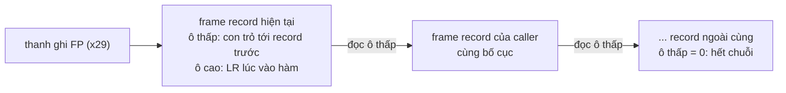

# P2 · Chương 04 — Calling convention và stack frame

## Bạn sẽ hiểu được gì

1. **Q1.** ABI là gì, khác API ở đâu, và vì sao hai object file biên dịch riêng (từ C, Rust, hay assembly) gọi được nhau? → mục 1
2. **Q2.** Trên x86-64 Linux (System V AMD64 ABI), tham số nguyên và giá trị trả về nằm ở thanh ghi nào? Khi nào phải đẩy lên stack? → mục 2
3. **Q3.** Thanh ghi nào *callee-saved*, thanh ghi nào *caller-saved*, và vì sao chia như vậy? → mục 3
4. **Q4.** Vì sao stack phải căn 16 byte *ngay trước lệnh `call`*, và **red zone** 128 byte là gì? → mục 4
5. **Q5.** AArch64 (AAPCS64) khác x86-64 ở đâu: `x0–x7`, `x19–x28`, `x29` (FP), `x30` (LR), `bl`/`ret`? → mục 5
6. **Q6.** Prologue/epilogue trông ra sao trong assembly do `rustc` sinh thật, và frame pointer giúp debugger/profiler unwind stack thế nào? → mục 6
7. **Q7.** Tail call là gì, và `rustc` có bảo đảm nó không? → mục 7
8. **Q8.** Vì sao `extern "Rust"` không có bảo đảm ABI ổn định còn `extern "C"` thì bám theo ABI C của nền tảng, và hệ quả khi gọi qua ranh giới FFI? → mục 8

## Kiến thức cần trước

- [Chương 03 — Assembly x86-64 và AArch64](03-assembly-x86-64-va-aarch64.md): thanh ghi, `mov`, `push`/`pop`, `call`/`ret`, `bl`/`ret`.
- [Chương 01 — Mô hình máy và ISA](01-mo-hinh-may-va-isa.md): khái niệm thanh ghi và stack pointer.

Chi tiết về alignment/padding của *dữ liệu* và về bố cục stack trong không gian địa chỉ tiến trình thuộc phase bộ nhớ: xem [P3 · Chương 07 — Stack, alignment và padding](../03-memory/07-stack-alignment-padding.md). Chương này chỉ tập trung vào quy ước *gọi hàm*.

## 1. ABI là gì và vì sao cần (Q1)

> **Trả lời ngắn.** ABI (Application Binary Interface — giao diện nhị phân) là bộ quy ước mức máy mà hai đoạn code biên dịch riêng phải cùng theo để làm việc cùng nhau được: tham số ở đâu, kết quả ở đâu, thanh ghi nào giữ nguyên, stack căn lề ra sao[^aapcs-scope]. API thì chỉ là giao diện mức source (cách phân biệt của người soạn).

**Giải thích.**

Hình dung (nhận xét của người soạn): hai đội xây hai đầu một cây cầu phải thống nhất trước bản vẽ khớp nối; ABI là bản vẽ đó.

Khi bạn viết `a + b`, trình biên dịch tự do chọn thanh ghi nào chứa `a`. Nhưng khi hàm `f` (biên dịch hôm qua, trong một thư viện) gọi hàm `g` (biên dịch hôm nay, bởi trình biên dịch khác, ngôn ngữ khác), hai bên **phải đồng ý trước** những điều sau, vì không ai nhìn thấy code của bên kia:

1. Tham số truyền ở đâu (thanh ghi nào, hay trên stack) và theo thứ tự nào?
2. Giá trị trả về nằm ở đâu?
3. Thanh ghi nào `g` được phép làm hỏng (*caller-saved*, còn gọi là *scratch* hoặc *temporary*[^aapcs-caller]), thanh ghi nào `g` phải trả nguyên vẹn (*callee-saved*)?
4. Stack được căn lề thế nào lúc vào hàm?

Tập quy ước đó là một phần của **ABI**; **API** là giao diện ở mức source (cách phân biệt này là của người soạn). Glossary của AAPCS64 định nghĩa một nghĩa của ABI là một khía cạnh cụ thể của các đặc tả mà những relocatable file được tạo ra độc lập phải tuân theo để liên kết tĩnh được và chạy được[^aapcs-abi]. ABI nằm ở mức máy nên không chỉ có quy ước gọi hàm mà còn quy định cả bố cục dữ liệu: ví dụ AAPCS64 quy định kích thước của một aggregate (struct) là bội số nhỏ nhất của alignment đủ chứa mọi member của nó[^aapcs-layout]. Tên symbol cũng phải khớp để linker nối được hai object file, nhưng điểm này không nằm trong hai đặc tả dùng ở chương này (nhận xét của người soạn). Glossary của AAPCS64 định nghĩa callee-saved register là thanh ghi có giá trị phải được giữ nguyên qua một lời gọi hàm[^aapcs-callee].

Mỗi nền tảng (hệ điều hành hoặc môi trường chạy) chọn một biến thể ABI cụ thể và có thể thêm ràng buộc; Linux là một nền tảng theo nghĩa đó[^aapcs-platform]. Chương này dùng hai bản: System V AMD64 psABI cho x86-64 Linux (tùy chọn `-mabi=sysv` của GCC được mô tả là ABI dùng trên GNU/Linux và các hệ thống khác[^gcc-abi]), và AAPCS64 (Arm "Procedure Call Standard for the Arm 64-bit Architecture") cho AArch64.

<details><summary>Đi sâu: phiên bản đặc tả được dùng và mô hình dữ liệu</summary>

AAPCS64 được ghim ở tag `2025Q4` của ARM-software/abi-aa. System V psABI được ghim ở commit `e1ce098331da5dbd66e1ffc74162380bcc213236` (đầu nhánh master khi soạn). Windows x64 và Apple arm64 không được bàn ở chương này.

Một ví dụ cho việc ABI quy định "kích thước kiểu": AAPCS64 định nghĩa các mô hình dữ liệu khác nhau, trong đó LP64 là biến thể giống SysV (`int` 32 bit, `long` và con trỏ 64 bit) còn LLP64 là biến thể giống Windows (`int` và `long` 32 bit, `long long` và con trỏ 64 bit)[^aapcs-datamodel]. Hệ quả (suy luận của người soạn): kích thước của `long` là một phần của hợp đồng ABI, và hai bên biên dịch với mô hình dữ liệu khác nhau sẽ hiểu khác nhau về kích thước kiểu.

</details>

**Quay lại Q1:** ABI là hợp đồng mức máy giữa code biên dịch riêng.

## 2. System V AMD64: tham số và giá trị trả về (Q2)

> **Trả lời ngắn.** Sáu tham số nguyên đầu tiên đi qua `rdi, rsi, rdx, rcx, r8, r9`[^sysv-int]; tham số số thực dùng `xmm0`–`xmm7`[^sysv-sse]. Hết thanh ghi thì tham số nằm trên stack[^sysv-nospace]. Giá trị trả về nguyên nằm trong `rax` (thêm `rdx` nếu giá trị gồm hai khối 8 byte kiểu nguyên, như struct hai trường `u64`)[^sysv-ret-int]; kiểu quá lớn thì caller cấp vùng nhớ và truyền địa chỉ như một tham số ẩn[^sysv-ret-mem].

**Giải thích.**

Hình dung (nhận xét của người soạn): phiếu gọi món có sáu ô điền sẵn theo thứ tự; món thừa kẹp tờ phụ (stack).

Với tham số thuộc lớp INTEGER (số nguyên, con trỏ, bool, char…), đặc tả dùng thanh ghi kế tiếp còn trống trong dãy sáu thanh ghi theo thứ tự `rdi, rsi, rdx, rcx, r8, r9`[^sysv-int]. Tham số số thực (lớp SSE) lấy thanh ghi vector kế tiếp, theo thứ tự từ `xmm0` đến `xmm7`[^sysv-sse]. Với hàm variadic (hàm mà số đối số và kiểu của chúng do bên gọi quyết định[^aapcs-variadic], như `printf` trong C), `al` còn mang số lượng thanh ghi vector đã dùng[^sysv-al]. Đặc tả làm tròn kích thước mỗi đối số lên bội của 8 byte và gọi mỗi khối 8 byte là một *eightbyte*[^sysv-eightbyte]. Hết thanh ghi thì đối số đi lên stack: nếu không còn thanh ghi cho một eightbyte nào đó của đối số, cả đối số được truyền trên stack và các thanh ghi đã gán cho nó bị thu hồi[^sysv-nospace]. Đối số nằm trên stack được đẩy theo thứ tự phải sang trái[^sysv-rtl].

Giá trị trả về nguyên nằm trong `rax`; nếu có eightbyte thứ hai cũng thuộc lớp INTEGER thì dùng `rdx`, vì lớp INTEGER lấy thanh ghi kế tiếp trong dãy `rax, rdx`[^sysv-ret-int]. Đó là trường hợp của struct hai trường `u64` ở phần Đi sâu bên dưới, và của `__int128` trong C, kiểu không vừa một thanh ghi mà cần hai[^sysv-int128]. Nếu kiểu thuộc lớp MEMORY — lớp gồm các kiểu được truyền và trả về trong bộ nhớ qua stack[^sysv-memory-class] — thì caller cấp vùng nhớ cho giá trị trả về và truyền địa chỉ vùng đó như một tham số ẩn đầu tiên trong `rdi`; callee trả lại chính địa chỉ đó trong `rax`[^sysv-ret-mem]. Một struct lớn hơn hai eightbyte thì cả đối số được truyền trong bộ nhớ, ngoại trừ trường hợp riêng của các kiểu vector rộng (eightbyte đầu thuộc lớp SSE, các eightbyte còn lại thuộc lớp SSEUP — lớp dành cho phần trên của một thanh ghi vector, giải nghĩa của người soạn)[^sysv-agg-mem]; vì vậy struct 24 byte toàn `u64` thuộc lớp MEMORY.

Ví dụ do `rustc` sinh thật. Hàm Rust dưới đây dùng `extern "C"` để bị ép theo ABI của C. Biên dịch bằng `rustc 1.95.0 --target x86_64-unknown-linux-gnu -C opt-level=2 -C panic=abort --emit asm`:

```rust
#[unsafe(no_mangle)]
pub extern "C" fn sum8(a: u64, b: u64, c: u64, d: u64,
                       e: u64, f: u64, g: u64, h: u64) -> u64 {
    a + b + c + d + e + f + g + h
}
```

Kết quả assembly (AT&T syntax, đã lược chỉ thị `.cfi`/`.size`):

```asm
sum8:
	addq	%rdi, %rsi        # a + b
	leaq	(%rdx,%rcx), %rax # c + d
	addq	%rsi, %rax
	addq	%r8, %rax         # + e
	addq	%r9, %rax         # + f
	addq	8(%rsp), %rax     # + g   (từ stack)
	addq	16(%rsp), %rax    # + h   (từ stack)
	retq
```

Sáu tham số đầu đến từ `rdi…r9`; `g` và `h` ở `8(%rsp)` và `16(%rsp)` vì tại điểm vào hàm `%rsp` trỏ vào địa chỉ trả về (do lệnh `call` đẩy)[^sysv-entry], nên tham số stack đầu tiên ở `rsp+8`. Hàm không có prologue vì không đụng thanh ghi callee-saved và không gọi ai (suy luận của người soạn từ asm).

<details><summary>Đi sâu: struct qua x86-64 SysV — MEMORY, hai eightbyte, con trỏ ẩn</summary>

Với struct, quy tắc phân loại khác tùy kích thước. Biên dịch cùng cách với `#[repr(C)] struct Three { a: u64, b: u64, c: u64 }` (24 byte, lớn hơn hai eightbyte nên thuộc lớp MEMORY[^sysv-agg-mem]):

```rust
#[unsafe(no_mangle)]
pub extern "C" fn take_c(t: Three) -> u64 { t.a + t.b + t.c }
```

```asm
take_c:
	movq	16(%rsp), %rax
	addq	8(%rsp), %rax
	addq	24(%rsp), %rax
	retq
```

Struct được *sao chép nguyên khối lên stack* (đối số nằm ở `8(%rsp)…24(%rsp)`), đúng quy tắc: lớp MEMORY thì đối số được truyền trên stack tại địa chỉ tôn trọng alignment của đối số[^sysv-mem]. Cùng hàm, nhưng với `extern "Rust"`, `rustc` sinh code khác hẳn — xem mục 8.

Ngược lại, struct hai trường `#[repr(C)] Two { a: u64, b: u64 }` trả về từ `extern "C" fn mk2(x: u64) -> Two` được sinh thành:

```asm
mk2:
	movq	%rdi, %rax        # Two.a = x   -> rax
	leaq	1(%rdi), %rdx     # Two.b = x+1 -> rdx
	retq
```

còn struct ba trường (`Big`, 24 byte) trả về qua con trỏ ẩn ở `rdi`:

```asm
mk:
	movq	%rdi, %rax        # trả lại địa chỉ đã nhận
	leaq	1(%rsi), %rcx
	movq	%rsi, (%rdi)      # Big.a = x   (x giờ nằm ở rsi!)
	addq	$2, %rsi
	movq	%rcx, 8(%rdi)
	movq	%rsi, 16(%rdi)
	retq
```

Để ý: tham số `x` giờ là tham số *thứ hai* (`rsi`), vì `rdi` bị tham số ẩn chiếm — đúng "tham số ẩn đầu tiên" của đặc tả[^sysv-ret-mem].

</details>

**Quay lại Q2:** sáu tham số nguyên vào `rdi…r9`, số thực vào `xmm0–7`, phần thừa lên stack; trả về ở `rax` (và `rdx`) hoặc qua con trỏ ẩn.

## 3. Caller-saved và callee-saved (Q3)

> **Trả lời ngắn.** Thanh ghi *callee-saved* là thanh ghi mà hàm được gọi phải trả lại nguyên giá trị cũ[^aapcs-callee]; *caller-saved* thì hàm gọi tự lưu nếu muốn giữ[^aapcs-caller]. SysV AMD64 bảo toàn `rbx`, `rbp`, `r12`–`r15`, `rsp`[^sysv-regs-table]; AAPCS64 bảo toàn `x19`–`x29` và `sp`[^aapcs-preserve].

**Giải thích.**

Hình dung (nhận xét của người soạn): bếp chung có dụng cụ "dùng xong để đó" (ai cần giữ nội dung thì tự cất) và dụng cụ "mượn phải trả đúng chỗ cũ".

Vì sao chia đôi? Một hàm lá (không gọi hàm khác) hiếm khi cần nhiều thanh ghi, còn một hàm lớn gọi hàm khác thì có giá trị sống qua lời gọi. Nếu *mọi* thanh ghi đều do callee giữ, hàm nhỏ phải lưu/khôi phục thanh ghi nó thậm chí không dùng. Nếu *mọi* thanh ghi do caller giữ, caller phải lưu cả những giá trị callee không đụng đến. Chia đôi là thỏa hiệp: một nhóm "scratch" (caller muốn giữ thì tự lưu quanh lời gọi), một nhóm "bảo toàn" (callee muốn dùng thì tự lưu và khôi phục). Đây là nhận định về thiết kế (nhận xét của người soạn); phần *quy tắc* thì có nguồn ở các mục dưới.

Bảng thanh ghi đầy đủ của đặc tả x86-64 (cột "callee saved") cho thấy: `rbx`, `rbp`, `r12`–`r15` và `rsp` được bảo toàn; `rax`, `rcx`, `rdx`, `rsi`, `rdi`, `r8`–`r11` và `xmm0`–`xmm15` thì không[^sysv-regs-table]. Quy tắc gốc: hàm được gọi phải bảo toàn giá trị các thanh ghi này cho caller của nó[^sysv-preserve]. AAPCS64 quy định tương tự: một lần gọi hàm phải bảo toàn nội dung các thanh ghi r19–r29 và SP[^aapcs-preserve].

Bảng dưới đây là bản người soạn rút gọn từ hai cột "Usage" và "callee saved" của bảng đó[^sysv-regs-table].

| Thanh ghi | Vai trò (SysV AMD64) | Bảo toàn qua `call`? |
|---|---|---|
| `rdi, rsi, rdx, rcx, r8, r9` | tham số 1–6 (INTEGER) | không |
| `xmm0–xmm7` | tham số số thực | không |
| `rax` (`rdx`) | trả về (nửa thứ hai) | không |
| `r10, r11` | scratch (`r10`: static chain[^sysv-r10]; `r11`: không dùng truyền tham số, để code PLT khỏi phải spill[^sysv-r11]) | không |
| `rbx, r12–r15` | callee-saved, không dùng truyền tham số | **có** |
| `rbp` | callee-saved; tùy chọn làm frame pointer | **có** |
| `rsp` | stack pointer | **có** |

Giải nghĩa hai thuật ngữ trong bảng (của người soạn, không phải câu trích): *static chain* là cách một số ngôn ngữ cho hàm lồng nhau truy cập biến của hàm bao ngoài; *PLT* (procedure linkage table) là đoạn code trung gian dùng khi gọi hàm nằm trong thư viện chia sẻ.

Quy tắc bảo toàn thanh ghi callee-saved được thực thi bằng code ở prologue/epilogue (đoạn code ở đầu và cuối hàm, định nghĩa ở mục 6): hàm muốn dùng `rbx` thì `push` nó lúc vào và `pop` lúc ra — xem hàm `two` ở mục 6.

<details><summary>Đi sâu: nửa SIMD/FP và thanh ghi nền tảng của AAPCS64</summary>

Phần SIMD/FP của AAPCS64: callee phải bảo toàn `v8`–`v15` qua các lời gọi hàm, và chỉ 64 bit thấp của mỗi giá trị lưu trong `v8–v15` cần được bảo toàn — phần rộng hơn là trách nhiệm của caller[^aapcs-vreg]. Các thanh ghi `v0–v7` dùng để truyền tham số và trả kết quả[^aapcs-vregs-args].

`x18` đặc biệt: vai trò của thanh ghi r18 phụ thuộc nền tảng[^aapcs-r18]; ghi chú của đặc tả khuyên người viết code độc lập nền tảng tránh dùng r18 nếu có thể[^aapcs-r18-note].

</details>

**Quay lại Q3:** callee-saved là thanh ghi hàm được gọi phải trả nguyên vẹn; phần còn lại caller tự lo.

## 4. Căn lề stack 16 byte và red zone (Q4)

> **Trả lời ngắn.** Trên x86-64, stack phải căn 16 byte ngay trước lệnh `call`[^sysv-align]; vì `call` đẩy địa chỉ trả về, lúc vào hàm `rsp+8` mới là bội của 16[^sysv-entry]. Đặc tả không nêu lý do thành câu; dữ kiện đi kèm là các kiểu vector (`__m128` trở lên) luôn phải được căn đúng[^sysv-vec-must]. Red zone là 128 byte ngay dưới `rsp` mà handler tín hiệu/ngắt không được ghi đè[^sysv-red]; hàm lá dùng được nó làm toàn bộ frame[^sysv-red-leaf].

**Giải thích.**

Hình dung (nhận xét của người soạn): căn lề như vạch kẻ ô đỗ xe áp dụng ở một thời điểm cố định; red zone như sân trước cửa mà người ngoài không được xây lấn, nên chủ nhà tạm để đồ mà khỏi xin phép.

*Căn lề.* Đặc tả viết: stack cần được căn 16 (32 hoặc 64) byte ngay trước khi lệnh `call` được thực thi[^sysv-align]. Ràng buộc được phát biểu cho điểm *trước `call`*, không phải cho mọi thời điểm (nhận xét của người soạn về cách đặc tả phát biểu). Lúc vào hàm, `rsp` trỏ vào địa chỉ trả về do `call` vừa đẩy, nên `rsp+8` là bội của 16[^sysv-entry]. Một hàm có lời gọi bên trong phải giữ ràng buộc đó trước lời gọi của mình: đó là lý do `two` ở mục 6 có thêm một `pushq %rax` không lưu gì (suy luận của người soạn từ asm). AArch64 đặt ràng buộc khác, trình bày ở mục 5.

*Vì sao 16?* Đặc tả không nêu lý do thành câu cho con số 16. Các dữ kiện liên quan: biên căn tối đa của vùng đối số là alignment lớn nhất của các biến được truyền trên stack[^sysv-max-align]; con số 32/64 trong quy tắc gắn với việc `__m256`/`__m512` được truyền trên stack[^sysv-align-args]; và các kiểu vector `__m128`, `__m256`, `__m512` luôn phải được căn đúng[^sysv-vec-must]. Suy luận của người soạn: quy tắc căn stack tồn tại để các giá trị vector đặt trên stack luôn căn đúng được.

*Red zone.* System V AMD64 cho phép hàm dùng vùng 128 byte ngay dưới `rsp` mà *không cần chỉnh rsp*: vùng này được coi là dành riêng và handler tín hiệu hoặc ngắt không được sửa nó[^sysv-red]. Hệ quả cho hàm lá: hàm lá có thể dùng vùng này cho toàn bộ stack frame, thay vì chỉnh stack pointer ở prologue và epilogue[^sysv-red-leaf].

<details><summary>Đi sâu: ví dụ red zone do rustc sinh, lý do tồn tại, giới hạn</summary>

Ví dụ `leaf_local` x86-64 (`rustc -C opt-level=2 -C panic=abort`):

```rust
#[unsafe(no_mangle)]
pub extern "C" fn leaf_local(i: usize) -> u64 {
    let mut a = [0u64; 4];
    a[i & 3] = i as u64;
    a[1] + a[2]
}
```

```asm
leaf_local:
	xorps	%xmm0, %xmm0
	movaps	%xmm0, -24(%rsp)   # ghi xuống phía DƯỚI rsp: nằm trong red zone
	movaps	%xmm0, -40(%rsp)
	movl	%edi, %eax
	andl	$3, %eax
	movq	%rdi, -40(%rsp,%rax,8)
	movq	-24(%rsp), %rax
	addq	-32(%rsp), %rax
	retq
```

Không có `sub $..., %rsp` nào: biến cục bộ nằm ở `-40(%rsp)…-9(%rsp)`. Bản AArch64 cùng hàm (mục 6) thì có `stp q0, q0, [sp, #-32]!`, tức trừ SP thật. Điều này khớp với AAPCS64 gốc: đặc tả cấm mọi thread truy cập "inactive region" của stack[^aapcs-inactive], vùng từ giới hạn stack đến SP, tức nằm dưới SP[^aapcs-inactive-def]; vì vậy không có khoảng dưới SP để hàm lá dùng như red zone của SysV (suy luận của người soạn từ hai câu trích).

Chú thích của đặc tả SysV ghi rằng các vị trí trong phạm vi 128 byte có thể được địa chỉ hóa bằng displacement một byte[^sysv-red-why]; theo suy luận của người soạn, đó là lợi ích về độ dài mã của vùng 128 byte. Cái giá của red zone là nó chỉ an toàn khi không có gì được phép ghi đè vùng dưới `rsp`: `rustc` có cờ `-C no-redzone` để tắt nó và mặc định phụ thuộc target[^rustc-redzone], còn Makefile của kernel Linux v6.8 cho x86-64 thêm `-mno-red-zone` cho C và `-Cno-redzone=y` cho Rust[^linux-redzone]. Lý do kernel tắt red zone không có trong các nguồn đã tải; suy luận của người soạn: trong kernel, ngắt đến chạy ngay trên stack đang dùng nên bảo đảm "handler không sửa red zone" của SysV không giữ được.

</details>

**Quay lại Q4:** căn 16 byte chỉ bắt buộc ngay trước `call`; red zone là 128 byte dưới `rsp` cho hàm lá.

## 5. AAPCS64 (AArch64) khác x86-64 ở đâu (Q5)

> **Trả lời ngắn.** AArch64 truyền tham số và trả kết quả qua `x0–x7`[^aapcs-r0r7], bảo toàn `x19–x29` và `sp`[^aapcs-preserve]. Lệnh `bl` ghi địa chỉ trả về vào `x30` (LR) thay vì đẩy lên stack[^dis-bl], và `ret` nhảy về `x30`[^dis-ret]. Kết quả lớn đi qua địa chỉ trong `x8`[^aapcs-x8].

**Giải thích.**

Hình dung (nhận xét của người soạn): x86-64 để địa chỉ về nhà trên "bàn chung" (stack); AArch64 giữ nó trong "túi áo" (`x30`), nhưng ghé thêm nơi nữa thì phải cất vào bàn trước.

*Thanh ghi.* AArch64 có 31 thanh ghi đa dụng 64 bit nhãn r0–r30 — gọi là `x0–x30` trong ngữ cảnh 64 bit, `w0–w30` trong ngữ cảnh 32 bit — cộng thanh ghi stack pointer SP dùng được với một số lệnh hạn chế[^aapcs-gpr]. Theo Table 2 của AAPCS64, `x0–x7` là thanh ghi tham số/kết quả, `x8` là "indirect result location register" và `x9–x15` là thanh ghi tạm[^aapcs-table]. Bốn thanh ghi `x16`, `x17`, `x29`, `x30` có vai trò đặc biệt và mang nhãn IP0, IP1, FP và LR[^aapcs-special]. Cụ thể, `x29` là frame pointer (FP), `x30` là link register (LR), còn `x16/x17` (IP0/IP1) là hai thanh ghi scratch mà linker có thể dùng giữa một hàm và hàm nó gọi[^aapcs-ip]. `x18` là platform register, vai trò tùy nền tảng[^aapcs-r18]; `x19–x28` cùng `x29` và `sp` là các thanh ghi được bảo toàn qua lời gọi hàm[^aapcs-preserve]. Tám thanh ghi đầu r0–r7 được dùng để truyền giá trị tham số vào hàm con và trả kết quả từ hàm[^aapcs-r0r7].

*Kết quả lớn.* Nếu kiểu cần truyền bằng thanh ghi thì trả về ở đúng các thanh ghi đó[^aapcs-ret-reg]; nếu quá lớn, caller phải dành một khối nhớ đủ kích thước và alignment để chứa kết quả, và địa chỉ khối nhớ được truyền như một đối số bổ sung trong `x8`[^aapcs-x8]. Khác x86-64: địa chỉ vào `x8`, *không* chiếm chỗ tham số `x0`. Ta thấy đúng điều đó trong assembly thật của `mk` (cùng source với mục 2, biên dịch trong container Linux aarch64 với `rustc 1.95.0`):

```asm
mk:
	add	x9, x0, #1
	add	x10, x0, #2
	stp	x0, x9, [x8]      // ghi Big.a, Big.b vào vùng caller cấp (x8)
	str	x10, [x8, #16]    // ghi Big.c
	ret
```

Và `x` vẫn ở `x0`. Còn `Two` (16 byte) trả về trong cặp thanh ghi (quan sát: `mk2` là `add x1, x0, #1; ret` — `a` ở `x0` sẵn có, `b` ở `x1`). Hai quan sát này khớp với mốc 16 byte trong quy tắc truyền đối số của AAPCS64: đối số kiểu composite lớn hơn 16 byte bị chép vào bộ nhớ do caller cấp rồi thay bằng con trỏ tới bản chép[^aapcs-b4] (liên hệ giữa quy tắc đối số này và cách trả kết quả là suy luận của người soạn).

*Gọi và trả về.* (Cơ chế `call`/`bl`/`ret` được trình bày kỹ hơn ở [Chương 03, mục 6](03-assembly-x86-64-va-aarch64.md); ở đây chỉ nhắc phần cần cho prologue.) x86-64 `call` đẩy địa chỉ trả về lên stack[^sysv-entry]. AArch64 không làm vậy: lệnh `bl` đặt `x30 = pc + 4` và `pc = addr`[^dis-bl], và `ret` nhảy về giá trị trong `x30`[^dis-ret]. AAPCS64 mô tả tương tự: BL chuyển giá trị kế tiếp của program counter — địa chỉ trả về — vào link register (LR)[^aapcs-bl]. Hệ quả (suy luận của người soạn từ cơ chế `bl`): hàm lá không phải chạm stack để trả về; nhưng hàm *không phải lá* phải cất `x30` ở đâu đó trước khi gọi `bl` khác, nếu không địa chỉ trả về bị ghi đè. Đó là lý do prologue AArch64 của hàm không phải lá thường lưu `x30` (cùng `x29`), như `stp x29, x30, [sp, #-32]!` trong ví dụ `two` ở mục 6 (quan sát từ `rustc`; cách lưu cụ thể là lựa chọn của compiler, không phải điều AAPCS64 bắt buộc).

*Căn lề stack.* AAPCS64 đòi `SP mod 16 = 0` (stack phải căn quad-word) tại mọi thời điểm truy cập bộ nhớ qua SP[^aapcs-sp16]. Khác x86-64 (ABI chỉ ràng buộc *ngay trước `call`*[^sysv-align]), nên prologue AArch64 điều chỉnh SP theo bội 16 (xem `stp ... [sp, #-32]!` ở mục 6, hay `sub sp, sp, #48` ở phần Đi sâu của mục đó).

<details><summary>Đi sâu: <code>sum8</code> trên AArch64</summary>

Cũng với `sum8`, bản AArch64 không đụng stack: tám tham số vừa đúng `x0–x7`:

```asm
sum8:
	add	x8, x2, x3
	add	x9, x1, x0
	add	x10, x4, x5
	add	x8, x9, x8
	add	x9, x10, x6
	add	x8, x8, x9
	add	x0, x8, x7
	ret
```

</details>

**Quay lại Q5:** `x0–x7` cho tham số/kết quả, `x8` cho con trỏ kết quả lớn, địa chỉ trả về ở `x30`.

## 6. Prologue, epilogue và frame pointer (Q6)

> **Trả lời ngắn.** Mỗi lần gọi hàm có một *stack frame* — phần stack riêng của lần gọi đó[^dis-frame]. Prologue cấp chỗ trên stack và lưu thanh ghi cần bảo toàn, epilogue khôi phục chúng và giải phóng frame[^dwarf-prologue]. Debugger/profiler đi ngược stack bằng chuỗi frame record nối qua frame pointer[^aapcs-fp] hoặc bằng bảng `.eh_frame`[^sysv-unwind].

**Giải thích.**

Hình dung (nhận xét của người soạn): mỗi lần gọi là một tờ giấy nháp mới đặt lên tờ cũ; frame pointer là dây xỏ nối các tờ để lần ngược được.

*Vấn đề.* Mỗi lần gọi hàm cần một chỗ để: lưu địa chỉ trả về, lưu thanh ghi callee-saved mà hàm này muốn dùng, chứa biến cục bộ không vừa thanh ghi, chứa tham số tràn (danh sách này là cách diễn đạt của người soạn). Chỗ đó là **stack frame** — vùng stack riêng của một lần gọi. Giáo trình *Dive into Systems* mô tả stack frame (còn gọi là activation frame hay activation record) là phần stack được cấp cho một lần gọi hàm[^dis-frame]. **Prologue** là đoạn code cấp chỗ trên stack và thực hiện việc lưu thanh ghi; **epilogue** là đoạn code khôi phục thanh ghi và giải phóng frame — đó là cách chuẩn DWARF định nghĩa hai từ này[^dwarf-prologue].

*x86-64: ví dụ có frame.* Nguồn (`ext` là hàm `#[inline(never)]` trả `x ^ 0x55`):

```rust
#[unsafe(no_mangle)]
pub extern "C" fn two(x: u64) -> u64 {
    let a = ext(x);
    let b = ext(a + 1);
    a * b
}
```

`rustc --target x86_64-unknown-linux-gnu -C opt-level=2 -C panic=abort` sinh (đã lược `.cfi`):

```asm
two:
	pushq	%r14              # --- prologue: lưu callee-saved
	pushq	%rbx
	pushq	%rax              # chỉ để chỉnh stack, không lưu giá trị
	movq	ext@GOTPCREL(%rip), %r14
	callq	*%r14             # a = ext(x)      (x vẫn ở rdi, truyền thẳng)
	movq	%rax, %rbx        # a cần sống qua lời gọi thứ hai -> rbx (callee-saved)
	leaq	1(%rax), %rdi
	callq	*%r14             # b = ext(a+1)
	imulq	%rbx, %rax        # a * b
	addq	$8, %rsp          # --- epilogue
	popq	%rbx
	popq	%r14
	retq
```

Đọc từng bước:

1. Giá trị `a` phải sống qua lời gọi `ext` thứ hai. `rax` là caller-saved nên `ext` được quyền làm hỏng nó; do đó compiler đặt `a` vào `rbx` — thanh ghi callee-saved. Nhưng `two` cũng là callee với caller của nó, nên phải *lưu `rbx` cũ* (`pushq %rbx`) và khôi phục lúc thoát. Tương tự `r14` giữ con trỏ hàm `ext`. Đây chính là quy tắc "hàm được gọi phải bảo toàn các thanh ghi này"[^sysv-preserve] được thực thi bằng code.
2. `pushq %rax` đầu tiên không lưu gì có ý nghĩa; nó trừ `rsp` thêm 8 byte. Lý do: lúc vào `two`, địa chỉ trả về đã bị `call` đẩy, nên `rsp+8` là bội của 16 (quy tắc ABI[^sysv-entry]); ba lần `push` (24 byte) cộng 8 byte địa chỉ trả về cho 32 → `rsp` lại là bội của 16 ngay trước hai lệnh `callq`, đúng quy tắc căn lề ở mục 4[^sysv-align]. Thiếu lần push này thì `rsp` lệch 8 tại chỗ gọi `ext`. Đây là (suy luận của người soạn) từ số học trên asm và quy tắc căn lề; asm cho thấy đúng ba push và một `addq $8, %rsp` đối xứng.
3. Epilogue đối xứng: bỏ vùng đệm, `pop` ngược thứ tự push, rồi `retq` (lấy địa chỉ trả về từ đỉnh stack).
4. `ext@GOTPCREL(%rip)` là cách nạp địa chỉ của `ext` qua bảng GOT, một kỹ thuật của code position-independent; chi tiết thuộc chủ đề linking, không cần để hiểu quy ước gọi (giải nghĩa của người soạn).

*AArch64: cùng hàm `two`* (container, `rustc 1.95.0 -C opt-level=2 -C panic=abort`):

```asm
two:
	stp	x29, x30, [sp, #-32]!   // --- prologue: sp -= 32; lưu FP, LR
	str	x19, [sp, #16]          // lưu x19 (callee-saved)
	mov	x29, sp                 // FP = SP: dựng frame record
	bl	ext                     // a = ext(x)
	mov	x19, x0                 // a sống qua lời gọi sau -> x19
	add	x0, x0, #1
	bl	ext                     // b = ext(a+1)
	mul	x0, x0, x19
	ldr	x19, [sp, #16]          // --- epilogue
	ldp	x29, x30, [sp], #32     // khôi phục FP, LR; sp += 32
	ret
```

Điểm khác x86-64: `stp ... [sp, #-32]!` là *pre-index store pair* — một lệnh vừa trừ SP vừa ghi hai thanh ghi; `ldp ... [sp], #32` là *post-index* (các chế độ địa chỉ này được giải thích ở [Chương 03](03-assembly-x86-64-va-aarch64.md)). Frame dài 32 byte (bội của 16): `[sp]` = FP cũ, `[sp+8]` = LR, `[sp+16]` = `x19`, 8 byte còn lại là đệm để giữ SP bội 16. `x29` được đặt trỏ vào frame record này.

*Unwind stack.* Debugger (như `gdb`, `lldb`) cần in backtrace và profiler (như `perf`) cần lấy call stack tại mỗi mẫu (nhận xét của người soạn về bối cảnh dùng). DWARF mô tả việc debugger "unwind ảo" stack theo từng bước: khôi phục các thanh ghi mà activation hiện tại đã lưu, rồi tính CFA và vị trí code của activation trước đó[^dwarf-virtual]. Với panic của Rust, unwinder tháo từng Rust frame và gọi `drop` của các đối tượng còn sống trong frame đó[^rust-panic-drop]. Cả hai đều cần đi ngược từ frame hiện tại sang frame của caller, rồi caller của caller…

**Cách 1 — chuỗi frame pointer.** AAPCS64 đòi code tuân thủ dựng một danh sách liên kết các stack frame, mỗi frame nối tới frame của caller bằng một frame record gồm hai giá trị 64 bit trên stack; FP trỏ vào frame record trong cùng, ô có địa chỉ thấp nhất trỏ đến record trước, ô có địa chỉ cao nhất chứa giá trị LR lúc vào hàm[^aapcs-fp]; cuối chuỗi được đánh dấu bằng địa chỉ 0 ở trường trỏ đến frame trước[^aapcs-fp-end]. Do đó unwinder chỉ cần lặp: đọc `[FP+8]` lấy địa chỉ trả về, đọc `[FP]` lấy FP kế tiếp (suy luận của người soạn từ bố cục record). Chi phí thấp: chỉ tốn một thanh ghi và vài lệnh mỗi hàm (nhận xét của người soạn). Tuy vậy, đặc tả để *nền tảng* quyết định mức độ tuân thủ, từ mức đòi FP luôn trỏ vào một frame record hợp lệ (có ngoại lệ cho hàm nhỏ không sửa link register) đến mức cho phép không duy trì chuỗi frame và dùng FP như thanh ghi đa dụng callee-saved[^aapcs-fp-levels].



Trên x86-64, đặc tả ghi `rbp` là thanh ghi callee-saved, tùy chọn dùng làm frame pointer[^sysv-regs-table], và có chú thích rằng có thể tránh dùng `rbp` làm frame pointer: kỹ thuật này tiết kiệm hai lệnh ở prologue và epilogue và cho thêm một thanh ghi đa dụng[^sysv-rbp]. Ví dụ `two` ở trên không có `pushq %rbp`, tức bản biên dịch mặc định cho x86-64 Linux ở đó không dùng `rbp` làm frame pointer — quan sát một lần biên dịch với `rustc 1.95.0`; mặc định của `rustc` phụ thuộc target[^rustc-fp].

**Cách 2 — bảng unwind (`.eh_frame` / DWARF CFI).** Khi không có frame pointer, thông tin vẫn có thể phục hồi bằng một bảng mô tả, tại mỗi địa chỉ lệnh, cách tính **CFA** (Canonical Frame Address — địa chỉ định danh một call frame, thường là giá trị stack pointer tại điểm gọi trong frame trước[^dwarf-cfa]) và thanh ghi nào đã được lưu ở đâu (DWARF là chuẩn định dạng thông tin debug). Đặc tả System V nói rằng stack frame không tự mô tả, và ở nơi cần unwind (như xử lý exception) thì phải sinh thêm thông tin unwind; thông tin đó được lưu trong section `.eh_frame`, có định dạng giống `.debug_frame` của DWARF, kèm vài mở rộng do đặc tả nêu[^sysv-unwind].

| | Frame pointer chain | Bảng `.eh_frame` |
|---|---|---|
| Chi phí runtime | 1 thanh ghi + vài lệnh mỗi hàm | không (bảng nằm ngoài code) |
| Tốc độ unwind | rất nhanh (lần theo con trỏ) | chậm hơn (tra bảng, parse DWARF) |
| Độ tin cậy khi thiếu FP | không dùng được | dùng được |

Bản chất đánh đổi trong bảng là nhận xét của người soạn.

<details><summary>Đi sâu: frame pointer ép bật, chỉ thị .cfi, mặc định theo target</summary>

Bố cục frame trong mô hình ARM64 của *Dive into Systems*: frame hiện hành bị chặn bởi stack pointer ở đầu (địa chỉ thấp) và frame pointer ở đáy (địa chỉ cao)[^dis-frame-arm]; trên x86-64 không dùng `rbp` làm frame pointer thì không có "đáy" tường minh như vậy (suy luận của người soạn).

Ví dụ `leaf_local` (hàm lá có mảng cục bộ, mục 4) trong lần biên dịch mặc định trên AArch64 Linux không có frame record, nhưng khi thêm `-C force-frame-pointers=yes` thì có:

```asm
leaf_local:                      // -C force-frame-pointers=yes
	sub	sp, sp, #48
	stp	x29, x30, [sp, #32]
	add	x29, sp, #32
	...
	ldp	x29, x30, [sp, #32]
	add	sp, sp, #48
	ret
```

(Bản mặc định chỉ `stp q0, q0, [sp, #-32]!` / `add sp, sp, #32` — không có `x29`; quan sát. Điều đó không mâu thuẫn với AAPCS64: ở mức tuân thủ cao nhất mà đặc tả liệt kê, hàm nhỏ không sửa link register vẫn được phép không tạo frame record[^aapcs-fp-small]. Nền tảng Linux chọn mức nào thì chương này không khẳng định.)

Thêm `-C force-frame-pointers=yes` cho hàm `two` x86-64:

```asm
two:                             # -C force-frame-pointers=yes
	pushq	%rbp
	movq	%rsp, %rbp       # rbp trỏ vào [rbp]=rbp cũ, [rbp+8]=địa chỉ trả về
	pushq	%r14
	pushq	%rbx
	...
	popq	%rbx
	popq	%r14
	popq	%rbp
	retq
```

Cờ này được `rustc` ghi: nó ép dùng frame pointer, còn nếu không ép bật thì hành vi mặc định phụ thuộc target[^rustc-fp]. Ghi chú thêm: các ví dụ ở đây cho thấy *hai target* khác mặc định với cùng source — đó là quan sát của một lần chạy `rustc 1.95.0`, không phải bảo đảm.

Các chỉ thị `.cfi_*` trong asm do compiler sinh là đầu vào để assembler tạo bảng `.eh_frame`: `.cfi_startproc` được dùng ở đầu mỗi hàm cần có một entry trong `.eh_frame`[^as-cfi-start]. Ví dụ trong `two` của AArch64:

```asm
	stp	x29, x30, [sp, #-32]!
	.cfi_def_cfa_offset 32
	...
	mov	x29, sp
	.cfi_def_cfa w29, 32
	.cfi_offset w19, -16
	.cfi_offset w30, -24
	.cfi_offset w29, -32
```

`.cfi_def_cfa_offset 32` sửa quy tắc tính CFA: thanh ghi giữ nguyên, offset mới là 32[^as-cfi-def-offset]. `.cfi_def_cfa w29, 32` đặt quy tắc mới: lấy địa chỉ trong thanh ghi rồi cộng offset[^as-cfi-def]; `w29` ở đây là thanh ghi số 29, tức `x29` (suy luận của người soạn). `.cfi_offset r, n` nghĩa là giá trị trước đó của `r` được lưu tại địa chỉ CFA + n[^as-cfi-offset]. Đọc như vậy (suy luận của người soạn): ngay sau `stp` SP đã giảm 32, nên CFA = SP hiện tại + 32, chính là giá trị SP trước prologue; và `x19`, `x30`, `x29` được lưu ở CFA−16, CFA−24, CFA−32, khớp bố cục `[sp+16]`, `[sp+8]`, `[sp]` đã phân tích ở trên. `rustc` có cờ `-C force-unwind-tables` để ép sinh bảng unwind[^rustc-unwind-tables].

</details>

**Quay lại Q6:** prologue/epilogue dựng và dỡ frame; unwind bằng chuỗi frame pointer hoặc bảng `.eh_frame`.

## 7. Tail call (Q7)

> **Trả lời ngắn.** Tail call là lời gọi nằm ở vị trí cuối của hàm: thay vì chồng thêm một frame, frame của hàm gọi được thay bằng frame của hàm được gọi[^rust-tail-def], nên compiler có thể đổi `call; ret` thành một lệnh nhảy. Trong Rust ổn định đó chỉ là tối ưu hóa mà tài liệu nói là không có bảo đảm[^rust-tco-noguar]; cách yêu cầu tường minh là `become`, hiện còn là tính năng chưa ổn định[^rust-become], chỉ dùng được trên nightly[^rust-nightly-flag].

**Giải thích.**

Hình dung (nhận xét của người soạn): việc cuối của bạn là chuyển máy cho đồng nghiệp trả lời thẳng khách; bạn rút khỏi đường dây.

**Vấn đề.** Với `fn tail(x) { ext(x + 1) }`, sau khi `ext` trả về `tail` không làm gì thêm ngoài việc trả tiếp giá trị đó. Giữ một frame cho `tail` trong lúc `ext` chạy là lãng phí (nhận xét của người soạn); và nếu mọi lời gọi trong một vòng gọi đều là tail call thì stack không lớn vô hạn[^rust-tail-def].

**Cơ chế.** Compiler thay `call ext; ret` bằng một lệnh **nhảy** thẳng (`jmp`/`b`) tới `ext` sau khi đã dỡ frame của chính mình và sắp lại tham số (mô tả cơ chế của người soạn, minh họa bằng asm bên dưới). `ext` khi `ret` sẽ trả thẳng về caller của `tail`. AAPCS64 mô tả: nếu lời gọi từ S1 tới S2 là "tail call", thì địa chỉ trả về X sẽ là địa chỉ do caller của S1 cung cấp[^aapcs-tail]. Assembly thật (`-C opt-level=2`):

```asm
# x86-64
tail:
	incq	%rdi
	jmpq	*ext@GOTPCREL(%rip)   # jmp, không phải call
```

```asm
// AArch64
tail:
	add	x0, x0, #1
	b	ext                       // b, không phải bl
```

Cả hai không có prologue, không dùng stack, và `ret` của `ext` quay về thẳng caller của `tail`.

**Trong Rust.** Trang std của từ khóa `become` mô tả: khi tail call một hàm, thay vì thêm frame của nó vào stack, frame của caller được thay trực tiếp bằng frame của callee, nên vòng gọi chỉ dùng tail call có stack tăng bị chặn trên[^rust-tail-def]. Cũng trang đó nói compiler có thể tự thay lời gọi thường bằng tail call (tail call optimization, TCO) nhưng không có bảo đảm sẽ làm vậy[^rust-tco-noguar]. Muốn bảo đảm thì phải dùng cú pháp `become`, nhưng nó chưa ổn định: Unstable Book 1.95.0 liệt kê `explicit_tail_calls` là tính năng cho phép tail call tường minh qua biểu thức `become`[^rust-become], và trang `become` nói tính năng này hiện chưa hoàn chỉnh, có thể chạy không đúng[^rust-become-incomplete]. Tính năng unstable chỉ dùng được trên toolchain nightly kèm feature flag[^rust-nightly-flag]. Vì vậy trong Rust ổn định không nên dựa vào tail call để đệ quy vô hạn (nhận xét của người soạn).

<details><summary>Đi sâu: vì sao tail call hay bị phá, điều kiện của <code>become</code>, và build không tối ưu</summary>

Tài liệu của `become` nêu một lý do tail call thường không xảy ra trong Rust: để TCO được thực hiện, lời gọi phải là việc cuối cùng hàm làm và được trả thẳng ra, nhưng yêu cầu này hay bị phá bởi drop code của biến cục bộ, vốn chạy sau khi tính xong biểu thức trả về[^rust-tco-drop]. Vì vậy `become` đổi cả thứ tự drop: biến cục bộ bị drop trước khi đánh giá lời gọi[^rust-become-drop].

Hiện tại, để bảo đảm compiler thực hiện được tail call, `become` đòi caller và callee cùng ABI, cùng tham số và cùng kiểu trả về (kèm một số điều kiện khác)[^rust-become-req]. Nhận xét của người soạn: điều kiện "cùng ABI" khớp với cơ chế ở trên — frame cũ chỉ thay được bằng lời gọi mới nếu hai bên nhận tham số theo cùng một quy ước.

Cùng source ở `-C opt-level=0` thì `rustc` sinh code `callq` kèm kiểm tra tràn số (do debug build cộng có kiểm tra overflow), tức không có tail call (quan sát trên x86-64, rustc 1.95.0). Đây là bằng chứng quan sát rằng tail call phụ thuộc mức tối ưu hóa.

</details>

**Quay lại Q7:** tail call biến `call; ret` thành `jmp`/`b`; trong Rust ổn định chỉ là tối ưu.

## 8. `extern "Rust"` và `extern "C"`: ABI ổn định và FFI (Q8)

> **Trả lời ngắn.** ABI "Rust" là calling convention mặc định của hàm Rust và không có bảo đảm ổn định[^rust-abi-rust]; ABI "C" khớp ABI mặc định của compiler C chủ đạo cho target[^rust-abi-c]. Vì vậy ở ranh giới FFI người ta dùng `extern "C"` cho hàm và `#[repr(C)]` cho struct, biểu diễn được thiết kế để tạo kiểu tương tác được với C[^rust-repr-c].

**Giải thích.**

Hình dung (nhận xét của người soạn): `extern "C"` là tiếng quốc tế mọi bên cam kết dùng; `extern "Rust"` là tiếng nội bộ được phép đổi từ vựng bất cứ lúc nào.

Reference của Rust định nghĩa các chuỗi ABI. Với `extern "Rust"`: đó là calling convention gốc của hàm và closure Rust, là mặc định khi hàm khai báo không dùng `extern fn`, và ABI Rust không đưa ra bảo đảm ổn định nào[^rust-abi-rust]. Còn `extern "C"`: khớp với ABI mặc định mà compiler C thống trị chọn cho target[^rust-abi-c]. Mục functions của Reference xác nhận ABI mặc định: khi bỏ `extern "Abi"` thì ABI "Rust" được gán[^rust-fn-default].

Ý nghĩa thực tế: (a) ABI "Rust" **không có bảo đảm ổn định**, nên (suy luận của người soạn từ câu trên) nó có thể khác đi giữa các phiên bản compiler, và bạn không được dùng nó để nạp `.so` do compiler khác build hay để export hàm cho C. Ngược lại, Reference không dùng chữ "ổn định" cho ABI "C": nó chỉ nói ABI này khớp ABI mặc định của compiler C chủ đạo cho target; sự ổn định là hệ quả (suy luận của người soạn) của việc ABI nền tảng như System V psABI hay AAPCS64 là đặc tả công khai mà cả hai phía cùng theo. (b) Layout `struct` mặc định (biểu diễn Rust) chỉ có vài bảo đảm tối thiểu — các field được căn đúng, không chồng lấn, và alignment của kiểu không nhỏ hơn alignment lớn nhất của field[^rust-layout-guar] — ngoài ra biểu diễn này không đưa ra bảo đảm nào khác về layout dữ liệu[^rust-layout]; vì vậy cần `#[repr(C)]`, biểu diễn được thiết kế để tạo kiểu tương tác được với C[^rust-repr-c].

Xem sự khác biệt thật: cùng một `#[repr(C)] struct Three` (24 byte), cùng thân hàm, hai ABI trên x86-64:

```rust
#[unsafe(no_mangle)] pub extern "C"    fn take_c(t: Three)    -> u64 { t.a + t.b + t.c }
#[unsafe(no_mangle)] pub extern "Rust" fn take_rust(t: Three) -> u64 { t.a + t.b + t.c }
```

```asm
take_c:                          # C ABI: struct sao chép lên stack
	movq	16(%rsp), %rax
	addq	8(%rsp), %rax
	addq	24(%rsp), %rax
	retq

take_rust:                       # Rust ABI: struct truyền bằng con trỏ trong rdi
	movq	8(%rdi), %rax
	addq	(%rdi), %rax
	addq	16(%rdi), %rax
	retq
```

(Quan sát một lần với `rustc 1.95.0`; chi tiết này là cài đặt, không phải bảo đảm — chính vì vậy Reference nói ABI Rust không ổn định.) Nếu bạn dùng sai ABI qua ranh giới FFI (ví dụ khai báo `extern "Rust"` rồi gọi từ C), hai bên sẽ hiểu khác nhau chỗ để đối số (ở ví dụ trên: con trỏ trong `rdi` so với bản sao trên stack), nên kết quả là sai (suy luận của người soạn; Reference không mô tả riêng trường hợp này).

<details><summary>Đi sâu: cảnh báo layout và unwind qua ranh giới ABI</summary>

- Lint `improper_ctypes_definitions` của `rustc` phát hiện cách dùng không phù hợp trong định nghĩa hàm `extern`[^rustc-lint-ctypes]; khi một `extern "C" fn` nhận struct không `repr(C)`, `rustc 1.95.0` cảnh báo rằng struct có layout không xác định (quan sát).
- **Unwind qua ranh giới ABI.** Mục functions của Reference chia ABI thành loại "unwinding" ("Rust", "C-unwind"…) và "non-unwinding" (gồm "C")[^rust-unwind-cat]. Với `panic=unwind`, một *panic* chạm ranh giới "non-unwinding" như `extern "C"` bị biến thành abort[^rust-abort-boundary] (Reference còn nói không xác định destructor nào chạy trước abort). Chiều ngược lại — một unwind từ ngoài, ví dụ ngoại lệ C++ không được bắt, đi vào code Rust qua ABI "non-unwinding" — là undefined behavior[^rust-panic-ffi-ub]. `extern "C-unwind"` là biến thể giống hệt "C" và "system" tương ứng, nhưng khác hành vi khi callee unwind[^rust-c-unwind]. Reference nói thêm rằng "unwinding" của Rust có thể được cài đặt mà không dùng cơ chế C++ của nền tảng, miễn là giữ bảo đảm dọn tài nguyên[^rust-unwind-impl]; vì vậy việc panic của Rust cụ thể dùng bảng `.eh_frame` ở mục 6 hay cơ chế khác thì chương này không dẫn nguồn riêng (suy luận của người soạn: trên x86-64 Linux thông tin unwind của đặc tả System V là `.eh_frame`[^sysv-unwind]). Chi tiết về panic qua FFI nằm ở [P10 · Chương 08, mục 6](../10-rust-internals/08-panic-abi-ffi.md).

</details>

**Quay lại Q8:** ABI "Rust" không ổn định nên qua FFI dùng `extern "C"` và `#[repr(C)]`.

## Tóm tắt

- ABI là hợp đồng mức máy giữa code biên dịch riêng; calling convention là phần quy định tham số, trả về, thanh ghi bảo toàn, căn lề stack.
- SysV AMD64: tham số nguyên `rdi, rsi, rdx, rcx, r8, r9`, số thực `xmm0–7`, trả về `rax/rdx`; `rbx, rbp, r12–r15, rsp` do callee bảo toàn.
- AAPCS64: tham số/kết quả `x0–x7`, con trỏ kết quả lớn ở `x8`, `x19–x29` và `sp` được bảo toàn, `x29` = FP, `x30` = LR, địa chỉ trả về nằm ở thanh ghi chứ không đẩy lên stack.
- Stack phải căn 16 byte: x86-64 ngay trước `call`; AArch64 tại mọi truy cập qua SP.
- Prologue/epilogue lưu và khôi phục thanh ghi callee-saved mà hàm dùng (và LR trên AArch64) — ta thấy chúng trong asm do `rustc` sinh thật.
- Unwind stack bằng chuỗi frame pointer (nhanh, tốn thanh ghi) hoặc bằng bảng `.eh_frame`/DWARF (không cần FP). Mặc định FP khác nhau giữa target.
- Red zone 128 byte của SysV cho hàm lá dùng vùng dưới `rsp` không cần chỉnh `rsp`.
- Tail call biến `call; ret` thành `jmp`/`b`; trong Rust ổn định chỉ là tối ưu, `become` còn là tính năng nightly.
- `extern "Rust"` không có bảo đảm ổn định ABI; dùng `extern "C"` (và `#[repr(C)]`) qua ranh giới FFI.

## Câu hỏi tự kiểm tra

1. Hàm x86-64 SysV nhận 8 tham số `u64`. Tham số 7 và 8 ở đâu khi vào hàm?
<details><summary>Đáp án</summary>

Trên stack, ở <code>8(%rsp)</code> và <code>16(%rsp)</code> vì <code>(%rsp)</code> chứa địa chỉ trả về do <code>call</code> đẩy[^sysv-entry] (ví dụ <code>sum8</code>; quy tắc: hết thanh ghi thì đối số lên stack[^sysv-nospace]).

</details>

2. Trên AArch64, 8 tham số `u64` đi đâu và kết quả trả ở đâu?
<details><summary>Đáp án</summary>

Tham số trong <code>x0–x7</code>[^aapcs-r0r7], kết quả <code>u64</code> trong <code>x0</code> (kết quả trả đúng các thanh ghi mà một đối số cùng kiểu sẽ dùng[^aapcs-ret-reg]); ví dụ <code>sum8</code> AArch64 không dùng stack.

</details>

3. Thanh ghi nào callee-saved trên SysV AMD64? Trên AAPCS64?
<details><summary>Đáp án</summary>

x86-64: <code>rbx, rbp, r12–r15, rsp</code>[^sysv-regs-table]. AArch64: <code>x19–x29</code> và <code>sp</code>[^aapcs-preserve].

</details>

4. Struct 24 byte trả về từ hàm `extern "C"` đi qua đâu ở x86-64 và AArch64?
<details><summary>Đáp án</summary>

Caller cấp bộ nhớ (ở x86-64, 24 byte lớn hơn hai eightbyte nên thuộc lớp MEMORY[^sysv-agg-mem]); x86-64 truyền địa chỉ trong <code>rdi</code> (và trả lại trong <code>rax</code>)[^sysv-ret-mem]; AArch64 truyền địa chỉ trong <code>x8</code>[^aapcs-x8].

</details>

5. Vì sao <code>two</code> trên x86-64 có thêm <code>pushq %rax</code> không lưu gì?
<details><summary>Đáp án</summary>

Để <code>rsp</code> là bội 16 ngay trước hai lệnh <code>callq</code> (quy tắc căn lề[^sysv-align]); phép tính 8 + 3×8 = 32 là suy luận của người soạn từ asm.

</details>

6. Vì sao prologue AArch64 của hàm không phải lá thường lưu `x30`?
<details><summary>Đáp án</summary>

<code>bl</code> ghi địa chỉ trả về vào <code>x30</code>[^dis-bl]; một <code>bl</code> thứ hai sẽ ghi đè nó, nên phải cất nó ở đâu đó (thường là lên stack) rồi khôi phục trước <code>ret</code>, vốn nhảy về <code>x30</code>[^dis-ret] (suy luận của người soạn; cách cất cụ thể là lựa chọn của compiler).

</details>

7. Red zone là gì và ai được dùng?
<details><summary>Đáp án</summary>

128 byte dưới <code>rsp</code> mà handler tín hiệu/ngắt không được ghi đè; hàm lá có thể dùng cho toàn bộ frame[^sysv-red][^sysv-red-leaf].

</details>

8. Hai cách để debugger đi ngược stack là gì?
<details><summary>Đáp án</summary>

Chuỗi frame record qua frame pointer[^aapcs-fp] và bảng <code>.eh_frame</code>[^sysv-unwind].

</details>

9. Vì sao không nên giả định `become`/tail call trong Rust ổn định?
<details><summary>Đáp án</summary>

Tail call trong Rust ổn định chỉ là tối ưu của compiler và tài liệu nói không có bảo đảm[^rust-tco-noguar] (build <code>opt-level=0</code> cho <code>callq</code>, quan sát); <code>become</code> còn là tính năng chưa ổn định <code>explicit_tail_calls</code>[^rust-become].

</details>

10. Vì sao `take_rust` nhận con trỏ còn `take_c` nhận struct trên stack, và điều đó cho thấy gì?
<details><summary>Đáp án</summary>

ABI "Rust" không có bảo đảm ổn định[^rust-abi-rust] nên compiler tự do chọn cách truyền (suy luận của người soạn; sự khác biệt cụ thể ở ví dụ là quan sát một lần với <code>rustc 1.95.0</code>); ABI "C" khớp ABI mặc định của compiler C cho target[^rust-abi-c].

</details>

11. `-C force-frame-pointers` có mặc định cố định không?
<details><summary>Đáp án</summary>

Không; mặc định phụ thuộc target[^rustc-fp] (ví dụ, quan sát một lần biên dịch: x86-64 Linux không dùng <code>rbp</code> trong <code>two</code>, AArch64 Linux thì dùng <code>x29</code>).

</details>

## Đọc thêm

- System V psABI x86-64, mục 3.2 *Function Calling Sequence* — <https://gitlab.com/x86-psABIs/x86-64-ABI> (đọc đầy đủ thuật toán phân loại tham số, kể cả struct, SSE, x87).
- AAPCS64, mục *The Base Procedure Call Standard* — <https://github.com/ARM-software/abi-aa/blob/2025Q4/aapcs64/aapcs64.rst> (thuật toán gán tham số vào `x0–x7`, quy tắc HFA/HVA).
- *Dive into Systems*, các chương về stack frame trên IA32 và ARM64 — <https://diveintosystems.org/book/C8-IA32/functions.html>, <https://diveintosystems.org/book/C9-ARM64/functions.html> (hình minh họa frame; lưu ý chương x86 là IA32 32-bit, `ebp/esp`, khác 64-bit).
- Rust Reference 1.95.0, *External blocks* — <https://doc.rust-lang.org/1.95.0/reference/items/external-blocks.html> (danh sách ABI string).
- [Chương 03 — Assembly x86-64 và AArch64](03-assembly-x86-64-va-aarch64.md) và [P3 · Chương 07 — Stack, alignment và padding](../03-memory/07-stack-alignment-padding.md) cho nền tảng cú pháp và layout.
- DWARF Debugging Information Format Version 5, mục 6.4 *Call Frame Information* — <https://dwarfstd.org/doc/DWARF5.pdf> (CFA, prologue/epilogue, unwind ảo: nền của bảng `.eh_frame`).
- The Rust Standard Library 1.95.0, từ khóa `become` — <https://doc.rust-lang.org/1.95.0/std/keyword.become.html> (tail call tường minh, điều kiện, ảnh hưởng tới thứ tự drop).
- [P10 · Chương 08 — Panic, ABI, FFI](../10-rust-internals/08-panic-abi-ffi.md), mục 6 — panic băng qua ranh giới FFI: khi nào là abort, khi nào là undefined behavior.

[^aapcs-scope]: AAPCS64, Scope — <https://raw.githubusercontent.com/ARM-software/abi-aa/2025Q4/aapcs64/aapcs64.rst> — "The AAPCS64 defines how subroutines can be separately written, separately compiled, and separately assembled to work together."
[^aapcs-abi]: AAPCS64, Terms and abbreviations (ABI) — <https://raw.githubusercontent.com/ARM-software/abi-aa/2025Q4/aapcs64/aapcs64.rst> — "A particular aspect of the specifications to which independently produced relocatable files must conform in order to be statically linkable and executable."
[^aapcs-layout]: AAPCS64, Data types and alignment (Aggregates) — <https://raw.githubusercontent.com/ARM-software/abi-aa/2025Q4/aapcs64/aapcs64.rst> — "The size of an aggregate shall be the smallest multiple of its alignment that is sufficient to hold all of its members."
[^aapcs-platform]: AAPCS64, Terms and abbreviations (Platform) — <https://raw.githubusercontent.com/ARM-software/abi-aa/2025Q4/aapcs64/aapcs64.rst> — "A platform defines the specific variant of the ABI and may impose additional constraints. Linux is a platform in this sense."
[^gcc-abi]: GCC 13.2.0 manual, x86 Options (-mabi) — <https://gcc.gnu.org/onlinedocs/gcc-13.2.0/gcc/x86-Options.html> — "Permissible values are ‘sysv’ for the ABI used on GNU/Linux and other systems, and ‘ms’ for the Microsoft ABI."
[^aapcs-datamodel]: AAPCS64, Scope — <https://raw.githubusercontent.com/ARM-software/abi-aa/2025Q4/aapcs64/aapcs64.rst> — "LP64: SysV-like variant where int is 32-bit, but long int and pointer are 64-bit. LLP64: Windows-like variant where int and long int are 32-bit, but long long int and pointer are 64-bit."
[^aapcs-callee]: AAPCS64, Glossary (Callee-saved register) — <https://raw.githubusercontent.com/ARM-software/abi-aa/2025Q4/aapcs64/aapcs64.rst> — "A register whose value must be preserved over a function call. If the function being called (the callee) needs to use the register, then it is responsible for saving and restoring the old value."
[^aapcs-caller]: AAPCS64, Glossary (Scratch register, temporary register, caller-saved register) — <https://raw.githubusercontent.com/ARM-software/abi-aa/2025Q4/aapcs64/aapcs64.rst> — "If a function needs to preserve the value held in such a register over a call to another function, then the calling function must save and restore the value."
[^aapcs-variadic]: AAPCS64, Terms and abbreviations (Variadic routine) — <https://raw.githubusercontent.com/ARM-software/abi-aa/2025Q4/aapcs64/aapcs64.rst> — "A routine is variadic if the number of arguments it takes, and their type, is determined by the caller instead of the callee."
[^sysv-int]: System V AMD64 psABI, 3.2.3 Parameter Passing — <https://gitlab.com/x86-psABIs/x86-64-ABI/-/raw/e1ce098331da5dbd66e1ffc74162380bcc213236/x86-64-ABI/low-level-sys-info.tex> — "If the class is INTEGER, the next available register of the sequence"
[^sysv-sse]: System V AMD64 psABI, 3.2.3 Parameter Passing — <https://gitlab.com/x86-psABIs/x86-64-ABI/-/raw/e1ce098331da5dbd66e1ffc74162380bcc213236/x86-64-ABI/low-level-sys-info.tex> — "If the class is SSE, the next available vector register is used, the registers are taken in the order from"
[^sysv-regs-table]: System V AMD64 psABI, Figure 3.4 Register Usage — <https://gitlab.com/x86-psABIs/x86-64-ABI/-/raw/e1ce098331da5dbd66e1ffc74162380bcc213236/x86-64-ABI/low-level-sys-info.tex> — "callee-saved register; optionally used as frame pointer"
[^sysv-eightbyte]: System V AMD64 psABI, 3.2.3 Parameter Passing (Classification) — <https://gitlab.com/x86-psABIs/x86-64-ABI/-/raw/e1ce098331da5dbd66e1ffc74162380bcc213236/x86-64-ABI/low-level-sys-info.tex> — "The size of each argument gets rounded up to eightbytes."
[^sysv-memory-class]: System V AMD64 psABI, 3.2.3 Parameter Passing (Definitions) — <https://gitlab.com/x86-psABIs/x86-64-ABI/-/raw/e1ce098331da5dbd66e1ffc74162380bcc213236/x86-64-ABI/low-level-sys-info.tex> — "This class consists of types that will be passed and returned in memory via the stack."
[^sysv-agg-mem]: System V AMD64 psABI, 3.2.3 Parameter Passing (Classification) — <https://gitlab.com/x86-psABIs/x86-64-ABI/-/raw/e1ce098331da5dbd66e1ffc74162380bcc213236/x86-64-ABI/low-level-sys-info.tex> — "If the size of the aggregate exceeds two eightbytes and the first eightbyte isn't SSE or any other eightbyte isn't SSEUP, the whole argument is passed in memory."
[^sysv-int128]: System V AMD64 psABI, 3.2.3 Parameter Passing (Classification) — <https://gitlab.com/x86-psABIs/x86-64-ABI/-/raw/e1ce098331da5dbd66e1ffc74162380bcc213236/x86-64-ABI/low-level-sys-info.tex> — "yet they do not fit into one general purpose register but require two registers."
[^sysv-nospace]: System V AMD64 psABI, 3.2.3 Parameter Passing — <https://gitlab.com/x86-psABIs/x86-64-ABI/-/raw/e1ce098331da5dbd66e1ffc74162380bcc213236/x86-64-ABI/low-level-sys-info.tex> — "If there are no registers available for any eightbyte of an argument, the whole argument is passed on the stack. If registers have already been assigned for some eightbytes of such an argument, the assignments get reverted."
[^sysv-al]: System V AMD64 psABI, 3.2.3 Parameter Passing (varargs) — <https://gitlab.com/x86-psABIs/x86-64-ABI/-/raw/e1ce098331da5dbd66e1ffc74162380bcc213236/x86-64-ABI/low-level-sys-info.tex> — "is used as hidden argument to specify the number of vector registers used."
[^sysv-r10]: System V AMD64 psABI, Figure 3.4 Register Usage — <https://gitlab.com/x86-psABIs/x86-64-ABI/-/raw/e1ce098331da5dbd66e1ffc74162380bcc213236/x86-64-ABI/low-level-sys-info.tex> — "temporary register, used for passing a function's static chain pointer"
[^sysv-r11]: System V AMD64 psABI, 3.2.3 Parameter Passing (footnote) — <https://gitlab.com/x86-psABIs/x86-64-ABI/-/raw/e1ce098331da5dbd66e1ffc74162380bcc213236/x86-64-ABI/low-level-sys-info.tex> — "means that code in the PLT need not spill any registers when computing the address to which control needs to be transferred."
[^sysv-entry]: System V AMD64 psABI, 3.2.2 The Stack Frame — <https://gitlab.com/x86-psABIs/x86-64-ABI/-/raw/e1ce098331da5dbd66e1ffc74162380bcc213236/x86-64-ABI/low-level-sys-info.tex> — "immediately after the return address has been pushed,"
[^sysv-rtl]: System V AMD64 psABI, 3.2.3 Parameter Passing — <https://gitlab.com/x86-psABIs/x86-64-ABI/-/raw/e1ce098331da5dbd66e1ffc74162380bcc213236/x86-64-ABI/low-level-sys-info.tex> — "Once registers are assigned, the arguments passed in memory are pushed on the stack in reversed"
[^sysv-ret-int]: System V AMD64 psABI, Returning of Values — <https://gitlab.com/x86-psABIs/x86-64-ABI/-/raw/e1ce098331da5dbd66e1ffc74162380bcc213236/x86-64-ABI/low-level-sys-info.tex> — "If the class is INTEGER, the next available register of the sequence"
[^sysv-ret-mem]: System V AMD64 psABI, Returning of Values — <https://gitlab.com/x86-psABIs/x86-64-ABI/-/raw/e1ce098331da5dbd66e1ffc74162380bcc213236/x86-64-ABI/low-level-sys-info.tex> — "the caller provides space for the return value and passes the address of this storage in"
[^sysv-preserve]: System V AMD64 psABI, 3.2.1 Registers and the Stack Frame — <https://gitlab.com/x86-psABIs/x86-64-ABI/-/raw/e1ce098331da5dbd66e1ffc74162380bcc213236/x86-64-ABI/low-level-sys-info.tex> — "a called function must preserve these registers' values for its caller."
[^sysv-mem]: System V AMD64 psABI, 3.2.3 Parameter Passing — <https://gitlab.com/x86-psABIs/x86-64-ABI/-/raw/e1ce098331da5dbd66e1ffc74162380bcc213236/x86-64-ABI/low-level-sys-info.tex> — "If the class is MEMORY, pass the argument on the stack at an address respecting the arguments alignment"
[^sysv-align]: System V AMD64 psABI, 3.2.2 The Stack Frame — <https://gitlab.com/x86-psABIs/x86-64-ABI/-/raw/e1ce098331da5dbd66e1ffc74162380bcc213236/x86-64-ABI/low-level-sys-info.tex> — "In other words, the stack needs to be 16 (32 or 64) byte aligned immediately before the call instruction is executed."
[^sysv-align-args]: System V AMD64 psABI, 3.2.2 The Stack Frame — <https://gitlab.com/x86-psABIs/x86-64-ABI/-/raw/e1ce098331da5dbd66e1ffc74162380bcc213236/x86-64-ABI/low-level-sys-info.tex> — "The end of the input argument area shall be aligned on a 16 (32 or 64, if"
[^sysv-max-align]: System V AMD64 psABI, 3.2.2 The Stack Frame (footnote) — <https://gitlab.com/x86-psABIs/x86-64-ABI/-/raw/e1ce098331da5dbd66e1ffc74162380bcc213236/x86-64-ABI/low-level-sys-info.tex> — "The maximum aligned boundary is the maximum alignment of all variables passed on stack."
[^sysv-vec-must]: System V AMD64 psABI, 3.1 Machine Interface (Data Representation, Fundamental Types) — <https://gitlab.com/x86-psABIs/x86-64-ABI/-/raw/e1ce098331da5dbd66e1ffc74162380bcc213236/x86-64-ABI/low-level-sys-info.tex> — "must always be aligned properly."
[^sysv-rbp]: System V AMD64 psABI, 3.2.2 The Stack Frame (footnote) — <https://gitlab.com/x86-psABIs/x86-64-ABI/-/raw/e1ce098331da5dbd66e1ffc74162380bcc213236/x86-64-ABI/low-level-sys-info.tex> — "This technique saves two instructions in the prologue and epilogue and makes one additional general-purpose register"
[^sysv-unwind]: System V AMD64 psABI, 4.2 Stack Unwind Algorithm — <https://gitlab.com/x86-psABIs/x86-64-ABI/-/raw/e1ce098331da5dbd66e1ffc74162380bcc213236/x86-64-ABI/low-level-sys-info.tex> — "The stack frames are not self descriptive and where stack unwinding is desirable (such as for exception handling) additional unwind information needs to be generated. The information is stored in an allocatable section"
[^sysv-red]: System V AMD64 psABI, 3.2.2 The Stack Frame — <https://gitlab.com/x86-psABIs/x86-64-ABI/-/raw/e1ce098331da5dbd66e1ffc74162380bcc213236/x86-64-ABI/low-level-sys-info.tex> — "to be reserved and shall not be modified by signal or interrupt handlers."
[^sysv-red-leaf]: System V AMD64 psABI, 3.2.2 The Stack Frame — <https://gitlab.com/x86-psABIs/x86-64-ABI/-/raw/e1ce098331da5dbd66e1ffc74162380bcc213236/x86-64-ABI/low-level-sys-info.tex> — "In particular, leaf functions may use this area for their entire stack frame, rather than adjusting the stack pointer in the prologue and epilogue."
[^sysv-red-why]: System V AMD64 psABI, 3.2.2 The Stack Frame (footnote) — <https://gitlab.com/x86-psABIs/x86-64-ABI/-/raw/e1ce098331da5dbd66e1ffc74162380bcc213236/x86-64-ABI/low-level-sys-info.tex> — "Locations within 128 bytes can be addressed using one-byte displacements."
[^aapcs-gpr]: AAPCS64, General-purpose Registers — <https://raw.githubusercontent.com/ARM-software/abi-aa/2025Q4/aapcs64/aapcs64.rst> — "There are thirty-one, 64-bit, general-purpose (integer) registers visible to the A64 instruction set; these are labeled r0-r30. In a 64-bit context these registers are normally referred to using the names x0-x30; in a 32-bit context the registers are specified by using w0-w30. Additionally, a stack-pointer register, SP, can be used with a restricted number of instructions."
[^aapcs-table]: AAPCS64, Table 2 General-purpose registers and AAPCS64 usage — <https://raw.githubusercontent.com/ARM-software/abi-aa/2025Q4/aapcs64/aapcs64.rst> — "r9…r15 Temporary registers r8 Indirect result location register r0…r7 Parameter/result registers"
[^aapcs-special]: AAPCS64, General-purpose Registers (special roles) — <https://raw.githubusercontent.com/ARM-software/abi-aa/2025Q4/aapcs64/aapcs64.rst> — "In all variants of the procedure call standard, registers r16, r17, r29 and r30 have special roles. In these roles they are labeled IP0, IP1, FP and LR when being used for holding addresses"
[^aapcs-ip]: AAPCS64, General-purpose Registers — <https://raw.githubusercontent.com/ARM-software/abi-aa/2025Q4/aapcs64/aapcs64.rst> — "Registers r16 (IP0) and r17 (IP1) may be used by a linker as a scratch register between a routine and any subroutine it calls"
[^aapcs-r0r7]: AAPCS64, General-purpose registers — <https://raw.githubusercontent.com/ARM-software/abi-aa/2025Q4/aapcs64/aapcs64.rst> — "The first eight registers, r0-r7, are used to pass argument values into a subroutine and to return result values from a function."
[^aapcs-preserve]: AAPCS64, General-purpose registers — <https://raw.githubusercontent.com/ARM-software/abi-aa/2025Q4/aapcs64/aapcs64.rst> — "A subroutine invocation must preserve the contents of the registers r19-r29 and SP."
[^aapcs-vreg]: AAPCS64, SIMD and Floating-Point registers — <https://raw.githubusercontent.com/ARM-software/abi-aa/2025Q4/aapcs64/aapcs64.rst> — "Registers v8-v15 must be preserved by a callee across subroutine calls; the remaining registers (v0-v7, v16-v31) do not need to be preserved (or should be preserved by the caller). Additionally, only the bottom 64 bits of each value stored in v8-v15 need to be preserved"
[^aapcs-vregs-args]: AAPCS64, SIMD and Floating-Point registers — <https://raw.githubusercontent.com/ARM-software/abi-aa/2025Q4/aapcs64/aapcs64.rst> — "The first eight registers, v0-v7, are used to pass argument values into a subroutine and to return result values from a function."
[^aapcs-r18]: AAPCS64, General-purpose registers — <https://raw.githubusercontent.com/ARM-software/abi-aa/2025Q4/aapcs64/aapcs64.rst> — "The role of register r18 is platform specific."
[^aapcs-r18-note]: AAPCS64, General-purpose registers (note) — <https://raw.githubusercontent.com/ARM-software/abi-aa/2025Q4/aapcs64/aapcs64.rst> — "Software developers creating platform-independent code are advised to avoid using r18 if at all possible."
[^aapcs-ret-reg]: AAPCS64, Result return — <https://raw.githubusercontent.com/ARM-software/abi-aa/2025Q4/aapcs64/aapcs64.rst> — "then the result is returned in the same registers as would be used for such an argument."
[^aapcs-x8]: AAPCS64, Result return — <https://raw.githubusercontent.com/ARM-software/abi-aa/2025Q4/aapcs64/aapcs64.rst> — "the caller shall reserve a block of memory of sufficient size and alignment to hold the result. The address of the memory block shall be passed as an additional argument to the function in x8."
[^aapcs-b4]: AAPCS64, Parameter passing (Stage B, rule B.4) — <https://raw.githubusercontent.com/ARM-software/abi-aa/2025Q4/aapcs64/aapcs64.rst> — "If the argument type is a Composite Type that is larger than 16 bytes, then the argument is copied to memory allocated by the caller"
[^aapcs-bl]: AAPCS64, Subroutine calls — <https://raw.githubusercontent.com/ARM-software/abi-aa/2025Q4/aapcs64/aapcs64.rst> — "performs a branch-with-link operation. The effect of executing BL is to transfer the sequentially next value of the program counter—the return address—into the link register (LR)"
[^aapcs-sp16]: AAPCS64, Universal stack constraints — <https://raw.githubusercontent.com/ARM-software/abi-aa/2025Q4/aapcs64/aapcs64.rst> — "SP mod 16 = 0. The stack must be quad-word aligned."
[^aapcs-inactive]: AAPCS64, Universal stack constraints — <https://raw.githubusercontent.com/ARM-software/abi-aa/2025Q4/aapcs64/aapcs64.rst> — "No thread is permitted to access (for reading or for writing) the inactive region of S."
[^aapcs-inactive-def]: AAPCS64, The Stack — <https://raw.githubusercontent.com/ARM-software/abi-aa/2025Q4/aapcs64/aapcs64.rst> — "The inactive region of T's stack is the area of memory denoted by the half-open interval [T.limit, T.SP)."
[^aapcs-fp]: AAPCS64, The Frame Pointer — <https://raw.githubusercontent.com/ARM-software/abi-aa/2025Q4/aapcs64/aapcs64.rst> — "Conforming code shall construct a linked list of stack-frames. Each frame shall link to the frame of its caller by means of a frame record of two 64-bit values on the stack"
[^aapcs-fp-end]: AAPCS64, The Frame Pointer — <https://raw.githubusercontent.com/ARM-software/abi-aa/2025Q4/aapcs64/aapcs64.rst> — "The end of the frame record chain is indicated by the address zero in the address for the previous frame."
[^aapcs-fp-levels]: AAPCS64, The Frame Pointer — <https://raw.githubusercontent.com/ARM-software/abi-aa/2025Q4/aapcs64/aapcs64.rst> — "A platform shall mandate the minimum level of conformance with respect to the maintenance of frame records."
[^aapcs-fp-small]: AAPCS64, The Frame Pointer — <https://raw.githubusercontent.com/ARM-software/abi-aa/2025Q4/aapcs64/aapcs64.rst> — "It may require the frame pointer to address a valid frame record at all times, except that small subroutines which do not modify the link register may elect not to create a frame record"
[^aapcs-tail]: AAPCS64, Subroutine calls (normal return) — <https://raw.githubusercontent.com/ARM-software/abi-aa/2025Q4/aapcs64/aapcs64.rst> — "if the call from S1 to S2 is a “tail call”, X will be the return address supplied by S1's caller."
[^dis-bl]: Dive into Systems, ARM64 functions (bl) — <https://diveintosystems.org/book/C9-ARM64/functions.html> — "Sets x30 = pc + 4 and sets pc = addr"
[^dis-ret]: Dive into Systems, ARM64 functions (ret) — <https://diveintosystems.org/book/C9-ARM64/functions.html> — "The ret instruction restores the value of pc to the value saved in x30"
[^dis-frame]: Dive into Systems, IA32 functions — <https://diveintosystems.org/book/C8-IA32/functions.html> — "The stack frame (also known as the activation frame or the activation record) refers to the"
[^dis-frame-arm]: Dive into Systems, ARM64 functions — <https://diveintosystems.org/book/C9-ARM64/functions.html> — "The active frame is bounded by the stack pointer (at the top of stack, lower address) and frame pointer (at the bottom of the frame, higher address)."
[^dwarf-prologue]: DWARF Debugging Information Format Version 5, 6.4 Call Frame Information — <https://dwarfstd.org/doc/DWARF5.pdf> — "The code that allocates space on the call frame stack and performs the save operation is called the subroutine’s prologue, and the code that performs the restore operation and deallocates the frame is called its epilogue."
[^dwarf-virtual]: DWARF Debugging Information Format Version 5, 6.4 Call Frame Information — <https://dwarfstd.org/doc/DWARF5.pdf> — "A debugger virtually unwinds a stack in steps. Starting with the current activation it virtually restores any registers that were preserved by the current activation and computes the predecessor’s CFA and code location."
[^dwarf-cfa]: DWARF Debugging Information Format Version 5, 6.4 Call Frame Information — <https://dwarfstd.org/doc/DWARF5.pdf> — "We refer to this address as the Canonical Frame Address or CFA. Typically, the CFA is defined to be the value of the stack pointer at the call site in the previous frame (which may be different from its value on entry to the current frame)."
[^as-cfi-start]: GNU as manual 2.42, CFI directives (.cfi_startproc) — <https://sourceware.org/binutils/docs-2.42/as/CFI-directives.html> — ".cfi_startproc is used at the beginning of each function that should have an entry in .eh_frame."
[^as-cfi-def-offset]: GNU as manual 2.42, CFI directives (.cfi_def_cfa_offset) — <https://sourceware.org/binutils/docs-2.42/as/CFI-directives.html> — ".cfi_def_cfa_offset modifies a rule for computing CFA. Register remains the same, but offset is new."
[^as-cfi-def]: GNU as manual 2.42, CFI directives (.cfi_def_cfa) — <https://sourceware.org/binutils/docs-2.42/as/CFI-directives.html> — ".cfi_def_cfa defines a rule for computing CFA as: take address from register and add offset to it."
[^as-cfi-offset]: GNU as manual 2.42, CFI directives (.cfi_offset) — <https://sourceware.org/binutils/docs-2.42/as/CFI-directives.html> — "Previous value of register is saved at offset offset from CFA."
[^rustc-fp]: rustc book 1.95.0, Codegen options (force-frame-pointers) — <https://doc.rust-lang.org/1.95.0/rustc/codegen-options/index.html> — "The default behaviour, if frame pointers are not force-enabled, depends on the target."
[^rustc-unwind-tables]: rustc book 1.95.0, Codegen options (force-unwind-tables) — <https://doc.rust-lang.org/1.95.0/rustc/codegen-options/index.html> — "This flag forces the generation of unwind tables."
[^rustc-redzone]: rustc book 1.95.0, Codegen options (no-redzone) — <https://doc.rust-lang.org/1.95.0/rustc/codegen-options/index.html> — "This flag allows you to disable the red zone. It takes one of the following values: y, yes, on, true or no value: disable the red zone. n, no, off or false: enable the red zone. The default behaviour, if the flag is not specified, depends on the target."
[^linux-redzone]: Linux v6.8, arch/x86/Makefile (nhánh x86-64) — <https://raw.githubusercontent.com/torvalds/linux/v6.8/arch/x86/Makefile> — "KBUILD_CFLAGS += -mno-red-zone KBUILD_CFLAGS += -mcmodel=kernel KBUILD_RUSTFLAGS += -Cno-redzone=y KBUILD_RUSTFLAGS += -Ccode-model=kernel"
[^rust-become]: The Rust Unstable Book 1.95.0, explicit_tail_calls — <https://doc.rust-lang.org/1.95.0/unstable-book/language-features/explicit-tail-calls.html> — "Allows explicit tail calls via become expression."
[^rust-tail-def]: The Rust Standard Library 1.95.0, keyword become — <https://doc.rust-lang.org/1.95.0/std/keyword.become.html> — "When tail calling a function, instead of its stack frame being added to the stack, the stack frame of the caller is directly replaced with the callee’s. This means that as long as a loop in a call graph only uses tail calls, the stack growth will be bounded."
[^rust-tco-noguar]: The Rust Standard Library 1.95.0, keyword become — <https://doc.rust-lang.org/1.95.0/std/keyword.become.html> — "Compilers can already perform “tail call optimization” – they can replace normal calls with tail calls, although there are no guarantees that this will be done."
[^rust-become-incomplete]: The Rust Standard Library 1.95.0, keyword become — <https://doc.rust-lang.org/1.95.0/std/keyword.become.html> — "feature(explicit_tail_calls) is currently incomplete and may not work properly."
[^rust-nightly-flag]: The Rust Programming Language 1.95.0, Appendix G (Unstable Features) — <https://doc.rust-lang.org/1.95.0/book/appendix-07-nightly-rust.html> — "you can, but you must be using a nightly release of Rust and annotate your source code with the appropriate flag to opt in."
[^rust-tco-drop]: The Rust Standard Library 1.95.0, keyword become — <https://doc.rust-lang.org/1.95.0/std/keyword.become.html> — "However, to perform TCO, the call needs to be the last thing that happens in the functions and be returned from it. This requirement is often broken by drop code for locals, which is run after computing the return expression:"
[^rust-become-drop]: The Rust Standard Library 1.95.0, keyword become — <https://doc.rust-lang.org/1.95.0/std/keyword.become.html> — "For this reason, become also changes the drop order, such that locals are dropped before evaluating the call."
[^rust-become-req]: The Rust Standard Library 1.95.0, keyword become — <https://doc.rust-lang.org/1.95.0/std/keyword.become.html> — "In order to guarantee that the compiler can perform a tail call, become currently has these requirements: callee and caller must have the same ABI, arguments, and return type"
[^rust-abi-rust]: The Rust Reference 1.95.0, External blocks (ABI) — <https://doc.rust-lang.org/1.95.0/reference/items/external-blocks.html> — "The native calling convention for Rust functions and closures. This is the default when a function is declared without using extern fn. The Rust ABI offers no stability guarantees."
[^rust-abi-c]: The Rust Reference 1.95.0, External blocks (ABI) — <https://doc.rust-lang.org/1.95.0/reference/items/external-blocks.html> — "The “C” ABI matches the default ABI chosen by the dominant C compiler for the target."
[^rust-fn-default]: The Rust Reference 1.95.0, Functions — <https://doc.rust-lang.org/1.95.0/reference/items/functions.html> — "the ABI \"Rust\" is assigned"
[^rust-unwind-cat]: The Rust Reference 1.95.0, Functions — <https://doc.rust-lang.org/1.95.0/reference/items/functions.html> — "The “non-unwinding” ABI category refers to all other ABI strings, including \"C\" and \"stdcall\"."
[^rust-layout]: The Rust Reference 1.95.0, Type layout (The Rust representation) — <https://doc.rust-lang.org/1.95.0/reference/type-layout.html> — "There are no other guarantees of data layout made by this representation."
[^rust-layout-guar]: The Rust Reference 1.95.0, Type layout (The Rust representation) — <https://doc.rust-lang.org/1.95.0/reference/type-layout.html> — "The fields are properly aligned. The fields do not overlap. The alignment of the type is at least the maximum alignment of its fields."
[^rust-repr-c]: The Rust Reference 1.95.0, Type layout (The C representation) — <https://doc.rust-lang.org/1.95.0/reference/type-layout.html> — "The C representation is designed for dual purposes. One purpose is for creating types that are interoperable with the C Language."
[^rustc-lint-ctypes]: rustc book 1.95.0, Lints (warn-by-default: improper_ctypes_definitions) — <https://doc.rust-lang.org/1.95.0/rustc/lints/listing/warn-by-default.html> — "The improper_ctypes_definitions lint detects incorrect use of extern function definitions."
[^rust-abort-boundary]: The Rust Reference 1.95.0, Functions (Unwinding) — <https://doc.rust-lang.org/1.95.0/reference/items/functions.html> — "With panic=unwind, when a panic is turned into an abort by a non-unwinding ABI boundary, either no destructors (Drop calls) will run, or all destructors up until the ABI boundary will run."
[^rust-panic-ffi-ub]: The Rust Reference 1.95.0, Panic (Unwinding across FFI boundaries) — <https://doc.rust-lang.org/1.95.0/reference/panic.html> — "Unwinding with the wrong ABI is undefined behavior: Causing an unwind into Rust code from a foreign function that was called via a function declaration or pointer declared with a non-unwinding ABI"
[^rust-panic-drop]: The Rust Reference 1.95.0, Panic (Unwinding) — <https://doc.rust-lang.org/1.95.0/reference/panic.html> — "This means that as the panic traverses Rust frames, live objects in those frames that implement Drop will have their drop methods called."
[^rust-unwind-impl]: The Rust Reference 1.95.0, Panic (Unwinding) — <https://doc.rust-lang.org/1.95.0/reference/panic.html> — "As long as this guarantee of resource-cleanup is preserved, “unwinding” may be implemented without actually using the mechanism used by C++ for the target platform."
[^rust-c-unwind]: The Rust Reference 1.95.0, External blocks (ABI) — <https://doc.rust-lang.org/1.95.0/reference/items/external-blocks.html> — "but with different behavior when the callee unwinds (by panicking or throwing a C++ style exception)."
