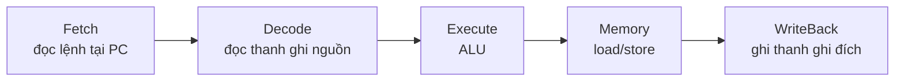
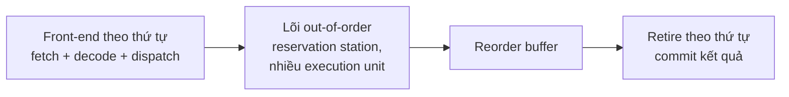
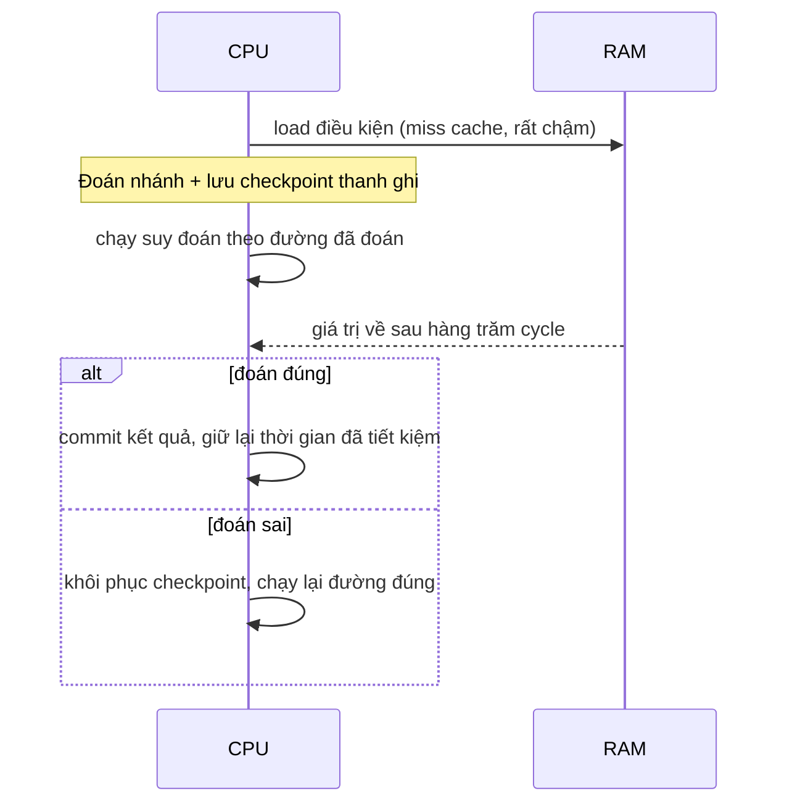

# P2 · Chương 05 — Pipeline, branch prediction và speculative execution

## Bạn sẽ hiểu được gì

1. **Q1.** Pipeline giải quyết vấn đề gì, và vì sao nó tăng *throughput* chứ không giảm *latency* của một lệnh? → mục 1
2. **Q2.** Ba loại hazard (data, control, structural) là gì, và CPU xử lý chúng bằng forwarding, stall, flush thế nào? → mục 2
3. **Q3.** Vì sao một lệnh nhảy có điều kiện lại làm CPU "đoán", và đoán sai thì tốn gì? → mục 3
4. **Q4.** Superscalar, out-of-order execution và register renaming giải quyết vấn đề gì (ở mức khái niệm)? → mục 4
5. **Q5.** Speculative execution là gì, và vì sao chính nó là gốc của Spectre/Meltdown? → mục 5
6. **Q6.** Kernel Linux phòng thủ ra sao (retpoline, PTI, `nospec`), và bạn đọc trạng thái đó ở đâu trên máy? → mục 6
7. **Q7.** Với code của bạn: khi nào "branch khó đoán" làm chậm chương trình, và branchless đáng giá lúc nào? → mục 7
8. **Q8.** `std::hint::{black_box, spin_loop, cold_path, select_unpredictable}`, `#[cold]`, `#[inline]` đứng ở đâu trong bức tranh này? → mục 8

## Kiến thức cần trước

- [Chương 01 — Mô hình máy và ISA](01-mo-hinh-may-va-isa.md): chu trình fetch–decode–execute–writeback và thanh ghi (CPI được định nghĩa ngay ở mục 1 của chương này).
- (Không bắt buộc) [Chương 03 — Assembly x86-64 và AArch64](03-assembly-x86-64-va-aarch64.md): đọc được lệnh `cmp`/`jcc`/`b.cond`, `cmov`/`csel` — giúp ở mục 2 và mục 7; theo [tổng quan phase](00-tong-quan.md), chương này độc lập với chương 03–04.
- Khái niệm cache ở mức "truy cập bộ nhớ có thể mất hàng trăm cycle"; chi tiết ở [Chương 06 — Cache hierarchy và NUMA](06-cache-va-numa.md).

Bạn đã viết service Rust và biết một vòng lặp `for` có `if` bên trong là gì; chương này cho thấy CPU thật sự chạy vòng lặp đó ra sao. Cả chương bám theo một service giả định tên `ingest`, giới thiệu ở mục 1.

## 1. Pipeline: chồng lấn lệnh để tăng throughput (Q1)

> **Trả lời ngắn.** Một CPU đơn giản làm trọn từng lệnh qua nhiều bước rồi mới sang lệnh kế, nên mạch của mỗi bước phần lớn thời gian đứng không[^dis-each-stage]. Pipeline cho lệnh kế tiếp bắt đầu trước khi lệnh hiện tại xong, nên các lệnh chồng lấn nhau[^dis-pipe]. Mỗi lệnh vẫn mất đủ số cycle như trước, tức latency không giảm[^dis-latency]. Nhưng số lệnh hoàn tất trong một đơn vị thời gian, tức throughput, thì tăng[^dis-throughput].

**Giải thích.**

*Với service `ingest`.* Hãy hình dung `ingest`, một service viết bằng Rust, nhận từng lô event qua mạng. Mỗi event có một trường `priority: u8`, và hot loop của service duyệt cả lô để cộng dồn những event có priority từ 128 trở lên. Ta sẽ bám theo `ingest` suốt chương (nhận xét của người soạn: đây là ví dụ giả định, không phải code trong repo). Mỗi event chỉ tốn vài lệnh máy, nhưng một lô có hàng triệu event, nên tốc độ chạy của vài lệnh đó quyết định `ingest` nhanh hay chậm. Câu hỏi của mục này: CPU hoàn tất được bao nhiêu lệnh mỗi cycle, và vì sao không phải mỗi lệnh một lần bốn cycle?

### 1.1 Một CPU đơn giản phí phần cứng ra sao

Một CPU đơn giản chạy mỗi lệnh qua bốn bước: Fetch lấy lệnh từ bộ nhớ, Decode giải mã và đọc thanh ghi nguồn, Execute cho ALU làm phép toán, WriteBack ghi kết quả về thanh ghi[^dis-4stage]. Nếu CPU làm trọn một lệnh rồi mới sang lệnh kế thì N lệnh tốn 4N cycle[^dis-cpi4], tức CPI = 4 (CPI là số cycle trung bình cho mỗi lệnh).

Cái phí nằm ở chỗ mạch của mỗi bước chỉ làm việc có ích đúng một cycle trong bốn[^dis-each-stage]. Lấy mạch Fetch: nạp xong một lệnh, nó không làm gì có ích trong ba cycle kế tiếp[^dis-idle]. Với `ingest`, nghĩa là trong lúc lệnh cộng của event này đang chạy, mạch Fetch ngồi không dù lệnh đọc event kế tiếp đã sẵn sàng được nạp (nhận xét của người soạn).

### 1.2 Chồng lấn các lệnh

Pipelining sửa chuyện đó bằng cách bắt đầu lệnh kế tiếp trước khi lệnh hiện tại hoàn tất[^dis-pipe]. Các lệnh vẫn chạy theo thứ tự, chỉ là chúng chồng lấn nhau[^dis-overlap]. Bảng dưới là trục thời gian của ba lệnh liên tiếp trong pipeline 4 stage (F = Fetch, D = Decode, E = Execute, W = WriteBack; bảng do người soạn vẽ lại theo mô tả của nguồn):

| Cycle | 1 | 2 | 3 | 4 | 5 | 6 |
|---|---|---|---|---|---|---|
| Lệnh 1 | F | D | E | W | | |
| Lệnh 2 | | F | D | E | W | |
| Lệnh 3 | | | F | D | E | W |

Khi pipeline đã đầy, tức mọi stage đều có lệnh đang chạy, CPU hoàn tất một lệnh mỗi cycle[^dis-full]. Trong bảng, từ cycle 4 trở đi cycle nào cũng có một lệnh hoàn tất, và CPI giảm về 1[^dis-fill4].

### 1.3 Cái gì tăng, cái gì không

Latency của một lệnh, tức số cycle nó đi qua pipeline, vẫn là bốn[^dis-latency]. Cái tăng là throughput, số lệnh CPU hoàn tất trong một đơn vị thời gian[^dis-throughput]. Với `ingest`, mỗi event vẫn đi qua các lệnh của nó mất đúng ngần ấy cycle; điều `ingest` được lợi là cả lô event xong sớm hơn nhiều (nhận xét của người soạn).

<details><summary>Đi sâu: bao nhiêu stage, và vì sao lệnh không đồng đều</summary>

Lệnh load/store cần thêm một stage truy cập bộ nhớ (Memory), nên pipeline kinh điển có năm stage: Fetch–Decode–Execute–Memory–WriteBack[^dis-5stage]. Số stage thay đổi theo thiết kế. ARM đời đầu có ba stage[^dis-arm3]. Pentium đời đầu có năm stage nhưng các đời sau có nhiều hơn đáng kể[^dis-depth]. Intel Core i7 có pipeline 14 stage[^dis-i7].



Sơ đồ do người soạn vẽ theo danh sách năm stage của nguồn[^dis-5stage-list].

Không phải lệnh nào cũng qua đủ stage[^dis-uneven]. Trong ví dụ của sách, lệnh nạp từ bộ nhớ cần cả năm stage, còn các lệnh chỉ dùng thanh ghi cần bốn[^dis-uneven-ex]. Lệnh nhảy (`JMP`) chỉ cần ba stage vì không ghi thanh ghi đa dụng[^dis-jmp3]. Sự không đồng đều này dẫn tới một tình huống va chạm mà sách minh họa: một lệnh năm stage và một lệnh bốn stage cùng muốn ghi một thanh ghi ở cùng một cycle[^dis-same-write] (xem Đi sâu của mục 2).

</details>

**Quay lại Q1:** pipeline chồng lấn các lệnh nên mạch nào cũng luôn có việc; mỗi lệnh vẫn mất cùng số cycle, nhưng cứ mỗi cycle có một lệnh hoàn tất, nên cả lô event của `ingest` chạy xong sớm hơn.

## 2. Hazard: khi các lệnh chồng lấn va vào nhau (Q2)

> **Trả lời ngắn.** Chồng lấn lệnh gây rắc rối (hazard) khi các lệnh tranh nhau phần cứng hoặc phụ thuộc nhau. Có ba loại: structural, data và control[^ww-three]. Với data hazard, CPU không chèn thêm bubble làm stall pipeline mà chủ yếu dùng forwarding[^dis-fwd]. Control hazard (nhánh) buộc CPU phải đoán; đoán sai thì phải flush pipeline, rất tốn kém[^dis-flush].

**Giải thích.**

*Với service `ingest`.* Vòng lặp của `ingest` có đủ cả ba kiểu rắc rối. Phép cộng dồn ở mỗi vòng cần tổng của vòng trước. Giá trị event vừa đọc từ bộ nhớ phải dùng ngay để so với 128. Và chính phép so sánh đó là một nhánh. Mục này đi qua từng loại; riêng nhánh sẽ là chủ đề của mục 3.

Trước hết cần một từ: khi một lệnh bị buộc chờ lệnh khác xong mới đi tiếp, ta có một **pipeline stall**, và CPU lẫn compiler cố hết sức tránh nó[^dis-stall].

### 2.1 Data hazard và forwarding

**Data hazard** xảy ra khi hai lệnh cùng truy cập một dữ liệu trong pipeline[^dis-data]. Ví dụ (assembly giả trong Dive into Systems):

```
MOV 4, Reg2           # Reg2 = 4
ADD Reg2, Reg2, Reg2  # Reg2 = Reg2 + Reg2
```

`ADD` cần giá trị `Reg2` mà `MOV` chưa kịp ghi. Vòng lặp của `ingest` có đúng kiểu này ở phép cộng dồn: vòng sau cần tổng mà vòng trước vừa tính (nhận xét của người soạn).

Chèn thêm "bubble" (một NOP trong pipeline) để đợi là giải pháp kém, vì nó làm stall pipeline[^dis-bubble]. CPU làm khác: **operand forwarding**, tức pipeline lấy kết quả của phép toán trước trực tiếp[^dis-fwd]. Nó không đợi kết quả đó được ghi vào thanh ghi[^ww-fwd].

Forwarding không cứu được mọi trường hợp. Nếu lệnh trước là `load` và giá trị chưa kịp có khi lệnh sau cần, thì không thể forward ngược thời gian[^ww-loaduse]. Trong pipeline năm stage của bài giảng, trường hợp load-use này cần stall một cycle[^ww-loaduse-stall]. Với `ingest`, đó là lúc vừa đọc `priority` của một event từ bộ nhớ đã đem so với 128 ngay (nhận xét của người soạn).

### 2.2 Control hazard: nhánh

Pipeline được tối ưu cho các lệnh nối tiếp nhau, còn `if` và vòng lặp có thể ảnh hưởng nghiêm trọng đến hiệu năng của nó[^dis-opt-seq]. **Control hazard** xảy ra khi pipeline gặp lệnh nhảy hoặc lệnh có điều kiện: nó phải "đoán" xem nhánh có được thực hiện hay không[^dis-ctrl].

Vì sao phải đoán? Vì không thể biết nhánh có được thực hiện cho đến khi lệnh nhảy chạy xong, mà lúc đó các lệnh phía sau đã được nạp vào pipeline[^dis-ctrl-late]. Nếu nhánh đi hướng khác với các lệnh đã nạp (trong ví dụ của sách: nhánh được thực hiện), những lệnh "rác" đó phải bị loại bỏ (**flush**) trước khi nạp lại pipeline, và flush pipeline rất tốn kém[^dis-flush].

Phần cứng có ba hướng đối phó[^dis-options]:

- **Stall**: gặp nhánh thì chèn bubble và chờ đến khi chắc chắn[^dis-opt-stall]. Cách này đúng nhưng mất hiệu năng ở *mọi* nhánh[^dis-stall-branch].
- **Branch prediction**: đoán hướng nhánh dựa trên các lần chạy trước[^dis-bp]. Đoán sai thì flush như trên, và sách ghi nhận cách này gần đây gây ra lỗ hổng bảo mật (Spectre)[^dis-bp-vuln].
- **Eager execution**: chạy cả hai phía rồi chọn kết quả bằng lệnh chuyển dữ liệu có điều kiện (`cmov` trên x86, `csel` trên ARMv8-A)[^dis-eager]. Không phải code nào cũng áp dụng được, và cách này nguy hiểm khi có dereference con trỏ hay side effect[^dis-eager-limit].

### 2.3 Structural hazard

**Structural hazard** là xung đột khi hai lệnh cùng dùng một tài nguyên phần cứng[^ww-struct]. Loại này do người thiết kế chip lo chứ không phải code của bạn (nhận xét của người soạn); phần Đi sâu bên dưới có ví dụ.

<details><summary>Đi sâu: structural hazard (bộ nhớ chung) và ví dụ hai lệnh ghi cùng thanh ghi</summary>

Bài giảng lấy ví dụ một bộ nhớ chung cho cả lệnh và dữ liệu: nó gây structural hazard trong kiến trúc pipeline[^ww-mem]. Lý do là lệnh load/store cần truy cập dữ liệu[^ww-ldst]. Vì vậy việc nạp lệnh phải stall đúng cycle đó[^ww-fetchstall]. Cách chữa là dùng bộ nhớ lệnh và bộ nhớ dữ liệu riêng (I$ và D$)[^ww-sep]. Slide tóm tắt của bài giảng ghi rằng structural hazard được giải quyết bằng cách thiết kế pipeline cho đúng[^ww-resolved]; nghĩa là việc này thuộc người thiết kế phần cứng chứ không phải lập trình viên (vế sau là nhận xét của người soạn).

Dive into Systems đưa thêm một ví dụ va chạm do lệnh dài ngắn khác nhau, ngay sau định nghĩa data hazard[^dis-data] (sách xếp nó vào data hazard; hai trang sách đã tải không dùng thuật ngữ structural hazard). Lệnh `MOV` nạp từ bộ nhớ (năm stage) và lệnh `ADD` chỉ dùng thanh ghi (bốn stage) cùng muốn ghi `Reg1` ở cùng một cycle. CPU ngăn tình huống đó bằng cách ép mọi lệnh đi đủ năm stage, và lệnh ngắn hơn được đệm bằng bubble[^dis-bubble-pad]. Đặt cạnh ví dụ bộ nhớ chung ở trên, cả hai đều là hai lệnh đòi cùng một thứ ở cùng một cycle (nhận xét của người soạn).

Về phân loại: bài giảng của Walla Walla University ghi control hazard là một trường hợp đặc biệt của data hazard, được tách thành loại riêng vì được xử lý theo cách khác[^ww-ctrl-special].

</details>

**Quay lại Q2:** structural = tranh tài nguyên (chữa bằng thiết kế), data = phụ thuộc dữ liệu (chữa chủ yếu bằng forwarding; load-use vẫn phải stall), control = nhánh (chữa bằng dự đoán; đoán sai thì flush). Trong `ingest`, phép cộng dồn thuộc loại data, còn `if priority >= 128` thuộc loại control.

## 3. Branch prediction: đoán nhánh và giá của đoán sai (Q3)

> **Trả lời ngắn.** Nếu mỗi nhánh đều phải đứng chờ thì mất hiệu năng[^dis-stall-branch]. Vì vậy cách phổ biến nhất là dự đoán hướng nhánh dựa trên các lần thực thi trước[^dis-bp]. CPU chạy tiếp theo hướng đã đoán thay vì chờ[^sp-spec]. Đoán đúng thì giữ kết quả. Đoán sai thì phải bỏ phần việc chạy nhầm và nạp lại pipeline từ đường đúng, một việc sách gọi là tốn kém[^dis-flush].

**Giải thích.**

*Với service `ingest`.* Nhánh `if priority >= 128` chạy một lần cho mỗi event, tức hàng triệu lần mỗi lô. CPU không thể đứng chờ ở từng lần, nên nó đoán. Đoán tốt hay không tùy việc dữ liệu trong lô có quy luật hay không (suy luận của người soạn; mục 7 có phép đo).

### 3.1 CPU đoán rồi chạy tiếp

Bộ dự đoán nhánh (branch predictor) đoán hướng của nhánh dựa trên các lần thực thi trước đó[^dis-bp]. Sách nhận xét các bộ dự đoán hiện đại rất chính xác[^dis-bp-acc].

Điều quan trọng là sau khi đoán, CPU không chờ mà **tiếp tục chạy theo hướng đã đoán**: nó lưu checkpoint trạng thái thanh ghi, rồi thực thi các lệnh trên đường đã đoán[^sp-spec]. Đoán đúng thì giữ lại phần việc đã làm. Đoán sai thì CPU bỏ các lệnh đã chạy nhầm bằng cách nạp lại trạng thái từ checkpoint, rồi chạy tiếp theo đường đúng[^sp-wrong]. Cơ chế này tên là speculative execution, mục 5 sẽ nói kỹ.

### 3.2 Một lần đoán sai tốn bao nhiêu

Một lần đoán sai tốn hai thứ: kết quả của các lệnh chạy nhầm bị bỏ, và pipeline phải nạp lại[^dis-flush]. Về phần đầu, bài báo Spectre viết rằng processor loại bỏ phần thực thi sai bằng cách trả trạng thái thanh ghi về checkpoint, cho hiệu năng tương đương việc đứng chờ[^sp-idle]. Bài báo không bàn gì đến việc nạp lại pipeline (người soạn đã tìm từ "pipeline" trong bản tải về và không thấy).

Con số cycle cụ thể phụ thuộc vi kiến trúc nên chương này không đưa con số chung nào. Chỉ có một ví dụ cho một thiết kế cụ thể: slide bài giảng (theo giáo trình Computer Organization and Design) mô tả pipeline Core i7 sâu 14 stage và ghi rằng một lần đoán nhánh sai tốn 17 clock cycle[^ww-i7]. Còn bài báo Meltdown mô tả chip Intel: khi đoán sai, reorder buffer cho phép quay lui bằng cách xóa reorder buffer và khởi tạo lại unified reservation station[^md-rollback]. Mục 7 có một phép đo thật trên máy của người soạn.

<details><summary>Đi sâu: BTB và lịch sử nhánh</summary>

Bài báo Spectre mô tả thành phần **Branch Target Buffer (BTB)**, lưu ánh xạ từ địa chỉ các lệnh nhảy vừa chạy gần đây sang địa chỉ đích[^sp-btb]. Nhờ đó CPU đoán được địa chỉ code kế tiếp ngay cả trước khi giải mã lệnh nhảy[^sp-btb-pred]. Với nhánh có điều kiện, biết địa chỉ đích thôi chưa đủ để đoán kết quả, nên CPU còn giữ lịch sử kết quả các nhánh gần đây[^sp-hist]. Bài báo cũng dẫn một phân tích BTB trên chip Intel Haswell[^sp-haswell]; đó là chi tiết cài đặt của một dòng chip, không phải mọi CPU.

Về các kiểu bộ dự đoán, bài báo Meltdown điểm qua như sau. Mức đơn giản nhất dùng một bộ đếm ghi lại kết quả lần trước của nhánh[^md-bp-1lvl]. CPU hiện đại thường dùng bộ dự đoán thích nghi hai mức[^md-bp-modern]. Loại này nhớ lịch sử các kết quả gần nhất nên đoán được các mẫu lặp đều[^md-bp-hist].

</details>

**Quay lại Q3:** chờ mọi nhánh quá đắt nên CPU đoán và chạy tiếp; đoán sai thì bỏ phần việc nhầm và nạp lại pipeline. Với `ingest`, nhánh `if priority >= 128` chạy hàng triệu lần mỗi lô nên mỗi lần đoán sai đều cộng dồn vào thời gian chạy.

## 4. Superscalar, out-of-order và register renaming (Q4)

> **Trả lời ngắn.** Pipeline đơn giản hoàn tất tối đa một lệnh mỗi cycle nên CPI không xuống dưới 1 (suy luận của người soạn từ mục 1). Superscalar phát nhiều hơn một lệnh mỗi cycle[^gwu-ss]. Out-of-order thực thi lệnh ngay khi tài nguyên sẵn sàng thay vì theo đúng thứ tự chương trình[^md-ooo]. Register renaming gán động tên khác nhau cho các định nghĩa khác nhau của cùng một thanh ghi để bỏ các phụ thuộc "giả"[^gwu-false]. Kết quả vẫn đúng vì lệnh được retire theo thứ tự qua reorder buffer[^sp-rob].

**Giải thích.**

*Với service `ingest`.* Ở mỗi event, vòng lặp của `ingest` làm vài việc gần như độc lập: đọc event, so sánh, cộng dồn (nhận xét của người soạn). Một pipeline đơn giản vẫn chỉ hoàn tất một lệnh mỗi cycle, dù CPU có sẵn đủ mạch để làm nhiều hơn. Mục này nói CPU nâng trần đó thế nào mà không làm tổng của `ingest` bị sai.

### 4.1 Hai cách nâng trần CPI

Pipeline hoàn tất một lệnh mỗi cycle (mục 1) nên CPI không thể thấp hơn 1 (suy luận của người soạn từ chính định nghĩa đó). Có hai bước để vượt trần ấy:

1. **Superscalar**: bộ xử lý phát (issue) được hơn một lệnh mỗi cycle[^gwu-ss]. Hệ quả suy ra là CPI lý tưởng có thể dưới 1 (suy luận của người soạn).
2. **Out-of-order execution (OoO)**: thay vì xử lý lệnh theo đúng thứ tự chương trình, CPU thực thi lệnh ngay khi mọi tài nguyên cần thiết sẵn sàng; trong lúc một execution unit bận, các unit khác chạy trước được[^md-ooo]. Bài báo Spectre diễn đạt: lệnh phía sau trong luồng lệnh có thể chạy song song với, và đôi khi *trước*, lệnh đứng trước[^sp-ooo].

### 4.2 Vì sao kết quả vẫn đúng

Chạy mất trật tự mà kết quả vẫn như chạy tuần tự là nhờ tách hai việc: *thực thi* thì mất trật tự, còn *retire* (hoàn tất) thì đúng thứ tự. Lệnh đã xong được xếp vào **reorder buffer**. Nó chỉ retire khi mọi lệnh đứng trước đã hoàn thành và retire, và chỉ lúc đó kết quả mới được commit và nhìn thấy từ bên ngoài[^sp-rob]. Với `ingest`, nghĩa là CPU có thể chạy phép cộng của event thứ 10 trước phép so sánh của event thứ 9, nhưng tổng của cả lô vẫn đúng như chạy tuần tự (nhận xét của người soạn).

Bài giảng GWU mô tả kiến trúc tổng thể như một lõi out-of-order kẹp giữa front-end theo thứ tự và back-end theo thứ tự[^gwu-sandwich]:



Sơ đồ trên là sơ đồ khái niệm do người soạn vẽ; trên chip Intel mà bài báo Meltdown mô tả, reorder buffer còn lo cả cấp phát và đổi tên thanh ghi ở phía trước (xem Đi sâu bên dưới).

### 4.3 Register renaming

Có những phụ thuộc "giả": hai lệnh dùng cùng *tên* thanh ghi nhưng không thật sự truyền dữ liệu cho nhau (write-after-read, write-after-write)[^gwu-war-waw]. Nếu chỉ vì trùng tên mà phải xếp hàng thì uổng phí. **Register renaming** gỡ chuyện này bằng cách gán động tên khác nhau cho các định nghĩa khác nhau của cùng một thanh ghi, để loại bỏ phụ thuộc giả[^gwu-false]. Nói cách khác, CPU gán động thanh ghi vật lý cho lệnh[^gwu-rename].

Ở mức khái niệm, thanh ghi trong assembly (`rax`, `x0`…) là thanh ghi *kiến trúc*, và bên dưới CPU ánh xạ động chúng sang thanh ghi vật lý (suy luận của người soạn từ định nghĩa trên). Trong vòng lặp của `ingest`, mỗi vòng nạp event vào cùng một thanh ghi; nhờ renaming, vòng sau dùng được thanh ghi vật lý khác mà không phải đợi vòng trước dùng xong (nhận xét của người soạn, mức khái niệm; code compiler thật sinh ra có thể khác).

<details><summary>Đi sâu: superpipelined, Tomasulo và mô tả trên chip Intel</summary>

Superscalar khác với việc chỉ làm pipeline *sâu hơn*. Bảng thuật ngữ của bài giảng GWU liệt kê riêng "superpipelined" là pipeline sâu nhưng không superscalar, ví dụ MIPS R5000 có 8 stage[^gwu-deep].

Bài báo Meltdown kể rằng thuật toán Tomasulo (1967) dùng reservation station để đổi tên thanh ghi, giải quyết các hazard RAW, WAR và WAW[^md-tomasulo]. Trên chip Intel mà bài báo mô tả, front-end nạp lệnh x86 và giải mã thành micro-op (µOP) gửi sang execution engine[^md-decode-uop]. Reorder buffer chịu trách nhiệm cấp thanh ghi, đổi tên thanh ghi và retire[^md-rob-intel]. Các µOP được chuyển cho reservation station rồi tới các execution unit[^md-uop]. Đây là mô tả cho một dòng chip cụ thể, không phải mọi CPU.

</details>

**Quay lại Q4:** superscalar phát nhiều lệnh mỗi cycle, OoO chạy lệnh khi sẵn sàng nhưng retire theo thứ tự, renaming bỏ phụ thuộc giả về tên thanh ghi; nhờ vậy `ingest` chạy nhanh hơn mà tổng vẫn đúng.

## 5. Speculative execution và gốc của Spectre/Meltdown (Q5)

> **Trả lời ngắn.** Khi CPU chạm một nhánh mà hướng đi còn phụ thuộc vào lệnh chưa xong, nó lưu checkpoint thanh ghi, đoán đường đi và chạy suy đoán theo đó[^sp-spec]. Đoán sai thì quay về checkpoint[^sp-idle]. Về mặt kiến trúc, việc này vô hình với chương trình[^sp-logical]. Nhưng nó có thể để lại dấu vết trong cache, buffer và branch predictor, và phần mềm độc hại có thể dùng các hiệu ứng phụ đó để suy ra dữ liệu đặc quyền[^kd-problem]. Đó là gốc của Spectre. Meltdown dùng cùng ý tưởng ở dạng chạy mất trật tự trước khi exception được xử lý[^sp-md-nobp] (xem lưu ý thuật ngữ bên dưới).

**Giải thích.**

*Với service `ingest`.* Giả sử `ingest` có thêm một endpoint tra cứu: client gửi `id`, handler kiểm tra `id < limits.len()` rồi mới đọc `limits[id]`. Với CPU, kiểm tra biên đó cũng là một nhánh. Nếu `limits.len()` đang nằm ngoài cache thì CPU không muốn đứng chờ, nên nó chạy tiếp theo hướng đã đoán. Mục này giải thích CPU làm gì trong lúc chờ, và vì sao chuyện đó thành lỗ hổng khi `ingest` chạy chung máy với code của người khác. Đoạn tình huống này là minh họa của người soạn: nó mượn hình dạng đoạn code trong bài báo Spectre, không khẳng định `ingest` thật sự khai thác được.

### 5.1 CPU chạy trước để khỏi chờ

Bài báo Spectre nêu tình huống điển hình: luồng điều khiển phụ thuộc vào một giá trị nằm trong RAM mà chưa có trong cache, nên có thể mất vài trăm chu kỳ xung nhịp mới biết giá trị đó. Thay vì đứng chờ, CPU đoán hướng, lưu checkpoint thanh ghi, và chạy tiếp theo đường đã đoán[^sp-hundreds]. Khi giá trị về, CPU kiểm tra lại. Đoán sai thì quay về checkpoint[^sp-idle]. Đoán đúng thì commit kết quả, và khoảng thời gian chờ đã được dùng cho việc có ích nên hiệu năng tăng đáng kể[^sp-correct].



Sơ đồ do người soạn vẽ lại theo mô tả của bài báo Spectre ở trên, không phải hình trong bài báo.

### 5.2 Vô hình về kiến trúc, không vô hình về vi kiến trúc

Ở mức kiến trúc, tức cái chương trình quan sát được qua thanh ghi và bộ nhớ, speculative execution là vô hình: các thay đổi của lệnh nằm ngoài đường chạy đúng bị hủy, nên "logical state" của chương trình như thể nó chạy đúng đường[^sp-logical]. Với `ingest`, nghĩa là dù CPU đã đọc `limits[id]` với `id` quá biên, handler không bao giờ thấy giá trị đó trong thanh ghi hay biến của nó (nhận xét của người soạn). Vấn đề nằm ở *vi kiến trúc* (microarchitecture): cache, buffer, branch predictor.

### 5.3 Vì sao thành lỗ hổng

Tài liệu kernel Linux tóm gọn vấn đề như sau. CPU dùng thực thi suy đoán để tăng hiệu năng, nhưng việc đó có thể để lại dấu vết của truy cập bộ nhớ hoặc phép tính trong cache, buffer và branch predictor của bộ xử lý. Phần mềm độc hại có thể tác động vào đường thực thi suy đoán, rồi dùng các hiệu ứng phụ trong cache và buffer để suy ra dữ liệu đặc quyền mà đường đó đã chạm đến[^kd-problem].

Hai lỗ hổng điển hình của loại này là Meltdown và Spectre (nhận xét của người soạn). Trang của nhóm tác giả tóm tắt rằng Meltdown phá lớp cô lập cơ bản nhất giữa ứng dụng người dùng và hệ điều hành[^site-melt]. Spectre thì phá lớp cô lập giữa các ứng dụng với nhau[^site-spec]. Nếu `ingest` chạy chung máy với service khác, đây là lớp cô lập mà Spectre nhắm vào (nhận xét của người soạn).

### 5.4 Lưu ý thuật ngữ

Bài báo Meltdown dùng "speculative execution" theo nghĩa hẹp, chỉ chuỗi lệnh theo sau một nhánh, và dùng "out-of-order execution" cho mọi cách chạy một lệnh trước khi kết quả của mọi lệnh đứng trước đã được commit[^md-terms]. Theo nghĩa hẹp đó, Spectre dựa vào dự đoán nhánh còn Meltdown thì không[^sp-md-nobp]. Cả hai giống nhau ở chỗ phần chạy tạm bị hủy về mặt kiến trúc, nhưng thay đổi ở các thành phần vi kiến trúc như nội dung cache vẫn có thể còn lại[^sp-survive]. Chương này gọi chung là "thực thi suy đoán" theo nghĩa rộng "chạy trước khi chắc chắn" (nhận xét của người soạn).

### 5.5 Đọc dấu vết bằng cách nào

Side channel (kênh phụ) nghĩa là rò thông tin qua các hiệu ứng phụ quan sát được, nằm ngoài đầu ra chính của phép tính[^sp-sidechannel]. Bài báo Spectre dùng kỹ thuật Flush+Reload. Trước hết kẻ tấn công đẩy một cache line dùng chung với nạn nhân ra khỏi cache, để nạn nhân chạy một lúc, rồi đo thời gian đọc bộ nhớ tại địa chỉ ứng với dòng đó[^sp-fr1]. Nếu nạn nhân đã chạm vào dòng thì dữ liệu nằm trong cache và lần đọc nhanh; nếu không thì lần đọc chậm[^sp-fr2]. Bước đẩy dòng ra khỏi cache dùng một lệnh máy chuyên dụng, ví dụ `clflush` của x86[^sp-clflush]. Vậy chỉ cần đo thời gian truy cập là biết nạn nhân có chạm vào dòng đó hay không.

<details><summary>Đi sâu: kiến trúc bị ảnh hưởng, Spectre v1, v2 và Meltdown</summary>

**Kiến trúc bị ảnh hưởng.** Spectre không giới hạn ở x86: kernel docs liệt kê trong các CPU dễ tổn thương cả Intel, AMD, IBM POWER/zSeries, ARM tầm cao, Apple CPUs và MIPS tầm cao[^kd-affected]. Nhóm tác giả đã kiểm chứng Spectre trên Intel, AMD và ARM[^site-spec-hw]. Meltdown hẹp hơn: FAQ trên trang của nhóm tác giả nói họ mới kiểm chứng Meltdown trên Intel, chưa rõ AMD có bị hay không, và theo ARM một số bộ xử lý của ARM cũng bị[^site-melt-hw] (câu đó không ghi ngày, nên tôi không biết nó còn đúng đến hôm nay không). Tài liệu PTI của kernel nằm trong mục x86 (`arch/x86`) và mô tả PTI là biện pháp chống tấn công kiểu Meltdown vào không gian địa chỉ user/kernel dùng chung[^kd-pti-melt]. Còn việc một máy cụ thể có bị Meltdown hay không thì đọc từ sysfs (mục 6).

**Spectre variant 1 — bounds check bypass.** Biến thể này mang mã CVE-2017-5753[^kd-cve]. Kernel docs nói variant 1 khai thác thực thi suy đoán của *nhánh có điều kiện*[^kd-variants]. Với kiểm tra biên mảng, thực thi suy đoán có thể bỏ qua nhánh kiểm tra và truy cập bộ nhớ ngoài biên *trước khi* kiểm tra được giải quyết. Truy cập suy đoán đó để lại hiệu ứng phụ, tạo side channel làm rò thông tin[^kd-v1]. Kernel docs lưu ý thêm: dù tên là "Bounds Check Bypass", variant 1 không chỉ về kiểm tra biên mảng do người dùng kiểm soát mà có thể ảnh hưởng *bất kỳ kiểm tra điều kiện nào*[^kd-v1-any].

Đoạn mã minh họa trong bài báo Spectre[^sp-v1-code] như sau (kiểm tra biên, rồi một lần đọc mảng phụ thuộc vào giá trị đọc được):

```c
if (x < array1_size)
    y = array2[array1[x] * 256];
```

Kịch bản: kẻ tấn công "huấn luyện" branch predictor bằng cách gọi code với giá trị hợp lệ để nó kỳ vọng `if` đúng; sau đó gọi với `x` nằm ngoài biên `array1` trong khi kích thước `array1` chưa nằm trong cache[^sp-v1-train]. CPU đoán kiểm tra biên là đúng và suy đoán thực thi `array2[array1[x] * 256]`. Thay đổi trạng thái cache do lần đọc `array2` đó không được hoàn tác khi CPU nhận ra mình đoán sai, và kẻ tấn công phát hiện được để đọc ra một byte bộ nhớ nạn nhân[^sp-v1].

**Spectre variant 2 — branch target injection.** Biến thể này mang mã CVE-2017-5715[^kd-cve]. Kernel docs nói variant 2 dùng thực thi suy đoán của *nhánh gián tiếp*[^kd-variants]. Bộ dự đoán nhánh gián tiếp có thể bị kẻ tấn công tác động, làm code "gadget" chạy suy đoán và để lộ dữ liệu nhạy cảm; hiệu ứng phụ trong cache đo được để suy ra giá trị[^kd-v2]. Kẻ tấn công có thể điều khiển các nhánh gián tiếp suy đoán của nạn nhân tới code gadget bằng cách "đầu độc" BTB[^kd-poison]. Trên hệ thống có SMT (hyper-threading), tấn công khả thi từ luồng anh em vì L1 cache và BTB có thể được chia sẻ giữa các hardware thread của một core[^kd-smt].

**Meltdown (CVE-2017-5754).** Meltdown khai thác OoO chứ không dựa vào dự đoán nhánh[^sp-md-nobp]. Bài báo Meltdown mô tả rằng khi một lệnh gây exception, lệnh phía sau có thể *đã* chạy một phần mất trật tự nhưng chưa retire, nên không có hiệu ứng kiến trúc[^md-exc]. Nhưng chúng vẫn có hiệu ứng vi kiến trúc, ví dụ dữ liệu bị nạp vào cache[^md-micro]. Bài báo nói rõ kẻ tấn công đọc bộ nhớ đặc quyền trong luồng OoO rồi truyền ra ngoài qua một covert channel vi kiến trúc như Flush+Reload[^md-dump]. Trang nhóm tác giả gán Meltdown cho CVE-2017-5754[^site-cve]. Trang đó cũng cho biết đã có bản vá Linux là KPTI (trước đây là KAISER)[^site-patch].

Cơ chế chi tiết theo mô tả của bài báo Meltdown (cho chip Intel): CPU kiểm tra bit quyền của địa chỉ ảo song song với việc dịch địa chỉ ảo sang vật lý[^md-perm]. Exception chỉ được ghi nhận khi lệnh `MOV` nạp địa chỉ kernel retire; lúc đó pipeline bị flush để loại các kết quả của những lệnh chạy mất trật tự phía sau. Nhưng có một race condition giữa việc nâng exception và bước đưa dữ liệu vào cache của cuộc tấn công[^md-race].

</details>

**Quay lại Q5:** speculative execution chạy trước khi biết đường đúng; kết quả kiến trúc bị hủy khi sai nhưng dấu vết vi kiến trúc (cache) vẫn còn. Đó là gốc của Spectre (qua dự đoán nhánh) và, theo nghĩa rộng "chạy trước khi chắc chắn", cả Meltdown (qua thực thi mất trật tự quanh exception). Với `ingest`, kiểm tra biên của endpoint tra cứu là loại nhánh mà Spectre v1 nhắm tới.

## 6. Phòng thủ trong Linux và cách đọc trạng thái (Q6)

> **Trả lời ngắn.** Trên x86, Linux chống Meltdown bằng PTI, tức dùng hai bộ page table[^kd-pti]. Với Spectre v2, kernel dùng retpoline[^kd-retpoline]; phần cứng có Enhanced IBRS thì dùng nó thay retpoline[^kd-eibrs]. Với Spectre v1, kernel làm sạch con trỏ bằng macro `nospec` ở những chỗ đã xác định[^kd-nospec]. Ở một số điểm nó còn thêm rào `LFENCE`[^kd-lfence]. Trạng thái trên máy đọc từ các file trong `/sys/devices/system/cpu/vulnerabilities/`[^kd-sysfs].

**Giải thích.**

*Với service `ingest`.* `ingest` là code user, không tự vá được lỗ hổng phần cứng; việc đó thuộc về kernel và firmware của máy nó chạy. Có hai chuyện `ingest` thật sự gặp. Một là mỗi `conn.read` là một system call, tức một lần vào và ra kernel, nên nếu máy bật PTI thì mỗi lần như vậy đắt thêm (suy luận của người soạn từ phần "Cái giá của PTI" bên dưới). Hai là bạn cần biết node đang chạy `ingest` bật những biện pháp nào; nếu `ingest` chạy trong container thì nó dùng chung kernel của máy chủ (nhận xét của người soạn), nên đáp án nằm ở kernel của máy chủ chứ không ở image.

### 6.1 Mỗi lỗ hổng một biện pháp

Không có chìa khóa vạn năng; mỗi lỗ hổng có một biện pháp riêng. Dưới đây là phần x86.

- **PTI** (Page Table Isolation; tài liệu nằm dưới `arch/x86`) chống Meltdown[^kd-pti-melt]. Kernel dựng một bộ page table độc lập, chỉ dùng khi chạy ứng dụng user[^kd-pti]. Bộ này chỉ chứa lượng kernel tối thiểu để vào và ra kernel[^kd-pti-min].
- **Retpoline** ("return trampolines") chống Spectre v2: kernel tự bảo vệ khỏi việc dùng các entry BTB bị đầu độc[^kd-retpoline]. Nó áp dụng cho mọi nhánh gián tiếp[^kd-retpoline-all]. Về cách làm, compiler biến các lệnh gọi hoặc nhảy gián tiếp trong kernel thành return trampoline[^kd-retpoline-compiler]. Các đường thực thi suy đoán bên trong trampoline bị "nhốt" trong một vòng lặp vô hạn để không nhảy tới gadget[^kd-retpoline-how].
- **Enhanced IBRS** cũng chống Spectre v2 và thay cho retpoline, khi CPU x86 có tính năng này trong phần cứng[^kd-eibrs].
- **Spectre v1** được chặn bằng cách làm sạch con trỏ qua các accessor `nospec` ở những chỗ kernel đã xác định[^kd-nospec]. Code copy-from-user có thêm rào `LFENCE` để `access_ok()` không bị đoán sai[^kd-lfence]. Biến thể `swapgs` có thêm `LFENCE` ở đường vào interrupt, exception và NMI khi cần[^kd-swapgs].

Biện pháp cho Spectre v1 chỉ đặt từng chỗ một: tài liệu kernel thừa nhận các biện pháp được đặt theo từng trường hợp và không có đảm bảo rằng mọi vector tấn công v1 đã được che[^kd-casebycase].

### 6.2 Cái giá của PTI

PTI nghĩa là chuyển page table ở mỗi lần vào và ra kernel: khi vào kernel qua syscall, interrupt hay exception thì dùng bản kernel đầy đủ, khi về user mode thì dùng lại bản user[^kd-pti-switch]. Theo chính docs kernel, mỗi lần vào và ra phải ghi thanh ghi CR3, và một lần ghi cỡ một trăm cycle[^kd-pti-cost]. Trên máy không có PCID, mỗi lần ghi CR3 còn xả toàn bộ TLB, tức bộ đệm các ánh xạ page table (xem [Chương 03 của phase Memory](../03-memory/03-page-table-va-tlb.md))[^kd-pti-tlb]. PCID là tính năng cho phép bỏ qua việc xả toàn bộ TLB khi đổi page table, nên có PCID thì việc đổi rẻ hơn[^kd-pti-pcid]. Kết luận "syscall của `ingest` đắt hơn" là suy luận của người soạn từ các câu trên; docs không đưa số đo cho cả hệ thống.

### 6.3 Đọc trạng thái trên máy

Kernel Linux có giao diện sysfs cho biết hệ thống có dễ tổn thương không và đang bật biện pháp nào[^kd-sysfs]. Mỗi file trong `/sys/devices/system/cpu/vulnerabilities/` mang tên một lỗ hổng[^kd-abi-files]. Ví dụ `meltdown`, `spectre_v1`, `spectre_v2`[^kd-abi-list]. Giá trị có ba dạng chung: `Not affected` (CPU không bị ảnh hưởng), `Vulnerable` (bị ảnh hưởng và chưa có biện pháp nào đang bật) hoặc `Mitigation: …` (bị ảnh hưởng và biện pháp đó đang bật)[^kd-abi-values]. Riêng trên x86, docs liệt kê cho `spectre_v1` chuỗi như `Mitigation: usercopy/swapgs barriers and __user pointer sanitization`[^kd-sysfs-v1val]. Cho `spectre_v2`, docs liệt kê các chuỗi như `Mitigation: Retpolines`[^kd-sysfs-v2val].

<details><summary>Đi sâu: quan sát thật trên Apple M3 Pro (container AArch64)</summary>

Quan sát thật (một lần chạy, không phải bảo đảm): `./labs/linux.sh bash -c 'grep . /sys/devices/system/cpu/vulnerabilities/*'` trên Mac Apple M3 Pro, trong container Linux AArch64 (kernel `6.8.0-117-generic`, Ubuntu). Output rút gọn:

```
meltdown:Not affected
spectre_v1:Mitigation: __user pointer sanitization
spectre_v2:Mitigation: CSV2, but not BHB
spec_store_bypass:Vulnerable
```

Các file còn lại (`mds`, `l1tf`, `retbleed`, `srbds`, `tsa`, …) đều ghi `Not affected`.

Giải nghĩa bốn dòng trên bằng source kernel v6.8 (gần với kernel `6.8.0-117-generic` của container, nhưng bản Ubuntu có thể khác chi tiết nhỏ; tôi không đọc source của bản Ubuntu):

- `meltdown:Not affected`: theo ABI doc, `Not affected` nghĩa là CPU không bị ảnh hưởng bởi lỗ hổng đó[^kd-abi-values].
- `spectre_v1:Mitigation: __user pointer sanitization`: mã arm64 của kernel luôn in đúng chuỗi này cho Spectre v1, kèm chú thích rằng kernel không bảo vệ được userspace ở điểm này, mỗi chương trình tự lo[^arm-v1-comment]. Vì thế không có phần `usercopy/swapgs barriers` như chuỗi x86 trong docs ở trên (suy luận của người soạn: phần đó gắn với code vào kernel của x86 nên arm64 không in).
- `spectre_v2:Mitigation: CSV2, but not BHB`: chú thích trong mã arm64 liệt kê một trường hợp là CPU được giảm thiểu bằng phần cứng và quảng bá qua trường `ID_AA64PFR0_EL1.CSV2`[^arm-v2-csv2]. Nền tảng bị ảnh hưởng bởi Spectre-BHB thì không được báo `Not affected` cho Spectre v2, và code gán nhãn `CSV2` cho trường hợp đó[^arm-v2-bhb]. Hậu tố `, but not BHB` là chuỗi code in khi trạng thái Spectre-BHB là SPECTRE_VULNERABLE[^arm-v2-str]. Tôi không kiểm tra vì sao VM này rơi vào trạng thái BHB đó.
- `spec_store_bypass:Vulnerable`: mã arm64 in `Vulnerable` khi trạng thái Spectre-v4 là SPECTRE_VULNERABLE[^arm-v4-show]. Ở bước phần cứng, CPU nằm trong danh sách an toàn thì là UNAFFECTED, có tính năng SSBS thì MITIGATED, còn lại VULNERABLE[^arm-v4-hw] (mã còn hỏi thêm firmware; tôi không biết vì sao VM này không có biện pháp nào và không kiểm chứng). Theo ABI doc, `Vulnerable` nghĩa là CPU bị ảnh hưởng và không có biện pháp nào đang bật[^kd-abi-values].

Container dùng kernel của VM Linux chạy trên Mac, nên đây là trạng thái của VM đó trên chip M3 Pro, không phải của macOS (giải thích của người soạn về cách container chạy trên macOS).

</details>

**Quay lại Q6:** trên x86, PTI cho Meltdown, retpoline hoặc eIBRS cho Spectre v2, `nospec`/`LFENCE` từng chỗ cho Spectre v1; trạng thái đọc ở sysfs. Với `ingest`, cái giá đáng nhớ nhất là mỗi syscall có thể đắt hơn khi máy bật PTI.

## 7. Hệ quả với code: nhánh khó đoán và branchless (Q7)

> **Trả lời ngắn.** Nhánh phụ thuộc dữ liệu ngẫu nhiên làm chậm chương trình vì CPU đoán sai nhiều, còn trên dữ liệu đã sắp xếp thì nhánh có mẫu dễ đoán (suy luận của người soạn, không đo bộ đếm hiệu năng). Trong phép đo của người soạn trên một chip, cùng vòng lặp có nhánh chậm hơn khoảng 7 lần trên dữ liệu ngẫu nhiên so với đã sắp xếp, còn biến thể không nhánh chạy ổn định. Lệnh chuyển dữ liệu có điều kiện (`cmov`/`csel`) cho phép tránh nhánh mà vẫn giữ pipeline chạy liên tục[^dis-eager]; phép đo dùng mask số học với cùng mục đích. Cách này không áp dụng được cho mọi code[^dis-eager-limit].

**Giải thích.**

*Với service `ingest`.* Mục này chạm thẳng vào code của bạn: hot loop của `ingest` chính là vòng lặp có `if priority >= 128` mà mục 3 đã nói tới. Cùng một lô event, nếu priority nằm theo thứ tự thì nhánh có mẫu cực dễ đoán, còn nếu lẫn lộn ngẫu nhiên thì nhánh khó đoán hơn nhiều (suy luận của người soạn; phép đo dưới đây không đọc bộ đếm hiệu năng). Ta đo thử xem chênh lệch đó lớn cỡ nào.

### 7.1 Thí nghiệm

Mục tiêu: xem nhánh phụ thuộc dữ liệu ngẫu nhiên đắt cỡ nào so với cùng dữ liệu đã sắp xếp, và so với biến thể không nhánh. Dữ liệu là 1.048.576 phần tử `u8` (xorshift, seed cố định) đóng vai priority của một lô event: một bản ngẫu nhiên, một bản `sort_unstable`. Mỗi hàm chạy 15 lần, lấy lần nhanh nhất, trên Apple M3 Pro (AArch64, macOS). Assembly cho thấy `sum_branchy` có lệnh nhảy có điều kiện (`tbz`) thật, còn bản branchless thì không. Mã nguồn ở phần Đi sâu cuối mục.

Kết quả (chạy hai lần, số khớp nhau):

| Biến thể | Dữ liệu ngẫu nhiên | Dữ liệu đã sắp xếp |
|---|---|---|
| Có nhánh (`if`) | 2644 µs (2,52 ns/phần tử) | 371 µs (0,35 ns/phần tử) |
| Không nhánh (mask) | 309–321 µs (≈0,30 ns/phần tử) | 316 µs (0,30 ns/phần tử) |

### 7.2 Đọc kết quả

- Cùng một code có nhánh chạy chậm hơn khoảng 7 lần trên dữ liệu ngẫu nhiên so với đã sắp xếp (2644/371 ≈ 7,1), dù code và giá trị giống nhau, chỉ khác thứ tự. Điều này khớp với việc dữ liệu đã sắp xếp cho nhánh một mẫu cực dễ đoán (hết một đoạn toàn "không" rồi toàn "có"), còn dữ liệu ngẫu nhiên khiến nhánh gần như tung đồng xu (suy luận của người soạn; tôi không đọc bộ đếm hiệu năng nên không có số mispredict thực). Bộ dự đoán thích nghi nhớ lịch sử các kết quả gần nhất để đoán mẫu lặp đều: xem Đi sâu ở mục 3.
- Nếu giả định ≈50% nhánh bị đoán sai ở dữ liệu ngẫu nhiên và ≈0% ở dữ liệu đã sắp xếp (giả định, chưa đo), phần chênh ≈2273 µs chia cho ≈524.000 lần đoán sai cho ≈4,3 ns mỗi lần.
- Bản branchless chạy ổn định ở ≈0,3 ns/phần tử bất kể thứ tự dữ liệu. Nó nhanh hơn bản có nhánh ≈8 lần trên dữ liệu ngẫu nhiên, nhưng trên dữ liệu đã sắp xếp chỉ nhỉnh hơn một chút (≈316 µs so với 371 µs); chênh lệch nhỏ như vậy không nên khái quát. Quy tắc rút ra từ số đo (nhận xét của người soạn, một chip): branchless mua *tính ổn định*, và lợi lớn chỉ khi nhánh khó đoán, cùng hướng với lời cảnh báo của docs `select_unpredictable` ở dưới.
- Với phiên bản `if` viết thẳng, không `black_box`, compiler tự do: hàm chạy ≈18 µs (≈0,02 ns/phần tử) trên cả hai dữ liệu. Tôi không phân tích assembly của trường hợp này; nhiều khả năng compiler đã đổi vòng lặp thành code không nhánh hoặc vectorize (suy luận). Bài học: *trước khi tự viết branchless, xem compiler đã làm giúp chưa*.

Giới hạn: một chip, một compiler, một cỡ dữ liệu.

### 7.3 Khi nào branchless đáng giá

- Eager execution hay chuyển dữ liệu có điều kiện (`cmov`, `csel`) giữ pipeline chạy liên tục[^dis-eager]. Không phải code nào cũng dùng được, và cách này nguy hiểm khi có dereference con trỏ hay side effect[^dis-eager-limit]. Chi tiết lệnh `cmov`/`csel` ở [Chương 03](03-assembly-x86-64-va-aarch64.md).
- Tài liệu Rust cho `select_unpredictable` nói rõ cả hai chiều. Trên nền tảng có `cmov`/`csel`, optimizer có thể dùng chúng để tránh nhánh, và điều đó có lợi khi branch predictor đang chật vật[^rs-su-cmov]. Nhưng lowering đó không được đảm bảo[^rs-su]. Nó còn có thể *giảm* hiệu năng nếu điều kiện vốn dễ đoán, nên docs khuyên benchmark[^rs-su-perf].

<details><summary>Đi sâu: mã đo (rustc -O, rustc 1.95.0)</summary>

Mã rút gọn từ file đã chạy bằng `rustc -O`, rustc 1.95.0; tên hàm trong file đo có hậu tố `_opaque`:

```rust
use std::hint::black_box;

#[inline(never)]
fn sum_branchy(data: &[u8]) -> u64 {
    let mut s = 0u64;
    for &x in data {
        if x >= 128 {
            s = black_box(s + x as u64); // black_box để compiler không đổi `if` thành csel
        }
    }
    s
}

#[inline(never)]
fn sum_branchless(data: &[u8]) -> u64 {
    let mut s = 0u64;
    for &x in data {
        let x = black_box(x);
        let mask = ((x >> 7) as u64).wrapping_neg(); // toàn bit 1 nếu x>=128, 0 nếu không
        s += (x as u64) & mask;
    }
    s
}
```

</details>

**Quay lại Q7:** nhánh khó đoán làm chậm vì đoán sai; branchless mua tính ổn định, chỉ lợi lớn khi nhánh thật sự khó đoán và nên đo/benchmark trước. Với `ingest`, nếu priority trong lô không có thứ tự thì `if priority >= 128` là ứng viên đáng đo.

## 8. Liên hệ với Rust: `std::hint`, `#[cold]`, `#[inline]` (Q8)

> **Trả lời ngắn.** Module `std::hint` chứa các gợi ý (hint) về cách sinh code hoặc tối ưu, hầu hết nhắm vào compiler[^rs-hint]; riêng `spin_loop` phát một lệnh máy báo cho CPU[^rs-spin]. Ở Rust 1.95.0, `black_box`, `spin_loop`, `cold_path` và `select_unpredictable` đã stable (bảng dưới), còn `likely` và `unlikely` chỉ ở nightly[^rs-likely]. `#[cold]` và `#[inline]` cũng chỉ là hint cho compiler[^rs-attr-cold]; chúng tác động lên code được sinh ra chứ không "lập trình" trực tiếp branch predictor (suy luận của người soạn).

**Giải thích.**

*Với service `ingest`.* Trong code Rust của `ingest`, những gợi ý này có chỗ dùng rất cụ thể. Nhánh xử lý event hỏng gần như không bao giờ chạy, và bạn muốn compiler đẩy nó ra khỏi đường nóng. Điều kiện `priority >= 128` có thể khó đoán, và bạn muốn thử bản không nhánh. Khi viết benchmark cho hot loop, bạn cần compiler đừng xóa mất đoạn code đang đo. Mỗi chỗ có một hint ứng với nó, nhưng hint chỉ là lời khuyên cho compiler và không hứa gì về hiệu năng.

### 8.1 Trạng thái trong Rust 1.95.0

Module `std::hint` chứa các gợi ý cho compiler về cách code được sinh ra hoặc tối ưu, có thể là hint lúc compile hoặc lúc chạy[^rs-hint]. Trạng thái trong Rust **1.95.0**:

| Hàm | Trạng thái 1.95.0 | Ghi chú |
|---|---|---|
| `black_box` | stable từ 1.66.0 (const từ 1.86.0)[^rs-bb-ver] | để benchmark; xem dưới |
| `spin_loop` | stable từ 1.49.0[^rs-spin-ver] | busy-wait |
| `cold_path` | stable từ 1.95.0[^rs-cold-ver] | đánh dấu đường nguội |
| `select_unpredictable` | stable từ 1.88.0[^rs-su-ver] | hint "điều kiện khó đoán"; có thể thành `cmov`/`csel` nhưng không bảo đảm |
| `likely` | **chỉ nightly** (`likely_unlikely`, issue #151619)[^rs-likely] | không dùng được trên stable |
| `unlikely` | **chỉ nightly** (`likely_unlikely`, issue #151619)[^rs-unlikely] | không dùng được trên stable |

Kiểm tra trực tiếp: `std::hint::likely(true)` trên rustc 1.95.0 stable cho lỗi `E0658: use of unstable library feature 'likely_unlikely'`; còn đoạn dùng `cold_path()` và `select_unpredictable` biên dịch và chạy được. Docs của `likely` tự khuyên xem `cold_path()` là lựa chọn phù hợp hơn cho code Rust idiomatic[^rs-likely-see].

### 8.2 `black_box`: giữ lại code đang đo

`black_box` là hàm identity, nhưng khác `std::convert::identity` ở chỗ compiler được khuyến khích giả định nó có thể dùng đối số theo mọi cách hợp lệ. Nhờ vậy nó hữu ích khi viết benchmark, để compiler không tối ưu mất phần code cần đo[^rs-bb]. Ngược lại, docs nhấn mạnh nó chỉ là "best-effort": chương trình không được dựa vào nó cho tính đúng đắn ngoài việc nó là identity, và nó không đem lại bảo đảm cho mục đích mật mã hay bảo mật[^rs-bb-besteffort].

Ở mục 7, `black_box` được dùng để chặn compiler biến `if` thành `csel`. Docs không hứa hiệu ứng đó, nên đây là điều đã kiểm bằng assembly của lần đo (lệnh `tbz` còn nguyên), không phải điều `black_box` bảo đảm. Cách dùng `black_box` trong benchmark nói kỹ hơn ở mục "`black_box` và đo hiệu năng đúng" của [Chương 07 — Rust và máy](07-rust-va-may.md).

### 8.3 `cold_path` và `select_unpredictable`

`cold_path` gợi ý compiler rằng đường này nguội; compiler có thể tối ưu đường không nguội và đánh đổi đường nguội[^rs-cold]. Docs cảnh báo hint không đảm bảo hiệu ứng cụ thể, và dùng sai có thể *giảm* hiệu năng nếu nhánh được gọi nhiều hơn dự kiến[^rs-cold-warn]. Với `ingest`, đây là hint hợp với nhánh xử lý event hỏng.

`select_unpredictable` có hành vi tương đương `if b { t } else { f }`[^rs-su-func]. Nhưng nó có thể sinh assembly khác[^rs-su-equiv]. Với `ingest`, đây là hint hợp với điều kiện `priority >= 128` khi lô không có thứ tự; mục 7.3 đã nói khi nào nó lợi, khi nào hại.

Lưu ý (đã chạy thử `cold_path` và `select_unpredictable` trên rustc 1.95.0, biên dịch được; chưa đo hiệu năng): các hint này tác động lên **code mà compiler sinh ra** (bố trí khối cơ bản, chọn nhánh hay `cmov`), không "lập trình" branch predictor trực tiếp (suy luận của người soạn từ việc docs mô tả chúng là hint cho compiler).

<details><summary>Đi sâu: <code>spin_loop</code>, <code>#[cold]</code> và <code>#[inline]</code></summary>

**`spin_loop`** phát ra một lệnh máy để báo cho CPU rằng nó đang trong vòng busy-wait; CPU có thể nhờ đó tiết kiệm điện hoặc chuyển hyper-thread[^rs-spin]. Khác với `thread::yield_now`, nó không tương tác với OS[^rs-spin-yield]. Docs nêu một trường hợp dùng phổ biến là "bounded optimistic spinning" trong vòng CAS của primitive đồng bộ. Docs cũng khuyến nghị mạnh *kết thúc vòng spin sau số lần lặp hữu hạn rồi gọi syscall chặn phù hợp* để tránh vấn đề như priority inversion[^rs-spin-bound]. Trên nền tảng không hỗ trợ tín hiệu này nó không làm gì[^rs-spin-noop].

Rust Reference mô tả hai thuộc tính codegen còn lại (mục "Code generation attributes"):

- `#[cold]` gợi ý rằng hàm được đánh dấu hiếm khi được gọi, có thể giúp compiler sinh code tốt hơn[^rs-attr-cold]. Dùng cho đường lỗi để đẩy code xử lý lỗi ra khỏi đường nóng (nhận xét của người soạn về cách dùng).
- `#[inline]` gợi ý nên đặt bản sao code của hàm vào nơi gọi thay vì sinh lời gọi hàm[^rs-inline-intro]. Có ba chế độ: `#[inline]`, `#[inline(always)]` và `#[inline(never)]`[^rs-inline-list]. Reference ghi chú trong *mọi* dạng, đây chỉ là hint và compiler có thể bỏ qua[^rs-inline-modes]. rustc tự inline khi thấy đáng làm; Reference cảnh báo dùng thuộc tính này cẩn thận vì quyết định inline tồi có thể làm chương trình chậm đi[^rs-inline-warn]. Ví dụ asm và cách kiểm tra hàm đã inline hay chưa có ở mục Inlining của [Chương 07 — Rust và máy](07-rust-va-may.md).

</details>

**Quay lại Q8:** các hint của `std::hint`, `#[cold]` và `#[inline]` chỉ tác động lên code compiler sinh (trừ `spin_loop`, báo thẳng cho CPU), không bảo đảm hiệu ứng; `likely`/`unlikely` chưa dùng được trên stable. Với `ingest`: `cold_path` cho nhánh event hỏng, `select_unpredictable` cho điều kiện khó đoán, `black_box` khi benchmark.

## Tóm tắt

- Pipeline cho các lệnh chồng lấn nhau; nó tăng throughput (tới CPI ≈ 1) nhưng không giảm latency của từng lệnh.
- Ba loại hazard: structural (tranh tài nguyên), data (phụ thuộc dữ liệu — chữa chủ yếu bằng forwarding, riêng load-use vẫn phải stall), control (nhánh — chữa bằng dự đoán, hoặc tránh nhánh bằng `cmov`/`csel`).
- Đoán nhánh sai buộc flush pipeline và vứt công việc suy đoán — đắt; chi phí phụ thuộc vi kiến trúc (ví dụ có nguồn: 17 cycle cho pipeline Core i7 sâu 14 stage trong một bài giảng); số đo của người soạn: cùng vòng lặp có nhánh chậm hơn ≈7 lần trên dữ liệu ngẫu nhiên so với đã sắp xếp (một chip, một compiler).
- Superscalar phát nhiều lệnh/cycle; out-of-order chạy lệnh khi toán hạng sẵn sàng nhưng retire theo thứ tự; register renaming loại bỏ phụ thuộc giả về tên thanh ghi.
- Speculative execution chạy trước khi biết đường đúng; kết quả kiến trúc bị hủy khi sai, nhưng dấu vết vi kiến trúc (cache) vẫn còn — gốc của Spectre (khai thác dự đoán nhánh) và Meltdown (khai thác OoO quanh exception).
- Trên x86, Linux phòng thủ bằng PTI (Meltdown; cái giá là ghi CR3 ở mỗi lần vào/ra kernel), retpoline/eIBRS (Spectre v2), `nospec` và `LFENCE` từng chỗ (Spectre v1); trạng thái đọc ở `/sys/devices/system/cpu/vulnerabilities/`.
- Rust 1.95.0: `black_box`, `spin_loop`, `cold_path`, `select_unpredictable` đã stable; `likely`/`unlikely` mới ở nightly. `#[cold]`, `#[inline]` chỉ là hint.

## Câu hỏi tự kiểm tra

1. Pipeline có làm giảm thời gian chạy của *một* lệnh không? Nó cải thiện cái gì?
<details><summary>Đáp án</summary>

Không; latency một lệnh giữ nguyên.[^dis-latency] Throughput tăng nhờ chồng lấn lệnh.[^dis-throughput]

</details>

2. Nêu ba loại hazard và một cách xử lý của mỗi loại.
<details><summary>Đáp án</summary>

Structural (tranh tài nguyên) chữa bằng thiết kế pipeline đúng, ví dụ tách bộ nhớ lệnh và dữ liệu.[^ww-resolved] Data chủ yếu chữa bằng forwarding.[^dis-fwd] Riêng load-use vẫn phải stall.[^ww-loaduse] Control chữa bằng branch prediction, hoặc chuyển dữ liệu có điều kiện.[^dis-options]

</details>

3. Vì sao flush pipeline xảy ra khi đoán nhánh sai?
<details><summary>Đáp án</summary>

Vì các lệnh sau lệnh nhảy đã được nạp vào pipeline trước khi biết nhánh.[^dis-ctrl-late] Nếu hướng sai, chúng là "rác" và phải bị loại.[^dis-flush]

</details>

4. Forwarding khác với thêm bubble ở điểm nào?
<details><summary>Đáp án</summary>

Bubble làm pipeline stall.[^dis-bubble] Forwarding đưa kết quả phép toán trước thẳng cho lệnh sau mà không chờ ghi thanh ghi.[^dis-fwd]

</details>

5. Out-of-order execution có làm kết quả chương trình thay đổi không? Cái gì đảm bảo điều đó?
<details><summary>Đáp án</summary>

Không thay đổi kết quả kiến trúc: lệnh chạy mất trật tự nhưng retire theo thứ tự chương trình qua reorder buffer; chỉ khi retire kết quả mới commit.[^sp-rob]

</details>

6. Tại sao thực thi suy đoán có thể rò dữ liệu dù kết quả bị hủy?
<details><summary>Đáp án</summary>

Hủy chỉ khôi phục trạng thái kiến trúc. Hiệu ứng phụ trong cache và buffer vẫn còn và đo được qua side channel.[^kd-problem] Ví dụ ở Spectre v1: thay đổi trạng thái cache không được hoàn tác khi CPU nhận ra đã đoán sai.[^sp-v1]

</details>

7. Spectre v1 và v2 khác nhau ở loại nhánh nào?
<details><summary>Đáp án</summary>

v1 khai thác nhánh có điều kiện; v2 khai thác nhánh gián tiếp.[^kd-variants]

</details>

8. Meltdown khác Spectre ở cơ chế kích hoạt suy đoán thế nào?
<details><summary>Đáp án</summary>

Meltdown dựa vào lệnh chạy mất trật tự sau một lệnh gây exception; các lệnh đó chưa retire nên không có hiệu ứng kiến trúc.[^md-exc] Nhưng chúng đã để lại dấu vết cache.[^md-micro] Meltdown không cần dự đoán nhánh.[^sp-md-nobp]

</details>

9. PTI chống Meltdown bằng cách nào?
<details><summary>Đáp án</summary>

Dùng hai bộ page table.[^kd-pti] Bộ dành cho chạy user chỉ chứa tối thiểu thứ cần để vào và ra kernel.[^kd-pti-min] Khi vào kernel, page table được đổi sang bản kernel đầy đủ.[^kd-pti-switch]

</details>

10. Trên Rust 1.95.0, dùng `std::hint::likely` được không? Thay bằng gì?
<details><summary>Đáp án</summary>

Không, nó chỉ ở nightly (E0658 trên stable).[^rs-likely] Docs gợi ý `cold_path()`.[^rs-likely-see]

</details>

11. Vì sao PTI làm mỗi lần vào/ra kernel đắt hơn?
<details><summary>Đáp án</summary>

Vì phải ghi thanh ghi CR3 để đổi page table ở mỗi lần vào và ra kernel (docs kernel ghi cỡ một trăm cycle mỗi lần ghi).[^kd-pti-cost] Trên máy không có PCID, mỗi lần ghi CR3 còn xả toàn bộ TLB.[^kd-pti-tlb]

</details>

## Đọc thêm

- Dive into Systems, mục 5.7 và 5.8 — [Pipelining](https://diveintosystems.org/book/C5-Arch/pipelining.html) và [Advanced Pipelining Considerations](https://diveintosystems.org/book/C5-Arch/pipelining_advanced.html): hình minh họa hazard, forwarding, flush.
- [Spectre Attacks: Exploiting Speculative Execution](https://arxiv.org/pdf/1801.01203) (bài gốc): mục 2 (OoO, speculative, branch prediction) và mục 4 (variant 1) — nên đọc đầy đủ thay vì chỉ tóm tắt.
- [Meltdown](https://arxiv.org/pdf/1801.01207) (bài gốc): mục 2 (nền tảng OoO) và mục 3 (ví dụ minh họa), rồi phần KAISER.
- [Spectre Side Channels — kernel docs](https://docs.kernel.org/admin-guide/hw-vuln/spectre.html): các kịch bản tấn công và bảng giá trị sysfs.
- [Page Table Isolation — kernel docs](https://docs.kernel.org/arch/x86/pti.html): cách kernel quản lý hai bộ page table, và mục Overhead nói về cái giá của PTI.
- [Linux v6.8 — ABI của sysfs `vulnerabilities`](https://raw.githubusercontent.com/torvalds/linux/v6.8/Documentation/ABI/testing/sysfs-devices-system-cpu): danh sách file trong `/sys/devices/system/cpu/vulnerabilities/` và ba dạng giá trị chung; [mã arm64 của kernel v6.8](https://raw.githubusercontent.com/torvalds/linux/v6.8/arch/arm64/kernel/proton-pack.c) cho thấy các chuỗi kiểu `Mitigation: CSV2, but not BHB` được tạo ra thế nào.
- [`std::hint`](https://doc.rust-lang.org/1.95.0/std/hint/index.html) và [Reference: codegen attributes](https://doc.rust-lang.org/1.95.0/reference/attributes/codegen.html): danh sách hint và thuộc tính đầy đủ.
- [Chương 07 — Rust và máy](07-rust-va-may.md): `#[inline]` và `black_box` trong benchmark, nói kỹ hơn phần được nhắc ngắn ở mục 8.
- Chương kế tiếp: [Chương 06 — Cache hierarchy và NUMA](06-cache-va-numa.md): độ trễ bộ nhớ (cỡ "hàng trăm cycle") là lý do speculation đáng giá; chương đó không bàn kênh phụ cache — phần Flush+Reload ở mục 5 chỉ nhắc ngắn theo bài báo Spectre.

[^dis-4stage]: Dive into Systems, 5.7 Pipelining — <https://diveintosystems.org/book/C5-Arch/pipelining.html> — "Our four-stage CPU takes four cycles to execute one instruction: the first cycle is used to fetch the instruction from memory; the second to decode the instruction and read operands from the register file; the third for the ALU to execute the operation; and the fourth to write back the ALU result to a register in the register file."
[^dis-cpi4]: Dive into Systems, 5.7 Pipelining — <https://diveintosystems.org/book/C5-Arch/pipelining.html> — "To execute a sequence of N instructions takes 4N clock cycles, as each is executed one at a time, in order, by the CPU."
[^dis-each-stage]: Dive into Systems, 5.7 Pipelining — <https://diveintosystems.org/book/C5-Arch/pipelining.html> — "the CPU circuitry associated with implementing each stage is only actively involved in instruction execution once every four cycles."
[^dis-idle]: Dive into Systems, 5.7 Pipelining — <https://diveintosystems.org/book/C5-Arch/pipelining.html> — "the fetch circuitry in the CPU is not used to perform any useful action related to executing an instruction for the next three clock cycles."
[^dis-pipe]: Dive into Systems, 5.7 Pipelining — <https://diveintosystems.org/book/C5-Arch/pipelining.html> — "CPU pipelining is this idea of starting the execution of the next instruction before the current instruction has fully completed its execution."
[^dis-overlap]: Dive into Systems, 5.7 Pipelining — <https://diveintosystems.org/book/C5-Arch/pipelining.html> — "CPU pipelining executes instructions in order, but it allows the execution of a sequence of instructions to overlap."
[^dis-full]: Dive into Systems, 5.7 Pipelining — <https://diveintosystems.org/book/C5-Arch/pipelining.html> — "When the pipeline is full, the CPU completes the execution of one instruction every clock cycle!"
[^dis-fill4]: Dive into Systems, 5.7 Pipelining — <https://diveintosystems.org/book/C5-Arch/pipelining.html> — "Starting with the fourth clock cycle the pipeline fills, meaning that the CPU completes the execution of one instruction every cycle, achieving a CPI of 1"
[^dis-latency]: Dive into Systems, 5.7 Pipelining — <https://diveintosystems.org/book/C5-Arch/pipelining.html> — "Notice that the total number of cycles required to execute a single instruction (the instruction latency) has not decreased in pipelined execution—it still takes four cycles for each instruction to execute."
[^dis-throughput]: Dive into Systems, 5.7 Pipelining — <https://diveintosystems.org/book/C5-Arch/pipelining.html> — "pipelining increases instruction throughput, or the number of instructions that the CPU can execute in a given period of time"
[^dis-5stage]: Dive into Systems, 5.7 Pipelining — <https://diveintosystems.org/book/C5-Arch/pipelining.html> — "To execute instructions that load and store values between memory and registers, a five-stage pipeline is used."
[^dis-arm3]: Dive into Systems, 5.7 Pipelining — <https://diveintosystems.org/book/C5-Arch/pipelining.html> — "the initial ARM architecture had three stages (Fetch, Decode, and Execute, wherein the Execute stage performed both the ALU execution and the register file WriteBack functionality)."
[^dis-depth]: Dive into Systems, 5.7 Pipelining — <https://diveintosystems.org/book/C5-Arch/pipelining.html> — "The initial Intel Pentium architectures had a five-stage pipeline, but later architectures had significantly more pipeline stages."
[^dis-i7]: Dive into Systems, 5.7 Pipelining — <https://diveintosystems.org/book/C5-Arch/pipelining.html> — "For example, the Intel Core i7 has a 14-stage pipeline."
[^dis-uneven]: Dive into Systems, 5.8 Advanced Pipelining Considerations — <https://diveintosystems.org/book/C5-Arch/pipelining_advanced.html> — "Not all instructions require the same number of pipeline stages to execute."
[^dis-5stage-list]: Dive into Systems, 5.8 Advanced Pipelining Considerations — <https://diveintosystems.org/book/C5-Arch/pipelining_advanced.html> — "Fetch (F): reads an instruction from memory (pointed to by the program counter). Decode (D): reads source registers and sets control logic. Execute (E): executes the instruction. Memory (M): reads from or writes to data memory. WriteBack (W): stores a result in a destination register."
[^dis-uneven-ex]: Dive into Systems, 5.8 Advanced Pipelining Considerations — <https://diveintosystems.org/book/C5-Arch/pipelining_advanced.html> — "the first MOV instruction requires all five stages, as it requires the movement of data from memory to a register. In contrast, the next three instructions require only four stages (F, D, E, W) to execute given that the operations involve only registers, and not memory."
[^dis-jmp3]: Dive into Systems, 5.8 Advanced Pipelining Considerations — <https://diveintosystems.org/book/C5-Arch/pipelining_advanced.html> — "Since the JMP instruction does not update a general-purpose register, the WriteBack stage is omitted, resulting in only three stages (F, D, E) being required."
[^dis-same-write]: Dive into Systems, 5.8 Advanced Pipelining Considerations — <https://diveintosystems.org/book/C5-Arch/pipelining_advanced.html> — "both instructions will attempt to write to register Reg1 at the same time"
[^dis-stall]: Dive into Systems, 5.8 Advanced Pipelining Considerations — <https://diveintosystems.org/book/C5-Arch/pipelining_advanced.html> — "A pipeline stall results when any instruction is forced to wait for another to finish executing before it can continue. Compilers and processors do whatever they can to avoid pipeline stalls in order to maximize performance."
[^dis-data]: Dive into Systems, 5.8 Advanced Pipelining Considerations — <https://diveintosystems.org/book/C5-Arch/pipelining_advanced.html> — "A data hazard occurs when two instructions attempt to access common data in an instruction pipeline. As an example, consider the first pair of instructions from the code snippet above:"
[^dis-bubble]: Dive into Systems, 5.8 Advanced Pipelining Considerations — <https://diveintosystems.org/book/C5-Arch/pipelining_advanced.html> — "Adding more bubbles is a suboptimal solution, because it stalls the pipeline."
[^dis-fwd]: Dive into Systems, 5.8 Advanced Pipelining Considerations — <https://diveintosystems.org/book/C5-Arch/pipelining_advanced.html> — "processors employ a technique called operand forwarding, in which the pipeline reads the result from the previous operation."
[^dis-opt-seq]: Dive into Systems, 5.8 Advanced Pipelining Considerations — <https://diveintosystems.org/book/C5-Arch/pipelining_advanced.html> — "The pipeline is optimized for instructions that occur one after another. Control changes in a program arising from conditionals such as if statements or loops can seriously affect the pipeline performance."
[^dis-ctrl]: Dive into Systems, 5.8 Advanced Pipelining Considerations — <https://diveintosystems.org/book/C5-Arch/pipelining_advanced.html> — "A control hazard occurs when the pipeline encounters a branch (or conditional) instruction. When this happens, the pipeline has to “guess” whether the branch will be taken."
[^dis-ctrl-late]: Dive into Systems, 5.8 Advanced Pipelining Considerations — <https://diveintosystems.org/book/C5-Arch/pipelining_advanced.html> — "it is impossible to know whether the branch is taken until the JLE instruction finishes executing. At that point, the ADD and JMP instructions have already been loaded into the pipeline."
[^dis-flush]: Dive into Systems, 5.8 Advanced Pipelining Considerations — <https://diveintosystems.org/book/C5-Arch/pipelining_advanced.html> — "If the branch is taken, these “junk” instructions in the pipeline need to be removed, or flushed, before the pipeline can be reloaded with new instructions. Flushing the pipeline is expensive."
[^dis-options]: Dive into Systems, 5.8 Advanced Pipelining Considerations — <https://diveintosystems.org/book/C5-Arch/pipelining_advanced.html> — "There are a few options that hardware engineers can choose to implement to help the processor deal with control hazards:"
[^dis-opt-stall]: Dive into Systems, 5.8 Advanced Pipelining Considerations — <https://diveintosystems.org/book/C5-Arch/pipelining_advanced.html> — "whenever there is a branch, add lots of NOP bubbles and stall the pipeline until the processor is sure that the branch is taken"
[^dis-stall-branch]: Dive into Systems, 5.8 Advanced Pipelining Considerations — <https://diveintosystems.org/book/C5-Arch/pipelining_advanced.html> — "Although stalling the pipeline will fix the issue, it will also lead to a performance hit"
[^dis-bp]: Dive into Systems, 5.8 Advanced Pipelining Considerations — <https://diveintosystems.org/book/C5-Arch/pipelining_advanced.html> — "The most common solution is to use a branch predictor, which will predict which way a branch will go, based on previous executions."
[^dis-bp-acc]: Dive into Systems, 5.8 Advanced Pipelining Considerations — <https://diveintosystems.org/book/C5-Arch/pipelining_advanced.html> — "Modern branch predictors are really good and accurate."
[^dis-bp-vuln]: Dive into Systems, 5.8 Advanced Pipelining Considerations — <https://diveintosystems.org/book/C5-Arch/pipelining_advanced.html> — "However, this approach has recently caused some security vulnerabilities (e.g. Spectre1)."
[^dis-eager]: Dive into Systems, 5.8 Advanced Pipelining Considerations — <https://diveintosystems.org/book/C5-Arch/pipelining_advanced.html> — "In eager execution, the CPU executes both sides of the branch and performs a conditional transfer of data rather than control (implemented through the cmov and the csel instructions in x86 and ARMv8-A, respectively). A conditional transfer of data enables the processor to continue execution without disrupting the pipeline."
[^dis-eager-limit]: Dive into Systems, 5.8 Advanced Pipelining Considerations — <https://diveintosystems.org/book/C5-Arch/pipelining_advanced.html> — "However, not all code is capable of taking advantage of eager execution, which can be dangerous in the case of pointer dereferences and side effects."
[^dis-bubble-pad]: Dive into Systems, 5.8 Advanced Pipelining Considerations — <https://diveintosystems.org/book/C5-Arch/pipelining_advanced.html> — "The processor prevents the aforementioned scenario by first forcing every instruction to take five pipeline stages to execute."
[^ww-three]: Cptr350/380 Chapter 4 lecture notes (Walla Walla University) — <https://gab.wallawalla.edu/~curt.nelson/cptr380/lecture/chapter4%20-%20data%20hazards.pdf> — "Structural hazards: different instructions in different stages (or the same stage) conflicting for the same resource. Data hazards: an instruction cannot continue because it needs a value that has not yet been generated by an earlier instruction. Control hazards: fetching the next instruction cannot continue because it does not know the outcome of a branch"
[^ww-struct]: Cptr350/380 Chapter 4 lecture notes (Walla Walla University) — <https://gab.wallawalla.edu/~curt.nelson/cptr380/lecture/chapter4%20-%20data%20hazards.pdf> — "A structural hazard is a conflict for use of a resource."
[^ww-ctrl-special]: Cptr350/380 Chapter 4 lecture notes (Walla Walla University) — <https://gab.wallawalla.edu/~curt.nelson/cptr380/lecture/chapter4%20-%20data%20hazards.pdf> — "special case of a data hazard – separate category because they are treated in different ways."
[^ww-mem]: Cptr350/380 Chapter 4 lecture notes (Walla Walla University) — <https://gab.wallawalla.edu/~curt.nelson/cptr380/lecture/chapter4%20-%20data%20hazards.pdf> — "A combination instruction/data memory would create a structural hazard in a pipelined architecture"
[^ww-ldst]: Cptr350/380 Chapter 4 lecture notes (Walla Walla University) — <https://gab.wallawalla.edu/~curt.nelson/cptr380/lecture/chapter4%20-%20data%20hazards.pdf> — "Load/store requires data access."
[^ww-fetchstall]: Cptr350/380 Chapter 4 lecture notes (Walla Walla University) — <https://gab.wallawalla.edu/~curt.nelson/cptr380/lecture/chapter4%20-%20data%20hazards.pdf> — "Instruction fetch would have to stall for that cycle."
[^ww-sep]: Cptr350/380 Chapter 4 lecture notes (Walla Walla University) — <https://gab.wallawalla.edu/~curt.nelson/cptr380/lecture/chapter4%20-%20data%20hazards.pdf> — "Fix with separate instruction and data memories (I$ and D$)."
[^ww-resolved]: Cptr350/380 Chapter 4 lecture notes (Walla Walla University) — <https://gab.wallawalla.edu/~curt.nelson/cptr380/lecture/chapter4%20-%20data%20hazards.pdf> — "Structural hazards – resolved by designing the pipeline correctly."
[^ww-fwd]: Cptr350/380 Chapter 4 lecture notes (Walla Walla University) — <https://gab.wallawalla.edu/~curt.nelson/cptr380/lecture/chapter4%20-%20data%20hazards.pdf> — "Use result when it is computed Don’t wait for it to be stored in a register."
[^ww-loaduse]: Cptr350/380 Chapter 4 lecture notes (Walla Walla University) — <https://gab.wallawalla.edu/~curt.nelson/cptr380/lecture/chapter4%20-%20data%20hazards.pdf> — "Can’t always avoid stalls by forwarding The value may not be available when needed."
[^ww-loaduse-stall]: Cptr350/380 Chapter 4 lecture notes (Walla Walla University) — <https://gab.wallawalla.edu/~curt.nelson/cptr380/lecture/chapter4%20-%20data%20hazards.pdf> — "Load-Use Data Hazard Need to stall for one cycle"
[^ww-i7]: Cptr350/380 Chapter 4 lecture notes (Walla Walla University) — <https://gab.wallawalla.edu/~curt.nelson/cptr380/lecture/chapter4%20-%20data%20hazards.pdf> — "The total pipeline depth is 14 stages, with branch mis-predictions costing 17 clock cycles."
[^sp-btb]: Spectre Attacks: Exploiting Speculative Execution, 2.3 Branch Prediction — <https://arxiv.org/pdf/1801.01203> — "The Branch Target Buffer (BTB) keeps a mapping from addresses of recently executed branch instructions to destination addresses"
[^sp-btb-pred]: Spectre Attacks: Exploiting Speculative Execution, 2.3 Branch Prediction — <https://arxiv.org/pdf/1801.01203> — "Processors can uses the BTB to predict future code addresses even before decoding the branch instructions."
[^sp-haswell]: Spectre Attacks: Exploiting Speculative Execution, 2.3 Branch Prediction — <https://arxiv.org/pdf/1801.01203> — "Evtyushkin et al. [11] analyze the BTB of a Intel Haswell processor"
[^sp-hist]: Spectre Attacks: Exploiting Speculative Execution, 2.3 Branch Prediction — <https://arxiv.org/pdf/1801.01203> — "the processor maintains a record of recent branches outcomes."
[^sp-idle]: Spectre Attacks: Exploiting Speculative Execution, 1 Introduction — <https://arxiv.org/pdf/1801.01203> — "the processor discards the (incorrect) speculative execution by reverting the register state back to the stored checkpoint, resulting in performance comparable to idling."
[^sp-correct]: Spectre Attacks: Exploiting Speculative Execution, 1 Introduction — <https://arxiv.org/pdf/1801.01203> — "In case the guess was correct, however, the speculative execution results are committed, yielding a significant performance gain as useful work was accomplished during the delay."
[^sp-ooo]: Spectre Attacks: Exploiting Speculative Execution, 2.1 Out-of-order Execution — <https://arxiv.org/pdf/1801.01203> — "allowing instructions further down the instruction stream of a program to be executed in parallel with, and sometimes before, preceding instructions."
[^sp-rob]: Spectre Attacks: Exploiting Speculative Execution, 2.1 Out-of-order Execution — <https://arxiv.org/pdf/1801.01203> — "The processor queues completed instructions in the reorder buffer. Instructions in the reorder buffer are retired in the program execution order, i.e., an instruction is only retired when all preceding instructions have been completed and retired. Only upon retirement, the results of the retired instructions are committed and made visible externally."
[^sp-spec]: Spectre Attacks: Exploiting Speculative Execution, 2.2 Speculative Execution — <https://arxiv.org/pdf/1801.01203> — "the processor can make save a checkpoint containing its current register state, make a prediction as to the path that the program will follow, and speculatively execute instructions along the path."
[^sp-wrong]: Spectre Attacks: Exploiting Speculative Execution, 2.2 Speculative Execution — <https://arxiv.org/pdf/1801.01203> — "If the prediction turns out to be correct, the checkpoint is not needed and instructions are retired in the program execution order. Otherwise, when the processor determines that it followed the wrong path, it abandons all pending instructions along the path by reloading its state from the checkpoint and execution resumes along the correct path."
[^sp-hundreds]: Spectre Attacks: Exploiting Speculative Execution, 1 Introduction — <https://arxiv.org/pdf/1801.01203> — "For example when the program’s control flow depends on an uncached value located in the physical memory, it may take several hundred clock cycles before the value becomes known. Rather than wasting these cycles by idling, the processor guesses the direction of control flow, saves a checkpoint of its register state, and proceeds to speculatively execute the program on the guessed path."
[^sp-logical]: Spectre Attacks: Exploiting Speculative Execution, 2.2 Speculative Execution — <https://arxiv.org/pdf/1801.01203> — "Hence, the speculative execution maintains the logical state of the program as if execution followed the correct path."
[^sp-survive]: Spectre Attacks: Exploiting Speculative Execution, 1 Introduction — <https://arxiv.org/pdf/1801.01203> — "changes to other microarchitectural parts of the CPU (such as cache contents) can survive nominal state reversion."
[^sp-fr1]: Spectre Attacks: Exploiting Speculative Execution, 2.5 Microarchitectural Side-Channel Attacks — <https://arxiv.org/pdf/1801.01203> — "the attacker begins by evicting from the cache a cache line shared with the victim. After the victim executes for a while, the attacker measures the time it takes to perform a memory read at the address corresponding to the evicted cache line."
[^sp-fr2]: Spectre Attacks: Exploiting Speculative Execution, 2.5 Microarchitectural Side-Channel Attacks — <https://arxiv.org/pdf/1801.01203> — "If the victim accessed the monitored cache line, the data will be in the cache and the access will be fast. Otherwise, if the victim has not accessed the line, the read will be slow."
[^sp-clflush]: Spectre Attacks: Exploiting Speculative Execution, 2.5 Microarchitectural Side-Channel Attacks — <https://arxiv.org/pdf/1801.01203> — "In the Flush+Reload technique, the attacker uses a dedicated machine instruction, e.g., x86’s clflush, to evict the line."
[^sp-sidechannel]: Spectre Attacks: Exploiting Speculative Execution, 1 Introduction — <https://arxiv.org/pdf/1801.01203> — "Computations performed by physical devices often leave observable side effects beyond the computation’s nominal outputs. Side channel attacks focus on exploiting these side effects"
[^sp-v1-code]: Spectre Attacks: Exploiting Speculative Execution, 1.1 Our Results — <https://arxiv.org/pdf/1801.01203> — "if (x < array1_size) y = array2[array1[x] * 256];"
[^sp-v1-train]: Spectre Attacks: Exploiting Speculative Execution, 1.1 Our Results — <https://arxiv.org/pdf/1801.01203> — "the attacker first invokes the relevant code with valid inputs, training the branch predictor to expect that the if will be true. The attacker then invokes the code with a value of x outside the bounds of array1 and with array1 size uncached."
[^sp-v1]: Spectre Attacks: Exploiting Speculative Execution, 1.1 Our Results — <https://arxiv.org/pdf/1801.01203> — "The change in the cache state is not reverted when the processor realizes that the speculative execution was erroneous"
[^sp-md-nobp]: Spectre Attacks: Exploiting Speculative Execution, 1.4 Meltdown — <https://arxiv.org/pdf/1801.01203> — "First, unlike Spectre, Meltdown does not use branch prediction for achieving speculative execution. Instead, it relies on the observation that when an instruction causes a trap, following instructions that were executed out-of-order are aborted."
[^md-ooo]: Meltdown, 2.1 Out-of-order execution — <https://arxiv.org/pdf/1801.01207> — "Instead of processing instructions strictly in the sequential program order, the CPU executes them as soon as all required resources are available. While the execution unit of the current operation is occupied, other execution units can run ahead."
[^md-terms]: Meltdown, 2.1 Out-of-order execution — <https://arxiv.org/pdf/1801.01207> — "In this paper, we refer to speculative execution in a more restricted meaning, where it refers to an instruction sequence following a branch, and use the term out-of-order execution to refer to any way of getting an operation executed before the processor has committed the results of all prior instructions."
[^md-tomasulo]: Meltdown, 2.1 Out-of-order execution — <https://arxiv.org/pdf/1801.01207> — "to solve read-after-write (RAW), write-after-read (WAR) and write-after-write (WAW) hazards."
[^md-decode-uop]: Meltdown, 2.1 Out-of-order execution — <https://arxiv.org/pdf/1801.01207> — "x86 instructions are fetched by the front-end from the memory and decoded to microoperations (µOPs) which are continuously sent to the execution engine."
[^md-rob-intel]: Meltdown, 2.1 Out-of-order execution — <https://arxiv.org/pdf/1801.01207> — "The Reorder Buffer is responsible for register allocation, register renaming and retiring."
[^md-uop]: Meltdown, 2.1 Out-of-order execution — <https://arxiv.org/pdf/1801.01207> — "The µOPs are forwarded to the Unified Reservation Station that queues the operations on exit ports that are connected to Execution Units."
[^md-rollback]: Meltdown, 2.1 Out-of-order execution — <https://arxiv.org/pdf/1801.01207> — "If the prediction was incorrect, the reorder buffer allows to rollback by clearing the reorder buffer and re-initializing the unified reservation station."
[^md-bp-1lvl]: Meltdown, 2.1 Out-of-order execution — <https://arxiv.org/pdf/1801.01207> — "counter to record the last outcome of the branch"
[^md-bp-modern]: Meltdown, 2.1 Out-of-order execution — <https://arxiv.org/pdf/1801.01207> — "Modern processors often use two-level adaptive predictors"
[^md-bp-hist]: Meltdown, 2.1 Out-of-order execution — <https://arxiv.org/pdf/1801.01207> — "that remember the history of the last n outcomes allow to predict regularly recurring patterns."
[^md-exc]: Meltdown, 3 A Toy Example — <https://arxiv.org/pdf/1801.01207> — "Due to the exception, the instructions executed out of order are not retired and, thus, never have architectural effects."
[^md-micro]: Meltdown, 3 A Toy Example — <https://arxiv.org/pdf/1801.01207> — "Although the instructions executed out of order do not have any visible architectural effect on registers or memory, they have microarchitectural side effects."
[^md-dump]: Meltdown, 1 Introduction — <https://arxiv.org/pdf/1801.01207> — "an attacker can dump the entire kernel memory by reading privileged memory in an out-of-order execution stream"
[^md-perm]: Meltdown, 5.1 Attack Description — <https://arxiv.org/pdf/1801.01207> — "In parallel to translating a virtual address into a physical address, the CPU also checks the permission bits of the virtual address, i.e., whether this virtual address is user accessible or only accessible by the kernel."
[^md-race]: Meltdown, 5.1 Attack Description — <https://arxiv.org/pdf/1801.01207> — "Thus, if the MOV instruction that loads the kernel address is retired, the exception is registered and the pipeline is flushed to eliminate all results of subsequent instructions which were executed out of order. However, there is a race condition between raising this exception and our attack step 2 which we describe below."
[^gwu-ss]: Superscalar Processors lecture (GWU CS 211) — <https://www2.seas.gwu.edu/~bhagiweb/cs211/lectures/superscalar.pdf> — "Superscalar proc. issues multiple inst. In cycle"
[^gwu-deep]: Superscalar Processors lecture (GWU CS 211) — <https://www2.seas.gwu.edu/~bhagiweb/cs211/lectures/superscalar.pdf> — "Deep, but not superscalar pipeline. E.g., MIPS R5000 has 8 stages"
[^gwu-sandwich]: Superscalar Processors lecture (GWU CS 211) — <https://www2.seas.gwu.edu/~bhagiweb/cs211/lectures/superscalar.pdf> — "Architecture is an out of order core sandwiched between inorder front-end and in-order back-end"
[^gwu-rename]: Superscalar Processors lecture (GWU CS 211) — <https://www2.seas.gwu.edu/~bhagiweb/cs211/lectures/superscalar.pdf> — "Able to dynamically assign physical registers to instructions"
[^gwu-false]: Superscalar Processors lecture (GWU CS 211) — <https://www2.seas.gwu.edu/~bhagiweb/cs211/lectures/superscalar.pdf> — "Dynamically assign different names to the multiple definitions of the same register thereby remove false dependencies"
[^gwu-war-waw]: Superscalar Processors lecture (GWU CS 211) — <https://www2.seas.gwu.edu/~bhagiweb/cs211/lectures/superscalar.pdf> — "Tracking instruction dependencies to allow execution as soon as operands available, and rename registers to avoid WAR and WAW"
[^kd-problem]: Linux kernel documentation, Spectre Side Channels, Problem — <https://docs.kernel.org/admin-guide/hw-vuln/spectre.html> — "CPUs use speculative operations to improve performance. That may leave traces of memory accesses or computations in the processor’s caches, buffers, and branch predictors. Malicious software may be able to influence the speculative execution paths, and then use the side effects of the speculative execution in the CPUs’ caches and buffers to infer privileged data touched during the speculative execution."
[^kd-affected]: Linux kernel documentation, Spectre Side Channels, Affected processors — <https://docs.kernel.org/admin-guide/hw-vuln/spectre.html> — "The following CPUs are vulnerable: Intel Core, Atom, Pentium, and Xeon processors AMD Phenom, EPYC, and Zen processors IBM POWER and zSeries processors Higher end ARM processors Apple CPUs Higher end MIPS CPUs"
[^kd-cve]: Linux kernel documentation, Spectre Side Channels, Related CVEs — <https://docs.kernel.org/admin-guide/hw-vuln/spectre.html> — "CVE-2017-5753 Bounds check bypass Spectre variant 1 CVE-2017-5715 Branch target injection Spectre variant 2"
[^kd-variants]: Linux kernel documentation, Spectre Side Channels, Problem — <https://docs.kernel.org/admin-guide/hw-vuln/spectre.html> — "Spectre variant 1 attacks take advantage of speculative execution of conditional branches, while Spectre variant 2 attacks use speculative execution of indirect branches to leak privileged memory."
[^kd-v1]: Linux kernel documentation, Spectre Side Channels, Spectre variant 1 — <https://docs.kernel.org/admin-guide/hw-vuln/spectre.html> — "Such speculative memory accesses can leave side effects, creating side channels which leak information to the attacker."
[^kd-v1-any]: Linux kernel documentation, Spectre Side Channels, Spectre variant 1 — <https://docs.kernel.org/admin-guide/hw-vuln/spectre.html> — "Note that, despite “Bounds Check Bypass” name, Spectre variant 1 is not only about user-controlled array bounds checks. It can affect any conditional checks."
[^kd-v2]: Linux kernel documentation, Spectre Side Channels, Spectre variant 2 — <https://docs.kernel.org/admin-guide/hw-vuln/spectre.html> — "The indirect branch predictors inside the processor used to guess the target of indirect branches can be influenced by an attacker, causing gadget code to be speculatively executed, thus exposing sensitive data touched by the victim. The side effects left in the CPU’s caches during speculative execution can be measured to infer data values."
[^kd-poison]: Linux kernel documentation, Spectre Side Channels, Spectre variant 2 — <https://docs.kernel.org/admin-guide/hw-vuln/spectre.html> — "the attacker can steer speculative indirect branches in the victim to gadget code by poisoning the branch target buffer of a CPU used for predicting indirect branch addresses."
[^kd-smt]: Linux kernel documentation, Spectre Side Channels, Spectre variant 2 — <https://docs.kernel.org/admin-guide/hw-vuln/spectre.html> — "On systems with simultaneous multi-threading (SMT), attacks are possible from the sibling thread, as level 1 cache and branch target buffer (BTB) may be shared between hardware threads in a CPU core."
[^kd-retpoline]: Linux kernel documentation, Spectre Side Channels, Spectre variant 2 — <https://docs.kernel.org/admin-guide/hw-vuln/spectre.html> — "The kernel can protect itself against consuming poisoned branch target buffer entries by using return trampolines (also known as “retpoline”)"
[^kd-retpoline-all]: Linux kernel documentation, Spectre Side Channels, Spectre variant 2 — <https://docs.kernel.org/admin-guide/hw-vuln/spectre.html> — "for all indirect branches. Return trampolines trap speculative execution paths to prevent jumping to gadget code during speculative execution."
[^kd-retpoline-how]: Linux kernel documentation, Spectre Side Channels, Turning on mitigation for Spectre variant 1 and Spectre variant 2 — <https://docs.kernel.org/admin-guide/hw-vuln/spectre.html> — "Speculative execution paths under retpolines are trapped in an infinite loop to prevent any speculative execution jumping to a gadget."
[^kd-retpoline-compiler]: Linux kernel documentation, Spectre Side Channels, Turning on mitigation for Spectre variant 1 and Spectre variant 2 — <https://docs.kernel.org/admin-guide/hw-vuln/spectre.html> — "For Spectre variant 2 mitigation, the compiler turns indirect calls or jumps in the kernel into equivalent return trampolines (retpolines)"
[^kd-eibrs]: Linux kernel documentation, Spectre Side Channels, Spectre variant 2 — <https://docs.kernel.org/admin-guide/hw-vuln/spectre.html> — "x86 CPUs with Enhanced Indirect Branch Restricted Speculation (Enhanced IBRS) available in hardware should use the feature to mitigate Spectre variant 2 instead of retpoline."
[^kd-nospec]: Linux kernel documentation, Spectre Side Channels, Spectre variant 1 — <https://docs.kernel.org/admin-guide/hw-vuln/spectre.html> — "For kernel code that has been identified where data pointers could potentially be influenced for Spectre attacks, new “nospec” accessor macros are used to prevent speculative loading of data."
[^kd-lfence]: Linux kernel documentation, Spectre Side Channels, Turning on mitigation for Spectre variant 1 and Spectre variant 2 — <https://docs.kernel.org/admin-guide/hw-vuln/spectre.html> — "Copy-from-user code has an LFENCE barrier to prevent the access_ok() check from being mis-speculated."
[^kd-swapgs]: Linux kernel documentation, Spectre Side Channels, Turning on mitigation for Spectre variant 1 and Spectre variant 2 — <https://docs.kernel.org/admin-guide/hw-vuln/spectre.html> — "For the swapgs variant of Spectre variant 1, LFENCE barriers are added to interrupt, exception and NMI entry where needed."
[^kd-casebycase]: Linux kernel documentation, Spectre Side Channels, Spectre system information — <https://docs.kernel.org/admin-guide/hw-vuln/spectre.html> — "However, the protections are put in place on a case by case basis, and there is no guarantee that all possible attack vectors for Spectre variant 1 are covered."
[^kd-sysfs]: Linux kernel documentation, Spectre Side Channels, Spectre system information — <https://docs.kernel.org/admin-guide/hw-vuln/spectre.html> — "The Linux kernel provides a sysfs interface to enumerate the current mitigation status of the system for Spectre: whether the system is vulnerable, and which mitigations are active."
[^kd-sysfs-v1val]: Linux kernel documentation, Spectre Side Channels, Spectre system information — <https://docs.kernel.org/admin-guide/hw-vuln/spectre.html> — "‘Mitigation: usercopy/swapgs barriers and __user pointer sanitization’ Protection in the kernel on a case by case base with explicit pointer sanitation, usercopy LFENCE barriers, and swapgs LFENCE barriers."
[^kd-sysfs-v2val]: Linux kernel documentation, Spectre Side Channels, Spectre system information — <https://docs.kernel.org/admin-guide/hw-vuln/spectre.html> — "‘Mitigation: Retpolines’ Use Retpoline thunks"
[^kd-pti]: Linux kernel documentation, Page Table Isolation (PTI), Overview — <https://docs.kernel.org/arch/x86/pti.html> — "To mitigate this class of attacks, we create an independent set of page tables for use only when running userspace applications."
[^kd-pti-melt]: Linux kernel documentation, Page Table Isolation (PTI), Overview — <https://docs.kernel.org/arch/x86/pti.html> — "is a countermeasure against attacks on the shared user/kernel address space such as the “Meltdown” approach"
[^kd-pti-switch]: Linux kernel documentation, Page Table Isolation (PTI), Overview — <https://docs.kernel.org/arch/x86/pti.html> — "When the kernel is entered via syscalls, interrupts or exceptions, the page tables are switched to the full “kernel” copy. When the system switches back to user mode, the user copy is used again."
[^kd-pti-min]: Linux kernel documentation, Page Table Isolation (PTI), Overview — <https://docs.kernel.org/arch/x86/pti.html> — "The userspace page tables contain only a minimal amount of kernel data: only what is needed to enter/exit the kernel such as the entry/exit functions themselves and the interrupt descriptor table (IDT)."
[^kd-pti-cost]: Linux kernel documentation, Page Table Isolation (PTI), Overhead — <https://docs.kernel.org/arch/x86/pti.html> — "Moves to CR3 are on the order of a hundred cycles, and are required at every entry and exit."
[^kd-pti-tlb]: Linux kernel documentation, Page Table Isolation (PTI), Overhead — <https://docs.kernel.org/arch/x86/pti.html> — "On systems without PCID support, each CR3 write flushes the entire TLB. That means that each syscall, interrupt or exception flushes the TLB."
[^kd-pti-pcid]: Linux kernel documentation, Page Table Isolation (PTI), Overhead — <https://docs.kernel.org/arch/x86/pti.html> — "Process Context IDentifiers (PCID) is a CPU feature that allows us to skip flushing the entire TLB when switching page tables by setting a special bit in CR3 when the page tables are changed."
[^kd-abi-files]: Linux v6.8, Documentation/ABI/testing/sysfs-devices-system-cpu (vulnerabilities) — <https://raw.githubusercontent.com/torvalds/linux/v6.8/Documentation/ABI/testing/sysfs-devices-system-cpu> — "The files are named after the code names of CPU vulnerabilities. The output of those files reflects the state of the CPUs in the system."
[^kd-abi-list]: Linux v6.8, Documentation/ABI/testing/sysfs-devices-system-cpu (vulnerabilities) — <https://raw.githubusercontent.com/torvalds/linux/v6.8/Documentation/ABI/testing/sysfs-devices-system-cpu> — "/sys/devices/system/cpu/vulnerabilities/meltdown /sys/devices/system/cpu/vulnerabilities/mmio_stale_data /sys/devices/system/cpu/vulnerabilities/retbleed /sys/devices/system/cpu/vulnerabilities/spec_store_bypass /sys/devices/system/cpu/vulnerabilities/spectre_v1 /sys/devices/system/cpu/vulnerabilities/spectre_v2"
[^kd-abi-values]: Linux v6.8, Documentation/ABI/testing/sysfs-devices-system-cpu (vulnerabilities) — <https://raw.githubusercontent.com/torvalds/linux/v6.8/Documentation/ABI/testing/sysfs-devices-system-cpu> — "“Not affected” CPU is not affected by the vulnerability “Vulnerable” CPU is affected and no mitigation in effect “Mitigation: $M” CPU is affected and mitigation $M is in effect"
[^arm-v1-comment]: Linux v6.8, arch/arm64/kernel/proton-pack.c (Spectre v1) — <https://raw.githubusercontent.com/torvalds/linux/v6.8/arch/arm64/kernel/proton-pack.c> — "The kernel can't protect userspace for this one: it's each person for themselves. Advertise what we're doing and be done with it."
[^arm-v2-csv2]: Linux v6.8, arch/arm64/kernel/proton-pack.c (Spectre v2) — <https://raw.githubusercontent.com/torvalds/linux/v6.8/arch/arm64/kernel/proton-pack.c> — "Mitigated in hardware and advertised by ID_AA64PFR0_EL1.CSV2."
[^arm-v2-bhb]: Linux v6.8, arch/arm64/kernel/proton-pack.c (Spectre v2) — <https://raw.githubusercontent.com/torvalds/linux/v6.8/arch/arm64/kernel/proton-pack.c> — "Platforms affected by Spectre-BHB can't report “Not affected” for Spectre-v2. */ v2_str = “CSV2”; fallthrough;"
[^arm-v2-str]: Linux v6.8, arch/arm64/kernel/proton-pack.c (Spectre v2) — <https://raw.githubusercontent.com/torvalds/linux/v6.8/arch/arm64/kernel/proton-pack.c> — "case SPECTRE_VULNERABLE: return “, but not BHB”;"
[^arm-v4-show]: Linux v6.8, arch/arm64/kernel/proton-pack.c (spec_store_bypass) — <https://raw.githubusercontent.com/torvalds/linux/v6.8/arch/arm64/kernel/proton-pack.c> — "case SPECTRE_VULNERABLE: fallthrough; default: return sprintf(buf, “Vulnerable\n”);"
[^arm-v4-hw]: Linux v6.8, arch/arm64/kernel/proton-pack.c (Spectre v4) — <https://raw.githubusercontent.com/torvalds/linux/v6.8/arch/arm64/kernel/proton-pack.c> — "if (is_midr_in_range_list(read_cpuid_id(), spectre_v4_safe_list)) return SPECTRE_UNAFFECTED; /* CPU features are detected first */ if (this_cpu_has_cap(ARM64_SSBS)) return SPECTRE_MITIGATED; return SPECTRE_VULNERABLE;"
[^site-melt]: Meltdown and Spectre (meltdownattack.com) — <https://meltdownattack.com/> — "Meltdown breaks the most fundamental isolation between user applications and the operating system."
[^site-spec]: Meltdown and Spectre (spectreattack.com) — <https://spectreattack.com/> — "Spectre breaks the isolation between different applications."
[^site-cve]: Meltdown and Spectre (meltdownattack.com) — <https://meltdownattack.com/> — "CVE-2017-5754 is the official reference to Meltdown."
[^site-patch]: Meltdown and Spectre (meltdownattack.com) — <https://meltdownattack.com/> — "There are patches against Meltdown for Linux ( KPTI (formerly KAISER)), Windows, and OS X."
[^site-spec-hw]: Meltdown and Spectre (meltdownattack.com), FAQ — <https://meltdownattack.com/> — "In particular, we have verified Spectre on Intel, AMD, and ARM processors."
[^site-melt-hw]: Meltdown and Spectre (meltdownattack.com), FAQ — <https://meltdownattack.com/> — "Currently, we have only verified Meltdown on Intel processors. At the moment, it is unclear whether AMD processors are also affected by Meltdown. According to ARM, some of their processors are also affected."
[^rs-hint]: Rust 1.95.0 std::hint — <https://doc.rust-lang.org/1.95.0/std/hint/index.html> — "Hints to compiler that affects how code should be emitted or optimized. Hints may be compile time or runtime."
[^rs-bb-ver]: Rust 1.95.0 std::hint::black_box — <https://doc.rust-lang.org/1.95.0/std/hint/fn.black_box.html> — "Function black_box Copy item path 1.66.0 (const: 1.86.0) · Source pub const fn black_box\<T>(dummy: T) -> T"
[^rs-spin-ver]: Rust 1.95.0 std::hint::spin_loop — <https://doc.rust-lang.org/1.95.0/std/hint/fn.spin_loop.html> — "Function spin_loop Copy item path 1.49.0 · Source pub fn spin_loop()"
[^rs-cold-ver]: Rust 1.95.0 std::hint::cold_path — <https://doc.rust-lang.org/1.95.0/std/hint/fn.cold_path.html> — "Function cold_path Copy item path 1.95.0 (const: 1.95.0) · Source pub const fn cold_path()"
[^rs-su-ver]: Rust 1.95.0 std::hint::select_unpredictable — <https://doc.rust-lang.org/1.95.0/std/hint/fn.select_unpredictable.html> — "Function select_unpredictable Copy item path 1.88.0 (const: unstable) · Source pub fn select_unpredictable\<T>(condition: bool, true_val: T, false_val: T) -> T"
[^rs-likely]: Rust 1.95.0 std::hint::likely — <https://doc.rust-lang.org/1.95.0/std/hint/fn.likely.html> — "This is a nightly-only experimental API. (likely_unlikely #151619)"
[^rs-unlikely]: Rust 1.95.0 std::hint::unlikely — <https://doc.rust-lang.org/1.95.0/std/hint/fn.unlikely.html> — "This is a nightly-only experimental API. (likely_unlikely #151619)"
[^rs-likely-see]: Rust 1.95.0 std::hint::likely — <https://doc.rust-lang.org/1.95.0/std/hint/fn.likely.html> — "See also the function cold_path() which may be more appropriate for idiomatic Rust code."
[^rs-bb]: Rust 1.95.0 std::hint::black_box — <https://doc.rust-lang.org/1.95.0/std/hint/fn.black_box.html> — "Unlike std::convert::identity, a Rust compiler is encouraged to assume that black_box can use dummy in any possible valid way that Rust code is allowed to without introducing undefined behavior in the calling code. This property makes black_box useful for writing code in which certain optimizations are not desired, such as benchmarks."
[^rs-bb-besteffort]: Rust 1.95.0 std::hint::black_box — <https://doc.rust-lang.org/1.95.0/std/hint/fn.black_box.html> — "Programs cannot rely on black_box for correctness, beyond it behaving as the identity function. As such, it must not be relied upon to control critical program behavior. This also means that this function does not offer any guarantees for cryptographic or security purposes."
[^rs-spin]: Rust 1.95.0 std::hint::spin_loop — <https://doc.rust-lang.org/1.95.0/std/hint/fn.spin_loop.html> — "Emits a machine instruction to signal the processor that it is running in a busy-wait spin-loop (“spin lock”). Upon receiving the spin-loop signal the processor can optimize its behavior by, for example, saving power or switching hyper-threads."
[^rs-spin-yield]: Rust 1.95.0 std::hint::spin_loop — <https://doc.rust-lang.org/1.95.0/std/hint/fn.spin_loop.html> — "whereas spin_loop does not interact with the operating system."
[^rs-spin-bound]: Rust 1.95.0 std::hint::spin_loop — <https://doc.rust-lang.org/1.95.0/std/hint/fn.spin_loop.html> — "A common use case for spin_loop is implementing bounded optimistic spinning in a CAS loop in synchronization primitives. To avoid problems like priority inversion, it is strongly recommended that the spin loop is terminated after a finite amount of iterations and an appropriate blocking syscall is made."
[^rs-spin-noop]: Rust 1.95.0 std::hint::spin_loop — <https://doc.rust-lang.org/1.95.0/std/hint/fn.spin_loop.html> — "On platforms that do not support receiving spin-loop hints this function does not do anything at all."
[^rs-cold]: Rust 1.95.0 std::hint::cold_path — <https://doc.rust-lang.org/1.95.0/std/hint/fn.cold_path.html> — "Hints to the compiler that given path is cold, i.e., unlikely to be taken. The compiler may choose to optimize paths that are not cold at the expense of paths that are cold."
[^rs-cold-warn]: Rust 1.95.0 std::hint::cold_path — <https://doc.rust-lang.org/1.95.0/std/hint/fn.cold_path.html> — "Using cold_path can actually decrease performance if the branch is called more than expected."
[^rs-su-cmov]: Rust 1.95.0 std::hint::select_unpredictable — <https://doc.rust-lang.org/1.95.0/std/hint/fn.select_unpredictable.html> — "In particular, on platforms with a conditional move or select instruction (like cmov on x86 or csel on ARM) the optimizer might use these instructions to avoid branches, which can benefit performance if the branch predictor is struggling with predicting condition, such as in an implementation of binary search."
[^rs-su]: Rust 1.95.0 std::hint::select_unpredictable — <https://doc.rust-lang.org/1.95.0/std/hint/fn.select_unpredictable.html> — "Note however that this lowering is not guaranteed (on any platform)"
[^rs-su-perf]: Rust 1.95.0 std::hint::select_unpredictable — <https://doc.rust-lang.org/1.95.0/std/hint/fn.select_unpredictable.html> — "Also be aware that this lowering might decrease performance if condition is well-predictable. It is advisable to perform benchmarks to tell if this function is useful."
[^rs-su-func]: Rust 1.95.0 std::hint::select_unpredictable — <https://doc.rust-lang.org/1.95.0/std/hint/fn.select_unpredictable.html> — "This method is functionally equivalent to"
[^rs-su-equiv]: Rust 1.95.0 std::hint::select_unpredictable — <https://doc.rust-lang.org/1.95.0/std/hint/fn.select_unpredictable.html> — "but might generate different assembly."
[^rs-attr-cold]: Rust Reference 1.95.0, The cold attribute — <https://doc.rust-lang.org/1.95.0/reference/attributes/codegen.html> — "The cold attribute suggests that the attributed function is unlikely to be called which may help the compiler produce better code."
[^rs-inline-intro]: Rust Reference 1.95.0, Code generation attributes — <https://doc.rust-lang.org/1.95.0/reference/attributes/codegen.html> — "The inline attribute suggests whether a copy of the attributed function’s code should be placed in the caller rather than generating a call to the function."
[^rs-inline-list]: Rust Reference 1.95.0, The inline attribute — <https://doc.rust-lang.org/1.95.0/reference/attributes/codegen.html> — "The inline attribute supports these modes: #[inline] suggests performing inline expansion."
[^rs-inline-modes]: Rust Reference 1.95.0, The inline attribute — <https://doc.rust-lang.org/1.95.0/reference/attributes/codegen.html> — "In every form the attribute is a hint. The compiler may ignore it."
[^rs-inline-warn]: Rust Reference 1.95.0, The inline attribute — <https://doc.rust-lang.org/1.95.0/reference/attributes/codegen.html> — "rustc automatically inlines functions when doing so seems worthwhile. Use this attribute carefully as poor decisions about what to inline can slow down programs."
