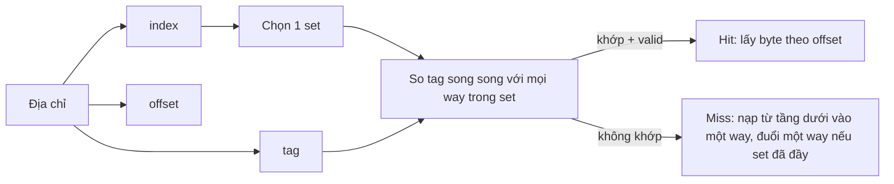
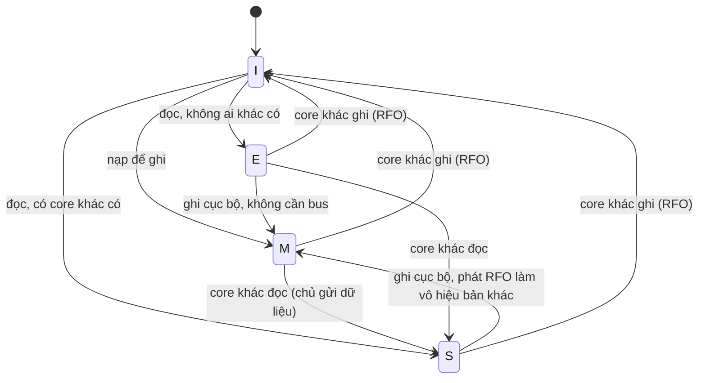
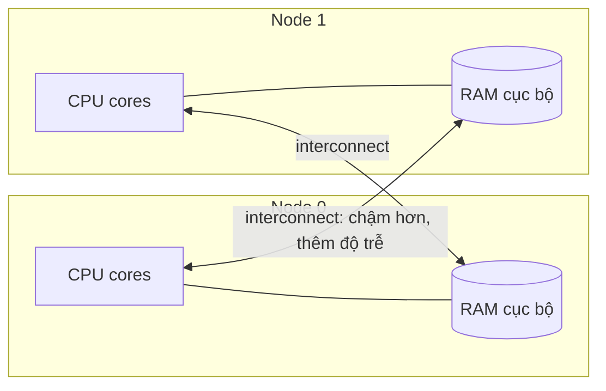

# P2 · Chương 06 — Cache hierarchy và NUMA

## Bạn sẽ hiểu được gì

1. **Q1.** Vì sao máy tính có cả một *hệ phân cấp bộ nhớ* thay vì một loại bộ nhớ vừa nhanh vừa lớn, và độ trễ từng tầng cỡ bao nhiêu? → mục 1
2. **Q2.** Temporal locality và spatial locality là gì, và vì sao cache tận dụng chúng bằng đơn vị *cache line* chứ không phải từng byte? → mục 2
3. **Q3.** Một địa chỉ được tìm trong cache như thế nào: direct-mapped, set-associative, fully associative khác nhau ở đâu? → mục 3
4. **Q4.** Khi cache đầy thì đuổi dòng nào (replacement), và khi ghi thì ghi đi đâu (write-through vs write-back)? → mục 4
5. **Q5.** Nhiều core cùng giữ bản sao một dòng thì làm sao không đọc nhầm dữ liệu cũ (cache coherence, MESI)? → mục 5
6. **Q6.** Vì sao coherence sinh ra *false sharing*, đo nó thế nào và chữa ra sao? → mục 6
7. **Q7.** Prefetching giúp gì, và khi nào bị vô hiệu? → mục 7
8. **Q8.** NUMA là gì, Linux xử lý bộ nhớ "gần/xa" thế nào, và việc đó liên quan gì đến server nhiều socket mà bạn deploy? → mục 8

## Kiến thức cần trước

- [Chương 01 — Mô hình máy và ISA](01-mo-hinh-may-va-isa.md): CPU, thanh ghi, bộ nhớ ở mức mô hình.
- [Chương 05 — Pipeline và speculation](05-pipeline-va-speculation.md): pipeline stall là gì, và vì sao CPU chạy suy đoán thay vì đứng chờ một giá trị còn nằm trong RAM.
- Địa chỉ ảo/vật lý (nhắc ngắn ở phần Đi sâu của mục 3): [Chương 03 của phase Memory](../03-memory/03-page-table-va-tlb.md).

Bạn đã tối ưu service ở tầng thuật toán và query (index, batch, connection pool) nhưng có thể chưa hiểu vì sao cùng một vòng lặp, cùng số phép tính, lúc nhanh lúc chậm gấp nhiều lần. Phần lớn câu trả lời nằm ở bộ nhớ, và chương này lấp chỗ đó. Code ví dụ bằng Rust, chỉ cần đọc được `Vec`, `AtomicU64` và `std::thread`.

## 1. Hệ phân cấp bộ nhớ: CPU nhanh, DRAM chậm (Q1)

> **Trả lời ngắn.** Không có loại bộ nhớ nào vừa nhanh vừa lớn: dung lượng càng lớn thì hiệu năng càng thấp[^dis-hier]. Vì vậy máy thật xếp nhiều loại thành tầng: thanh ghi, cache, bộ nhớ chính, rồi flash[^dis-combo]. Một giáo trình đưa ra thang độ trễ cỡ 5 ns cho cache và cỡ 100 ns cho bộ nhớ chính[^dis-table1]. Flash chậm hơn nữa, cỡ 0,1–1 ms[^dis-table2]. Đó là thang bậc độ lớn từ bảng "typical 2020 workstation", không phải số đo CPU hiện đại.

**Giải thích.**

*Với service `orders`.* Hãy hình dung `orders`, một service viết bằng Rust, chạy trên server hai socket (hai CPU vật lý cắm trên một bo mạch, mỗi CPU nhiều core). Mỗi request vào một handler thread. Handler tra một bảng đơn hàng nằm trong RAM của process (`Vec<Order>`), cộng vào vài bộ đếm (số request, doanh thu) rồi trả lời. Ta sẽ bám theo `orders` suốt chương (nhận xét của người soạn: đây là ví dụ giả định, không phải code trong repo). Câu hỏi của mục này: khi handler đọc một phần tử của `Vec<Order>`, dữ liệu đó đang nằm ở đâu, và lấy nó mất bao lâu?

### 1.1 Vì sao không có một loại bộ nhớ cho tất cả

Giả sử có một loại bộ nhớ vừa nhanh như thanh ghi vừa rộng như đĩa, thì `orders` chẳng cần quan tâm dữ liệu nằm chỗ nào. Thực tế không có loại đó. Sự đánh đổi giữa hiệu năng và dung lượng có tên là *memory hierarchy*[^dis-hier]. Thiết bị nhanh còn đắt hơn, cả về giá trên mỗi byte lẫn chi phí vận hành[^dis-cost]. Và việc chế tạo một CPU có cache đủ lớn để bỏ hẳn bộ nhớ chính cũng không khả thi[^dis-infeasible].

### 1.2 Hai công nghệ: SRAM và DRAM

Hai tầng gần CPU nhất dùng hai công nghệ khác nhau. **SRAM** được tích hợp thẳng vào CPU để làm thanh ghi và cache. Nó thường là loại nhanh nhất, nhưng tốn kém cả về chi phí chế tạo, điện năng lẫn diện tích, nên dung lượng bị giới hạn[^dis-sram]. **DRAM** lưu dữ liệu bằng tụ điện[^dis-dram]. Nó dùng làm bộ nhớ chính, và điện tích trong tụ phải được refresh liên tục[^dis-dram2].

Với `orders`, nghĩa là bảng `Vec<Order>` cả trăm MB nằm trong DRAM, còn trong SRAM chỉ có phần handler vừa chạm tới (nhận xét của người soạn).

Con số cho thấy khoảng cách. Theo bảng ở phần Đi sâu, từ cache sang DRAM chậm đi khoảng 20 lần (5 ns → 100 ns), và từ DRAM sang flash chậm đi khoảng 1.000–10.000 lần (100 ns → 0,1–1 ms) (suy luận của người soạn từ bảng). Một lần đọc `Order` mà không trúng cache vì thế tốn cỡ hai chục lần một lần đọc trúng.

<details><summary>Đi sâu: bảng độ trễ từng tầng và vì sao đếm theo chu kỳ</summary>

**Đây không phải số đo của CPU hiện đại.** Cột trái là bảng "typical 2020 workstation" của một giáo trình (số làm tròn, không gắn với mẫu CPU nào). Cột phải là số Intel công bố cho Pentium M, trích trong bài Drepper đề ngày 21/11/2007 (nguồn không nêu năm ra mắt của Pentium M). Chương này không đo độ trễ cache trên máy nào, nên hãy đọc hai cột như *thang đo* bậc độ lớn, không phải hằng số:

| Tầng | Dive into Systems, "typical 2020 workstation" (ns) | Drepper (bài 2007), số Intel công bố cho Pentium M (chu kỳ) |
|---|---|---|
| Thanh ghi | < 1 ns | ≤ 1 chu kỳ |
| L1d | (gộp chung "CPU cache") | ~3 chu kỳ |
| L2 | (gộp chung "CPU cache") | ~14 chu kỳ |
| Cache nói chung | ~5 ns | — |
| Bộ nhớ chính | ~100 ns | ~240 chu kỳ |

Cột trái lấy từ bảng của Dive into Systems[^dis-table1]. Cột phải lấy từ bảng "To Where / Cycles" của Drepper[^drep-pm]. Với bộ nhớ thứ cấp, độ trễ flash disk là 0,1–1 ms[^dis-table2]. Tính theo chu kỳ của Pentium M thì từ L2 sang bộ nhớ chính chậm đi 14 → 240 chu kỳ, cỡ 17 lần (suy luận của người soạn từ bảng Drepper).

Vì sao nên đếm theo chu kỳ chứ không chỉ theo ns? Vì thứ CPU thật sự cảm nhận là số chu kỳ nó phải chờ. Drepper minh họa bằng một phép tính với số giả định: bộ nhớ chính mất 200 chu kỳ, cache mất 15 chu kỳ, và một đoạn code dùng 100 phần tử dữ liệu, mỗi phần tử 100 lần. Không có cache thì tốn 2.000.000 chu kỳ truy cập bộ nhớ; nếu toàn bộ dữ liệu nằm trong cache thì chỉ 168.500, tức cải thiện 91,5%[^drep-calc]. Đây là ví dụ số giả định, không đo trên CPU cụ thể nào.

</details>

**Quay lại Q1:** nhanh, rộng, rẻ không đi cùng nhau nên máy xếp bộ nhớ thành nhiều tầng, mỗi tầng xuống dưới chậm hơn cỡ một đến nhiều bậc độ lớn; với `orders`, một lần đọc dữ liệu có thể tốn vài ns hay cả trăm ns tùy dữ liệu đang nằm ở tầng nào.

## 2. Locality và cache line (Q2)

> **Trả lời ngắn.** Cache là SRAM nhỏ giữ bản sao tạm của dữ liệu trong DRAM. Nó hiệu quả vì chương trình hay dùng lại cùng một dữ liệu (temporal locality) và hay dùng dữ liệu nằm gần chỗ vừa dùng (spatial locality)[^drep-loc]. Nhờ spatial locality, cache lưu theo *dòng* gồm nhiều byte liền kề thay vì từng từ[^drep-lines]. Vì vậy dù bạn chỉ đọc 1 byte, phần cứng vẫn kéo cả dòng vào L1d[^drep-wholeline].

**Giải thích.**

*Với service `orders`.* Giả sử một handler tính tổng doanh thu bằng cách duyệt `Vec<Order>` từ đầu đến cuối. Vòng lặp đó đụng đủ hai kiểu locality, và cũng cho thấy vì sao cache không lưu từng byte lẻ.

### 2.1 Hai kiểu locality

- **Temporal locality**: chương trình hay truy cập lại cùng một dữ liệu theo thời gian. Vừa dùng một biến thì nhiều khả năng sẽ dùng lại sớm[^dis-temporal].
- **Spatial locality**: chương trình hay truy cập dữ liệu gần chỗ vừa dùng, gần theo địa chỉ. Đã đọc địa chỉ N và N+4 thì rất có thể sắp đọc N+8[^dis-spatial].

Vòng `for` cộng mảng minh họa cả hai. Vì vòng lặp lặp lại, các biến `i`, `len`, `sum` và địa chỉ gốc của mảng đều có temporal locality[^dis-sumarray]. Còn bản thân các phần tử mảng, dù mỗi phần tử chỉ đọc một lần, vẫn hưởng spatial locality: một lần nạp kéo theo vài phần tử kế tiếp, và số lượng bao nhiêu thì tùy block size của cache[^dis-block]. Trong `orders`, `sum` là phần temporal, còn các `Order` nằm liền nhau trong `Vec` là phần spatial (nhận xét của người soạn).

### 2.2 Vì sao cache lưu theo dòng

Spatial locality là lý do cache lưu theo *dòng* (line, hay block) gồm nhiều byte liền kề chứ không theo từng từ. Có thêm hai lý do thực dụng. Thứ nhất, mỗi entry trong cache phải kèm một tag, nên lấy một từ làm đơn vị thì tốn: với từ 32 bit trên x86, riêng tag có thể cần 32 bit trở lên[^drep-tagcost]. Thứ hai, module RAM hiệu quả hơn nhiều khi chuyển được nhiều từ liên tiếp mà không cần tín hiệu CAS hay RAS mới[^drep-ramburst].

Hệ quả thấy rõ khi duyệt ma trận. Duyệt theo hàng, đúng thứ tự ma trận nằm trong bộ nhớ (row-major), chạy nhanh hơn khoảng năm lần so với duyệt theo cột, và chênh lệch ấy chỉ đến từ spatial locality: bản đầu trả chi phí đến bộ nhớ một lần cho mỗi block giá trị[^dis-matrix]. Với `orders`, nếu bạn quét `Vec<Order>` theo thứ tự thì mỗi lần nạp dòng đem theo vài `Order` kế tiếp cho các vòng sau dùng, còn nhảy cóc qua `Vec` thì mỗi lần nạp chỉ dùng được một phần tử (nhận xét của người soạn).

Về kích thước dòng: các cache đời đầu dùng dòng 32 byte, còn chuẩn vào lúc Drepper viết bài (2007) là 64 byte[^drep-line]. Đó là chuyện của thời điểm bài viết, chưa phải khẳng định về mọi CPU hiện nay. Địa chỉ của một dòng có được bằng cách che bớt các bit thấp theo kích thước dòng; với dòng 64 byte, 6 bit thấp bị xóa về 0 và dùng làm *offset* trong dòng[^drep-mask].

### 2.3 Đọc 1 byte, ghi 1 byte

Dù handler chỉ đọc 1 byte của `Order`, cả dòng chứa nó được kéo vào L1d[^drep-wholeline]. Ghi cũng vậy: dù chỉ ghi 1 byte, cả dòng phải được nạp trước, vì không có lệnh nào sửa toàn bộ một dòng cùng lúc (ngoại lệ là write-combining)[^drep-writeload]. Điều này sẽ quan trọng ở mục 6.

<details><summary>Đi sâu: dòng bao nhiêu byte? Đo trên máy, sysfs và <code>crossbeam-utils</code></summary>

Đừng hard-code 64. Số liệu dưới đây là **một quan sát trên một máy** của người soạn (macOS, Apple M3 Pro, lệnh `sysctl`), kiểm lại ngày review; nó không nói gì về các chip ARM/AArch64 khác:

```text
$ sysctl hw.cachelinesize hw.l1dcachesize hw.l2cachesize hw.pagesize
hw.cachelinesize: 128
hw.l1dcachesize: 65536
hw.l2cachesize: 4194304
hw.pagesize: 16384
```

Trên máy này `sysctl` báo dòng cache là **128 byte** (không phải 64) — **không** suy ra "ARM có cache line 128 B": đây là một điểm dữ liệu từ một chip Apple, và VM Linux aarch64 bên dưới không cho đọc kích thước dòng để so sánh. Máy có nhiều cụm lõi: `hw.perflevel0.l1dcachesize`/`l2cachesize` là 131072/16777216 (cụm hiệu năng cao), `hw.perflevel1.*` là 65536/4194304, nên một con số "L1/L2" duy nhất không mô tả hết máy.

Trên Linux, kernel xuất thông tin cache qua sysfs `/sys/devices/system/cpu/cpu*/cache/index*/`. ABI doc mô tả `coherency_line_size` là lượng dữ liệu tối thiểu truyền từ bộ nhớ vào cache, cùng các thuộc tính `number_of_sets`, `size`, `level`, `type`[^abi-sysfs]. Dive into Systems cho ví dụ đọc `coherency_line_size` của `index0` ra 64 trên máy của họ[^dis-linesz]. Trong VM Linux aarch64 của repo (`./labs/linux.sh`, 4 CPU, chạy trên máy Apple nói trên), `cache/index0..2` chỉ có `level`, `type` (Data, Instruction, Unified), `shared_cpu_*` và `uevent`; các tệp `size`, `coherency_line_size`, `ways_of_associativity`, `number_of_sets` **không tồn tại** (quan sát một lần, tùy kernel/platform).

Rust có biết kích thước dòng không? Crate `crossbeam-utils` (bản 0.8.23) ước lượng theo kiến trúc: 128 byte cho x86-64, aarch64 và powerpc64; 32 cho arm, mips, mips64, sparc, hexagon; 16 cho m68k; 256 cho s390x; 64 cho các kiến trúc còn lại[^cp-arch]. Tài liệu nói rõ N chỉ là phỏng đoán, không bảo đảm khớp độ dài dòng thật của máy đang chạy[^cp-n]. Lý do chọn 128 cho aarch64, theo chú thích trong source của crate, là kiến trúc big.LITTLE có lõi không đồng nhất và các lõi "big" có dòng 128 byte[^cp-arm]. Với Intel, tài liệu nêu lý do là spatial prefetcher kéo từng cặp dòng 64 B nên chọn 128 theo hướng bi quan[^cp-why128]. Source nói cụ thể hơn: từ Sandy Bridge của Intel trở đi[^cp-sandy]. Tóm lại 128 là lựa chọn phòng xa, không phải kích thước dòng đã đo.

</details>

**Quay lại Q2:** chương trình hay dùng lại dữ liệu và dữ liệu lân cận, nên cache lưu theo dòng nhiều byte liền kề; handler của `orders` đọc 1 byte cũng kéo cả dòng.

## 3. Cache tìm một địa chỉ như thế nào (Q3)

> **Trả lời ngắn.** Ba kiểu tổ chức cache khác nhau ở chỗ một khối bộ nhớ được phép nằm ở đâu trong cache. Direct-mapped ép mỗi địa chỉ vào đúng một dòng[^dis-dm]. Fully associative cho nó nằm ở bất kỳ đâu[^dis-fa]. Set-associative là thỏa hiệp: mỗi địa chỉ ánh xạ vào đúng một set gồm vài dòng[^dis-set].

**Giải thích.**

*Với service `orders`.* Giả sử mỗi worker thread của `orders` có một buffer riêng để parse request, và bạn cấp phát mỗi buffer căn theo 4096 byte cho gọn. Nghe vô hại, nhưng ví dụ tính tay ở cuối mục sẽ cho thấy những buffer đó có thể tranh nhau cùng một vài chỗ trong cache. Câu hỏi: khi handler đọc một địa chỉ, cache tìm dòng của nó ở đâu, và những địa chỉ nào tranh chỗ của nhau?

### 3.1 Direct-mapped

Cache chia thành các *cache line*, và trong kiểu direct-mapped mỗi địa chỉ bộ nhớ ứng với đúng một dòng[^dis-dm]. Địa chỉ được tách thành offset (chọn byte trong dòng), index (chọn dòng) và tag (các bit còn lại)[^dis-addrsplit]. Mỗi dòng có một *valid bit* và một *tag*[^dis-tag]. Khi tra, nếu dòng hợp lệ và tag khớp phần trên của địa chỉ yêu cầu thì đó là hit[^dis-hit].

Ưu điểm là nhanh và tương đối dễ cài đặt[^drep-dm]. Nhược điểm là **conflict miss**: dù cache chưa đầy, hai biến hay dùng vẫn có thể ánh xạ vào cùng một dòng và liên tục đuổi nhau[^dis-conflict]. Trong ba kiểu, direct-mapped chịu xung đột nhiều nhất[^dis-conflict2].

### 3.2 Fully associative

Ở đầu kia, fully associative cho phép mọi vùng bộ nhớ nằm ở bất kỳ vị trí nào. Đổi lại, tra cứu và đuổi dòng phức tạp nhất vì mọi vị trí phải được xét đồng thời[^dis-fa2]. Cách nói khác: phần cứng phải so tag của *mọi* dòng[^drep-fa]. Vì thế kiểu này chỉ thực tế với cache rất nhỏ, cỡ vài chục mục, chẳng hạn TLB của một số CPU Intel lúc đó[^drep-fa2]. Dive into Systems cũng coi nó chỉ đáng giá cho các ứng dụng nhỏ, chuyên dụng như TLB[^dis-fa-tlb].

### 3.3 Set-associative

Kiểu thực tế là thỏa hiệp: mỗi vùng bộ nhớ ánh xạ vào đúng một *set*, nhưng mỗi set chứa nhiều dòng. Số dòng mỗi set cố định, thường từ hai đến tám[^dis-set]. Nhiều vùng nhớ cùng rơi vào một set không gây conflict miss, trừ khi cả set đã đầy[^dis-setok]. Kiểu này giữ ưu điểm của cả hai thái cực và tránh phần lớn điểm yếu của chúng[^drep-set]. Dung lượng cache khi đó là tích của ba số: cache size = cache line size × associativity × số set[^drep-size].



### 3.4 Tính tay: các buffer căn 4096 của `orders`

Lấy một cache 32 KiB, 8-way, dòng 64 B (số minh họa của người soạn, không phải một CPU cụ thể). Số set là 32768 / (64 × 8) = 64. Địa chỉ gồm 6 bit offset, 6 bit index, phần còn lại là tag. Hai địa chỉ cách nhau một bội của 4096 byte có cùng index, nên tranh nhau 8 chỗ của một set.

Giờ giả sử `orders` có 9 buffer căn 4096 byte và handler đọc luân phiên dòng đầu của từng buffer. Chín dòng đó cùng rơi vào một set chỉ có 8 chỗ, nên chúng có thể đuổi nhau liên tục dù tổng dung lượng rất nhỏ so với cache. Đây là suy luận của người soạn từ công thức trên; mức độ thực tế còn phụ thuộc chính sách đuổi ở mục 4. Cách tránh quen thuộc là đừng căn mọi buffer vào cùng một độ lệch (nhận xét của người soạn).

<details><summary>Đi sâu: TLB — nhắc ngắn</summary>

Địa chỉ ảo phải được dịch thành địa chỉ vật lý, và **TLB** là cache nhỏ phục vụ việc dịch này. Dive into Systems lấy TLB làm ví dụ cho các ứng dụng nhỏ, chuyên dụng mà cache fully associative vẫn đáng giá[^dis-fa-tlb]. Để đo ảnh hưởng của TLB, Drepper đặt mỗi phần tử danh sách trên một trang riêng, nên mỗi lần lặp đều cần một dòng cache mới *và* một trang mới[^drep-tlb]. Cơ chế đầy đủ nằm ở [Page table và TLB](../03-memory/03-page-table-va-tlb.md).

</details>

**Quay lại Q3:** địa chỉ tách thành offset/index/tag; direct-mapped một vị trí, fully associative mọi vị trí, set-associative một set gồm vài way, là thỏa hiệp phổ biến; với `orders`, các buffer cách nhau đúng bội của kích thước một "lát" cache có thể tranh nhau cùng một set.

## 4. Replacement và chính sách ghi (Q4)

> **Trả lời ngắn.** Khi set đầy, cache phải chọn một dòng để đuổi, và cách phổ biến là LRU: đuổi dòng lâu nhất chưa được dùng[^drep-lru]. Khi ghi, write-through sửa cả cache lẫn bộ nhớ chính ngay[^dis-wt]. Write-back thì chỉ sửa cache, đánh dấu dòng là dirty và chỉ ghi xuống bộ nhớ khi dòng bị đuổi[^dis-wb].

**Giải thích.**

*Với service `orders`.* Mỗi request, handler chạm vào bảng đơn hàng, vài bộ đếm và buffer parse. Tổng những thứ đó thường lớn hơn cache, nên luôn có dòng phải nhường chỗ. Và mỗi lần handler cập nhật bộ đếm doanh thu, cần biết ghi đó đi đâu. Mục này trả lời hai câu: dòng nào bị đuổi, và một lần ghi tốn những gì.

### 4.1 Replacement: đuổi dòng nào

Khi set đầy, cache phải chọn một nạn nhân. Chính sách phổ biến là LRU, dựa trên temporal locality: dữ liệu vừa dùng gần đây nhiều khả năng sẽ được dùng lại[^dis-lrutemp]. Cách chọn này có tên chung là *cache replacement policy*[^dis-lru]. Hầu hết cache đuổi dòng LRU trước. Khi associativity tăng, việc duy trì danh sách LRU ngày càng đắt, nên có thể xuất hiện chiến lược khác[^drep-lru]. Lập trình viên gần như không can thiệp được vào chuyện này[^drep-lru-prog]. Với `orders`, nghĩa là bạn không chọn được dòng nào bị đuổi; thứ chỉnh được là kích thước dữ liệu nóng và thứ tự truy cập (nhận xét của người soạn).

### 4.2 Ghi: write-through và write-back

- **Write-through**: mỗi lần ghi sửa cache *và đồng thời* cập nhật bộ nhớ chính, nên hai nơi luôn đồng bộ[^dis-wt]. Cách này đơn giản nhưng chậm: Drepper chỉ ra rằng chương trình liên tục sửa một biến cục bộ sẽ tạo nhiều lưu lượng bus dù dữ liệu có thể chẳng ai khác dùng[^drep-wt].
- **Write-back**: ghi chỉ sửa cache. Mỗi dòng có thêm một *dirty bit*, và khi một dòng dirty bị đuổi thì nó mới được ghi xuống bộ nhớ[^dis-wb]. Drepper nhận xét write-back có thể nhanh hơn đáng kể, nên phần lớn bộ nhớ trong hệ thống có CPU tử tế được cache theo kiểu này[^drep-wb]. Dive into Systems nói tương tự: phần lớn cache hiện đại chọn write-back vì dàn trải chi phí truy cập bộ nhớ qua nhiều lần ghi[^dis-wbmodern].

Với `orders`: handler cộng vào bộ đếm hàng triệu lần. Nếu cache là write-back thì cả loạt lần ghi đó chỉ sửa một dòng trong cache, và dòng chỉ xuống bộ nhớ khi bị đuổi (nhận xét của người soạn).

Write-back có một cái giá: nó làm bài toán nhiều core khó hơn, vì bộ nhớ chính có thể đang giữ bản lỗi thời[^drep-wbprob]. Đó là chuyện của mục 5.

<details><summary>Đi sâu: LRU một bit, dòng bị đuổi đi đâu, và chính sách ghi trên CPU thật</summary>

*LRU nhỏ nhất.* Với cache 2-way, mỗi set chỉ cần một bit LRU để nhớ dòng nào dùng lâu nhất[^dis-lrubit]. Số bit cần có tăng theo số dòng mỗi set[^dis-lrumeta]. Cách mã hóa bit LRU còn khác nhau giữa các cache[^dis-lruvary]. Đó là một lý do khiến chi phí duy trì LRU tăng theo associativity, như đã nói ở phần Giải thích.

*Dòng bị đuổi đi đâu.* Theo mô tả của Drepper (2007), dòng bị đuổi khỏi L1d được đẩy xuống L2, có thể tiếp xuống L3 rồi bộ nhớ chính, và mỗi lần đuổi sâu hơn lại đắt hơn[^drep-evict]. Với cache *inclusive* (mọi dòng của L1d cũng có mặt trong L2), việc đuổi khỏi L1d nhanh hơn nhiều[^drep-incl]. Chính ông ghi chú rằng khái quát này không hoàn toàn đúng, vì có cache exclusive và có cache inclusive mang tính chất của exclusive[^drep-incl-caveat]. Ông cũng nhắc CPU được tự do quản lý cache miễn là không đổi mô hình bộ nhớ của kiến trúc, ví dụ chủ động ghi dòng dirty về bộ nhớ khi bus rảnh[^drep-proactive].

*Chính sách ghi trên phần cứng thật.* Write-through không chỉ là lý thuyết. Drepper suy ra từ đồ thị băng thông rằng ở các bộ xử lý Netburst, Intel dùng write-through cho L1d[^drep-netburst]. Bộ xử lý Intel Core 2 trong cùng bài thì không[^drep-core2]. Đó là suy luận của Drepper từ phép đo năm 2007 trên hai mẫu CPU cụ thể, không áp dụng được cho CPU hiện nay. Trên Linux, ABI doc của sysfs mô tả thuộc tính `write_policy` (WriteThrough/WriteBack) trong thư mục cache của từng CPU[^abi-wp]. Tệp này có thể không tồn tại trên mọi máy (xem mục 2).

*Ngoại lệ: vùng nhớ đặc biệt.* Drepper nhắc thêm hai chính sách write-combining và uncacheable, dành cho các vùng địa chỉ không phải RAM thật[^drep-wc]. Đó chính là "ngoại lệ write-combining" nhắc ở mục 2.

Chương này không có nguồn về chiến lược đuổi hay chính sách ghi cụ thể của một CPU hiện nay (M3 Pro, Intel hay AMD đời mới), nên không khẳng định gì thêm về chúng.

</details>

**Quay lại Q4:** replacement thường là LRU; write-back (dirty bit) phổ biến vì ít lưu lượng bus hơn write-through, nhưng làm bài toán đa core khó hơn; với `orders`, bộ đếm được cộng nhiều lần chỉ cần sửa một dòng trong cache.

## 5. Nhiều core: cache coherence và MESI (Q5)

> **Trả lời ngắn.** Mỗi core có cache riêng (ít nhất là L1d)[^drep-notshared], nên cùng một dòng có thể có bản sao ở nhiều core. Khi core A ghi vào dòng đó, các bản sao cũ ở core khác phải bị vô hiệu hóa, để core B không đọc nhầm dữ liệu cũ[^drep-inval]. Các core theo dõi (snoop) thao tác ghi của nhau để làm được việc ấy[^drep-snoop]. Còn MESI gắn mỗi dòng một trong bốn trạng thái Modified, Exclusive, Shared, Invalid để quyết định lúc nào phải gửi dữ liệu, lúc nào phải vô hiệu hóa bản sao khác[^drep-mesi].

**Giải thích.**

*Với service `orders`.* Giả sử mọi handler thread cùng cộng vào một bộ đếm chung `requests_total`, là một `AtomicU64`. Các thread chạy trên các core khác nhau, và mỗi core giữ bản sao dòng chứa bộ đếm trong L1d của riêng mình. Khi core A cộng 1, core B không được phép đọc ra giá trị cũ. Việc giữ cho mọi bản sao nhất quán gọi là cache coherence, và nó có giá. Mục này nói giao thức làm việc đó ra sao, và vì sao "có giá" là chuyện của `orders`.

### 5.1 Vấn đề

Cả CPU nhiều lõi cũng gặp vấn đề này ở các tầng cache không dùng chung, ít nhất là L1d[^drep-notshared]. Giả sử core A ghi vào một dòng dirty rồi core B đọc cùng địa chỉ. B không thể chỉ ra bộ nhớ chính đọc, vì dòng dirty của A mới là bản đúng[^drep-dirty]. Để giữ đúng, giao thức coherence phải bảo đảm hai quy tắc. Một là dòng dirty không có trong cache của bộ xử lý nào khác[^drep-rule-dirty]. Hai là các bản sao *clean* của cùng một dòng thì có thể nằm trong nhiều cache tùy ý[^drep-rules].

### 5.2 Theo dõi nhau: snooping

Để biết dòng nào dirty ở đâu, các bộ xử lý theo dõi thao tác ghi của nhau và so địa chỉ với cache cục bộ[^drep-snoop]. Nếu thấy một lần ghi tới dòng mà mình đang giữ bản clean, bộ xử lý đánh dấu bản đó là invalid[^drep-inval]. Dive into Systems mô tả cùng ý: một *snoopy cache* "nghe" bus bộ nhớ, và khi thấy một lần ghi vào khối mà nó đang giữ thì vô hiệu hóa dòng chứa khối đó của mình[^dis-snoopy]. Nói chung, chiến lược coherence là *vô hiệu hóa* hoặc cập nhật các bản sao ở cache khác mỗi khi có ghi[^dis-snoop].

### 5.3 MESI

MESI đặt tên theo bốn trạng thái mà một dòng cache có thể ở[^drep-mesi]:

| Trạng thái | Ý nghĩa (theo Drepper) |
|---|---|
| **M**odified | Bộ xử lý cục bộ đã sửa dòng; ngụ ý đây là bản duy nhất trong mọi cache[^drep-m]. |
| **E**xclusive | Chưa sửa, nhưng biết không nằm trong cache nào khác[^drep-e]. |
| **S**hared | Chưa sửa, có thể tồn tại ở cache khác[^drep-s]. |
| **I**nvalid | Dòng không hợp lệ/không dùng[^drep-i]. |

Cơ chế từng bước (theo mô tả của Drepper, đã đơn giản hóa):

1. Ban đầu mọi dòng là Invalid. Nạp để *ghi* thì thành Modified. Nạp để *đọc* thì thành Shared nếu bộ xử lý khác cũng có dòng đó, ngược lại thành Exclusive[^drep-init].
2. Dòng Modified bị bộ xử lý khác đọc: chủ gửi nội dung sang rồi chuyển sang Shared, và nội dung đó cũng được bộ điều khiển bộ nhớ nhận để ghi vào bộ nhớ[^drep-modread]. Nếu bộ xử lý khác muốn *ghi*, chủ gửi nội dung rồi tự đánh dấu Invalid. Đó là thao tác **RFO (Request For Ownership)**[^drep-mod].
3. Dòng Shared bị ghi cục bộ: chuyển thành Modified, nhưng phải báo bằng thông điệp RFO để mọi bản sao khác bị đánh dấu Invalid[^drep-sharedw]. Ngược lại, dòng Shared bị bộ xử lý khác đọc thì không phải làm gì, còn bị ghi (RFO) thì chỉ cần đánh dấu Invalid, không cần thao tác bus[^drep-sremote].
4. Exclusive khác Shared ở chỗ ghi cục bộ *không cần* báo trên bus, vì cache cục bộ biết mình là bản duy nhất[^drep-excl].



### 5.4 Chi phí: RFO là thứ làm chậm

Từ mô tả các chuyển trạng thái, Drepper chỉ ra chi phí đặc thù của đa bộ xử lý: ngoài việc nạp cache vốn đã đắt, còn phải để ý các thông điệp RFO, vì mỗi khi phải gửi một thông điệp như vậy thì mọi thứ chậm đi[^drep-rfoslow]. RFO cần thiết trong hai tình huống: khi một thread bị chuyển sang bộ xử lý khác (toàn bộ dòng phải chuyển theo), và khi một dòng thật sự cần ở hai bộ xử lý[^drep-rfowhen]. Đồng bộ hóa luôn dùng bộ nhớ nên một số RFO là chính đáng, nhưng phải giữ chúng càng hiếm càng tốt[^drep-rfosync]. Với hai core của cùng một CPU thì điều này vẫn đúng, chỉ là chi phí nhỏ hơn một chút[^drep-fn21].

Quay lại `orders`: nếu mọi handler cùng cộng vào `requests_total`, dòng chứa nó phải liên tục chuyển quyền sở hữu từ core này sang core kia, mỗi lần kèm một RFO (suy luận của người soạn từ các bước trên). Đó là lý do bộ đếm chung bị tranh chấp nặng, và là tiền đề cho mục 6.

<details><summary>Đi sâu: độ tin cậy của sơ đồ trạng thái, biến thể giao thức và độ trễ phản hồi</summary>

Sơ đồ trên do người soạn vẽ lại từ lời văn của Drepper §3.3.4; bản văn bản không trích được hình 3.18 nên chưa đối chiếu từng mũi tên với hình. Riêng `E → S` và `E → I` Drepper không tả riêng. Hai mũi tên đó suy ra từ câu nói Exclusive gần như giống Shared, khác biệt duy nhất được nêu là ghi cục bộ không cần báo trên bus[^drep-eqs]. Chúng cũng dựa vào mô tả Shared bị đọc thì không đổi, bị ghi (RFO) thì thành Invalid mà không cần thao tác bus[^drep-sremote]. Đây là suy luận của người soạn, có cơ sở trong lời văn nhưng chưa phải câu nguyên văn.

Drepper cũng nói có thể bỏ hẳn Exclusive mà vẫn đúng chức năng, chỉ chậm hơn vì E→M nhanh hơn S→M nhiều[^drep-noexcl]. Dive into Systems thì dùng ví dụ giao thức MSI (Modified, Shared, Invalid), tức chỉ có ba trạng thái, không có Exclusive[^dis-msi].

Về độ trễ: một chuyển trạng thái MESI chỉ xảy ra khi mọi bộ xử lý trong hệ thống đã có cơ hội trả lời, nên thời gian trả lời lâu nhất quyết định tốc độ giao thức[^drep-mesireply]. Drepper kể va chạm trên bus, độ trễ có thể cao trong hệ NUMA và lưu lượng lớn là những thứ làm nó chậm[^drep-mesilat]. Nối với mục 8: coherence vẫn giữ chương trình đúng trên máy NUMA nhưng đắt hơn khi các bộ xử lý ở xa nhau (suy luận của người soạn từ hai câu trên).

</details>

**Quay lại Q5:** coherence giữ các bản sao nhất quán bằng snoop và trạng thái MESI; RFO, tức xin quyền sở hữu để vô hiệu bản sao khác, là chi phí đặc thù của đa core, và `requests_total` chung của `orders` phải trả chi phí đó ở mỗi lần cộng.

## 6. False sharing (Q6)

> **Trả lời ngắn.** Coherence làm việc theo **cả dòng**, không theo từng biến: khi một thread cập nhật biến `g`, cả dòng cache chứa `g` bị vô hiệu hóa ở cache khác[^dis-fs]. Vì vậy hai thread ghi hai biến *khác nhau* nhưng nằm cùng một dòng vẫn giành quyền sở hữu dòng đó và chậm đi[^drep-fs]. Cách chữa thường dùng là tách chúng ra các dòng khác nhau, ví dụ bằng `crossbeam_utils::CachePadded`[^cp-use]. Tốt hơn nữa là cho mỗi thread ghi vào bộ nhớ cục bộ rồi mới gộp lại[^dis-fixlocal].

**Giải thích.**

*Với service `orders`.* Để bớt tranh chấp trên `requests_total` ở mục 5, bạn đổi sang mỗi worker một bộ đếm riêng, xếp trong một `Vec<AtomicU64>`. Worker nào chỉ ghi ô của mình, nên nhìn qua thì không còn gì dùng chung. Nhưng các `AtomicU64` 8 byte nằm sát nhau, có thể vài ô chung một dòng cache 64 hay 128 byte. Mục này giải thích vì sao thiết kế "không dùng chung" đó vẫn chậm, đo nó ra sao và chữa thế nào.

### 6.1 Vô hiệu hóa theo cả dòng

Coherence hoạt động ở độ chi tiết **cả dòng**. Khi thread cập nhật biến `g` trên core 0, snoopy cache vô hiệu hóa không chỉ `g` mà *cả dòng cache chứa `g`*[^dis-fs]. Do đó nếu hai thread ghi hai biến khác nhau nằm cùng một dòng, mỗi lần ghi của một core lại vô hiệu hóa dòng ở core kia, và hai core giành nhau quyền sở hữu dòng (suy luận của người soạn từ câu trên và từ MESI ở mục 5).

Drepper mô tả trước hết trường hợp nhiều thread ghi vào cùng một vị trí nhớ. Khi đó dòng phải ở trạng thái "E" (exclusive, theo cách ông viết) trong L1d của từng core, nên một lần ghi bình thường bỗng đắt vì phải gửi RFO, và trong trường hợp xấu nhất là một RFO cho mỗi lần ghi[^drep-fssame]. Rồi ông nói thêm rằng vấn đề vẫn xuất hiện khi các thread dùng ô nhớ *khác nhau* và tưởng là độc lập[^drep-fs]. Ông gọi hiện tượng này là "false sharing"[^drep-fsname]. Trong phép đo của ông, phần phạt xuất hiện khi các ô nhớ của các thread bị dồn vào một dòng cache[^drep-fsline].

### 6.2 Cách chữa

Có hai hướng. Hướng thứ nhất là tách các dữ liệu bị nhiều thread ghi độc lập ra các dòng khác nhau. Drepper gọi đó là cách "fix" rất đơn giản (mỗi biến một dòng), nhưng cũng nêu cái giá là footprint của ứng dụng tăng nhiều[^drep-fix]. Dive into Systems thêm rằng padding tốn bộ nhớ và có thể không gỡ được vấn đề trên mọi kiến trúc, chẳng hạn khi hai máy có kích thước L1 cache khác nhau[^dis-fixpad]. Vì mỗi biến được đệm chiếm cả một dòng, chỉ nên đệm các trường nóng (nhận xét của người soạn).

Hướng thứ hai, mà Dive into Systems gọi là tốt hơn, là cho mỗi thread ghi vào bộ nhớ cục bộ của nó khi có thể rồi mới gộp vào kết quả chung[^dis-fixlocal]. Với bộ đếm theo worker của `orders`, nghĩa là mỗi worker giữ một bộ đếm cục bộ và chỉ gộp khi cần, ví dụ lúc xuất metrics (nhận xét của người soạn, theo gợi ý của Dive into Systems).

### 6.3 Trong Rust

Hướng thứ nhất có sẵn trong `crossbeam_utils::CachePadded<T>`: nó đệm và căn một giá trị theo độ dài dòng cache[^cp-def]. Tài liệu giải thích rằng cập nhật một atomic làm vô hiệu cả dòng chứa nó, khiến lần truy cập kế tiếp của core khác chậm hơn[^cp-why]. Kích thước `CachePadded<T>` là bội số nhỏ nhất của N đủ chứa `T`, và alignment là max(N, align của `T`)[^cp-size]. Trong source của crate, việc căn lề được viết bằng thuộc tính `repr(align(N))` đặt có điều kiện theo kiến trúc (`cfg_attr`)[^cp-repr]. Còn Reference quy định giá trị alignment phải là lũy thừa của hai[^ref-align]. Cách dùng, phép đo và cái giá khi áp dụng nằm ở [Chương 07, mục 7](07-rust-va-may.md).

Cách dùng điển hình cho `orders` là bọc từng bộ đếm worker trong `CachePadded<AtomicU64>`. Tài liệu của `CachePadded` thì lấy `head` và `tail` của một hàng đợi lock-free làm ví dụ[^cp-example].

<details><summary>Đi sâu: phép đo false sharing trên Apple M3 Pro</summary>

Chương trình dưới đây được biên dịch (`rustc -O`, rustc 1.95.0) và chạy trên macOS (Apple M3 Pro, 11 CPU, dòng cache 128 B theo `sysctl`). Các thread không được ghim vào core nào; macOS tự xếp lịch giữa các cụm lõi. Hai thread, mỗi thread tăng một `AtomicU64` 500 triệu lần (`Relaxed`, kiểu load rồi store, không `fetch_add`). Trường hợp 1: hai atomic nằm cạnh nhau trong một mảng 16 byte (thường rơi cùng một dòng 128 B; mảng chỉ rơi vắt qua hai dòng nếu bắt đầu đúng 120 byte sau ranh giới dòng — suy luận của người soạn từ alignment 8 byte). Trường hợp 2: mỗi atomic bọc trong struct `#[repr(align(128))]` nên nằm trên dòng riêng.

```rust
use std::sync::atomic::{AtomicU64, Ordering::Relaxed};
use std::time::Instant;

#[repr(align(128))]
struct Pad(AtomicU64);

fn run(a: &AtomicU64, b: &AtomicU64) -> u128 {
    let n = 500_000_000u64;
    let t = Instant::now();
    std::thread::scope(|s| {
        s.spawn(|| for _ in 0..n { a.store(a.load(Relaxed) + 1, Relaxed) });
        s.spawn(|| for _ in 0..n { b.store(b.load(Relaxed) + 1, Relaxed) });
    });
    t.elapsed().as_millis()
}

fn main() {
    let adj = [AtomicU64::new(0), AtomicU64::new(0)];
    let p = [Pad(AtomicU64::new(0)), Pad(AtomicU64::new(0))];
    println!("same line: {} ms, padded: {} ms", run(&adj[0], &adj[1]), run(&p[0].0, &p[1].0));
}
```

Kết quả (quan sát trên một máy, không phải bảo đảm): lần đo ban đầu của người soạn, 5 lần chạy, "cùng dòng" 558–630 ms, "đệm 128 B" 157–189 ms. Chạy lại 5 lần khi review cho 529–575 ms và 172–229 ms (tỉ lệ từng lần 2,4–3,2 lần); với 100 triệu vòng là 107–115 ms và 33–42 ms. Tóm lại "cùng dòng" chậm hơn cỡ ba lần dù hai thread không dùng chung biến nào; `Pad` in ra kích thước 128. Con số tuyệt đối thay đổi theo máy và lịch của OS; chỉ nên tin vào bậc độ lớn. [Chương 07, mục 7](07-rust-va-may.md) đo một chương trình khác (4 thread, `fetch_add`) và ghi tỉ lệ riêng của nó; hai tỉ lệ không so trực tiếp được vì chương trình đo, số thread và phép toán khác nhau.

Chính Drepper cũng đo hiện tượng này: chương trình của ông tạo nhiều thread chỉ làm việc tăng một ô nhớ, 500 triệu lần[^drep-fsfig]. Máy đo có bốn bộ xử lý P4, với các thread ghim vào từng bộ xử lý[^drep-fsmachine]. Ông ghi các mức overhead 390%, 734% và 1.147% "lần lượt" (văn bản không nói rõ ứng với cấu hình nào)[^drep-fsnum]. Đó là số của phần cứng năm 2007 trên một chương trình khác, chỉ để thấy hiện tượng đã được biết từ lâu.

</details>

**Quay lại Q6:** false sharing là hai thread ghi hai biến khác nhau nhưng cùng một dòng cache nên tranh quyền sở hữu; với `orders`, chữa bằng cách tách bộ đếm các worker ra các dòng khác nhau (`CachePadded`, `repr(align)`) hoặc cho mỗi worker ghi cục bộ rồi gộp.

## 7. Prefetching (Q7)

> **Trả lời ngắn.** Prefetching che độ trễ truy cập bộ nhớ bằng cách nạp dữ liệu *trước khi* chương trình hỏi[^drep-pfpurpose]. Việc đó do phần cứng tự kích hoạt, hoặc do chương trình yêu cầu tường minh[^drep-pf]. Prefetcher phần cứng nhận ra các truy cập liền kề và cả stride, tức nhảy cách đều[^drep-hwpfstride]. Nhưng nó không vượt qua ranh giới trang[^drep-pfpage], và truy cập ngẫu nhiên thì nó không giúp được.

**Giải thích.**

*Với service `orders`.* Giả sử bảng đơn hàng có hai dạng: một `Vec<Order>` liền mạch, và một cấu trúc đi theo con trỏ, chẳng hạn danh sách liên kết các `Box<Order>` cấp phát lẻ. Quét `Vec` là kiểu truy cập mà phần cứng đoán trước được. Đi theo con trỏ rải rác thì địa chỉ kế tiếp không đoán được (nhận xét của người soạn). Mục này nói prefetcher đoán dựa trên gì, và khi nào nó bó tay.

### 7.1 Vì sao cần prefetch

Chờ DRAM hàng trăm chu kỳ là quá đắt (bảng ở mục 1 ghi cỡ 240 chu kỳ cho Pentium M[^drep-pm]). Pipeline và thực thi ngoài thứ tự (xem [Chương 05](05-pipeline-va-speculation.md)) chỉ che được một phần độ trễ, và nhiều nhất cũng chỉ cho các truy cập trúng cache[^drep-pfpurpose]. Prefetching bổ sung bằng cách nạp dữ liệu trước khi chương trình hỏi. Có hai loại: prefetch phần cứng do CPU tự kích hoạt khi có sự kiện nhất định, và prefetch phần mềm do chương trình yêu cầu tường minh[^drep-pf].

### 7.2 Prefetch phần cứng

Điều kiện kích hoạt thường là một chuỗi từ hai cache miss trở lên theo một mẫu nhất định, đến các dòng liền sau hoặc liền trước[^drep-hwpf]. Các cài đặt cũ chỉ nhận ra miss ở các dòng liền kề; phần cứng đương thời của Drepper (2007) nhận ra cả *stride*, tức nhảy qua cố định một số dòng[^drep-hwpfstride]. Cũng không thể cho mọi miss kích hoạt prefetch: truy cập ngẫu nhiên khá phổ biến, và các prefetch sinh ra chủ yếu lãng phí băng thông bus. Vì vậy truy cập ngẫu nhiên không nên kích hoạt nó[^drep-hwpf2].

### 7.3 Khi nào prefetch bị vô hiệu

- **Ranh giới trang.** Prefetch phần cứng không vượt qua ranh giới trang, vì CPU hỗ trợ demand paging và một prefetch vượt trang có thể kích hoạt một sự kiện OS để cấp trang đó[^drep-pfpage]. Hệ quả: dù prefetcher đoán mẫu giỏi đến đâu, chương trình vẫn bị cache miss ở ranh giới trang, trừ khi prefetch hoặc đọc tường minh trang mới[^drep-pfpage2].
- **Mẫu phi tuyến hoặc ngẫu nhiên.** Các prefetch unit hiện không nhận ra mẫu truy cập phi tuyến[^drep-nonlinear]. Với danh sách phần tử 64 byte xếp thứ tự ngẫu nhiên trong phép đo của Drepper, ông nhận xét prefetcher khó có tác dụng[^drep-pfrand].

Áp vào `orders`: quét `Vec<Order>` được prefetcher giúp trong từng trang, nhưng sang trang mới vẫn có thể miss. Duyệt danh sách các `Box<Order>` rải rác thì gần như không được giúp (nhận xét của người soạn).

### 7.4 Prefetch phần mềm

Chương trình tự chèn lệnh prefetch đặc biệt vào mã nguồn[^drep-swpf]. Chi tiết ở phần Đi sâu và mục "Liên hệ với Rust".

<details><summary>Đi sâu: cửa sổ stride, prefetch phần mềm và con số của Drepper</summary>

*Vì sao prefetcher phần cứng không thông minh hơn.* Drepper cho rằng vì giới hạn trang nói trên, các bộ xử lý đương thời không có logic nhận mẫu quá tinh vi. Với trang 4k còn phổ biến thì chỉ có chừng ấy là hợp lý, và cửa sổ nhận stride cũng chỉ cỡ 512 byte[^drep-pfwin]. Nếu prefetch phần cứng bị kích hoạt nhầm thì khó làm gì: có thể tắt toàn bộ hoặc một phần prefetch phần cứng của cả bộ xử lý (trên Intel qua một thanh ghi MSR), nhưng thường phải làm trong kernel vì đây là thao tác đặc quyền[^drep-pfmsr].

*Prefetch phần mềm.* Với x86 và x86-64, mã dùng intrinsic `_mm_prefetch` trên bất kỳ con trỏ nào; phần lớn bộ xử lý (chắc chắn mọi x86 và x86-64) bỏ qua lỗi do con trỏ không hợp lệ gây ra[^drep-swpf2]. Prefetch thừa phải tránh vì có thể làm giảm hiệu quả cache và tiêu tốn băng thông bộ nhớ[^drep-swpf3].

*Hiệu quả đo được.* Trong thí nghiệm danh sách liên kết bố trí ngẫu nhiên của Drepper, mỗi nút được xử lý khoảng 160 chu kỳ[^drep-pfsetup]. Khi vượt kích thước L2, prefetch tiết kiệm 50–60 chu kỳ, tối đa 8%: giúp được một chút chứ không che hết độ trễ[^drep-pf8]. Ông nhấn mạnh prefetch có thể lợi hơn thế nhưng nổi tiếng là khó làm đúng, nhất là khi cùng một binary phải chạy tốt trên nhiều máy[^drep-pfhard]. Đó là số của phần cứng 2007 trên một thí nghiệm cụ thể, không phải kỳ vọng cho code của bạn.

Chương này không có nguồn riêng về prefetcher của một CPU cụ thể hiện nay (ví dụ M3 Pro hay một dòng Intel đời mới). Spatial prefetcher của Intel được nhắc ở mục 2 chỉ là lý do mà tài liệu `crossbeam-utils` đưa ra để chọn N = 128[^cp-why128].

</details>

**Quay lại Q7:** prefetch nạp dữ liệu trước khi cần; phần cứng nhận ra chuỗi liền kề và stride, nên quét `Vec<Order>` được giúp, còn truy cập ngẫu nhiên hoặc qua ranh giới trang thì không.

## 8. NUMA (Q8)

> **Trả lời ngắn.** NUMA là kiến trúc trong đó bộ nhớ gắn trực tiếp vào một bộ xử lý thì truy cập nhanh, còn bộ nhớ gắn vào bộ xử lý khác phải qua interconnect nên chậm hơn[^drep-numa]. Linux mặc định cấp bộ nhớ local, tức gần CPU đang xin[^kp-default]. Linux quan tâm chủ yếu đến ccNUMA, nơi coherence do phần cứng lo[^k-ccnuma], nên NUMA chủ yếu là chuyện hiệu năng chứ không đổi kết quả chương trình (suy luận của người soạn).

**Giải thích.**

*Với service `orders`.* Server của `orders` có hai socket, và mỗi socket có RAM gắn riêng. Giả sử một thread khởi tạo cả bảng đơn hàng lúc khởi động, nó chạy trên socket 0, và các handler thread sau đó lại rải đều trên cả hai socket. Mọi handler vẫn đọc được bảng với kết quả đúng, nhưng các handler ở socket 1 phải đi qua interconnect cho từng lần hụt cache. Mục này giải thích vì sao có chuyện đó, Linux quyết định trang nằm ở đâu, và bạn can thiệp được chỗ nào.

### 8.1 Vấn đề từ phần cứng

Tài liệu kernel gọi "cell" là một thành phần của máy NUMA, có thể chứa 0 hoặc nhiều CPU, bộ nhớ cục bộ và/hoặc bus I/O[^k-celldef]. Các cell nối với nhau bằng một system interconnect[^k-cell]. Bộ nhớ gắn trực tiếp vào bộ xử lý được truy cập với tốc độ thường. Truy cập bộ nhớ gắn vào bộ xử lý khác phải qua interconnect, và mỗi lần qua đều tốn thêm chi phí. Phần chi phí thêm đó gọi là "NUMA factor"[^drep-numa]. Man page `numa(7)` nói cùng ý: thời gian truy cập một node phụ thuộc vị trí tương đối giữa CPU truy cập và node được truy cập[^numa7]. Điều này khác với SMP đối xứng, nơi mọi CPU có thời gian truy cập như nhau[^numa7smp].

Vì sao người ta vẫn làm máy như vậy? Tài liệu kernel nói NUMA không được xây để làm khó lập trình viên, mà để có băng thông bộ nhớ co giãn được[^k-numa-why]. Muốn vậy, phần mềm phải sắp xếp để phần lớn tham chiếu (cache miss) rơi vào bộ nhớ "local"[^k-numa-local].

Linux quan tâm chủ yếu đến ccNUMA (cache-coherent NUMA): mọi bộ nhớ nhìn thấy và truy cập được từ mọi CPU, còn coherence do phần cứng lo[^k-ccnuma]. Nghĩa là với chính sách mặc định, NUMA **không đổi tính đúng đắn của chương trình mà chủ yếu đổi hiệu năng** (suy luận của người soạn từ đoạn đó cộng với mục 5; riêng chính sách ràng buộc cứng có thêm rủi ro, xem phần Đi sâu).



### 8.2 Linux nhìn NUMA thế nào

Linux chia tài nguyên thành các **node**, ánh xạ lên các cell phần cứng[^k-nodes]. Truy cập tới node gần (ứng với cell gần) nhìn chung có thời gian truy cập nhanh hơn và băng thông hiệu dụng cao hơn[^k-nodes2]. Với mỗi node có bộ nhớ, Linux dựng một bộ quản lý bộ nhớ độc lập, có free list, thống kê và lock riêng[^k-nodemm]. Khi một node không đáp ứng được yêu cầu cấp phát, thứ tự dự phòng (zonelist) quy định tìm ở đâu tiếp: mặc định thử các zone cùng node trước, rồi mới đến node xa, xếp theo khoảng cách NUMA[^k-zonelist].

### 8.3 Chính sách bộ nhớ (memory policy)

Kernel cho tiến trình điều khiển node nào cấp trang:

- **Chính sách mặc định của hệ thống**: khi hệ thống đã chạy, là *local allocation*[^kp-default]. Chỉ lúc boot mới interleave giữa các node có đủ bộ nhớ, để không dồn tải vào node khởi động[^kp-boot]. "Local" nghĩa là bắt đầu từ node chứa CPU nơi việc cấp phát xảy ra[^kp-local].
- `MPOL_BIND`: bộ nhớ phải lấy từ tập node chỉ định[^kp-bind].
- `MPOL_INTERLEAVE`: cấp phát luân phiên theo đơn vị trang qua các node chỉ định[^kp-interleave].
- Task policy chỉ áp dụng cho trang cấp *sau khi* cài; trang đã được fault vào trước đó giữ nguyên chỗ[^kp-after].

### 8.4 Trang của `orders` nằm ở node nào

Mặc định của hệ thống là cấp bộ nhớ cục bộ cho thread đang xin[^drep-localdefault]. Ngoài ra, vùng `mmap` thường chưa được cấp trang thật cho đến khi lần đọc hoặc ghi đầu tiên vào nó cấp trang tương ứng[^drep-firsttouch]. Ghép hai điều đó với "local allocation" ở trên (suy luận của người soạn): với chính sách mặc định, trang thường nằm ở node của CPU chạy thread **lần đầu chạm vào nó**. Đó chính là kịch bản ở đầu mục. Thread khởi tạo chạy trên socket 0 nên bảng đơn hàng nằm ở node 0, và handler ở socket 1 truy cập xa. Cho từng worker tự khởi tạo vùng của mình là hướng ngược lại (nhận xét của người soạn).

### 8.5 Với server nhiều socket bạn deploy

- **Mức phạt của truy cập xa đo được.** Drepper dẫn số từ tài liệu của AMD về máy bốn socket[^drep-amd]. Theo đó, hiệu năng đọc qua node khác giảm 9% (một bước nhảy) và 30% (hai bước)[^drep-remote]. Phép đo riêng của ông ở một bước nhảy cho đọc chậm hơn 20%[^drep-remote20]. Đó là số của phần cứng năm 2007, chỉ cho thấy bậc độ lớn chứ không phải số cho server hiện nay.
- **Phía OS.** Scheduler biết topology NUMA nhưng không tính trực tiếp "dấu chân" NUMA của một task, nên khi mất cân bằng đủ lớn, task có thể bị chuyển sang node khác và thành xa bộ nhớ ban đầu của nó[^k-sched].
- **Công cụ can thiệp.** Bạn có thể giới hạn việc di chuyển của task bằng `taskset`, `numactl` hay `sched_setaffinity`, và đổi hành vi cấp phát mặc định bằng NUMA memory policy[^k-tools]. Policy của task được kế thừa qua `fork` và `exec`, nên tiến trình cha (ví dụ `numactl`) đặt được policy cho chương trình con không biết gì về memory policy[^kp-inherit].
- **Hai câu hỏi đáng hỏi** với `orders` hay một database chạy trên máy nhiều socket: thread nào khởi tạo vùng nhớ lớn, và process có bị chuyển sang socket khác không (nhận xét của người soạn).

<details><summary>Đi sâu: system call NUMA, <code>numa_maps</code>, ràng buộc cứng và điểm các nguồn không thống nhất</summary>

Các system call gồm `get_mempolicy(2)`, `mbind(2)`, `migrate_pages(2)`, `move_pages(2)` và `set_mempolicy(2)`; `numa(7)` khuyên ứng dụng thường nên dùng `libnuma`[^numa7calls]. `libnuma` và header `numaif.h` nằm trong gói `numactl`[^numa7pkg]. Các system call và giao diện `/proc` này chỉ có nếu kernel được cấu hình và build với `CONFIG_NUMA`[^numa7cfg].

Để xem trang của một process đang nằm ở node nào, `numa(7)` mô tả `/proc/<pid>/numa_maps`: tệp hiển thị chính sách bộ nhớ và việc cấp phát NUMA của process[^numa7maps].

Ràng buộc cứng có cái giá: theo Drepper, `MPOL_BIND` chỉ cấp phát từ các node chỉ định và nếu không được thì cấp phát thất bại[^drep-bindfail]. Vì vậy "NUMA chủ yếu là chuyện hiệu năng" đúng với ccNUMA ở chính sách mặc định, còn khi tự đặt chính sách ràng buộc thì bạn nhận thêm rủi ro hết bộ nhớ trên node đã chỉ định (suy luận của người soạn từ câu trên).

Các nguồn không hoàn toàn thống nhất. Drepper §5.2 viết rằng để tránh cạn bộ nhớ cục bộ, mặc định bộ nhớ *không* được cấp độc quyền ở node cục bộ mà được "stripe" qua các node[^drep-stripe]. Trong khi đó §6.5.1 của chính bài này và tài liệu kernel nói mặc định là cấp phát cục bộ cho thread yêu cầu[^drep-localdefault]. Tài liệu kernel cũng nói vậy[^kp-default]. Chương này theo tài liệu kernel; đoạn §5.2 nên đọc như một cân nhắc thiết kế của năm 2007, không phải mô tả mặc định hiện hành (suy luận của người soạn).

VM Linux aarch64 của repo (4 CPU) chỉ có `/sys/devices/system/node/node0` (quan sát một lần); tôi không khẳng định gì về NUMA trên macOS.

</details>

**Quay lại Q8:** NUMA làm bộ nhớ local nhanh hơn remote; Linux mặc định cấp phát local và cho `mbind`/`set_mempolicy` để kiểm soát; với `orders`, trang nằm ở node của thread chạm vào nó đầu tiên, nên với ccNUMA nó chủ yếu ảnh hưởng hiệu năng, trừ khi bạn tự đặt chính sách ràng buộc cứng.

## Liên hệ với Rust

- **Layout dữ liệu** là công cụ quen thuộc nhất để tác động đến cache từ Rust (nhận xét của người soạn). Với bộ đếm theo worker của `orders`, đó là kiểu `#[repr(align(N))]` hoặc crate như `crossbeam-utils::CachePadded` (bản 0.8.23 ghim ở trên) để chống false sharing. Reference quy định alignment phải là lũy thừa của hai[^ref-align]. Nếu alignment bạn ghi nhỏ hơn alignment tự nhiên của kiểu thì `align` không có tác dụng[^ref-align2]. Cách dùng và phép đo nằm ở [Chương 07, mục 7](07-rust-va-may.md).
- **Chọn N đúng.** `CachePadded` đoán N theo kiến trúc chứ không đo[^cp-n]. Con số 128 B mà `sysctl` báo trên M3 Pro trùng với số crate đặt cho aarch64, nhưng đó chỉ là một điểm dữ liệu.
- **Prefetch phần mềm.** `core::arch::x86_64::_mm_prefetch` chỉ là một gợi ý: docs 1.95.0 nói CPU được phép bỏ qua yêu cầu[^rs-prefetch]. Dữ liệu thường không được nạp nếu việc đó gây TLB miss hoặc page fault[^rs-prefetch2]. Hàm an toàn để gọi dù nhận con trỏ thô, vì nó không thể đổi hành vi chương trình[^rs-prefetch3]. Trên AArch64, `core::arch::aarch64::_prefetch` ở 1.95.0 là API thử nghiệm, chỉ có trên nightly[^rs-prefetch-a64].
- **NUMA.** Chương này không có nguồn về API chính sách bộ nhớ trong std. `numa(7)` khuyên dùng `libnuma` thay vì gọi system call trực tiếp[^numa7calls]. Còn `numactl` đặt được chính sách cho một chương trình Rust từ bên ngoài, vì policy được tiến trình con kế thừa[^drep-numactl].

## Tóm tắt

- Bộ nhớ nhanh thì nhỏ và đắt; hệ phân cấp thanh ghi → cache → DRAM → SSD chênh nhau nhiều bậc độ trễ (số trong bảng là thang đo cũ, không phải CPU hiện đại).
- Cache hiệu quả nhờ temporal và spatial locality; đơn vị chuyển động là *cache line* (64 B là "chuẩn" theo Drepper 2007; 128 B là quan sát trên một máy Apple M3 Pro, không khái quát cho ARM).
- Direct-mapped (một vị trí), fully associative (mọi vị trí, đắt), set-associative (nhiều way mỗi set, thỏa hiệp).
- Replacement thường là LRU; write-back + dirty bit phổ biến hơn, write-through đơn giản nhưng nhiều lưu lượng.
- Coherence giữ các bản sao nhất quán; MESI có bốn trạng thái, RFO (xin quyền sở hữu) là chi phí đặc thù của đa core.
- False sharing: hai thread ghi hai biến khác nhau nhưng cùng một dòng cache → tranh quyền sở hữu; đo được cỡ 3× chậm hơn trên một máy; chữa bằng căn/đệm (`CachePadded`, `repr(align)`) hoặc, tốt hơn nếu làm được, cho mỗi thread ghi cục bộ rồi gộp.
- Prefetcher phần cứng nhận ra chuỗi/stride nhưng không vượt ranh giới trang và không nhận mẫu phi tuyến; truy cập ngẫu nhiên không nên kích hoạt nó.
- NUMA: bộ nhớ local nhanh hơn remote; Linux mặc định cấp phát local, có `mbind`/`set_mempolicy` để kiểm soát; ccNUMA chủ yếu ảnh hưởng hiệu năng, riêng chính sách ràng buộc như `MPOL_BIND` có thể làm cấp phát thất bại.

## Câu hỏi tự kiểm tra

1. Phân biệt temporal và spatial locality bằng ví dụ vòng lặp cộng mảng.
<details><summary>Đáp án</summary>

Biến tổng được dùng lại mỗi vòng (temporal); phần tử mảng kề nhau được duyệt liên tiếp (spatial).[^dis-temporal][^dis-spatial][^dis-sumarray]

</details>

2. Vì sao đọc 1 byte vẫn kéo cả dòng?
<details><summary>Đáp án</summary>

Cache lưu theo dòng nhiều từ liền kề để tận dụng spatial locality; cả dòng được nạp vào L1d.[^drep-lines][^drep-wholeline]

</details>

3. Cache 32 KiB, 8-way, dòng 64 B có bao nhiêu set, bao nhiêu bit index?
<details><summary>Đáp án</summary>

32768/(64×8) = 64 set, 6 bit index (dùng công thức size = line × assoc × sets).[^drep-size]

</details>

4. Write-back khác write-through ở đâu, dirty bit để làm gì?
<details><summary>Đáp án</summary>

Write-back chỉ sửa cache và đánh dấu dirty, ghi xuống bộ nhớ khi đuổi dòng; write-through ghi cả hai ngay. Dirty bit đánh dấu dòng khác bộ nhớ chính, nên dòng đó phải được ghi xuống khi bị đuổi.[^dis-wt][^dis-wb]

</details>

5. Mô tả điều xảy ra với dòng Shared khi core cục bộ ghi vào nó.
<details><summary>Đáp án</summary>

Chuyển thành Modified và phát RFO để các bản sao khác thành Invalid.[^drep-sharedw]

</details>

6. Vì sao hai thread tăng hai biến khác nhau vẫn có thể chậm?
<details><summary>Đáp án</summary>

Coherence làm vô hiệu cả dòng chứa biến; nếu hai biến cùng dòng, hai core liên tục xin quyền sở hữu (false sharing).[^dis-fs][^drep-fs]

</details>

7. NUMA khác SMP ở điểm nào, và chính sách cấp phát mặc định của Linux là gì?
<details><summary>Đáp án</summary>

SMP: mọi CPU truy cập mọi bộ nhớ với cùng thời gian; NUMA: thời gian truy cập phụ thuộc vị trí CPU và node, node cục bộ thường nhanh hơn.[^numa7][^numa7smp] Khi hệ thống đã chạy, mặc định là local allocation (lúc boot thì interleave).[^kp-default][^kp-boot]

</details>

8. Vì sao bộ đệm do một thread khởi tạo rồi thread ở socket khác dùng có thể chậm?
<details><summary>Đáp án</summary>

Suy luận: mặc định cấp bộ nhớ cục bộ cho thread yêu cầu và trang được cấp ở lần đọc/ghi đầu tiên, nên trang nằm ở node của thread khởi tạo; thread kia truy cập xa.[^drep-localdefault][^drep-firsttouch][^kp-local] Cần `mbind`/interleave hoặc khởi tạo phân tán; task policy chỉ áp dụng cho trang cấp sau khi cài.[^kp-after]

</details>

9. Vì sao prefetcher phần cứng không giúp khi duyệt danh sách liên kết xếp ngẫu nhiên, và nó còn giới hạn nào khác?
<details><summary>Đáp án</summary>

Nó nhận mẫu từ hai miss trở lên theo mẫu liền kề hoặc stride; truy cập ngẫu nhiên không có mẫu và không nên kích hoạt nó, nên prefetcher khó có tác dụng.[^drep-hwpf][^drep-hwpf2][^drep-pfrand] Ngoài ra nó không vượt ranh giới trang nên vẫn bị miss khi sang trang mới.[^drep-pfpage]

</details>

10. Vì sao `CachePadded` dùng N = 128 trên x86-64 dù Drepper (2007) nói dòng chuẩn là 64 B, và N có phải số đo không?
<details><summary>Đáp án</summary>

N chỉ là phỏng đoán theo kiến trúc, không bảo đảm khớp độ dài dòng thật; lý do tài liệu nêu cho Intel là spatial prefetcher kéo từng cặp dòng 64 B nên chọn 128 phòng xa.[^cp-n][^cp-why128][^drep-line]

</details>

## Đọc thêm

- Drepper, *What Every Programmer Should Know About Memory*, §2 (DRAM), §3 (CPU caches, kể cả 3.3.4 MESI), §5 (NUMA), §6.3 (prefetching), §6.4.1 (false sharing), §6.5 (NUMA programming) — <https://www.akkadia.org/drepper/cpumemory.pdf>: bản gốc chi tiết nhất về mọi thứ trong chương, gồm cả đồ thị đo (số liệu từ phần cứng 2007).
- Dive into Systems, ch. 11 (Storage and the Memory Hierarchy) — <https://diveintosystems.org/book/C11-MemHierarchy/mem_hierarchy.html>: ví dụ từng bước direct-mapped/set-associative với bit tag/index.
- Dive into Systems, §14.5 (Cache Coherence and False Sharing) — <https://diveintosystems.org/book/C14-SharedMemory/cache_coherence.html>: false sharing có mã C ví dụ và hai cách chữa (padding, ghi cục bộ).
- Linux kernel docs, *What is NUMA?* — <https://docs.kernel.org/mm/numa.html> và *NUMA Memory Policy* — <https://docs.kernel.org/admin-guide/mm/numa_memory_policy.html>: góc nhìn kernel và các chế độ chính sách.
- `numa(7)` — <https://manpages.debian.org/bookworm/manpages/numa.7.en.html>: tổng quan syscall và `/proc/<pid>/numa_maps`.
- [Chương 07 — Rust và máy, mục 7](07-rust-va-may.md): `repr(align)`, `CachePadded` và một phép đo false sharing khác (4 thread, `fetch_add`).
- [Chương 05 — Pipeline và speculation, mục 5](05-pipeline-va-speculation.md): hiệu ứng phụ còn lại trong cache sau khi CPU hủy suy đoán là thứ các tấn công Spectre/Meltdown đo qua side channel.
- [Page table và TLB](../03-memory/03-page-table-va-tlb.md): cache cho phép dịch địa chỉ.

[^dis-hier]: Dive into Systems, 11.1 The Memory Hierarchy — <https://diveintosystems.org/book/C11-MemHierarchy/mem_hierarchy.html> — "This trade-off between performance and capacity is known as the memory hierarchy"
[^dis-cost]: Dive into Systems, 11.1 The Memory Hierarchy — <https://diveintosystems.org/book/C11-MemHierarchy/mem_hierarchy.html> — "faster devices are more expensive, both in terms of bytes per dollar and operational costs"
[^dis-combo]: Dive into Systems, 11.1 The Memory Hierarchy — <https://diveintosystems.org/book/C11-MemHierarchy/mem_hierarchy.html> — "Practical systems must utilize a combination of devices to meet the performance and capacity requirements of programs"
[^dis-infeasible]: Dive into Systems, 11.1 The Memory Hierarchy — <https://diveintosystems.org/book/C11-MemHierarchy/mem_hierarchy.html> — "the cost (and manufacturing challenges) of building a CPU with a large enough cache to forego main memory makes such a design infeasible"
[^dis-table1]: Dive into Systems, 11.2.1 Primary Storage, Table 1 — <https://diveintosystems.org/book/C11-MemHierarchy/devices.html> — "CPU cache 1 - 32 megabytes 5 ns SRAM Main memory 4 - 64 gigabytes 100 ns DRAM"
[^dis-table2]: Dive into Systems, 11.2.2 Secondary Storage, Table 2 — <https://diveintosystems.org/book/C11-MemHierarchy/devices.html> — "Flash disk 0.5 - 2 terabytes 0.1 - 1 ms"
[^dis-sram]: Dive into Systems, 11.2.1 Primary Storage — <https://diveintosystems.org/book/C11-MemHierarchy/devices.html> — "SRAM is typically the fastest type of memory, and designers integrate it directly into a CPU to build registers and caches. SRAM is relatively expensive in its cost to build, cost to operate (power consumption), and in the amount of space it occupies."
[^dis-dram]: Dive into Systems, 11.2.1 Primary Storage — <https://diveintosystems.org/book/C11-MemHierarchy/devices.html> — "DRAM stores data using electrical components called capacitors that hold an electrical charge."
[^dis-dram2]: Dive into Systems, 11.2.1 Primary Storage — <https://diveintosystems.org/book/C11-MemHierarchy/devices.html> — "a DRAM system must frequently refresh the charge of its capacitors to maintain a stored value. Modern systems use DRAM to implement main memory on modules that connect to the CPU via a high-speed interconnect called the memory bus."
[^drep-pm]: Drepper, What Every Programmer Should Know About Memory, §3.2 — <https://www.akkadia.org/drepper/cpumemory.pdf> — "These are the numbers Intel lists for a Pentium M"
[^drep-calc]: Drepper, What Every Programmer Should Know About Memory, §3 — <https://www.akkadia.org/drepper/cpumemory.pdf> — "and only 168,500 cycles if all data can be cached. That is an improvement of 91.5%."
[^drep-loc]: Drepper, What Every Programmer Should Know About Memory, §3 — <https://www.akkadia.org/drepper/cpumemory.pdf> — "This is possible because program code and data has temporal and spatial locality."
[^dis-temporal]: Dive into Systems, 11.3 Locality — <https://diveintosystems.org/book/C11-MemHierarchy/locality.html> — "Temporal locality: Programs tend to access the same data repeatedly over time."
[^dis-spatial]: Dive into Systems, 11.3 Locality — <https://diveintosystems.org/book/C11-MemHierarchy/locality.html> — "Spatial locality: Programs tend to access data that is nearby other, previously accessed data."
[^dis-sumarray]: Dive into Systems, 11.3.1 Locality Examples in Code — <https://diveintosystems.org/book/C11-MemHierarchy/locality.html> — "In this code, the repetitive nature of the for loop introduces temporal locality for i, len, sum, and array (the base address of the array), as the program accesses each of these variables within every loop iteration."
[^dis-block]: Dive into Systems, 11.3.1 Locality Examples in Code — <https://diveintosystems.org/book/C11-MemHierarchy/locality.html> — "Exactly how many additional integers get moved into the cache depends on the cache’s block size"
[^dis-matrix]: Dive into Systems, 11.3.1 Locality Examples in Code — <https://diveintosystems.org/book/C11-MemHierarchy/locality.html> — "Thus, it benefits from a system that loads large blocks from memory into the cache because it pays the cost of going to memory only once for every block of values."
[^drep-lines]: Drepper, What Every Programmer Should Know About Memory, §3.2 — <https://www.akkadia.org/drepper/cpumemory.pdf> — "So the entries stored in the caches are not single words but, instead, “lines” of several contiguous words."
[^drep-line]: Drepper, What Every Programmer Should Know About Memory, §3.2 — <https://www.akkadia.org/drepper/cpumemory.pdf> — "In early caches these lines were 32 bytes long; nowadays the norm is 64 bytes."
[^drep-wholeline]: Drepper, What Every Programmer Should Know About Memory, §3.2 — <https://www.akkadia.org/drepper/cpumemory.pdf> — "When memory content is needed by the processor the entire cache line is loaded into the L1d."
[^drep-mask]: Drepper, What Every Programmer Should Know About Memory, §3.2 — <https://www.akkadia.org/drepper/cpumemory.pdf> — "For a 64 byte cache line this means the low 6 bits are zeroed."
[^drep-writeload]: Drepper, What Every Programmer Should Know About Memory, §3.2 — <https://www.akkadia.org/drepper/cpumemory.pdf> — "has to load a cache line first because no instruction modifies an entire cache line at once"
[^abi-sysfs]: Linux kernel ABI (testing), sysfs-devices-system-cpu — <https://docs.kernel.org/admin-guide/abi-testing.html> — "the minimum amount of data in bytes that gets transferred from memory to cache"
[^dis-linesz]: Dive into Systems, 14.5.2 False Sharing — <https://diveintosystems.org/book/C14-SharedMemory/cache_coherence.html> — "The output reveals that L1 cache line size for the machine is 64 bytes."
[^cp-arch]: crossbeam-utils 0.8.23, CachePadded — <https://docs.rs/crossbeam-utils/0.8.23/crossbeam_utils/struct.CachePadded.html> — "Cache lines are assumed to be N bytes long, depending on the architecture: On x86-64, aarch64, and powerpc64, N = 128. On arm, mips, mips64, sparc, and hexagon, N = 32. On m68k, N = 16. On s390x, N = 256. On all others, N = 64."
[^cp-n]: crossbeam-utils 0.8.23, CachePadded — <https://docs.rs/crossbeam-utils/0.8.23/crossbeam_utils/struct.CachePadded.html> — "Note that N is just a reasonable guess and is not guaranteed to match the actual cache line length of the machine the program is running on."
[^cp-arm]: crossbeam-utils 0.8.23, src/cache_padded.rs — <https://raw.githubusercontent.com/crossbeam-rs/crossbeam/crossbeam-utils-0.8.23/crossbeam-utils/src/cache_padded.rs> — "aarch64/arm64ec's big.LITTLE architecture has asymmetric cores and "big" cores have 128-byte cache line size."
[^cp-why128]: crossbeam-utils 0.8.23, CachePadded — <https://docs.rs/crossbeam-utils/0.8.23/crossbeam_utils/struct.CachePadded.html> — "On modern Intel architectures, spatial prefetcher is pulling pairs of 64-byte cache lines at a time, so we pessimistically assume that cache lines are 128 bytes long."
[^cp-sandy]: crossbeam-utils 0.8.23, src/cache_padded.rs — <https://raw.githubusercontent.com/crossbeam-rs/crossbeam/crossbeam-utils-0.8.23/crossbeam-utils/src/cache_padded.rs> — "Starting from Intel's Sandy Bridge, spatial prefetcher is now pulling pairs of 64-byte cache lines at a time, so we have to align to 128 bytes rather than 64."
[^drep-tagcost]: Drepper, What Every Programmer Should Know About Memory, §3.2 — <https://www.akkadia.org/drepper/cpumemory.pdf> — "Since for the tag, in addition to the actual memory, additional space is required, it is inefficient to chose a word as the granularity of the cache. For a 32-bit word on an x86 machine the tag itself might need 32 bits or more."
[^drep-ramburst]: Drepper, What Every Programmer Should Know About Memory, §3.2 — <https://www.akkadia.org/drepper/cpumemory.pdf> — "RAM modules are much more effective if they can transport many data words in a row without a new CAS or even RAS signal."
[^dis-dm]: Dive into Systems, 11.4.1 Direct-Mapped Caches — <https://diveintosystems.org/book/C11-MemHierarchy/caching.html> — "In a direct-mapped cache, each address in memory corresponds to exactly one cache line."
[^dis-addrsplit]: Dive into Systems, 11.4.1 Direct-Mapped Caches — <https://diveintosystems.org/book/C11-MemHierarchy/caching.html> — "The dimensions of a cache dictate how many bits to interpret as the offset, index, and tag portions of a memory address."
[^dis-tag]: Dive into Systems, 11.4.1 Direct-Mapped Caches — <https://diveintosystems.org/book/C11-MemHierarchy/caching.html> — "each cache line’s metadata includes a valid bit and a tag."
[^dis-hit]: Dive into Systems, 11.4.1 Direct-Mapped Caches, Figure 3 — <https://diveintosystems.org/book/C11-MemHierarchy/caching.html> — "If the line is valid with a matching tag, the lookup succeeds as a hit."
[^drep-dm]: Drepper, What Every Programmer Should Know About Memory, §3.3.1 — <https://www.akkadia.org/drepper/cpumemory.pdf> — "Such a direct-mapped cache is fast and relatively easy to implement as can be seen in Figure 3.6."
[^dis-conflict]: Dive into Systems, 11.4.2 Cache Misses and Associative Designs — <https://diveintosystems.org/book/C11-MemHierarchy/caching.html> — "even if a direct-mapped cache is not 100% full, a program might end up with the addresses of two frequently used variables mapping to the same cache location."
[^dis-conflict2]: Dive into Systems, 11.4.2 Cache Misses and Associative Designs — <https://diveintosystems.org/book/C11-MemHierarchy/caching.html> — "Although direct-mapped caches are less complex than other designs, they suffer the most from conflicts."
[^dis-fa]: Dive into Systems, 11.4.2 Cache Misses and Associative Designs — <https://diveintosystems.org/book/C11-MemHierarchy/caching.html> — "A fully associative cache allows any memory region to occupy any cache location."
[^dis-fa2]: Dive into Systems, 11.4.2 Cache Misses and Associative Designs — <https://diveintosystems.org/book/C11-MemHierarchy/caching.html> — "Fully associative caches offer the most flexibility, but they also have the highest lookup and eviction complexity because every location needs to be simultaneously considered during any operation."
[^dis-fa-tlb]: Dive into Systems, 11.4.2 Cache Misses and Associative Designs — <https://diveintosystems.org/book/C11-MemHierarchy/caching.html> — "Although fully associative caches are valuable in some small, specialized applications (for example, TLBs), their high complexity makes them generally unfit for a general-purpose CPU cache."
[^drep-fa]: Drepper, What Every Programmer Should Know About Memory, §3.3.1 — <https://www.akkadia.org/drepper/cpumemory.pdf> — "the processor core would have to compare the tags of each and every cache line"
[^drep-fa2]: Drepper, What Every Programmer Should Know About Memory, §3.3.1 — <https://www.akkadia.org/drepper/cpumemory.pdf> — "Fully associative caches are practical for small caches (for instance, the TLB caches on some Intel processors are fully associative) but those caches are small, really small. We are talking about a few dozen entries at most."
[^dis-set]: Dive into Systems, 11.4.2 Cache Misses and Associative Designs — <https://diveintosystems.org/book/C11-MemHierarchy/caching.html> — "In a set associative cache, every memory region maps to exactly one cache set, but each set stores multiple cache lines. The number of lines allowed in a set is a fixed dimension of a cache, and set associative caches typically store two to eight lines per set."
[^dis-setok]: Dive into Systems, 11.4.3 Set Associative Caches — <https://diveintosystems.org/book/C11-MemHierarchy/caching.html> — "multiple memory regions that map to the same set don’t trigger conflict misses unless the entire set fills."
[^drep-set]: Drepper, What Every Programmer Should Know About Memory, §3.3.1 — <https://www.akkadia.org/drepper/cpumemory.pdf> — "A set-associative cache combines the good features of the full associative and direct-mapped caches to largely avoid the weaknesses of those designs."
[^drep-size]: Drepper, What Every Programmer Should Know About Memory, §3.3.1 — <https://www.akkadia.org/drepper/cpumemory.pdf> — "cache line size × associativity × number of sets"
[^drep-tlb]: Drepper, What Every Programmer Should Know About Memory, §3.3.2 — <https://www.akkadia.org/drepper/cpumemory.pdf> — "For the second measurement each iteration requires loading a new cache line which is on a new page."
[^drep-lru]: Drepper, What Every Programmer Should Know About Memory, §3.3.5 — <https://www.akkadia.org/drepper/cpumemory.pdf> — "Most caches evict the Least Recently Used (LRU) element first. This is always a good default strategy. With larger associativity (and associativity might indeed grow further in the coming years due to the addition of more cores) maintaining the LRU list becomes more and more expensive and we might see different strategies adopted."
[^drep-lru-prog]: Drepper, What Every Programmer Should Know About Memory, §3.3.5 — <https://www.akkadia.org/drepper/cpumemory.pdf> — "As for the cache replacement there is not much a programmer can do."
[^dis-lru]: Dive into Systems, 11.4.3 Set Associative Caches — <https://diveintosystems.org/book/C11-MemHierarchy/caching.html> — "LRU is known as a cache replacement policy because it governs the cache’s eviction mechanism."
[^dis-lrutemp]: Dive into Systems, 11.4.3 Set Associative Caches — <https://diveintosystems.org/book/C11-MemHierarchy/caching.html> — "Specifically, temporal locality suggests that recently used data is likely to be used again."
[^dis-lrubit]: Dive into Systems, 11.4.3 Set Associative Caches — <https://diveintosystems.org/book/C11-MemHierarchy/caching.html> — "With just two lines, each set requires one LRU metadata bit to keep track of which line was least recently used."
[^dis-lruvary]: Dive into Systems, 11.4.3 Set Associative Caches — <https://diveintosystems.org/book/C11-MemHierarchy/caching.html> — "The interpretation of LRU bits varies across caches."
[^dis-lrumeta]: Dive into Systems, 11.4.3 Set Associative Caches — <https://diveintosystems.org/book/C11-MemHierarchy/caching.html> — "As the number of lines in a set increases, so does the number of bits required to encode the LRU status of the set."
[^dis-wt]: Dive into Systems, 11.4.1 Direct-Mapped Caches, Writing to Cached Data — <https://diveintosystems.org/book/C11-MemHierarchy/caching.html> — "In a write-through cache, a memory write operation modifies the value in the cache and simultaneously updates the contents of main memory."
[^drep-wt]: Drepper, What Every Programmer Should Know About Memory, §3.3.3 — <https://www.akkadia.org/drepper/cpumemory.pdf> — "This cache policy is simple but not very fast."
[^dis-wb]: Dive into Systems, 11.4.1 Direct-Mapped Caches, Writing to Cached Data — <https://diveintosystems.org/book/C11-MemHierarchy/caching.html> — "each line in a write-back cache stores an additional bit of metadata, known as a dirty bit. When evicting the data block from a dirty cache line, the cache block’s data must first be written back to main memory to synchronize their contents."
[^drep-wb]: Drepper, What Every Programmer Should Know About Memory, §3.3.3 — <https://www.akkadia.org/drepper/cpumemory.pdf> — "Write-back caches have the chance to be significantly better performing, which is why most memory in a system with a decent processor is cached this way."
[^dis-wbmodern]: Dive into Systems, 11.4.1 Direct-Mapped Caches, Writing to Cached Data — <https://diveintosystems.org/book/C11-MemHierarchy/caching.html> — "Because amortizing the cost of a memory access across many writes significantly improves performance, most modern caches opt for a write-back design."
[^drep-wbprob]: Drepper, What Every Programmer Should Know About Memory, §3.3.3 — <https://www.akkadia.org/drepper/cpumemory.pdf> — "But there is a significant problem with the write-back implementation."
[^drep-evict]: Drepper, What Every Programmer Should Know About Memory, §3.2 — <https://www.akkadia.org/drepper/cpumemory.pdf> — "An eviction from L1d pushes the cache line down into L2 (which uses the same cache line size). This of course means room has to be made in L2. This in turn might push the content into L3 and ultimately into main memory. Each eviction is progressively more expensive."
[^drep-incl]: Drepper, What Every Programmer Should Know About Memory, §3.2 — <https://www.akkadia.org/drepper/cpumemory.pdf> — "where each cache line in L1d is also present in L2. Therefore evicting from L1d is much faster."
[^drep-incl-caveat]: Drepper, What Every Programmer Should Know About Memory, §3.2, chú thích 19 — <https://www.akkadia.org/drepper/cpumemory.pdf> — "This generalization is not completely correct. A few caches are exclusive and some inclusive caches have exclusive cache properties."
[^drep-proactive]: Drepper, What Every Programmer Should Know About Memory, §3.2 — <https://www.akkadia.org/drepper/cpumemory.pdf> — "The CPUs are allowed to manage the caches as they like as long as the memory model defined for the processor architecture is not changed. It is, for instance, perfectly fine for a processor to take advantage of little or no memory bus activity and proactively write dirty cache lines back to main memory."
[^drep-netburst]: Drepper, What Every Programmer Should Know About Memory, §3.5.1 — <https://www.akkadia.org/drepper/cpumemory.pdf> — "This indicates that, in these Netburst processors, Intel elected to use a Write-Through mode for L1d where the performance is obviously limited by the L2 speed."
[^drep-core2]: Drepper, What Every Programmer Should Know About Memory, §3.5.1 — <https://www.akkadia.org/drepper/cpumemory.pdf> — "The processor does not have a Write-Through policy; written data is stored in L1d and only evicted when necessary."
[^abi-wp]: Linux kernel ABI (testing), sysfs-devices-system-cpu — <https://docs.kernel.org/admin-guide/abi-testing.html> — "write_policy: WriteThrough: data is written to both the cache line and to the block in the lower-level memory WriteBack: data is written only to the cache line and the modified cache line is written to main memory only when it is replaced"
[^drep-wc]: Drepper, What Every Programmer Should Know About Memory, §3.3.3 — <https://www.akkadia.org/drepper/cpumemory.pdf> — "write-combining; and uncacheable. Both these policies are used for special regions of the address space which are not backed by real RAM."
[^drep-dirty]: Drepper, What Every Programmer Should Know About Memory, §3.3.3 — <https://www.akkadia.org/drepper/cpumemory.pdf> — "the read operation cannot just go out to the main memory."
[^drep-inval]: Drepper, What Every Programmer Should Know About Memory, §3.2 — <https://www.akkadia.org/drepper/cpumemory.pdf> — "If a write access is detected and the processor has a clean copy of the cache line in its cache, this cache line is marked invalid."
[^drep-snoop]: Drepper, What Every Programmer Should Know About Memory, §3.2 — <https://www.akkadia.org/drepper/cpumemory.pdf> — "All the processors need to do is to monitor each others’ write accesses and compare the addresses with those in their local caches."
[^drep-mesi]: Drepper, What Every Programmer Should Know About Memory, §3.3.4 — <https://www.akkadia.org/drepper/cpumemory.pdf> — "The protocol is named after the four states a cache line can be in when using the MESI protocol:"
[^drep-notshared]: Drepper, What Every Programmer Should Know About Memory, §3.3.4 — <https://www.akkadia.org/drepper/cpumemory.pdf> — "Even multi-core processors have the problem for those cache levels which are not shared (at least the L1d)."
[^drep-rule-dirty]: Drepper, What Every Programmer Should Know About Memory, §3.2 — <https://www.akkadia.org/drepper/cpumemory.pdf> — "A dirty cache line is not present in any other processor’s cache."
[^drep-rules]: Drepper, What Every Programmer Should Know About Memory, §3.2 — <https://www.akkadia.org/drepper/cpumemory.pdf> — "Clean copies of the same cache line can reside in arbitrarily many caches."
[^dis-snoopy]: Dive into Systems, 14.5.1 Caches on Multicore Systems — <https://diveintosystems.org/book/C14-SharedMemory/cache_coherence.html> — "If the snoopy cache detects a write to a shared cache block, it invalidates its line containing that cache block."
[^dis-snoop]: Dive into Systems, 14.5.1 Caches on Multicore Systems — <https://diveintosystems.org/book/C14-SharedMemory/cache_coherence.html> — "A cache coherence strategy invalidates or updates cached copies of shared values in other caches when a write to the shared data value is made in one cache."
[^drep-m]: Drepper, What Every Programmer Should Know About Memory, §3.3.4 — <https://www.akkadia.org/drepper/cpumemory.pdf> — "Modified: The local processor has modified the cache line. This also implies it is the only copy in any cache."
[^drep-e]: Drepper, What Every Programmer Should Know About Memory, §3.3.4 — <https://www.akkadia.org/drepper/cpumemory.pdf> — "Exclusive: The cache line is not modified but known to not be loaded into any other processor’s cache."
[^drep-s]: Drepper, What Every Programmer Should Know About Memory, §3.3.4 — <https://www.akkadia.org/drepper/cpumemory.pdf> — "Shared: The cache line is not modified and might exist in another processor’s cache."
[^drep-i]: Drepper, What Every Programmer Should Know About Memory, §3.3.4 — <https://www.akkadia.org/drepper/cpumemory.pdf> — "Invalid: The cache line is invalid, i.e., unused."
[^drep-init]: Drepper, What Every Programmer Should Know About Memory, §3.3.4 — <https://www.akkadia.org/drepper/cpumemory.pdf> — "Initially all cache lines are empty and hence also Invalid. If data is loaded into the cache for writing the cache changes to Modified. If the data is loaded for reading the new state depends on whether another processor has the cache line loaded as well. If this is the case then the new state is Shared, otherwise Exclusive."
[^drep-modread]: Drepper, What Every Programmer Should Know About Memory, §3.3.4 — <https://www.akkadia.org/drepper/cpumemory.pdf> — "If a second processor wants to read from the cache line the first processor has to send the content of its cache to the second processor and then it can change the state to Shared. The data sent to the second processor is also received and processed by the memory controller which stores the content in memory."
[^drep-mod]: Drepper, What Every Programmer Should Know About Memory, §3.3.4 — <https://www.akkadia.org/drepper/cpumemory.pdf> — "the first processor sends the cache line content and marks the cache line locally as Invalid."
[^drep-sharedw]: Drepper, What Every Programmer Should Know About Memory, §3.3.4 — <https://www.akkadia.org/drepper/cpumemory.pdf> — "If the cache line is locally written to the cache line can be used as well but the state changes to Modified. It also requires that all other possible copies of the cache line in other processors are marked as Invalid. Therefore the write operation has to be announced to the other processors via an RFO message."
[^drep-excl]: Drepper, What Every Programmer Should Know About Memory, §3.3.4 — <https://www.akkadia.org/drepper/cpumemory.pdf> — "a local write operation does not have to be announced on the bus. The local cache is known to be the only one holding this specific cache line."
[^drep-sremote]: Drepper, What Every Programmer Should Know About Memory, §3.3.4 — <https://www.akkadia.org/drepper/cpumemory.pdf> — "If the cache line is requested for reading by a second processor nothing has to happen. The main memory contains the current data and the local state is already Shared. In case a second processor wants to write to the cache line (RFO) the cache line is simply marked Invalid. No bus operation is needed."
[^drep-rfoslow]: Drepper, What Every Programmer Should Know About Memory, §3.3.4 — <https://www.akkadia.org/drepper/cpumemory.pdf> — "Yes, filling caches is still expensive but now we also have to look out for RFO messages. Whenever such a message has to be sent things are going to be slow."
[^drep-rfowhen]: Drepper, What Every Programmer Should Know About Memory, §3.3.4 — <https://www.akkadia.org/drepper/cpumemory.pdf> — "There are two situations when RFO messages are necessary: A thread is migrated from one processor to another and all the cache lines have to be moved over to the new processor once. A cache line is truly needed in two different processors."
[^drep-rfosync]: Drepper, What Every Programmer Should Know About Memory, §3.3.4 — <https://www.akkadia.org/drepper/cpumemory.pdf> — "In multi-thread or multi-process programs there is always some need for synchronization; this synchronization is implemented using memory. So there are some valid RFO messages. They still have to be kept as infrequent as possible."
[^drep-fn21]: Drepper, What Every Programmer Should Know About Memory, §3.3.4, chú thích 21 — <https://www.akkadia.org/drepper/cpumemory.pdf> — "At a smaller level the same is true for two cores on the same processor. The costs are just a bit smaller."
[^drep-eqs]: Drepper, What Every Programmer Should Know About Memory, §3.3.4 — <https://www.akkadia.org/drepper/cpumemory.pdf> — "The Exclusive state is mostly identical to the Shared state with one crucial difference: a local write operation does not have to be announced on the bus."
[^drep-noexcl]: Drepper, What Every Programmer Should Know About Memory, §3.3.4 — <https://www.akkadia.org/drepper/cpumemory.pdf> — "The Exclusive state can also be left out completely without causing functional problems. It is only the performance that will suffer since the E→M transition is much faster than the S→M transition."
[^dis-msi]: Dive into Systems, 14.5.1 Caches on Multicore Systems — <https://diveintosystems.org/book/C14-SharedMemory/cache_coherence.html> — "The Modified Shared Invalid (MSI) protocol (discussed in detail in Chapter 11.6) is one example of an invalidating cache coherency protocol."
[^drep-mesireply]: Drepper, What Every Programmer Should Know About Memory, §3.3.4 — <https://www.akkadia.org/drepper/cpumemory.pdf> — "A MESI transition cannot happen until it is clear that all the processors in the system have had a chance to reply to the message. That means that the longest possible time a reply can take determines the speed of the coherency protocol."
[^drep-mesilat]: Drepper, What Every Programmer Should Know About Memory, §3.3.4 — <https://www.akkadia.org/drepper/cpumemory.pdf> — "Collisions on the bus are possible, latency can be high in NUMA systems, and of course sheer traffic volume can slow things down."
[^dis-fs]: Dive into Systems, 14.5.2 False Sharing — <https://diveintosystems.org/book/C14-SharedMemory/cache_coherence.html> — "the snoopy cache invalidates not only g, but the entire cache line that g is a part of."
[^drep-fssame]: Drepper, What Every Programmer Should Know About Memory, §6.4.1 — <https://www.akkadia.org/drepper/cpumemory.pdf> — "if multiple threads write to a memory location, the cache line must be in ‘E’ (exclusive) state in the L1d of each respective core. This means that a lot of RFO messages are sent, in the worst case one for each write access."
[^drep-fs]: Drepper, What Every Programmer Should Know About Memory, §6.4.1 — <https://www.akkadia.org/drepper/cpumemory.pdf> — "The problem is also visible, though, when all the threads are using different memory locations and are supposedly independent."
[^drep-fsname]: Drepper, What Every Programmer Should Know About Memory, §6.4.1 — <https://www.akkadia.org/drepper/cpumemory.pdf> — "Figure 6.10 shows the results of this “false sharing”."
[^drep-fsline]: Drepper, What Every Programmer Should Know About Memory, §6.4.1 — <https://www.akkadia.org/drepper/cpumemory.pdf> — "The red part is the penalty occurred when the locations for the threads are moved to just one cache line."
[^drep-fix]: Drepper, What Every Programmer Should Know About Memory, §6.4.1 — <https://www.akkadia.org/drepper/cpumemory.pdf> — "There is a very simple “fix” for the problem: put every variable on its own cache line. This is where the conflict with the previously mentioned optimization comes into play, specifically, the footprint of the application would increase a lot."
[^dis-fixpad]: Dive into Systems, 14.5.3 Fixing False Sharing — <https://diveintosystems.org/book/C14-SharedMemory/cache_coherence.html> — "However, padding can waste memory, and may not eliminate the problem from all architectures (consider the scenario in which two different machines have different L1 cache sizes)."
[^dis-fixlocal]: Dive into Systems, 14.5.3 Fixing False Sharing — <https://diveintosystems.org/book/C14-SharedMemory/cache_coherence.html> — "A better solution is to have threads write to local storage whenever possible."
[^cp-def]: crossbeam-utils 0.8.23, CachePadded — <https://docs.rs/crossbeam-utils/0.8.23/crossbeam_utils/struct.CachePadded.html> — "Pads and aligns a value to the length of a cache line."
[^cp-use]: crossbeam-utils 0.8.23, CachePadded — <https://docs.rs/crossbeam-utils/0.8.23/crossbeam_utils/struct.CachePadded.html> — "Use CachePadded to ensure updating one piece of data doesn’t invalidate other cached data."
[^cp-why]: crossbeam-utils 0.8.23, CachePadded — <https://docs.rs/crossbeam-utils/0.8.23/crossbeam_utils/struct.CachePadded.html> — "Updating an atomic value invalidates the whole cache line it belongs to, which makes the next access to the same cache line slower for other CPU cores."
[^cp-size]: crossbeam-utils 0.8.23, CachePadded — <https://docs.rs/crossbeam-utils/0.8.23/crossbeam_utils/struct.CachePadded.html> — "The size of CachePadded\<T> is the smallest multiple of N bytes large enough to accommodate a value of type T. The alignment of CachePadded\<T> is the maximum of N bytes and the alignment of T."
[^cp-repr]: crossbeam-utils 0.8.23, src/cache_padded.rs — <https://raw.githubusercontent.com/crossbeam-rs/crossbeam/crossbeam-utils-0.8.23/crossbeam-utils/src/cache_padded.rs> — "#[cfg_attr(target_arch = "s390x", repr(align(256)))]"
[^ref-align]: The Rust Reference 1.95.0, Type layout — <https://doc.rust-lang.org/1.95.0/reference/type-layout.html> — "The alignment value must be a power of two from 1 up to 229."
[^cp-example]: crossbeam-utils 0.8.23, CachePadded — <https://docs.rs/crossbeam-utils/0.8.23/crossbeam_utils/struct.CachePadded.html> — "head: CachePadded\<AtomicUsize>, tail: CachePadded\<AtomicUsize>,"
[^drep-fsfig]: Drepper, What Every Programmer Should Know About Memory, §6.4.1 — <https://www.akkadia.org/drepper/cpumemory.pdf> — "creates a number of threads which do nothing but increment a memory location (500 million times)."
[^drep-fsmachine]: Drepper, What Every Programmer Should Know About Memory, §6.4.1 — <https://www.akkadia.org/drepper/cpumemory.pdf> — "The threads are pinned to individual processors. The machine has four P4 processors."
[^drep-fsnum]: Drepper, What Every Programmer Should Know About Memory, §6.4.1 — <https://www.akkadia.org/drepper/cpumemory.pdf> — "The measured overhead, computed by dividing the time needed when using one single cache line versus a separate cache line for each thread, is 390%, 734%, and 1,147% respectively."
[^drep-pfpurpose]: Drepper, What Every Programmer Should Know About Memory, §6.3 — <https://www.akkadia.org/drepper/cpumemory.pdf> — "The purpose of prefetching is to hide the latency of a memory access. The command pipeline and out-of-order (OOO) execution capabilities of today’s processors can hide some latency but, at best, only for accesses which hit the caches."
[^drep-pf]: Drepper, What Every Programmer Should Know About Memory, §6.3 — <https://www.akkadia.org/drepper/cpumemory.pdf> — "The processor performs prefetching on its own, triggered by certain events (hardware prefetching) or explicitly requested by the program (software prefetching)."
[^drep-hwpf]: Drepper, What Every Programmer Should Know About Memory, §6.3.1 — <https://www.akkadia.org/drepper/cpumemory.pdf> — "The trigger for the CPU to start hardware prefetching is usually a sequence of two or more cache misses in a certain pattern. These cache misses can be to succeeding or preceding cache lines."
[^drep-hwpfstride]: Drepper, What Every Programmer Should Know About Memory, §6.3.1 — <https://www.akkadia.org/drepper/cpumemory.pdf> — "In old implementations only cache misses to adjacent cache lines are recognized. With contemporary hardware, strides are recognized as well, meaning that skipping a fixed number of cache lines is recognized as a pattern and handled appropriately."
[^drep-hwpf2]: Drepper, What Every Programmer Should Know About Memory, §6.3.1 — <https://www.akkadia.org/drepper/cpumemory.pdf> — "It would be bad for performance if every single cache miss triggered a hardware prefetch. Random memory access patterns, for instance to global variables, are quite common and the resulting prefetches would mostly waste FSB bandwidth."
[^drep-pfpage]: Drepper, What Every Programmer Should Know About Memory, §6.3.1 — <https://www.akkadia.org/drepper/cpumemory.pdf> — "Prefetching has one big weakness: it cannot cross page boundaries. The reason should be obvious when one realizes that the CPUs support demand paging. If the prefetcher were allowed to cross page boundaries, the access might trigger an OS event to make the page available."
[^drep-pfpage2]: Drepper, What Every Programmer Should Know About Memory, §6.3.1 — <https://www.akkadia.org/drepper/cpumemory.pdf> — "regardless of how good the prefetcher is at predicting the pattern, the program will experience cache misses at page boundaries unless it explicitly prefetches or reads from the new page."
[^drep-pfwin]: Drepper, What Every Programmer Should Know About Memory, §6.3.1 — <https://www.akkadia.org/drepper/cpumemory.pdf> — "Because of this page limitation the processors today do not have terribly sophisticated logic to recognize prefetch patterns. With the still predominant 4k page size there is only so much which makes sense. The address range in which strides are recognized has been increased over the years, but it probably does not make much sense to go beyond the 512 byte window which is often used today."
[^drep-nonlinear]: Drepper, What Every Programmer Should Know About Memory, §6.3.1 — <https://www.akkadia.org/drepper/cpumemory.pdf> — "Currently prefetch units do not recognize non-linear access patterns."
[^drep-pfrand]: Drepper, What Every Programmer Should Know About Memory, §3.3.2 — <https://www.akkadia.org/drepper/cpumemory.pdf> — "Due to the randomized order of the list elements it is unlikely that the hardware prefetcher has any effect"
[^drep-pfmsr]: Drepper, What Every Programmer Should Know About Memory, §6.3.1 — <https://www.akkadia.org/drepper/cpumemory.pdf> — "It is possible to completely or partially disable hardware prefetching for the entire processor. On Intel processors an Model Specific Register (MSR) is used for this (IA32 MISC ENABLE, bit 9 on many processors; bit 19 disables only the adjacent cache line prefetch). This, in most cases, has to happen in the kernel since it is a privileged operation."
[^drep-swpf]: Drepper, What Every Programmer Should Know About Memory, §6.3.2 — <https://www.akkadia.org/drepper/cpumemory.pdf> — "Software prefetching does require modification of the source code by inserting special instructions."
[^drep-swpf2]: Drepper, What Every Programmer Should Know About Memory, §6.3.2 — <https://www.akkadia.org/drepper/cpumemory.pdf> — "Programs can use the _mm_prefetch intrinsic on any pointer in the program. Most processors (certainly all x86 and x86-64 processors) ignore errors resulting from invalid pointers which makes the life of the programmer significantly easier."
[^drep-swpf3]: Drepper, What Every Programmer Should Know About Memory, §6.3.2 — <https://www.akkadia.org/drepper/cpumemory.pdf> — "Unnecessary prefetches should definitely be avoided since this might reduce the effectiveness of the caches and it consumes memory bandwidth"
[^drep-pfsetup]: Drepper, What Every Programmer Should Know About Memory, §6.3.2 — <https://www.akkadia.org/drepper/cpumemory.pdf> — "The list is randomly laid out in memory. The difference to previous test is that the program actually spends some time at each list node (about 160 cycles)."
[^drep-pf8]: Drepper, What Every Programmer Should Know About Memory, §6.3.2 — <https://www.akkadia.org/drepper/cpumemory.pdf> — "As soon as the L2 size is exceeded the prefetching saves between 50 to 60 cycles, up to 8%. The use of prefetch cannot hide all the penalties but it does help a bit."
[^drep-pfhard]: Drepper, What Every Programmer Should Know About Memory, §6.3.2 — <https://www.akkadia.org/drepper/cpumemory.pdf> — "Prefetching can have bigger advantages than the meager 8% we achieved here. But it is notoriously hard to do right, especially if the same binary is supposed to perform well on a variety of machines."
[^drep-numa]: Drepper, What Every Programmer Should Know About Memory, §2 — <https://www.akkadia.org/drepper/cpumemory.pdf> — "We talk about “NUMA factors” when we describe the extra time needed to access remote memory."
[^numa7]: numa(7), Debian bookworm manpages — <https://manpages.debian.org/bookworm/manpages/numa.7.en.html> — "The access time of a memory node depends on the relative locations of the accessing CPU and the accessed node."
[^numa7smp]: numa(7), Debian bookworm manpages — <https://manpages.debian.org/bookworm/manpages/numa.7.en.html> — "This contrasts with a symmetric multiprocessor system, where the access time for all of the memory is the same for all CPUs."
[^k-nodes]: Linux kernel docs, What is NUMA? — <https://docs.kernel.org/mm/numa.html> — "Linux divides the system’s hardware resources into multiple software abstractions called “nodes”."
[^kp-default]: Linux kernel docs, NUMA Memory Policy — <https://docs.kernel.org/admin-guide/mm/numa_memory_policy.html> — "When the system is “up and running”, the system default policy will use “local allocation” described below."
[^k-ccnuma]: Linux kernel docs, What is NUMA? — <https://docs.kernel.org/mm/numa.html> — "With ccNUMA systems, all memory is visible to and accessible from any CPU attached to any cell and cache coherency is handled in hardware by the processor caches and/or the system interconnect."
[^k-celldef]: Linux kernel docs, What is NUMA? — <https://docs.kernel.org/mm/numa.html> — "From the hardware perspective, a NUMA system is a computer platform that comprises multiple components or assemblies each of which may contain 0 or more CPUs, local memory, and/or IO buses."
[^k-cell]: Linux kernel docs, What is NUMA? — <https://docs.kernel.org/mm/numa.html> — "The cells of the NUMA system are connected together with some sort of system interconnect"
[^k-numa-why]: Linux kernel docs, What is NUMA? — <https://docs.kernel.org/mm/numa.html> — "Rather, this architecture is a means to provide scalable memory bandwidth."
[^k-numa-local]: Linux kernel docs, What is NUMA? — <https://docs.kernel.org/mm/numa.html> — "However, to achieve scalable memory bandwidth, system and application software must arrange for a large majority of the memory references [cache misses] to be to “local” memory"
[^k-nodes2]: Linux kernel docs, What is NUMA? — <https://docs.kernel.org/mm/numa.html> — "will generally experience faster access times and higher effective bandwidth than accesses to more remote cells"
[^k-nodemm]: Linux kernel docs, What is NUMA? — <https://docs.kernel.org/mm/numa.html> — "For each node with memory, Linux constructs an independent memory management subsystem, complete with its own free page lists, in-use page lists, usage statistics and locks to mediate access."
[^k-zonelist]: Linux kernel docs, What is NUMA? — <https://docs.kernel.org/mm/numa.html> — "This means it tries to fallback to other zones from the same node before using remote nodes which are ordered by NUMA distance."
[^kp-boot]: Linux kernel docs, NUMA Memory Policy — <https://docs.kernel.org/admin-guide/mm/numa_memory_policy.html> — "during boot up, the system default policy will be set to interleave allocations across all nodes with “sufficient” memory"
[^kp-local]: Linux kernel docs, NUMA Memory Policy — <https://docs.kernel.org/admin-guide/mm/numa_memory_policy.html> — "“Local” allocation policy can be viewed as a Preferred policy that starts at the node containing the cpu where the allocation takes place."
[^kp-bind]: Linux kernel docs, NUMA Memory Policy — <https://docs.kernel.org/admin-guide/mm/numa_memory_policy.html> — "This mode specifies that memory must come from the set of nodes specified by the policy."
[^kp-interleave]: Linux kernel docs, NUMA Memory Policy — <https://docs.kernel.org/admin-guide/mm/numa_memory_policy.html> — "This mode specifies that page allocations be interleaved, on a page granularity, across the nodes specified in the policy."
[^kp-after]: Linux kernel docs, NUMA Memory Policy — <https://docs.kernel.org/admin-guide/mm/numa_memory_policy.html> — "A task policy applies only to pages allocated after the policy is installed. Any pages already faulted in by the task when the task changes its task policy remain where they were allocated based on the policy at the time they were allocated."
[^drep-localdefault]: Drepper, What Every Programmer Should Know About Memory, §6.5.1 — <https://www.akkadia.org/drepper/cpumemory.pdf> — "The system default is to allocate memory local to the thread requesting the memory."
[^drep-firsttouch]: Drepper, What Every Programmer Should Know About Memory, §6.5.2 — <https://www.akkadia.org/drepper/cpumemory.pdf> — "Note the difference between memory allocation and address space reservation: an address space region established using mmap is usually not automatically allocated. The first read or write operation on the memory region will allocate the appropriate page."
[^drep-amd]: Drepper, What Every Programmer Should Know About Memory, §5.4 — <https://www.akkadia.org/drepper/cpumemory.pdf> — "In [1] AMD documents the NUMA cost of a four socket machine."
[^drep-remote]: Drepper, What Every Programmer Should Know About Memory, §5.4 — <https://www.akkadia.org/drepper/cpumemory.pdf> — "when performed across nodes the read performance falls by 9% and 30% respectively for 1- and 2-hop reads."
[^drep-remote20]: Drepper, What Every Programmer Should Know About Memory, §5.4 — <https://www.akkadia.org/drepper/cpumemory.pdf> — "The important information in this graph is that read operations are always 20% slower."
[^k-sched]: Linux kernel docs, What is NUMA? — <https://docs.kernel.org/mm/numa.html> — "the scheduler does not take a task’s NUMA footprint into account directly. Thus, under sufficient imbalance, tasks can migrate between nodes, remote from their initial node and kernel data structures."
[^k-tools]: Linux kernel docs, What is NUMA? — <https://docs.kernel.org/mm/numa.html> — "System administrators and application designers can restrict a task’s migration to improve NUMA locality using various CPU affinity command line interfaces, such as taskset(1) and numactl(1), and program interfaces such as sched_setaffinity(2)."
[^kp-inherit]: Linux kernel docs, NUMA Memory Policy — <https://docs.kernel.org/admin-guide/mm/numa_memory_policy.html> — "This allows a parent task to establish the task policy for a child task exec()’d from an executable image that has no awareness of memory policy."
[^numa7calls]: numa(7), Debian bookworm manpages — <https://manpages.debian.org/bookworm/manpages/numa.7.en.html> — "However, applications should normally use the interface provided by libnuma"
[^numa7pkg]: numa(7), Debian bookworm manpages — <https://manpages.debian.org/bookworm/manpages/numa.7.en.html> — "libnuma and the required \<numaif.h> header are available in the numactl package."
[^numa7cfg]: numa(7), Debian bookworm manpages — <https://manpages.debian.org/bookworm/manpages/numa.7.en.html> — "The Linux NUMA system calls and /proc interface are available only if the kernel was configured and built with the CONFIG_NUMA option."
[^numa7maps]: numa(7), Debian bookworm manpages — <https://manpages.debian.org/bookworm/manpages/numa.7.en.html> — "This file displays information about a process's NUMA memory policy and allocation."
[^drep-bindfail]: Drepper, What Every Programmer Should Know About Memory, §6.5.1 — <https://www.akkadia.org/drepper/cpumemory.pdf> — "MPOL_BIND Memory is allocated only from the given set of nodes. If this is not possible allocation fails."
[^drep-stripe]: Drepper, What Every Programmer Should Know About Memory, §5.2 — <https://www.akkadia.org/drepper/cpumemory.pdf> — "In response to these severe problems, memory is, by default, not allocated exclusively on the local node. To utilize all the system’s memory the default strategy is to stripe the memory."
[^drep-numactl]: Drepper, What Every Programmer Should Know About Memory, §6.5.1 — <https://www.akkadia.org/drepper/cpumemory.pdf> — "The policy is inherited by child processes, which makes it possible to use the numactl tool."
[^ref-align2]: The Rust Reference 1.95.0, Type layout — <https://doc.rust-lang.org/1.95.0/reference/type-layout.html> — "For align, if the specified alignment is less than the alignment of the type without the align modifier, then the alignment is unaffected."
[^rs-prefetch]: Rust 1.95.0, core::arch::x86_64::_mm_prefetch — <https://doc.rust-lang.org/1.95.0/core/arch/x86_64/fn._mm_prefetch.html> — "This instruction is considered a hint, so the CPU is also free to simply ignore the request."
[^rs-prefetch2]: Rust 1.95.0, core::arch::x86_64::_mm_prefetch — <https://doc.rust-lang.org/1.95.0/core/arch/x86_64/fn._mm_prefetch.html> — "Data is usually not fetched if this would cause a TLB miss or a page fault."
[^rs-prefetch3]: Rust 1.95.0, core::arch::x86_64::_mm_prefetch — <https://doc.rust-lang.org/1.95.0/core/arch/x86_64/fn._mm_prefetch.html> — "this intrinsic is safe to use even though it takes a raw pointer argument. In general, this cannot change the behavior of the program, including not trapping on invalid pointers."
[^rs-prefetch-a64]: Rust 1.95.0, core::arch::aarch64::_prefetch — <https://doc.rust-lang.org/1.95.0/core/arch/aarch64/fn._prefetch.html> — "This is a nightly-only experimental API."
