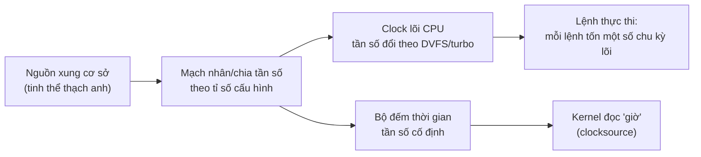
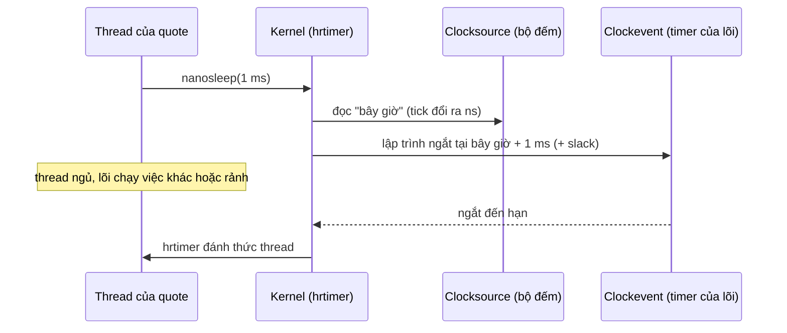
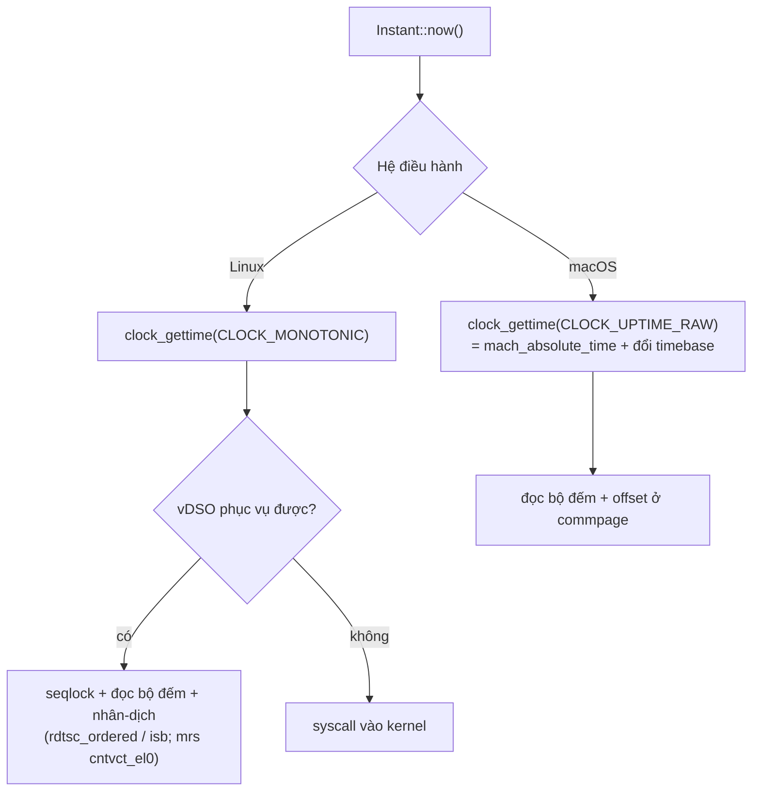

# P2 · Chương 08 — Xung nhịp, chu kỳ và đồng hồ trong máy

> Phạm vi: phần phần cứng nói về x86-64 (TSC) và AArch64 (generic timer); phần kernel là **Linux**; macOS chỉ xuất hiện ở chỗ `Instant` của Rust trên Mac cần được giải thích. Các khối "đã chạy thật" là *quan sát một lần chạy* trên một máy Apple M3 Pro chạy macOS (`rustc 1.95.0`), không phải bảo đảm của tài liệu, và không nói gì về x86 hay Linux. Các trang `docs.kernel.org` là bản hiện hành lúc soạn (đầu trang ghi 7.3.0-rc7, không ghim); source kernel được ghim ở tag `v6.8`.

## Bạn sẽ hiểu được gì

1. **Q1.** Xung nhịp (clock) của CPU là gì, từ đâu ra, và một "chu kỳ" dài bao nhiêu nano-giây? → mục 1
2. **Q2.** Thời gian chạy của một đoạn code suy ra thế nào từ số lệnh, CPI và chu kỳ (iron law), và IPC khác CPI ở đâu? → mục 2
3. **Q3.** Vì sao riêng con số GHz không nói được CPU nhanh hay chậm: CPI, độ trễ bộ nhớ tính theo chu kỳ, và tần số đổi theo DVFS/turbo? → mục 3
4. **Q4.** CPU cho phần mềm đọc giờ bằng bộ đếm nào (TSC của x86, generic timer của ARM), và đếm chu kỳ lõi khác đếm thời gian ở chỗ nào? → mục 4
5. **Q5.** Kernel Linux biến bộ đếm đó thành giờ và hẹn giờ ra sao: clocksource, clockevent, tick, NO_HZ, hrtimer? → mục 5
6. **Q6.** `clock_gettime` có những đồng hồ nào, mỗi cái bảo đảm gì, vì sao đọc giờ thường không vào kernel (vDSO), và macOS khác chỗ nào? → mục 6
7. **Q7.** `Instant`, `SystemTime`, `Duration` của Rust đứng trên đồng hồ nào, và đo một đoạn code ngắn thì một lần đọc đồng hồ tốn bao nhiêu, phân giải đến đâu? → mục 7
8. **Q8.** Với service backend: timeout nên dùng đồng hồ nào, đồng hồ treo tường nhảy làm hỏng rate limiter và lease ra sao, và ngân sách latency đổi ra chu kỳ thế nào? → mục 8

## Kiến thức cần trước

- [Chương 01, mục 4.3](01-mo-hinh-may-va-isa.md#43-clock-và-cpi): clock và CPI ở mức giới thiệu, chỉ một đoạn. Chương này đào sâu đúng chỗ đó; chu trình fetch–decode–execute không được nhắc lại.
- [Chương 05](05-pipeline-va-speculation.md): pipeline, superscalar, stall. Chương này cần chúng để giải thích vì sao CPI có thể nhỏ hơn 1 hoặc lớn hơn nhiều.
- [Chương 06, mục 1](06-cache-va-numa.md): độ trễ cache và DRAM. Mục 3 đổi chúng sang đơn vị chu kỳ.
- [P1 · Chương 01, mục 5.2](../01-linux/01-os-va-kernel.md#52-timer-interrupt): timer interrupt là gì và vì sao OS cần nó. Mục 5 đi tiếp: timer đó lấy giờ từ đâu.
- [P1 · Chương 02, mục 4](../01-linux/02-system-call.md#4-vdso-gọi-syscall-mà-không-vào-kernel-q3): vDSO là gì. Mục 6 chỉ giải thích vDSO tính giờ ra sao.
- [P12 · Chương 08, mục 5–6](../12-he-thong-du-lieu/08-su-co-he-phan-tan.md#5-đồng-hồ-time-of-day-và-monotonic-q5): time-of-day so với monotonic và NTP ở mức hệ phân tán. Chương này không giải thích lại NTP; nó đi từ phía phần cứng và kernel lên.

Bạn đã quen gọi `Instant::now()` trong Rust nhưng chưa phải nghĩ "bên dưới nó là một thanh ghi của CPU và một bảng hệ số của kernel". Chương này lấp chỗ đó. Ví dụ chạy suốt chương là `quote`, một service Rust tính giá (giả định của người soạn, không phải code trong repo): mỗi request nhận mã sản phẩm, tra bảng giá nằm trong RAM, áp vài luật khuyến mãi rồi trả giá. Đội vận hành đặt cho phần CPU của handler ngân sách 200 µs mỗi request.

---

## 1. Xung nhịp, chu kỳ và tần số (Q1)

> **Trả lời ngắn.** Mạch số trong CPU đổi trạng thái theo từng nhịp của một tín hiệu clock: chuỗi xung cao–thấp lặp đều, sinh ra từ một mạch dao động mà tần số cơ sở thường đến từ tinh thể thạch anh[^dis-osc]. Mỗi lần lặp là một chu kỳ (cycle). Thời gian của một chu kỳ là cycle time, và tần số (số chu kỳ mỗi giây) là nghịch đảo của nó[^dis-period]. CPU 3 GHz có ba tỉ chu kỳ mỗi giây, nên một chu kỳ dài khoảng 0,333 ns (tính của người soạn).

**Giải thích.**

*Với service `quote`.* Ngân sách 200 µs nghe như một khoảng thời gian, nhưng CPU không đếm micro-giây: nó đếm chu kỳ. Một lệnh tốn một số chu kỳ nào đó, một lần chờ bộ nhớ tốn thêm vài trăm chu kỳ nữa, và mọi con số hiệu năng ở các mục sau đều quy về đơn vị này. Mục này dựng lại đơn vị đó từ đầu: chu kỳ là gì, đến từ đâu, và đổi sang nano-giây thế nào.

### 1.1 Tín hiệu clock

Mỗi giai đoạn thực thi một lệnh (nạp lệnh, giải mã, tính, ghi kết quả; xem [chương 01, mục 4](01-mo-hinh-may-va-isa.md)) là một khối mạch mà tín hiệu điện phải mất thời gian để lan qua. CPU cần biết lúc nào đầu vào của một khối đã sẵn sàng để dùng, và lúc nào đầu ra của nó đã là kết quả hợp lệ để chuyển cho khối kế tiếp; việc đó do clock đảm nhiệm[^dis-clock-role]. Clock là chuỗi xung cao–thấp lặp đi lặp lại: một đoạn cao rồi thấp là một chu kỳ, còn gọi là một tick[^dis-cycle]. Mỗi lần tín hiệu đổi mức (clock edge), trạng thái của các mạch đổi theo, và chính các cạnh đó đẩy việc thực thi lệnh đi tiếp[^dis-edge].

Tín hiệu ấy sinh ra từ một mạch dao động (oscillator). Giáo trình *Dive into Systems* mô tả mạch clock dùng oscillator để tạo ra chuỗi xung rất đều và chính xác, trong đó tần số cơ sở thường do một tinh thể (crystal oscillator) cấp[^dis-osc]. Tần số cơ sở ấy chưa phải tần số của lõi: Intel ghi rõ tần số của "core crystal clock" có thể khác tần số tham chiếu, tần số bus và tần số lõi[^sdm-crystal]. Chip nhân hoặc chia tần số cơ sở theo một tỉ số cấu hình để ra các tần số cần dùng (suy luận của người soạn từ câu trên của Intel). Ví dụ cụ thể: tần số của TSC (mục 4) được Intel định nghĩa là tần số tinh thể danh định nhân với một tỉ số hai số nguyên mà CPU báo qua CPUID[^sdm-tscfreq].

### 1.2 Chu kỳ và tần số

Hai đại lượng này là nghịch đảo của nhau. Cycle time là thời gian giữa hai tick liên tiếp, còn tốc độ clock (clock rate) bằng 1 chia cho cycle time và thường đo bằng MHz hoặc GHz[^dis-period]. 1 MHz là một triệu tick mỗi giây, 1 GHz là một tỉ tick mỗi giây[^dis-ghz]. Viết thành công thức, với $T$ là thời gian một chu kỳ và $f$ là tần số:

$$T = \frac{1}{f}, \qquad \text{số chu kỳ} = \text{thời gian} \times f.$$

Bảng dưới đổi vài tần số hay gặp ra thời gian một chu kỳ, rồi ra số chu kỳ trong 1 µs và trong ngân sách 200 µs của `quote` (tính của người soạn bằng hai công thức trên; hàng 24 MHz để dành cho mục 4 và 7):

| Tần số $f$ | Một chu kỳ $T$ | Số chu kỳ trong 1 µs | Số chu kỳ trong 200 µs |
|---|---|---|---|
| 1 GHz | 1 ns | 1.000 | 200.000 |
| 2,5 GHz | 0,4 ns | 2.500 | 500.000 |
| 3 GHz | 0,333 ns | 3.000 | 600.000 |
| 4 GHz | 0,25 ns | 4.000 | 800.000 |
| 24 MHz | 41,67 ns | 24 | 4.800 |

Mẹo nhớ: ở 1 GHz thì 1 chu kỳ đúng bằng 1 ns, nên ở $f$ GHz, một nano-giây ứng với $f$ chu kỳ. Với `quote` ở 3 GHz, ngân sách 200 µs là $200 \times 10^{-6} \times 3 \times 10^{9} = 600.000$ chu kỳ.

### 1.3 Vì sao chu kỳ không thể ngắn tùy ý

Có hai giới hạn. Thứ nhất, độ dài chu kỳ bị chặn dưới bởi độ trễ lan truyền dài nhất của mọi giai đoạn thực thi: clock không thể nhanh hơn thời gian khối mạch chậm nhất cần để cho ra kết quả đúng[^dis-bound]. Thứ hai, clock càng nhanh càng sinh nhiệt. Tần số CPU đạt đỉnh vào giữa đến cuối những năm 2000[^dis-peak]. Sau đó nó chạm giới hạn mà sách gọi là *power wall*, vì không tản nổi nhiệt của clock nhanh hơn[^dis-power-wall]. Từ đó nhà sản xuất tăng số lõi chứ không tăng tần số của từng lõi[^dis-multicore]. Hệ quả cho người viết service: tần số lõi hiện nay vẫn quanh vài GHz, và hiệu năng một luồng tăng chủ yếu nhờ làm cho mỗi chu kỳ làm được nhiều việc hơn, tức giảm CPI (mục 2 và 3).

### 1.4 Hai "thước" thời gian trong một chip

Từ đây có một điều cần nhìn rõ trước khi đi tiếp: một chip có hai thước đo thời gian khác bản chất. Thước thứ nhất là clock lõi. Nó quyết định mỗi lệnh tốn bao nhiêu chu kỳ, và tần số của nó thay đổi theo tải và nhiệt (mục 3). Thước thứ hai là một bộ đếm chạy ở tần số cố định, thứ mà hệ điều hành đọc để biết "bây giờ là mấy giờ" (mục 4 và 5). Hai thước này dễ bị trộn lẫn khi đo, nên phần còn lại của chương luôn ghi rõ đang nói về thước nào.



(Sơ đồ khái niệm của người soạn: chip cụ thể nối khác nhau. Với Intel, TSC bất biến dựa trên bộ đếm ART chạy theo tần số tinh thể của lõi[^sdm-art]. Với Arm, system counter không bị DVFS hay việc đưa lõi vào trạng thái tiết kiệm điện làm ảnh hưởng[^arm-realtime].)

<details><summary>Đi sâu: nhìn tần số từ bên ngoài và độ chính xác của thạch anh</summary>

- **Con số trên nhãn không phải tần số tức thời.** Leaf CPUID 16H của Intel trả thông tin tần số "theo thông số kỹ thuật của bộ xử lý, không phản ánh giá trị thực"[^sdm-cpuid16], và trên một số bộ xử lý, tần số TSC có thể khác tần số ghi trong brand string[^sdm-tsc-brand]. Vì vậy "3,0 GHz" trong tên CPU hay trong `/proc/cpuinfo` không đủ để tính chu kỳ ra giờ (suy luận của người soạn; mục 3 đo thử).
- **Thạch anh có sai số.** Tần số dao động đổi theo nhiệt độ[^drift-temp], và đồng hồ máy tính thường đúng trong khoảng 50 ppm khi chưa được đồng bộ[^drift-50]. 50 ppm là $50 \times 10^{-6}$ giây lệch mỗi giây, tức khoảng 4,3 giây mỗi ngày (tính của người soạn: $86\,400 \times 50 \times 10^{-6}$). Chuyện lệch này và cách NTP sửa nằm ở [P12 · Chương 08, mục 6](../12-he-thong-du-lieu/08-su-co-he-phan-tan.md#6-ntp-độ-lệch-và-vì-sao-không-dùng-timestamp-để-sắp-thứ-tự-q6); chương này chỉ cần nhớ rằng bộ đếm phần cứng chạy *đều* chứ không chạy *đúng*.

</details>

**Quay lại Q1:** xung nhịp là tín hiệu cao–thấp lặp đều từ mạch dao động; một chu kỳ dài $T = 1/f$, nên ở 3 GHz một chu kỳ là 0,333 ns và 200 µs của `quote` là 600.000 chu kỳ.

---

## 2. Iron law: thời gian = số lệnh × CPI × chu kỳ (Q2)

> **Trả lời ngắn.** Thời gian chạy của một chương trình bằng tích của ba thừa số: số lệnh phải thực thi, số chu kỳ trung bình mỗi lệnh (CPI) và thời gian của một chu kỳ[^cs61c-iron]. Mỗi thừa số do một tầng khác nhau quyết định, nên so sánh hai phương án (đổi code, đổi CPU, đổi cấu hình) là phải xét cả ba, không phải riêng một. IPC (số lệnh mỗi chu kỳ) là nghịch đảo của CPI[^cs61c-ipc].

**Giải thích.**

*Với service `quote`.* Bản release mới của `quote` chậm hơn bản cũ 15%, và cả đội đoán mỗi người một kiểu: "compiler sinh nhiều lệnh hơn", "node mới ít GHz hơn", "cache miss nhiều hơn". Ba lời đoán nhắm vào ba thừa số khác nhau. Iron law là công cụ tách chúng ra để mỗi lời đoán trở thành một con số có thể đo.

### 2.1 Dựng công thức

*(Chứng minh của người soạn; nguồn dùng để đối chiếu định nghĩa.)* Gọi $I$ là số lệnh chương trình thật sự thực thi (đếm lệnh đã chạy, không phải số dòng code), $C$ là tổng số chu kỳ chương trình tốn, $f$ là tần số và $T = 1/f$ là thời gian một chu kỳ. CPI là số chu kỳ trung bình mỗi lệnh, tính trên mọi lệnh đã chạy, vì các lệnh khác nhau tốn thời gian khác nhau[^cs61c-cpi-avg]. Sách *Dive into Systems* cũng đề nghị đo CPI trên toàn bộ lần chạy của chương trình thay vì xét một lệnh riêng lẻ[^dis-cpi]. Từ định nghĩa đó:

$$\mathrm{CPI} = \frac{C}{I}, \qquad t = C \times T = (I \times \mathrm{CPI}) \times T = \frac{I \times \mathrm{CPI}}{f}.$$

Dòng thứ hai chỉ là thế $C = I \times \mathrm{CPI}$ vào "thời gian bằng số chu kỳ nhân thời gian mỗi chu kỳ". Đó chính là iron law; giáo trình CS 61C viết nó dưới dạng tích của ba phân số: lệnh trên chương trình, chu kỳ trên lệnh và thời gian trên chu kỳ[^cs61c-iron]. IPC là $I/C = 1/\mathrm{CPI}$[^cs61c-ipc], và số lệnh hoàn tất mỗi giây (instruction throughput) là $f/\mathrm{CPI}$, tức $f \times \mathrm{IPC}$[^cs61c-throughput].

Ba thừa số do ba tầng khác nhau quyết định, nên mỗi lời đoán của đội `quote` có chỗ để kiểm:

| Thừa số | Do gì quyết định | Đòn bẩy của người viết `quote` |
|---|---|---|
| Số lệnh $I$ | Thuật toán, ngôn ngữ, compiler và ISA; ngôn ngữ bậc cao mô tả gọn nhưng có thể bung thành rất nhiều lệnh máy[^cs61c-instr-factors] | Đổi thuật toán và cấu trúc dữ liệu, `opt-level`, bỏ bounds check thừa ([chương 07](07-rust-va-may.md)) |
| CPI | Khác nhau giữa các bộ xử lý vì ISA và cách cài đặt[^cs61c-cpi-factors]; còn phụ thuộc workload (mục 3) | Bố cục dữ liệu, cache locality, nhánh dễ đoán ([chương 05](05-pipeline-va-speculation.md), [06](06-cache-va-numa.md)) |
| Thời gian một chu kỳ $T$ | Cách cài đặt mạch (đường đi tới hạn qua logic tổ hợp)[^cs61c-period-factors] | Chọn loại instance/CPU, cấu hình turbo và governor (mục 3) |

### 2.2 Ba ví dụ có số

Các con số dưới đây là giả định của người soạn cho `quote`, đã được kiểm bằng một chương trình Rust nhỏ (không đưa vào chương). Mọi ví dụ cùng một handler với $I = 300.000$ lệnh mỗi request, trừ khi nói khác.

**Ví dụ A (mốc so sánh).** Node A chạy 3 GHz với CPI = 1,2. Số chu kỳ là $300.000 \times 1{,}2 = 360.000$; thời gian là $360.000 / (3 \times 10^9) = 120$ µs; IPC là $1/1{,}2 \approx 0{,}833$.

**Ví dụ B (xung cao hơn mà chậm hơn).** Node B chạy 3,6 GHz, cùng binary nên cùng $I$, nhưng lõi và bộ nhớ của nó cho CPI = 1,6. Số chu kỳ là $480.000$; thời gian là $480.000 / (3{,}6 \times 10^9) = 133{,}3$ µs. B có xung nhanh hơn 20% nhưng CPI cao hơn 33%, nên chậm hơn A khoảng 11%. Chúng hòa nhau khi $c_B = 1{,}2 \times 3{,}6/3{,}0 = 1{,}44$, với $c_B$ là CPI của node B. Giáo trình CS 61C có một ví dụ cùng dạng: bộ xử lý chạy nhiều lệnh hơn và xung chậm hơn vẫn thắng nhờ CPI tốt hơn[^cs61c-example].

**Ví dụ C (bớt lệnh nhưng CPI tăng).** Một bản tối ưu cắt 25% số lệnh, còn 225.000, nhưng đổi cách bố trí dữ liệu làm CPI tăng lên 1,5 (nhiều cache miss hơn). Ở 3 GHz: $225.000 \times 1{,}5 / (3 \times 10^9) = 112{,}5$ µs, chỉ nhanh hơn A 6,25% chứ không phải 25%. Sách giáo khoa của Patterson và Hennessy, qua trích dẫn của CS 61C, nói đúng điều này: đoạn code chạy ít lệnh nhất chưa chắc nhanh nhất, vì CPI phụ thuộc loại lệnh được thực thi[^cs61c-fewest]. Kết luận cũng từ đó: thước đo đầy đủ và đáng tin duy nhất của hiệu năng là thời gian[^cs61c-time-only].

### 2.3 CPI cộng được, IPC thì không

*(Chứng minh của người soạn.)* Tổng số chu kỳ gồm các chu kỳ "làm việc" và các chu kỳ chờ do từng nguồn: $C = C_0 + \sum_k C_k$, với $C_k$ là chu kỳ chờ của nguồn $k$ (đoán sai nhánh, chờ DRAM, ...). Chia hai vế cho $I$, với $c_0 = C_0/I$ là CPI cơ sở:

$$\mathrm{CPI} = c_0 + \sum_k \frac{C_k}{I}.$$

Mỗi số hạng là "số chu kỳ chờ thêm trên mỗi lệnh" do một nguồn gây ra, nên các số hạng cộng được và đọc được như một hóa đơn. Ví dụ (số giả định): $c_0 = 0{,}8$ vì CPU phát nhiều lệnh trong một chu kỳ; 2% lệnh là nhánh đoán sai, mỗi lần mất 15 chu kỳ, thêm $0{,}02 \times 15 = 0{,}30$; 0,5% lệnh là lần đọc phải xuống DRAM, mỗi lần 200 chu kỳ, thêm $0{,}005 \times 200 = 1{,}0$. Vậy $\mathrm{CPI} = 0{,}8 + 0{,}3 + 1{,}0 = 2{,}1$ và $\mathrm{IPC} = 0{,}476$. Nếu thử cộng IPC từng phần ($1{,}25$; $3{,}33$; $1{,}0$) ta không ra $0{,}476$; IPC không cộng được vì nó là nghịch đảo của một tổng. Cũng từ hóa đơn thấy ngay khoản lớn nhất: DRAM chiếm $1{,}0/2{,}1 \approx 48\%$ số chu kỳ. Đó là lý do chẩn đoán hiệu năng nên viết CPI thành các khoản chờ.

Bộ xử lý đơn giản có pipeline 5 tầng cho CPI gần 1, hơi lớn hơn vì stall do hazard[^cs61c-pipe-cpi]; bộ xử lý superscalar hoàn tất nhiều hơn một lệnh mỗi chu kỳ nên CPI trung bình nhỏ hơn 1[^cs61c-ss-cpi] (chi tiết ở [chương 05, mục 4](05-pipeline-va-speculation.md#4-superscalar-out-of-order-và-register-renaming-q4)).

### 2.4 Đọc CPI và IPC trên máy thật

Trên Linux, `perf stat` in IPC ngay cạnh số lệnh, với nhãn `insn per cycle`[^stat-ipc] (cách dùng ở [P11 · Chương 01](../11-do-dac-va-go-loi/01-perf-va-sampling-profiler.md)). Hai lưu ý khi đọc: số lệnh mà `perf` đếm là lệnh *đã retire*, và man page cảnh báo nó có thể bị ảnh hưởng bởi nhiều yếu tố, nhất là số ngắt phần cứng[^peo-instr]. Còn số chu kỳ thì phụ thuộc vào tần số lúc đó (mục 4). Trên macOS không có công cụ tương đương trong phạm vi chương này, nên các phép đo ở mục 3 và 7 quay về đo thời gian rồi suy ra chu kỳ.

<details><summary>Đi sâu: CPI là trung bình có trọng số theo loại lệnh</summary>

*(Chứng minh của người soạn.)* Giả sử chương trình có $n_j$ lệnh thuộc loại $j$ (cộng, nạp từ L1, nhảy, ...), mỗi lệnh loại $j$ tốn trung bình $c_j$ chu kỳ. Khi đó $C = \sum_j n_j c_j$ và $I = \sum_j n_j$, nên $\mathrm{CPI} = \sum_j p_j c_j$ với $p_j = n_j/I$ là tỉ lệ lệnh loại $j$. Đó là lý do CS 61C gọi CPI là một *trung bình* trên mọi lệnh của chương trình[^cs61c-cpi-avg]. Hệ quả: cùng một CPU, hai chương trình có tỉ lệ loại lệnh khác nhau sẽ có CPI khác nhau; và cùng một chương trình, đổi tỉ lệ $p_j$ (ví dụ thêm nhiều lệnh nạp xuống DRAM) đổi CPI mà không đổi $I$. Vì vậy iron law dùng được để *giải thích* một phép đo, còn dự đoán thì cần biết $p_j$ và $c_j$ của loại lệnh trên đúng máy đó.

</details>

**Quay lại Q2:** thời gian $= I \times \mathrm{CPI} / f$; ba thừa số do code, vi kiến trúc cộng workload, và mạch cộng nguồn điện quyết định, nên chỉ riêng GHz hay riêng số lệnh đều không đủ; CPI cộng được theo từng nguồn chờ còn IPC thì không.

---

## 3. Vì sao riêng con số GHz đánh lừa (Q3)

> **Trả lời ngắn.** GHz mới là một thừa số của iron law: cùng xung mà CPI khác thì chạy khác, và sách giáo khoa nói thẳng rằng clock rate riêng nó không đủ để so hai bộ xử lý[^dis-fewer-stages]. CPI lại thay đổi theo workload: dữ liệu không nằm trong cache thì mỗi lần chờ DRAM tốn hàng trăm chu kỳ[^drep-pm]. Ngoài ra bản thân GHz không cố định, vì CPU có thể chạy ở nhiều mức tần số và điện áp khác nhau[^kcf-pstate].

**Giải thích.**

*Với service `quote`.* Đội mua thêm node "4,5 GHz" để thay node 3 GHz, tin rằng xung nhanh hơn 50% thì request nhanh hơn 50% (kịch bản giả định của người soạn; con số cụ thể được tính ở cuối mục). Sau khi chuyển, p50 chỉ giảm vài phần trăm. Cách giải thích đúng nằm ở ba chỗ: CPI không phải hằng số (3.1), phần lớn thời gian của `quote` có thể là chờ bộ nhớ chứ không phải tính toán (3.2), và tần số đổi giữa các lần đo (3.3).

### 3.1 CPI không phải hằng số của một CPU

Giữa hai kiến trúc, sách *Dive into Systems* nêu rằng kiến trúc có ít giai đoạn thực thi hơn với xung chậm hơn vẫn có thể hoàn tất cùng số lệnh mỗi giây như kiến trúc xung nhanh hơn nhưng nhiều giai đoạn hơn[^dis-fewer-stages]. Trên cùng một CPU, CPI cũng đổi theo dữ liệu mà chương trình chạm vào. Drepper đo điều này trên một lõi Intel Core 2: với tập dữ liệu nhỏ, CPI quanh 1,0, và với chương trình không bị giới hạn bởi băng thông bộ nhớ thì có thể thấp hơn 1,0 đáng kể vì lõi superscalar xử lý nhiều lệnh một lúc[^drep-cpi-core2]. Khi L1d không đủ chứa tập dữ liệu, CPI nhảy lên dưới 3,0 một chút[^drep-cpi-l1]. Khi cả L2 cũng không đủ, CPI vọt lên hơn 20[^drep-cpi-l2]. Số đo của ông lấy trung bình cái giá phải trả trên *mọi* lệnh chứ không riêng lệnh truy cập bộ nhớ[^drep-cpi-avg]. Cùng một CPU, cùng GHz, CPI đi từ khoảng 1 đến hơn 20 chỉ vì cỡ tập dữ liệu.

### 3.2 Độ trễ bộ nhớ tính theo chu kỳ

CPU không cảm nhận nano-giây mà cảm nhận số chu kỳ phải chờ. Drepper trích số Intel công bố cho Pentium M (một CPU cũ, nên đọc như thang đo bậc độ lớn chứ không phải hằng số): thanh ghi $\le 1$ chu kỳ, L1d khoảng 3, L2 khoảng 14, bộ nhớ chính khoảng 240[^drep-pm]. Ông nhấn mạnh đó là thời gian truy cập thật tính bằng chu kỳ CPU[^drep-cycles-measured]. Ông cũng lưu ý rằng không phải lần truy cập nào cũng trả trọn chi phí: pipeline có thể che bớt một phần[^drep-hide]. Chi tiết về từng tầng nằm ở [chương 06, mục 1](06-cache-va-numa.md#1-hệ-phân-cấp-bộ-nhớ-cpu-nhanh-dram-chậm-q1).

Để có số cho một chip hiện đại, người soạn chạy thử một chuỗi truy cập phụ thuộc (*pointer chasing*: mỗi lần đọc cho ra địa chỉ của lần đọc kế, nên CPU không chồng lấn được) trên danh sách liên kết ngẫu nhiên, mỗi nút một khối 128 byte. Chương trình dưới cũng ước lượng tần số lõi bằng một chuỗi lệnh `add` phụ thuộc nhau; phép ước lượng này **giả định** mỗi `add` phụ thuộc mất đúng 1 chu kỳ, nên ra số GHz *theo giả định đó*. Đây là *quan sát một lần chạy* trên Apple M3 Pro, macOS, `rustc 1.95.0 -C opt-level=3`; không phải bảo đảm của tài liệu.

<details><summary>Đi sâu: mã nguồn <code>cycles.rs</code> (đã chạy thật)</summary>

```rust
// Ước lượng tần số lõi và độ trễ truy cập bộ nhớ theo chu kỳ. Chỉ chạy được trên macOS AArch64.
use std::arch::asm;
use std::ffi::CString;
use std::hint::black_box;
use std::os::raw::{c_char, c_int, c_void};
use std::time::{Duration, Instant};

unsafe extern "C" {
    fn sysctlbyname(name: *const c_char, oldp: *mut c_void, oldlenp: *mut usize, newp: *mut c_void, newlen: usize) -> c_int;
}

fn sysctl_u64(name: &str) -> Option<u64> {
    let c = CString::new(name).unwrap();
    let mut v = 0u64;
    let mut len = 8usize;
    let rc = unsafe { sysctlbyname(c.as_ptr(), &mut v as *mut u64 as *mut c_void, &mut len, std::ptr::null_mut(), 0) };
    (rc == 0).then_some(if len == 4 { v & 0xffff_ffff } else { v })
}

fn sysctl_str(name: &str) -> Option<String> {
    let c = CString::new(name).unwrap();
    let mut buf = [0u8; 128];
    let mut len = buf.len();
    let rc = unsafe { sysctlbyname(c.as_ptr(), buf.as_mut_ptr() as *mut c_void, &mut len, std::ptr::null_mut(), 0) };
    (rc == 0).then(|| String::from_utf8_lossy(&buf[..len.saturating_sub(1)]).into_owned())
}

/// 8 lệnh `add` phụ thuộc nhau mỗi vòng. Lệnh `subs`/`b.ne` của vòng lặp không nằm trên chuỗi phụ thuộc.
#[inline(never)]
fn dep_add_chain(iters: u64) -> u64 {
    let mut x = 0u64;
    let y = black_box(1u64);
    unsafe {
        asm!(
            "2:",
            "add {x}, {x}, {y}", "add {x}, {x}, {y}", "add {x}, {x}, {y}", "add {x}, {x}, {y}",
            "add {x}, {x}, {y}", "add {x}, {x}, {y}", "add {x}, {x}, {y}", "add {x}, {x}, {y}",
            "subs {n}, {n}, #1",
            "b.ne 2b",
            x = inout(reg) x, y = in(reg) y, n = inout(reg) iters => _,
            options(nomem, nostack),
        );
    }
    x
}

/// GHz = số chu kỳ / ns, với GIẢ ĐỊNH mỗi `add` phụ thuộc mất đúng 1 chu kỳ.
fn ghz(iters: u64) -> f64 {
    let t0 = Instant::now();
    black_box(dep_add_chain(black_box(iters)));
    iters as f64 * 8.0 / t0.elapsed().as_nanos() as f64
}

/// Danh sách liên kết ngẫu nhiên: mỗi nút chiếm một khối `stride` byte và chứa con trỏ tới nút kế.
fn build_chain(bytes: usize, stride: usize) -> (Vec<u8>, *const u8) {
    let n = bytes / stride;
    let mut mem = vec![0u8; (n + 1) * stride];
    let base = (mem.as_mut_ptr() as usize).next_multiple_of(stride);
    let mut order: Vec<usize> = (0..n).collect();
    let mut s = 0x9E37_79B9_7F4A_7C15u64; // xorshift64
    for i in (1..n).rev() {
        s ^= s << 13; s ^= s >> 7; s ^= s << 17;
        order.swap(i, (s % i as u64) as usize); // Sattolo: một chu trình duy nhất
    }
    for k in 0..n {
        unsafe { *((base + order[k] * stride) as *mut usize) = base + order[(k + 1) % n] * stride };
    }
    (mem, (base + order[0] * stride) as *const u8)
}

#[inline(never)]
fn chase(head: *const u8, steps: u64) -> *const u8 {
    let mut p = head;
    for _ in 0..steps {
        p = unsafe { *(p as *const *const u8) }; // mỗi lần đọc phụ thuộc kết quả lần trước
    }
    p
}

fn main() {
    println!("chip: {:?}", sysctl_str("machdep.cpu.brand_string"));
    for k in ["hw.perflevel0.logicalcpu", "hw.perflevel0.l1dcachesize", "hw.perflevel0.l2cachesize", "hw.cachelinesize", "hw.pagesize"] {
        println!("{k} = {:?}", sysctl_u64(k));
    }

    // 1. Sau 3 giây nghỉ, chạy liên tiếp 24 lượt ngắn: tần số ước lượng thay đổi thế nào?
    std::thread::sleep(Duration::from_secs(3));
    let t_start = Instant::now();
    let mut row = vec![];
    for _ in 0..24 {
        let g = ghz(4_000_000);
        row.push(format!("{:.0}ms:{:.2}", t_start.elapsed().as_secs_f64() * 1000.0, g));
    }
    println!("sau nghỉ 3 s, (mốc kết thúc lượt: GHz) {}", row.join(" "));

    // 2. Làm nóng nửa giây rồi ước lượng 7 lượt.
    let t0 = Instant::now();
    while t0.elapsed() < Duration::from_millis(500) {
        black_box(dep_add_chain(1_000_000));
    }
    let mut v: Vec<f64> = (0..7).map(|_| ghz(50_000_000)).collect();
    println!("sau khi nóng, GHz mỗi lượt: {}", v.iter().map(|g| format!("{g:.3}")).collect::<Vec<_>>().join(" "));
    v.sort_by(|a, b| a.partial_cmp(b).unwrap());
    let g = v[v.len() / 2];
    println!("trung vị {g:.3} GHz => 1 chu kỳ ≈ {:.4} ns", 1.0 / g);

    // 3. Độ trễ truy cập phụ thuộc, nút cách nhau 128 byte.
    println!("{:>9} {:>8} {:>11}", "vùng nhớ", "ns/lần", "chu kỳ/lần");
    for kb in [16usize, 64, 128, 512, 2048, 8192, 32768, 131072, 524288] {
        let (_mem, head) = build_chain(kb * 1024, 128);
        black_box(chase(head, 2 * (kb as u64 * 1024 / 128))); // làm nóng: đi hai vòng
        let steps = 20_000_000u64;
        let best = (0..3)
            .map(|_| {
                let t0 = Instant::now();
                black_box(chase(black_box(head), steps));
                t0.elapsed().as_nanos() as f64 / steps as f64
            })
            .fold(f64::MAX, f64::min);
        let size = if kb >= 1024 { format!("{} MB", kb / 1024) } else { format!("{kb} KB") };
        println!("{size:>9} {best:>8.2} {:>11.1}", best * g);
    }
}
```

</details>

Đầu ra của một lần chạy (quan sát, chép nguyên văn):

```text
chip: Some("Apple M3 Pro")
hw.perflevel0.logicalcpu = Some(5)
hw.perflevel0.l1dcachesize = Some(131072)
hw.perflevel0.l2cachesize = Some(16777216)
hw.cachelinesize = Some(128)
hw.pagesize = Some(16384)
sau nghỉ 3 s, (mốc kết thúc lượt: GHz) 14ms:2.28 22ms:3.89 30ms:3.93 39ms:3.91 47ms:3.93 55ms:3.76 64ms:3.87 72ms:3.82 80ms:3.79 89ms:3.80 97ms:3.85 106ms:3.77 114ms:3.82 122ms:3.79 131ms:3.76 139ms:3.83 148ms:3.79 156ms:3.82 165ms:3.77 173ms:3.79 181ms:3.83 190ms:3.82 198ms:3.88 206ms:3.85
sau khi nóng, GHz mỗi lượt: 3.982 4.016 3.826 4.015 4.022 4.015 3.865
trung vị 4.015 GHz => 1 chu kỳ ≈ 0.2490 ns
 vùng nhớ   ns/lần  chu kỳ/lần
    16 KB     0.99         4.0
    64 KB     0.99         4.0
   128 KB     0.99         4.0
   512 KB     5.27        21.2
     2 MB     6.58        26.4
     8 MB     8.41        33.8
    32 MB    69.59       279.4
   128 MB   108.25       434.7
   512 MB   112.10       450.1
```

Cách đọc (quan sát của người soạn, trên đúng máy này): theo `sysctl`, các lõi hiệu năng cao (perflevel0) có L1d 128 KiB và L2 16 MiB, và đường cong khớp với kích thước đó. Đến 128 KB, mỗi lần đọc phụ thuộc chỉ 0,99 ns, tức khoảng 4 chu kỳ. Từ 512 KB đến 8 MB là vùng L2, 5 đến 9 ns hay 21 đến 34 chu kỳ. Khi vùng nhớ vượt cỡ L2 (32 MB trở lên), mỗi lần đọc tốn 70 đến 112 ns, tức **280 đến 450 chu kỳ**: một lần chờ DRAM bằng vài trăm lần một phép cộng. Hai lưu ý. Thứ nhất, số chu kỳ ở cột cuối là $\text{ns} \times 4{,}015$ GHz, nên phụ thuộc giả định "một `add` phụ thuộc một chu kỳ". Thứ hai, với trang 16 KiB, các vùng lớn có thể còn phải trả thêm chi phí tra bảng trang (TLB miss), nên đây là độ trễ truy cập *phụ thuộc* chứ chưa chắc là độ trễ DRAM thuần (suy luận của người soạn; chương này không tách riêng hai phần).

*Hóa đơn của `quote`.* Giả sử mỗi request của `quote` chạy 300.000 lệnh, CPI cơ sở là 0,5 (nhờ superscalar), và 1% số lệnh, tức 3.000 lệnh, là lần đọc bảng giá phải xuống DRAM, mỗi lần 200 chu kỳ (con số 200 là giả định mà Drepper cũng dùng trong ví dụ của ông[^drep-200]). Chu kỳ cơ sở là $300.000 \times 0{,}5 = 150.000$, chu kỳ chờ là $3.000 \times 200 = 600.000$, tổng $750.000$ chu kỳ, tức CPI = 2,5. Ở 3 GHz, request tốn $750.000/(3 \times 10^9) = 250$ µs, và 80% số chu kỳ là chờ bộ nhớ (tính của người soạn, đã kiểm). Với một handler như vậy, tính toán chỉ là phần nhỏ; đội cần thu nhỏ tập dữ liệu hay đổi cách tra, không cần thêm GHz.

### 3.3 Tần số không cố định: DVFS và turbo

Phần lớn CPU hiện đại chạy được ở nhiều cặp tần số–điện áp, gọi là *operating performance point* hay P-state[^kcf-pstate]. Tần số và điện áp càng cao thì CPU hoàn tất càng nhiều lệnh trong một đơn vị thời gian, nhưng cũng tốn càng nhiều năng lượng[^kcf-tradeoff]. Không phải lúc nào cũng giữ được mức cao nhất: nhiệt độ hoặc công suất nguồn có thể không cho phép[^kcf-thermal]. Vì vậy hệ thống ước lượng công suất cần dùng rồi chọn P-state, và việc lặp đi lặp lại đó gọi là CPU frequency scaling[^kcf-scaling]. Riêng Intel và AMD còn có *turbo*: một số lõi tạm thời chạy trên ngưỡng bền vững của cả gói chip khi chip chưa dùng hết ngân sách nhiệt hay công suất[^kcf-boost]. Docs của `intel_pstate` nói mức turbo tối đa giảm dần khi nhiều lõi cùng chạy: tối đa cho 3 lõi thường thấp hơn cho 2 lõi, và cho 2 lõi thường thấp hơn cho 1 lõi[^ips-turbo-cores].

Vì sao không "cứ chạy mức cao nhất cho nhanh"? Công suất động của mạch CMOS tăng theo bình phương điện áp, và muốn tần số cao hơn thì phải tăng điện áp[^cam-square]. Nếu điện áp tăng tuyến tính theo tần số thì công suất động phụ thuộc bậc ba vào tần số[^cam-cubic]. Suy ra, ví dụ: tăng tần số 20% tốn khoảng $1{,}2^3 \approx 1{,}73$ lần công suất (suy luận của người soạn từ câu trên của nguồn). Đó là lý do chip tự hạ xung khi nóng.

Quan sát trên máy này (cùng chương trình `cycles.rs` ở trên): sau 3 giây nghỉ, lượt chạy đầu tiên (kết thúc ở mốc 14 ms) cho ước lượng 2,28 GHz, rồi chỉ 8 ms sau đã là 3,89 GHz và giữ quanh 3,8 đến 3,9 GHz trong 200 ms tiếp theo; sau nửa giây làm nóng, các lượt cho 3,83 đến 4,02 GHz. Vậy trong cùng một process, thời gian một chu kỳ đo được dao động từ khoảng 0,44 ns xuống 0,25 ns. Chương trình không biết nguyên nhân (chạy đổi lõi hay đổi P-state), nên đây chỉ là quan sát về *sự thay đổi*, không phải mô tả cơ chế của chip Apple.

Hệ quả cho việc đo: docs cpufreq của kernel nói thẳng rằng vì turbo phụ thuộc tải của cả gói chip nên hiệu năng một luồng có thể biến thiên, dẫn đến kết quả benchmark không tái lập[^kcf-boost-bench]. Nếu muốn một máy chạy nhanh nhất có thể, docs cũng nói rõ lúc đó không có lý do dùng P-state nào khác ngoài mức cao nhất[^kcf-highest].

*Quay lại `quote`.* Vì sao node 4,5 GHz chỉ giảm thời gian vài phần trăm? Giữ nguyên "hóa đơn" ở 3.2 nhưng tính theo thời gian. Phần tính toán (150.000 chu kỳ) co lại theo xung: $150.000/(4{,}5 \times 10^9) = 33{,}3$ µs thay vì 50 µs ở 3 GHz. Còn mỗi lần chờ DRAM, tính ở 3 GHz là $200/3 \approx 66{,}7$ ns. Giả thiết (suy luận của người soạn): khoảng thời gian này do chính chip DRAM và bộ điều khiển bộ nhớ quyết định chứ không đổi theo xung lõi. Drepper mô tả độ trễ của DRAM, gọi là CAS latency, là thời gian chip RAM cần để chuẩn bị dữ liệu[^drep-cas], nên giả thiết này chỉ xấp xỉ vì bộ nhớ đệm và bộ điều khiển có thể đổi xung theo. Nếu đúng, 3.000 lần chờ vẫn tốn $3.000 \times 66{,}7$ ns $= 200$ µs ở xung nào cũng vậy. Tổng ở 4,5 GHz là $33{,}3 + 200 = 233{,}3$ µs, giảm 6,7% so với 250 µs dù xung tăng 50%. Nếu độ trễ DRAM cố định theo *chu kỳ* thì tổng là $750.000/(4{,}5 \times 10^9) = 166{,}7$ µs, giảm 33,3%: đó mới là điều con số GHz gợi ý. Cùng một tỉ lệ stall, tăng xung chỉ lợi cho phần tính toán.

<details><summary>Đi sâu: tần số thật trên Linux và vì sao "3,0 GHz" trên nhãn không đủ</summary>

- Kernel có hai thuộc tính sysfs với nghĩa khác nhau. `cpuinfo_cur_freq` là tần số hiện tại *do phần cứng báo*, và được kỳ vọng là tần số CPU thật sự chạy[^kcf-curfreq]. `scaling_cur_freq` thì trong đa số trường hợp là tần số của P-state gần nhất mà driver yêu cầu, có thể không phản ánh tần số CPU đang chạy thật[^kcf-scalingcur]. Khi cần biết tần số trung bình trong một đoạn, Intel khuyên đếm số chu kỳ lõi bằng bộ đếm hiệu năng trong đúng khoảng đó (mục 4)[^sdm-tsc-avgfreq].
- Với driver `intel_pstate` khi phần cứng tự quản P-state (HWP), thuộc tính `base_frequency` cho biết tần số cơ sở; mọi tần số cao hơn nó nằm trong vùng turbo[^ips-base].
- Số Intel in trên nhãn (brand string) và tần số TSC có thể khác nhau[^sdm-tsc-brand], còn leaf CPUID 16H chỉ trả thông tin theo thông số kỹ thuật chứ không phản ánh giá trị thực[^sdm-cpuid16].

</details>

**Quay lại Q3:** GHz chỉ là một thừa số; CPI đổi theo workload (từ gần 1 lên hơn 20 chỉ vì cỡ tập dữ liệu), mỗi lần chờ DRAM tốn hàng trăm chu kỳ, và tần số đổi theo DVFS/turbo nên phép đo cùng một đoạn code ở hai thời điểm có thể không cùng "thước". Với `quote`, tăng xung 50% chỉ giảm thời gian 6,7% vì 80% số chu kỳ là chờ bộ nhớ.

---

## 4. Bộ đếm của CPU: TSC, generic timer, và đếm chu kỳ khác đếm giờ (Q4)

> **Trả lời ngắn.** CPU có sẵn một bộ đếm 64 bit tăng đều mà code user đọc được bằng một lệnh, không cần vào kernel: `rdtsc` đọc time-stamp counter (TSC) trên x86[^kvm-tsc-read], còn `mrs x0, cntvct_el0` đọc system counter của generic timer trên AArch64[^arm-sysctr]. Trên CPU đời mới, TSC "invariant" của Intel chạy ở tốc độ không đổi[^sdm-invtsc], và system counter của Arm không bị DVFS ảnh hưởng[^arm-realtime]. Vì vậy chúng đo *thời gian trôi qua* chứ không đếm *chu kỳ lõi*; muốn đếm chu kỳ lõi thật phải dùng bộ đếm hiệu năng (event `cycles` của `perf`), còn `ref-cycles` là biến thể không bị đổi tần số làm lệch[^peo-refcycles].

**Giải thích.**

*Với service `quote`.* Đội muốn biết "chi phí mỗi request". Chữ "chi phí" có hai nghĩa dễ lẫn: request tốn bao nhiêu *thời gian* (để so với ngân sách 200 µs), hay tốn bao nhiêu *chu kỳ CPU* (để biết nó làm bao nhiêu việc, bất kể CPU đang chạy nhanh hay chậm). Câu đầu trả lời bằng bộ đếm tần số hằng, tức một đồng hồ; câu sau cần bộ đếm hiệu năng. Mục này chỉ ra hai loại bộ đếm, vì sao phải tách, và `quote` nên đọc cái nào.

### 4.1 x86: time-stamp counter

TSC là một thanh ghi 64 bit, đọc được bằng lệnh `RDMSR`, `RDTSC` hoặc `RDTSCP` (khi có)[^kvm-tsc-read]. `RDTSC` chạy được ở mọi mức đặc quyền khi cờ `CR4.TSD` tắt; hệ điều hành bật cờ đó nếu muốn chặn code user đọc TSC[^sdm-tsd]. Vì là một lệnh chứ không phải system call, đọc TSC rẻ: Intel nói OS có thể dùng TSC làm đồng hồ treo tường thay cho ACPI hay HPET timer, vì việc đọc hiệu quả hơn nhiều và không chịu chi phí chuyển vòng bảo vệ (ring transition) hay truy cập một tài nguyên nền tảng[^sdm-invtsc-os].

Vấn đề là TSC *đếm cái gì*. Ở các CPU đời cũ, TSC tăng theo từng chu kỳ clock lõi, mà chu kỳ lõi đổi theo tỉ số core-clock/bus-clock và theo SpeedStep[^sdm-tsc-old]; một bộ đếm như thế không dùng làm đồng hồ được. Từ các đời sau, TSC tăng với tốc độ không đổi (*constant TSC*); nhờ vậy mỗi tick dài đều nhau và TSC dùng được làm đồng hồ treo tường dù lõi đổi tần số[^sdm-tsc-const]. Tốc độ đó có thể đặt theo tỉ số core-clock/bus-clock tối đa, hoặc theo tần số tối đa lúc boot[^sdm-tsc-rate]; vì thế nó không phải tần số lõi tức thời và có thể khác con số trên nhãn CPU[^sdm-tsc-brand]. *Invariant TSC* (báo qua CPUID.80000007H:EDX[8]) là bản Intel hứa chạy ở tốc độ không đổi trong mọi P-, C- và T-state của ACPI[^sdm-invtsc].

Linux ghi trạng thái này thành hai cờ CPU: `constant_tsc` nghĩa là tốc độ TSC không đổi theo P-state, `nonstop_tsc` nghĩa là TSC không dừng khi CPU vào C-state[^kvm-tsc-flags]. (Tên cờ trong `/proc/cpuinfo` là suy luận của người soạn từ các macro `X86_FEATURE_CONSTANT_TSC`[^lx-x86-feat-const] và `X86_FEATURE_NONSTOP_TSC`[^lx-x86-feat-nonstop].) Kernel dùng chúng để quyết định có tin TSC hay không: nếu CPU có đủ `constant_tsc`, `nonstop_tsc` và thanh ghi `TSC_ADJUST` (và không quá bốn node bộ nhớ), kernel tắt watchdog kiểm tra TSC[^lx-tsc-watchdog]. Tuy vậy TSC không phải đồng hồ chung của cả máy: trong đa số cài đặt nó là đồng hồ cục bộ của từng CPU, và các CPU có thể bắt đầu đếm ở những thời điểm khác nhau[^kvm-tsc-local]. Tài liệu kernel khuyên không tin các TSC vẫn đồng bộ trên hệ NUMA hoặc nhiều socket[^kvm-tsc-numa], và các cờ nói trên chỉ có nghĩa cho máy một node[^kvm-tsc-flags-scope].

Trong Rust trên x86-64 có `core::arch::x86_64::_rdtsc` (đã nhắc ở [chương 07, mục 5](07-rust-va-may.md)). Docs ghi rõ nó không phải lệnh serializing: nó không nhất thiết đợi các lệnh trước chạy xong rồi mới đọc bộ đếm[^rs-rdtsc]. Chi tiết về thứ tự nằm ở phần Đi sâu cuối mục.

### 4.2 AArch64: generic timer

Phía Arm, *system counter* là một thiết bị luôn bật, cho ra một bộ đếm tăng với tần số cố định; giá trị đó được phát tới mọi lõi nên mọi lõi có cùng một cách nhìn về thời gian trôi qua[^arm-sysctr]. (So sánh của người soạn: khác TSC cục bộ theo CPU của x86.) Bộ đếm rộng từ 56 đến 64 bit, và theo hướng dẫn của Arm (bản 2019) tần số thường nằm trong khoảng 1 đến 50 MHz[^arm-range]. Generic Timer chỉ đo thời gian trôi qua, không biết ngày giờ; ngày giờ cần một thiết bị RTC riêng[^arm-time-only]. Nó cũng là thước "real time": không bị DVFS hay việc đưa lõi vào trạng thái tiết kiệm điện làm ảnh hưởng[^arm-realtime].

Phần mềm đọc nó qua thanh ghi: `CNTVCT_EL0` (virtual count) cho giá trị đếm và `CNTFRQ_EL0` cho tần số. Virtual count bằng physical count trừ một offset do hypervisor đặt, nên hypervisor có thể giấu khoảng thời gian VM không được chạy[^arm-vcount]. `CNTFRQ_EL0` báo tần số của bộ đếm nhưng *không do phần cứng điền*: firmware, thường chạy ở EL3, ghi nó lúc khởi động[^arm-cntfrq]. Linux đọc nó bằng `read_sysreg(cntfrq_el0)`[^lx-arm-cntfrq], và có thuộc tính device tree `clock-frequency` để ghi đè khi firmware cấu hình sai, dù tài liệu khuyên sửa firmware thay vì dùng thuộc tính này[^lx-arm-dt-freq]. Về tần số, docs của crate `quanta` viết rằng từ Armv8.6-A và Armv9 tần số được cố định ở 1 GHz, tức độ phân giải 1 ns[^qu-armfreq] (nguồn thứ cấp, không phải tài liệu của Arm).

Arm cảnh báo rằng lệnh đọc bộ đếm có thể bị thực hiện suy đoán, tức ngoài thứ tự chương trình[^arm-spec]. Khi thứ tự quan trọng thì chèn `ISB` trước lệnh đọc[^arm-isb]. Linux làm đúng như vậy trong vDSO: `isb` rồi `mrs ..., cntvct_el0`, hoặc dùng thanh ghi tự đồng bộ nếu CPU có FEAT_ECV[^lx-arm-vdso-isb]. Clocksource tương ứng của Linux tên `arch_sys_counter` với rating 400[^lx-arm-clocksource], mức mà chú thích trong kernel mô tả là "Perfect", clocksource lý tưởng[^cs-rating-perfect].

### 4.3 Quan sát trên Apple M3 Pro: `counters.rs`

Chương trình dưới đọc thẳng hai thanh ghi trên, đo tốc độ thật của chúng bằng `Instant` trong 200 ms, rồi đo chi phí một lần đọc theo bốn cách. Đây là *quan sát một lần chạy* trên Apple M3 Pro, macOS, `rustc 1.95.0 -C opt-level=3`; không phải bảo đảm của tài liệu và không nói gì về x86 hay Linux.

<details><summary>Đi sâu: mã nguồn <code>counters.rs</code> (đã chạy thật)</summary>

```rust
// Chỉ chạy được trên macOS/Linux AArch64: đọc thẳng bộ đếm hệ thống của CPU.
use std::arch::asm;
use std::hint::black_box;
use std::time::{Duration, Instant};

#[repr(C)]
struct TimebaseInfo {
    numer: u32,
    denom: u32,
}

unsafe extern "C" {
    fn mach_timebase_info(info: *mut TimebaseInfo) -> i32; // chỉ có trên macOS
    fn mach_absolute_time() -> u64; // chỉ có trên macOS
}

fn cntfrq() -> u64 {
    let t: u64;
    unsafe { asm!("mrs {t}, cntfrq_el0", t = out(reg) t, options(nomem, nostack)) };
    t
}

fn cntvct() -> u64 {
    let t: u64;
    unsafe { asm!("mrs {t}, cntvct_el0", t = out(reg) t, options(nomem, nostack)) };
    t
}

fn cntvct_isb() -> u64 {
    let t: u64;
    unsafe { asm!("isb", "mrs {t}, cntvct_el0", t = out(reg) t, options(nomem, nostack)) };
    t
}

fn row(name: &str, mut f: impl FnMut()) {
    // 5 lượt, mỗi lượt 10 triệu lần gọi; in ns/lần của từng lượt.
    let n = 10_000_000u64;
    let v: Vec<String> = (0..5)
        .map(|_| {
            let t0 = Instant::now();
            for _ in 0..n {
                f();
            }
            format!("{:.2}", t0.elapsed().as_nanos() as f64 / n as f64)
        })
        .collect();
    println!("{name:<22}: {}", v.join(" "));
}

fn main() {
    let mut tb = TimebaseInfo { numer: 0, denom: 0 };
    unsafe { mach_timebase_info(&mut tb) };
    println!("CNTFRQ_EL0           = {} Hz", cntfrq());
    println!("mach_timebase_info   = {}/{} (ns mỗi tick của mach_absolute_time)", tb.numer, tb.denom);

    // Hai bộ đếm thật sự chạy nhanh cỡ nào? Dùng Instant làm thước trong 200 ms.
    let (v0, m0, t0) = (cntvct_isb(), unsafe { mach_absolute_time() }, Instant::now());
    std::thread::sleep(Duration::from_millis(200));
    let (v1, m1, t1) = (cntvct_isb(), unsafe { mach_absolute_time() }, Instant::now());
    let ns = t1.duration_since(t0).as_nanos() as f64;
    println!("trong {:.1} ms: cntvct_el0 +{} tick ({:.4} tick/ns); mach_absolute_time +{} tick ({:.4} tick/ns)",
             ns / 1e6, v1 - v0, (v1 - v0) as f64 / ns, m1 - m0, (m1 - m0) as f64 / ns);

    // Chi phí một lần đọc, ns/lần.
    row("mrs cntvct_el0", || { black_box(cntvct()); });
    row("isb; mrs cntvct_el0", || { black_box(cntvct_isb()); });
    row("mach_absolute_time()", || { black_box(unsafe { mach_absolute_time() }); });
    row("Instant::now()", || { black_box(Instant::now()); });
}
```

</details>

Đầu ra (chép nguyên văn):

```text
CNTFRQ_EL0           = 1000000000 Hz
mach_timebase_info   = 125/3 (ns mỗi tick của mach_absolute_time)
trong 200.5 ms: cntvct_el0 +200523840 tick (1.0000 tick/ns); mach_absolute_time +4812585 tick (0.0240 tick/ns)
mrs cntvct_el0        : 0.55 0.28 0.29 0.28 0.30
isb; mrs cntvct_el0   : 9.45 9.12 9.10 9.32 9.58
mach_absolute_time()  : 4.96 4.94 4.90 4.94 4.96
Instant::now()        : 14.99 14.97 14.81 14.41 14.48
```

Cách đọc (quan sát của người soạn, trừ chỗ ghi khác):

- `CNTFRQ_EL0` báo 1 GHz và đo thật cho 1,0000 tick mỗi ns: bộ đếm phần cứng có độ phân giải 1 ns. Con số này khớp với mô tả "1 GHz từ Armv8.6-A" ở trên; người soạn không biết M3 Pro cài phiên bản kiến trúc nào, nên chỉ nói là khớp.
- `mach_absolute_time` của macOS lại tăng 0,0240 tick mỗi ns, tức một tick là $125/3 \approx 41{,}67$ ns (24 MHz): macOS dùng một timebase thô hơn nhiều so với bộ đếm phần cứng. Người soạn không biết lý do. Hệ quả sẽ thấy ở mục 7: `Instant` trên máy này không phân giải được dưới 41,67 ns.
- `mrs cntvct_el0` đứng một mình tốn chừng 0,3 ns mỗi lần, tức khoảng một chu kỳ ở 4 GHz (mục 3): đó là thông lượng của một dãy lệnh đọc độc lập, CPU chồng lấn chúng và không bảo đảm vị trí của lần đọc so với lệnh lân cận (đúng như cảnh báo "đọc suy đoán" ở trên). Thêm `isb` thì mỗi lần tốn 9,1 đến 9,6 ns, cỡ ba mươi mấy chu kỳ (suy luận của người soạn: `isb` buộc CPU làm sạch pipeline). Tức *một lần đọc có thứ tự đắt gấp khoảng ba chục lần một lần đọc không thứ tự*.
- `mach_absolute_time()` tốn khoảng 4,9 ns và `Instant::now()` khoảng 14,4 đến 15,0 ns; phần chênh là lớp `clock_gettime` bọc ngoài (người soạn không tách riêng).

### 4.4 Đếm chu kỳ lõi khác đếm giờ

Hai loại bộ đếm trả lời hai câu hỏi khác nhau, nên đừng đổi chỗ chúng:

| | Chu kỳ lõi (core cycles) | Bộ đếm tần số hằng (TSC bất biến, system counter) |
|---|---|---|
| Tick theo | clock lõi, đổi theo P-state và turbo (mục 3) | nguồn xung cố định |
| Trả lời câu hỏi | CPU đã làm bao nhiêu chu kỳ | đã trôi qua bao lâu |
| Đọc bằng | bộ đếm hiệu năng (PMU), ví dụ event `cycles` của `perf`; một số hệ cho đọc từ user space bằng `rdpmc`[^peo-rdpmc] | `rdtsc`, `mrs cntvct_el0`, hoặc `clock_gettime` qua vDSO (mục 6) |
| Với `perf` | man page cảnh báo phải cẩn thận khi tần số đổi[^peo-cycles] | event `ref-cycles` được mô tả là không bị frequency scaling ảnh hưởng[^peo-refcycles] |

Muốn biết tần số trung bình của lõi trong một khoảng, Intel khuyên đếm chu kỳ lõi bằng bộ đếm hiệu năng trong đúng khoảng đó[^sdm-tsc-avgfreq]. Nói bằng công thức, $f_{\text{tb}} = \Delta C_{\text{lõi}} / \Delta t$, với $\Delta t$ lấy từ bộ đếm tần số hằng. Ví dụ với số giả định (tính của người soạn, giả định `ref-cycles` tick ở tần số TSC): `perf stat` cho một process chạy 2,0 s theo đồng hồ treo tường báo `cycles` = $6{,}0 \times 10^9$ và `ref-cycles` = $5{,}0 \times 10^9$, TSC là 2,5 GHz. Tần số trung bình là $6{,}0 \times 10^9 / 2{,}0 = 3{,}0$ GHz; cũng bằng tỉ số $6{,}0/5{,}0 = 1{,}2$ nhân 2,5 GHz. Lõi chạy cao hơn mức tham chiếu 20%.

Với `quote`: để so với ngân sách 200 µs thì đo bằng giờ (`Instant`); để hỏi "vì sao chậm" thì dùng `perf stat` đếm chu kỳ và lệnh, rồi suy ra CPI và tần số trung bình như ở mục 2.4. Drepper cũng dựng đồ thị CPI từ đúng cặp event này: `CPU_CLK_UNHALTED` đếm chu kỳ của CPU và `INST_RETIRED` đếm lệnh[^drep-events].

<details><summary>Đi sâu: thứ tự quanh <code>rdtsc</code>, hiệu chuẩn TSC và những chỗ bộ đếm "nói dối"</summary>

- **Thứ tự.** Intel nói `RDTSC` không serializing và không có thứ tự với lệnh khác: nó có thể chạy trước khi lệnh đứng trước xong, và lệnh sau có thể bắt đầu trước khi nó đọc xong[^sdm-rdtsc-nonser]. Nếu cần lệnh sau không bắt đầu trước, chèn `LFENCE` ngay sau `RDTSC`[^sdm-rdtsc-lfence]. `RDTSCP` thì chờ mọi lệnh trước chạy xong, nhưng lệnh sau vẫn có thể bắt đầu sớm[^rs-rdtscp]. vDSO của Linux dùng `rdtsc_ordered()` cho chế độ TSC[^vd-x86-tsc]. Intel cũng bảo đảm `RDTSC` trả giá trị tăng đơn điệu duy nhất và không tràn trong 10 năm kể từ reset[^sdm-tsc-mono].
- **Hiệu chuẩn.** Kernel không tin nhãn tần số mà đo: khi không có CPUID/MSR, nó so TSC với PIT, HPET hoặc PM timer, chạy 5 vòng và lấy giá trị thấp nhất làm ước lượng tốt nhất[^lx-tsc-cal]. Crate `quanta` làm tương tự ở user space: đo lặp cả đồng hồ tham chiếu lẫn bộ đếm cho tới khi có hệ số quy đổi đủ tin cậy[^qu-calib], và chỉ dùng TSC khi CPU có constant hoặc nonstop/invariant TSC[^qu-tsc]. Chính docs của nó thừa nhận các chỗ bộ đếm có thể "nói dối": giá trị thô có thể nhảy thời gian và số đo có thể trôi so với đồng hồ tham chiếu[^qu-caveats], và nó không theo dõi thời gian qua suspend[^qu-suspend].
- **Đổi sang nano-giây trong perf.** Man page `perf_event_open(2)` cho công thức dùng `time_offset`, `time_mult`, `time_shift` để đổi giá trị `rdtsc` thành nano-giây[^peo-timecalc]. Đó cũng là phép nhân rồi dịch bit mà kernel dùng ở mục 5.
- **Máy ảo.** Hypervisor chiếm CPU nên guest không chạy 100% thời gian dù nó tưởng vậy[^kvm-tsc-virt]; phía Arm, offset `CNTVOFF_EL2` là chỗ hypervisor che thời gian VM không chạy (mục 4.2).

</details>

**Quay lại Q4:** CPU cho code user hai bộ đếm đọc được không cần syscall, TSC (x86) và system counter (Arm); trên CPU đời mới chúng chạy ở tần số cố định nên đo thời gian chứ không đếm chu kỳ lõi. Đếm chu kỳ lõi cần PMU (`cycles`, `ref-cycles`), và tần số trung bình bằng chu kỳ lõi chia cho thời gian.

---

## 5. Kernel Linux: clocksource, clockevent, tick, NO_HZ và hrtimer (Q5)

> **Trả lời ngắn.** Kernel tách hai việc. *Clocksource* là một bộ đếm chạy tự do (như TSC hay system counter), cho kernel biết "bây giờ là mấy giờ", và kernel đổi số tick ra nano-giây bằng một phép nhân rồi dịch bit[^kt-mult]. *Clockevent* là thiết bị hẹn giờ phát ngắt tại một điểm trên trục thời gian đó[^kt-events]. Từ clockevent kernel có tick định kỳ, có hrtimer (hẹn giờ độ phân giải nano-giây) và có chế độ tickless (NO_HZ) để CPU rảnh không bị ngắt vô ích[^nohz-purpose].

**Giải thích.**

*Với service `quote`.* Handler của `quote` gọi `tokio::time::timeout(5ms, risk_call)` và ngủ 200 µs giữa các lần retry. "Biết bây giờ là mấy giờ" và "bị đánh thức đúng giờ" nghe như một việc, nhưng kernel làm chúng bằng hai cơ chế khác nhau. Hiểu ranh giới đó giải thích vì sao `sleep(10 µs)` có thể trả muộn vài chục µs, vì sao CPU rảnh không bị ngắt mỗi vài mili-giây, và `clock_gettime` đọc giờ từ đâu.

### 5.1 Clocksource: trục thời gian

Clocksource có nhiệm vụ cấp cho hệ thống một trục thời gian cho biết "đang ở đâu trong thời gian"; lệnh `date` cuối cùng cũng đọc clocksource để biết mấy giờ[^kt-source]. Thường nó là bộ đếm đơn điệu n bit, đếm từ 0 đến $2^n - 1$ rồi quay về 0[^kt-counter], và lý tưởng là không bao giờ ngừng đếm khi hệ thống đang chạy (có thể ngừng lúc suspend)[^kt-nostop]. Các lớp chỉnh giờ như đồng bộ với RTC hay NTP chỉ cập nhật một *offset* so với clocksource chứ không đổi bản thân bộ đếm[^kt-offset]. Đó là lý do chuyện NTP step (P12·08) không làm bộ đếm phần cứng nhảy.

Kernel không chia để đổi tick ra nano-giây vì phép chia đắt; nó dùng phép nhân rồi dịch bit: $\text{ns} \approx (\text{cycles} \times \text{mult}) \gg \text{shift}$[^kt-mult]. Trong `struct clocksource`, `mult` là hệ số nhân đổi chu kỳ sang nano-giây và `shift` là "số chia" lũy thừa của hai[^cs-multshift]. *(Tính của người soạn; kernel chọn cặp `mult`/`shift` riêng cho từng clocksource.)* Với bộ đếm 24 MHz của macOS ở mục 4, một tick là 41,6667 ns. Chọn `shift` = 24 thì `mult` $= \mathrm{round}(41{,}6667 \times 2^{24}) = 699.050.667$, và 4.812.585 tick (số tick `mach_absolute_time` tăng trong khoảng 200 ms ở 4.3) đổi ra $(4.812.585 \times 699.050.667) \gg 24 = 200.524.375$ ns, tức 200,52 ms. Tích này sẽ tràn số 64 bit sau $2^{64}/699.050.667 \approx 2{,}64 \times 10^{10}$ tick, tức khoảng 18 phút. Vì thế kernel chỉ dùng phép nhân-dịch cho *hiệu số* tick so với một mốc gần đây chứ không cho số tick tuyệt đối[^cs-cyc2ns].

Máy thường có vài clocksource, nên kernel chọn theo `rating`: số càng cao càng tốt[^cs-rating], và kernel chọn clocksource có rating cao nhất (nếu chế độ one-shot hay high-res đang bật thì chỉ xét loại hợp lệ cho high-res)[^cs-best]. Trên x86, TSC đăng ký với rating 300 và chế độ vDSO là `VDSO_CLOCKMODE_TSC`[^lx-tsc-clocksource][^lx-tsc-vdso]; trên Arm, system counter có rating 400[^lx-arm-clocksource]. Quản trị viên xem và đặt clocksource qua sysfs (`current_clocksource`, `available_clocksource`)[^cs-sysfs-cur][^cs-sysfs-avail] hoặc tham số boot `clocksource=`[^kp-clocksource]. Kernel còn *kiểm tra* TSC bằng một đồng hồ khác và có thể ghi "Marking TSC unstable" rồi bỏ nó[^lx-tsc-unstable].

### 5.2 Clockevent và tick

Clockevent là mặt ngược của clocksource: nó nhận một thời điểm mong muốn và tính giá trị cần nạp vào thanh ghi của timer phần cứng[^kt-reverse]. Với SMP, thường mỗi lõi có một thiết bị riêng để tự phát sự kiện độc lập với lõi khác[^kt-percpu]. Trên Arm, timer của từng lõi là một bộ so sánh với system count: phần mềm ghi một giá trị, và timer kích hoạt khi bộ đếm đạt hoặc vượt giá trị đó[^arm-cval].

Lớp quản lý clock event có thể giao cho một thiết bị một hoặc nhiều việc sau: tick toàn hệ thống (cập nhật jiffies), `update_process_times` cục bộ của từng CPU, profiling, và ngắt "sự kiện kế tiếp" cho chế độ không định kỳ[^hl-tick-duties]. Tick (ngắt đồng hồ lập lịch) chính là timer interrupt mà [P1 · Chương 01, mục 5.2](../01-linux/01-os-va-kernel.md#52-timer-interrupt) đã nói: mục đích chính của nó là buộc một CPU đang bận chuyển sự chú ý giữa nhiều việc[^nohz-purpose].

Tần số tick gọi là HZ, chọn lúc build kernel; Kconfig của v6.8 đặt mặc định `HZ_250`[^kz-default]. Man page `time(7)` ghi các giá trị 100, 250 (mặc định) và 1000 cho jiffy 0,01; 0,004 và 0,001 giây[^t7-hz]. Khi chưa có high-res timer, độ chính xác của các system call đặt timeout bị giới hạn bởi độ phân giải của "software clock" đo bằng jiffy[^t7-jiffy]. Tick xảy ra trên *từng* CPU nên số ngắt mỗi giây là NR_CPUS × HZ[^kz-percpu]. Ví dụ 16 CPU với HZ = 250 là 4.000 ngắt mỗi giây. Nếu mỗi ngắt tốn 2 µs (giả định của người soạn), mỗi lõi mất $250 \times 2$ µs $= 0{,}05\%$ thời gian, còn HZ = 1000 mất 0,2%. Trung bình thì nhỏ, nhưng kernel gọi phần nhiễu này là "OS jitter" và đó là thứ làm đuôi latency dài ra[^nohz-intro].

### 5.3 NO_HZ: không ngắt khi không cần

CPU rảnh không có việc gì để chuyển sự chú ý, nên gửi tick cho nó là phí[^nohz-purpose]. Kernel có ba chế độ. `NO_HZ_IDLE` bỏ tick trên CPU rảnh; tài liệu gọi đó là cách phổ biến nhất và nên là mặc định[^nohz-idle]. `NO_HZ_FULL` bỏ tick cả trên CPU chỉ có một task chạy được[^nohz-full], chỉ áp cho các CPU liệt kê trong tham số boot `nohz_full=`[^nohz-bootparam]. Chế độ còn lại là tick định kỳ như kernel đời cũ.

Mỗi chế độ có giá. `NO_HZ_FULL` làm các lần chuyển user/kernel đắt hơn chút vì phải báo cho các hệ con như RCU[^nohz-cost], và luôn phải còn ít nhất một CPU giữ tick để lo timekeeping, nhờ vậy `gettimeofday()` vẫn trả đúng trên các CPU adaptive-tick[^nohz-timekeeper]. Hệ thống real-time khắt khe thậm chí hay chọn kernel tick định kỳ để tránh chi phí chuyển từ trạng thái idle[^nohz-realtime]. Với `quote` (nhận xét của người soạn): nếu p99 bị nhiễu bởi tick trên đúng core chạy handler, `nohz_full` cộng pin thread là công cụ của kernel cho việc đó, nhưng điều kiện (một task mỗi core, RCU chuyển chỗ khác) và chi phí đủ lớn để không bật làm mặc định.

### 5.4 hrtimer và timer slack

Kernel có hai hệ timer. *Timer wheel* dành cho timeout: chúng bảo vệ các lỗi trong đường I/O như mạng hay block I/O, và phần lớn không bao giờ hết hạn nên cần cực rẻ chứ không cần chính xác[^hrt-wheel]. *hrtimer* dành cho độ chính xác: người dùng chính là chương trình user gọi `nanosleep`, posix timer và itimer[^hrt-users]. hrtimer không gắn với jiffy mà mọi logic chạy ở độ phân giải nano-giây 64 bit[^hrt-ns], và xếp các timer theo thời gian trong cây đỏ-đen[^hrt-rbtree]. Khi hệ thống chuyển sang chế độ high-res, tick định kỳ toàn hệ thống bị tắt[^hl-tick-off], và chức năng tick do một hrtimer riêng cho từng CPU đảm nhiệm[^hl-tick-hrtimer].

`clock_getres` trả độ phân giải thật của đồng hồ, dù thấp hay cao[^hrt-getres]. Trong source v6.8, biến `hrtimer_resolution` khởi đầu bằng `LOW_RES_NSEC`[^hrt-res-src] và đổi thành `HIGH_RES_NSEC` khi chuyển sang chế độ high-res[^hrt-res-hres]; `HIGH_RES_NSEC` bằng 1 ns[^kr-highres1]. Man page `time(7)` nói khi có HRT, độ chính xác của sleep và timer không còn bị jiffy ràng buộc mà "chính xác như phần cứng cho phép", thường cỡ micro-giây[^t7-hrt]; kiểm bằng `clock_getres` hoặc mục "resolution" trong `/proc/timer_list`[^t7-check-hrt].

Có thêm một lớp làm chậm có chủ đích là *timer slack*. Kernel gộp các timer hết hạn gần nhau của một thread, nên timer có thể trễ tới số nano-giây của slack (không bao giờ sớm)[^slack-def]. Giá trị của `init` là 50 µs và con cháu thừa hưởng[^slack-default]. Nó áp dụng cho `select`, `poll`, `epoll_wait`, `clock_nanosleep`, `nanosleep` và `futex`[^slack-affected], trừ thread chạy theo chính sách real-time[^slack-rt]. Hệ quả với `quote` (suy luận của người soạn từ hai nguồn trên): `thread::sleep(Duration::from_micros(10))` hay timeout của `epoll_wait` có thể trễ thêm tới khoảng 50 µs ngoài chuyện lập lịch. Rust hứa `sleep` "không bao giờ ngủ ít hơn" nhưng có thể lâu hơn[^sleep-least]; man page `nanosleep` cũng nói khoảng sleep được làm tròn lên bội của độ chi tiết đồng hồ[^ns-round], và sau khi sleep xong còn có thể phải đợi CPU rảnh để chạy lại thread[^ns-after].



(Sơ đồ của người soạn theo mô tả hrtimer và clockevent ở trên; việc đánh thức nanosleep nằm trong hàm callback chạy ngay trong ngữ cảnh ngắt[^hl-nanosleep-wake].)

<details><summary>Đi sâu: watchdog, <code>tsc=</code>, <code>sched_clock</code> và delay khi tần số đổi</summary>

- **Watchdog.** Khi CPU có đủ `constant_tsc`, `nonstop_tsc` và `TSC_ADJUST`, kernel tắt watchdog (mục 4.1)[^lx-tsc-watchdog]. Ngược lại TSC bị theo dõi, và tham số `tsc=reliable` tắt việc kiểm tra ở runtime lẫn lúc boot[^kp-tsc]. Tham số `tsc=nowatchdog` tắt watchdog cho các tình huống có yêu cầu latency nghiêm ngặt, nơi việc watchdog xen vào là không chấp nhận được[^kp-tsc-nowd].
- **`sched_clock()`.** Scheduler dùng một đồng hồ riêng phải rất nhanh, nên được phép hy sinh độ chính xác. Trên x86, TSC có thể lệch giữa các CPU làm `sched_clock()` trôi theo, và kernel có tùy chọn `CONFIG_HAVE_UNSTABLE_SCHED_CLOCK` để đối phó[^kt-tsc-sched].
- **Delay khi tần số đổi.** Các hàm `delay()` của kernel dùng vòng lặp hiệu chuẩn lúc boot; khi hệ thống có tần số CPU thay đổi chúng "cư xử lạ"[^kt-delay], chẳng hạn hạ tần số một nửa thì mọi `delay()` dài gấp đôi[^kt-delay-half]. Đó là một ví dụ ngay trong kernel về việc đếm chu kỳ lõi để đo thời gian là sai (mục 3 và 4).
- **Quấn vòng.** Bộ đếm 32 bit ở 100 MHz quấn về 0 sau chừng 43 giây, nên clocksource có trường `mask` để kernel bù lúc quấn[^kt-wrap].

</details>

**Quay lại Q5:** clocksource là bộ đếm tự do cho kernel biết giờ (đổi tick ra ns bằng nhân–dịch), clockevent là timer phần cứng phát ngắt đúng lúc; tick, hrtimer và NO_HZ đều dựng trên clockevent, còn timer slack và độ chi tiết đồng hồ là lý do một lần ngủ ngắn trả muộn.

---

## 6. `clock_gettime`: các đồng hồ, bảo đảm và vDSO (Q6)

> **Trả lời ngắn.** Linux cho đọc nhiều đồng hồ qua `clock_gettime`. Ba cái cần phân biệt: `CLOCK_REALTIME` là giờ treo tường, đặt được và chịu cả các bước nhảy khi chỉnh giờ[^cg-realtime]; `CLOCK_MONOTONIC` không bị bước nhảy ấy và không đi lùi, nhưng vẫn bị NTP chỉnh tần số[^cg-mono-nojump] và không đếm lúc máy suspend[^cg-mono-susp]; `CLOCK_BOOTTIME` giống `MONOTONIC` nhưng có đếm cả lúc suspend[^cg-boot]. Phần lớn lời gọi đọc được ngay trong user space nhờ vDSO, còn đồng hồ nào vDSO không phục vụ thì quay về syscall thật[^vd-fallback]. Trên macOS, `Instant` dùng `CLOCK_UPTIME_RAW`, cũng không đếm lúc máy ngủ[^rs-apple-uptime].

**Giải thích.**

*Với service `quote`.* `quote` đọc đồng hồ vì hai việc khác hẳn: đo xem request mất bao lâu và đặt timeout cho lần gọi `risk`; và gắn nhãn "đơn giá tính lúc 14:03:07" vào log và bản ghi để đối chiếu với hệ thống khác. Hai việc cần hai đồng hồ khác nhau, và dùng nhầm thì hỏng theo cách khó thấy. [P12 · Chương 08, mục 5](../12-he-thong-du-lieu/08-su-co-he-phan-tan.md#5-đồng-hồ-time-of-day-và-monotonic-q5) đã nêu nguyên tắc; mục này đưa ra bảng đầy đủ và cơ chế bên dưới.

### 6.1 Các đồng hồ của Linux

| Đồng hồ | Nhảy khi ai đó chỉnh giờ? | Bị NTP/`adjtime` chỉnh tần số? | Đếm lúc suspend? | Đọc bằng vDSO? |
|---|---|---|---|---|
| `CLOCK_REALTIME` | Có[^cg-realtime] | Có[^cg-realtime] | man page không nêu | Có (nhóm HRES)[^vd-hres-mask] |
| `CLOCK_MONOTONIC` | Không[^cg-mono-nojump] | Có[^cg-mono-nojump] | Không[^cg-mono-susp] | Có (nhóm HRES) |
| `CLOCK_MONOTONIC_RAW` | Không (giống `MONOTONIC`) | Không[^cg-raw] | Không[^cg-raw] | Có (nhóm RAW) |
| `CLOCK_BOOTTIME` | Không (giống `MONOTONIC`) | Có (giống `MONOTONIC`) | Có[^cg-boot] | Có (nhóm HRES) |
| `CLOCK_TAI` | Không có bước nhảy do leap second[^cg-tai] | man page không nêu | man page không nêu | Có (nhóm HRES) |
| `CLOCK_*_COARSE` | như bản thường | như bản thường | như bản thường | Có (nhóm COARSE) |
| `CLOCK_PROCESS_CPUTIME_ID`, `CLOCK_THREAD_CPUTIME_ID` | không áp dụng: đo thời gian CPU của process[^cg-cpu] hoặc thread[^cg-thread] | không áp dụng | không áp dụng | Không: quay về syscall[^vd-common] |

Các ô "giống `MONOTONIC`" là suy luận của người soạn từ câu của man page rằng `BOOTTIME` giống hệt `MONOTONIC` trừ việc nó còn tính cả thời gian suspend[^cg-boot]. Cột vDSO lấy từ mặt nạ trong kernel: nhóm HRES gồm REALTIME, MONOTONIC, BOOTTIME và TAI; nhóm COARSE gồm hai bản `_COARSE`; nhóm RAW chỉ có MONOTONIC_RAW[^vd-hres-mask].

### 6.2 "Đơn điệu" bảo đảm gì và không bảo đảm gì

`CLOCK_MONOTONIC` bảo đảm hai lần gọi liên tiếp không trả giá trị nhỏ đi, nhưng tùy kiến trúc chúng có thể trả *cùng* một giá trị[^cg-mono-same]; đừng giả định hiệu hai lần đọc luôn dương. Điểm gốc của nó trên Linux là lúc máy khởi động[^cg-mono], nên giá trị tuyệt đối vô nghĩa giữa các máy. Nó cũng *không* bảo đảm tốc độ đúng, vì NTP và `adjtime` vẫn chỉnh tần số của nó[^cg-mono-nojump]. Cận của việc chỉnh đó: thuật toán tham chiếu NTPv4 trong RFC 5905 đặt dung sai tần số 500 ppm[^rfc-maxfreq] và chỉ *đặt thẳng* đồng hồ (step) khi lệch quá ngưỡng 0,125 s[^rfc-step]. Suy luận của người soạn: nếu việc chỉnh tần số đạt đúng cận 500 ppm thì khoảng 10 s đo bằng `MONOTONIC` lệch tối đa $10 \times 500 \times 10^{-6} = 5$ ms so với giờ chuẩn. Đủ chính xác cho mọi timeout của backend, nhưng không phải đồng hồ nguyên tử.

Nó cũng *không đếm lúc máy suspend*[^cg-mono-susp], còn `CLOCK_BOOTTIME` thì có[^cg-boot]; Rust thì không hứa gì về điều này cho `Instant`[^inst-suspend]. Với một lease dài trên máy có thể bị suspend, đó là khác biệt có thật (mục 8).

### 6.3 Độ phân giải và đồng hồ COARSE

Man page nói độ phân giải của đồng hồ phụ thuộc cài đặt và process không cấu hình được[^cg-res]. Ví dụ trong chính man page in 0,000000001 giây (1 ns) cho REALTIME, TAI, MONOTONIC và BOOTTIME trên máy của tác giả[^cg-example]. Trong kernel, `clock_getres` của REALTIME và MONOTONIC trả `hrtimer_resolution`[^px-hr-res], còn của các bản `_COARSE` trả `KTIME_LOW_RES`[^px-coarse-res] mà kernel định nghĩa bằng một tick (`TICK_NSEC`)[^kr-lowres]. Nói cách khác, độ phân giải *khai báo* của đồng hồ COARSE là một jiffy, tức 1 đến 10 ms tùy HZ[^t7-hz] (suy luận của người soạn từ hai nguồn). Bù lại chúng nhanh hơn: man page mô tả chúng là bản "nhanh hơn nhưng kém chính xác" cho trường hợp cần timestamp nhanh chứ không cần mịn[^cg-coarse]. Với `quote`, timestamp cho log chỉ cần mili-giây là chỗ dùng hợp lý (nhận xét của người soạn).

### 6.4 vDSO đọc giờ ra sao

[P1 · Chương 02, mục 4](../01-linux/02-system-call.md#4-vdso-gọi-syscall-mà-không-vào-kernel-q3) đã giải thích vDSO là gì: một thư viện nhỏ kernel tự map vào mọi process[^vd-def], để lời gọi lấy giờ chỉ còn là gọi hàm thường cộng vài lần truy cập bộ nhớ[^vd-time]. Đây là phần ruột, theo source v6.8 (rút gọn):

```text
do_hres(clock):                       // lib/vdso/gettimeofday.c, rút gọn
  lặp:
    seq = đọc vd->seq (nếu lẻ: kernel đang cập nhật, chờ)
    nếu clock_mode == NONE: return -1 // bảo caller quay về syscall
    cycles = đọc bộ đếm phần cứng     // x86: rdtsc_ordered(); arm64: isb; mrs cntvct_el0
    ns = base_ns + ((cycles - cycle_last) * mult) >> shift
  đến khi seq không đổi
  tách ns thành giây và nano-giây
```

Từng bước có nguồn. Vòng đọc `seq` là seqlock: nếu kernel cập nhật dữ liệu giữa chừng thì vòng lặp thử lại[^vd-hres]. Chế độ clocksource không phải `NONE` là điều kiện để vDSO dùng được[^vd-clockmode-ok]. Bộ đếm phần cứng đọc bằng `rdtsc_ordered()` trên x86 khi chế độ là TSC[^vd-x86-tsc] (các chế độ máy ảo khác dùng đường riêng, còn lại trả `U64_MAX` để vDSO bỏ cuộc[^vd-x86-other]), và bằng `isb; mrs cntvct_el0` trên arm64[^vd-arm64-hw]. Công thức nhân-dịch chính là công thức của mục 5, áp lên hiệu `cycles - cycle_last`[^vd-hres]. Không có syscall và không có khóa: chi phí là một lần đọc bộ đếm cộng vài phép tính, và đó là lý do ở mục 4.3 phần lớn thời gian của `Instant::now()` nằm ở lệnh đọc bộ đếm có thứ tự (suy luận của người soạn từ số đo trên Mac, không phải trên Linux).

Chỉ một số đồng hồ có đường nhanh này. Kernel kiểm bằng mặt nạ bit: REALTIME, MONOTONIC, BOOTTIME, TAI, hai bản COARSE và MONOTONIC_RAW được phục vụ trong vDSO; mọi `clockid` khác trả `-1` và hàm bọc quay về syscall[^vd-common][^vd-fallback]. Đồng hồ COARSE còn rẻ hơn, vì với chúng vDSO chỉ đọc thời gian đã lưu sẵn chứ không đọc bộ đếm[^vd-coarse-time]. Hai hệ quả (suy luận của người soạn từ code): `CLOCK_THREAD_CPUTIME_ID` và `CLOCK_PROCESS_CPUTIME_ID` luôn là syscall thật nên đắt hơn hẳn các đồng hồ trên; và nếu clocksource đang dùng không khai báo chế độ vDSO, mọi lần `clock_gettime` đều là syscall. Trường hợp thứ hai không chỉ là giả thuyết: trên Arm, kernel chủ động tắt đường nhanh khi gặp lỗi phần cứng (erratum) buộc phải đọc bộ đếm qua hàm riêng[^lx-arm-errata-vdso]. Man page `vdso(7)` còn lưu ý hàm do vDSO cung cấp không hiện trong `strace` và cũng không bị `seccomp` thấy[^vd-strace].



(Sơ đồ của người soạn theo std 1.95.0 và source đã trích; nhánh macOS ở 6.5.)

### 6.5 macOS

Trên macOS, `Instant` không dùng `CLOCK_MONOTONIC` mà dùng `CLOCK_UPTIME_RAW`. Chú thích trong source std 1.95.0 giải thích: đồng hồ này dựa trên `mach_absolute_time`, mà kernel dùng làm chuẩn cho mọi timeout và deadline bên trong nó[^rs-apple-clock]. Giá trị của nó giống hệt `mach_absolute_time()` sau khi đổi qua `mach_timebase`[^rs-apple-uptime], và không tăng khi máy ngủ[^rs-apple-nosleep]. Source XNU (tag `xnu-12377.121.6`, một bản phát hành mã nguồn, không chắc khớp từng bản macOS) cho thấy `mach_absolute_time` trên arm64 đọc timebase ngay trong user space nếu commpage cho phép, rồi cộng offset trong commpage, offset này được cập nhật mỗi khi máy thức dậy từ giấc ngủ[^xnu-arm64]; bản đọc dùng `CNTVCT_EL0` có `isb` đứng trước để chặn suy đoán[^xnu-isb]. Trên x86-64, cùng hàm đó đọc `rdtsc` rồi tính $\mathrm{ns} = (((\mathrm{tsc} - \mathrm{tsc\_base}) \ll \mathrm{shift}) \times \mathrm{scale}) / 2^{32} + \mathrm{ns\_base}$[^xnu-x86], tức cùng ý nhân–dịch như Linux. Đơn vị của tick đổi sang nano-giây qua `mach_timebase_info`; trên Mac của người soạn nó là 125/3 (mục 4.3).

<details><summary>Đi sâu: đồng hồ CPU time và lịch sử của TSC trong glibc</summary>

- `CLOCK_PROCESS_CPUTIME_ID` đo CPU time mà mọi thread của process đã dùng[^cg-cpu], còn `CLOCK_THREAD_CPUTIME_ID` đo của riêng một thread[^cg-thread]. Hai đồng hồ này đo *công việc CPU*, không phải thời gian trôi qua, và khác hẳn nhóm vDSO ở trên.
- Man page ghi lại một bài học: trước khi kernel hỗ trợ hai đồng hồ này, glibc cài chúng trên nhiều nền tảng bằng thanh ghi timer của CPU (TSC trên i386), nên chúng có thể trả kết quả vô nghĩa nếu process bị chuyển sang CPU khác[^cg-tsc-hist]. Từ glibc 2.4 wrapper dùng bản của kernel. Cùng bài học với mục 4.1: TSC là đồng hồ cục bộ của từng CPU.

</details>

**Quay lại Q6:** `REALTIME` để gắn nhãn (nhảy được), `MONOTONIC` để đo khoảng (không nhảy, không đếm suspend, vẫn bị slew), `BOOTTIME` khi cần đếm cả suspend; vDSO phục vụ nhóm HRES, COARSE và RAW bằng seqlock cộng nhân–dịch trên bộ đếm của CPU, còn lại là syscall. macOS dùng `CLOCK_UPTIME_RAW` cho `Instant`.

---

## 7. `Instant`, `SystemTime`, `Duration` và đo code ngắn trong Rust (Q7)

> **Trả lời ngắn.** `Instant` là phép đo của một đồng hồ đơn điệu: không bao giờ đi lùi (trừ lỗi nền tảng), nhưng không bảo đảm các tick dài đều nhau, và chỉ có nghĩa khi lấy hiệu hai `Instant`[^inst-mono]. Trên Linux nó dùng `CLOCK_MONOTONIC`, trên macOS dùng `CLOCK_UPTIME_RAW`[^inst-sys]. `SystemTime` là đồng hồ treo tường, không đơn điệu, nên so sánh hai giá trị trả `Result` chứ không phải `Duration`[^st-result]. Còn `Duration` là một số giây nguyên cộng phần nano-giây[^dur-def]. Khi đo code ngắn, một lần đọc đồng hồ vừa tốn thời gian vừa bị làm tròn: trên máy quan sát (mục 7.4) một lần `Instant::now()` tốn khoảng 15 ns và độ phân giải 41,67 ns, nên phải đo cả lô rồi chia.

**Giải thích.**

*Với service `quote`.* Handler muốn ghi thời gian xử lý của mỗi request vào một histogram, và gắn thời điểm "đơn giá tính lúc nào" vào bản ghi. Hai việc, hai đồng hồ, hai kiểu Rust: `Instant` cho khoảng, `SystemTime` cho nhãn.

### 7.1 `Instant`

Docs bảo đảm `Instant` không nhỏ hơn bất kỳ `Instant` nào lấy trước đó, trừ lỗi nền tảng[^inst-mono]. Docs cũng nói rõ cái *không* được bảo đảm: các tick có thể dài ngắn khác nhau, đồng hồ có thể nhảy tới hoặc chạy nhanh chậm, nhưng không bao giờ đi lùi[^inst-steady]. Thời gian máy suspend có tính hay không không được quy định, và khác nhau theo nền tảng lẫn phiên bản Rust[^inst-suspend]. `Instant` là kiểu mờ: không có hàm lấy "số giây", chỉ có hiệu hai `Instant` hoặc so sánh[^inst-opaque].

Về nền tảng, docs ghi UNIX dùng `clock_gettime` với `CLOCK_MONOTONIC`, Darwin dùng `CLOCK_UPTIME_RAW`[^inst-sys], kèm lưu ý rằng danh sách này có thể đổi theo thời gian[^inst-disclaimer]. Source std 1.95.0 khớp: `Instant::now()` gọi `Timespec::now(Self::CLOCK_ID)`[^rs-instant-now], trong đó `CLOCK_ID` chọn `CLOCK_UPTIME_RAW` khi `target_vendor = "apple"` và `CLOCK_MONOTONIC` ở nơi khác[^rs-clockid]. `Timespec::now` gọi `libc::clock_gettime(...)` rồi `unwrap()`[^rs-cgt-unwrap]: nếu lời gọi lỗi thì panic (hiếm). Đây là chi tiết cài đặt, có thể đổi.

Docs thừa nhận bảo đảm đơn điệu đôi khi vỡ do lỗi phần cứng, ảo hóa hoặc hệ điều hành; để chống lại, `duration_since`, `elapsed` và phép trừ *saturate* về 0 thay vì panic như các bản Rust cũ[^inst-bugs]. Muốn phát hiện thay vì im lặng thì dùng `checked_duration_since`[^inst-checked]. Docs cũng báo trước các bản sau có thể đưa panic trở lại, vì cách saturate che lỗi lập trình khi hai `Instant` bị đảo[^inst-panic-future]. Bài học: đừng giả định `elapsed()` luôn dương, và đừng `unwrap` một kết quả tưởng chắc chắn. Một nhắc nhở khác của docs: đoạn code cộng một khoảng rất lớn vào `Instant` chạy tốt trên Linux nhưng panic trên macOS[^inst-os]; với code đa nền tảng, khoảng chừng một trăm năm là mức dùng thoải mái[^inst-100y].

### 7.2 `SystemTime`

`SystemTime` là phép đo của đồng hồ hệ thống, dùng để nói chuyện với bên ngoài như file system hay process khác[^st-purpose]. Nó không đơn điệu: lưu file này rồi file kia, file sau có thể mang `SystemTime` sớm hơn[^st-nonmono]. Vì vậy so sánh hai `SystemTime` trả `Result`, để buộc người gọi xử lý chuyện đồng hồ trôi[^st-result]. `UNIX_EPOCH` là mốc 1970-01-01 00:00:00 UTC theo đồng hồ hệ thống[^st-epoch], và `SystemTime` không đếm leap second[^st-leap]. Trên UNIX lẫn Darwin nó dựa vào `clock_gettime` với đồng hồ realtime[^st-sys] (source: `CLOCK_REALTIME`[^rs-systime-now]). Độ chính xác phụ thuộc định dạng thời gian của hệ điều hành[^st-precision]; mục 7.4 sẽ thấy trên Mac này nó chỉ đến micro-giây.

### 7.3 `Duration`

`Duration` gồm một số giây nguyên và phần lẻ tính bằng nano-giây[^dur-def]. Trong source đó là hai trường `secs: u64` và `nanos` luôn nhỏ hơn một tỉ[^dur-struct]. Nếu hệ thống bên dưới không hỗ trợ độ chính xác nano-giây, các API gắn với timeout hệ thống thường làm tròn *lên* phần nano-giây[^dur-round]. `Duration::MAX` cỡ 584.942.417.355 năm[^dur-max]: đủ để chứa hiệu của hai `Instant` hay hai `SystemTime` bất kỳ.

### 7.4 Đo code ngắn: chương trình và quan sát

Chương trình dưới đo bốn thứ trên `Instant` và `SystemTime`: (1) độ phân giải, bằng hiệu giữa hai lần đọc liên tiếp; (2) chi phí một lần đọc; (3) kết quả khi bọc `Instant` quanh *từng lần* gọi một hàm rất ngắn (8 phép cộng phụ thuộc nhau, cỡ vài ns); (4) kết quả khi đo cả lô 50 triệu lần rồi chia. Đây là *quan sát một lần chạy* trên Apple M3 Pro, macOS, `rustc 1.95.0 --edition 2021 -C opt-level=3`; không nói gì về Linux hay x86.

```rust
use std::collections::HashMap;
use std::hint::black_box;
use std::time::{Instant, SystemTime};

/// 8 lệnh `add` phụ thuộc nhau: cỡ vài ns, đủ ngắn để thấy giới hạn của việc đo từng lần.
#[inline(never)]
fn tiny_work(x: u64) -> u64 {
    let mut a = x;
    for _ in 0..8 {
        a = black_box(a.wrapping_add(1));
    }
    a
}

fn summarize(name: &str, h: &HashMap<u128, u64>, n: usize, backwards: u64) {
    let zero = h.get(&0).copied().unwrap_or(0);
    let min_nz = h.keys().copied().filter(|&k| k > 0).min().unwrap_or(0);
    let mut v: Vec<_> = h.iter().collect();
    v.sort_by(|a, b| b.1.cmp(a.1).then(a.0.cmp(b.0)));
    let top: Vec<String> = v.iter().take(5).map(|(d, c)| format!("{d} ns:{c}")).collect();
    println!("{name}: lùi {backwards} lần; hiệu = 0 chiếm {:.1}%; hiệu nhỏ nhất khác 0 = {min_nz} ns", 100.0 * zero as f64 / n as f64);
    println!("    hay gặp nhất: {}", top.join(", "));
}

fn per_call_ns(n: u64, mut f: impl FnMut()) -> f64 {
    let t0 = Instant::now();
    for _ in 0..n {
        f();
    }
    t0.elapsed().as_nanos() as f64 / n as f64
}

fn main() {
    const N: usize = 2_000_000;

    // 1. Độ phân giải: hiệu giữa hai lần đọc liên tiếp.
    let mut hi: HashMap<u128, u64> = HashMap::new();
    let (mut prev, mut back) = (Instant::now(), 0u64);
    for _ in 0..N {
        let now = Instant::now();
        match now.checked_duration_since(prev) {
            Some(d) => *hi.entry(d.as_nanos()).or_default() += 1,
            None => back += 1,
        }
        prev = now;
    }
    summarize("Instant   ", &hi, N, back);

    let mut hs: HashMap<u128, u64> = HashMap::new();
    let (mut prev, mut back) = (SystemTime::now(), 0u64);
    for _ in 0..N {
        let now = SystemTime::now();
        match now.duration_since(prev) {
            Ok(d) => *hs.entry(d.as_nanos()).or_default() += 1,
            Err(_) => back += 1,
        }
        prev = now;
    }
    summarize("SystemTime", &hs, N, back);

    // 2. Chi phí một lần đọc đồng hồ: 5 lượt, mỗi lượt 10 triệu lần.
    let mut inst = vec![];
    let mut sys = vec![];
    for _ in 0..5 {
        inst.push(per_call_ns(10_000_000, || { black_box(Instant::now()); }));
        sys.push(per_call_ns(10_000_000, || { black_box(SystemTime::now()); }));
    }
    let fmt = |v: &[f64]| v.iter().map(|x| format!("{x:.1}")).collect::<Vec<_>>().join(" ");
    println!("Instant::now()    ns/lần: {}", fmt(&inst));
    println!("SystemTime::now() ns/lần: {}", fmt(&sys));

    // 3. Đo từng lần (Instant trước/sau mỗi lần gọi) so với đo cả lô rồi chia.
    let mut h1: HashMap<u128, u64> = HashMap::new();
    let mut sum = 0u128;
    for _ in 0..N {
        let t0 = Instant::now();
        black_box(tiny_work(black_box(0)));
        let d = t0.elapsed().as_nanos();
        sum += d;
        *h1.entry(d).or_default() += 1;
    }
    let mut v: Vec<_> = h1.iter().collect();
    v.sort_by(|a, b| b.1.cmp(a.1).then(a.0.cmp(b.0)));
    let top: Vec<String> = v.iter().take(4).map(|(d, c)| format!("{d} ns:{c}")).collect();
    println!("đo từng lần : trung bình {:.1} ns/lần; {} giá trị khác nhau; hay gặp: {}", sum as f64 / N as f64, h1.len(), top.join(", "));
    let batch = 50_000_000u64;
    let t0 = Instant::now();
    for _ in 0..batch {
        black_box(tiny_work(black_box(0)));
    }
    println!("đo cả lô    : {:.2} ns/lần ({} lần gọi, chia đều)", t0.elapsed().as_nanos() as f64 / batch as f64, batch);
}
```

Đầu ra (chép nguyên văn):

```text
Instant   : lùi 0 lần; hiệu = 0 chiếm 0.3%; hiệu nhỏ nhất khác 0 = 41 ns
    hay gặp nhất: 42 ns:1313525, 41 ns:656724, 83 ns:14012, 84 ns:6980, 0 ns:6622
SystemTime: lùi 0 lần; hiệu = 0 chiếm 95.7%; hiệu nhỏ nhất khác 0 = 1000 ns
    hay gặp nhất: 0 ns:1913426, 1000 ns:86472, 4000 ns:30, 3000 ns:21, 6000 ns:17
Instant::now()    ns/lần: 15.6 15.3 14.5 15.0 14.8
SystemTime::now() ns/lần: 14.7 14.7 14.6 14.6 14.5
đo từng lần : trung bình 15.7 ns/lần; 19 giá trị khác nhau; hay gặp: 0 ns:1249576, 42 ns:499787, 41 ns:249954, 83 ns:235
đo cả lô    : 3.12 ns/lần (50000000 lần gọi, chia đều)
```

Cách đọc (quan sát của người soạn, trừ chỗ ghi khác):

- **Độ phân giải của `Instant` là 41,67 ns.** Hiệu giữa hai lần đọc liên tiếp chỉ nhận các giá trị 0, 41, 42, 83, 84... ns, không bao giờ 1 đến 40. Tỉ lệ 42 so với 41 là 1.313.525 so với 656.724, xấp xỉ 2:1, đúng kiểu làm tròn xuống của một tick $125/3$ ns (mục 4.3): các hiệu liên tiếp luân phiên 42, 42, 41 ns. `Instant` trên máy này kế thừa độ phân giải của timebase 24 MHz của macOS dù bộ đếm phần cứng chạy 1 GHz.
- **`SystemTime` thô hơn nữa:** hiệu nhỏ nhất khác 0 là 1.000 ns và 95,7% cặp đọc liên tiếp bằng nhau; nó chỉ phân giải đến micro-giây.
- **Chi phí một lần đọc cỡ 15 ns**, cả `Instant::now()` (14,5 đến 15,6 ns) lẫn `SystemTime::now()` (14,5 đến 14,7 ns). Ở khoảng 4 GHz (mục 3) đó là khoảng 60 chu kỳ.
- **Đo từng lần hỏng với thao tác ngắn.** Thao tác thật chỉ 3,12 ns (kết quả đo cả lô), nhưng đo từng lần cho trung bình 15,7 ns và chỉ ba giá trị đáng kể: 0 ns (62,5% số lần), 42 ns (25%), 41 ns (12,5%). Trung bình 15,7 ns xấp xỉ chi phí của *một lần đọc đồng hồ*, không phải của thao tác. Mô hình thô (suy luận của người soạn): khoảng giữa hai lần lấy mẫu chứa chừng một lần gọi `now()` (15 ns) cộng thao tác (3 ns), nên xác suất vắt qua một ranh tick xấp xỉ $(15 + 3{,}12)/41{,}67 \approx 43\%$; số quan sát là 37,5%, cùng bậc độ lớn.

Quy tắc rút ra (nhận xét của người soạn, từ hai lập luận trên): chọn kích thước lô $N$ sao cho tổng thời gian đo $N \cdot w$ lớn hơn độ phân giải $r$ ít nhất 1.000 lần, để sai số do làm tròn không quá 0,1%. Với thao tác $w = 10$ ns và $r = 41{,}67$ ns thì $N \ge 41{,}67 \times 1000 / 10 \approx 4.167$. Bọc đầu vào và kết quả bằng `std::hint::black_box` để compiler không xóa hay tính trước phần đang đo[^bb-two]; hint này hữu ích cho benchmark nhưng chỉ là nỗ lực tối đa[^bb-bench] ([chương 07, mục 6](07-rust-va-may.md)). Khởi động trước khi đo, vì tần số CPU đổi theo thời gian (mục 3). Cuối cùng, báo cáo cả phân phối thay vì một số trung bình: xem [P14 · Chương 06](../14-toan-va-ly-thuyet/06-thong-ke-cho-benchmark.md) và [P11 · Chương 03](../11-do-dac-va-go-loi/03-hieu-nang-service-rust.md).

Trên x86-64 bức tranh khác: `_rdtsc` cho tick cỡ GHz (độ phân giải dưới nano-giây) nhưng không serializing nên cần `LFENCE` (mục 4). Trên Mac này có thể đọc `cntvct_el0` với độ phân giải 1 ns, nhưng một lần đọc *có thứ tự* tốn 9 ns (mục 4.3). Độ phân giải không phải giới hạn duy nhất của phép đo. Còn muốn *đếm chu kỳ* thật thì phải dùng PMU (mục 4.4); chương này chỉ đổi nano-giây sang chu kỳ bằng cách nhân với tần số ước lượng, dựa vào giả định đã nêu ở mục 3.

<details><summary>Đi sâu: <code>Instant</code> trong async và các crate đồng hồ nhanh</summary>

- `tokio::time::Instant` bọc `std::time::Instant` và chỉ khác ở chỗ đồng hồ của Tokio có thể bị tạm dừng trong test[^tk-instant]. `tokio::time::sleep` hoạt động ở độ chi tiết mili-giây và docs khuyên không dùng cho việc cần timer độ phân giải cao[^tk-sleep-gran].
- Crate `quanta` đọc TSC hoặc system counter khi có và hiệu chuẩn về đồng hồ tham chiếu (mục 4.4). Docs của nó nói `Clock::recent` có thể nhanh hơn `Clock::now` từ 4 đến 10 lần, kể cả khi `now` đã dùng TSC, đổi lại độ chính xác phụ thuộc tần suất cập nhật của một thread nền[^qu-recent].

</details>

**Quay lại Q7:** `Instant` là đồng hồ đơn điệu mờ (`CLOCK_MONOTONIC` trên Linux, `CLOCK_UPTIME_RAW` trên macOS), `SystemTime` là giờ treo tường trả `Result` khi so sánh, `Duration` là giây cộng nano-giây. Trên Mac của người soạn, một lần `Instant::now()` tốn khoảng 15 ns và làm tròn đến 41,67 ns, nên thao tác cỡ vài ns chỉ đo được bằng cách đo cả lô rồi chia.

---

## 8. Hệ quả cho backend: timeout, rate limiter, lease và ngân sách chu kỳ (Q8)

> **Trả lời ngắn.** Mọi thứ đo "đã trôi bao lâu" ở trong một process (timeout, deadline, retry backoff, rate limit, hạn lease cục bộ) nên dùng đồng hồ đơn điệu; giờ treo tường chỉ để gắn nhãn thời điểm. Nếu limiter hay lease lưu mốc theo giờ treo tường thì một bước nhảy lùi làm limiter từ chối cả đợt request, hoặc làm chủ lease tin hạn còn dài hơn thực tế (mô phỏng ở 8.2 và 8.3). Đơn điệu cũng chưa đủ cho lease: nó không đếm lúc suspend và không thấy process bị pause. Ngân sách latency đổi ra chu kỳ bằng $\text{thời gian} \times f$: 1 µs là 3.000 chu kỳ ở 3 GHz.

**Giải thích.**

*Với service `quote`.* `quote` gọi dịch vụ `risk` với timeout, có một rate limiter bảo vệ `risk`, và giữ một lease để là bản duy nhất ghi cache giá. Cả ba "hỏi giờ", và cả ba dễ sai nếu dùng nhầm đồng hồ.

### 8.1 Timeout và deadline

Chính kernel làm như vậy: `epoll_wait` đo timeout theo `CLOCK_MONOTONIC`[^epoll-mono], và `nanosleep` trên Linux cũng đo theo `CLOCK_MONOTONIC` dù POSIX nói `CLOCK_REALTIME`[^ns-mono]. Lý do nằm ở man page `clock_gettime`: khi `CLOCK_REALTIME` bị đổi, timer cho khoảng tương đối không bị ảnh hưởng nhưng timer cho thời điểm tuyệt đối thì có[^cg-abs]. Một deadline lưu dưới dạng giờ treo tường tuyệt đối vì thế dễ co giãn theo bước nhảy. Trong Rust, `Instant` làm đúng việc này, và `tokio::time::Instant` chỉ bọc nó[^tk-instant]. Hai quy tắc đi kèm: đừng gửi `Instant` qua mạng (nó mờ và chỉ có nghĩa trong một máy; hãy gửi *khoảng còn lại*, như gRPC gửi `grpc-timeout`, xem [P12 · Chương 08, mục 4](../12-he-thong-du-lieu/08-su-co-he-phan-tan.md)); và đừng so `Instant` của hai máy.

### 8.2 Rate limiter theo giờ treo tường: mô phỏng

Chương trình dưới là một mô phỏng *tất định*: nó không đọc đồng hồ thật mà tự dựng hai đồng hồ, `mono` luôn đi tiến đều và `wall` bằng `mono` cộng một bước nhảy. Limiter là loại cửa sổ cố định: tối đa 100 request mỗi 1 s, mốc đầu cửa sổ lưu theo đồng hồ mà bên gọi đưa vào; tải là 200 request mỗi giây. Nó minh họa *logic*, không đo hành vi của hệ điều hành nào.

<details><summary>Đi sâu: mã nguồn <code>limiter_sim.rs</code> (đã chạy thật)</summary>

```rust
// Mô phỏng tất định, KHÔNG đọc đồng hồ thật: "mono" luôn đi tiến đều, "wall" bằng mono cộng một bước nhảy.
// Mọi thời điểm tính bằng mili-giây.

/// Cửa sổ cố định: tối đa `limit` request mỗi `win` ms. Mốc đầu cửa sổ lưu theo đồng hồ mà bên gọi đưa vào.
struct FixedWindow {
    start: i64,
    count: u32,
    limit: u32,
    win: i64,
}

impl FixedWindow {
    fn new(now: i64, limit: u32, win: i64) -> Self {
        Self { start: now, count: 0, limit, win }
    }
    fn allow(&mut self, now: i64) -> bool {
        if now - self.start >= self.win {
            self.start = now;
            self.count = 0;
        }
        if self.count < self.limit {
            self.count += 1;
            true
        } else {
            false
        }
    }
}

/// Đồng hồ treo tường nhảy `step` ms tại thời điểm mono = `at`.
fn wall(mono: i64, at: i64, step: i64) -> i64 {
    if mono >= at { mono + step } else { mono }
}

/// Mỗi 5 ms có một request (200 request/giây), chạy 12 giây; trả về số request được phép trong từng giây (theo mono).
fn run_limiter(clock: impl Fn(i64) -> i64) -> Vec<u32> {
    let mut lim = FixedWindow::new(clock(0), 100, 1000);
    let mut per_sec = vec![0u32; 12];
    for t in (0..12_000).step_by(5) {
        if lim.allow(clock(t)) {
            per_sec[(t / 1000) as usize] += 1;
        }
    }
    per_sec
}

fn main() {
    let at = 3_500; // bước nhảy xảy ra tại mono = 3,5 s
    println!("Số request được phép mỗi giây (giới hạn 100/giây, tải 200/giây, giây 0..11):");
    println!("  đồng hồ mono          : {:?}", run_limiter(|t| t));
    println!("  wall, nhảy lùi 5 s    : {:?}", run_limiter(|t| wall(t, at, -5_000)));
    println!("  wall, nhảy tiến 5 s   : {:?}", run_limiter(|t| wall(t, at, 5_000)));

    // Lease 10 s cấp lúc t = 0 bởi dịch vụ khóa có đồng hồ đúng; chủ lease tự theo dõi hạn bằng đồng hồ của mình.
    let ttl = 10_000;
    let (exp_wall, exp_mono) = (wall(0, 4_000, -5_000) + ttl, ttl); // chủ ghi hạn ngay lúc cấp (wall = mono = 0)
    let mut last_wall = 0;
    let mut last_mono = 0;
    for t in (0..20_000).step_by(100) {
        if wall(t, 4_000, -5_000) < exp_wall {
            last_wall = t;
        }
        if t < exp_mono {
            last_mono = t;
        }
    }
    println!("Lease 10 s cấp lúc t=0; đồng hồ treo tường của chủ lease nhảy lùi 5 s tại t=4 s:");
    println!("  dịch vụ khóa coi lease hết hạn lúc t = 10000 ms");
    println!("  chủ lease theo wall còn tin lease hợp lệ tới t = {} ms", last_wall);
    println!("  chủ lease theo mono còn tin lease hợp lệ tới t = {} ms", last_mono);
}
```

</details>

Đầu ra (chép nguyên văn):

```text
Số request được phép mỗi giây (giới hạn 100/giây, tải 200/giây, giây 0..11):
  đồng hồ mono          : [100, 100, 100, 100, 100, 100, 100, 100, 100, 100, 100, 100]
  wall, nhảy lùi 5 s    : [100, 100, 100, 100, 0, 0, 0, 0, 0, 100, 100, 100]
  wall, nhảy tiến 5 s   : [100, 100, 100, 200, 100, 100, 100, 100, 100, 100, 100, 100]
Lease 10 s cấp lúc t=0; đồng hồ treo tường của chủ lease nhảy lùi 5 s tại t=4 s:
  dịch vụ khóa coi lease hết hạn lúc t = 10000 ms
  chủ lease theo wall còn tin lease hợp lệ tới t = 14900 ms
  chủ lease theo mono còn tin lease hợp lệ tới t = 9900 ms
```

Cách đọc. Với đồng hồ `mono`, mỗi giây đúng 100 request được qua. Khi `wall` nhảy lùi 5 s lúc `mono` = 3,5 s, limiter từ chối *mọi* request từ 3,5 s đến 9,0 s: giây 4 đến 8 đều bằng 0. *(Chứng minh của người soạn.)* Gọi $s$ là mốc đầu cửa sổ hiện tại, $W$ là độ dài cửa sổ, $\tau$ là lúc xảy ra bước nhảy lùi $\delta$, và giả sử cửa sổ đã hết hạn mức. Cửa sổ chỉ được reset khi $\text{wall} - s \ge W$; sau bước nhảy $\text{wall} = \text{mono} - \delta$, nên reset xảy ra khi $\text{mono} \ge s + W + \delta$. Khoảng từ chối là $(s + W + \delta) - \tau = \delta + (s + W - \tau)$. Với $s = 3000$, $W = 1000$, $\tau = 3500$, $\delta = 5000$ ms ta được $5000 + 500 = 5500$ ms, đúng như mô phỏng. Nhảy *tiến* 5 s thì cửa sổ reset ngay, nên giây 3 cho qua 200 request, gấp đôi hạn mức: một đợt dư ngay lúc đồng hồ nhảy.

Với đồng hồ đơn điệu, limiter này vẫn không hoàn hảo nhưng có cận rõ ràng: trong *mọi* khoảng dài $W$ có nhiều nhất $2L$ request được qua, với $L$ là hạn mức mỗi cửa sổ (chứng minh ở bài tập 10). Biến thể token bucket với phép trừ saturate (như `Instant`) cho kết quả mềm hơn: nhảy lùi chỉ mất một khoảng không refill, nhảy tiến làm bucket đầy (suy luận của người soạn, không mô phỏng). Thư viện `governor` thể hiện đúng sự lựa chọn này trong kiểu: nó có `MonotonicClock` (đồng hồ đơn điệu cài bằng `Instant`)[^gov-clocks], có `SystemClock` mà docs gọi thẳng là đồng hồ không đơn điệu cài bằng `SystemTime`[^gov-system], và đồng hồ mặc định dựa trên `quanta`, độ phân giải 100 ns[^gov-default].

### 8.3 Lease và các lỗ hổng còn lại của đồng hồ đơn điệu

Phần thứ hai của cùng chương trình mô phỏng một lease 10 s cấp lúc $t = 0$ bởi dịch vụ khóa có đồng hồ đúng. Chủ lease theo dõi hạn bằng giờ treo tường, và đồng hồ đó nhảy lùi 5 s lúc $t = 4$ s. Kết quả: dịch vụ coi lease hết hạn lúc 10.000 ms, nhưng chủ lease theo `wall` còn tin nó hợp lệ tới 14.900 ms, tức 4,9 s trùng với chủ mới. Chủ lease theo `mono` dừng đúng hạn (9.900 ms ở bước mẫu 100 ms). Redis cũng thuộc nhóm này: Kleppmann chỉ ra Redis dùng `gettimeofday` chứ không dùng đồng hồ đơn điệu để xác định hạn của key[^kb-redis-clock].

Nhưng đơn điệu mới chữa được *một* lỗ hổng. Còn ba lỗ nữa:

1. **Suspend.** `CLOCK_MONOTONIC` không đếm lúc máy suspend[^cg-mono-susp], còn `CLOCK_BOOTTIME` thì có[^cg-boot]; `std` không hứa gì cho `Instant`[^inst-suspend], và `std` không có API `CLOCK_BOOTTIME` (cần gọi `libc::clock_gettime`, nhận xét của người soạn).
2. **Process bị pause.** Chủ lease có thể bị dừng giữa lần kiểm hạn và lần ghi. Kleppmann nói thẳng: không sửa được bằng cách chèn một bước kiểm hạn ngay trước khi ghi[^kb-check]. Lời giải là fencing token ([P12 · Chương 08, mục 7–8](../12-he-thong-du-lieu/08-su-co-he-phan-tan.md#8-lease-và-fencing-token-q8)); đồng hồ nào cũng không thay thế được.
3. **Tốc độ đồng hồ khác nhau.** Package `leaderelection` của Kubernetes client-go chỉ dùng timestamp *ghi cục bộ*[^k8s-local], nên "chịu được độ lệch (skew) tùy ý nhưng không chịu được tốc độ lệch (skew rate) tùy ý"[^k8s-skew]. Mức chịu được tỉ lệ thời gian trôi nhanh nhất so với chậm nhất xấp xỉ tỉ số `LeaseDuration`/`RenewDeadline`[^k8s-ratio]. Ví dụ 15 s và 10 s chịu được tỉ số 1,5. Google giả định trôi tối đa 200 ppm[^tt-drift], tức $10 \times 200 \times 10^{-6} = 2$ ms mỗi 10 s: rất xa 1,5. Nghĩa là với lease, *rate* của đồng hồ gần như không bao giờ là vấn đề; pause và suspend mới là vấn đề (nhận xét của người soạn).

### 8.4 Ngân sách latency đổi ra chu kỳ

Công thức ở mục 1 là $\text{chu kỳ} = \text{thời gian} \times f$. Bảng dưới đổi các ngân sách hay gặp (tính của người soạn, đã kiểm):

| Ngân sách | Ở 3 GHz | Ở 4 GHz |
|---|---|---|
| 1 µs | 3.000 chu kỳ | 4.000 |
| 10 µs | 30.000 | 40.000 |
| 100 µs | 300.000 | 400.000 |
| 200 µs (CPU của `quote`) | 600.000 | 800.000 |
| 1 ms | 3.000.000 | 4.000.000 |
| 5 ms | 15.000.000 | 20.000.000 |

Giá của vài sự kiện, đổi từ số đo ở mục 3 và 7 (quan sát trên M3 Pro, với tần số ước lượng khoảng 4 GHz): một lần đọc đồng hồ 15 ns, khoảng 60 chu kỳ; một lần trúng L2 cỡ 6 ns, khoảng 24 chu kỳ; một lần phải xuống DRAM cỡ 110 ns, khoảng 440 chu kỳ. Từ đó ba phép tính cho `quote` (số của người soạn):

- *Bao nhiêu lần miss DRAM thì hết ngân sách?* $200$ µs $/\, 110$ ns $\approx 1.818$ lần nếu không làm gì khác. Chừa 40% ngân sách cho miss thì còn khoảng 727 lần. Một handler tra bảng giá 2 GB bằng chỉ số ngẫu nhiên phải đếm số lần tra theo thước này.
- *Đo mỗi request bằng 12 lần đọc đồng hồ* tốn $12 \times 15 = 180$ ns, tức 0,09% ngân sách: không đáng kể.
- *Đo từng hàm bằng span, 2.000 span mỗi request, mỗi span đọc đồng hồ hai lần* tốn $2.000 \times 2 \times 15 = 60$ µs, tức 30% ngân sách. Phải lấy mẫu, hoặc dùng đồng hồ rẻ hơn với độ chính xác thấp hơn như `quanta::Clock::recent`[^qu-recent].

Một lưu ý khi dùng ngân sách chu kỳ: nó chỉ chuyển được giữa các máy ở phần *tính toán*; phần chờ DRAM tính theo ns gần như cố định (mục 3.3), nên đổi từ µs sang chu kỳ phải dùng tần số của đúng máy và đúng thời điểm.

**Quay lại Q8:** timeout, deadline, hạn lease cục bộ và rate limiter dùng đồng hồ đơn điệu; giờ treo tường chỉ để gắn nhãn. Bước nhảy lùi 5 s làm limiter cửa sổ cố định từ chối liền 5,5 s và làm chủ lease tin hạn còn dài thêm 4,9 s; đơn điệu chưa chữa được suspend, pause và tốc độ lệch (cần BOOTTIME, fencing token và dung sai). 1 µs là 3.000 chu kỳ ở 3 GHz, và một lần miss DRAM cỡ vài trăm chu kỳ.

---

## Liên hệ với Rust

Phần lớn chủ đề Rust đã nằm ở mục 7; bảng dưới gom lại để tra, kèm những chỗ chưa nói.

| Nhu cầu | API | Bảo đảm / lưu ý (Rust 1.95.0) |
|---|---|---|
| Đo khoảng thời gian trong process | `Instant::now()`, `elapsed()` | Đơn điệu, không bảo đảm tick đều; suspend không quy định[^inst-steady]; `elapsed` saturate về 0, dùng `checked_duration_since` để phát hiện[^inst-bugs] |
| Gắn nhãn thời điểm | `SystemTime::now()`, `duration_since(UNIX_EPOCH)` | Không đơn điệu nên trả `Result`[^st-result]; không đếm leap second[^st-leap] |
| Biểu diễn khoảng | `Duration` | Giây `u64` cộng nano-giây[^dur-struct] |
| Ngủ | `thread::sleep` | "Không bao giờ ngủ ít hơn" nhưng có thể lâu hơn; trên Unix có thể gọi syscall nhiều lần nếu bị ngắt[^sleep-least] |
| Ngủ trong async | `tokio::time::sleep` | Độ chi tiết mili-giây[^tk-sleep-gran] |
| Đọc TSC | `core::arch::x86_64::_rdtsc` | Chỉ x86-64; không serializing[^rs-rdtsc] |
| Đọc `cntvct_el0` | `asm!` (như `counters.rs`) | `unsafe`; cần `isb` nếu cần thứ tự (mục 4.2) |
| Chống compiler xóa phép đo | `std::hint::black_box` | Nỗ lực tối đa, không phải bảo đảm[^bb-bench] |

Hai điểm Rust-cụ thể nên nhớ. Thứ nhất, `Instant + Duration` có thể panic nếu kết quả không biểu diễn được, và hành vi này khác giữa Linux và macOS[^inst-os]. Thứ hai, `Instant` mờ *có chủ đích*: vì mốc gốc của đồng hồ đơn điệu vô nghĩa giữa các máy[^inst-opaque], kiểu này không cho bạn lấy "số giây" để vô tình gửi qua mạng hay ghi vào đĩa.

---

## Tóm tắt

- Clock là tín hiệu cao–thấp lặp đều từ mạch dao động; chu kỳ là $T = 1/f$, nên ở 3 GHz một chu kỳ là 0,333 ns và 1 µs là 3.000 chu kỳ.
- Iron law: $t = I \times \mathrm{CPI} / f$. CPI cộng được theo từng nguồn chờ, IPC thì không; tăng xung chỉ lợi cho phần tính toán.
- GHz một mình đánh lừa: CPI từ gần 1 đến hơn 20 tùy cỡ tập dữ liệu, một lần chờ DRAM tốn hàng trăm chu kỳ (quan sát M3 Pro: 280 đến 450), và tần số đổi theo DVFS/turbo (quan sát: ước lượng từ 2,28 đến 4,02 GHz trong cùng process).
- CPU cho user hai bộ đếm đọc được không cần syscall: TSC (x86) và system counter (Arm). Trên CPU đời mới chúng chạy ở tần số cố định, nên đo thời gian chứ không đếm chu kỳ lõi; chu kỳ lõi cần PMU (`cycles`, `ref-cycles`).
- Một lần đọc bộ đếm có thứ tự tốn nhiều hơn nhiều so với không thứ tự (quan sát: 9 ns so với 0,3 ns); `rdtsc` không serializing, và đọc `cntvct_el0` cần `isb`.
- Kernel Linux tách clocksource (bộ đếm, đổi tick ra ns bằng nhân–dịch) và clockevent (timer phát ngắt); tick, hrtimer và NO_HZ dựng trên clockevent; timer slack mặc định 50 µs làm một lần ngủ ngắn trả muộn.
- `clock_gettime`: REALTIME nhảy được; MONOTONIC không nhảy, không đếm suspend, vẫn bị slew; BOOTTIME đếm cả suspend. vDSO phục vụ nhóm HRES, COARSE, RAW bằng seqlock cộng nhân–dịch; CPUTIME là syscall thật.
- Rust: `Instant` (đơn điệu, mờ; `CLOCK_MONOTONIC` trên Linux, `CLOCK_UPTIME_RAW` trên macOS), `SystemTime` (không đơn điệu, `Result`), `Duration` (giây `u64` cộng nano-giây). Trên máy quan sát một lần `Instant::now()` tốn khoảng 15 ns, làm tròn đến 41,67 ns; đo thao tác ngắn phải đo cả lô.
- Backend: timeout, deadline, rate limiter, lease cục bộ dùng đồng hồ đơn điệu; bước nhảy lùi làm limiter cửa sổ cố định từ chối $\delta + (s + W - \tau)$ ms; đơn điệu chưa chữa được suspend, pause và tốc độ lệch.

---

## Câu hỏi tự kiểm tra

1. Một CPU chạy 2,5 GHz. Một chu kỳ dài bao nhiêu, và timeout 5 ms ứng với bao nhiêu chu kỳ? Tần số lõi khác tần số tinh thể ở chỗ nào?
<details><summary>Đáp án</summary>

Tần số là nghịch đảo của cycle time[^dis-period], nên chu kỳ là $1/(2{,}5 \times 10^9) = 0{,}4$ ns và 5 ms là $5 \times 10^{-3} \times 2{,}5 \times 10^9 = 12.500.000$ chu kỳ. Tần số tinh thể danh định có thể khác tần số lõi[^sdm-crystal]; ví dụ tần số TSC là tinh thể nhân một tỉ số[^sdm-tscfreq].

</details>

2. Phát biểu iron law và nói CPI, IPC là gì. Vì sao CPI cộng được theo từng nguồn chờ còn IPC thì không?
<details><summary>Đáp án</summary>

$t = I \times \mathrm{CPI} \times T$[^cs61c-iron]. CPI là trung bình số chu kỳ mỗi lệnh[^cs61c-cpi-avg], IPC là nghịch đảo của nó[^cs61c-ipc]. Tổng chu kỳ là chu kỳ làm việc cộng chu kỳ chờ; chia cho $I$ thì mỗi khoản chờ thành một số hạng của CPI. IPC là nghịch đảo của một tổng nên không cộng được (mục 2.3).

</details>

3. Vì sao node 3,6 GHz có thể chậm hơn node 3,0 GHz cho cùng binary? Cho một ví dụ có số.
<details><summary>Đáp án</summary>

Vì thời gian phụ thuộc cả CPI, và clock rate riêng nó không đủ để so hai bộ xử lý[^dis-fewer-stages]. Với $I = 300.000$: node 3,0 GHz, CPI 1,2 cho 120 µs; node 3,6 GHz, CPI 1,6 cho 133,3 µs (mục 2.2). Hòa vốn khi CPI của node B là $c_B = 1{,}44$.

</details>

4. Cùng một CPU, CPI có thể đổi từ khoảng 1 đến hơn 20. Nguồn nào cho thấy và vì sao?
<details><summary>Đáp án</summary>

Drepper đo trên Core 2: tập dữ liệu nhỏ cho CPI quanh 1,0[^drep-cpi-core2]; vượt L1d thì dưới 3,0 một chút[^drep-cpi-l1]; vượt cả L2 thì hơn 20[^drep-cpi-l2]. Lý do là mỗi lần chờ bộ nhớ thêm hàng chục đến hàng trăm chu kỳ stall vào CPI[^drep-pm].

</details>

5. Vì sao tăng xung 50% có thể chỉ giảm thời gian 6,7% với `quote` ở mục 3?
<details><summary>Đáp án</summary>

80% số chu kỳ là chờ DRAM. Nếu độ trễ DRAM gần như cố định theo ns (suy luận của người soạn; chip DRAM có timing riêng[^drep-cas]), phần chờ giữ nguyên 200 µs và chỉ phần tính toán co lại, từ 50 µs còn 33,3 µs: tổng 233,3 µs so với 250 µs.

</details>

6. Invariant TSC là gì, và `constant_tsc`, `nonstop_tsc` nghĩa là gì?
<details><summary>Đáp án</summary>

Invariant TSC chạy ở tốc độ không đổi trong mọi P-, C- và T-state[^sdm-invtsc]. `constant_tsc`: tốc độ TSC không đổi theo P-state; `nonstop_tsc`: TSC không dừng ở C-state[^kvm-tsc-flags]. Các cờ này chỉ có nghĩa cho máy một node[^kvm-tsc-flags-scope], và TSC là đồng hồ cục bộ theo CPU trong đa số cài đặt[^kvm-tsc-local].

</details>

7. System counter của Arm khác TSC ở đâu, và `CNTFRQ_EL0` do ai điền?
<details><summary>Đáp án</summary>

System counter là thiết bị luôn bật, tần số cố định, phát giá trị tới mọi lõi[^arm-sysctr] và không bị DVFS ảnh hưởng[^arm-realtime]. `CNTFRQ_EL0` không do phần cứng điền mà do firmware, thường ở EL3[^arm-cntfrq]. Đọc có thể bị suy đoán nên cần `isb` khi thứ tự quan trọng[^arm-spec].

</details>

8. `cycles` và `ref-cycles` của `perf` khác nhau thế nào, và tính tần số trung bình ra sao?
<details><summary>Đáp án</summary>

`cycles` đếm chu kỳ lõi và man page cảnh báo khi tần số đổi[^peo-cycles]; `ref-cycles` không bị ảnh hưởng bởi đổi tần số[^peo-refcycles]. Tần số trung bình bằng chu kỳ lõi chia cho thời gian[^sdm-tsc-avgfreq]; với 6,0 tỉ chu kỳ trong 2,0 s là 3,0 GHz (mục 4.4).

</details>

9. Phân biệt clocksource và clockevent, và nói tick, NO_HZ, hrtimer đứng ở đâu.
<details><summary>Đáp án</summary>

Clocksource cấp trục thời gian[^kt-source]; clockevent phát ngắt tại các điểm trên trục đó[^kt-events]. Tick là một chức năng được giao cho clock event device[^hl-tick-duties]; NO_HZ bỏ tick trên CPU rảnh[^nohz-idle]; hrtimer cho hẹn giờ ở độ phân giải nano-giây, độc lập với tick[^hrt-ns].

</details>

10. Kể các đồng hồ của `clock_gettime`, cái nào nhảy khi chỉnh giờ, cái nào đếm suspend, cái nào vào vDSO.
<details><summary>Đáp án</summary>

REALTIME chịu bước nhảy[^cg-realtime]; MONOTONIC không[^cg-mono-nojump] và không đếm suspend[^cg-mono-susp]; BOOTTIME đếm suspend[^cg-boot]. vDSO phục vụ REALTIME, MONOTONIC, BOOTTIME, TAI, hai bản COARSE và MONOTONIC_RAW[^vd-hres-mask]; còn lại quay về syscall[^vd-common].

</details>

11. Vì sao `thread::sleep(10 µs)` có thể mất lâu hơn nhiều?
<details><summary>Đáp án</summary>

Rust chỉ hứa không ngủ *ít hơn*[^sleep-least]. Kernel có timer slack mặc định 50 µs cho `nanosleep` và `epoll_wait`[^slack-default][^slack-affected], và sau khi sleep xong còn có thể phải đợi CPU rảnh[^ns-after].

</details>

12. Vì sao đồng hồ treo tường nhảy lùi làm hỏng rate limiter cửa sổ cố định, và đơn điệu có đủ cho lease không?
<details><summary>Đáp án</summary>

Cửa sổ chỉ reset khi $\text{now} - s \ge W$, nên bước nhảy lùi $\delta$ làm limiter từ chối $\delta + (s + W - \tau)$ (mục 8.2). Đơn điệu chưa đủ cho lease: nó không đếm suspend[^cg-mono-susp], không thấy process pause[^kb-check], và Kubernetes tự nêu giới hạn về tốc độ đồng hồ lệch[^k8s-skew].

</details>

---

## Bài tập

Số liệu trong đề là số liệu giả định của người soạn, trừ chỗ ghi quan sát trên máy Apple M3 Pro ở các mục trước. Đáp số đã được tính lại bằng một chương trình Rust nhỏ (`rustc 1.95.0`, macOS arm64, không đưa vào chương).

**Bài 1 (Dễ).** CPU chạy 2,5 GHz. (a) Một chu kỳ dài bao nhiêu ns? (b) 1 µs là bao nhiêu chu kỳ? (c) Một timeout 5 ms là bao nhiêu chu kỳ?

<details><summary>Lời giải</summary>

*(Lời giải của người soạn.)* (a) $T = 1/f = 1/(2{,}5 \times 10^9) = 0{,}4$ ns. (b) $10^{-6} \times 2{,}5 \times 10^9 = 2.500$ chu kỳ. (c) $5 \times 10^{-3} \times 2{,}5 \times 10^9 = 12.500.000$ chu kỳ.

</details>

**Bài 2 (Dễ).** Một hàm của `quote` chạy 90.000 lệnh với CPI = 1,5 trên CPU 3 GHz. Tính số chu kỳ, thời gian và IPC.

<details><summary>Lời giải</summary>

*(Lời giải của người soạn.)* Số chu kỳ $= 90.000 \times 1{,}5 = 135.000$. Thời gian $= 135.000 / (3 \times 10^9) = 45$ µs. $\mathrm{IPC} = 1/1{,}5 \approx 0{,}667$.

</details>

**Bài 3 (Dễ).** Với mỗi việc sau của `quote`, chọn đồng hồ (`Instant`, `SystemTime`, hay đồng hồ khác) và nêu lý do: (a) timeout 5 ms cho lần gọi `risk`; (b) cột `created_at` trong database; (c) đo latency mỗi request; (d) hạn lease cục bộ trên máy có thể bị suspend; (e) timestamp mili-giây trong log.

<details><summary>Lời giải</summary>

*(Lời giải của người soạn, dựa trên các nguồn ở mục 6 đến 8.)* (a) `Instant`: đơn điệu, không bị bước nhảy của giờ treo tường[^cg-mono-nojump]. (b) `SystemTime`: cần một mốc có nghĩa với bên ngoài[^st-purpose]. (c) `Instant`, vì chỉ cần khoảng. (d) Cần đồng hồ đếm cả suspend: `CLOCK_BOOTTIME`[^cg-boot], gọi qua `libc`; `Instant` không hứa điều đó[^inst-suspend]; và vẫn cần fencing cho pause. (e) `SystemTime`, hoặc `CLOCK_REALTIME_COARSE` nếu chỉ cần độ phân giải một tick[^cg-coarse].

</details>

**Bài 4 (Dễ).** `perf stat` cho một process chạy 2,0 s (theo đồng hồ treo tường) báo `cycles` = $6{,}0 \times 10^9$ và `ref-cycles` = $5{,}0 \times 10^9$. Giả sử `ref-cycles` tick ở tần số TSC = 2,5 GHz. Tính tần số trung bình của lõi và so với TSC.

<details><summary>Lời giải</summary>

*(Lời giải của người soạn.)* $f_{\text{tb}} = 6{,}0 \times 10^9 / 2{,}0 = 3{,}0$ GHz. Kiểm lại bằng tỉ số: $6{,}0/5{,}0 = 1{,}2$ và $1{,}2 \times 2{,}5 = 3{,}0$ GHz. Lõi chạy cao hơn mức tham chiếu 20%. Cũng thấy $5{,}0 \times 10^9 / 2{,}0 = 2{,}5$ GHz đúng bằng TSC, khớp giả định.

</details>

**Bài 5 (Vừa).** Node A: 3,0 GHz, CPI 1,2. Node B: 3,6 GHz. (a) CPI của B bằng bao nhiêu thì hai node hòa nhau? (b) Nếu CPI của B là 1,3, B nhanh hơn A bao nhiêu phần trăm?

<details><summary>Lời giải</summary>

*(Lời giải của người soạn.)* (a) Thời gian mỗi lệnh $\mathrm{CPI}/f$ bằng nhau: $c_B = 1{,}2 \times 3{,}6/3{,}0 = 1{,}44$ (CPI của B). (b) A: $1{,}2/3{,}0 = 0{,}4$ ns mỗi lệnh. B: $1{,}3/3{,}6 \approx 0{,}3611$ ns mỗi lệnh. Tốc độ B/A $= 0{,}4/0{,}3611 \approx 1{,}108$: B nhanh hơn 10,8% (thời gian giảm 9,7%).

</details>

**Bài 6 (Vừa).** Một request của `quote` chạy 400.000 lệnh, CPI cơ sở 0,75; 0,5% số lệnh phải xuống DRAM, mỗi lần 300 chu kỳ ở 3 GHz. (a) Tính CPI, thời gian và tỉ lệ chu kỳ chờ. (b) Chuyển sang node 4,5 GHz, giả sử độ trễ DRAM không đổi theo ns: thời gian mới và mức nhanh hơn?

<details><summary>Lời giải</summary>

*(Lời giải của người soạn.)* (a) $\mathrm{CPI} = 0{,}75 + 0{,}005 \times 300 = 2{,}25$; chu kỳ $= 400.000 \times 2{,}25 = 900.000$; thời gian $= 900.000/(3 \times 10^9) = 300$ µs. Chu kỳ chờ $= 2.000 \times 300 = 600.000$, chiếm $66{,}7\%$. (b) Mỗi lần chờ là $300/3 = 100$ ns, nên 2.000 lần là 200 µs ở xung nào cũng vậy. Phần tính toán $= 300.000/(4{,}5 \times 10^9) = 66{,}7$ µs. Tổng $266{,}7$ µs: nhanh hơn $300/266{,}7 = 1{,}125$ lần (12,5%; thời gian giảm 11,1%) dù xung tăng 50%.

</details>

**Bài 7 (Vừa).** Bộ đếm 24 MHz, kernel dùng `shift` = 24. (a) Tính `mult` (làm tròn). (b) Đổi 4.812.585 tick ra ns. (c) Sau bao lâu thì tích `cycles × mult` tràn số 64 bit, nếu dùng số tick tuyệt đối?

<details><summary>Lời giải</summary>

*(Lời giải của người soạn; kernel thật chọn cặp khác.)* (a) Một tick là $10^9/(24 \times 10^6) = 41{,}6667$ ns, nên $\mathrm{mult} = \mathrm{round}(41{,}6667 \times 2^{24}) = 699.050.667$. (b) $(4.812.585 \times 699.050.667) \gg 24 = 200.524.375$ ns, khớp giá trị chính xác $4.812.585 \times 41{,}6667 = 200.524.375$ ns. (c) Tràn khi $\mathrm{cycles} > 2^{64}/699.050.667 \approx 2{,}639 \times 10^{10}$ tick, tức $2{,}639 \times 10^{10}/(24 \times 10^6) \approx 1.099{,}5$ s, khoảng 18,3 phút. Vì vậy kernel chỉ nhân-dịch hiệu số tick so với một mốc gần[^cs-cyc2ns].

</details>

**Bài 8 (Vừa).** Trên máy có `Instant` phân giải $r = 41{,}67$ ns và chi phí một lần đọc $c = 15$ ns, bạn đo một thao tác thật mất $w = 10$ ns bằng cách bọc từng lần. (a) Xác suất kết quả khác 0 xấp xỉ bao nhiêu và trung bình đo được xấp xỉ bao nhiêu? (b) Cần bao nhiêu lần lặp trong một lô để sai số do làm tròn không quá 0,1%?

<details><summary>Lời giải</summary>

*(Lời giải của người soạn, theo mô hình thô ở mục 7.4.)* (a) Khoảng giữa hai lần lấy mẫu chứa chừng $c + w = 25$ ns, nên xác suất vắt qua một ranh tick xấp xỉ $25/41{,}67 = 60\%$; mỗi lần đó kết quả là một tick 41–42 ns, còn lại là 0. Trung bình $\approx c + w = 25$ ns chứ không phải 10 ns: sai số chủ yếu là chi phí đọc đồng hồ. (b) Tổng thời gian cả lô $N w$ phải lớn hơn $1000\, r$: $N \ge 1000 \times 41{,}67 / 10 \approx 4.167$ lần lặp. Làm tròn lên 5.000 là gọn.

</details>

**Bài 9 (Vừa).** Server 16 vCPU chạy kernel `HZ = 250`; kernel khác `HZ = 1000`. Giả sử mỗi tick tốn 2 µs. (a) Số ngắt tick mỗi giây của cả máy? (b) Tỉ lệ thời gian của *mỗi* lõi dành cho tick? (c) Một `thread::sleep(Duration::from_micros(20))` có thể mất tối đa khoảng bao lâu do timer slack mặc định, chưa tính lập lịch?

<details><summary>Lời giải</summary>

*(Lời giải của người soạn.)* (a) Mỗi CPU nhận $HZ$ ngắt mỗi giây[^kz-percpu]: $16 \times 250 = 4.000$ và $16 \times 1000 = 16.000$. (b) Mỗi lõi: $250 \times 2$ µs $= 0{,}5$ ms mỗi giây $= 0{,}05\%$; với HZ 1000 là $2$ ms mỗi giây $= 0{,}2\%$ (không phụ thuộc số lõi). (c) Slack mặc định 50 µs và timer có thể trễ tới số đó nhưng không sớm[^slack-def][^slack-default]; vậy $20 + 50 = 70$ µs, chưa tính lập lịch[^ns-after].

</details>

**Bài 10 (Khó, backend).** Limiter cửa sổ cố định của mục 8.2: cửa sổ mở ở $s$, dài $W$, đếm đến $L$, rồi reset khi $\text{now} - s \ge W$ (lúc đó $s$ đặt bằng $\text{now}$). (a) Chứng minh với đồng hồ đơn điệu, mọi khoảng thời gian dài $W$ chứa nhiều nhất $2L$ request được qua. (b) Với wall clock nhảy lùi $\delta$ tại $\tau$, tính khoảng thời gian từ chối nếu cửa sổ lúc đó đã hết hạn mức. (c) Đề xuất sửa.

<details><summary>Lời giải</summary>

*(Lời giải của người soạn.)* (a) Gọi các mốc mở cửa sổ là $s_1 < s_2 < \dots$. Reset chỉ xảy ra khi $\text{now} - s_k \ge W$ nên $s_{k+1} \ge s_k + W$. Mọi request được qua trong cửa sổ $k$ có thời điểm trong $[s_k, s_k + W)$. Giả sử một khoảng $I$ dài $W$ chứa request từ ba cửa sổ $i < j < k$: request của $i$ ở $t_i < s_i + W$, của $k$ ở $t_k \ge s_k \ge s_j + W \ge s_i + 2W$. Khi đó $t_k - t_i > 2W - W = W$, mâu thuẫn với việc cả hai cùng nằm trong $I$. Vậy $I$ chạm nhiều nhất hai cửa sổ, mỗi cửa sổ qua tối đa $L$, tổng $\le 2L$. (b) Sau bước nhảy, $\text{wall} = \text{mono} - \delta$. Reset xảy ra khi $\text{mono} - \delta - s \ge W$, tức $\text{mono} \ge s + W + \delta$. Khoảng từ chối là $(s + W + \delta) - \tau = \delta + (s + W - \tau)$. Với số của mô phỏng $s = 3000$, $W = 1000$, $\tau = 3500$, $\delta = 5000$ ms: $5500$ ms. (c) Đưa `Instant` (hoặc một đồng hồ đơn điệu bất kỳ) vào, như `governor::MonotonicClock`[^gov-clocks]; nếu bắt buộc dùng giờ treo tường thì phải phát hiện $\text{now} < s$ và reset cửa sổ khi đó, nhưng khi đó bước nhảy tiến vẫn cho qua một đợt dư (như mô phỏng).

</details>

**Bài 11 (Khó, hệ phân tán).** `quote` giữ lease 10 s và gia hạn mỗi 3 s. Máy bị suspend 25 s ngay sau một lần gia hạn thành công. (a) Chủ lease dùng `CLOCK_MONOTONIC`, `CLOCK_BOOTTIME` hoặc giờ treo tường: ai nhận ra lease đã hết khi thức dậy? (b) Vì sao vẫn cần fencing token? (c) Kubernetes cấu hình `LeaseDuration` 15 s, `RenewDeadline` 10 s: chịu được tỉ số tốc độ đồng hồ bao nhiêu, và 200 ppm có là vấn đề không?

<details><summary>Lời giải</summary>

*(Lời giải của người soạn.)* (a) `CLOCK_MONOTONIC` không đếm lúc suspend[^cg-mono-susp], nên chủ lease chỉ thấy trôi qua vài giây trước khi suspend (chưa tới 10 s) và tin lease còn hạn, trong khi dịch vụ khóa đã hết hạn sau 10 s và có thể đã cấp cho người khác. `CLOCK_BOOTTIME` có đếm suspend[^cg-boot], nên thấy trôi qua khoảng 25 s hay hơn và nhận ra hạn đã hết. Giờ treo tường có thể cũng thấy, nếu máy kịp đồng bộ lại giờ sau khi thức, nhưng nó còn chịu cả bước nhảy (mục 8.3). (b) Ngay cả chủ lease dùng `BOOTTIME` có thể bị pause *giữa* lần kiểm hạn và lần ghi (GC, SIGSTOP, throttle); kiểm hạn ngay trước khi ghi không cứu được[^kb-check]. Cần tài nguyên đích từ chối token cũ: fencing ([P12 · Chương 08, mục 8](../12-he-thong-du-lieu/08-su-co-he-phan-tan.md#8-lease-và-fencing-token-q8)). (c) Tỉ số $15/10 = 1{,}5$: chịu được khoảng việc nhanh nhất trôi nhanh gấp rưỡi chậm nhất[^k8s-ratio]. Drift 200 ppm[^tt-drift] làm sai $10 \times 200 \times 10^{-6} = 2$ ms trên 10 s, nên không phải vấn đề; suspend 25 s và pause mới là vấn đề.

</details>

**Bài 12 (Khó).** Muốn hiệu chuẩn tần số một bộ đếm bằng một đồng hồ tham chiếu có độ phân giải $r$: đọc cả hai ở đầu và cuối một khoảng dài $\Delta$, rồi lấy $\hat f = \Delta C / \Delta t$. (a) Chứng minh sai số tương đối của $\hat f$ không vượt $2r/\Delta$ nếu bộ đếm chính xác và mỗi lần đọc đồng hồ tham chiếu sai không quá $r$. (b) Cần $\Delta$ bao nhiêu để sai số không vượt 1 ppm khi $r = 41{,}67$ ns (như `Instant` trên Mac) và khi $r = 1$ ns? (c) Vì sao kernel chạy 5 vòng và lấy giá trị thấp nhất?

<details><summary>Lời giải</summary>

*(Lời giải của người soạn.)* (a) Gọi khoảng thật là $\Delta$ và số tick thật là $\Delta C = f\,\Delta$. Mỗi đầu mút của đồng hồ tham chiếu sai không quá $r$, nên khoảng đo được $\Delta t \in [\Delta - 2r,\ \Delta + 2r]$. Khi đó $\hat f = f\,\Delta/\Delta t$, và sai số tương đối $|\hat f - f|/f = |\Delta - \Delta t|/\Delta t \le 2r/\Delta t \approx 2r/\Delta$ khi $2r \ll \Delta$. (b) Cần $2r/\Delta \le 10^{-6}$, nên $\Delta \ge 2r \times 10^{6}$: với $r = 41{,}67$ ns là $\Delta \ge 83{,}3$ ms; với $r = 1$ ns là $\Delta \ge 2$ ms. Độ phân giải thô buộc phải đo lâu hơn nhiều. (c) Mỗi vòng có thể bị nhiễu (ngắt, bus bận) làm khoảng đo dài ra; các nhiễu đó làm $\Delta t$ lớn hơn thật, nên $\hat f$ nhỏ hơn thật. Lấy giá trị thấp nhất hay lấy vòng ít nhiễu nhất tùy chiều của nhiễu; kernel viết rằng nó chạy 5 vòng để lấy giá trị thấp nhất, coi đó là ước lượng tốt nhất[^lx-tsc-cal]. Chiều của thiên lệch trong thực tế phụ thuộc cách đo của từng vòng (suy luận của người soạn).

</details>

---

## Đọc thêm

- [P2 · Chương 05, mục 1 và 4](05-pipeline-va-speculation.md): pipeline, superscalar và CPI < 1; đọc để hiểu thừa số CPI của iron law từ phía vi kiến trúc.
- [P2 · Chương 06, mục 1](06-cache-va-numa.md#1-hệ-phân-cấp-bộ-nhớ-cpu-nhanh-dram-chậm-q1): độ trễ cache và DRAM; mục 3 của chương này đổi chúng sang chu kỳ.
- [P1 · Chương 01, mục 5.2](../01-linux/01-os-va-kernel.md#52-timer-interrupt) và [P1 · Chương 02, mục 4](../01-linux/02-system-call.md#4-vdso-gọi-syscall-mà-không-vào-kernel-q3): timer interrupt và vDSO ở mức khái niệm.
- [P12 · Chương 08, mục 5–8](../12-he-thong-du-lieu/08-su-co-he-phan-tan.md#5-đồng-hồ-time-of-day-và-monotonic-q5): time-of-day so với monotonic, NTP, pause, lease và fencing ở mức hệ phân tán.
- [P11 · Chương 01](../11-do-dac-va-go-loi/01-perf-va-sampling-profiler.md): `perf stat` với `cycles`, `ref-cycles`, `insn per cycle`; [P14 · Chương 06](../14-toan-va-ly-thuyet/06-thong-ke-cho-benchmark.md): thống kê cho benchmark.
- Intel SDM, Vol. 3B, mục "Time-Stamp Counter" (số mục đổi giữa các bản; bản 325462-093 là 20.17): <https://cdrdv2.intel.com/v1/dl/getContent/671200>. Đọc để có đặc tả gốc của TSC, invariant TSC và RDTSC.
- Arm, *Learn the architecture: Generic Timer* (102379): <https://documentation-service.arm.com/static/6294c39db334256d9ea8ae53>. Đọc để thấy system counter, timer của từng lõi và các thanh ghi `CNT*`.
- Tài liệu kernel `timers/` ([timekeeping](https://docs.kernel.org/timers/timekeeping.html), [hrtimers](https://docs.kernel.org/timers/hrtimers.html), [highres](https://docs.kernel.org/timers/highres.html), [no_hz](https://docs.kernel.org/timers/no_hz.html)) cùng man page `clock_gettime(2)`, `time(7)`, `vdso(7)`: nguồn chính của mục 5 và 6.
- Giáo trình CS 61C, [Iron Law of Processor Performance](https://notes.cs61c.org/content/pipeline/iron-law-cpi): nguồn của mục 2, kèm bài quick-check.

[^dis-osc]: Dive into Systems, 5.6.1 Clock-Driven Execution, The Clock Circuit — <https://diveintosystems.org/book/C5-Arch/instrexec.html> — "A clock circuit uses an oscillator circuit to generate a very precise and regular pulse pattern. Typically, a crystal oscillator generates the base frequency of the oscillator circuit"
[^dis-period]: Dive into Systems, 5.6.1 Clock-Driven Execution — <https://diveintosystems.org/book/C5-Arch/instrexec.html> — "A processor’s clock cycle time measures the time between each clock tick. A processor’s clock speed (or clock rate) is 1/(clock cycle time). It is typically measured in megahertz (MHz) or gigahertz (GHz)."
[^dis-clock-role]: Dive into Systems, 5.6.1 Clock-Driven Execution — <https://diveintosystems.org/book/C5-Arch/instrexec.html> — "the clock is used by the CPU to determine when inputs to circuits associated with each stage are ready to be used by the circuit, and it controls when outputs from circuits represent valid results from one stage and can be used as inputs to other circuits executing the next stage."
[^dis-cycle]: Dive into Systems, 5.6.1 Clock-Driven Execution, The Clock Circuit — <https://diveintosystems.org/book/C5-Arch/instrexec.html> — "A clock cycle (or tick) is a 1 and 0 subsequence from the clock circuit pattern."
[^dis-edge]: Dive into Systems, 5.6.1 Clock-Driven Execution, The Clock Circuit — <https://diveintosystems.org/book/C5-Arch/instrexec.html> — "Clock edges trigger state changes in CPU circuits, driving the execution of instructions."
[^sdm-crystal]: Intel SDM (bản tổng hợp 325462-093), Vol. 1, CPUID leaf 15H — <https://cdrdv2.intel.com/v1/dl/getContent/671200> — "Note, the core crystal clock may differ from the reference clock, bus clock or core clock frequencies."
[^sdm-tscfreq]: Intel SDM (bản tổng hợp 325462-093), Vol. 1, CPUID leaf 15H — <https://cdrdv2.intel.com/v1/dl/getContent/671200> — "Dividing EBX[31:0] by EAX[31:0] provides the ratio of the TSC frequency to the core crystal clock frequency. The Timestamp Counter frequency is computed by multiplying that ratio by ECX[31:0], such as TSC_frequency = ECX * EBX/EAX."
[^dis-ghz]: Dive into Systems, 5.6.1 Clock-Driven Execution — <https://diveintosystems.org/book/C5-Arch/instrexec.html> — "A 1-MHz clock rate has one million clock ticks per second, and 1-GHz has one billion clock ticks per second."
[^dis-bound]: Dive into Systems, 5.6.1 Clock-Driven Execution, The Clock Circuit — <https://diveintosystems.org/book/C5-Arch/instrexec.html> — "The length of the clock cycle (or the clock rate) is bounded by the longest propagation delay through any stage of instruction execution."
[^dis-peak]: Dive into Systems, 5.6.1 Clock-Driven Execution, Clock Rates and Processor Performance — <https://diveintosystems.org/book/C5-Arch/instrexec.html> — "Clock rates peaked in the mid to late 2000s with processors like the IBM z10, which had a clock rate of 4.4 GHz."
[^dis-power-wall]: Dive into Systems, 5.6.1 Clock-Driven Execution, Clock Rates and Processor Performance — <https://diveintosystems.org/book/C5-Arch/instrexec.html> — "Today, however, CPU clock rates have reached their limit due to problems associated with handling heat dissipation of faster clocks. This limit is known as the power wall."
[^dis-multicore]: Dive into Systems, 5.6.1 Clock-Driven Execution, Clock Rates and Processor Performance — <https://diveintosystems.org/book/C5-Arch/instrexec.html> — "Multicore processors have multiple "simple" CPU cores per chip, each core driven by a clock whose rate has not increased from the previous-generation core."
[^sdm-art]: Intel SDM (bản tổng hợp 325462-093), Vol. 3B, mục 20.17.4 Invariant Time-Keeping — <https://cdrdv2.intel.com/v1/dl/getContent/671200> — "The invariant TSC is based on the invariant timekeeping hardware (called Always Running Timer or ART), that runs at the core crystal clock frequency."
[^arm-realtime]: Arm, Learn the architecture - Generic Timer (102379), mục 5 — <https://documentation-service.arm.com/static/6294c39db334256d9ea8ae53> — "The System Counter measures real time. This means that it cannot be affected by power management techniques like Dynamic Voltage and Frequency Scaling (DVFS) or putting cores into a lower power state."
[^sdm-cpuid16]: Intel SDM (bản tổng hợp 325462-093), Vol. 1, CPUID leaf 16H — <https://cdrdv2.intel.com/v1/dl/getContent/671200> — "Data is returned from this interface in accordance with the processor's specification and does not reflect actual values."
[^sdm-tsc-brand]: Intel SDM (bản tổng hợp 325462-093), Vol. 3B, mục 20.17 Time-Stamp Counter — <https://cdrdv2.intel.com/v1/dl/getContent/671200> — "On certain processors, the TSC frequency may not be the same as the frequency in the brand string."
[^drift-temp]: Kleppmann, Concurrent and Distributed Systems, mục 3.1 — <https://www.cl.cam.ac.uk/teaching/2122/ConcDisSys/dist-sys-notes.pdf> — "Moreover, the oscillation frequency varies with the temperature."
[^drift-50]: Kleppmann, Concurrent and Distributed Systems, mục 3.1, slide 45 — <https://www.cl.cam.ac.uk/teaching/2122/ConcDisSys/dist-sys-notes.pdf> — "Most computer clocks correct within ≈ 50 ppm"
[^cs61c-iron]: CS 61C Course Notes, Iron Law of Processor Performance — <https://notes.cs61c.org/content/pipeline/iron-law-cpi> — "into the product of three components that involve instruction count, cycles per instruction, and clock period."
[^cs61c-ipc]: CS 61C Course Notes, Iron Law of Processor Performance, Exercise 2 — <https://notes.cs61c.org/content/pipeline/iron-law-cpi> — "A related metric to CPI is IPC, or instructions per cycle."
[^cs61c-cpi-avg]: CS 61C Course Notes, Iron Law of Processor Performance, 1.2 (trích P&H 1.6) — <https://notes.cs61c.org/content/pipeline/iron-law-cpi> — "Since different instructions may take different amounts of time depending on what they do, CPI is an average of all the instructions executed in the program."
[^dis-cpi]: Dive into Systems, 5.6.1 Clock-Driven Execution — <https://diveintosystems.org/book/C5-Arch/instrexec.html> — "Instead, the average number of cycles per instruction (CPI) measured over a program’s full execution is a better measure of a CPU’s performance."
[^cs61c-throughput]: CS 61C Course Notes, Iron Law of Processor Performance, 2.1 — <https://notes.cs61c.org/content/pipeline/iron-law-cpi> — "Instruction throughput can be measured as instructions completed per unit of time and is the product of the inverse of the last two components."
[^cs61c-instr-factors]: CS 61C Course Notes, Iron Law of Processor Performance, 1.1 — <https://notes.cs61c.org/content/pipeline/iron-law-cpi> — "Higher-level languages provide a compact description of a task but may “blow up” into very many assembly instructions"
[^cs61c-cpi-factors]: CS 61C Course Notes, Iron Law of Processor Performance, 1.2 — <https://notes.cs61c.org/content/pipeline/iron-law-cpi> — "On the same program benchmark, processors will have different CPI because of differences in the ISA and the processor implementation."
[^cs61c-period-factors]: CS 61C Course Notes, Iron Law of Processor Performance, 1.3 — <https://notes.cs61c.org/content/pipeline/iron-law-cpi> — "Processor implementation, e.g., the critical path through combinational logic."
[^cs61c-example]: CS 61C Course Notes, Iron Law of Processor Performance, Exercise 1 — <https://notes.cs61c.org/content/pipeline/iron-law-cpi> — "Despite executing more instructions and having a slower clock rate, Processor B is faster for this task!"
[^cs61c-fewest]: CS 61C Course Notes, Iron Law of Processor Performance, 2 (trích P&H 1.6) — <https://notes.cs61c.org/content/pipeline/iron-law-cpi> — "Similarly, because CPI depends on the type of instructions executed, the code that executes the fewest number of instructions may not be the fastest."
[^cs61c-time-only]: CS 61C Course Notes, Iron Law of Processor Performance, 2 (trích P&H 1.6) — <https://notes.cs61c.org/content/pipeline/iron-law-cpi> — "Always bear in mind that the only complete and reliable measure of computer performance is time."
[^cs61c-pipe-cpi]: CS 61C Course Notes, Iron Law of Processor Performance, 1.2 — <https://notes.cs61c.org/content/pipeline/iron-law-cpi> — "CPI is often slightly greater than 1 because of stalls due to pipeline hazards."
[^cs61c-ss-cpi]: CS 61C Course Notes, Superscalar — <https://notes.cs61c.org/content/pipeline/superscalar> — "In our Iron Law of Processor Performance, superscalar processors have average CPI < 1 because IPC > 1 (multiple instructions completed per clock cycle)."
[^stat-ipc]: perf-stat(1), ví dụ output (Debian bookworm, linux-perf) — <https://manpages.debian.org/bookworm/linux-perf/perf-stat.1.en.html> — "instructions:u # 1.36 insn per cycle"
[^peo-instr]: perf_event_open(2), PERF_COUNT_HW_INSTRUCTIONS (Debian bookworm) — <https://manpages.debian.org/bookworm/manpages-dev/perf_event_open.2.en.html> — "Retired instructions. Be careful, these can be affected by various issues, most notably hardware interrupt counts."
[^dis-fewer-stages]: Dive into Systems, 5.6.1 Clock-Driven Execution — <https://diveintosystems.org/book/C5-Arch/instrexec.html> — "In architectures with fewer execution stages a slower clock may yield the same number of instructions completed per second as on another architecture with a faster clock rate but more execution stages."
[^drep-pm]: Drepper, What Every Programmer Should Know About Memory, §3.2 — <https://www.akkadia.org/drepper/cpumemory.pdf> — "These are the numbers Intel lists for a Pentium M: To Where Cycles Register L1d L2 Main Memory ≤1 ∼3 ∼ 14 ∼ 240"
[^kcf-pstate]: Linux kernel docs, CPU Performance Scaling — <https://docs.kernel.org/admin-guide/pm/cpufreq.html> — "The majority of modern processors are capable of operating in a number of different clock frequency and voltage configurations, often referred to as Operating Performance Points or P-states (in ACPI terminology)."
[^drep-cpi-core2]: Drepper, What Every Programmer Should Know About Memory, §7.1 — <https://www.akkadia.org/drepper/cpumemory.pdf> — "measurements were made on a Intel Core 2 processor, which is multi-scalar and can work on several instructions at once. For a program which is not limited by memory bandwidth, the ratio can be significantly below 1.0"
[^drep-cpi-l1]: Drepper, What Every Programmer Should Know About Memory, §7.1 — <https://www.akkadia.org/drepper/cpumemory.pdf> — "Once the L1d is no longer large enough to hold the working set, the CPI jumps to just below 3.0."
[^drep-cpi-l2]: Drepper, What Every Programmer Should Know About Memory, §7.1 — <https://www.akkadia.org/drepper/cpumemory.pdf> — "If even the L2 cache is not sufficient, the CPI ratio jumps to more than 20."
[^drep-cpi-avg]: Drepper, What Every Programmer Should Know About Memory, §7.1 — <https://www.akkadia.org/drepper/cpumemory.pdf> — "Note that the CPI ratio averages the penalties for accessing L2 over all instructions, not just the memory instructions."
[^drep-cycles-measured]: Drepper, What Every Programmer Should Know About Memory, §3.2 — <https://www.akkadia.org/drepper/cpumemory.pdf> — "These are the actual access times measured in CPU cycles."
[^drep-hide]: Drepper, What Every Programmer Should Know About Memory, §3.2 — <https://www.akkadia.org/drepper/cpumemory.pdf> — "The numbers in the table look high but, fortunately, the entire cost does not have to be paid for each occurrence of the cache load and miss. Some parts of the cost can be hidden."
[^drep-200]: Drepper, What Every Programmer Should Know About Memory, §3 — <https://www.akkadia.org/drepper/cpumemory.pdf> — "Assume access to main memory takes 200 cycles and access to the cache memory take 15 cycles. Then code using 100 data elements 100 times each will spend 2,000,000 cycles on memory operations if there is no cache and only 168,500 cycles if all data can be cached."
[^kcf-tradeoff]: Linux kernel docs, CPU Performance Scaling — <https://docs.kernel.org/admin-guide/pm/cpufreq.html> — "the higher the clock frequency and the higher the voltage, the more instructions can be retired by the CPU over a unit of time, but also the higher the clock frequency and the higher the voltage, the more energy is consumed over a unit of time"
[^kcf-thermal]: Linux kernel docs, CPU Performance Scaling — <https://docs.kernel.org/admin-guide/pm/cpufreq.html> — "It also may not be physically possible to maintain maximum CPU capacity for too long for thermal or power supply capacity reasons or similar."
[^kcf-scaling]: Linux kernel docs, CPU Performance Scaling — <https://docs.kernel.org/admin-guide/pm/cpufreq.html> — "The activity by which this happens is referred to as CPU performance scaling or CPU frequency scaling (because it involves adjusting the CPU clock frequency)."
[^kcf-boost]: Linux kernel docs, CPU Performance Scaling, Frequency Boost Support — <https://docs.kernel.org/admin-guide/pm/cpufreq.html> — "Some processors support a mechanism to raise the operating frequency of some cores in a multicore package temporarily (and above the sustainable frequency threshold for the whole package) under certain conditions, for example if the whole chip is not fully utilized and below its intended thermal or power budget."
[^ips-turbo-cores]: Linux kernel docs, intel_pstate CPU Performance Scaling Driver — <https://docs.kernel.org/admin-guide/pm/intel_pstate.html> — "The maximum turbo P-state that can be set for 3 cores at the same time usually is lower than the analogous maximum P-state for 2 cores, which in turn usually is lower than the maximum turbo P-state that can be set for 1 core."
[^cam-square]: Cambridge ACS P35 (Greaves), The Voltage and Frequency Relationship — <https://www.cl.cam.ac.uk/research/srg/han/ACS-P35/obj-4.2/zhpc0cb9a60b.html> — "A higher supply voltage (at fixed f) uses more power (square law) but allows a higher f."
[^cam-cubic]: Cambridge ACS P35 (Greaves), The Voltage and Frequency Relationship — <https://www.cl.cam.ac.uk/research/srg/han/ACS-P35/obj-4.2/zhpc0cb9a60b.html> — "In general servers (ie.\ not for a static/finite workload), ramping voltage up linearly with clock frequency (f) results in dynamic power consumption with a cubic dependence on f."
[^kcf-boost-bench]: Linux kernel docs, CPU Performance Scaling, Frequency Boost Support — <https://docs.kernel.org/admin-guide/pm/cpufreq.html> — "Since the boosting functionality depends on the load of the whole package, single-thread performance may vary because of it which may lead to unreproducible results sometimes."
[^kcf-highest]: Linux kernel docs, CPU Performance Scaling — <https://docs.kernel.org/admin-guide/pm/cpufreq.html> — "In some situations it is desirable or even necessary to run the program as fast as possible and then there is no reason to use any P-states different from the highest one"
[^drep-cas]: Drepper, What Every Programmer Should Know About Memory, §2.2 — <https://www.akkadia.org/drepper/cpumemory.pdf> — "The RAM chip needs some time to prepare for this. The delay is usually called CAS Latency (CL)."
[^kcf-curfreq]: Linux kernel docs, CPU Performance Scaling, cpuinfo_cur_freq — <https://docs.kernel.org/admin-guide/pm/cpufreq.html> — "Current frequency of the CPUs belonging to this policy as obtained from the hardware (in KHz). This is expected to be the frequency the hardware actually runs at."
[^kcf-scalingcur]: Linux kernel docs, CPU Performance Scaling, scaling_cur_freq — <https://docs.kernel.org/admin-guide/pm/cpufreq.html> — "which may or may not reflect the frequency the CPU is actually running at (due to hardware design and other limitations)."
[^sdm-tsc-avgfreq]: Intel SDM (bản tổng hợp 325462-093), Vol. 3B, mục 20.17 Time-Stamp Counter — <https://cdrdv2.intel.com/v1/dl/getContent/671200> — "To determine average processor clock frequency, Intel recommends the use of performance monitoring logic to count processor core clocks over the period of time for which the average is required."
[^ips-base]: Linux kernel docs, intel_pstate CPU Performance Scaling Driver — <https://docs.kernel.org/admin-guide/pm/intel_pstate.html> — "Shows the base frequency of the CPU. Any frequency above this will be in the turbo frequency range."
[^kvm-tsc-read]: Linux kernel docs, Timekeeping Virtualization for X86-Based Architectures, mục 3 — <https://docs.kernel.org/virt/kvm/x86/timekeeping.html> — "The TSC is represented internally as a 64-bit MSR which can be read with the RDMSR, RDTSC, or RDTSCP (when available) instructions."
[^arm-sysctr]: Arm, Learn the architecture - Generic Timer (102379), mục 3 — <https://documentation-service.arm.com/static/6294c39db334256d9ea8ae53> — "The System Counter is an always-on device, which provides a fixed frequency incrementing system count. The system count value is broadcast to all the cores in the system, giving the cores a common view of the passage of time."
[^sdm-invtsc]: Intel SDM (bản tổng hợp 325462-093), Vol. 3B, mục 20.17.1 Invariant TSC — <https://cdrdv2.intel.com/v1/dl/getContent/671200> — "The invariant TSC will run at a constant rate in all ACPI P-, C-. and T-states. This is the architectural behavior moving forward."
[^peo-refcycles]: perf_event_open(2), PERF_COUNT_HW_REF_CPU_CYCLES (Debian bookworm) — <https://manpages.debian.org/bookworm/manpages-dev/perf_event_open.2.en.html> — "Total cycles; not affected by CPU frequency scaling."
[^sdm-tsd]: Intel SDM (bản tổng hợp 325462-093), Vol. 2B, RDTSC — <https://cdrdv2.intel.com/v1/dl/getContent/671200> — "When the flag is clear, the RDTSC instruction can be executed at any privilege level; when the flag is set, the instruction can only be executed at privilege level 0."
[^sdm-invtsc-os]: Intel SDM (bản tổng hợp 325462-093), Vol. 3B, mục 20.17.1 Invariant TSC — <https://cdrdv2.intel.com/v1/dl/getContent/671200> — "On processors with invariant TSC support, the OS may use the TSC for wall clock timer services (instead of ACPI or HPET timers). TSC reads are much more efficient and do not incur the overhead associated with a ring transition or access to a platform resource."
[^sdm-tsc-old]: Intel SDM (bản tổng hợp 325462-093), Vol. 3B, mục 20.17 Time-Stamp Counter — <https://cdrdv2.intel.com/v1/dl/getContent/671200> — "the time-stamp counter increments with every internal processor clock cycle. The internal processor clock cycle is determined by the current core-clock to bus-clock ratio. Intel® SpeedStep® technology transitions may also impact the processor clock."
[^sdm-tsc-const]: Intel SDM (bản tổng hợp 325462-093), Vol. 3B, mục 20.17 Time-Stamp Counter — <https://cdrdv2.intel.com/v1/dl/getContent/671200> — "Constant TSC behavior ensures that the duration of each clock tick is uniform and supports the use of the TSC as a wall clock timer even if the processor core changes frequency."
[^sdm-tsc-rate]: Intel SDM (bản tổng hợp 325462-093), Vol. 3B, mục 20.17 Time-Stamp Counter — <https://cdrdv2.intel.com/v1/dl/getContent/671200> — "the time-stamp counter increments at a constant rate. That rate may be set by the maximum core-clock to bus-clock ratio of the"
[^kvm-tsc-flags]: Linux kernel docs, Timekeeping Virtualization for X86-Based Architectures, mục 3.9 — <https://docs.kernel.org/virt/kvm/x86/timekeeping.html> — "X86_FEATURE_CONSTANT_TSC The TSC rate is unchanged with P-states X86_FEATURE_NONSTOP_TSC The TSC does not stop in C-states"
[^lx-x86-feat-const]: Linux v6.8, arch/x86/include/asm/cpufeatures.h — <https://raw.githubusercontent.com/torvalds/linux/v6.8/arch/x86/include/asm/cpufeatures.h> — "#define X86_FEATURE_CONSTANT_TSC ( 3*32+ 8) /* TSC ticks at a constant rate */"
[^lx-x86-feat-nonstop]: Linux v6.8, arch/x86/include/asm/cpufeatures.h — <https://raw.githubusercontent.com/torvalds/linux/v6.8/arch/x86/include/asm/cpufeatures.h> — "#define X86_FEATURE_NONSTOP_TSC ( 3*32+24) /* TSC does not stop in C states */"
[^lx-tsc-watchdog]: Linux v6.8, arch/x86/kernel/tsc.c, check_system_tsc_reliable — <https://raw.githubusercontent.com/torvalds/linux/v6.8/arch/x86/kernel/tsc.c> — "Disable the clocksource watchdog when the system has: - TSC running at constant frequency - TSC which does not stop in C-States - the TSC_ADJUST register which allows to detect even minimal modifications"
[^kvm-tsc-local]: Linux kernel docs, Timekeeping Virtualization for X86-Based Architectures, mục 3.1 — <https://docs.kernel.org/virt/kvm/x86/timekeeping.html> — "The TSC is a CPU-local clock in most implementations. This means, on SMP platforms, the TSCs of different CPUs may start at different times depending on when the CPUs are powered on."
[^kvm-tsc-numa]: Linux kernel docs, Timekeeping Virtualization for X86-Based Architectures, mục 3.3 — <https://docs.kernel.org/virt/kvm/x86/timekeeping.html> — "It is recommended not to trust the TSCs to remain synchronized on NUMA or multiple socket systems for these reasons."
[^kvm-tsc-flags-scope]: Linux kernel docs, Timekeeping Virtualization for X86-Based Architectures, mục 3.9 — <https://docs.kernel.org/virt/kvm/x86/timekeeping.html> — "but they can only be taken to be meaningful for UP or single node systems."
[^rs-rdtsc]: Rust 1.95.0, core::arch::x86_64::_rdtsc — <https://doc.rust-lang.org/1.95.0/core/arch/x86_64/fn._rdtsc.html> — "The RDTSC instruction is not a serializing instruction. It does not necessarily wait until all previous instructions have been executed before reading the counter."
[^arm-range]: Arm, Learn the architecture - Generic Timer (102379), mục 3 — <https://documentation-service.arm.com/static/6294c39db334256d9ea8ae53> — "The system count value is between 56 bits and 64 bits in width, with a frequency typically in the range of 1MHz to 50MHz."
[^arm-time-only]: Arm, Learn the architecture - Generic Timer (102379), mục 3 — <https://documentation-service.arm.com/static/6294c39db334256d9ea8ae53> — "The Generic Timer only measures the passage of time. It does not report the time or date."
[^arm-vcount]: Arm, Learn the architecture - Generic Timer (102379), mục 4 — <https://documentation-service.arm.com/static/6294c39db334256d9ea8ae53> — "The virtual count allows a hypervisor to show virtual time to a Virtual Machine (VM). For example, a hypervisor could use the offset to hide the passage of time when the VM was not scheduled."
[^arm-cntfrq]: Arm, Learn the architecture - Generic Timer (102379), mục 4 — <https://documentation-service.arm.com/static/6294c39db334256d9ea8ae53> — "CNTFRQ_EL0 reports the frequency of the system count. However, this register is not populated by hardware. The register is write-able at the highest implemented Exception level and readable at all Exception levels. Firmware, typically running at EL3, populates this register as part of early system initialization."
[^lx-arm-cntfrq]: Linux v6.8, arch/arm64/include/asm/arch_timer.h, arch_timer_get_cntfrq — <https://raw.githubusercontent.com/torvalds/linux/v6.8/arch/arm64/include/asm/arch_timer.h> — "static inline u32 arch_timer_get_cntfrq(void) { return read_sysreg(cntfrq_el0); }"
[^lx-arm-dt-freq]: Linux v6.8, Documentation/devicetree/bindings/timer/arm,arch_timer.yaml — <https://raw.githubusercontent.com/torvalds/linux/v6.8/Documentation/devicetree/bindings/timer/arm,arch_timer.yaml> — "The frequency of the main counter, in Hz. Should be present only where necessary to work around broken firmware which does not configure CNTFRQ on all CPUs to a uniform correct value."
[^qu-armfreq]: quanta 0.13.0, System Counter (AArch64) — <https://docs.rs/quanta/0.13.0/quanta/> — "prior to ARMv8.6-A, the counter frequency could vary between processors, and is anecdotally in the range of 1MHz to 50MHz, which means that the resolution of measurements might be as high as 1,000 nanoseconds. After ARMv8.6-A, and in ARMv9, the counter frequency is fixed at 1GHz, providing 1 nanosecond resolution."
[^arm-spec]: Arm, Learn the architecture - Generic Timer (102379), mục 4 — <https://documentation-service.arm.com/static/6294c39db334256d9ea8ae53> — "Reads of CNTPCT_EL0 can be made speculatively. This means that they can be read out of order regarding the program flow."
[^arm-isb]: Arm, Learn the architecture - Generic Timer (102379), mục 4 — <https://documentation-service.arm.com/static/6294c39db334256d9ea8ae53> — "When the ordering of the counter read is important, an ISB can be used"
[^lx-arm-vdso-isb]: Linux v6.8, arch/arm64/include/asm/vdso/gettimeofday.h — <https://raw.githubusercontent.com/torvalds/linux/v6.8/arch/arm64/include/asm/vdso/gettimeofday.h> — "If FEAT_ECV is available, use the self-synchronizing counter. Otherwise the isb is required to prevent that the counter value is speculated."
[^lx-arm-clocksource]: Linux v6.8, drivers/clocksource/arm_arch_timer.c — <https://raw.githubusercontent.com/torvalds/linux/v6.8/drivers/clocksource/arm_arch_timer.c> — ".name = "arch_sys_counter", .id = CSID_ARM_ARCH_COUNTER, .rating = 400,"
[^cs-rating-perfect]: Linux v6.8, include/linux/clocksource.h, struct clocksource — <https://raw.githubusercontent.com/torvalds/linux/v6.8/include/linux/clocksource.h> — "400-499: Perfect The ideal clocksource. A must-use where available."
[^peo-rdpmc]: perf_event_open(2), cap_user_rdpmc (Debian bookworm) — <https://manpages.debian.org/bookworm/manpages-dev/perf_event_open.2.en.html> — "If the hardware supports user-space read of performance counters without syscall (this is the "rdpmc" instruction on x86), then the following code can be used to do a read:"
[^peo-cycles]: perf_event_open(2), PERF_COUNT_HW_CPU_CYCLES (Debian bookworm) — <https://manpages.debian.org/bookworm/manpages-dev/perf_event_open.2.en.html> — "Total cycles. Be wary of what happens during CPU frequency scaling."
[^drep-events]: Drepper, What Every Programmer Should Know About Memory, §7.1 — <https://www.akkadia.org/drepper/cpumemory.pdf> — "The names of the events to collect this information for most Intel processor are CPU_CLK_UNHALTED and INST_RETIRED. As the names suggest, the former counts the clock cycles of the CPU and the latter the number of instructions."
[^sdm-rdtsc-nonser]: Intel SDM (bản tổng hợp 325462-093), Vol. 2B, RDTSC — <https://cdrdv2.intel.com/v1/dl/getContent/671200> — "The RDTSC instruction is not a serializing instruction. It does not necessarily wait until all previous instructions have been executed before reading the counter. Similarly, subsequent instructions may begin execution before the read operation is performed."
[^sdm-rdtsc-lfence]: Intel SDM (bản tổng hợp 325462-093), Vol. 2B, RDTSC — <https://cdrdv2.intel.com/v1/dl/getContent/671200> — "If software requires RDTSC to be executed prior to execution of any subsequent instruction (including any memory accesses), it can execute the sequence LFENCE immediately after RDTSC."
[^rs-rdtscp]: Rust 1.95.0, core::arch::x86_64::__rdtscp — <https://doc.rust-lang.org/1.95.0/core/arch/x86_64/fn.__rdtscp.html> — "The RDTSCP instruction waits until all previous instructions have been executed before reading the counter. However, subsequent instructions may begin execution before the read operation is performed."
[^vd-x86-tsc]: Linux v6.8, arch/x86/include/asm/vdso/gettimeofday.h, __arch_get_hw_counter — <https://raw.githubusercontent.com/torvalds/linux/v6.8/arch/x86/include/asm/vdso/gettimeofday.h> — "if (likely(clock_mode == VDSO_CLOCKMODE_TSC)) return (u64)rdtsc_ordered() & S64_MAX;"
[^sdm-tsc-mono]: Intel SDM (bản tổng hợp 325462-093), Vol. 3B, mục 20.17 Time-Stamp Counter — <https://cdrdv2.intel.com/v1/dl/getContent/671200> — "The RDTSC instruction reads the time-stamp counter and is guaranteed to return a monotonically increasing unique value whenever executed, except for a 64-bit counter wraparound. Intel guarantees that the time-stamp counter will not wraparound within 10 years after being reset."
[^lx-tsc-cal]: Linux v6.8, arch/x86/kernel/tsc.c, pit_hpet_ptimer_calibrate_cpu — <https://raw.githubusercontent.com/torvalds/linux/v6.8/arch/x86/kernel/tsc.c> — "Run 5 calibration loops to get the lowest frequency value (the best estimate)."
[^qu-calib]: quanta 0.13.0, Calibration — <https://docs.rs/quanta/0.13.0/quanta/> — "We acquire this scaling factor by repeatedly taking measurements from both the reference and source clocks, until we have a statistically-relevant measure of the average scaling factor."
[^qu-tsc]: quanta 0.13.0, Time Stamp Counter (x86-64) — <https://docs.rs/quanta/0.13.0/quanta/> — "For TSC, the processor must support either constant or nonstop/invariant TSC. This ensures that the TSC ticks at a constant rate which can be easily scaled."
[^qu-caveats]: quanta 0.13.0, Caveats — <https://docs.rs/quanta/0.13.0/quanta/> — "raw values may time warp measurements from the TSC/System Counter may drift past or behind the comparable reference clock"
[^qu-suspend]: quanta 0.13.0, Caveats — <https://docs.rs/quanta/0.13.0/quanta/> — "quanta does not track time across system suspends."
[^peo-timecalc]: perf_event_open(2), time_offset/time_mult/time_shift (Debian bookworm) — <https://manpages.debian.org/bookworm/manpages-dev/perf_event_open.2.en.html> — "If cap_usr_time, these fields can be used to compute the time delta since time_enabled (in nanoseconds) using rdtsc or similar."
[^kvm-tsc-virt]: Linux kernel docs, Timekeeping Virtualization for X86-Based Architectures, mục 4 — <https://docs.kernel.org/virt/kvm/x86/timekeeping.html> — "Thus the virtual operating system does not run with 100% usage of the CPU, despite the fact that it may very well make that assumption."
[^kt-mult]: Linux kernel docs, Clock sources, Clock events, sched_clock() and delay timers — <https://docs.kernel.org/timers/timekeeping.html> — "instead the number is taken as close as possible to a nanosecond value using only the arithmetic operations multiply and shift, so in clocksource_cyc2ns() you find: ns ~= (clocksource * mult) >> shift"
[^kt-events]: Linux kernel docs, Clock sources, Clock events, sched_clock() and delay timers — <https://docs.kernel.org/timers/timekeeping.html> — "To provide timekeeping for your platform, the clock source provides the basic timeline, whereas clock events shoot interrupts on certain points on this timeline, providing facilities such as high-resolution timers."
[^nohz-purpose]: Linux kernel docs, NO_HZ: Reducing Scheduling-Clock Ticks — <https://docs.kernel.org/timers/no_hz.html> — "After all, the primary purpose of a scheduling-clock interrupt is to force a busy CPU to shift its attention among multiple duties, and an idle CPU has no duties to shift its attention among."
[^kt-source]: Linux kernel docs, Clock sources, Clock events, sched_clock() and delay timers — <https://docs.kernel.org/timers/timekeeping.html> — "The purpose of the clock source is to provide a timeline for the system that tells you where you are in time."
[^kt-counter]: Linux kernel docs, Clock sources, Clock events, sched_clock() and delay timers — <https://docs.kernel.org/timers/timekeeping.html> — "Typically the clock source is a monotonic, atomic counter which will provide n bits which count from 0 to (2^n)-1 and then wraps around to 0 and start over."
[^kt-nostop]: Linux kernel docs, Clock sources, Clock events, sched_clock() and delay timers — <https://docs.kernel.org/timers/timekeeping.html> — "It will ideally NEVER stop ticking as long as the system is running. It may stop during system suspend."
[^kt-offset]: Linux kernel docs, Clock sources, Clock events, sched_clock() and delay timers — <https://docs.kernel.org/timers/timekeeping.html> — "but all they do basically is update an offset against the clock source, which provides the fundamental timeline for the system."
[^cs-multshift]: Linux v6.8, include/linux/clocksource.h, struct clocksource — <https://raw.githubusercontent.com/torvalds/linux/v6.8/include/linux/clocksource.h> — "@mult: Cycle to nanosecond multiplier @shift: Cycle to nanosecond divisor (power of two)"
[^cs-cyc2ns]: Linux v6.8, include/linux/clocksource.h, clocksource_cyc2ns — <https://raw.githubusercontent.com/torvalds/linux/v6.8/include/linux/clocksource.h> — "The code is optimized for performance and is not intended to work with absolute clocksource cycles (as those will easily overflow), but is only intended to be used with relative (delta) clocksource cycles."
[^cs-rating]: Linux v6.8, include/linux/clocksource.h, struct clocksource — <https://raw.githubusercontent.com/torvalds/linux/v6.8/include/linux/clocksource.h> — "@rating: Rating value for selection (higher is better)"
[^cs-best]: Linux v6.8, kernel/time/clocksource.c, clocksource_find_best — <https://raw.githubusercontent.com/torvalds/linux/v6.8/kernel/time/clocksource.c> — "We pick the clocksource with the highest rating. If oneshot mode is active, we pick the highres valid clocksource with the best rating."
[^lx-tsc-clocksource]: Linux v6.8, arch/x86/kernel/tsc.c, clocksource_tsc — <https://raw.githubusercontent.com/torvalds/linux/v6.8/arch/x86/kernel/tsc.c> — ".name = "tsc", .rating = 300, .read = read_tsc, .mask = CLOCKSOURCE_MASK(64),"
[^lx-tsc-vdso]: Linux v6.8, arch/x86/kernel/tsc.c, clocksource_tsc — <https://raw.githubusercontent.com/torvalds/linux/v6.8/arch/x86/kernel/tsc.c> — ".vdso_clock_mode = VDSO_CLOCKMODE_TSC,"
[^cs-sysfs-cur]: Linux v6.8, kernel/time/clocksource.c, current_clocksource_store — <https://raw.githubusercontent.com/torvalds/linux/v6.8/kernel/time/clocksource.c> — "Takes input from sysfs interface for manually overriding the default clocksource selection."
[^cs-sysfs-avail]: Linux v6.8, kernel/time/clocksource.c, available_clocksource_show — <https://raw.githubusercontent.com/torvalds/linux/v6.8/kernel/time/clocksource.c> — "Provides sysfs interface for listing registered clocksources"
[^kp-clocksource]: Linux kernel docs, The kernel's command-line parameters, clocksource= — <https://docs.kernel.org/admin-guide/kernel-parameters.html> — "Override the default clocksource and use the clocksource with the name specified."
[^lx-tsc-unstable]: Linux v6.8, arch/x86/kernel/tsc.c, mark_tsc_unstable — <https://raw.githubusercontent.com/torvalds/linux/v6.8/arch/x86/kernel/tsc.c> — "pr_info("Marking TSC unstable due to %s\n", reason);"
[^kt-reverse]: Linux kernel docs, Clock sources, Clock events, sched_clock() and delay timers — <https://docs.kernel.org/timers/timekeeping.html> — "Clock events are the conceptual reverse of clock sources: they take a desired time specification value and calculate the values to poke into hardware timer registers."
[^kt-percpu]: Linux kernel docs, Clock sources, Clock events, sched_clock() and delay timers — <https://docs.kernel.org/timers/timekeeping.html> — "On an SMP system, it is ideal (and customary) to have one such event driving timer per CPU core, so that each core can trigger events independently of any other core."
[^arm-cval]: Arm, Learn the architecture - Generic Timer (102379), mục 4 — <https://documentation-service.arm.com/static/6294c39db334256d9ea8ae53> — "The comparator register, CVAL, is a 64-bit register. Software writes a value to this register and the timer triggers when the count reaches, or exceeds, that value"
[^hl-tick-duties]: Linux kernel docs, High resolution timers and dynamic ticks design notes, clock event management — <https://docs.kernel.org/timers/highres.html> — "The management layer assigns one or more of the following functions to a clock event device: system global periodic tick (jiffies update) cpu local update_process_times cpu local profiling cpu local next event interrupt (non periodic mode)"
[^kz-default]: Linux v6.8, kernel/Kconfig.hz — <https://raw.githubusercontent.com/torvalds/linux/v6.8/kernel/Kconfig.hz> — "prompt "Timer frequency" default HZ_250"
[^t7-hz]: time(7), The software clock, HZ, and jiffies (Debian bookworm) — <https://manpages.debian.org/bookworm/manpages/time.7.en.html> — "Since Linux 2.6.13, the HZ value is a kernel configuration parameter and can be 100, 250 (the default) or 1000, yielding a jiffies value of, respectively, 0.01, 0.004, or 0.001 seconds."
[^t7-jiffy]: time(7), The software clock, HZ, and jiffies (Debian bookworm) — <https://manpages.debian.org/bookworm/manpages/time.7.en.html> — "The accuracy of various system calls that set timeouts, (e.g., select(2), sigtimedwait(2)) and measure CPU time (e.g., getrusage(2)) is limited by the resolution of the software clock, a clock maintained by the kernel which measures time in jiffies. The size of a jiffy is determined by the value of the kernel constant HZ."
[^kz-percpu]: Linux v6.8, kernel/Kconfig.hz — <https://raw.githubusercontent.com/torvalds/linux/v6.8/kernel/Kconfig.hz> — "Note that the timer interrupt occurs on each processor in an SMP environment leading to NR_CPUS * HZ number of timer interrupts per second."
[^nohz-intro]: Linux kernel docs, NO_HZ: Reducing Scheduling-Clock Ticks — <https://docs.kernel.org/timers/no_hz.html> — "This document describes Kconfig options and boot parameters that can reduce the number of scheduling-clock interrupts, thereby improving energy efficiency and reducing OS jitter."
[^nohz-idle]: Linux kernel docs, NO_HZ: Reducing Scheduling-Clock Ticks — <https://docs.kernel.org/timers/no_hz.html> — "Omit scheduling-clock ticks on idle CPUs (CONFIG_NO_HZ_IDLE=y or CONFIG_NO_HZ=y for older kernels). This is the most common approach, and should be the default."
[^nohz-full]: Linux kernel docs, NO_HZ: Reducing Scheduling-Clock Ticks — <https://docs.kernel.org/timers/no_hz.html> — "Omit scheduling-clock ticks on CPUs that are either idle or that have only one runnable task (CONFIG_NO_HZ_FULL=y)."
[^nohz-bootparam]: Linux kernel docs, NO_HZ: Reducing Scheduling-Clock Ticks — <https://docs.kernel.org/timers/no_hz.html> — "By default, no CPU will be an adaptive-ticks CPU. The “nohz_full=” boot parameter specifies the adaptive-ticks CPUs."
[^nohz-cost]: Linux kernel docs, NO_HZ: Reducing Scheduling-Clock Ticks — <https://docs.kernel.org/timers/no_hz.html> — "The user/kernel transitions are slightly more expensive due to the need to inform kernel subsystems (such as RCU) about the change in mode."
[^nohz-timekeeper]: Linux kernel docs, NO_HZ: Reducing Scheduling-Clock Ticks — <https://docs.kernel.org/timers/no_hz.html> — "At least one non-adaptive-tick CPU must remain online to handle timekeeping tasks in order to ensure that system calls like gettimeofday() returns accurate values on adaptive-tick CPUs."
[^nohz-realtime]: Linux kernel docs, NO_HZ: Reducing Scheduling-Clock Ticks — <https://docs.kernel.org/timers/no_hz.html> — "Therefore, systems with aggressive real-time response constraints often run CONFIG_HZ_PERIODIC=y kernels"
[^hrt-wheel]: Linux kernel docs, hrtimers - subsystem for high-resolution kernel timers — <https://docs.kernel.org/timers/hrtimers.html> — "the timer wheel code is most optimal for use cases which can be identified as “timeouts”. Such timeouts are usually set up to cover error conditions in various I/O paths, such as networking and block I/O. The vast majority of those timers never expire"
[^hrt-users]: Linux kernel docs, hrtimers - subsystem for high-resolution kernel timers — <https://docs.kernel.org/timers/hrtimers.html> — "The primary users of precision timers are user-space applications that utilize nanosleep, posix-timers and itimer interfaces."
[^hrt-ns]: Linux kernel docs, hrtimers - subsystem for high-resolution kernel timers, hrtimer subsystem implementation details — <https://docs.kernel.org/timers/hrtimers.html> — "data structure not bound to jiffies or any other granularity. All the kernel logic works at 64-bit nanoseconds resolution - no compromises."
[^hrt-rbtree]: Linux kernel docs, hrtimers - subsystem for high-resolution kernel timers, hrtimer subsystem implementation details — <https://docs.kernel.org/timers/hrtimers.html> — "we chose the red black tree as the basic data structure."
[^hl-tick-off]: Linux kernel docs, High resolution timers and dynamic ticks design notes, high resolution timer functionality — <https://docs.kernel.org/timers/highres.html> — "Once a system has switched to high resolution mode, the periodic tick is switched off."
[^hl-tick-hrtimer]: Linux kernel docs, High resolution timers and dynamic ticks design notes, high resolution timer functionality — <https://docs.kernel.org/timers/highres.html> — "The periodic tick functionality is provided by an per-cpu hrtimer."
[^hrt-getres]: Linux kernel docs, hrtimers - subsystem for high-resolution kernel timers, rounding of timer values — <https://docs.kernel.org/timers/hrtimers.html> — "This will return whatever real resolution a given clock has - be it low-res, high-res, or artificially-low-res."
[^hrt-res-src]: Linux v6.8, kernel/time/hrtimer.c — <https://raw.githubusercontent.com/torvalds/linux/v6.8/kernel/time/hrtimer.c> — "unsigned int hrtimer_resolution __read_mostly = LOW_RES_NSEC;"
[^hrt-res-hres]: Linux v6.8, kernel/time/hrtimer.c, hrtimer_switch_to_hres — <https://raw.githubusercontent.com/torvalds/linux/v6.8/kernel/time/hrtimer.c> — "hrtimer_resolution = HIGH_RES_NSEC;"
[^kr-highres1]: Linux v6.8, include/linux/hrtimer_defs.h — <https://raw.githubusercontent.com/torvalds/linux/v6.8/include/linux/hrtimer_defs.h> — "# define HIGH_RES_NSEC 1"
[^t7-hrt]: time(7), High-resolution timers (Debian bookworm) — <https://manpages.debian.org/bookworm/manpages/time.7.en.html> — "On a system that supports HRTs, the accuracy of sleep and timer system calls is no longer constrained by the jiffy, but instead can be as accurate as the hardware allows (microsecond accuracy is typical of modern hardware)."
[^t7-check-hrt]: time(7), High-resolution timers (Debian bookworm) — <https://manpages.debian.org/bookworm/manpages/time.7.en.html> — "You can determine whether high-resolution timers are supported by checking the resolution returned by a call to clock_getres(2)"
[^slack-def]: prctl(2), PR_SET_TIMERSLACK (Debian bookworm) — <https://manpages.debian.org/bookworm/manpages-dev/prctl.2.en.html> — "The "current" timer slack is used by the kernel to group timer expirations for the calling thread that are close to one another; as a consequence, timer expirations for the thread may be up to the specified number of nanoseconds late (but will never expire early)."
[^slack-default]: prctl(2), PR_SET_TIMERSLACK (Debian bookworm) — <https://manpages.debian.org/bookworm/manpages-dev/prctl.2.en.html> — "The timer slack values of init (PID 1), the ancestor of all processes, are 50,000 nanoseconds (50 microseconds)."
[^slack-affected]: prctl(2), PR_SET_TIMERSLACK (Debian bookworm) — <https://manpages.debian.org/bookworm/manpages-dev/prctl.2.en.html> — "The timer expirations affected by timer slack are those set by select(2), pselect(2), poll(2), ppoll(2), epoll_wait(2), epoll_pwait(2), clock_nanosleep(2), nanosleep(2), and futex(2)"
[^slack-rt]: prctl(2), PR_SET_TIMERSLACK (Debian bookworm) — <https://manpages.debian.org/bookworm/manpages-dev/prctl.2.en.html> — "Timer slack is not applied to threads that are scheduled under a real-time scheduling policy"
[^sleep-least]: Rust std 1.95.0, `std::thread::sleep` — <https://doc.rust-lang.org/1.95.0/std/thread/fn.sleep.html> — "The thread may sleep longer than the duration specified due to scheduling specifics or platform-dependent functionality. It will never sleep less."
[^ns-round]: nanosleep(2), NOTES (Debian bookworm) — <https://manpages.debian.org/bookworm/manpages-dev/nanosleep.2.en.html> — "If the interval specified in req is not an exact multiple of the granularity underlying clock (see time(7)), then the interval will be rounded up to the next multiple."
[^ns-after]: nanosleep(2), NOTES (Debian bookworm) — <https://manpages.debian.org/bookworm/manpages-dev/nanosleep.2.en.html> — "Furthermore, after the sleep completes, there may still be a delay before the CPU becomes free to once again execute the calling thread."
[^hl-nanosleep-wake]: Linux kernel docs, High resolution timers and dynamic ticks design notes, high resolution timer functionality — <https://docs.kernel.org/timers/highres.html> — "This applies, for example, to the common case of a wakeup function as used by nanosleep."
[^kp-tsc]: Linux kernel docs, The kernel's command-line parameters, tsc= — <https://docs.kernel.org/admin-guide/kernel-parameters.html> — "reliable: mark tsc clocksource as reliable, this disables clocksource verification at runtime, as well as the stability checks done at bootup."
[^kp-tsc-nowd]: Linux kernel docs, The kernel's command-line parameters, tsc= — <https://docs.kernel.org/admin-guide/kernel-parameters.html> — "nowatchdog: disable clocksource watchdog. Used in situations with strict latency requirements (where interruptions from clocksource watchdog are not acceptable)."
[^kt-tsc-sched]: Linux kernel docs, Clock sources, Clock events, sched_clock() and delay timers — <https://docs.kernel.org/timers/timekeeping.html> — "Some hardware (such as the x86 TSC) will cause the sched_clock() function to drift between the CPUs on the system."
[^kt-delay]: Linux kernel docs, Clock sources, Clock events, sched_clock() and delay timers — <https://docs.kernel.org/timers/timekeeping.html> — "On systems with variable CPU frequency, the various kernel delay() functions will sometimes behave strangely."
[^kt-delay-half]: Linux kernel docs, Clock sources, Clock events, sched_clock() and delay timers — <https://docs.kernel.org/timers/timekeeping.html> — "as an effect when the frequency is geared down to half the full frequency, any delay() will be twice as long."
[^kt-wrap]: Linux kernel docs, Clock sources, Clock events, sched_clock() and delay timers — <https://docs.kernel.org/timers/timekeeping.html> — "Since a 32-bit counter at say 100 MHz will wrap around to zero after some 43 seconds, the code handling the clock source will have to compensate for this."
[^cg-realtime]: clock_gettime(2), CLOCK_REALTIME (Debian bookworm) — <https://manpages.debian.org/bookworm/manpages-dev/clock_gettime.2.en.html> — "A settable system-wide clock that measures real (i.e., wall-clock) time. Setting this clock requires appropriate privileges. This clock is affected by discontinuous jumps in the system time (e.g., if the system administrator manually changes the clock), and by the incremental adjustments performed by adjtime(3) and NTP."
[^cg-mono-nojump]: clock_gettime(2), CLOCK_MONOTONIC (Debian bookworm) — <https://manpages.debian.org/bookworm/manpages-dev/clock_gettime.2.en.html> — "The CLOCK_MONOTONIC clock is not affected by discontinuous jumps in the system time (e.g., if the system administrator manually changes the clock), but is affected by the incremental adjustments performed by adjtime(3) and NTP."
[^cg-mono-susp]: clock_gettime(2), CLOCK_MONOTONIC (Debian bookworm) — <https://manpages.debian.org/bookworm/manpages-dev/clock_gettime.2.en.html> — "This clock does not count time that the system is suspended."
[^cg-boot]: clock_gettime(2), CLOCK_BOOTTIME (Debian bookworm) — <https://manpages.debian.org/bookworm/manpages-dev/clock_gettime.2.en.html> — "A nonsettable system-wide clock that is identical to CLOCK_MONOTONIC, except that it also includes any time that the system is suspended."
[^vd-fallback]: Linux v6.8, lib/vdso/gettimeofday.c, __cvdso_clock_gettime_data — <https://raw.githubusercontent.com/torvalds/linux/v6.8/lib/vdso/gettimeofday.c> — "int ret = __cvdso_clock_gettime_common(vd, clock, ts); if (unlikely(ret)) return clock_gettime_fallback(clock, ts);"
[^rs-apple-uptime]: Rust 1.95.0, library/std/src/sys/time/unix.rs, Instant::CLOCK_ID — <https://raw.githubusercontent.com/rust-lang/rust/1.95.0/library/std/src/sys/time/unix.rs> — "The returned value is identical to the result of mach_absolute_time() after the appropriate mach_timebase conversion is applied."
[^vd-hres-mask]: Linux v6.8, include/vdso/datapage.h — <https://raw.githubusercontent.com/torvalds/linux/v6.8/include/vdso/datapage.h> — "#define VDSO_HRES (BIT(CLOCK_REALTIME) | \ BIT(CLOCK_MONOTONIC) | \ BIT(CLOCK_BOOTTIME) | \ BIT(CLOCK_TAI)) #define VDSO_COARSE (BIT(CLOCK_REALTIME_COARSE) | \ BIT(CLOCK_MONOTONIC_COARSE)) #define VDSO_RAW (BIT(CLOCK_MONOTONIC_RAW))"
[^cg-raw]: clock_gettime(2), CLOCK_MONOTONIC_RAW (Debian bookworm) — <https://manpages.debian.org/bookworm/manpages-dev/clock_gettime.2.en.html> — "Similar to CLOCK_MONOTONIC, but provides access to a raw hardware-based time that is not subject to NTP adjustments or the incremental adjustments performed by adjtime(3). This clock does not count time that the system is suspended."
[^cg-tai]: clock_gettime(2), CLOCK_TAI (Debian bookworm) — <https://manpages.debian.org/bookworm/manpages-dev/clock_gettime.2.en.html> — "A nonsettable system-wide clock derived from wall-clock time but ignoring leap seconds."
[^cg-cpu]: clock_gettime(2), CLOCK_PROCESS_CPUTIME_ID (Debian bookworm) — <https://manpages.debian.org/bookworm/manpages-dev/clock_gettime.2.en.html> — "This is a clock that measures CPU time consumed by this process (i.e., CPU time consumed by all threads in the process)."
[^cg-thread]: clock_gettime(2), CLOCK_THREAD_CPUTIME_ID (Debian bookworm) — <https://manpages.debian.org/bookworm/manpages-dev/clock_gettime.2.en.html> — "This is a clock that measures CPU time consumed by this thread."
[^vd-common]: Linux v6.8, lib/vdso/gettimeofday.c, __cvdso_clock_gettime_common — <https://raw.githubusercontent.com/torvalds/linux/v6.8/lib/vdso/gettimeofday.c> — "msk = 1U << clock; if (likely(msk & VDSO_HRES)) vd = &vd[CS_HRES_COARSE]; else if (msk & VDSO_COARSE) return do_coarse(&vd[CS_HRES_COARSE], clock, ts); else if (msk & VDSO_RAW) vd = &vd[CS_RAW]; else return -1;"
[^cg-mono-same]: clock_gettime(2), CLOCK_MONOTONIC (Debian bookworm) — <https://manpages.debian.org/bookworm/manpages-dev/clock_gettime.2.en.html> — "All CLOCK_MONOTONIC variants guarantee that the time returned by consecutive calls will not go backwards, but successive calls may—depending on the architecture—return identical (not-increased) time values."
[^cg-mono]: clock_gettime(2), CLOCK_MONOTONIC (Debian bookworm) — <https://manpages.debian.org/bookworm/manpages-dev/clock_gettime.2.en.html> — "A nonsettable system-wide clock that represents monotonic time since—as described by POSIX—"some unspecified point in the past". On Linux, that point corresponds to the number of seconds that the system has been running since it was booted."
[^rfc-maxfreq]: RFC 5905 (NTPv4), Appendix A.5.5.6 (clock discipline) — <https://www.rfc-editor.org/rfc/rfc5905.html> — "#define MAXFREQ 500e-6 /* frequency tolerance (500 ppm) */"
[^rfc-step]: RFC 5905 (NTPv4), mục 11.3 Clock Discipline Algorithm — <https://www.rfc-editor.org/rfc/rfc5905.html> — "A step clock action is implemented by setting the clock directly, but this is done only after the stepout threshold WATCH (900 s) when the offset is more than the step threshold STEPT (.125 s)."
[^inst-suspend]: Rust std 1.95.0, `std::time::Instant` — <https://doc.rust-lang.org/1.95.0/std/time/struct.Instant.html> — "As part of this non-guarantee it is also not specified whether system suspends count as elapsed time or not. The behavior varies across platforms and Rust versions."
[^cg-res]: clock_gettime(2), DESCRIPTION (Debian bookworm) — <https://manpages.debian.org/bookworm/manpages-dev/clock_gettime.2.en.html> — "The resolution of clocks depends on the implementation and cannot be configured by a particular process."
[^cg-example]: clock_gettime(2), EXAMPLES (Debian bookworm) — <https://manpages.debian.org/bookworm/manpages-dev/clock_gettime.2.en.html> — "CLOCK_MONOTONIC: 52395.722 (14h 33m 15s) resolution: 0.000000001 CLOCK_BOOTTIME : 72691.019 (20h 11m 31s)"
[^px-hr-res]: Linux v6.8, kernel/time/posix-timers.c, posix_get_hrtimer_res — <https://raw.githubusercontent.com/torvalds/linux/v6.8/kernel/time/posix-timers.c> — "static int posix_get_hrtimer_res(clockid_t which_clock, struct timespec64 *tp) { tp->tv_sec = 0; tp->tv_nsec = hrtimer_resolution; return 0; }"
[^px-coarse-res]: Linux v6.8, kernel/time/posix-timers.c, posix_get_coarse_res — <https://raw.githubusercontent.com/torvalds/linux/v6.8/kernel/time/posix-timers.c> — "static int posix_get_coarse_res(const clockid_t which_clock, struct timespec64 *tp) { *tp = ktime_to_timespec64(KTIME_LOW_RES); return 0; }"
[^kr-lowres]: Linux v6.8, include/vdso/ktime.h — <https://raw.githubusercontent.com/torvalds/linux/v6.8/include/vdso/ktime.h> — "#define LOW_RES_NSEC TICK_NSEC #define KTIME_LOW_RES (LOW_RES_NSEC)"
[^cg-coarse]: clock_gettime(2), CLOCK_MONOTONIC_COARSE (Debian bookworm) — <https://manpages.debian.org/bookworm/manpages-dev/clock_gettime.2.en.html> — "A faster but less precise version of CLOCK_MONOTONIC. Use when you need very fast, but not fine-grained timestamps."
[^vd-def]: vdso(7), DESCRIPTION (Debian bookworm) — <https://manpages.debian.org/bookworm/manpages/vdso.7.en.html> — "is a small shared library that the kernel automatically maps into the address space of all user-space applications."
[^vd-time]: vdso(7), Example background (Debian bookworm) — <https://manpages.debian.org/bookworm/manpages/vdso.7.en.html> — "Now a call to gettimeofday(2) changes from a system call to a normal function call and a few memory accesses."
[^vd-hres]: Linux v6.8, lib/vdso/gettimeofday.c, do_hres — <https://raw.githubusercontent.com/torvalds/linux/v6.8/lib/vdso/gettimeofday.c> — "cycles = __arch_get_hw_counter(vd->clock_mode, vd); if (unlikely(!vdso_cycles_ok(cycles))) return -1; ns = vdso_ts->nsec; last = vd->cycle_last; ns += vdso_calc_delta(cycles, last, vd->mask, vd->mult); ns = vdso_shift_ns(ns, vd->shift); sec = vdso_ts->sec; } while (unlikely(vdso_read_retry(vd, seq)));"
[^vd-clockmode-ok]: Linux v6.8, lib/vdso/gettimeofday.c, vdso_clocksource_ok — <https://raw.githubusercontent.com/torvalds/linux/v6.8/lib/vdso/gettimeofday.c> — "static inline bool vdso_clocksource_ok(const struct vdso_data *vd) { return vd->clock_mode != VDSO_CLOCKMODE_NONE; }"
[^vd-x86-other]: Linux v6.8, arch/x86/include/asm/vdso/gettimeofday.h, __arch_get_hw_counter — <https://raw.githubusercontent.com/torvalds/linux/v6.8/arch/x86/include/asm/vdso/gettimeofday.h> — "#ifdef CONFIG_HYPERV_TIMER if (clock_mode == VDSO_CLOCKMODE_HVCLOCK) { barrier(); return vread_hvclock(); } #endif return U64_MAX;"
[^vd-arm64-hw]: Linux v6.8, arch/arm64/include/asm/vdso/gettimeofday.h, __arch_get_hw_counter — <https://raw.githubusercontent.com/torvalds/linux/v6.8/arch/arm64/include/asm/vdso/gettimeofday.h> — "ALTERNATIVE("isb\n" "mrs %0, cntvct_el0", "nop\n" __mrs_s("%0", SYS_CNTVCTSS_EL0), ARM64_HAS_ECV)"
[^vd-coarse-time]: Linux v6.8, include/vdso/datapage.h, struct vdso_timestamp — <https://raw.githubusercontent.com/torvalds/linux/v6.8/include/vdso/datapage.h> — "For high-resolution clocks, this encodes the time corresponding to vdso_data.cycle_last. For coarse clocks this encodes the actual time."
[^lx-arm-errata-vdso]: Linux v6.8, drivers/clocksource/arm_arch_timer.c, arch_timer_enable_workaround — <https://raw.githubusercontent.com/torvalds/linux/v6.8/drivers/clocksource/arm_arch_timer.c> — "Don't use the vdso fastpath if errata require using the out-of-line counter accessor."
[^vd-strace]: vdso(7), strace(1), seccomp(2), and the vDSO (Debian bookworm) — <https://manpages.debian.org/bookworm/manpages/vdso.7.en.html> — "When tracing systems calls with strace(1), symbols (system calls) that are exported by the vDSO will not appear in the trace output. Those system calls will likewise not be visible to seccomp(2) filters."
[^rs-apple-clock]: Rust 1.95.0, library/std/src/sys/time/unix.rs, Instant::CLOCK_ID — <https://raw.githubusercontent.com/rust-lang/rust/1.95.0/library/std/src/sys/time/unix.rs> — "We use `CLOCK_UPTIME_RAW` instead of `CLOCK_MONOTONIC` since `CLOCK_UPTIME_RAW` is based on `mach_absolute_time`, which is the clock that all timeouts and deadlines are measured against inside the kernel."
[^rs-apple-nosleep]: Rust 1.95.0, library/std/src/sys/time/unix.rs, Instant::CLOCK_ID (chú thích chép từ man page macOS; dấu gạch nối ngắt dòng là của nguồn) — <https://raw.githubusercontent.com/rust-lang/rust/1.95.0/library/std/src/sys/time/unix.rs> — "but that does not incre- ment while the system is asleep."
[^xnu-arm64]: XNU (tag xnu-12377.121.6), libsyscall/wrappers/mach_absolute_time.s, arm64 — <https://raw.githubusercontent.com/apple-oss-distributions/xnu/xnu-12377.121.6/libsyscall/wrappers/mach_absolute_time.s> — "If userspace access to the timebase is supported (indicated through the commpage), directly reads the timebase and uses it and the current timebase offset (also in the commpage, and updated whenever the system wakes from sleep) to construct the current time value; otherwise, traps to the kernel to handle this."
[^xnu-isb]: XNU (tag xnu-12377.121.6), libsyscall/wrappers/mach_absolute_time.s, arm64 — <https://raw.githubusercontent.com/apple-oss-distributions/xnu/xnu-12377.121.6/libsyscall/wrappers/mach_absolute_time.s> — "isb // Prevent speculation on CNTVCT across calls CALC_MACH_ABSOLUTE_TIME CNTVCT_EL0"
[^xnu-x86]: XNU (tag xnu-12377.121.6), libsyscall/wrappers/mach_absolute_time.s, x86-64 — <https://raw.githubusercontent.com/apple-oss-distributions/xnu/xnu-12377.121.6/libsyscall/wrappers/mach_absolute_time.s> — "ns = ((((rdtsc - rnt_tsc_base)<\<rnt_shift)*rnt_tsc_scale) / 2**32) + rnt_ns_base;"
[^cg-tsc-hist]: clock_gettime(2), Historical note for SMP systems (Debian bookworm) — <https://manpages.debian.org/bookworm/manpages-dev/clock_gettime.2.en.html> — "These registers may differ between CPUs and as a consequence these clocks may return bogus results if a process is migrated to another CPU."
[^inst-mono]: Rust std 1.95.0, `std::time::Instant` — <https://doc.rust-lang.org/1.95.0/std/time/struct.Instant.html> — "Instants are always guaranteed, barring platform bugs, to be no less than any previously measured instant when created, and are often useful for tasks such as measuring benchmarks or timing how long an operation takes."
[^inst-sys]: Rust std 1.95.0, `std::time::Instant`, Underlying System calls — <https://doc.rust-lang.org/1.95.0/std/time/struct.Instant.html> — "UNIX clock_gettime with CLOCK_MONOTONIC Darwin clock_gettime with CLOCK_UPTIME_RAW"
[^st-result]: Rust std 1.95.0, `std::time::SystemTime` — <https://doc.rust-lang.org/1.95.0/std/time/struct.SystemTime.html> — "Consequently, comparing two SystemTime instances to learn about the duration between them returns a Result instead of an infallible Duration to indicate that this sort of time drift may happen and needs to be handled."
[^dur-def]: Rust std 1.95.0, `std::time::Duration` — <https://doc.rust-lang.org/1.95.0/std/time/struct.Duration.html> — "Each Duration is composed of a whole number of seconds and a fractional part represented in nanoseconds."
[^inst-steady]: Rust std 1.95.0, `std::time::Instant` — <https://doc.rust-lang.org/1.95.0/std/time/struct.Instant.html> — "Note, however, that instants are not guaranteed to be steady. In other words, each tick of the underlying clock might not be the same length (e.g. some seconds may be longer than others). An instant may jump forwards or experience time dilation (slow down or speed up), but it will never go backwards."
[^inst-opaque]: Rust std 1.95.0, `std::time::Instant` — <https://doc.rust-lang.org/1.95.0/std/time/struct.Instant.html> — "Instants are opaque types that can only be compared to one another. There is no method to get “the number of seconds” from an instant."
[^inst-disclaimer]: Rust std 1.95.0, `std::time::Instant`, Underlying System calls — <https://doc.rust-lang.org/1.95.0/std/time/struct.Instant.html> — "Disclaimer: These system calls might change over time."
[^rs-instant-now]: Rust 1.95.0, library/std/src/sys/time/unix.rs, Instant::now — <https://raw.githubusercontent.com/rust-lang/rust/1.95.0/library/std/src/sys/time/unix.rs> — "Instant { t: Timespec::now(Self::CLOCK_ID) }"
[^rs-clockid]: Rust 1.95.0, library/std/src/sys/time/unix.rs, Instant::CLOCK_ID — <https://raw.githubusercontent.com/rust-lang/rust/1.95.0/library/std/src/sys/time/unix.rs> — "#[cfg(target_vendor = "apple")] pub(crate) const CLOCK_ID: libc::clockid_t = libc::CLOCK_UPTIME_RAW; #[cfg(not(target_vendor = "apple"))] pub(crate) const CLOCK_ID: libc::clockid_t = libc::CLOCK_MONOTONIC;"
[^rs-cgt-unwrap]: Rust 1.95.0, library/std/src/sys/pal/unix/time.rs, Timespec::now — <https://raw.githubusercontent.com/rust-lang/rust/1.95.0/library/std/src/sys/pal/unix/time.rs> — "cvt(unsafe { libc::clock_gettime(clock, t.as_mut_ptr()) }).unwrap();"
[^inst-bugs]: Rust std 1.95.0, `std::time::Instant`, Monotonicity — <https://doc.rust-lang.org/1.95.0/std/time/struct.Instant.html> — "In practice such guarantees are – under rare circumstances – broken by hardware, virtualization or operating system bugs. To work around these bugs and platforms not offering monotonic clocks duration_since, elapsed and sub saturate to zero."
[^inst-checked]: Rust std 1.95.0, `std::time::Instant`, Monotonicity — <https://doc.rust-lang.org/1.95.0/std/time/struct.Instant.html> — "checked_duration_since can be used to detect and handle situations where monotonicity is violated, or Instants are subtracted in the wrong order."
[^inst-panic-future]: Rust std 1.95.0, `std::time::Instant`, Monotonicity — <https://doc.rust-lang.org/1.95.0/std/time/struct.Instant.html> — "This workaround obscures programming errors where earlier and later instants are accidentally swapped. For this reason future Rust versions may reintroduce panics."
[^inst-os]: Rust std 1.95.0, `std::time::Instant`, OS-specific behaviors — <https://doc.rust-lang.org/1.95.0/std/time/struct.Instant.html> — "For example, the following snippet is fine on Linux but panics on macOS:"
[^inst-100y]: Rust std 1.95.0, `std::time::Instant`, OS-specific behaviors — <https://doc.rust-lang.org/1.95.0/std/time/struct.Instant.html> — "For cross-platform code, you can comfortably use durations of up to around one hundred years."
[^st-purpose]: Rust std 1.95.0, `std::time::SystemTime` — <https://doc.rust-lang.org/1.95.0/std/time/struct.SystemTime.html> — "A measurement of the system clock, useful for talking to external entities like the file system or other processes."
[^st-nonmono]: Rust std 1.95.0, `std::time::SystemTime` — <https://doc.rust-lang.org/1.95.0/std/time/struct.SystemTime.html> — "Distinct from the Instant type, this time measurement is not monotonic. This means that you can save a file to the file system, then save another file to the file system, and the second file has a SystemTime measurement earlier than the first."
[^st-epoch]: Rust std 1.95.0, `std::time::SystemTime::UNIX_EPOCH` — <https://doc.rust-lang.org/1.95.0/std/time/struct.SystemTime.html> — "This constant is defined to be “1970-01-01 00:00:00 UTC” on all systems with respect to the system clock."
[^st-leap]: Rust std 1.95.0, `std::time::SystemTime` — <https://doc.rust-lang.org/1.95.0/std/time/struct.SystemTime.html> — "A SystemTime does not count leap seconds."
[^st-sys]: Rust std 1.95.0, `std::time::SystemTime`, Platform-specific behavior — <https://doc.rust-lang.org/1.95.0/std/time/struct.SystemTime.html> — "UNIX clock_gettime (Realtime Clock) Darwin clock_gettime (Realtime Clock)"
[^rs-systime-now]: Rust 1.95.0, library/std/src/sys/time/unix.rs, SystemTime::now — <https://raw.githubusercontent.com/rust-lang/rust/1.95.0/library/std/src/sys/time/unix.rs> — "pub fn now() -> SystemTime { SystemTime { t: Timespec::now(libc::CLOCK_REALTIME) } }"
[^st-precision]: Rust std 1.95.0, `std::time::SystemTime`, Platform-specific behavior — <https://doc.rust-lang.org/1.95.0/std/time/struct.SystemTime.html> — "The precision of SystemTime can depend on the underlying OS-specific time format."
[^dur-struct]: Rust 1.95.0, library/core/src/time.rs, struct Duration — <https://raw.githubusercontent.com/rust-lang/rust/1.95.0/library/core/src/time.rs> — "pub struct Duration { secs: u64, nanos: Nanoseconds, // Always 0 <= nanos < NANOS_PER_SEC }"
[^dur-round]: Rust std 1.95.0, `std::time::Duration` — <https://doc.rust-lang.org/1.95.0/std/time/struct.Duration.html> — "If the underlying system does not support nanosecond-level precision, APIs binding a system timeout will typically round up the number of nanoseconds."
[^dur-max]: Rust std 1.95.0, `std::time::Duration::MAX` — <https://doc.rust-lang.org/1.95.0/std/time/struct.Duration.html> — "This constraint gives it a value of about 584,942,417,355 years in practice, which is currently used on all platforms."
[^bb-two]: std::hint::black_box, How to use this — <https://doc.rust-lang.org/1.95.0/std/hint/fn.black_box.html> — "In practice, black_box serves two purposes: It prevents the compiler from making optimizations related to the value returned by black_box It forces the value passed to black_box to be calculated, even if the return value of black_box is unused"
[^bb-bench]: std::hint::black_box — <https://doc.rust-lang.org/1.95.0/std/hint/fn.black_box.html> — "This property makes black_box useful for writing code in which certain optimizations are not desired, such as benchmarks."
[^tk-instant]: tokio 1.53.2, `tokio::time::Instant` — <https://docs.rs/tokio/1.53.2/tokio/time/struct.Instant.html> — "This type wraps the inner std variant and is used to align the Tokio clock for uses of now()."
[^tk-sleep-gran]: tokio 1.53.2, `tokio::time::sleep` — <https://docs.rs/tokio/1.53.2/tokio/time/fn.sleep.html> — "Sleep operates at millisecond granularity and should not be used for tasks that require high-resolution timers."
[^qu-recent]: quanta 0.13.0, Coarsely-updated, or recent, time — <https://docs.rs/quanta/0.13.0/quanta/> — "This interface can be 4-10x faster than directly calling Clock::now, even when TSC support is available."
[^epoll-mono]: epoll_wait(2), DESCRIPTION (Debian bookworm) — <https://manpages.debian.org/bookworm/manpages-dev/epoll_wait.2.en.html> — "The timeout argument specifies the number of milliseconds that epoll_wait() will block. Time is measured against the CLOCK_MONOTONIC clock."
[^ns-mono]: nanosleep(2), NOTES (Debian bookworm) — <https://manpages.debian.org/bookworm/manpages-dev/nanosleep.2.en.html> — "However, Linux measures the time using the CLOCK_MONOTONIC clock."
[^cg-abs]: clock_gettime(2), DESCRIPTION (Debian bookworm) — <https://manpages.debian.org/bookworm/manpages-dev/clock_gettime.2.en.html> — "When its time is changed, timers for a relative interval are unaffected, but timers for an absolute point in time are affected."
[^gov-clocks]: governor 0.10.0, module governor::clock, MonotonicClock — <https://docs.rs/governor/0.10.0/governor/clock/index.html> — "The monotonic clock implemented by Instant."
[^gov-system]: governor 0.10.0, module governor::clock, SystemClock — <https://docs.rs/governor/0.10.0/governor/clock/index.html> — "The non-monotonic clock implemented by SystemTime."
[^gov-default]: governor 0.10.0, module governor::clock — <https://docs.rs/governor/0.10.0/governor/clock/index.html> — "The default clock using quanta for extremely fast timekeeping (at a 100ns resolution)."
[^kb-redis-clock]: Kleppmann, "How to do distributed locking" (2016-02-08) — <https://martin.kleppmann.com/2016/02/08/how-to-do-distributed-locking.html> — "Note that Redis uses gettimeofday, not a monotonic clock, to determine the expiry of keys."
[^kb-check]: Kleppmann, "How to do distributed locking" (2016-02-08) — <https://martin.kleppmann.com/2016/02/08/how-to-do-distributed-locking.html> — "You cannot fix this problem by inserting a check on the lock expiry just before writing back to storage."
[^k8s-local]: kubernetes/client-go v0.31.0, tools/leaderelection/leaderelection.go, package comment — <https://raw.githubusercontent.com/kubernetes/client-go/v0.31.0/tools/leaderelection/leaderelection.go> — "A client only acts on timestamps captured locally to infer the state of the leader election."
[^k8s-skew]: kubernetes/client-go v0.31.0, tools/leaderelection/leaderelection.go, package comment — <https://raw.githubusercontent.com/kubernetes/client-go/v0.31.0/tools/leaderelection/leaderelection.go> — "Thus the implementation is tolerant to arbitrary clock skew, but is not tolerant to arbitrary clock skew rate."
[^k8s-ratio]: kubernetes/client-go v0.31.0, tools/leaderelection/leaderelection.go, package comment — <https://raw.githubusercontent.com/kubernetes/client-go/v0.31.0/tools/leaderelection/leaderelection.go> — "The tolerance expressed as a maximum tolerated ratio of time passed on the fastest node to time passed on the slowest node can be approximately achieved with a configuration that sets the same ratio of LeaseDuration to RenewDeadline."
[^tt-drift]: Kleppmann, Concurrent and Distributed Systems, mục 8.2 Spanner — <https://www.cl.cam.ac.uk/teaching/2122/ConcDisSys/dist-sys-notes.pdf> — "Google assumes a maximum drift rate of 200 ppm"
