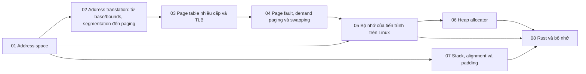

# P3 · Tổng quan — Bộ nhớ

> Trang này chỉ điều hướng: mục tiêu, bản đồ chương, thứ tự đọc, sách gốc và câu hỏi tổng hợp. Mọi khẳng định kỹ thuật có chú thích nằm trong từng chương; các lời khuyên về thứ tự đọc là của người soạn.

## Mục tiêu của phase

Phase này giải thích bộ nhớ từ góc nhìn chương trình rồi xuống phần cứng: address space, dịch địa chỉ, page table và TLB, page fault, bộ nhớ của process Linux, heap allocator, stack/alignment/padding. Cuối phase, bạn nối được `Box`, `Vec`, `Drop` và `GlobalAlloc` của Rust với những cơ chế này. Đây là phase quan trọng nhất cho việc hiểu ownership dưới mức ngôn ngữ.

## Bản đồ chương

Mũi tên nghĩa là chương đích dùng khái niệm của chương nguồn (nhận xét của người soạn về thứ tự học).

## Các chương

| Chương | Nội dung chính |
|---|---|
| [01 — Address space](01-address-space.md) | Vì sao không thể "đặt chương trình vào RAM rồi chạy"; address space và các vùng; transparency/efficiency/protection; isolation; kernel trong address space; `malloc`/`free` và lỗi bộ nhớ kinh điển; Rust chặn gì. |
| [02 — Address translation: từ base/bounds, segmentation đến paging](02-address-translation.md) | MMU và address translation; base/bounds; segmentation; vì sao vẫn gọi là segmentation fault; paging: VPN, offset, PFN; bit trong PTE; vì sao paging thắng segmentation. |
| [03 — Page table nhiều cấp và TLB](03-page-table-va-tlb.md) | TLB hit/miss; ai xử lý TLB miss; context switch, ASID; page table tuyến tính quá lớn và cách thu nhỏ; page table nhiều cấp; x86-64/AArch64 và tên cấp trong Linux; huge page, THP; TLB miss với backend. |
| [04 — Page fault, demand paging và swapping](04-page-fault-va-swapping.md) | Present bit và page fault; demand paging, demand zeroing; swap, `kswapd`, watermark; thuật toán thay trang; thrashing, OOM killer, `oom_score`; minor vs major fault; `swappiness`, `memory.high/max`; vì sao hạn chế swap. |
| [05 — Bộ nhớ của tiến trình trên Linux](05-bo-nho-tien-trinh-linux.md) | ELF và `text`/`rodata`/`data`/`bss`; kernel và `ld.so` dựng process; `/proc/<pid>/maps`, ASLR; `mmap`, `brk`, copy-on-write; overcommit; RSS/VSZ/PSS; `mlock`; memory cgroup và OOM. |
| [06 — Heap allocator](06-heap-allocator.md) | `free` biết kích thước thế nào; splitting/coalescing, best/first fit; fragmentation; segregated list, slab, buddy; arena, thread cache, `M_ARENA_MAX`; glibc `brk`/`mmap`, `M_MMAP_THRESHOLD`; jemalloc, mimalloc; global allocator của Rust. |
| [07 — Stack, alignment và padding](07-stack-alignment-padding.md) | Stack tăng về phía nào; stack process vs thread, `RLIMIT_STACK`; guard page và tràn stack; alignment; padding và layout `repr(C)`; sắp xếp lại field; `size_of`/`offset_of!`/`Layout`; chỉnh stack thread trong Rust. |
| [08 — Rust và bộ nhớ](08-rust-va-bo-nho.md) | Ownership và `move` ở mức bit; `Drop` vs `Copy`, thứ tự drop; layout `Box`/`Vec`/`String`; `GlobalAlloc`, `System`, `#[global_allocator]`; `Rc`/`Arc`/`Weak` và leak; `MaybeUninit`; lỗi C và cơ chế Rust chặn; stack hay heap. |

## Thứ tự đọc

Đọc 01 → 08 theo số; 02, 03, 04 là chuỗi cơ chế phần cứng/kernel nên đừng đảo thứ tự. Chương 07 tương đối độc lập với 02–04, có thể đọc trước nếu bạn đang vướng chuyện layout (nhận xét của người soạn). Chương 08 đọc cuối.

## Lộ trình đọc sách gốc

Các nguồn dưới đây đều là nguồn mà chương của phase đã dùng; mở đọc song song với chương tương ứng. Không bắt buộc: chương đã tự chứa phần cần thiết.

- [OSTEP — The Abstraction: Address Spaces](https://pages.cs.wisc.edu/~remzi/OSTEP/vm-intro.pdf) — chương 01.
- [OSTEP — Interlude: Memory API](https://pages.cs.wisc.edu/~remzi/OSTEP/vm-api.pdf) — chương 01.
- [OSTEP — Mechanism: Address Translation](https://pages.cs.wisc.edu/~remzi/OSTEP/vm-mechanism.pdf) — chương 02.
- [OSTEP — Segmentation](https://pages.cs.wisc.edu/~remzi/OSTEP/vm-segmentation.pdf) — chương 02.
- [OSTEP — Paging: Introduction](https://pages.cs.wisc.edu/~remzi/OSTEP/vm-paging.pdf) — chương 02.
- [OSTEP — Paging: Faster Translations (TLBs)](https://pages.cs.wisc.edu/~remzi/OSTEP/vm-tlbs.pdf) — chương 03.
- [OSTEP — Paging: Smaller Tables](https://pages.cs.wisc.edu/~remzi/OSTEP/vm-smalltables.pdf) — chương 03.
- [OSTEP — Beyond Physical Memory: Mechanisms](https://pages.cs.wisc.edu/~remzi/OSTEP/vm-beyondphys.pdf) — chương 04.
- [OSTEP — Beyond Physical Memory: Policies](https://pages.cs.wisc.edu/~remzi/OSTEP/vm-beyondphys-policy.pdf) — chương 04.
- [OSTEP — Free-Space Management](https://pages.cs.wisc.edu/~remzi/OSTEP/vm-freespace.pdf) — chương 06.
- [The Rust Book — What Is Ownership?](https://doc.rust-lang.org/1.95.0/book/ch04-01-what-is-ownership.html) — chương 01, 08.
- [The Rust Book — Using Box\<T>](https://doc.rust-lang.org/1.95.0/book/ch15-01-box.html) — chương 08.
- [The Rust Book — Reference Cycles](https://doc.rust-lang.org/1.95.0/book/ch15-06-reference-cycles.html) — chương 08.
- [The Rustonomicon — Leaking](https://doc.rust-lang.org/1.95.0/nomicon/leaking.html) — chương 08.

## Câu hỏi tổng hợp xuyên chương

Không có đáp án ở đây; mỗi câu trỏ về chương cần đọc lại.

1. Từ `Box::new(x)` đến byte đầu tiên trong RAM: allocator, `brk`/`mmap`, page table và page fault lần chạm đầu tiên phối hợp thế nào? ([chương 08](08-rust-va-bo-nho.md), [chương 06](06-heap-allocator.md), [chương 05](05-bo-nho-tien-trinh-linux.md), [chương 04](04-page-fault-va-swapping.md), [chương 03](03-page-table-va-tlb.md)).
2. `free` xong mà RSS không giảm: allocator và `mmap` threshold giải thích điều đó thế nào, và đo bằng gì? ([chương 06](06-heap-allocator.md), [chương 05](05-bo-nho-tien-trinh-linux.md)).
3. Container bị OOM kill trong khi ứng dụng "không dùng nhiều heap": RSS, page cache và memory cgroup khác nhau chỗ nào? ([chương 05](05-bo-nho-tien-trinh-linux.md), [chương 04](04-page-fault-va-swapping.md)).
4. Vì sao tràn stack của chương trình Rust bị dừng mà không phải ghi đè bộ nhớ khác? ([chương 07](07-stack-alignment-padding.md), [chương 04](04-page-fault-va-swapping.md)).
5. Tính tay `size_of` của một struct `repr(C)`, rồi so với cách Rust sắp xếp: padding và alignment xuất hiện ở đâu? ([chương 07](07-stack-alignment-padding.md), [chương 08](08-rust-va-bo-nho.md)).
6. Context switch làm TLB thế nào, và vì sao điều đó là một phần chi phí của thread/process? ([chương 03](03-page-table-va-tlb.md), [chương 02](02-address-translation.md)).
7. Những lỗi bộ nhớ kinh điển của C (use-after-free, double free, tràn buffer…) tương ứng với cơ chế nào của Rust, và leak vì sao vẫn là safe? ([chương 01](01-address-space.md), [chương 08](08-rust-va-bo-nho.md)).

## Lab

Làm sau khi đã đọc lý thuyết:

- [Lab 03 — Bộ nhớ](../labs/03-memory-lab.md)
