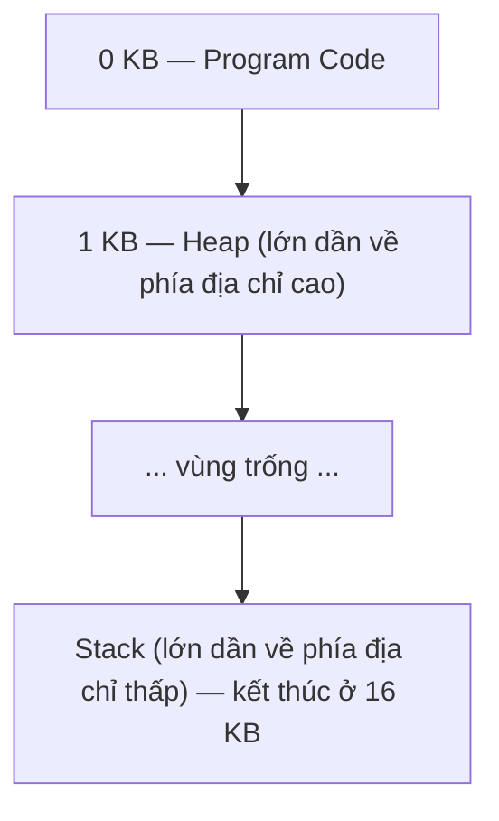
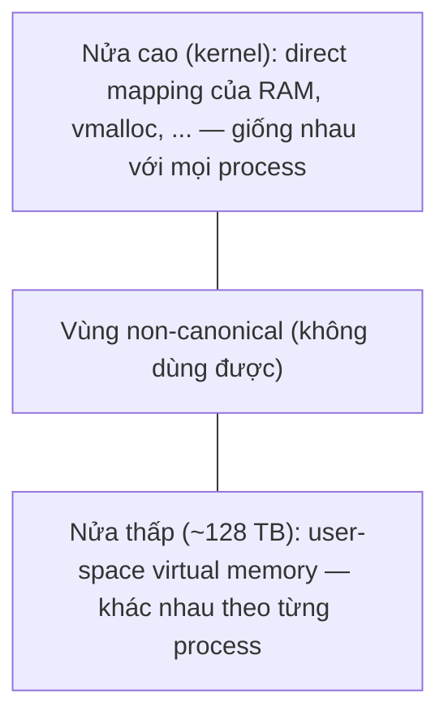

# P3 · Chương 01 — Address space

## Bạn sẽ hiểu được gì

1. **Q1.** Vì sao một chương trình không thể đơn giản được "đặt vào RAM rồi chạy", và hệ điều hành đã đi từ máy sơ khai tới multiprogramming và time sharing như thế nào? → mục 1
2. **Q2.** Address space là gì, gồm những vùng nào, và vì sao mọi địa chỉ bạn in ra từ một chương trình người dùng đều là địa chỉ ảo? → mục 2
3. **Q3.** Ba mục tiêu của bộ nhớ ảo — transparency, efficiency, protection — nghĩa là gì, và "transparent" bị hiểu nhầm ở đâu? → mục 3
4. **Q4.** Isolation giữa các process được tạo ra bằng cách nào, và nó dừng ở đâu (thread cùng process thì sao)? → mục 4
5. **Q5.** Kernel nằm ở đâu trong address space của một process? → mục 5
6. **Q6.** `malloc`/`free` là gì (syscall hay không), và các lỗi kinh điển — dùng bộ nhớ chưa cấp, tràn buffer, đọc chưa khởi tạo, leak, dangling pointer/use-after-free, double free, free sai con trỏ — trông như thế nào khi chạy thật? → mục 6
7. **Q7.** Vì sao Rust ngăn được phần lớn các lỗi đó ngay ở compile time hoặc bằng kiểm tra runtime, và vì sao leak vẫn là lỗi "an toàn"? → mục 7

## Kiến thức cần trước

Chương này mở đầu phase Bộ nhớ, nên không đòi hỏi chương bộ nhớ nào trước. Bạn nên biết process là gì và CPU có chế độ user/kernel ở mức khái niệm: xem [Linux · Chương 01, mục 3 — User mode, kernel mode](../01-linux/01-os-va-kernel.md) và [Linux · Chương 03 — Process](../01-linux/03-process.md); nếu cần ôn lại cách code chạy trên CPU, xem [Chương 03 — Assembly x86-64 và AArch64](../02-cpu/03-assembly-x86-64-va-aarch64.md). Các chương sau của phase sẽ đào sâu những gì chương này chỉ giới thiệu: [dịch địa chỉ](02-address-translation.md), [page table và TLB](03-page-table-va-tlb.md), [page fault và swapping](04-page-fault-va-swapping.md), [bố cục bộ nhớ process trên Linux](05-bo-nho-tien-trinh-linux.md), [heap và allocator](06-heap-allocator.md), [Rust và bộ nhớ](08-rust-va-bo-nho.md).

## 1. Từ máy sơ khai đến nhu cầu trừu tượng hóa bộ nhớ (Q1)

> **Trả lời ngắn.** Máy đời đầu không cho người dùng trừu tượng bộ nhớ nào: OS chỉ là một thư viện routine nằm trong bộ nhớ, chương trình dùng phần còn lại[^ostep-early]. Máy đắt nên người ta chia sẻ nó cho nhiều chương trình, và muốn chuyển qua lại nhanh thì phải để các process ở lại trong bộ nhớ thay vì lưu cả bộ nhớ ra đĩa[^ostep-leave]. Khi đó vấn đề mới xuất hiện: không để process này đọc/ghi bộ nhớ của process khác[^ostep-protect-issue].

**Giải thích.**

Hình dung (nhận xét của người soạn): một căn nhà chỉ một người thuê thì không cần vách ngăn; khi nhiều người ở ghép thì phải có vách ngăn, nếu không ai cũng lục được đồ của ai.

*Máy sơ khai.* OSTEP (giáo trình *Operating Systems: Three Easy Pieces*) mô tả máy đời đầu: về mặt bộ nhớ, chúng gần như không cho người dùng trừu tượng nào. OS là một tập routine — thực chất là một thư viện — nằm trong bộ nhớ vật lý, và một chương trình đang chạy dùng phần bộ nhớ còn lại[^ostep-early].

*Multiprogramming và time sharing.* Vì máy rất đắt, người ta chia sẻ máy hiệu quả hơn: kỷ nguyên *multiprogramming*, trong đó nhiều process sẵn sàng chạy cùng lúc và OS chuyển qua lại giữa chúng, ví dụ khi một process chờ I/O; làm vậy tăng mức dùng CPU[^ostep-multiprog]. Sau đó là *time sharing*: người dùng muốn tương tác, không chịu nổi chu kỳ debug dài của batch computing[^ostep-timeshare].

*Cách ngây thơ và vì sao bỏ.* Cách ngây thơ để cài time sharing là chạy một process một lúc với toàn quyền trên bộ nhớ, rồi dừng, lưu toàn bộ trạng thái ra đĩa (kể cả toàn bộ bộ nhớ vật lý), nạp trạng thái process khác. OSTEP gọi cách này là quá chậm, nhất là khi bộ nhớ lớn dần: lưu/khôi phục thanh ghi thì nhanh, nhưng lưu cả bộ nhớ ra đĩa thì chậm khủng khiếp; thứ ta muốn là **để process ở lại trong bộ nhớ khi chuyển qua lại**[^ostep-leave].

*Vấn đề mới: protection.* Khi nhiều chương trình cùng cư trú trong bộ nhớ, protection trở thành vấn đề quan trọng: ta không muốn một process đọc, hay tệ hơn là ghi, bộ nhớ của process khác[^ostep-protect-issue]. Hai nhu cầu va nhau — giữ nhiều process trong RAM để chuyển nhanh, nhưng không để chúng giẫm lên nhau — và lời giải của OS là một trừu tượng: **address space** (mục 2).

<details><summary>Đi sâu: ví dụ số liệu của OSTEP</summary>

- Ví dụ của sách: ba process A, B, C, mỗi cái chiếm một mảnh nhỏ của 512 KB bộ nhớ vật lý; với một CPU, OS chạy một process (giả sử A), B và C chờ trong ready queue[^ostep-three-procs].

</details>

**Quay lại Q1:** chỉ "nạp vào RAM rồi chạy" không đủ khi nhiều process phải cùng ở lại RAM; điều đó đẻ ra nhu cầu protection, và address space là câu trả lời.

## 2. Address space và địa chỉ ảo (Q2)

> **Trả lời ngắn.** Address space là cái nhìn của chương trình đang chạy về bộ nhớ trong hệ thống[^ostep-addrspace]; mô hình đơn giản gồm code, stack và heap[^ostep-parts]. Mọi địa chỉ bạn thấy với tư cách lập trình viên chương trình người dùng đều là virtual address; chỉ OS và phần cứng biết vị trí vật lý thật[^ostep-aside].

**Giải thích.**

Hình dung (nhận xét của người soạn): địa chỉ "số 1, đường Lê Lợi" ở thành phố này khác "số 1, đường Lê Lợi" ở thành phố khác; mỗi process có "thành phố" riêng, và bưu điện (OS + phần cứng) biết nhà nằm thật ở đâu.

*Định nghĩa.* Address space là trừu tượng dễ dùng mà OS tạo ra từ bộ nhớ vật lý: cái nhìn của chương trình về bộ nhớ[^ostep-addrspace]. Nó chứa toàn bộ *memory state* của chương trình đang chạy[^ostep-addrspace-state].

*Code, stack, heap.* OSTEP tối giản address space thành ba thành phần và nói rõ rằng thực tế còn nhiều thứ khác (ví dụ biến được khởi tạo tĩnh)[^ostep-parts]:

| Vùng | Chứa gì | Đặc điểm |
|---|---|---|
| **Code** | Các lệnh của chương trình | Tĩnh, nên dễ đặt: biết trước kích thước và không lớn lên khi chạy[^ostep-code-static] |
| **Stack** | Theo dõi vị trí trong chuỗi lời gọi hàm, cấp biến cục bộ, truyền tham số và giá trị trả về[^ostep-stackdef] | Co giãn khi chạy |
| **Heap** | Bộ nhớ cấp phát động do người dùng quản lý, kiểu bộ nhớ nhận từ `malloc()` trong C[^ostep-heapdef] | Co giãn khi chạy |

*Địa chỉ ảo.* Giả sử process A thực sự nằm ở physical 320 KB nhưng "nghĩ" mình bắt đầu từ địa chỉ 0. Khi A thực hiện một `load` ở địa chỉ 0 — OSTEP gọi đây là **virtual address** — OS cùng phần cứng phải đảm bảo load không thực sự đi tới physical address 0 mà tới physical address 320 KB nơi A đã được nạp[^ostep-va]. Đó là cốt lõi của *virtualizing memory*: chương trình nghĩ nó được nạp tại một địa chỉ nào đó (ví dụ 0) và có address space có thể rất lớn (32 hay 64 bit), còn thực tế khác hẳn[^ostep-virtualizing]. Nếu in ra được địa chỉ của code, đó cũng là virtual[^ostep-aside].

*Address space không phải RAM.* Address space là cái *chương trình thấy*, không phải lượng RAM nó đang chiếm. OSTEP tóm tắt: hệ thống VM chịu trách nhiệm tạo ảo giác về một address space **lớn, thưa, riêng tư** cho mỗi chương trình; OS cùng phần cứng dịch từng tham chiếu ảo sang địa chỉ vật lý[^ostep-illusion]. Chữ "thưa" (sparse) quan trọng: phần lớn dải địa chỉ 64 bit không được ánh xạ tới đâu cả — chỉ một số vùng được map, như `/proc/<pid>/maps` cho thấy ở [Chương 05, mục 3](05-bo-nho-tien-trinh-linux.md) (nhận xét của người soạn). Cơ chế dịch là nội dung [Chương 02](02-address-translation.md) và [Chương 03](03-page-table-va-tlb.md).

<details><summary>Đi sâu: ví dụ 16 KB của OSTEP, và thí nghiệm in địa chỉ trên Linux aarch64</summary>

- Trong ví dụ 16 KB của sách, code nằm đầu address space (từ địa chỉ 0, chiếm 1 KB đầu). Heap và stack là hai vùng có thể lớn lên và co lại; chúng được đặt ở hai đầu đối diện của khoảng còn lại, để mỗi bên có chỗ lớn lên theo hướng ngược nhau[^ostep-layout]. Sách nhấn mạnh cách xếp này **chỉ là quy ước**, có thể sắp xếp khác (và khi có nhiều thread trong một address space thì cách chia đôi như vậy không còn dùng được nữa)[^ostep-convention].



*Đây là hình minh họa 16 KB của OSTEP, không phải layout thật của một process Linux; layout thật (file thực thi, bss, heap, thư viện nạp động, vdso, stack...) là nội dung của [Chương 05, mục 3](05-bo-nho-tien-trinh-linux.md).*

- **Thử chạy thật.** Chương trình C dưới đây in địa chỉ của hàm `main`, một biến toàn cục, một khối `malloc`, và một biến cục bộ:

```c
#include <stdio.h>
#include <stdlib.h>
int g = 1;
int main(void) {
  int s = 3; int *h = malloc(sizeof(int));
  printf("code  %p\ndata  %p\nheap  %p\nstack %p\n",
         (void*)main, (void*)&g, (void*)h, (void*)&s);
  return 0;
}
```

Biên dịch bằng `gcc` và chạy hai lần liên tiếp trong container Linux aarch64 của repo (`./labs/linux.sh`), kết quả quan sát được:

| Lần chạy | code | data | heap | stack |
|---|---|---|---|---|
| `-no-pie` #1 | `0x4006c4` | `0x420038` | `0x1c4482a0` | `0xffffce2dfc74` |
| `-no-pie` #2 | `0x4006c4` | `0x420038` | `0x96452a0` | `0xffffe7d8a0e4` |
| mặc định (PIE) #1 | `0xc976f25607d4` | `0xc976f2580040` | `0xc977232d52a0` | `0xffffe24532f4` |
| mặc định (PIE) #2 | `0xae58037f07d4` | `0xae5803810040` | `0xae58238692a0` | `0xffffd222b8e4` |

Đây là *quan sát* từ hai lần chạy trên một máy, không phải bảo đảm: mọi giá trị đều là virtual address; heap và stack đổi giữa các lần chạy, code đổi khi build PIE nhưng không đổi với `-no-pie`. Mẫu hình này khớp với ASLR: tài liệu kernel nói với binary PIE, vị trí bắt đầu của code cũng được ngẫu nhiên hóa[^kdoc-aslr-pie]. Các mức 0/1/2 của `kernel.randomize_va_space` (mmap base, stack, VDSO, heap) được trình bày trong bảng ở [Chương 05, mục 3](05-bo-nho-tien-trinh-linux.md). Việc `-no-pie` giữ nguyên địa chỉ code là suy luận của người soạn từ chỗ tài liệu chỉ nói code của binary *PIE* bị ngẫu nhiên hóa. Giá trị sysctl trong container lab đã được đọc ở khung môi trường của [Chương 05](05-bo-nho-tien-trinh-linux.md): `randomize_va_space` = 2, nên "ASLR đang bật ở lab" là đo được, không còn là suy ra.

</details>

**Quay lại Q2:** address space là cái nhìn của chương trình về bộ nhớ (code, stack, heap và hơn thế), và mọi địa chỉ nó thấy là địa chỉ ảo.

## 3. Ba mục tiêu của bộ nhớ ảo (Q3)

> **Trả lời ngắn.** OSTEP đặt ba mục tiêu cho VM: transparency (OS làm VM vô hình với chương trình)[^ostep-transp], efficiency (hiệu quả cả thời gian lẫn không gian)[^ostep-eff] và protection (bảo vệ process khỏi nhau và bảo vệ chính OS)[^ostep-prot]. "Transparent" ở đây hay bị hiểu ngược: nó nghĩa là ảo giác không được ứng dụng nhìn thấy[^ostep-transp-footnote].

**Giải thích.**

Hình dung (nhận xét của người soạn): một nhà hàng tốt thì khách không thấy bếp phải xoay xở thế nào (transparent), món ra nhanh (efficient), và khách bàn này không với tay được vào đĩa bàn khác (protection).

Hình dung ở trên cho thấy ba mục tiêu là ba mặt của cùng một bài toán: nhiều process cùng ở lại RAM (mục 1) mà vẫn phải trông như mỗi cái có bộ nhớ riêng. OSTEP đặt ba mục tiêu để dẫn dắt thiết kế của VM[^ostep-goals-intro]. Mỗi mục tiêu trả lời một nỗi lo khác nhau, theo thứ tự "chạy được → chạy nhanh → chạy an toàn":

1. **Transparency (vô hình): chương trình không phải biết mình nằm ở đâu.** OS cài VM theo cách vô hình với chương trình đang chạy: chương trình không nhận ra bộ nhớ bị ảo hóa, nó hành xử như thể có bộ nhớ vật lý riêng[^ostep-transp]. Cụ thể là ví dụ ở mục 2: process A "nghĩ" mình bắt đầu từ địa chỉ 0 dù thực tế nằm ở 320 KB[^ostep-virtualizing]. Nhờ vậy cùng một chương trình viết bằng địa chỉ ảo chạy được dù OS đặt nó ở đâu trong RAM (suy luận của người soạn).
2. **Efficiency (hiệu quả): ảo giác không được làm mọi thứ chậm đi.** Mỗi lần load/store đều đi qua dịch địa chỉ, nên OS phải ảo hóa hiệu quả cả về thời gian (không làm chương trình chạy chậm đi nhiều) lẫn không gian (không tốn quá nhiều bộ nhớ cho cấu trúc hỗ trợ ảo hóa)[^ostep-eff]. Phần thời gian không làm nổi chỉ bằng phần mềm: OS phải dựa vào hỗ trợ phần cứng như TLB[^ostep-eff-hw].
3. **Protection (bảo vệ): ảo giác không được phá vỡ ranh giới.** OS phải bảo vệ process khỏi nhau và bảo vệ chính OS[^ostep-prot]. Đó là vấn đề đã nêu ở cuối mục 1; phần "isolation" kéo theo ở mục 4.

Từ "transparent" hay bị hiểu ngược. OSTEP chú thích riêng: nhiều sinh viên tưởng "transparent" là để mọi thứ phơi ra (như một chính phủ minh bạch), nhưng ở đây nó có nghĩa ngược lại — ảo giác do OS tạo ra **không được nhìn thấy** bởi ứng dụng[^ostep-transp-footnote].

<details><summary>Đi sâu: hai vế của efficiency, và ba mục tiêu là "cái đích"</summary>

- Efficiency có hai vế: thời gian và không gian[^ostep-eff]. Vế thời gian dẫn tới phần cứng như TLB, nội dung của [Chương 03](03-page-table-va-tlb.md); vế không gian là chi phí bộ nhớ của chính các cấu trúc dịch địa chỉ (suy luận của người soạn; xem [Chương 02](02-address-translation.md) và Chương 03).
- Ba mục tiêu này là "cái đích" dẫn thiết kế; các cơ chế cụ thể (dịch địa chỉ, page table…) sẽ lần lượt đáp ứng chúng ở các chương sau.

</details>

**Quay lại Q3:** transparency = ảo giác vô hình với ứng dụng (không phải "phơi ra"), efficiency = nhanh và gọn nhờ phần cứng, protection = cô lập process và bảo vệ OS.

## 4. Isolation giữa process và ranh giới của nó (Q4)

> **Trả lời ngắn.** Protection cho ra isolation: khi một process thực hiện load, store hay instruction fetch, nó không thể truy cập hay ảnh hưởng bộ nhớ nằm ngoài address space của mình[^ostep-isolation]. Ranh giới này nằm giữa các address space, tức giữa các process; hai thread cùng process thì chia sẻ bộ nhớ global, chỉ stack là riêng[^pthreads-share].

**Giải thích.**

Hình dung (nhận xét của người soạn): mỗi process là một căn hộ khóa riêng; thread là các thành viên trong cùng căn hộ — họ dùng chung phòng khách (data, heap), chỉ có ngăn kéo riêng (stack).

Isolation là hệ quả của protection ở mục 3. Cơ chế từng bước, theo OSTEP:

1. Mỗi process có address space riêng (mục 2). Khi một process thực hiện load, store hay instruction fetch, nó không được truy cập hay ảnh hưởng bộ nhớ của process khác hay của OS — tức bất cứ thứ gì nằm ngoài address space của nó; kết quả là mỗi process chạy trong "cái kén" cô lập, an toàn trước các process lỗi hoặc độc hại khác[^ostep-isolation].
2. Để có quyền thi hành việc đó, OS cần hơn ứng dụng: phần cứng có hai chế độ, OS chạy ở privileged/kernel mode với quyền truy cập toàn bộ máy, còn ứng dụng ở user mode bị hạn chế[^ostep-kmode]. Cách phần cứng chặn truy cập ngoài address space là dịch địa chỉ ở [Chương 02](02-address-translation.md) và [Chương 03](03-page-table-va-tlb.md).
3. Ranh giới do đó nằm giữa các **address space**, tức giữa các process. Hai thread cùng process không có ranh giới này: `pthreads(7)` nói chúng chia sẻ bộ nhớ global (data và heap segment), chỉ stack là riêng từng thread[^pthreads-share]; OSTEP cũng nhắc nhiều thread cùng tồn tại trong một address space[^ostep-convention]. Thread được trình bày ở [Concurrency · Chương 01](../04-concurrency/01-thread.md).

*Liên hệ backend (nhận xét của người soạn):* server pre-fork (mỗi worker một process) được isolation ở mức process: con trỏ hỏng trong worker này không chạm được bộ nhớ worker kia, crash chỉ giết worker đó. Server nhiều thread trong một process không có lưới an toàn đó: một lần ghi tràn ở thread này có thể làm hỏng dữ liệu thread khác.

<details><summary>Đi sâu: isolation là nguyên lý thiết kế, và stack "riêng" vẫn cùng address space</summary>

- OSTEP đóng khung isolation là một nguyên lý thiết kế hệ thống đáng tin cậy: nếu hai thực thể được cô lập đúng đắn thì một bên có thể hỏng mà không ảnh hưởng bên kia[^ostep-isolation-tip].
- Stack "riêng" vẫn nằm trong cùng address space, nên con trỏ hỏng ở thread này vẫn có thể chạm stack thread kia (suy luận của người soạn).

</details>

**Quay lại Q4:** isolation đến từ protection giữa các address space; nó chặn process này với process kia, nhưng không chặn thread với thread trong cùng một process.

## 5. Kernel trong address space (Q5)

> **Trả lời ngắn.** Kernel không phải một process riêng: trong mỗi address space, nửa cao của dải địa chỉ (trên x86-64 Linux, theo kernel docs) là bộ nhớ của kernel, và nửa này dùng chung cho mọi process[^kdoc-shared]. Code user mode bị chặn không chạm vào được nửa đó nhờ bit quyền trên từng trang trong page table (bảng dịch địa chỉ ảo sang vật lý; OSTEP gọi là bit U/S[^ostep-us-bit]); việc áp dụng bit đó cho trang kernel là suy luận của người soạn.

**Giải thích.**

Hình dung (nhận xét của người soạn): một tòa nhà có tầng khách và tầng nhân viên dùng chung một thang máy; thẻ của khách không bấm được tầng nhân viên. Khi bạn gọi syscall, CPU chuyển sang kernel mode và kernel cần truy cập bộ nhớ — nên nó phải có chỗ ngay trong dải địa chỉ đang dùng.

Tài liệu kernel Linux cho x86-64 (page table 4 cấp) cho một ví dụ cụ thể về cách chia dải địa chỉ: nửa thấp, khoảng 128 TB từ `0000000000000000` đến `00007fffffffefff`, là bộ nhớ ảo của user space và khác nhau theo từng `mm` (mô tả address space của một process)[^kdoc-user]. Nửa cao của dải địa chỉ canonical là phần của kernel và được chia sẻ giữa mọi process[^kdoc-shared]. Giữa hai nửa là một vùng khổng lồ non-canonical mà địa chỉ không hợp lệ[^kdoc-hole].



Sơ đồ này chỉ đúng với x86-64 theo tài liệu trên (bảng có chú thích riêng cho từng chế độ page table và kiến trúc); vì sao có hố non-canonical thì xem phần Đi sâu của [Chương 03](03-page-table-va-tlb.md). Điểm cần nhớ: **kernel không phải là một process khác** mà "nằm trong" mỗi address space ở nửa kernel.

Cơ chế từng bước khi bạn gọi syscall (mô hình khái niệm, suy luận của người soạn từ các nguồn trên):

1. CPU chuyển sang kernel mode (privileged mode, có quyền truy cập toàn bộ máy[^ostep-kmode]).
2. Kernel chạy bằng chính địa chỉ ảo ở nửa cao, vốn có mặt trong mọi address space[^kdoc-shared]; nó không cần "nhảy sang" một process khác.
3. Khi trở về user mode, code user vẫn chỉ thấy phần nửa thấp của mình: bit quyền U/S trên trang quyết định process user-mode có truy cập được trang hay không[^ostep-us-bit].

Đây là mô hình đơn giản. Thực tế trên x86-64 với Page Table Isolation (PTI) bật, hệ thống giữ bản page table "user" và bản "kernel" đầy đủ, rồi chuyển sang bản kernel khi vào kernel qua syscall, interrupt hoặc exception, và quay lại bản user khi về user mode[^kdoc-pti]; chi tiết xem [Linux · Chương 01, mục 7](../01-linux/01-os-va-kernel.md).

<details><summary>Đi sâu: direct mapping, bit U/S, và những gì chương này không khẳng định</summary>

- Một dòng trong bảng kernel docs ghi `ffff888000000000` là direct mapping của toàn bộ bộ nhớ vật lý (`page_offset_base`) — vùng kernel dùng để truy cập toàn bộ bộ nhớ vật lý bằng địa chỉ ảo[^kdoc-direct].
- Bit U/S là chi tiết x86 trong sách OSTEP; chương này không khẳng định gì về cơ chế AArch64 (xem phần Đi sâu của [Chương 03](03-page-table-va-tlb.md) về TTBR0/TTBR1). Việc kernel đánh dấu trang của mình là cấm user, và quyền truy cập ghi/thi hành trên từng trang, được nối với bit trong PTE ở [Chương 02](02-address-translation.md) và [Chương 03](03-page-table-va-tlb.md).

</details>

**Quay lại Q5:** kernel sống trong nửa cao của mỗi address space (x86-64 Linux), dùng chung giữa các process, và user mode bị chặn truy cập nó nhờ bit quyền trong page table (suy luận của người soạn).

## 6. `malloc`, `free` và các lỗi kinh điển (Q6)

> **Trả lời ngắn.** `malloc` và `free` không phải system call (lời gọi thẳng vào kernel) mà là hàm của thư viện: thư viện malloc quản lý không gian trong address space của bạn, và chỉ gọi system call khi cần xin thêm hoặc trả bớt bộ nhớ[^ostep-libcall]. Các lỗi kinh điển — quên cấp phát, tràn buffer, đọc chưa khởi tạo, leak, dangling pointer, double free, free sai — đều biên dịch được mà trình biên dịch không phàn nàn[^ostep-compiles]; khi chạy chúng có thể crash, hỏng im lặng, hoặc "chạy đúng" một cách may mắn.

**Giải thích.**

Hình dung (nhận xét của người soạn): bạn thuê kho. OS là chủ đất giao cho bạn một mảnh đất lớn; `malloc` là người quản lý kho trong khu đất đó chia ô cho bạn, `free` là trả ô về cho quản lý — chưa chắc quản lý trả đất lại cho chủ ngay.

Address space có heap; heap được dùng từ phía lập trình viên C qua hai hàm. `malloc(size)` cấp `size` byte, trả về con trỏ tới vùng nhớ vừa cấp; vùng nhớ **không được khởi tạo**[^malloc-man]. `free(ptr)` giải phóng vùng nhớ mà `ptr` trỏ tới; `ptr` phải là con trỏ do `malloc` (hoặc hàm họ hàng) trả về, nếu không, hoặc nếu `ptr` đã bị free rồi, thì hành vi là undefined[^free-ub].

`malloc`/`free` là *library call*: thư viện malloc quản lý không gian bên trong virtual address space của bạn, nhưng bản thân nó được xây trên một số system call để xin thêm bộ nhớ hoặc trả bớt về hệ thống[^ostep-libcall]. Hai tầng quản lý bộ nhớ cùng tồn tại: tầng OS cấp bộ nhớ cho process khi chạy và thu hồi khi chết; tầng thứ hai nằm trong mỗi process (ví dụ trong heap khi gọi `malloc`/`free`)[^ostep-two-levels]. Hệ quả: `free` không đồng nghĩa với "trả RAM cho OS ngay" — đó là chuyện của allocator ([Chương 06, mục 8](06-heap-allocator.md)). Còn `free` không nhận kích thước, nên thư viện phải tự theo dõi kích thước vùng đã cấp[^ostep-freesize]; cách làm (header trước khối) ở [Chương 06, mục 2](06-heap-allocator.md).

OSTEP liệt kê các lỗi mà họ gặp đi gặp lại khi dạy môn OS; tất cả ví dụ của sách đều biên dịch và chạy mà trình biên dịch không phàn nàn, và sách nhấn mạnh biên dịch được hay chạy đúng một lần không có nghĩa là chương trình đúng[^ostep-compiles]:

| Lỗi | Mô tả | Hậu quả theo OSTEP |
|---|---|---|
| Quên cấp phát | Gọi hàm cần buffer (như `strcpy`) với con trỏ chưa trỏ tới vùng nào | Segmentation fault[^ostep-forget-alloc] |
| Cấp thiếu (buffer overflow) | Ví dụ `malloc(strlen(src))` thiếu 1 byte cho `'\0'` | Có thể chạy "đúng", có thể hỏng biến khác, có thể crash; nguồn của nhiều lỗ hổng bảo mật[^ostep-overflow] |
| Quên khởi tạo | `malloc` rồi đọc trước khi ghi | Đọc dữ liệu giá trị không biết trước (uninitialized read)[^ostep-uninit] |
| Quên free (memory leak) | Không `free` khi xong | Process chạy lâu dần cạn bộ nhớ[^ostep-leak] |
| Free quá sớm (dangling pointer) | Free xong vẫn dùng con trỏ | Có thể crash hoặc ghi đè dữ liệu hợp lệ nếu `malloc` sau đó tái dùng vùng đó[^ostep-dangling] |
| Free nhiều lần (double free) | `free` cùng một con trỏ hai lần | Kết quả undefined; thư viện có thể "bối rối"; crash là hậu quả thường gặp[^ostep-doublefree] |
| Free sai (invalid free) | Truyền vào `free` một giá trị không phải do `malloc` trả về | Nguy hiểm[^ostep-invalid-free] |

Chạy thật các lỗi trên trong container Linux aarch64 của repo (glibc, `gcc` mặc định). Đây là *quan sát* về một môi trường cụ thể, không phải bảo đảm của C: chuẩn C và `malloc(3)` chỉ nói hành vi là undefined.

**(a) Quên cấp phát.** `char *dst; strcpy(dst, "hello");` biên dịch xong và khi chạy chết với `Segmentation fault`, exit status 139. Shell dùng 128 + N làm exit status khi lệnh chết vì tín hiệu số N[^bash-exit128], và theo bảng tín hiệu của Linux, SIGSEGV là số 11[^sig-segv-num], nên 139 = 128 + 11 là khớp. Cơ chế phía sau (suy luận của người soạn): `dst` chưa khởi tạo nên giá trị không xác định, ghi vào đó là truy cập một địa chỉ ảo không hợp lệ, phần cứng báo lỗi và process nhận SIGSEGV (cơ chế fault: [Chương 04](04-page-fault-va-swapping.md)).

**(b) Double free.** `char *p = malloc(16); free(p); free(p);` làm chương trình in `free(): double free detected in tcache 2` rồi bị abort, exit status 134 (= 128 + 6; SIGABRT là số 6[^sig-abrt-num]). Đây là hành vi **của glibc** trong môi trường này, suy ra từ nội dung thông báo (suy luận của người soạn): chuẩn chỉ nói free hai lần là undefined[^free-ub], nên không có gì bảo đảm allocator khác cũng phát hiện, chứ đừng nói đến việc in đúng thông báo này.

**(c) Use-after-free + tái dùng vùng nhớ.**

```c
char *a = malloc(16); strcpy(a, "hello"); free(a);
char *b = malloc(16); strcpy(b, "world");
printf("a=%p b=%p *a=%s\n", (void*)a, (void*)b, a);
```

Kết quả quan sát được: `a=0xb13be5c3f2a0 b=0xb13be5c3f2a0 *a=world`. Cùng một địa chỉ ảo được trao lại cho `b`, nên đọc qua con trỏ `a` đã free lại thấy dữ liệu của `b`. Chương trình không crash và không có thông báo lỗi — đúng kịch bản "ghi đè dữ liệu hợp lệ khi `malloc` tái dùng vùng bị free" mà OSTEP mô tả[^ostep-dangling].

*Liên hệ backend (nhận xét của người soạn):* kịch bản (c) trong một service là một request đọc nhầm dữ liệu của request khác. OSTEP nêu riêng rằng buffer overflow là nguồn của nhiều lỗ hổng bảo mật[^ostep-overflow].

<details><summary>Đi sâu: căn lề của <code>malloc</code>, overflow "thường không sao", GC và leak, process thoát</summary>

- Con trỏ `malloc` trả về được căn (align) phù hợp cho mọi kiểu vừa trong kích thước yêu cầu hoặc nhỏ hơn[^malloc-align].
- **Overflow thường "không sao" — cho tới khi có sao.** Do cách `malloc` cài đặt và nhiều chi tiết khác, chương trình tràn buffer thường chạy có vẻ đúng; đôi khi thư viện cấp dư chút chỗ nên không đè lên biến nào, đôi khi chương trình crash[^ostep-overflow].
- **GC không cứu được leak** nếu bạn còn giữ tham chiếu: garbage collector sẽ không bao giờ giải phóng vùng nhớ còn được tham chiếu[^ostep-gc-leak].
- **Process chết thì OS thu hồi hết.** Với chương trình ngắn, không `free` trước khi thoát không làm mất bộ nhớ theo nghĩa thật, vì OS lấy lại mọi page của process kể cả code, stack và heap[^ostep-exit]. Nhưng với server chạy lâu (web server, DBMS), leak là vấn đề lớn và cuối cùng dẫn tới crash khi hết bộ nhớ[^ostep-exit-server].

</details>

**Quay lại Q6:** `malloc`/`free` là library call trên heap của process; các lỗi kinh điển đều vẫn biên dịch được và khi chạy thì crash, hỏng im lặng hoặc "đúng nhầm" — như ba thí nghiệm (a)–(c).

## 7. Liên hệ với Rust: Rust chặn được lỗi nào, và vì sao leak vẫn "an toàn" (Q7)

> **Trả lời ngắn.** Các lỗi ở mục 6 có chung một gốc: ngôn ngữ để lập trình viên tự ghép cặp `malloc`/`free` và tự đảm bảo con trỏ còn hợp lệ (nhận xét của người soạn). Rust trả bộ nhớ tự động khi biến sở hữu nó ra khỏi scope[^book-auto]; nhờ đó trình biên dịch chặn được double free và dangling reference ngay lúc biên dịch[^book-dangling], còn tràn chỉ số bị chặn bằng kiểm tra lúc chạy. Leak thì không bị chặn: Book nói rõ memory leak là memory safe trong Rust[^book-leak].

**Giải thích.**

Hình dung (nhận xét của người soạn): thay vì tự trả chìa khóa kho và tự nhớ ô nào còn thuê, Rust gắn mỗi ô với đúng một người giữ chìa; người đó rời phòng thì ô tự được trả, và trình biên dịch từ chối cho ai cầm chìa của ô đã trả.

Theo Book, Rust khác với ngôn ngữ có GC: ngôn ngữ có GC thì GC theo dõi và dọn bộ nhớ không còn dùng[^book-gc]; Rust thì bộ nhớ được trả tự động khi biến sở hữu nó ra khỏi scope[^book-auto]. Chi tiết (ownership, `Drop`, layout của `Vec`/`String`) và bảng đối chiếu đầy đủ hơn từng lỗi C với cơ chế Rust (kể cả data race, bộ nhớ chưa khởi tạo) nằm ở [Chương 08, mục 8](08-rust-va-bo-nho.md); ở đây chỉ tóm lược ba lỗi quan trọng nhất kèm quan sát biên dịch/chạy.

| Lỗi trong C | Rust chặn bằng | Quan sát (rustc 1.95.0) |
|---|---|---|
| Double free | Một owner duy nhất + move: sau `let s2 = s1;` Rust coi `s1` không còn hợp lệ, vì nếu không cả hai sẽ cùng free một vùng[^book-doublefree][^book-move-valid] | Dùng lại `s1` sau khi move → `error[E0382]: borrow of moved value: s1`; `drop(s); drop(s);` cũng lỗi `E0382` |
| Dangling pointer / use-after-free | Borrow checker: dữ liệu không được ra khỏi scope trước tham chiếu tới nó[^book-dangling] | Hàm `fn dangle<'a>() -> &'a String { let s = String::from("a"); &s }` → `error[E0515]: cannot return reference to local variable s`; bỏ `'a` như ví dụ `dangle` của Book thì rustc dừng sớm hơn ở `E0106: missing lifetime specifier` |
| Tràn buffer / truy cập ngoài biên | Kiểm tra chỉ số lúc chạy: nếu index ≥ độ dài thì panic[^book-index-panic], thay vì truy cập bộ nhớ không hợp lệ như nhiều ngôn ngữ cấp thấp không kiểm tra[^book-index]. Ví dụ Book dùng mảng; `Vec` cũng vậy, như quan sát bên phải | `v[i]` với `v.len()==3`, `i==6` in `index out of bounds: the len is 3 but the index is 6`, exit status 101 |
| Memory leak | **Không bị chặn** (xem dưới) | — |

**Leak không bị chặn và vẫn là "an toàn".** Book viết rõ: ngăn leak hoàn toàn không phải một trong các bảo đảm của Rust, nghĩa là memory leak là memory safe trong Rust[^book-leak]. Lý do (suy luận của người soạn): leak chỉ tốn bộ nhớ, không làm đọc bộ nhớ không hợp lệ. Vậy chương trình Rust vẫn có thể phình bộ nhớ vì vòng tham chiếu `Rc`/`RefCell` (chủ đề của chính chương Book vừa trích[^book-leak]), `Box::leak`[^box-leak] hay `mem::forget`; tài liệu `mem::forget` nói hàm này không `unsafe` vì bảo đảm an toàn của Rust không gồm việc destructor luôn chạy[^forget-safe]. Service chạy dài ngày vẫn phải theo dõi RSS như thường (nhận xét của người soạn). Cơ chế vòng `Rc` và `forget` được tách chi tiết ở [Chương 08, mục 6](08-rust-va-bo-nho.md).

<details><summary>Đi sâu: bảo đảm này thuộc Safe Rust, và kiểm tra index có chi phí</summary>

- Nomicon viết: nếu bạn chỉ viết Safe Rust, bạn sẽ không bao giờ phải chịu dangling pointer, use-after-free hay bất kỳ dạng Undefined Behavior nào khác[^nomicon-safe]. Trong `unsafe`, chính lập trình viên lại phải giữ các bất biến đó (dereference con trỏ dangling là một trong các hành vi bị coi là UB[^nomicon-deref]).
- Kiểm tra index có chi phí runtime: Book giải thích kiểm tra này phải xảy ra lúc chạy vì compiler không biết trước giá trị người dùng nhập[^book-index-runtime].

</details>

**Quay lại Q7:** Rust chặn double free và dangling bằng ownership/borrow checking, chặn tràn chỉ số bằng kiểm tra runtime — trong Safe Rust; leak vẫn được phép vì nó không gây truy cập bộ nhớ không hợp lệ.

## Tóm tắt

- Máy sơ khai chỉ có OS (thư viện routine) và một chương trình trong bộ nhớ vật lý; multiprogramming và time sharing buộc nhiều process cùng nằm trong RAM, và lưu cả bộ nhớ ra đĩa khi chuyển process quá chậm[^ostep-early][^ostep-leave].
- Nhiều process chung RAM khiến protection thành vấn đề; lời giải là trừu tượng address space[^ostep-protect-issue][^ostep-addrspace].
- Address space đơn giản gồm code, stack, heap (thực tế còn nhiều vùng khác); cách xếp trong sách chỉ là quy ước[^ostep-parts][^ostep-convention].
- Mọi địa chỉ chương trình người dùng thấy đều là virtual; OS cùng phần cứng dịch sang địa chỉ vật lý[^ostep-aside][^ostep-va].
- Ba mục tiêu của VM: transparency (vô hình với chương trình), efficiency (thời gian và không gian, cần phần cứng), protection (cô lập process và bảo vệ OS)[^ostep-transp][^ostep-eff][^ostep-prot].
- Kernel cũng nằm trong address space (trên x86-64 Linux là nửa cao, dùng chung giữa các process)[^kdoc-user][^kdoc-direct][^kdoc-shared]; việc chặn code user mode chạm vào nó dựa trên bit quyền của từng trang trong page table (bit U/S trên x86)[^ostep-us-bit] — phần "trang kernel bị đánh dấu cấm user" là suy luận của người soạn; với PTI bật, kernel còn có bản page table riêng[^kdoc-pti].
- `malloc`/`free` là library call, thư viện tự theo dõi kích thước; các lỗi kinh điển là overflow, uninitialized read, leak, dangling pointer, double free, invalid free[^ostep-libcall][^ostep-freesize].
- Rust chặn double free và dangling bằng ownership/borrow checking lúc biên dịch, chặn tràn chỉ số bằng kiểm tra runtime; leak thì vẫn được phép[^book-doublefree][^book-dangling][^book-index][^book-leak].

## Câu hỏi tự kiểm tra

1. Vì sao "lưu toàn bộ bộ nhớ ra đĩa khi chuyển process" không dùng được cho time sharing, và OS làm gì thay vào đó?
<details><summary>Đáp án</summary>

Quá chậm, nhất là khi bộ nhớ lớn; lưu thanh ghi thì nhanh nhưng lưu cả bộ nhớ thì không. OS giữ các process trong bộ nhớ khi chuyển qua lại[^ostep-leave]. Điều này làm protection thành vấn đề[^ostep-protect-issue].

</details>

2. Address space gồm những thành phần nào trong mô hình đơn giản của OSTEP, và vùng nào "co giãn"?
<details><summary>Đáp án</summary>

Code, stack, heap; code tĩnh còn heap và stack có thể lớn lên và co lại[^ostep-parts][^ostep-layout].

</details>

3. Địa chỉ `0x4006c4` in ra từ một chương trình C là gì: physical hay virtual? Có bảo đảm lần chạy sau cũng in ra giá trị đó không?
<details><summary>Đáp án</summary>

Virtual[^ostep-aside]. Không có bảo đảm; trong thí nghiệm ở mục 2 địa chỉ code giữ nguyên giữa hai lần chạy `-no-pie` nhưng đổi giữa hai lần chạy PIE (quan sát, không phải bảo đảm).

</details>

4. Nêu ba mục tiêu của VM và một hệ quả thiết kế của mục tiêu efficiency.
<details><summary>Đáp án</summary>

Transparency, efficiency, protection[^ostep-transp][^ostep-eff][^ostep-prot]. Để hiệu quả về thời gian, OS phải dựa vào hỗ trợ phần cứng như TLB[^ostep-eff-hw].

</details>

5. "Transparent" trong OSTEP khác nghĩa thông thường ở chỗ nào?
<details><summary>Đáp án</summary>

Nghĩa là ảo giác do OS tạo ra không được ứng dụng nhìn thấy, chứ không phải "để mọi thứ lộ ra"[^ostep-transp-footnote].

</details>

6. Isolation giữa process đến từ đâu, và hai thread cùng process có được isolation đó với nhau không?
<details><summary>Đáp án</summary>

Từ protection: process không truy cập được bộ nhớ ngoài address space của mình[^ostep-isolation]. Hai thread cùng process dùng chung address space (data và heap dùng chung; mỗi thread có stack riêng) nên không có ranh giới này giữa chúng[^pthreads-share][^ostep-convention].

</details>

7. Trên x86-64 Linux, phần nào của dải địa chỉ là user space và nó có khác nhau giữa các process không?
<details><summary>Đáp án</summary>

Khoảng 128 TB thấp là bộ nhớ ảo của user space, khác nhau theo từng `mm`, tức theo từng address space[^kdoc-user].

</details>

8. `malloc` có phải system call không? `free` biết cần giải phóng bao nhiêu byte bằng cách nào?
<details><summary>Đáp án</summary>

Không, là library call xây trên system call[^ostep-libcall]. Kích thước không do người dùng truyền; thư viện tự theo dõi[^ostep-freesize].

</details>

9. Trong thí nghiệm use-after-free ở mục 6(c), vì sao đọc qua `a` lại thấy chữ "world" mà không crash?
<details><summary>Đáp án</summary>

Sau `free(a)`, `malloc(16)` tiếp theo trả lại đúng vùng đó (quan sát: `a` và `b` cùng địa chỉ), nên `strcpy(b, "world")` ghi đè vùng mà `a` vẫn trỏ tới; đây là kịch bản OSTEP mô tả cho dangling pointer[^ostep-dangling].

</details>

10. Kể ba lỗi bộ nhớ C mà Rust chặn và cơ chế tương ứng; lỗi nào Rust không chặn?
<details><summary>Đáp án</summary>

Double free (owner duy nhất/move)[^book-doublefree]; dangling reference (borrow checker)[^book-dangling]; truy cập ngoài biên (kiểm tra index runtime, panic)[^book-index]. Memory leak không bị chặn và là memory safe[^book-leak].

</details>

11. Vì sao leak là "safe" trong Rust, và bảo đảm "không UB" áp dụng cho phần nào của ngôn ngữ?
<details><summary>Đáp án</summary>

Book: ngăn leak không phải bảo đảm của Rust nên leak là memory safe[^book-leak]. Bảo đảm không dangling/use-after-free áp dụng cho Safe Rust; trong `unsafe` lập trình viên tự chịu trách nhiệm[^nomicon-safe].

</details>

12. Kernel nằm ở đâu trong address space của một process trên x86-64 Linux, và user mode bị chặn chạm vào nó nhờ cơ chế nào?
<details><summary>Đáp án</summary>

Nửa cao của dải địa chỉ là bộ nhớ ảo của kernel, dùng chung giữa mọi process[^kdoc-shared]. Việc chặn dựa trên bit quyền U/S trong PTE, quyết định process user-mode có truy cập được trang hay không[^ostep-us-bit]; áp dụng cho trang kernel là suy luận của người soạn. Khi PTI bật, vào kernel thì chuyển sang bản page table "kernel" đầy đủ[^kdoc-pti].

</details>

## Đọc thêm

- OSTEP ch.13 *The Abstraction: Address Spaces* — nguồn chính của mục 1–4: <https://pages.cs.wisc.edu/~remzi/OSTEP/vm-intro.pdf>
- OSTEP ch.14 *Interlude: Memory API* — nguồn của mục 6, kể cả phần "Underlying OS Support": <https://pages.cs.wisc.edu/~remzi/OSTEP/vm-api.pdf>
- `malloc(3)` (Debian bookworm) — hợp đồng chính xác của `malloc`/`free`: <https://manpages.debian.org/bookworm/manpages-dev/malloc.3.en.html>
- Tài liệu kernel, *Complete virtual memory map with 4-level page tables* — bảng chia dải địa chỉ x86-64: <https://docs.kernel.org/arch/x86/x86_64/mm.html>
- The Rust Programming Language, 4.1 *What Is Ownership?* — mô hình ownership đối chiếu với `malloc`/`free`: <https://doc.rust-lang.org/1.95.0/book/ch04-01-what-is-ownership.html>
- The Rust Programming Language, 15.6 *Reference Cycles Can Leak Memory* — vì sao leak vẫn safe: <https://doc.rust-lang.org/1.95.0/book/ch15-06-reference-cycles.html>
- [Linux · Chương 01, mục 7 — Kernel space và user space trong bộ nhớ](../01-linux/01-os-va-kernel.md) — PTI, copy_from_user và bản đồ AArch64 đối chiếu với mục 5.
- [Chương 08, mục 8 — Lỗi bộ nhớ của C bị Rust chặn ra sao](08-rust-va-bo-nho.md) — bảng đối chiếu đầy đủ hơn (kể cả data race, bộ nhớ chưa khởi tạo) cho mục 7.
- Chương kế tiếp: [Dịch địa chỉ](02-address-translation.md).

[^ostep-early]: OSTEP, ch.13 The Abstraction: Address Spaces — <https://pages.cs.wisc.edu/~remzi/OSTEP/vm-intro.pdf> — "The OS was a set of routines (a library, really) that sat in memory"
[^ostep-multiprog]: OSTEP, ch.13 The Abstraction: Address Spaces — <https://pages.cs.wisc.edu/~remzi/OSTEP/vm-intro.pdf> — "the era of multiprogramming was born"
[^ostep-timeshare]: OSTEP, ch.13 The Abstraction: Address Spaces — <https://pages.cs.wisc.edu/~remzi/OSTEP/vm-intro.pdf> — "the era of time sharing was born"
[^ostep-leave]: OSTEP, ch.13 The Abstraction: Address Spaces — <https://pages.cs.wisc.edu/~remzi/OSTEP/vm-intro.pdf> — "it is way too slow, particularly as memory grows."
[^ostep-three-procs]: OSTEP, ch.13 The Abstraction: Address Spaces — <https://pages.cs.wisc.edu/~remzi/OSTEP/vm-intro.pdf> — "there are three processes (A, B, and C) and each of them have a small part of the 512KB physical memory carved out for them."
[^ostep-protect-issue]: OSTEP, ch.13 The Abstraction: Address Spaces — <https://pages.cs.wisc.edu/~remzi/OSTEP/vm-intro.pdf> — "allowing multiple programs to reside concurrently in memory makes protection an important issue"
[^ostep-addrspace]: OSTEP, ch.13 The Abstraction: Address Spaces — <https://pages.cs.wisc.edu/~remzi/OSTEP/vm-intro.pdf> — "We call this abstraction the address space, and it is the running program’s view of memory in the system."
[^ostep-addrspace-state]: OSTEP, ch.13 The Abstraction: Address Spaces — <https://pages.cs.wisc.edu/~remzi/OSTEP/vm-intro.pdf> — "The address space of a process contains all of the memory state of the running program."
[^ostep-parts]: OSTEP, ch.13 The Abstraction: Address Spaces — <https://pages.cs.wisc.edu/~remzi/OSTEP/vm-intro.pdf> — "assume those three components: code, stack, and heap."
[^ostep-code-static]: OSTEP, ch.13 The Abstraction: Address Spaces — <https://pages.cs.wisc.edu/~remzi/OSTEP/vm-intro.pdf> — "Code is static (and thus easy to place in memory)"
[^ostep-stackdef]: OSTEP, ch.13 The Abstraction: Address Spaces — <https://pages.cs.wisc.edu/~remzi/OSTEP/vm-intro.pdf> — "uses a stack to keep track of where it is in the function call chain as well as to allocate local variables and pass parameters and return values to and from routines."
[^ostep-heapdef]: OSTEP, ch.13 The Abstraction: Address Spaces — <https://pages.cs.wisc.edu/~remzi/OSTEP/vm-intro.pdf> — "the heap is used for dynamically-allocated, user-managed memory, such as that you might receive from a call to malloc()."
[^ostep-layout]: OSTEP, ch.13 The Abstraction: Address Spaces — <https://pages.cs.wisc.edu/~remzi/OSTEP/vm-intro.pdf> — "by putting them at opposite ends of the address space, we can allow such growth: they just have to grow in opposite directions."
[^ostep-convention]: OSTEP, ch.13 The Abstraction: Address Spaces — <https://pages.cs.wisc.edu/~remzi/OSTEP/vm-intro.pdf> — "you could arrange the address space in a different way if you’d like (as we’ll see later, when multiple threads co-exist in an address space, no nice way to divide the address space like this works anymore, alas)."
[^ostep-va]: OSTEP, ch.13 The Abstraction: Address Spaces — <https://pages.cs.wisc.edu/~remzi/OSTEP/vm-intro.pdf> — "tries to perform a load at address 0 (which we will call a virtual address)"
[^ostep-virtualizing]: OSTEP, ch.13 The Abstraction: Address Spaces — <https://pages.cs.wisc.edu/~remzi/OSTEP/vm-intro.pdf> — "the running program thinks it is loaded into memory at a particular address (say 0) and has a potentially very large address space"
[^ostep-aside]: OSTEP, ch.13 The Abstraction: Address Spaces (aside: Every Address You See Is Virtual) — <https://pages.cs.wisc.edu/~remzi/OSTEP/vm-intro.pdf> — "any address you can see as a programmer of a user-level program is a virtual address."
[^ostep-illusion]: OSTEP, ch.13 The Abstraction: Address Spaces (Summary) — <https://pages.cs.wisc.edu/~remzi/OSTEP/vm-intro.pdf> — "The VM system is responsible for providing the illusion of a large, sparse, private address space to each running program"
[^ostep-goals-intro]: OSTEP, ch.13 The Abstraction: Address Spaces, Goals — <https://pages.cs.wisc.edu/~remzi/OSTEP/vm-intro.pdf> — "we need some goals to guide us."
[^ostep-transp]: OSTEP, ch.13 The Abstraction: Address Spaces, Goals — <https://pages.cs.wisc.edu/~remzi/OSTEP/vm-intro.pdf> — "The OS should implement virtual memory in a way that is invisible to the running program."
[^ostep-eff]: OSTEP, ch.13 The Abstraction: Address Spaces, Goals — <https://pages.cs.wisc.edu/~remzi/OSTEP/vm-intro.pdf> — "Another goal of VM is efficiency. The OS should strive to make the virtualization as efficient as possible, both in terms of time (i.e., not making programs run much more slowly) and space (i.e., not using too much memory for structures needed to support virtualization)."
[^ostep-eff-hw]: OSTEP, ch.13 The Abstraction: Address Spaces, Goals — <https://pages.cs.wisc.edu/~remzi/OSTEP/vm-intro.pdf> — "In implementing time-efficient virtualization, the OS will have to rely on hardware support, including hardware features such as TLBs"
[^ostep-prot]: OSTEP, ch.13 The Abstraction: Address Spaces, Goals — <https://pages.cs.wisc.edu/~remzi/OSTEP/vm-intro.pdf> — "a third VM goal is protection. The OS should make sure to protect processes from one another as well as the OS itself"
[^ostep-transp-footnote]: OSTEP, ch.13 The Abstraction: Address Spaces, footnote on transparency — <https://pages.cs.wisc.edu/~remzi/OSTEP/vm-intro.pdf> — "Here, it means the opposite: that the illusion provided by the OS should not be visible to applications."
[^ostep-isolation]: OSTEP, ch.13 The Abstraction: Address Spaces, Goals — <https://pages.cs.wisc.edu/~remzi/OSTEP/vm-intro.pdf> — "each process should be running in its own isolated cocoon, safe from the ravages of other faulty or even malicious processes."
[^ostep-isolation-tip]: OSTEP, ch.13 The Abstraction: Address Spaces (Tip: The Principle of Isolation) — <https://pages.cs.wisc.edu/~remzi/OSTEP/vm-intro.pdf> — "If two entities are properly isolated from one another, this implies that one can fail without affecting the other."
[^ostep-kmode]: OSTEP, ch.15 Mechanism: Address Translation — <https://pages.cs.wisc.edu/~remzi/OSTEP/vm-mechanism.pdf> — "The OS runs in privileged mode (or kernel mode), where it has access to the entire machine; applications run in user mode, where they are limited in what they can do."
[^kdoc-user]: Linux kernel docs, Complete virtual memory map with 4-level page tables — <https://docs.kernel.org/arch/x86/x86_64/mm.html> — "user-space virtual memory, different per mm"
[^kdoc-direct]: Linux kernel docs, Complete virtual memory map with 4-level page tables — <https://docs.kernel.org/arch/x86/x86_64/mm.html> — "direct mapping of all physical memory (page_offset_base)"
[^kdoc-hole]: Linux kernel docs, Complete virtual memory map with 4-level page tables — <https://docs.kernel.org/arch/x86/x86_64/mm.html> — "huge, almost 63 bits wide hole of non-canonical"
[^malloc-man]: malloc(3), Linux man-pages (Debian bookworm) — <https://manpages.debian.org/bookworm/manpages-dev/malloc.3.en.html> — "The malloc() function allocates size bytes and returns a pointer to the allocated memory. The memory is not initialized."
[^malloc-align]: malloc(3), Linux man-pages (Debian bookworm) — <https://manpages.debian.org/bookworm/manpages-dev/malloc.3.en.html> — "return a pointer to the allocated memory, which is suitably aligned for any type that fits into the requested size or less."
[^free-ub]: malloc(3), Linux man-pages (Debian bookworm) — <https://manpages.debian.org/bookworm/manpages-dev/malloc.3.en.html> — "Otherwise, or if ptr has already been freed, undefined behavior occurs."
[^ostep-freesize]: OSTEP, ch.14 Interlude: Memory API — <https://pages.cs.wisc.edu/~remzi/OSTEP/vm-api.pdf> — "the size of the allocated region is not passed in by the user, and must be tracked by the memory-allocation library itself."
[^ostep-libcall]: OSTEP, ch.14 Interlude: Memory API (Underlying OS Support) — <https://pages.cs.wisc.edu/~remzi/OSTEP/vm-api.pdf> — "they are not system calls, but rather library calls. Thus the malloc library manages space within your virtual address space, but itself is built on top of some system calls which call into the OS to ask for more memory or release some back to the system."
[^ostep-two-levels]: OSTEP, ch.14 Interlude: Memory API (aside: Why No Memory Is Leaked Once Your Process Exits) — <https://pages.cs.wisc.edu/~remzi/OSTEP/vm-api.pdf> — "there are really two levels of memory management in the system."
[^ostep-compiles]: OSTEP, ch.14 Interlude: Memory API (Common Errors) — <https://pages.cs.wisc.edu/~remzi/OSTEP/vm-api.pdf> — "All of these examples compile and run with nary a peep from the compiler"
[^ostep-forget-alloc]: OSTEP, ch.14 Interlude: Memory API — <https://pages.cs.wisc.edu/~remzi/OSTEP/vm-api.pdf> — "it will likely lead to a segmentation"
[^ostep-overflow]: OSTEP, ch.14 Interlude: Memory API — <https://pages.cs.wisc.edu/~remzi/OSTEP/vm-api.pdf> — "In some cases, these overflows can be incredibly harmful, and in fact are the source of many security vulnerabilities in systems"
[^ostep-uninit]: OSTEP, ch.14 Interlude: Memory API — <https://pages.cs.wisc.edu/~remzi/OSTEP/vm-api.pdf> — "your program will eventually encounter an uninitialized read, where it reads from the heap some data of unknown value."
[^ostep-leak]: OSTEP, ch.14 Interlude: Memory API — <https://pages.cs.wisc.edu/~remzi/OSTEP/vm-api.pdf> — "Another common error is known as a memory leak, and it occurs when you forget to free memory."
[^ostep-gc-leak]: OSTEP, ch.14 Interlude: Memory API — <https://pages.cs.wisc.edu/~remzi/OSTEP/vm-api.pdf> — "If you still have a reference to some chunk of memory, no garbage collector will ever free it, and thus memory leaks remain a problem even in more modern languages."
[^ostep-exit]: OSTEP, ch.14 Interlude: Memory API (aside: Why No Memory Is Leaked Once Your Process Exits) — <https://pages.cs.wisc.edu/~remzi/OSTEP/vm-api.pdf> — "the operating system will reclaim all the memory of the process"
[^ostep-exit-server]: OSTEP, ch.14 Interlude: Memory API (aside: Why No Memory Is Leaked Once Your Process Exits) — <https://pages.cs.wisc.edu/~remzi/OSTEP/vm-api.pdf> — "leaked memory is a much bigger issue, and will eventually lead to a crash when the application runs out of memory."
[^ostep-dangling]: OSTEP, ch.14 Interlude: Memory API — <https://pages.cs.wisc.edu/~remzi/OSTEP/vm-api.pdf> — "such a mistake is called a dangling pointer"
[^ostep-doublefree]: OSTEP, ch.14 Interlude: Memory API — <https://pages.cs.wisc.edu/~remzi/OSTEP/vm-api.pdf> — "Programs also sometimes free memory more than once; this is known as the double free. The result of doing so is undefined."
[^ostep-invalid-free]: OSTEP, ch.14 Interlude: Memory API — <https://pages.cs.wisc.edu/~remzi/OSTEP/vm-api.pdf> — "such invalid frees are dangerous and of course should also be avoided."
[^book-gc]: The Rust Programming Language, 4.1 What Is Ownership? — <https://doc.rust-lang.org/1.95.0/book/ch04-01-what-is-ownership.html> — "In languages with a garbage collector (GC), the GC keeps track of and cleans up memory that isn’t being used anymore, and we don’t need to think about it."
[^book-auto]: The Rust Programming Language, 4.1 What Is Ownership? — <https://doc.rust-lang.org/1.95.0/book/ch04-01-what-is-ownership.html> — "Rust takes a different path: The memory is automatically returned once the variable that owns it goes out of scope."
[^book-doublefree]: The Rust Programming Language, 4.1 What Is Ownership? — <https://doc.rust-lang.org/1.95.0/book/ch04-01-what-is-ownership.html> — "When s2 and s1 go out of scope, they will both try to free the same memory. This is known as a double free error and is one of the memory safety bugs we mentioned previously."
[^book-move-valid]: The Rust Programming Language, 4.1 What Is Ownership? — <https://doc.rust-lang.org/1.95.0/book/ch04-01-what-is-ownership.html> — "To ensure memory safety, after the line let s2 = s1;, Rust considers s1 as no longer valid."
[^book-dangling]: The Rust Programming Language, 4.2 References and Borrowing — <https://doc.rust-lang.org/1.95.0/book/ch04-02-references-and-borrowing.html> — "the compiler guarantees that references will never be dangling references"
[^book-index]: The Rust Programming Language, 3.2 Data Types — <https://doc.rust-lang.org/1.95.0/book/ch03-02-data-types.html> — "In many low-level languages, this kind of check is not done, and when you provide an incorrect index, invalid memory can be accessed."
[^book-index-runtime]: The Rust Programming Language, 3.2 Data Types — <https://doc.rust-lang.org/1.95.0/book/ch03-02-data-types.html> — "This check has to happen at runtime, especially in this case, because the compiler can’t possibly know what value a user will enter when they run the code later."
[^nomicon-safe]: The Rustonomicon, Meet Safe and Unsafe — <https://doc.rust-lang.org/1.95.0/nomicon/meet-safe-and-unsafe.html> — "If all you do is write Safe Rust, you will never have to worry about type-safety or memory-safety. You will never endure a dangling pointer, a use-after-free, or any other kind of Undefined Behavior (a.k.a. UB)."
[^nomicon-deref]: The Rustonomicon, What Unsafe Rust Can Do — <https://doc.rust-lang.org/1.95.0/nomicon/what-unsafe-does.html> — "Dereferencing (using the * operator on) dangling or unaligned pointers"
[^book-leak]: The Rust Programming Language, 15.6 Reference Cycles Can Leak Memory — <https://doc.rust-lang.org/1.95.0/book/ch15-06-reference-cycles.html> — "Preventing memory leaks entirely is not one of Rust’s guarantees, meaning memory leaks are memory safe in Rust."
[^kdoc-aslr-pie]: Linux kernel docs, Documentation for /proc/sys/kernel/, randomize_va_space — <https://docs.kernel.org/admin-guide/sysctl/kernel.html> — "Also for PIE-linked binaries, the location of code start is randomized."
[^kdoc-shared]: Linux kernel docs, Complete virtual memory map with 4-level page tables — <https://docs.kernel.org/arch/x86/x86_64/mm.html> — "Kernel-space virtual memory, shared between all processes"
[^ostep-us-bit]: OSTEP, ch.18 Paging: Introduction — <https://pages.cs.wisc.edu/~remzi/OSTEP/vm-paging.pdf> — "a user/supervisor bit (U/S) which determines if user-mode processes can access the page"
[^pthreads-share]: pthreads(7), Linux man-pages (Debian bookworm) — <https://manpages.debian.org/bookworm/manpages/pthreads.7.en.html> — "These threads share the same global memory (data and heap segments), but each thread has its own stack (automatic variables)."
[^box-leak]: Rust std 1.95.0, Box::leak — <https://doc.rust-lang.org/1.95.0/std/boxed/struct.Box.html> — "Consumes and leaks the Box, returning a mutable reference"
[^forget-safe]: Rust std 1.95.0, mem::forget (Safety) — <https://doc.rust-lang.org/1.95.0/std/mem/fn.forget.html> — "forget is not marked as unsafe, because Rust’s safety guarantees do not include a guarantee that destructors will always run."
[^book-index-panic]: The Rust Programming Language, 3.2 Data Types — <https://doc.rust-lang.org/1.95.0/book/ch03-02-data-types.html> — "If the index is greater than or equal to the length, Rust will panic."
[^bash-exit128]: Bash Reference Manual, Exit Status — <https://www.gnu.org/software/bash/manual/html_node/Exit-Status.html> — "When a command terminates on a fatal signal whose number is N, Bash uses the value 128+N as the exit status."
[^sig-segv-num]: signal(7), Linux man-pages (Debian bookworm), Standard signals — <https://manpages.debian.org/bookworm/manpages/signal.7.en.html> — "SIGSEGV 11 11 11 11 SIGUSR2 12 31 17 17"
[^sig-abrt-num]: signal(7), Linux man-pages (Debian bookworm), Standard signals — <https://manpages.debian.org/bookworm/manpages/signal.7.en.html> — "SIGTRAP 5 5 5 5 SIGABRT 6 6 6 6"
[^kdoc-pti]: Linux kernel docs, Page Table Isolation (PTI) — <https://docs.kernel.org/arch/x86/pti.html> — "When the kernel is entered via syscalls, interrupts or exceptions, the page tables are switched to the full “kernel” copy. When the system switches back to user mode, the user copy is used again."
