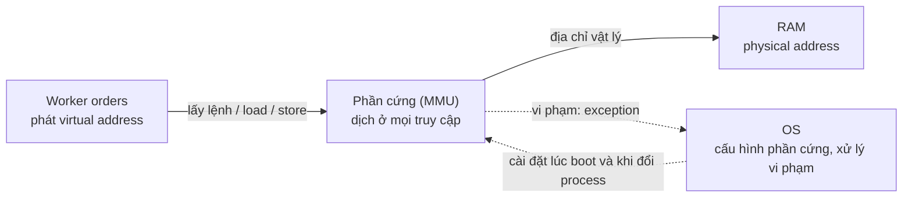

# P3 · Chương 02 — Address translation: từ base/bounds, segmentation đến paging

## Bạn sẽ hiểu được gì

1. **Q1.** "Hardware-based address translation" là gì, MMU làm gì, OS phải làm gì để phần cứng dịch đúng? → mục 1
2. **Q2.** Base and bounds dịch (và từ chối) địa chỉ cụ thể ra sao; khi context switch OS lưu/khôi phục gì? → mục 2
3. **Q3.** Segmentation sửa lỗi gì của base/bounds; vì sao cần bit chiều tăng và protection bits; vì sao external fragmentation không chữa dứt điểm? → mục 3
4. **Q4.** Vì sao lỗi truy cập trái phép vẫn gọi là "segmentation fault" dù máy không còn segmentation? → mục 4
5. **Q5.** Paging tách virtual address thành VPN và offset, tra PTE, ghép PFN thế nào (tính tay một ví dụ)? → mục 5
6. **Q6.** PTE chứa những bit nào và mỗi bit để làm gì? → mục 6
7. **Q7.** Vì sao paging thắng segmentation, và nó tạo ra hai vấn đề nào cho [chương 03](03-page-table-va-tlb.md)? → mục 7

## Kiến thức cần trước

- [Chương 01 — Address space](01-address-space.md): process thấy bộ nhớ riêng, liên tục, bắt đầu từ 0 (virtual address); ba mục tiêu transparency / efficiency / protection.

Các ví dụ số trong chương (address space 16 KB, 64 byte, các bảng base/size) lấy từ sách OSTEP. Chúng nhỏ hơn máy thật rất nhiều, nhưng nhỏ thì mới tính tay được từng bước. Ta gắn chúng vào một service giả định tên `orders` để thấy chuyện này liên quan gì đến process bạn deploy hằng ngày.

## 1. Hardware-based address translation: ảo giác cần một cơ chế (Q1)

> **Trả lời ngắn.** Mỗi lần CPU lấy lệnh, load hay store, phần cứng đổi virtual address mà lệnh đưa ra thành physical address, tức chỗ dữ liệu thật sự nằm trong RAM[^ostep-translation]. Phần cứng chỉ làm được phép đổi ở mức thấp, nên OS phải cài đặt nó cho đúng và theo dõi chỗ nào của RAM còn trống, chỗ nào đang dùng[^m-track]. Khi mọi thứ bình thường, phần cứng tự dịch và OS không phải chen vào[^m-nohw].

**Giải thích.**

*Với service `orders`.* Hãy hình dung `orders`, một service viết bằng Rust, chạy thành vài worker process giống hệt nhau trên cùng một máy (kiểu prefork). Worker nào cũng cho rằng biến đếm request của nó nằm ở cùng một địa chỉ, chẳng hạn 15 KB, thế mà các worker không ghi đè lên nhau. Ta sẽ bám theo `orders` suốt chương (nhận xét của người soạn: đây là ví dụ giả định, không phải code trong repo). Câu hỏi của mục này: ai biến "15 KB của worker này" thành một chỗ cụ thể trong RAM, và làm sao việc đó không làm chậm từng lệnh?

### 1.1 Phần cứng dịch, OS cài đặt

Phase 1 đã nói về *limited direct execution* ([Phase 1 · Chương 01](../01-linux/01-os-va-kernel.md), mục 2): cho chương trình chạy thẳng trên phần cứng, OS chỉ chen vào ở vài thời điểm then chốt. Với bộ nhớ cũng vậy. Hiệu quả đòi hỏi phần cứng hỗ trợ[^m-eff]. Còn kiểm soát nghĩa là không ứng dụng nào đụng được vào bộ nhớ ngoài phần của mình[^m-ctrl]. Quy vào `orders`: một worker phải đọc ghi biến của nó ở tốc độ bình thường, và không có cách nào chạm vào biến của worker khác.

Cơ chế chạy theo ba bước:

1. **Lúc boot,** OS đang ở kernel mode nên dùng lệnh đặc quyền để cài các exception handler, trong đó có handler cho truy cập ngoài giới hạn[^m-handlers].
2. **Khi worker chạy,** với *từng* lần lấy lệnh, load, store, phần cứng đổi virtual address thành physical address[^ostep-translation]. Việc này lặp ở mọi truy cập nên chỉ phần cứng mới theo kịp (suy luận của người soạn).
3. **Trong suốt thời gian đó,** OS vẫn phải làm phần của mình. Phần cứng một mình không ảo hóa được bộ nhớ, vì nó chỉ cung cấp cơ chế mức thấp; OS phải chen vào ở các thời điểm then chốt để cấu hình đúng bản dịch[^m-os]. Nó cũng phải theo dõi vùng nhớ nào còn rảnh, vùng nào đang dùng[^m-track].



(Sơ đồ minh họa của người soạn.)

Phần của bộ xử lý lo việc dịch này đôi khi được gọi là *memory management unit* (MMU)[^m-mmu]. Khi worker chạy bình thường, bản dịch do phần cứng lo, không có OS chen vào[^m-nohw]. OS chỉ phải can thiệp khi worker vi phạm[^m-lde].

Có ba thế hệ cơ chế để làm việc này, mỗi thế hệ sửa nhược điểm của thế hệ trước: base/bounds, rồi segmentation, rồi paging. Các mục 2 đến 7 đi lần lượt qua chúng.

<details><summary>Đi sâu: phần cứng cần có (theo OSTEP, trong bối cảnh base/bounds)</summary>

Để base/bounds chạy được, phần cứng phải có bốn thứ:

- Hai chế độ CPU: kernel mode toàn quyền, user mode bị giới hạn[^m-modes].
- Cặp thanh ghi base/bounds, cùng mạch dịch và kiểm tra giới hạn.
- Lệnh *đặc quyền* để sửa base/bounds, chỉ chạy được ở kernel mode[^m-priv].
- Khả năng phát exception, kể cả khi process user thử đổi chính các thanh ghi đó[^m-exc].

</details>

**Quay lại Q1:** phần cứng dịch địa chỉ ảo cho *từng* truy cập của worker; OS không dịch từng lần mà cấu hình phần cứng, rồi xử lý khi có vi phạm hoặc đổi process.

## 2. Base and bounds (dynamic relocation) (Q2)

> **Trả lời ngắn.** Mỗi CPU có hai thanh ghi, base và bounds[^m-two-regs]. Địa chỉ vật lý bằng địa chỉ ảo cộng base[^m-formula]. Trước khi cộng, phần cứng kiểm tra địa chỉ ảo có nằm trong giới hạn không; nếu không, CPU phát exception[^ostep-bounds-exc]. Vì mỗi CPU chỉ có một cặp thanh ghi mà mỗi process cần giá trị riêng, nên khi đổi process OS cất cặp này vào PCB (cấu trúc dữ liệu riêng của process) và nạp lại khi process chạy tiếp[^m-ctx2].

**Giải thích.**

*Với service `orders`.* Worker `orders` đồ chơi của ta có address space 16 KB, bắt đầu ở địa chỉ 0. Trong một handler có dòng `count += 3` (sách viết `x = x + 3` bằng C; việc gán nó vào `orders` là của người soạn). Compiler dịch dòng này thành ba lệnh x86 đặt ở địa chỉ 128, 132 và 135: một lệnh load từ địa chỉ của biến (ở 15 KB, trong stack, giá trị ban đầu 3000), một lệnh cộng, một lệnh store trở lại cùng địa chỉ. Nhìn từ worker, đầu tiên nó lấy lệnh ở 128 rồi load từ 15 KB[^m-example-seq]. Lệnh cộng ở 132 không chạm bộ nhớ, nên bước kế tiếp là lấy lệnh ở 135 rồi store vào 15 KB[^m-example-seq2].

Tất cả những địa chỉ đó là virtual address. Vấn đề là OS muốn đặt worker ở một chỗ khác trong RAM, không nhất thiết từ địa chỉ 0, mà worker không được biết[^m-problem]. Máy có nhiều worker `orders` thì chắc chắn không thể đặt hết từ địa chỉ vật lý 0 (suy luận của người soạn).

### 2.1 Cơ chế: một phép cộng

Giải pháp đầu tiên tên là *base and bounds*, còn gọi là *dynamic relocation*, có từ các máy time-sharing đầu tiên cuối thập niên 1950[^ostep-bb]. Mỗi CPU có hai thanh ghi: *base* và *bounds* (đôi khi gọi là *limit*)[^m-two-regs]. Mỗi chương trình được viết và biên dịch như thể nó nạp ở địa chỉ 0; khi chương trình bắt đầu chạy, OS chọn chỗ đặt nó trong RAM rồi nạp địa chỉ đó vào base[^m-load0]. Từ đó mọi tham chiếu được dịch theo công thức[^m-formula]:

```
physical address = virtual address + base
```

Giả sử OS đặt worker 16 KB tại 32 KB (32768). Khi PC = 128, phần cứng lấy 128 + 32768 = 32896 và lấy lệnh từ địa chỉ vật lý đó[^m-trace128]. Khi lệnh load phát địa chỉ ảo 15 KB, phần cứng cộng base 32 KB và ra địa chỉ vật lý 47 KB[^m-trace15k]. Worker không hề biết nó nằm ở 32 KB; đó là điều ta muốn.

### 2.2 Bounds: chặn địa chỉ ngoài vùng

Thanh ghi **bounds** lo phần protection[^ostep-bounds]. Trước khi cộng base, phần cứng kiểm tra tham chiếu có nằm trong giới hạn không. Nếu địa chỉ ảo lớn hơn hoặc bằng bounds, hoặc âm, CPU phát exception và process nhiều khả năng bị kết thúc[^ostep-bounds-exc]. Với `orders`, một worker có bug đọc ra ngoài vùng của mình sẽ dừng ngay ở đây, chưa chạm tới RAM của worker nào khác (nhận xét của người soạn).

Bảng dưới là ví dụ của sách: address space 4 KB nạp tại 16 KB, tức base = 16384, bounds = 4096. Các giá trị 16 KB, 17 KB, 19384 và fault đều có trong sách; 16384 và 17408 là người soạn đổi KB ra byte. Người soạn đã kiểm lại bằng chương trình ở mục Liên hệ với Rust[^m-example-table].

| Virtual address | Kiểm tra `va < 4096` | Physical address |
|---|---|---|
| 0 | đúng | 16384 (16 KB) |
| 1024 (1 KB) | đúng | 17408 (17 KB) |
| 3000 | đúng | 19384 |
| 4400 | sai | Fault (out of bounds) |

Địa chỉ 4400 vượt bounds nên ra fault. Theo sách, chỉ khi địa chỉ "quá lớn" hoặc âm thì mới có fault và exception[^m-table-fault].

Một chi tiết phần cứng: cặp base/bounds nằm ngay trên chip, mỗi CPU một cặp[^m-onchip].

### 2.3 Bốn việc của OS

Phần cứng chỉ cộng và so sánh. Mọi việc còn lại thuộc về OS, và với `orders` có bốn việc:

1. **Khi tạo worker: tìm chỗ cho address space.** Với giả định mọi address space đều nhỏ hơn bộ nhớ vật lý và cùng kích thước, việc này dễ: OS coi RAM là một mảng các "khe" và theo dõi khe nào trống[^m-slots]. Nó duyệt một *free list* để tìm khe trống rồi đánh dấu là đã dùng[^m-free]. Khi worker kết thúc, OS trả bộ nhớ của nó về free list[^m-reclaim].
2. **Khi context switch: đổi cặp thanh ghi.** Mỗi CPU chỉ có *một* cặp base/bounds mà giá trị mỗi process mỗi khác, nên OS phải lưu rồi khôi phục cặp này mỗi lần đổi process[^m-ctx]. Chuyển từ worker A sang worker B nghĩa là ghi giá trị hiện có của cặp thanh ghi vào PCB của A, rồi nạp giá trị đã lưu của B[^m-ctx2]. Bỏ bước này thì B bị dịch bằng base của A (suy luận của người soạn).
3. **Có thể di chuyển address space.** Khi worker đang bị dừng, OS có thể copy address space sang chỗ mới rồi cập nhật base đã lưu; lúc chạy lại worker không hay biết gì[^m-move].
4. **Cài exception handler lúc boot** bằng lệnh đặc quyền[^m-handlers]. Phản ứng thường gặp với truy cập ngoài bounds là kết thúc worker vi phạm.

<details><summary>Đi sâu: hai cách định nghĩa bounds</summary>

Có hai cách định nghĩa bounds. Cách thứ nhất giữ *kích thước* address space: kiểm tra trước, rồi mới cộng base. Cách thứ hai giữ *địa chỉ vật lý cuối*: cộng base trước rồi mới kiểm tra. Hai cách tương đương về mặt logic[^m-bound-two].

</details>

**Quay lại Q2:** `PA = VA + base` với kiểm tra `VA < bounds`; cặp thanh ghi là per-CPU nên OS lưu/khôi phục khi context switch.

## 3. Segmentation (Q3)

> **Trả lời ngắn.** Base/bounds lãng phí vùng trống giữa stack và heap nằm trong khối đã cấp (internal fragmentation)[^ostep-bb-waste]. Segmentation sửa bằng cách cho mỗi segment logic một cặp base/bounds riêng, nên chỉ phần dùng thật mới chiếm RAM và address space lớn mà thưa vẫn dùng được[^ostep-seg-sparse]. Để chạy đúng, phần cứng cần thêm bit chiều tăng cho stack, vốn tăng ngược về địa chỉ thấp[^ostep-seg-bit], và protection bits để chia sẻ code giữa các process. Đổi lại, RAM đầy lỗ hổng rải rác giữa các khối đã cấp (external fragmentation); dồn khối lại (compaction) hay chọn chỗ trống khôn hơn chỉ giảm chứ không chữa dứt điểm[^ostep-seg-ext-always].

**Giải thích.**

*Với service `orders`.* Quay lại worker 16 KB. Heap của nó chứa cache đơn hàng, stack chứa biến local của handler (trong đó có `count`), code là binary `orders`. Với base/bounds, worker chiếm trọn khe 32–48 KB dù heap và stack còn nhỏ, và khoảng trống ở giữa vẫn chiếm RAM. Máy chạy càng nhiều worker thì chỗ phí đó càng nhân lên. Mục này xem segmentation tách ba phần ấy ra thế nào, và nó mua được gì, trả giá gì.

### 3.1 Lỗi của base/bounds

Base/bounds nhanh: một phép cộng và một phép so sánh (nhận xét của người soạn). Nhưng vì heap và stack của worker chưa lớn, toàn bộ vùng giữa chúng bị bỏ phí. Sách gọi chỗ phí đó là *internal fragmentation*, vì nó nằm *bên trong* đơn vị đã cấp phát[^ostep-bb-waste]. Với address space 32-bit, chương trình thường chỉ dùng vài MB nhưng vẫn đòi cả address space nằm trong bộ nhớ[^s-32bit].

### 3.2 Một cặp base/bounds cho mỗi segment

Ý tưởng sửa lỗi này đã có từ lâu, ít nhất từ đầu thập niên 1960[^s-old]. Thay vì một cặp base/bounds cho cả address space, ta đặt một cặp *cho mỗi segment logic*[^ostep-seg]. Segment là một phần liên tục của address space, có độ dài xác định[^s-def]. Address space chuẩn gồm ba segment khác nhau về mặt logic: code, stack, heap. OS đặt mỗi segment ở một chỗ riêng trong RAM vật lý, nên không phải lấp RAM bằng phần address space không dùng.

Muốn vậy phần cứng cần một bộ ba cặp thanh ghi base/bounds[^s-regs]. Thanh ghi size ở đây chính là bounds ta đã gặp: nó cho phần cứng biết segment có đúng bao nhiêu byte hợp lệ[^s-size]. Ví dụ của sách dùng address space 16 KB trong RAM 64 KB, với 16 KB đầu dành cho OS. Theo phần giải thích của sách, code đặt ở 32 KB với cỡ 2 KB, còn heap đặt ở 34 KB với cỡ 3 KB[^s-table]. Stack đã được dời tới 28 KB[^s-stack-base]; cỡ stack là 2 KB theo hình 16.3 của sách.

| Segment | Base | Size |
|---|---|---|
| Code | 32K | 2K |
| Heap | 34K | 3K |
| Stack | 28K | 2K |

Chỉ phần bộ nhớ thực sự dùng mới chiếm RAM, nên address space lớn mà thưa vẫn dùng được[^ostep-seg-sparse].

### 3.3 Dịch địa chỉ: phải trừ điểm bắt đầu của segment

Có ba ví dụ, lần lượt là code, heap và địa chỉ hỏng.

**Địa chỉ 100 (lấy lệnh, thuộc code).** Ta cộng base với offset trong segment, tức 100 + 32 KB = 32868; rồi kiểm tra 100 < 2 KB (đúng) và phát truy cập tới 32868[^s-trans100].

**Địa chỉ 4200 (heap).** Không thể cộng thẳng với base của heap, vì ra 39016 là sai. Heap bắt đầu ở virtual address 4 KB (4096), nên offset là 4200 − 4096 = 104; cộng với base 34 KB ra 34920[^s-heap].

**Địa chỉ từ 7 KB trở lên.** Chúng nằm sau cuối heap. Phần cứng thấy ngoài bounds, trap vào OS, và process nhiều khả năng bị kết thúc[^s-oob].

**Chiều tăng của stack.** Stack khác code và heap ở chỗ nó tăng ngược về phía địa chỉ thấp[^ostep-seg-stack]. Trong ví dụ, stack nằm ở 28 KB vật lý và tăng ngược về 26 KB, tương ứng với virtual 16 KB về 14 KB, nên phép dịch phải làm khác đi. Vì vậy phần cứng cần biết thêm chiều tăng của từng segment, chẳng hạn một bit đặt 1 nếu segment tăng theo chiều dương, 0 nếu theo chiều âm[^ostep-seg-bit].

Đây là chỗ biến `count` của ta rơi vào. Địa chỉ ảo 15 KB (0x3C00 = `11 1100 0000 0000`) có hai bit cao là `11`, chọn stack; phần còn lại là offset 3 KB. Để có offset âm đúng, ta lấy 3 KB − 4 KB (kích thước tối đa của segment) = −1 KB, rồi cộng offset âm đó vào base 28 KB ra 27 KB[^s-negative]. Lúc này kiểm tra bounds là trị tuyệt đối của offset âm không vượt cỡ hiện tại của segment (2 KB trong ví dụ)[^s-negbound]. Kết quả 27 KB khác 47 KB ở mục 2 chỉ vì hai mục bố trí RAM khác nhau.

### 3.4 Protection bits: chia sẻ code giữa các worker

Khi segmentation phát triển, các nhà thiết kế thấy có thể tiết kiệm bộ nhớ bằng cách cho nhiều address space dùng chung một số segment[^s-share]. Muốn vậy phần cứng cần *protection bits*: vài bit mỗi segment cho biết chương trình được đọc, ghi hay thực thi code trong segment đó không[^s-protbits]. Nếu đặt segment code là read-only thì cùng một đoạn code chia sẻ được giữa nhiều process mà không phá cô lập[^ostep-seg-prot]. Ghi vào segment read-only, hay thực thi từ segment không-executable, sẽ làm phần cứng phát exception cho OS xử lý[^s-protcheck].

Với `orders` chạy nhiều worker từ cùng một binary, đây là lợi ích trực tiếp: một bản code trong RAM phục vụ mọi worker (nhận xét của người soạn).

### 3.5 External fragmentation: cái giá phải trả

Mỗi worker có nhiều segment cỡ khác nhau, nên RAM nhanh chóng đầy những lỗ hổng nhỏ rải rác. Đó là **external fragmentation**: chỗ trống nằm *bên ngoài* các khối đã cấp[^ostep-seg-ext]. Chẳng hạn một worker mới xin segment 20 KB khi tổng cộng còn 24 KB trống, nhưng nằm ở ba mảnh không liên tục: OS không đáp ứng được[^s-20kb].

Có hai hướng xử lý, và không hướng nào dứt điểm:

- **Compaction:** dừng các process, copy segment về một vùng liên tục, rồi cập nhật thanh ghi segment. Cách này tốn kém, vì copy segment ngốn bộ nhớ và tốn nhiều thời gian CPU[^s-compact]. Nó còn làm khó việc đáp ứng các yêu cầu nới segment về sau[^s-compact-grow].
- **Thuật toán free-list khôn hơn** (best-fit, worst-fit, first-fit, buddy…). Nhưng dù thuật toán khôn đến đâu, external fragmentation vẫn còn; thuật toán tốt chỉ giảm nó[^ostep-seg-ext-always].

Kết luận của sách là lời giải thật sự phải tránh hẳn vấn đề, bằng cách không bao giờ cấp phát bộ nhớ theo khối kích thước thay đổi[^s-onlyreal].

Tóm lại, segmentation nhanh vì phép tính đơn giản và hợp với phần cứng[^s-fast]. Nhưng nó còn external fragmentation, và chưa đủ linh hoạt cho address space thưa tổng quát: một heap lớn dùng thưa mà nằm trọn trong một segment thì cả heap vẫn phải nằm trong RAM[^s-notflex]. Với cache đơn hàng của `orders`, nếu nó phình ra nhưng chỉ dùng thưa thớt, segmentation không giúp được gì.

<details><summary>Đi sâu: cách phần cứng biết segment nào, và việc của OS với segmentation</summary>

**Chọn segment: cách explicit.** VAX/VMS cắt address space theo vài bit cao của virtual address[^s-explicit]. Với địa chỉ 14 bit và ba segment, cần 2 bit: `00` là code, `01` là heap, `11` là stack; 12 bit còn lại là offset trong segment. Địa chỉ 4200 là `01 0000 0110 1000`: 2 bit trên là `01` (heap) và 12 bit dưới là 0x068 = 104, đúng kết quả ở trên. Giả mã của sách diễn tả như sau:

```
Segment = (VirtualAddress & SEG_MASK) >> SEG_SHIFT   // SEG_MASK=0x3000, SEG_SHIFT=12
Offset  =  VirtualAddress & OFFSET_MASK              // OFFSET_MASK=0xFFF
if (Offset >= Bounds[Segment]) RaiseException(PROTECTION_FAULT)
else PhysAddr = Base[Segment] + Offset
```

Có offset thì kiểm tra bounds gọn hẳn: chỉ cần xem offset có nhỏ hơn bounds không[^s-bounds-off]. Cách chia bit cao có hai nhược điểm. Một là mỗi segment bị giới hạn kích thước tối đa, ở ví dụ là 4 KB vì 16 KB chia làm 4 phần[^s-maxsize]. Hai là dùng 2 bit cho 3 segment thì một phần tư address space bỏ không[^s-unused].

**Chọn segment: cách implicit.** Phần cứng suy ra segment từ *cách địa chỉ được tạo ra*: địa chỉ từ PC là code, từ stack/base pointer là stack, còn lại là heap[^s-implicit].

**Việc của OS.** Mỗi lần context switch, các thanh ghi segment phải được lưu và khôi phục, vì mỗi process có address space riêng[^s-ctx]. Khi segment lớn lên thì có thêm một việc. Giả sử `malloc()` thấy heap hiện tại hết chỗ; thư viện cấp phát sẽ thực hiện một system call để nới heap (kiểu `sbrk()` cổ điển)[^s-sbrk]. OS thường cấp thêm và cập nhật thanh ghi size, nhưng nó *có thể từ chối* nếu hết bộ nhớ vật lý hoặc nếu cho rằng process đã dùng quá nhiều[^s-reject]. (Xem tiếp: [chương 06](06-heap-allocator.md) đi sâu vào `brk`/`mmap` của allocator hiện đại.)

</details>

**Quay lại Q3:** segmentation sửa lãng phí giữa heap và stack bằng một cặp base/bounds mỗi segment (cần bit chiều tăng và protection bits), nhưng sinh ra external fragmentation mà chỉ giảm được, không chữa dứt điểm.

## 4. Vì sao vẫn gọi là "segmentation fault" (Q4)

> **Trả lời ngắn.** Tên này sinh ra từ truy cập địa chỉ bất hợp pháp trên máy có segmentation, và vẫn còn dù máy không hỗ trợ segmentation nữa[^ostep-segfault]. Trên máy dùng paging, lỗi tương ứng nằm ở mức page, nên cái tên chỉ còn là di sản (suy luận của người soạn).

**Giải thích.**

*Với service `orders`.* Giả sử một đoạn `unsafe` trong `orders` dereference con trỏ hỏng và worker chết với lỗi quen thuộc "segmentation fault". Máy của bạn gần như chắc chắn dùng paging chứ không phải segmentation (nhận xét của người soạn), vậy tên lỗi từ đâu ra? Câu trả lời là lịch sử.

Đi theo từng thế hệ cơ chế. Trên máy có segmentation, phần cứng so offset với bounds của segment; ngoài bounds thì trap vào OS, và process nhiều khả năng bị kết thúc[^s-oob]. Truy cập bất hợp pháp kiểu này chính là nguồn gốc của tên *segmentation fault* (hay *violation*)[^ostep-segfault].

Sang paging, việc kiểm tra chuyển vào PTE. Giả mã tra PTE trong sách (xem phần Đi sâu của mục 7) vẫn ghi `RaiseException(SEGMENTATION_FAULT)` khi PTE không valid[^p-segv-pte]. Nói cách khác, tên cũ được giữ cho lỗi mới; sách nhận xét nó còn tồn tại ngay cả trên máy không có segmentation[^ostep-segfault].

<details><summary>Đi sâu: Linux báo hai nguyên nhân cho SIGSEGV</summary>

Linux phân biệt hai nguyên nhân khi báo SIGSEGV. Nguyên nhân thứ nhất là địa chỉ không ánh xạ tới đối tượng nào (`SEGV_MAPERR`)[^l-maperr]. Nguyên nhân thứ hai là địa chỉ có ánh xạ nhưng sai quyền (`SEGV_ACCERR`)[^l-accerr].

Suy luận của người soạn: vì vậy ngày nay "segmentation fault" thường là lỗi mức page, thiếu mapping hoặc sai quyền, còn cái tên chỉ là di sản. Man page không nói trực tiếp câu này.

</details>

**Quay lại Q4:** "segmentation fault" là tên từ thời segmentation; ngày nay thường là lỗi mức page (thiếu mapping hoặc sai quyền).

## 5. Paging: VPN, offset, PTE và PFN (Q5)

> **Trả lời ngắn.** Paging chia address space thành các page kích thước cố định[^ostep-paging]. Tương ứng, RAM chia thành các page frame cùng cỡ[^ostep-frame]. Virtual address được tách thành số thứ tự page (VPN) và offset; page table tra VPN ra số thứ tự frame (PFN), PFN ghép với offset thành physical address, còn offset giữ nguyên vì nó chỉ cho biết byte nào bên trong page[^p-offset].

**Giải thích.**

*Với service `orders`.* Ta thu worker `orders` xuống còn 64 byte, đủ nhỏ để tính tay trọn vẹn một page table. Mục này theo dõi chuyện gì xảy ra khi worker đọc một địa chỉ ảo: chia địa chỉ làm đôi, tra bảng, ghép lại. Cách này không còn cần giả định gì về việc heap và stack của worker tăng về phía nào.

### 5.1 Page, frame và page table

Thay vì tách address space thành vài segment logic, ta chia nó thành các đơn vị cố định gọi là **page**[^ostep-paging]. RAM vật lý được coi là một mảng các khe cỡ cố định gọi là **page frame**, mỗi frame chứa đúng một virtual page[^ostep-frame].

Ví dụ nhỏ của sách: address space 64 byte gồm bốn page 16 byte (virtual page 0 đến 3), còn RAM vật lý 128 byte gồm tám frame[^p-example]. OS đặt VP0 ở frame 3, VP1 ở frame 7, VP2 ở frame 5, VP3 ở frame 2; các frame 1, 4, 6 còn trống[^p-placement].

Cách chia này có hai lợi ích. Thứ nhất, nó **linh hoạt**: không cần giả định heap và stack tăng về hướng nào[^p-flex]. Thứ hai, việc **quản lý chỗ trống đơn giản** hơn nhiều[^ostep-page-simple]. Đặt address space 64 byte chỉ cần lấy bốn frame trống từ free list[^p-freelist].

Để ghi virtual page nằm ở frame nào, OS thường giữ một cấu trúc *theo từng process* gọi là **page table**[^ostep-pt]. Vai trò chính của nó là lưu bản dịch cho từng virtual page của address space, nên nhìn vào đó ta biết mỗi page đang ở đâu trong RAM vật lý. Với ví dụ trên, page table có bốn entry: (VP0 → PF3), (VP1 → PF7), (VP2 → PF5), (VP3 → PF2)[^p-pt4]. Vì page table là cấu trúc per-process, khi chạy process khác OS dùng page table khác. Các process có thể chia sẻ vài frame, nhưng ánh xạ của mỗi process vẫn riêng[^p-perproc]. Cấu trúc cụ thể của page table hoặc do phần cứng quy định (hệ cũ), hoặc được OS quản lý linh hoạt hơn (hệ hiện đại)[^p-pt-variants].

### 5.2 Tách địa chỉ thành VPN và offset

Để dịch một virtual address, trước hết phải tách nó thành hai phần: **virtual page number (VPN)** và **offset trong page**[^ostep-vpn].

Address space 64 byte cần 6 bit cho virtual address (2⁶ = 64)[^p-bits]. Page size là 16 byte, nên cần chọn một trong bốn page; hai bit cao làm việc đó. Vậy VPN là 2 bit, còn 4 bit thấp là offset[^p-vpn-bits].

### 5.3 Tính tay một ví dụ

Giả sử worker chạy `movl 21, %eax` (bỏ qua việc lấy lệnh). Ta có 21 = `010101`. Tách ra: VPN = `01` (= 1), offset = `0101` (= 5), tức byte thứ 5 của virtual page 1. Tra page table: VPN 1 ứng với physical frame number (PFN, đôi khi gọi là physical page number, PPN) là 7 = `111`[^p-pfn]. Thay VPN bằng PFN và giữ nguyên offset: `111` `0101` = `1110101` = 117[^p-result]. Offset không phải dịch, vì nó chỉ cho biết byte nào bên trong page[^p-offset].

Người soạn tự tính thêm vài ví dụ từ page table này, và đã kiểm bằng chương trình ở phần Liên hệ với Rust (không trích từ sách):

| VA (thập phân) | Nhị phân | VPN | offset | PFN | PA = PFN×16 + offset |
|---|---|---|---|---|---|
| 0 | 000000 | 0 | 0 | 3 | 48 |
| 21 | 010101 | 1 | 5 | 7 | 117 |
| 50 | 110010 | 3 | 2 | 2 | 34 |
| 63 | 111111 | 3 | 15 | 2 | 47 |

<details><summary>Đi sâu: vì sao paging có từ Atlas, và phép tách bằng mask/shift</summary>

Với hầu hết bài toán quản lý không gian, OS có hai cách: chia thành mảnh kích thước thay đổi (như segmentation), hoặc chia thành mảnh *kích thước cố định*[^p-two-ways]. Cách sau, khi dùng trong virtual memory, gọi là *paging*, và có từ hệ thống Atlas[^p-atlas].

Với address space 32-bit và page 4 KB, địa chỉ tách thành VPN 20 bit và offset 12 bit[^p-32bit]. Phép tách làm bằng mask và shift: `VPN = (VirtualAddress & VPN_MASK) >> SHIFT`. Địa chỉ vật lý ghép lại bằng `(PFN << SHIFT) | offset`[^p-mask].

</details>

**Quay lại Q5:** tách VA thành VPN + offset, tra page table lấy PFN, ghép lại với offset (ví dụ: 21 → VPN 1, offset 5, PFN 7 → 117).

## 6. Bên trong một PTE (Q6)

> **Trả lời ngắn.** Ngoài PFN, mỗi PTE (một dòng của page table) còn mang vài bit điều khiển. Bit valid cho biết bản dịch có hợp lệ không[^p-valid]. Bit protection cho biết page được đọc, ghi hay thực thi không[^p-prot]. Ba bit còn lại, present, dirty và accessed, cho biết page đang ở RAM hay trên đĩa, đã bị sửa chưa, và đã được truy cập chưa; bảng ở phần Giải thích có nguồn cho từng bit.

**Giải thích.**

*Với service `orders`.* Mỗi lần worker chạm vào một page, phần cứng nhìn PTE của page đó trước khi cho qua. Page chưa từng dùng thì PTE đánh dấu không hợp lệ, và chạm vào nó là trap tới OS. Page của code thì đánh dấu không cho ghi, nên một lỗi ghi nhầm vào vùng code cũng trap (nhận xét của người soạn). Mục này đọc từng bit.

Page table đơn giản nhất là *linear page table*, chỉ là một mảng: OS lập chỉ mục theo VPN và đọc **page-table entry (PTE)** tại chỉ mục đó để lấy PFN[^p-linear]. Ngoài PFN, PTE mang các bit sau (theo OSTEP):

| Bit | Ý nghĩa |
|---|---|
| Valid | Bản dịch có hợp lệ không. Vùng chưa dùng bị đánh dấu invalid; truy cập vào đó sinh trap tới OS. Vì vậy valid then chốt cho address space thưa[^p-valid]. |
| Protection | Đọc / ghi / thực thi được không; sai thì trap[^p-prot]. |
| Present | Page ở RAM hay trên đĩa[^p-present]. |
| Dirty | Page đã bị sửa từ khi nạp vào RAM chưa[^p-dirty]. |
| Accessed | Page đã được truy cập chưa; hữu ích khi chọn page để thay thế[^p-ref]. |

<details><summary>Đi sâu: PTE x86 và bit present/valid</summary>

PTE x86 trong sách (Hình 18.5, sơ đồ 32 bit) có các trường sau: present bit (P); read/write (R/W), quyết định có được ghi vào page không; user/supervisor (U/S), quyết định process ở user mode có truy cập được không; một vài bit (PWT, PCD, PAT, G) điều khiển cách hardware caching hoạt động cho page; bit accessed (A); bit dirty (D); và cuối cùng là PFN[^ostep-pte-bits].

Chi tiết hay gây nhầm: PTE x86 của sách chỉ có present, không có valid riêng. Khi P = 1, page vừa present vừa valid[^p-nobit]. Khi P = 0, page có thể hợp lệ nhưng không ở RAM, hoặc không hợp lệ, và OS phải dùng cấu trúc phụ để phân biệt. Xem tiếp ở [chương 04](04-page-fault-va-swapping.md).

</details>

**Quay lại Q6:** PTE = PFN + các bit valid, protection, present, dirty, accessed (x86 gộp valid vào present).

## 7. Vì sao paging thắng segmentation, và hai vấn đề cho chương 03 (Q7)

> **Trả lời ngắn.** Paging không gây external fragmentation vì chia bộ nhớ thành đơn vị cố định, và cho dùng thưa address space[^ostep-page-noext]. Việc quản lý chỗ trống cũng đơn giản lại: chỉ cần lấy frame từ free list[^ostep-page-simple]. Cái giá là hai vấn đề, page table quá lớn và truy cập chậm đi, nên nếu thiết kế không cẩn thận cả phần cứng lẫn phần mềm thì hệ thống vừa chậm vừa tốn bộ nhớ[^p-two-prob].

**Giải thích.**

*Với service `orders`.* Giả sử máy chạy 100 worker `orders`, mỗi worker một page table riêng. Cái được của paging dễ thấy: không còn "20 KB xin mà có 24 KB trống ở ba mảnh" nữa, vì frame nào trống cũng dùng được. Nhưng cuốn sổ ghi "page nào nằm ở frame nào" đang nhân lên theo số worker, và mỗi truy cập bộ nhớ của worker còn phải mở sổ trước. Mục này tính hai cái giá đó ra số.

### 7.1 Vấn đề 1: bảng quá lớn

Page table có thể lớn hơn nhiều so với bảng segment hay cặp base/bounds[^p-big]. Hãy tính với address space 32-bit và page 4 KB. VPN 20 bit nghĩa là 2²⁰ (khoảng một triệu) bản dịch cho mỗi process. Với 4 byte mỗi PTE, ta cần 4 MB cho *mỗi* page table[^ostep-pt-size]. Với 100 process, OS cần 400 MB chỉ để chứa các bản dịch[^p-100]. Và đó chưa phải address space 64-bit.

Vì quá lớn, MMU không có phần cứng đặc biệt trên chip để chứa page table của process đang chạy. Thay vào đó, page table của từng process nằm trong bộ nhớ[^p-inmem].

### 7.2 Vấn đề 2: mỗi truy cập tốn thêm một lần đọc RAM

Hệ quả của việc page table nằm trong RAM: với *mỗi* tham chiếu bộ nhớ của worker (lấy lệnh, load, store), paging đòi thêm một lần tham chiếu RAM để lấy bản dịch từ page table trước[^p-extra]. Điều đó nhiều khả năng làm chậm process "một hệ số hai hoặc hơn"[^p-slow2].

Hai vấn đề đó, bảng quá lớn và mỗi truy cập tốn thêm một lần đọc RAM, là việc của [chương 03](03-page-table-va-tlb.md). Page table nhiều cấp giải vấn đề kích thước; TLB, một cache phần cứng giữ các bản dịch gần đây, giải vấn đề tốc độ.

### 7.3 So sánh ba cách

| Tiêu chí | Base and bounds | Segmentation | Paging |
|---|---|---|---|
| Đơn vị dịch | cả address space | segment, kích thước thay đổi | page, kích thước cố định |
| Phần cứng | 1 cặp thanh ghi mỗi CPU | một cặp mỗi segment (+ bit chiều tăng, protection) | page table trong RAM + thanh ghi trỏ tới nó (PTBR) |
| Quản lý RAM vật lý | đặt cả khối liên tục | phải tìm khối liên tục theo kích thước từng segment | chỉ cần tìm các frame trống (free list) |
| Vấn đề chính | lãng phí vùng giữa heap và stack (internal fragmentation)[^ostep-bb-waste] | external fragmentation[^ostep-seg-ext] | bảng lớn và chậm nếu làm cẩu thả[^ostep-paging-slow] |
| Address space thưa | không: vùng trống giữa heap và stack vẫn chiếm RAM[^ostep-bb-waste] | một phần; segment lớn thưa vẫn phải nằm trọn trong RAM[^s-notflex] | có, nhờ bit valid[^p-valid] |
| Giả định về stack/heap | không áp dụng (cả address space là một khối) | phần cứng phải biết chiều tăng của từng segment[^ostep-seg-bit] | không giả định hướng tăng[^p-flex] |

Bảng này khớp với kết luận ở mục 3: cách thật sự tránh external fragmentation là không cấp phát khối kích thước thay đổi[^s-onlyreal]. Paging làm đúng điều đó vì chia bộ nhớ thành đơn vị cố định[^ostep-page-noext].

<details><summary>Đi sâu: công thức tra PTE, dấu vết bộ nhớ, và internal fragmentation trong page</summary>

**Công thức tra PTE.** Giả sử có một **page-table base register (PTBR)** chứa địa chỉ vật lý của đầu page table của process đang chạy[^p-ptbr]. Để tìm PTE cần đọc, phần cứng tính `VPN = (VirtualAddress & VPN_MASK) >> SHIFT`, rồi `PTEAddr = PageTableBaseRegister + (VPN * sizeof(PTE))`[^p-formula]. Sau đó nó đọc PTE từ RAM và kiểm tra valid và protection: invalid thì phát exception, sai quyền thì phát protection fault (theo giả mã Hình 18.6 của sách[^p-fig186]). Cuối cùng nó ghép PFN với offset rồi mới truy cập dữ liệu thật.

**Dấu vết bộ nhớ.** Sách minh họa bằng vòng lặp khởi tạo mảng 1000 số nguyên, với giả định address space 64 KB, page 1 KB và page table tuyến tính ở địa chỉ vật lý 1 KB. Kết quả của sách: mỗi lần lặp có **10** truy cập bộ nhớ, gồm bốn lần lấy lệnh, một lần cập nhật mảng và năm lần truy cập page table để dịch chúng[^p-trace]. Như vậy một nửa số truy cập RAM chỉ để tra bản dịch (tính toán của sách cho cấu hình giả định, không phải đo trên máy thật).

**Internal fragmentation trong page.** Page table to và truy cập chậm là cái giá chính. Ngoài ra internal fragmentation vẫn còn *trong page*: sách (ch.20) nói page lớn gây lãng phí bên trong mỗi page[^p-internal]. Vì vậy hầu hết hệ thống dùng page nhỏ, thường 4 KB[^p-smallpg]. Mức lãng phí cụ thể (trung bình bao nhiêu) sách không đo; chương này không đưa số.

</details>

**Quay lại Q7:** paging thắng vì hết external fragmentation và cho address space thưa; nó để lại hai việc cho chương 03, bảng quá lớn và mỗi truy cập chậm hơn.

## Liên hệ với Rust: mô phỏng ba cơ chế bằng vài dòng

Rust không có API "dịch địa chỉ", vì đó là việc của phần cứng và kernel; code `orders` của bạn không bao giờ nhìn thấy physical address (nhận xét của người soạn). Nhưng viết lại các phép toán ở trên bằng Rust là cách rẻ nhất để kiểm chứng số học. Chương trình dưới được biên dịch bằng `rustc -O` (1.95.0) và chạy; nó chỉ mô phỏng các ví dụ số ở trên.

```rust
fn bb(va: u32, base: u32, bounds: u32) -> Option<u32> {
    if va < bounds { Some(base + va) } else { None }
}

// Địa chỉ 14 bit: 2 bit cao chọn segment; mỗi segment là (base, size, grows_positive).
fn seg(va: u32) -> Option<u32> {
    let t = [(32768u32, 2048u32, true), (34816, 3072, true), (0, 0, true), (28672, 2048, false)];
    let s = (va >> 12) as usize;
    let off = va & 0xFFF;
    let (b, sz, pos) = t[s];
    if pos {
        if off < sz { Some(b + off) } else { None }
    } else {
        let neg = 4096 - off; // độ lớn của offset âm
        if neg <= sz { Some(b - neg) } else { None }
    }
}

// Address space 64 B, page 16 B: VPN = 2 bit cao, offset = 4 bit thấp.
fn page(va: u32, pt: &[u32]) -> u32 {
    let vpn = (va & 0x30) >> 4;
    let off = va & 0xF;
    (pt[vpn as usize] << 4) | off
}

fn main() {
    for va in [0u32, 1024, 3000, 4400] {
        println!("bb {va} -> {:?}", bb(va, 16384, 4096));
    }
    for va in [100u32, 4200, 15360, 7168] {
        println!("seg {va} -> {:?}", seg(va));
    }
    let pt = [3u32, 7, 5, 2];
    for va in [0u32, 21, 50, 63] {
        println!("page {va} -> {}", page(va, &pt));
    }
    println!("{} bytes", (1u64 << 20) * 4);
}
```

Kết quả khi chạy:

```
bb 0 -> Some(16384)
bb 1024 -> Some(17408)
bb 3000 -> Some(19384)
bb 4400 -> None
seg 100 -> Some(32868)
seg 4200 -> Some(34920)
seg 15360 -> Some(27648)
seg 7168 -> None
page 0 -> 48
page 21 -> 117
page 50 -> 34
page 63 -> 47
4194304 bytes
```

Đối chiếu kết quả với các ví dụ trong chương:

- 19384 khớp bảng base/bounds, và 4400 bị từ chối như bảng ấy[^m-example-table].
- 32868 khớp ví dụ segmentation cho địa chỉ 100[^s-trans100].
- 34920 khớp ví dụ segmentation cho địa chỉ 4200[^s-heap].
- 27648 = 27 KB khớp ví dụ stack[^s-negative].
- 7168 bị từ chối như sách mô tả[^s-oob].
- 117 khớp ví dụ paging[^p-result].
- 4194304 byte = 4 MB khớp phép tính page table[^ostep-pt-size].

Đây là mô hình tối giản của sách, không phải một CPU cụ thể.

## Tóm tắt

- Hardware-based address translation: phần cứng đổi virtual address thành physical address cho *mỗi* truy cập[^ostep-translation]. OS chỉ cấu hình phần cứng và can thiệp ở các thời điểm then chốt[^m-os].
- Base and bounds: `PA = VA + base`, kiểm tra `VA < bounds`[^m-formula]. Cặp thanh ghi là per-CPU nên OS lưu/khôi phục khi context switch[^m-ctx]. Lệnh sửa chúng là đặc quyền[^m-priv].
- Base/bounds lãng phí vùng trống giữa stack và heap (internal fragmentation)[^ostep-bb-waste].
- Segmentation: một cặp base/bounds mỗi segment[^ostep-seg]; stack cần bit chiều tăng[^ostep-seg-bit]; protection bits cho phép chia sẻ code[^ostep-seg-prot].
- Đổi lại segmentation có external fragmentation, mà compaction và thuật toán free-list chỉ giảm chứ không chữa dứt điểm[^ostep-seg-ext-always].
- Paging: page/frame cố định, page table per-process ánh xạ VPN → PFN[^ostep-pt]. Offset giữ nguyên[^p-offset]. PTE mang thêm bit valid/present, protection, dirty, accessed[^ostep-pte-bits].
- Paging không gây external fragmentation và cho phép address space thưa[^ostep-page-noext].
- Cái giá của paging là bảng lớn (4 MB mỗi process ở 32-bit/4 KB)[^ostep-pt-size]. Mỗi truy cập còn tốn thêm một lần đọc RAM[^p-extra]. Đó là đề bài của [chương 03](03-page-table-va-tlb.md).

## Câu hỏi tự kiểm tra

1. Worker `orders` 4 KB nạp tại 16 KB: địa chỉ ảo 3000 và 4400 cho kết quả gì?
<details><summary>Đáp án</summary>

3000 cộng base 16384 ra 19384[^m-formula]. 4400 ≥ 4096 nên là fault[^m-example-table].

</details>

2. Vì sao OS phải lưu/khôi phục base/bounds khi context switch?
<details><summary>Đáp án</summary>

Mỗi CPU chỉ có một cặp thanh ghi mà giá trị mỗi process mỗi khác[^m-ctx]. Vì vậy OS lưu cặp này vào PCB khi dừng process, và nạp lại khi chạy tiếp[^m-ctx2].

</details>

3. Dịch virtual address 4200 trong ví dụ segmentation; vì sao không cộng thẳng với base?
<details><summary>Đáp án</summary>

Heap bắt đầu ở virtual address 4096 nên offset là 4200 − 4096 = 104. Cộng với base 34 KB ra 34920; cộng thẳng 4200 với base ra 39016 là sai[^s-heap].

</details>

4. Vì sao stack cần bit chiều tăng, và 15 KB dịch ra đâu?
<details><summary>Đáp án</summary>

Stack tăng về địa chỉ thấp nên dùng offset âm[^ostep-seg-stack]. Phần cứng cần bit chiều tăng để biết segment nào tính offset kiểu đó[^ostep-seg-bit]. Với 15 KB, lấy 3 KB − 4 KB = −1 KB rồi cộng base 28 KB ra 27 KB[^s-negative].

</details>

5. External fragmentation là gì và vì sao compaction không phải lời giải tốt?
<details><summary>Đáp án</summary>

RAM đầy lỗ hổng nhỏ nên khó cấp hay nới segment[^ostep-seg-ext]. Ví dụ 24 KB trống ở ba mảnh không thỏa yêu cầu 20 KB[^s-20kb]. Compaction tốn nhiều CPU và bộ nhớ để copy[^s-compact].

</details>

6. Dịch VA = 50 với page 16 byte và page table VP0→3, VP1→7, VP2→5, VP3→2.
<details><summary>Đáp án</summary>

50 = `110010`, nên VPN = 3 và offset = 2. VP3 nằm ở frame 2, vậy PA = 2×16 + 2 = 34. Cách tính này theo ví dụ 21 → 117 của sách[^p-result]; kết quả đã chạy trong mô phỏng ở phần Liên hệ với Rust.

</details>

7. Page table 32-bit, page 4 KB, PTE 4 byte lớn bao nhiêu và hai vấn đề nào dẫn tới chương 03?
<details><summary>Đáp án</summary>

VPN 20 bit[^p-32bit] nên có 2²⁰ PTE. Mỗi PTE 4 byte, tức 4 MB mỗi process[^ostep-pt-size]. Hai vấn đề là bảng quá lớn, và mỗi tham chiếu tốn thêm một lần đọc PTE từ RAM[^p-extra].

</details>

8. Vì sao "segmentation fault" còn tên đó?
<details><summary>Đáp án</summary>

Thuật ngữ sinh ra trên máy có segmentation và vẫn tồn tại trên máy không có[^ostep-segfault].

</details>

## Đọc thêm

- [OSTEP ch.15 — Address Translation](https://pages.cs.wisc.edu/~remzi/OSTEP/vm-mechanism.pdf): hình timeline "@ boot"/"@ runtime"; bài tập `relocation.py`.
- [OSTEP ch.16 — Segmentation](https://pages.cs.wisc.edu/~remzi/OSTEP/vm-segmentation.pdf): thêm ví dụ số, bài tập `segmentation.py`.
- [OSTEP ch.18 — Paging: Introduction](https://pages.cs.wisc.edu/~remzi/OSTEP/vm-paging.pdf): trace bộ nhớ của vòng lặp mảng (Hình 18.7).
- [Chương 03](03-page-table-va-tlb.md): lời giải cho hai vấn đề cuối chương; [chương 04](04-page-fault-va-swapping.md): bit present khi page không ở RAM.

[^m-eff]: OSTEP, ch.15 Mechanism: Address Translation — <https://pages.cs.wisc.edu/~remzi/OSTEP/vm-mechanism.pdf> — "Efficiency dictates that we make use of hardware support"
[^m-ctrl]: OSTEP, ch.15 Mechanism: Address Translation — <https://pages.cs.wisc.edu/~remzi/OSTEP/vm-mechanism.pdf> — "Control implies that the OS ensures that no application is allowed to access any memory but its own"
[^m-os]: OSTEP, ch.15 Mechanism: Address Translation — <https://pages.cs.wisc.edu/~remzi/OSTEP/vm-mechanism.pdf> — "The OS must get involved at key points to set up the hardware so that the correct translations take place"
[^m-example-seq]: OSTEP, ch.15 Mechanism: Address Translation — <https://pages.cs.wisc.edu/~remzi/OSTEP/vm-mechanism.pdf> — "Execute this instruction (load from address 15 KB)"
[^m-problem]: OSTEP, ch.15 Mechanism: Address Translation — <https://pages.cs.wisc.edu/~remzi/OSTEP/vm-mechanism.pdf> — "the OS wants to place the process somewhere else in physical memory, not necessarily at address 0."
[^ostep-translation]: OSTEP, ch.15 Mechanism: Address Translation — <https://pages.cs.wisc.edu/~remzi/OSTEP/vm-mechanism.pdf> — "the hardware transforms each memory access (e.g., an instruction fetch, load, or store), changing the virtual address provided by the instruction to a physical address where the desired information is actually located."
[^ostep-bb]: OSTEP, ch.15 Mechanism: Address Translation — <https://pages.cs.wisc.edu/~remzi/OSTEP/vm-mechanism.pdf> — "Introduced in the first time-sharing machines of the late 1950’s is a simple idea referred to as base and bounds; the technique is also referred to as dynamic relocation"
[^m-two-regs]: OSTEP, ch.15 Mechanism: Address Translation — <https://pages.cs.wisc.edu/~remzi/OSTEP/vm-mechanism.pdf> — "we’ll need two hardware registers within each CPU: one is called the base register, and the other the bounds (sometimes called a limit register)."
[^m-load0]: OSTEP, ch.15 Mechanism: Address Translation — <https://pages.cs.wisc.edu/~remzi/OSTEP/vm-mechanism.pdf> — "each program is written and compiled as if it is loaded at address zero."
[^m-formula]: OSTEP, ch.15 Mechanism: Address Translation — <https://pages.cs.wisc.edu/~remzi/OSTEP/vm-mechanism.pdf> — "physical address = virtual address + base"
[^m-trace128]: OSTEP, ch.15 Mechanism: Address Translation — <https://pages.cs.wisc.edu/~remzi/OSTEP/vm-mechanism.pdf> — "it first adds the value to the base register value of 32 KB (32768) to get a physical address of 32896"
[^m-trace15k]: OSTEP, ch.15 Mechanism: Address Translation — <https://pages.cs.wisc.edu/~remzi/OSTEP/vm-mechanism.pdf> — "adds to the base register (32 KB), getting the final physical address of 47 KB"
[^ostep-bounds]: OSTEP, ch.15 Mechanism: Address Translation — <https://pages.cs.wisc.edu/~remzi/OSTEP/vm-mechanism.pdf> — "the bounds register is there to help with protection."
[^ostep-bounds-exc]: OSTEP, ch.15 Mechanism: Address Translation — <https://pages.cs.wisc.edu/~remzi/OSTEP/vm-mechanism.pdf> — "If a process generates a virtual address that is greater than (or equal to) the bounds, or one that is negative, the CPU will raise an exception, and the process will likely be terminated."
[^m-bound-two]: OSTEP, ch.15 Mechanism: Address Translation — <https://pages.cs.wisc.edu/~remzi/OSTEP/vm-mechanism.pdf> — "Both methods are logically equivalent"
[^m-example-table]: OSTEP, ch.15 Mechanism: Address Translation — <https://pages.cs.wisc.edu/~remzi/OSTEP/vm-mechanism.pdf> — "Imagine a process with an address space of size 4 KB (yes, unrealistically small) has been loaded at physical address 16 KB."
[^m-mmu]: OSTEP, ch.15 Mechanism: Address Translation — <https://pages.cs.wisc.edu/~remzi/OSTEP/vm-mechanism.pdf> — "Sometimes people call the part of the processor that helps with address translation the memory management unit (MMU)"
[^m-onchip]: OSTEP, ch.15 Mechanism: Address Translation — <https://pages.cs.wisc.edu/~remzi/OSTEP/vm-mechanism.pdf> — "the base and bounds registers are hardware structures kept on the chip (one pair per CPU)."
[^m-modes]: OSTEP, ch.15 Mechanism: Address Translation — <https://pages.cs.wisc.edu/~remzi/OSTEP/vm-mechanism.pdf> — "The OS runs in privileged mode (or kernel mode), where it has access to the entire machine; applications run in user mode, where they are limited in what they can do."
[^m-priv]: OSTEP, ch.15 Mechanism: Address Translation — <https://pages.cs.wisc.edu/~remzi/OSTEP/vm-mechanism.pdf> — "These instructions are privileged; only in kernel (or privileged) mode can the registers be modified."
[^m-exc]: OSTEP, ch.15 Mechanism: Address Translation — <https://pages.cs.wisc.edu/~remzi/OSTEP/vm-mechanism.pdf> — "if a user program tries to change the values of the (privileged) base and bounds registers, the CPU should raise an exception"
[^m-slots]: OSTEP, ch.15 Mechanism: Address Translation — <https://pages.cs.wisc.edu/~remzi/OSTEP/vm-mechanism.pdf> — "given our assumptions that each address space is (a) smaller than the size of physical memory and (b) the same size, this is quite easy for the OS; it can simply view physical memory as an array of slots"
[^m-free]: OSTEP, ch.15 Mechanism: Address Translation — <https://pages.cs.wisc.edu/~remzi/OSTEP/vm-mechanism.pdf> — "the OS will have to search a data structure (often called a free list) to find room for the new address space and then mark it used."
[^m-reclaim]: OSTEP, ch.15 Mechanism: Address Translation — <https://pages.cs.wisc.edu/~remzi/OSTEP/vm-mechanism.pdf> — "Upon termination of a process, the OS thus puts its memory back on the free list"
[^m-ctx]: OSTEP, ch.15 Mechanism: Address Translation — <https://pages.cs.wisc.edu/~remzi/OSTEP/vm-mechanism.pdf> — "the OS must save and restore the base-and-bounds pair when it switches between processes."
[^m-ctx2]: OSTEP, ch.15 Mechanism: Address Translation — <https://pages.cs.wisc.edu/~remzi/OSTEP/vm-mechanism.pdf> — "it must save the values of the base and bounds registers to memory, in some per-process structure such as the process structure or process control block (PCB)."
[^m-move]: OSTEP, ch.15 Mechanism: Address Translation — <https://pages.cs.wisc.edu/~remzi/OSTEP/vm-mechanism.pdf> — "it is possible for the OS to move an address space from one location in memory to another rather easily."
[^m-handlers]: OSTEP, ch.15 Mechanism: Address Translation — <https://pages.cs.wisc.edu/~remzi/OSTEP/vm-mechanism.pdf> — "the OS installs these handlers at boot time (via privileged instructions)."
[^m-nohw]: OSTEP, ch.15 Mechanism: Address Translation — <https://pages.cs.wisc.edu/~remzi/OSTEP/vm-mechanism.pdf> — "note how its memory translations are handled by the hardware with no OS intervention."
[^m-lde]: OSTEP, ch.15 Mechanism: Address Translation — <https://pages.cs.wisc.edu/~remzi/OSTEP/vm-mechanism.pdf> — "only when the process misbehaves does the OS have to become involved."
[^ostep-bb-waste]: OSTEP, ch.15 Mechanism: Address Translation — <https://pages.cs.wisc.edu/~remzi/OSTEP/vm-mechanism.pdf> — "because the process stack and heap are not too big, all of the space between the two is simply wasted. This type of waste is usually called internal fragmentation"
[^s-32bit]: OSTEP, ch.16 Segmentation — <https://pages.cs.wisc.edu/~remzi/OSTEP/vm-segmentation.pdf> — "a typical program will only use megabytes of memory, but still would demand that the entire address space be resident in memory."
[^ostep-seg]: OSTEP, ch.16 Segmentation — <https://pages.cs.wisc.edu/~remzi/OSTEP/vm-segmentation.pdf> — "why not have a base and bounds pair per logical segment of the address space?"
[^s-def]: OSTEP, ch.16 Segmentation — <https://pages.cs.wisc.edu/~remzi/OSTEP/vm-segmentation.pdf> — "A segment is just a contiguous portion of the address space of a particular length"
[^s-regs]: OSTEP, ch.16 Segmentation — <https://pages.cs.wisc.edu/~remzi/OSTEP/vm-segmentation.pdf> — "a set of three base and bounds register pairs"
[^s-size]: OSTEP, ch.16 Segmentation — <https://pages.cs.wisc.edu/~remzi/OSTEP/vm-segmentation.pdf> — "it tells the hardware exactly how many bytes are valid in this segment"
[^ostep-seg-sparse]: OSTEP, ch.16 Segmentation — <https://pages.cs.wisc.edu/~remzi/OSTEP/vm-segmentation.pdf> — "allowing us to fit more address spaces into physical memory and support a large and sparse virtual address space per process."
[^s-trans100]: OSTEP, ch.16 Segmentation — <https://pages.cs.wisc.edu/~remzi/OSTEP/vm-segmentation.pdf> — "to arrive at the desired physical address: 100 + 32KB, or 32868"
[^s-heap]: OSTEP, ch.16 Segmentation — <https://pages.cs.wisc.edu/~remzi/OSTEP/vm-segmentation.pdf> — "the offset of 4200 is actually 4200 minus 4096, or 104"
[^s-oob]: OSTEP, ch.16 Segmentation — <https://pages.cs.wisc.edu/~remzi/OSTEP/vm-segmentation.pdf> — "the hardware detects that the address is out of bounds, traps into the OS, likely leading to the termination of the offending process."
[^s-explicit]: OSTEP, ch.16 Segmentation — <https://pages.cs.wisc.edu/~remzi/OSTEP/vm-segmentation.pdf> — "chop up the address space into segments based on the top few bits of the virtual address"
[^s-bounds-off]: OSTEP, ch.16 Segmentation — <https://pages.cs.wisc.edu/~remzi/OSTEP/vm-segmentation.pdf> — "we can simply check if the offset is less than the bounds"
[^s-maxsize]: OSTEP, ch.16 Segmentation — <https://pages.cs.wisc.edu/~remzi/OSTEP/vm-segmentation.pdf> — "each segment is limited to a maximum size, which in our example is 4KB"
[^s-implicit]: OSTEP, ch.16 Segmentation — <https://pages.cs.wisc.edu/~remzi/OSTEP/vm-segmentation.pdf> — "If, for example, the address was generated from the program counter"
[^ostep-seg-stack]: OSTEP, ch.16 Segmentation — <https://pages.cs.wisc.edu/~remzi/OSTEP/vm-segmentation.pdf> — "it grows backwards (i.e., towards lower addresses)."
[^ostep-seg-bit]: OSTEP, ch.16 Segmentation — <https://pages.cs.wisc.edu/~remzi/OSTEP/vm-segmentation.pdf> — "the hardware also needs to know which way the segment grows"
[^s-negative]: OSTEP, ch.16 Segmentation — <https://pages.cs.wisc.edu/~remzi/OSTEP/vm-segmentation.pdf> — "We simply add the negative offset (-1KB) to the base (28KB) to arrive at the correct physical address: 27KB."
[^s-negbound]: OSTEP, ch.16 Segmentation — <https://pages.cs.wisc.edu/~remzi/OSTEP/vm-segmentation.pdf> — "ensuring the absolute value of the negative offset is less than or equal to"
[^s-protbits]: OSTEP, ch.16 Segmentation — <https://pages.cs.wisc.edu/~remzi/OSTEP/vm-segmentation.pdf> — "Basic support adds a few bits per segment, indicating whether or not a program can read or write a segment, or perhaps execute code that lies within the segment."
[^ostep-seg-prot]: OSTEP, ch.16 Segmentation — <https://pages.cs.wisc.edu/~remzi/OSTEP/vm-segmentation.pdf> — "By setting a code segment to read-only, the same code can be shared across multiple processes, without worry of harming isolation"
[^s-protcheck]: OSTEP, ch.16 Segmentation — <https://pages.cs.wisc.edu/~remzi/OSTEP/vm-segmentation.pdf> — "If a user process tries to write to a read-only segment, or execute from a non-executable segment, the hardware should raise an exception"
[^s-ctx]: OSTEP, ch.16 Segmentation — <https://pages.cs.wisc.edu/~remzi/OSTEP/vm-segmentation.pdf> — "the segment registers must be saved and restored."
[^s-sbrk]: OSTEP, ch.16 Segmentation — <https://pages.cs.wisc.edu/~remzi/OSTEP/vm-segmentation.pdf> — "the memory-allocation library will perform a system call to grow the heap"
[^s-reject]: OSTEP, ch.16 Segmentation — <https://pages.cs.wisc.edu/~remzi/OSTEP/vm-segmentation.pdf> — "the OS could reject the request, if no more physical memory is available, or if it decides that the calling process already has too much."
[^ostep-seg-ext]: OSTEP, ch.16 Segmentation — <https://pages.cs.wisc.edu/~remzi/OSTEP/vm-segmentation.pdf> — "physical memory quickly becomes full of little holes of free space, making it difficult to allocate new segments, or to grow existing ones. We call this problem external fragmentation"
[^s-20kb]: OSTEP, ch.16 Segmentation — <https://pages.cs.wisc.edu/~remzi/OSTEP/vm-segmentation.pdf> — "there is 24KB free, but not in one contiguous segment (rather, in three non-contiguous chunks). Thus, the OS cannot satisfy the 20KB request."
[^s-compact]: OSTEP, ch.16 Segmentation — <https://pages.cs.wisc.edu/~remzi/OSTEP/vm-segmentation.pdf> — "compaction is expensive, as copying segments is memory-intensive and generally uses a fair amount of processor time"
[^ostep-seg-ext-always]: OSTEP, ch.16 Segmentation — <https://pages.cs.wisc.edu/~remzi/OSTEP/vm-segmentation.pdf> — "no matter how smart the algorithm, external fragmentation will still exist; a good algorithm attempts to minimize it."
[^s-onlyreal]: OSTEP, ch.16 Segmentation — <https://pages.cs.wisc.edu/~remzi/OSTEP/vm-segmentation.pdf> — "The only real solution (as we will see in forthcoming chapters) is to avoid the problem altogether, by never allocating memory in variable-sized chunks."
[^s-fast]: OSTEP, ch.16 Segmentation — <https://pages.cs.wisc.edu/~remzi/OSTEP/vm-segmentation.pdf> — "It is also fast, as doing the arithmetic segmentation requires is easy and well-suited to hardware"
[^s-share]: OSTEP, ch.16 Segmentation — <https://pages.cs.wisc.edu/~remzi/OSTEP/vm-segmentation.pdf> — "A fringe benefit arises too: code sharing."
[^s-notflex]: OSTEP, ch.16 Segmentation — <https://pages.cs.wisc.edu/~remzi/OSTEP/vm-segmentation.pdf> — "if we have a large but sparsely-used heap all in one logical segment, the entire heap must still reside in memory in order to be accessed."
[^ostep-segfault]: OSTEP, ch.16 Segmentation, aside — <https://pages.cs.wisc.edu/~remzi/OSTEP/vm-segmentation.pdf> — "The term segmentation fault or violation arises from a memory access on a segmented machine to an illegal address. Humorously, the term persists, even on machines with no support for segmentation at all."
[^p-two-ways]: OSTEP, ch.18 Paging: Introduction — <https://pages.cs.wisc.edu/~remzi/OSTEP/vm-paging.pdf> — "to chop up space into fixed-sized pieces."
[^p-atlas]: OSTEP, ch.18 Paging: Introduction — <https://pages.cs.wisc.edu/~remzi/OSTEP/vm-paging.pdf> — "it goes back to an early and important system, the Atlas"
[^ostep-paging]: OSTEP, ch.18 Paging: Introduction — <https://pages.cs.wisc.edu/~remzi/OSTEP/vm-paging.pdf> — "we divide it into fixed-sized units, each of which we call a page."
[^ostep-frame]: OSTEP, ch.18 Paging: Introduction — <https://pages.cs.wisc.edu/~remzi/OSTEP/vm-paging.pdf> — "we view physical memory as an array of fixed-sized slots called page frames; each of these frames can contain a single virtual-memory page."
[^p-example]: OSTEP, ch.18 Paging: Introduction — <https://pages.cs.wisc.edu/~remzi/OSTEP/vm-paging.pdf> — "only 64 bytes total in size, with four 16-byte pages"
[^p-placement]: OSTEP, ch.18 Paging: Introduction — <https://pages.cs.wisc.edu/~remzi/OSTEP/vm-paging.pdf> — "the OS has placed virtual page 0 of the address space (AS) in physical frame 3, virtual page 1 of the AS in physical frame 7, page 2 in frame 5, and page 3 in frame 2."
[^p-flex]: OSTEP, ch.18 Paging: Introduction — <https://pages.cs.wisc.edu/~remzi/OSTEP/vm-paging.pdf> — "make assumptions about the direction the heap and stack grow and how they are used"
[^ostep-page-simple]: OSTEP, ch.18 Paging: Introduction — <https://pages.cs.wisc.edu/~remzi/OSTEP/vm-paging.pdf> — "Another advantage is the simplicity of free-space management that paging affords."
[^p-freelist]: OSTEP, ch.18 Paging: Introduction — <https://pages.cs.wisc.edu/~remzi/OSTEP/vm-paging.pdf> — "perhaps the OS keeps a free list of all free pages for this"
[^ostep-pt]: OSTEP, ch.18 Paging: Introduction — <https://pages.cs.wisc.edu/~remzi/OSTEP/vm-paging.pdf> — "the operating system usually keeps a per-process data structure known as a page table."
[^p-pt4]: OSTEP, ch.18 Paging: Introduction — <https://pages.cs.wisc.edu/~remzi/OSTEP/vm-paging.pdf> — "the page table would thus have the following four entries"
[^p-perproc]: OSTEP, ch.18 Paging: Introduction — <https://pages.cs.wisc.edu/~remzi/OSTEP/vm-paging.pdf> — "most page table structures we discuss are per-process structures"
[^p-pt-variants]: OSTEP, ch.18 Paging: Introduction — <https://pages.cs.wisc.edu/~remzi/OSTEP/vm-paging.pdf> — "The exact structure of the page table is either determined by the hardware (older systems) or can be more flexibly managed by the OS (modern systems)."
[^ostep-vpn]: OSTEP, ch.18 Paging: Introduction — <https://pages.cs.wisc.edu/~remzi/OSTEP/vm-paging.pdf> — "we have to first split it into two components: the virtual page number (VPN), and the offset within the page."
[^p-bits]: OSTEP, ch.18 Paging: Introduction — <https://pages.cs.wisc.edu/~remzi/OSTEP/vm-paging.pdf> — "because the virtual address space of the process is 64 bytes, we need 6 bits total for our virtual address"
[^p-vpn-bits]: OSTEP, ch.18 Paging: Introduction — <https://pages.cs.wisc.edu/~remzi/OSTEP/vm-paging.pdf> — "we need to be able to select 4 pages, and the top 2 bits of the address do just that."
[^p-pfn]: OSTEP, ch.18 Paging: Introduction — <https://pages.cs.wisc.edu/~remzi/OSTEP/vm-paging.pdf> — "the physical frame number (PFN) (also sometimes called the physical page number or PPN) is 7"
[^p-result]: OSTEP, ch.18 Paging: Introduction — <https://pages.cs.wisc.edu/~remzi/OSTEP/vm-paging.pdf> — "Our final physical address is 1110101 (117 in decimal)"
[^p-offset]: OSTEP, ch.18 Paging: Introduction — <https://pages.cs.wisc.edu/~remzi/OSTEP/vm-paging.pdf> — "the offset stays the same (i.e., it is not translated)"
[^p-32bit]: OSTEP, ch.18 Paging: Introduction — <https://pages.cs.wisc.edu/~remzi/OSTEP/vm-paging.pdf> — "splits into a 20-bit VPN and 12-bit offset"
[^p-mask]: OSTEP, ch.18 Paging: Introduction — <https://pages.cs.wisc.edu/~remzi/OSTEP/vm-paging.pdf> — "PhysAddr = (PTE.PFN << PFN_SHIFT) | offset"
[^p-linear]: OSTEP, ch.18 Paging: Introduction — <https://pages.cs.wisc.edu/~remzi/OSTEP/vm-paging.pdf> — "The simplest form is called a linear page table, which is just an array."
[^p-valid]: OSTEP, ch.18 Paging: Introduction — <https://pages.cs.wisc.edu/~remzi/OSTEP/vm-paging.pdf> — "the valid bit is crucial for supporting a sparse address space"
[^p-prot]: OSTEP, ch.18 Paging: Introduction — <https://pages.cs.wisc.edu/~remzi/OSTEP/vm-paging.pdf> — "We also might have protection bits, indicating whether the page could be read from, written to, or executed from."
[^p-present]: OSTEP, ch.18 Paging: Introduction — <https://pages.cs.wisc.edu/~remzi/OSTEP/vm-paging.pdf> — "A present bit indicates whether this page is in physical memory or on disk"
[^p-dirty]: OSTEP, ch.18 Paging: Introduction — <https://pages.cs.wisc.edu/~remzi/OSTEP/vm-paging.pdf> — "A dirty bit is also common, indicating whether the page has been modified since it was brought into memory."
[^p-ref]: OSTEP, ch.18 Paging: Introduction — <https://pages.cs.wisc.edu/~remzi/OSTEP/vm-paging.pdf> — "A reference bit (a.k.a. accessed bit) is sometimes used to track whether a page has been accessed"
[^ostep-pte-bits]: OSTEP, ch.18 Paging: Introduction — <https://pages.cs.wisc.edu/~remzi/OSTEP/vm-paging.pdf> — "It contains a present bit (P); a read/write bit (R/W) which determines if writes are allowed to this page; a user/supervisor bit (U/S) which determines if user-mode processes can access the page"
[^p-nobit]: OSTEP, ch.18 Paging: Introduction — <https://pages.cs.wisc.edu/~remzi/OSTEP/vm-paging.pdf> — "If that bit is set (P=1), it means the page is both present and valid."
[^p-big]: OSTEP, ch.18 Paging: Introduction — <https://pages.cs.wisc.edu/~remzi/OSTEP/vm-paging.pdf> — "Page tables can get terribly large, much bigger than the small segment table or base/bounds pair we have discussed previously."
[^ostep-pt-size]: OSTEP, ch.18 Paging: Introduction — <https://pages.cs.wisc.edu/~remzi/OSTEP/vm-paging.pdf> — "assuming we need 4 bytes per page table entry (PTE) to hold the physical translation plus any other useful stuff, we get an immense 4MB of memory needed for each page table!"
[^p-100]: OSTEP, ch.18 Paging: Introduction — <https://pages.cs.wisc.edu/~remzi/OSTEP/vm-paging.pdf> — "Now imagine there are 100 processes running: this means the OS would need 400MB of memory just for all those address translations!"
[^p-inmem]: OSTEP, ch.18 Paging: Introduction — <https://pages.cs.wisc.edu/~remzi/OSTEP/vm-paging.pdf> — "Instead, we store the page table for each process in memory somewhere."
[^p-ptbr]: OSTEP, ch.18 Paging: Introduction — <https://pages.cs.wisc.edu/~remzi/OSTEP/vm-paging.pdf> — "a single page-table base register contains the physical address of the starting location of the page table."
[^p-formula]: OSTEP, ch.18 Paging: Introduction — <https://pages.cs.wisc.edu/~remzi/OSTEP/vm-paging.pdf> — "PTEAddr = PageTableBaseRegister + (VPN * sizeof(PTE))"
[^p-extra]: OSTEP, ch.18 Paging: Introduction — <https://pages.cs.wisc.edu/~remzi/OSTEP/vm-paging.pdf> — "paging requires us to perform one extra memory reference in order to first fetch the translation from the page table."
[^p-slow2]: OSTEP, ch.18 Paging: Introduction — <https://pages.cs.wisc.edu/~remzi/OSTEP/vm-paging.pdf> — "will likely slow down the process by a factor of two or more."
[^p-trace]: OSTEP, ch.18 Paging: Introduction — <https://pages.cs.wisc.edu/~remzi/OSTEP/vm-paging.pdf> — "there are 10 memory accesses per loop, which includes four instruction fetches, one explicit update of memory, and five page table accesses"
[^p-two-prob]: OSTEP, ch.18 Paging: Introduction — <https://pages.cs.wisc.edu/~remzi/OSTEP/vm-paging.pdf> — "Without careful design of both hardware and software, page tables will cause the system to run too slowly, as well as take up too much memory."
[^ostep-page-noext]: OSTEP, ch.18 Paging: Introduction (Summary) — <https://pages.cs.wisc.edu/~remzi/OSTEP/vm-paging.pdf> — "First, it does not lead to external fragmentation, as paging (by design) divides memory into fixed-sized units. Second, it is quite flexible, enabling the sparse use of virtual address spaces."
[^ostep-paging-slow]: OSTEP, ch.18 Paging: Introduction (Summary) — <https://pages.cs.wisc.edu/~remzi/OSTEP/vm-paging.pdf> — "implementing paging support without care will lead to a slower machine (with many extra memory accesses to access the page table) as well as memory waste"
[^m-track]: OSTEP, ch.15 Mechanism: Address Translation — <https://pages.cs.wisc.edu/~remzi/OSTEP/vm-mechanism.pdf> — "it must thus manage memory, keeping track of which locations are free and which are in use"
[^m-example-seq2]: OSTEP, ch.15 Mechanism: Address Translation — <https://pages.cs.wisc.edu/~remzi/OSTEP/vm-mechanism.pdf> — "Fetch the instruction at address 135"
[^m-table-fault]: OSTEP, ch.15 Mechanism: Address Translation — <https://pages.cs.wisc.edu/~remzi/OSTEP/vm-mechanism.pdf> — "Only if the virtual address is “too big” or negative will the result be a fault, causing an exception to be raised."
[^s-table]: OSTEP, ch.16 Segmentation — <https://pages.cs.wisc.edu/~remzi/OSTEP/vm-segmentation.pdf> — "the code segment is placed at physical address 32KB and has a size of 2KB and the heap segment is placed at 34KB and has a size of 3KB."
[^s-stack-base]: OSTEP, ch.16 Segmentation — <https://pages.cs.wisc.edu/~remzi/OSTEP/vm-segmentation.pdf> — "The stack has been relocated to physical address 28KB in the diagram above"
[^s-unused]: OSTEP, ch.16 Segmentation — <https://pages.cs.wisc.edu/~remzi/OSTEP/vm-segmentation.pdf> — "one segment of the address space goes unused."
[^s-compact-grow]: OSTEP, ch.16 Segmentation — <https://pages.cs.wisc.edu/~remzi/OSTEP/vm-segmentation.pdf> — "Compaction also (ironically) makes requests to grow existing segments hard to serve"
[^p-fig186]: OSTEP, ch.18 Paging: Introduction — <https://pages.cs.wisc.edu/~remzi/OSTEP/vm-paging.pdf> — "else if (CanAccess(PTE.ProtectBits) == False) RaiseException(PROTECTION_FAULT)"
[^p-segv-pte]: OSTEP, ch.18 Paging: Introduction — <https://pages.cs.wisc.edu/~remzi/OSTEP/vm-paging.pdf> — "if (PTE.Valid == False) RaiseException(SEGMENTATION_FAULT)"
[^l-maperr]: sigaction(2), Debian bookworm — <https://manpages.debian.org/bookworm/manpages-dev/sigaction.2.en.html> — "Address not mapped to object."
[^l-accerr]: sigaction(2), Debian bookworm — <https://manpages.debian.org/bookworm/manpages-dev/sigaction.2.en.html> — "Invalid permissions for mapped object."
[^p-internal]: OSTEP, ch.20 Paging: Smaller Tables — <https://pages.cs.wisc.edu/~remzi/OSTEP/vm-smalltables.pdf> — "big pages lead to waste within each page, a problem known as internal fragmentation"
[^p-smallpg]: OSTEP, ch.20 Paging: Smaller Tables — <https://pages.cs.wisc.edu/~remzi/OSTEP/vm-smalltables.pdf> — "most systems use relatively small page sizes in the common case: 4KB (as in x86)"
[^s-old]: OSTEP, ch.16 Segmentation — <https://pages.cs.wisc.edu/~remzi/OSTEP/vm-segmentation.pdf> — "going at least as far back as the very early 1960’s"
