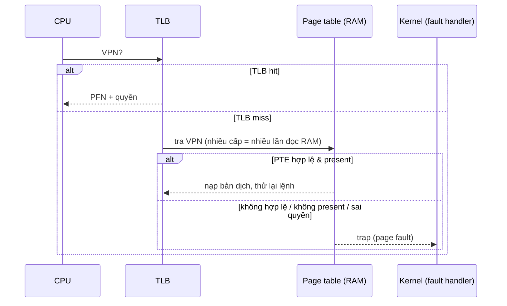

# P3 · Chương 03 — Page table nhiều cấp và TLB

## Bạn sẽ hiểu được gì

1. **Q1.** TLB là gì, hit/miss khác nhau thế nào, và vì sao thiếu TLB thì paging quá chậm? → mục 1
2. **Q2.** Khi TLB miss, ai đi tra page table — phần cứng hay phần mềm — và đánh đổi gì? → mục 2
3. **Q3.** Vì sao context switch làm TLB "mất tác dụng", ASID giải quyết ra sao, và TLB đầy thì đuổi entry nào? → mục 3
4. **Q4.** Vì sao page table tuyến tính quá lớn, và các cách thu nhỏ (page lớn, hybrid, inverted) được gì, mất gì? → mục 4
5. **Q5.** Page table nhiều cấp thu nhỏ bảng bằng cách nào, và trả giá gì? → mục 5
6. **Q6.** Một virtual address trên x86-64 và AArch64 được cắt qua bao nhiêu cấp bảng, Linux đặt tên các cấp thế nào? → mục 6
7. **Q7.** Huge page và THP là gì, vì sao giúp TLB, và giá phải trả là gì? → mục 7
8. **Q8.** Khi nào TLB miss thành vấn đề thật với workload backend? → mục 8

## Kiến thức cần trước

- [Chương 01 — Address space](./01-address-space.md) và [Chương 02 — Dịch địa chỉ](./02-address-translation.md): virtual address, VPN/offset, PFN, ý tưởng paging.
- Giúp ích: [Cache và NUMA](../02-cpu/06-cache-va-numa.md) (TLB cũng là một cache, dựa vào locality).

## 1. TLB: cache của các bản dịch (Q1)

> **Trả lời ngắn.** Paging làm mỗi lần truy cập bộ nhớ phải tra page table trước; làm không cẩn thận thì máy chậm hơn vì thêm nhiều truy cập bộ nhớ[^ostep-paging-slow]. TLB là một cache phần cứng giữ các bản dịch địa chỉ phổ biến[^ostep-tlb]. Có sẵn bản dịch trong TLB thì gọi là hit[^ostep-tlbhit]; không có thì gọi là miss, và phần cứng phải làm thêm việc[^ostep-tlbmiss-cost].

**Giải thích.**

Hình dung (nhận xét của người soạn): mỗi lần đi taxi bạn phải mở cuốn danh bạ dày để tra địa chỉ rồi mới nói được điểm đến. Mẩu giấy ghi vài địa chỉ hay đi chính là TLB: có trên giấy thì khỏi mở danh bạ.

Paging cần hai việc phải giải quyết: **chậm** (nhiều truy cập thêm để đọc page table) và **to** (bảng chiếm bộ nhớ). Chương này giải quyết chậm bằng TLB (mục 1–3) và to bằng các cấu trúc bảng nhỏ hơn, chủ yếu nhiều cấp (mục 4–6); huge page (mục 7) giúp cả hai.

Nhắc lại từ [chương 02](./02-address-translation.md) (mục 5–6): page table là cấu trúc theo từng process, virtual address tách thành VPN và offset, và mỗi PTE ngoài PFN còn có các bit như valid/present và protection — nên protection thực thi được theo từng page (suy luận từ các bit đó).

**Vấn đề.** Nếu mỗi load/store phải đọc PTE từ RAM trước, mỗi truy cập thành ít nhất hai: paging đòi thêm một lần tham chiếu bộ nhớ chỉ để lấy bản dịch[^ostep-one-extra]. **Cơ chế.** Phần cứng thêm TLB, một phần của MMU, chỉ đơn giản là một cache phần cứng của các bản dịch virtual-to-physical phổ biến[^ostep-tlb]; kernel docs bổ sung rằng MMU còn có thể dùng *page walk cache*[^kdoc-mmu-tlb]. Với mỗi virtual address, phần cứng:

1. Rút VPN, tra TLB. Có bản dịch: **TLB hit**[^ostep-tlbhit] — ghép PFN với offset, một truy cập RAM.
2. Không có: **TLB miss**. MMU dùng *page walk* để xác định physical address[^kdoc-walk]; nếu tham chiếu hợp lệ thì cập nhật TLB[^ostep-tlbmiss-update], rồi thử lại lệnh[^ostep-tlbmiss-retry]. Việc này tốn kém vì phải thêm truy cập bộ nhớ[^ostep-tlbmiss-cost].



**Phân biệt cần nhớ.** TLB miss **không** phải page fault: miss chỉ là chưa có bản dịch trong cache; nếu page present thì không có fault nào. Fault là nhánh dưới của sơ đồ, xem [chương 04](./04-page-fault-va-swapping.md).

<details><summary>Đi sâu: ví dụ hit rate của OSTEP, locality, TLB reach và Culler's Law</summary>

- **Ví dụ (OSTEP).** Duyệt tuần tự một mảng nhỏ cho chuỗi: miss, hit, hit, miss, hit, hit, hit, miss, hit, hit — hit rate 70%[^ostep-hitrate]. Lần đầu chạm mảng mà TLB vẫn có ích nhờ spatial locality: chỉ truy cập đầu tiên trên mỗi page mới miss[^ostep-tlb-spatial]. Như mọi cache, TLB cần cả spatial lẫn temporal locality, và đó là tính chất của chương trình[^ostep-tlb-cache-locality].
- **Culler's Law.** OSTEP: truy cập ngẫu nhiên, nhất là khi số page chạm vượt *TLB coverage*, gây tổn thất hiệu năng nặng[^ostep-culler]. *TLB reach* (suy luận của người soạn): N entry × kích thước page S. Ví dụ N = 1536 (số minh họa, không phải CPU cụ thể): page 4 KB che 6144 KiB; page 2 MiB che 3072 MiB (phép nhân, đã chạy bằng rustc 1.95.0).

</details>

**Quay lại Q1:** TLB là cache các bản dịch; hit tránh được lần đọc page table, miss thì phải page walk — và miss chưa phải page fault.

## 2. Phần cứng hay phần mềm xử lý miss? (Q2)

> **Trả lời ngắn.** Tùy kiến trúc. Trên x86, phần cứng tự đi tra page table nhiều cấp[^ostep-hw-tlb]. Ở kiểu software-managed, phần cứng chỉ phát exception và nhảy vào trap handler của kernel[^ostep-sw-tlb]; đổi lại OS được dùng cấu trúc page table tùy ý[^ostep-sw-flex].

**Giải thích.**

Hình dung (nhận xét của người soạn): hết số trên mẩu giấy thì bạn có hai cách — tự mở danh bạ (phần cứng), hoặc gọi thư ký tra hộ rồi ghi lên giấy (phần mềm). Thư ký linh hoạt hơn nhưng phải được dặn kỹ.

**Hardware-managed.** Phần cứng tự xử lý trọn miss; muốn vậy nó phải biết chính xác page table nằm ở đâu (qua một thanh ghi) và định dạng của nó[^ostep-hw-know]. OSTEP lấy x86: page table nhiều cấp cố định, trỏ bởi thanh ghi CR3; phần cứng tự page walk[^ostep-hw-tlb]. **Software-managed.** Khi miss, phần cứng chỉ phát exception: tạm dừng luồng lệnh, nâng lên kernel mode, nhảy tới trap handler[^ostep-sw-tlb]; handler tra page table, nạp TLB bằng lệnh đặc quyền rồi return-from-trap để phần cứng chạy lại lệnh[^ostep-sw-priv].

| | Hardware-managed | Software-managed |
|---|---|---|
| Khi miss | phần cứng tự tra | exception, OS tra |
| Được | OS không phải viết và chạy handler cho miss (suy luận của người soạn) | OS dùng cấu trúc page table tùy ý[^ostep-sw-flex]; phần cứng đơn giản, chỉ phát exception rồi để OS làm nốt[^ostep-sw-simple] |
| Mất | cấu trúc bảng do phần cứng quy định[^ostep-hw-know] | phải cẩn thận, ví dụ không để chính handler gây chuỗi miss vô hạn[^ostep-inf-chain] |

<details><summary>Đi sâu: handler của OS, ví dụ CPU, và page fault thì khác</summary>

- Handler ở kiểu software-managed là code OS viết riêng cho việc này[^ostep-sw-handler]. OSTEP nêu MIPS R10k và SPARC v9 là ví dụ kiến trúc software-managed[^ostep-sw-arch].
- Page fault thì khác TLB miss: gần như mọi hệ thống xử lý page fault bằng phần mềm, kể cả khi TLB do phần cứng quản lý[^ostep-pf-sw]. Lý do và luồng từng bước nằm ở [chương 04, mục 1](./04-page-fault-va-swapping.md).

</details>

**Quay lại Q2:** x86 để phần cứng tự tra; software-managed đổi sự phức tạp lấy tính linh hoạt của OS — còn page fault thì (hầu như) luôn do phần mềm xử lý.

## 3. Context switch, ASID và replacement (Q3)

> **Trả lời ngắn.** Bản dịch trong TLB chỉ đúng cho process đang chạy[^ostep-tlb-ctx], nên khi đổi process phải xóa hết entry (flush) — đắt vì process mới chịu miss lại[^ostep-flush-cost] — hoặc gắn thêm số nhận diện address space (ASID) vào mỗi entry để nhiều process cùng nằm trong TLB[^ostep-asid-field]. TLB đầy thì đuổi một entry theo LRU hoặc random[^ostep-lru][^ostep-random].

**Giải thích.**

Hình dung (nhận xét của người soạn): hai người thuê trọ cùng nói "phòng 10" nhưng ở hai tòa khác nhau; nếu bảo vệ giữ nguyên tờ ghi chú của người trước thì người sau bị dẫn nhầm phòng. Có hai cách: xóa sạch ghi chú mỗi lần đổi người, hoặc ghi thêm tên tòa nhà vào mỗi dòng.

**Vì sao phải xử lý.** Bản dịch trong TLB chỉ đúng cho process đang chạy[^ostep-tlb-ctx]. Ví dụ của OSTEP: trang ảo thứ 10 của P1 ánh xạ tới frame 100, của P2 tới frame 170; nếu TLB giữ cả hai entry VPN 10 thì phần cứng không phân biệt được entry nào thuộc process nào[^ostep-asid-example]. Hai hướng:

1. **Flush** TLB khi đổi process[^ostep-flush] — đặt mọi entry invalid[^ostep-asid]. Giá: process phải chịu miss khi chạm lại dữ liệu và code, đắt nếu đổi process thường xuyên[^ostep-flush-cost].
2. **ASID**: phần cứng thêm trường address-space identifier vào entry[^ostep-asid-field], như một PID ngắn hơn (ví dụ 8 bit so với 32 bit)[^ostep-asid-pid]. TLB giữ được bản dịch của nhiều process cùng lúc; khi chuyển process, OS đặt một thanh ghi đặc quyền thành ASID của process sắp chạy để phần cứng biết đang dịch cho ai[^ostep-asid-reg].

**Replacement.** TLB đầy thì phải đuổi một entry: LRU[^ostep-lru] hoặc random[^ostep-random].

<details><summary>Đi sâu: nội dung entry, ASID 8 bit, global bit, LRU với n + 1 page</summary>

- **Nội dung.** Một TLB điển hình (theo OSTEP) có 32, 64 hoặc 128 entry, fully associative: bản dịch nằm đâu cũng được, phần cứng tìm song song[^ostep-tlb-size]. Entry có VPN, PFN, và các bit khác như valid, protection, ASID, dirty[^ostep-tlb-entry]. Lưu ý: valid bit của TLB **không** phải valid bit của page table; OSTEP gọi nhầm lẫn này là "a common mistake"[^ostep-valid-mistake]. Con số của CPU cụ thể phải tra tài liệu vendor.
- Với ASID 8 bit, có hơn 256 process thì sao? OSTEP nêu câu hỏi để ngỏ[^ostep-asid-256].
- Ví dụ MIPS còn có *global bit* cho page dùng chung: khi bật, ASID bị bỏ qua[^ostep-global].
- LRU có tình huống góc: vòng lặp qua n + 1 page với TLB n entry khiến LRU miss ở **mọi** truy cập, random tốt hơn nhiều[^ostep-lru-bad].

</details>

**Quay lại Q3:** entry TLB chỉ đúng cho một address space nên đổi process phải flush hoặc dùng ASID; entry bị đuổi theo LRU hay random.

## 4. Page table quá lớn và bốn hướng thu nhỏ (Q4)

> **Trả lời ngắn.** Bảng tuyến tính cho address space 32-bit, page 4 KB, PTE 4 byte nặng 4 MB cho **mỗi** process[^ostep-pt-size], dù phần lớn entry invalid. Có bốn hướng: page lớn hơn (bị internal fragmentation)[^ostep-internal-frag], hybrid paging + segmentation (kế thừa nhược điểm của segmentation)[^ostep-hybrid-1], inverted page table (phải tìm kiếm)[^ostep-inverted-hash], và nhiều cấp (mục 5).

**Giải thích.**

Hình dung (nhận xét của người soạn): danh bạ in sẵn một dòng cho từng số điện thoại có thể tồn tại, dù chỉ vài số có người dùng — dày cộp và gần như toàn dòng trống.

Con số 4 MB là phép nhân đã làm ở [chương 02, mục 7](./02-address-translation.md): 32-bit với page 4 KB cho VPN 20 bit, tức 2²⁰ PTE, mỗi PTE 4 byte[^ostep-pt-size]. Trong ví dụ của OSTEP, phần lớn bảng không dùng, toàn entry invalid[^ostep-mostly-invalid]. Cả bốn hướng dưới đây cùng giảm số entry hoặc phần bảng phải giữ (suy luận của người soạn), mỗi hướng bằng một cách khác và trả một giá khác:

- **Page lớn hơn.** Đây là cách đơn giản nhất[^ostep-bigger]. Giữ address space 32-bit nhưng tăng page lên 16 KB, VPN còn 18 bit cộng offset 14 bit[^ostep-bigger-18], bảng nhỏ đi bốn lần đúng bằng hệ số tăng của page[^ostep-bigger-4x]. Giá: mỗi page cấp ra chỉ dùng một phần thì phần còn lại bị bỏ phí, gọi là internal fragmentation[^ostep-internal-frag].
- **Hybrid** paging + segmentation: mỗi segment logic (code, heap, stack) có một page table riêng[^ostep-hybrid]. MMU dùng lại cặp thanh ghi của segmentation nhưng đổi nghĩa: base giữ địa chỉ vật lý của page table của segment, bounds cho biết bảng có bao nhiêu page hợp lệ[^ostep-hybrid-regs]; khoảng trống giữa stack và heap nhờ vậy không còn tốn entry[^ostep-hybrid-save]. Giá: vẫn dính segmentation vốn kém linh hoạt[^ostep-hybrid-1], và vì bảng giờ có kích thước tùy ý nên tìm chỗ đặt chúng trong RAM khó hơn, tức external fragmentation quay lại[^ostep-hybrid-2][^ostep-hybrid-free].
- **Inverted page table**: một bảng duy nhất cho cả hệ thống, một entry cho mỗi *physical* page[^ostep-inverted]; entry ghi process nào đang dùng page đó và virtual page nào của process ánh xạ vào[^ostep-inverted-entry]. Tra bản dịch thành bài toán tìm kiếm; quét tuyến tính thì đắt nên thường dựng thêm hash table[^ostep-inverted-hash]. Kích thước tỉ lệ với RAM vật lý chứ không với số process (suy luận từ định nghĩa).
- **Nhiều cấp** — hướng thắng thế, mục 5.

OSTEP kết luận: page table chỉ là cấu trúc dữ liệu, làm nhỏ hay lớn, nhanh hay chậm đều được[^ostep-just-ds].

<details><summary>Đi sâu: cỡ page thực tế</summary>

- Vì internal fragmentation, phần lớn hệ thống dùng page nhỏ: 4 KB (x86) hoặc 8 KB (SPARCv9)[^ostep-small-pages].
- OSTEP có một aside: nhiều kiến trúc (MIPS, SPARC, x86-64) hỗ trợ nhiều cỡ page, nhưng lý do chính không phải tiết kiệm chỗ cho bảng mà là giảm áp lực lên TLB[^ostep-multi-pagesize]. Đó là chủ đề của mục 7.

</details>

**Quay lại Q4:** bảng tuyến tính tốn 4 MB mỗi process trong ví dụ 32-bit; mỗi cách thu nhỏ đổi một giá khác (fragmentation, segmentation, tìm kiếm, hoặc thêm lần đọc ở mục 5).

## 5. Page table nhiều cấp (Q5)

> **Trả lời ngắn.** Thay vì một mảng liền khối, bảng được chia thành các đoạn dài bằng một page và xếp thành thứ giống cái cây[^ostep-mlpt]. Đoạn nào toàn entry invalid thì không cấp phát, và một page directory (bảng chỉ mục) ghi nhớ đoạn nào còn tồn tại[^ostep-pdir]. Nhờ vậy bảng chỉ chiếm chỗ tỉ lệ với phần address space đang dùng[^ostep-ml-adv]; giá phải trả là khi TLB miss phải đọc bộ nhớ hai lần thay vì một[^ostep-ml-cost].

**Giải thích.**

Hình dung (nhận xét của người soạn): thay vì một cuốn danh bạ liền khối, bạn có một mục lục (directory) chỉ tới từng tập; tập nào không có số nào thì không in.

**Cắt bảng.** Bảng tuyến tính là một mảng PTE rất dài; ta cắt nó thành các đoạn dài đúng bằng một page. Một *page directory* ghi lại đoạn nào được cấp phát và nằm ở đâu; đoạn nào toàn PTE invalid thì bị bỏ, không chiếm RAM[^ostep-pdir].

**Entry của directory (PDE).** Gồm valid bit và PFN như PTE, nhưng valid có nghĩa hơi khác: PDE valid nghĩa là ít nhất một PTE trong page bảng mà nó trỏ tới là valid; PDE invalid thì phần còn lại của nó không có nghĩa[^ostep-pde]. Directory cần một entry cho mỗi page của bảng, và ta lấy một số bit cao của VPN làm chỉ số vào directory[^ostep-index].

**Khi TLB miss, phần cứng đi hai bước.**

1. Dùng các bit cao của VPN đọc PDE trong directory (lần đọc RAM thứ nhất). PDE invalid thì không có page bảng nào để đọc tiếp (suy ra từ định nghĩa trên).
2. PDE valid: PFN của nó cho biết page bảng nằm đâu; dùng các bit còn lại của VPN chọn PTE trong page đó (lần đọc thứ hai). PTE cho PFN của page dữ liệu, rồi ghép với offset như bảng tuyến tính. Công thức đầy đủ và ví dụ làm tay nằm ở phần Đi sâu.

**Lợi và giá.** Bảng chiếm chỗ tỉ lệ với phần address space đang dùng[^ostep-ml-adv], và các page của bảng đặt đâu trong RAM cũng được, không cần một khối liền[^ostep-indirection]. Giá: miss cần hai lần đọc bộ nhớ thay vì một[^ostep-ml-cost] — đổi thời gian lấy không gian: TLB hit không khác, TLB miss đắt hơn[^ostep-timespace]. Với address space lớn, hai cấp có thể không đủ[^ostep-more-levels]; ta cần thêm cấp (mục 6).

<details><summary>Đi sâu: ví dụ làm tay 0x3F80, tính tiết kiệm, page table bị swap</summary>

**Ví dụ làm tay (OSTEP).** Address space 16 KB, page 64 byte: địa chỉ 14 bit = 8 bit VPN + 6 bit offset, bảng tuyến tính 256 entry[^ostep-example]. Page directory có 16 entry nên dùng 4 bit cao của VPN làm chỉ số, 4 bit sau chỉ số vào page của bảng[^ostep-index]. Dịch `0x3F80` từng bước. (1) Viết 14 bit: `0x3F80` = `11 1111 1000 0000`. (2) 6 bit thấp `000000` là offset = 0; 8 bit cao `1111 1110` là VPN = 254 (254 × 64 = 16256 = `0x3F80`, nên đây đúng là byte đầu của page 254)[^ostep-translate-start]. (3) Lấy 4 bit đầu của VPN, `1111`, làm chỉ số vào directory: entry thứ 15 (đếm từ 0), nó trỏ tới page của bảng nằm ở PFN 101[^ostep-translate-pde]. (4) Lấy 4 bit sau, `1110`, làm chỉ số vào page bảng đó: entry 14, cho biết page 254 nằm ở physical page 55 (`0x37`)[^ostep-translate-result]. (5) Ghép PFN 55 với offset: 55 × 64 = 3520 = `0x0DC0`, tức `00 1101 1100 0000`[^ostep-translate-result]. Số 101 và 55 là nội dung do OSTEP chọn trong hình 20.5, không suy ra được từ địa chỉ. Công thức: `PTEAddr = (PDE.PFN << SHIFT) + (PTIndex * sizeof(PTE))`[^ostep-formulas].

*Tiết kiệm (tính của người soạn từ hình 20.4: code VPN 0–1, heap 4–5, stack 254–255):* VPN 0–5 cùng một page bảng, VPN 254–255 một page khác. Cần 2 page bảng + 1 directory = 3 × 64 = 192 byte, so với 1 KB.

Bản thân page table cũng có thể bị swap nếu nằm trong kernel virtual memory[^ostep-pt-swap].

</details>

**Quay lại Q5:** nhiều cấp chỉ cấp phát phần bảng đang dùng, đổi lại mỗi TLB miss ở bảng hai cấp phải đọc RAM hai lần thay vì một.

## 6. Page table của Linux, x86-64 và AArch64 (Q6)

> **Trả lời ngắn.** Linux mô hình hóa page table thành hệ phân cấp hiện cao **năm cấp** — `pgd` → `p4d` → `pud` → `pmd` → `pte` — và từng kiến trúc ánh xạ nó vào giới hạn phần cứng[^kdoc-five]; cấp không dùng được bỏ qua lúc biên dịch (fold)[^kdoc-fold]. Trên x86-64 với 48 bit, địa chỉ cắt thành bốn chỉ số 9 bit cộng offset 12 bit (người soạn tính, bên dưới). AArch64 cho tối đa 4 cấp với page 4 KB[^arm-levels].

**Giải thích.**

Hình dung (nhận xét của người soạn): địa chỉ nhà gồm tỉnh/quận/phường/số nhà — mỗi cấp thu hẹp vùng tìm kiếm, và vùng nào không có nhà thì không cần liệt kê chi tiết.

**Mô hình Linux.** Phân cấp tồn tại để tiết kiệm bộ nhớ page table và tăng tốc ánh xạ[^kdoc-why]; lỗ lớn trong address space chỉ cần đánh dấu unmapped ở cấp cao[^kdoc-holes]. Từ trên xuống: `pgd` → `p4d` → `pud` → `pmd` → `pte`.

- Mỗi process có `pgd` riêng, trong `struct mm_struct`, và mỗi `task_struct` trỏ tới `mm_struct` của nó[^kdoc-pgd].
- `pte` là *bảng* thấp nhất, không phải một entry — tên gây nhầm vì lịch sử[^kdoc-pte-name].
- `p4d` chỉ dùng trên hệ 5 cấp thật, nếu không thì bị folded[^kdoc-p4d]; cấp không dùng được *fold* (bỏ qua) lúc biên dịch[^kdoc-fold].
- Entry cấp cao có thể trỏ thẳng tới vùng vật lý liền khối, ánh xạ vài MB hay GB bằng một entry[^kdoc-huge-entry] — cơ sở của huge page.

**x86-64: cắt địa chỉ 48 bit** (tính của người soạn): page 4 KB, mỗi bảng là một page, PTE 8 byte → 512 entry → 9 bit mỗi cấp; 48 = 4 × 9 + 12 bit offset. (Tài liệu giảng dạy của TU Graz nêu mỗi entry của các bảng x86-64 dài 8 byte và mỗi bảng 4 kB, tức 512 entry[^x86-pte8]; kernel docs chỉ nói `pteval_t` là giá trị 32 hoặc 64 bit tùy kiến trúc[^kdoc-pteval]. Chưa trích được Intel SDM vì trang tải về bị chặn.) Đã chạy bằng rustc 1.95.0, với `va = 0x0000_7f12_3456_789a`:

```rust
let (pgd, pud, pmd, pt) = ((va >> 39) & 0x1ff, (va >> 30) & 0x1ff, (va >> 21) & 0x1ff, (va >> 12) & 0x1ff);
let off = va & 0xfff;
```

In ra `pgd=254 pud=72 pmd=418 pte=359 off=0x89a`. Một TLB miss có thể cần **bốn** lần đọc (suy luận của người soạn, mở rộng "hai lần cho hai cấp"[^ostep-ml-cost]); đó là chặn trên, không phải thời gian đo, vì page walk cache[^kdoc-mmu-tlb] và cache dữ liệu giảm bớt. 5 cấp thêm 9 bit (57 = 5 × 9 + 12) và thêm một lần đọc (cũng là chặn trên).

**AArch64.** Kiến trúc cho tối đa 4 cấp với page 4 KB và 3 cấp với page 64 KB[^arm-levels]. Linux dùng 3–4 cấp với page 4 KB (39 hoặc 48 bit), và 2 cấp với 64 KB (42 bit)[^arm-vabits].

<details><summary>Đi sâu: 48 so với 57 bit, hố non-canonical, TTBR0/TTBR1 và khác biệt giữa các phiên bản docs</summary>

- **x86-64: địa chỉ 48/57 bit.** Kiến trúc định nghĩa địa chỉ 64 bit, hiện hỗ trợ 48 và 57 bit; các bit cao được sign-extend, nên có hố giữa user và kernel khi đọc như số không dấu[^x86-sign]. Hố non-canonical đó, cùng direct mapping của toàn bộ RAM vật lý trong nửa kernel, được trình bày ở [chương 01, mục 5](./01-address-space.md). Layout 5 cấp mở rộng user space 512 lần, từ 0.125 PB lên 64 PB[^x86-5lvl-user].
- **56 hay 57?** Chỗ dễ nhầm: địa chỉ ảo 5 cấp là **57 bit** (kernel docs: 128 PiB không gian ảo[^x86-5lvl-total]), nhưng vì bit cao được sign-extend nên mỗi nửa (user, kernel) chỉ có 56 bit = 64 PiB. Kernel docs nói 5 cấp cho phép không gian địa chỉ ảo userspace 56 bit[^x86-5lvl-56] là nói về nửa user, và ví dụ bản đồ "56-bit" trên chính là dải `0` đến `00ffffffffffffff`. Tương tự 4 cấp: 48 bit tổng (256 TiB[^x86-4lvl-total]), mỗi nửa 47 bit = 128 TiB = 0.125 PiB (suy luận của người soạn từ phép chia đôi; khớp ranh giới `00007fffffffffff` trong bảng bản đồ).
- Mặc định kernel không cấp địa chỉ user vượt 47 bit trừ khi `mmap` có hint cao hơn[^x86-5lvl-hint].
- **AArch64: TTBR.** Khác x86-64: một bit cao của virtual address chọn TTBR0 hoặc TTBR1; `swapper_pg_dir` chỉ chứa ánh xạ kernel và ghi vào TTBR1, còn `pgd` của user chứa ánh xạ user[^arm-ttbr]. Bit nào thì tài liệu kernel ghi khác nhau theo phiên bản: docs hiện hành trên docs.kernel.org ghi bit 55[^arm-ttbr], còn bản trong source kernel v6.8 (kernel của máy lab) ghi bit 63[^arm-ttbr-v68]. Mặc định kernel trả địa chỉ userspace trong dải 48 bit; muốn 52 bit phải opt-in qua hint `mmap`[^arm-52].
- Chương này không khẳng định kích thước TLB hay ASID cụ thể của Intel/AMD/Arm.

</details>

**Quay lại Q6:** Linux gọi các cấp là pgd, p4d, pud, pmd, pte; x86-64 48 bit dùng bốn cấp 9 bit + offset 12 bit, AArch64 dùng 3–4 cấp với page 4 KB.

## 7. Huge page và Transparent Huge Pages (Q7)

> **Trả lời ngắn.** Huge page là page lớn hơn 4 KB (trên x86 thường 2M, và 1G nếu CPU hỗ trợ[^huge-sizes]); vì TLB có số entry hữu hạn, page lớn làm mỗi entry phủ được nhiều bộ nhớ hơn nên ít miss hơn[^thp-f2b]. Giá phải trả: THP có thể cấp page 2M cho vùng chỉ chạm vài byte, lãng phí bộ nhớ[^thp-waste]; và ở cấu hình `defrag=always` ứng dụng có thể bị stall khi kernel dồn bộ nhớ để cấp page lớn[^thp-defrag-always].

**Giải thích.**

Hình dung (nhận xét của người soạn): thay vì ghi từng căn hộ vào mẩu giấy, bạn ghi cả tòa nhà — một dòng phủ nhiều căn, nhưng nếu chỉ ở một căn thì phần còn lại để không.

**Vấn đề.** TLB là tài nguyên rất khan hiếm trên bộ xử lý, và kernel docs nói việc dùng TLB hiệu quả càng quan trọng khi RAM lớn dần[^huge-scarce]. Số entry hữu hạn nên muốn tăng reach chỉ còn cách tăng kích thước page (suy luận của người soạn) — mà mục 4 cho thấy page lớn có giá, và OSTEP nói lý do chính để hỗ trợ nhiều cỡ page là giảm áp lực TLB chứ không phải tiết kiệm chỗ cho bảng (mục 4, phần Đi sâu). Huge page chấp nhận giá đó có chọn lọc. Với 9 bit mỗi cấp (mục 6), 2 MB là phạm vi một entry PMD phủ (512 × 4 KB) và 1 GB là của entry PUD (suy luận của người soạn) — đúng cơ chế entry cấp cao trỏ thẳng vùng vật lý[^kdoc-huge-entry]; page walk cũng ngắn đi một cấp (suy luận).

**hugetlbfs (tường minh).** Dùng qua `mmap` hoặc shared memory SysV[^huge-use]. Huge page bị reserve, không dùng cho việc khác và **không bị swap**[^huge-reserved].

**THP (tự động).** Có tự động nâng/hạ kích thước page, không có nhược điểm của hugetlbfs[^thp-obj]; hiện chỉ cho anonymous mapping và tmpfs/shmem[^thp-scope]; ứng dụng không cần sửa[^thp-nomod].

*Vì sao nhanh hơn.* Kernel docs: yếu tố ít quan trọng là một page fault cho mỗi vùng 2M, giảm 512 lần, chỉ ở lần chạm đầu[^thp-f1]. Yếu tố quan trọng và kéo dài: TLB miss chạy nhanh hơn, đặc biệt với ảo hóa dùng nested page table và "almost always" cả trên bare metal[^thp-f2a], và một TLB entry phủ lượng virtual memory lớn hơn nên ít miss hơn[^thp-f2b].

*Giá phải trả.*
- Lãng phí: khi huge page bật toàn hệ thống, mmap vùng lớn, chạm 1 byte, có thể được cấp page 2M thay vì 4k[^thp-waste].
- Clear/copy page lớn hơn trong fault[^thp-clear].
- Stall: với `defrag=always`, ứng dụng stall khi cấp phát thất bại, trực tiếp reclaim và compact bộ nhớ[^thp-defrag-always]. Dịch vụ nhạy latency nên cân nhắc (nhận xét của người soạn).

<details><summary>Đi sâu: reserve và boot với hugetlbfs, các nút điều khiển THP, quan sát trên máy soạn chương</summary>

- hugetlbfs: reserve bảo đảm cấp được lúc fault[^huge-rsvd]; cấp lúc boot là đáng tin nhất vì bộ nhớ chưa phân mảnh[^huge-boot].
- *Điều khiển THP.* Bật toàn hệ thống hoặc theo task/vùng nhớ[^thp-control]; chế độ `always`/`madvise`/`never`[^thp-modes]; ứng dụng hưởng lợi nên `madvise(MADV_HUGEPAGE)` vùng quan trọng[^thp-madvise]; `khugepaged` gộp page thường thành huge page nếu cấu hình cho phép[^thp-khuge]; mTHP cấp khối nhỏ hơn cỡ PMD để page fault bớt gây latency spike so với THP cỡ PMD[^thp-mthp].
- **Quan sát trên máy soạn chương** (một lần chạy, không phải bảo đảm): container Linux của repo (`./labs/linux.sh`, aarch64, page 4096) cho `enabled` = `always [madvise] never`, `defrag` = `always defer defer+madvise [madvise] never`, `AnonHugePages: 0 kB`, `HugePages_Total: 0`, `Hugepagesize: 2048 kB`. Máy của bạn có thể khác: hãy đọc các file đó trên chính máy cần xét.

</details>

**Quay lại Q7:** huge page tăng lượng bộ nhớ mỗi entry TLB phủ được; hugetlbfs dành riêng RAM, THP tự động nhưng có thể phình bộ nhớ và stall.

## 8. TLB miss với workload backend (Q8)

> **Trả lời ngắn.** Chỉ đáng nghi khi số page khác nhau mà chương trình chạm trong thời gian ngắn vượt TLB coverage — kịch bản mà OSTEP gọi là Culler's Law[^ostep-culler]. Hãy đo bộ đếm TLB miss trước khi chỉnh THP hay hugetlbfs (nhận xét của người soạn).

**Giải thích.**

*Nhận xét của người soạn; chỉ câu có chú thích là sự thật có nguồn.*

Hình dung: thợ sửa xe chỉ cần vài cuốn sổ ở bàn khi làm cùng một xe, nhưng nếu mỗi phút lại tra một xe ở bãi khác nhau thì mẩu giấy ghi chú không đủ chỗ.

- **Khi nào thành vấn đề:** số page khác nhau chạm trong thời gian ngắn vượt TLB coverage — kịch bản Culler's Law[^ostep-culler]. Ứng viên: cache in-process hàng GB truy cập theo hash, index trong bộ nhớ, buffer pool. Truy cập ngẫu nhiên mất lợi thế "một miss mỗi page"[^ostep-tlb-spatial]; scan tuần tự thì ổn.
- **Đắt hơn vẻ ngoài:** mỗi miss là cả một page walk nhiều cấp, đi qua cache như mọi truy cập (suy luận).
- **Đo trước khi chỉnh:** dùng bộ đếm TLB miss phần cứng (ví dụ `perf stat`; tên sự kiện phụ thuộc CPU, tra `perf list` — chương này không chạy lệnh đó nên không có số liệu), rồi mới thử THP/hugetlbfs và so p50/p99.

<details><summary>Đi sâu: ảo hóa và rủi ro vận hành</summary>

- **Ảo hóa:** huge page đặc biệt có lợi với nested page table; chỉ một bên (KVM hoặc guest) dùng huge page đã tăng tốc đáng kể[^thp-f2a]. Chạy trong VM (đa số cloud) thì áp dụng.
- **Rủi ro vận hành:** stall compaction[^thp-defrag-always], phình bộ nhớ[^thp-waste]; hugetlbfs dành riêng RAM, không swap[^huge-reserved]. Trong container, chi phí tính vào giới hạn bộ nhớ (chưa kiểm chứng ở đây).

</details>

**Quay lại Q8:** nghi TLB khi working set truy cập ngẫu nhiên vượt coverage; đo bộ đếm trước, rồi mới thử huge page và chú ý rủi ro vận hành.

## Liên hệ với Rust

Rust không có "API TLB". Điểm chạm gián tiếp: bộ nhớ của `Vec`/`Box` lớn đến từ global allocator, mà allocator mặc định hiện không được đặc tả[^alloc-global]. Vùng nhớ đó có thành anonymous mapping (thứ THP áp dụng được[^thp-scope]) hay không là việc của allocator thực tế — xem [chương 06](./06-heap-allocator.md). Suy luận của người soạn: cải thiện cho cấu trúc dữ liệu khổng lồ truy cập ngẫu nhiên nằm ở bố cục dữ liệu hoặc cấu hình hệ thống (THP, `madvise` qua crate như `libc` — chưa kiểm chứng ở đây), không ở `std`.

## Tóm tắt

- TLB là cache phần cứng của bản dịch; TLB miss ≠ page fault.
- Miss do phần cứng (x86) hoặc phần mềm (MIPS, SPARC v9) xử lý; phần mềm đổi lấy sự linh hoạt.
- Context switch: flush TLB (tốn miss) hoặc ASID (nhiều process cùng nằm trong TLB).
- LRU có tình huống góc (n + 1 page, n entry); random tránh được.
- Bảng tuyến tính 32-bit/4 KB nặng 4 MB mỗi process; page lớn → internal fragmentation, hybrid → segmentation, inverted → tìm kiếm, nhiều cấp → thêm lần đọc khi miss.
- Linux: PGD, P4D, PUD, PMD, PTE, fold cấp không dùng; x86-64 48/57 bit; AArch64 39/48 bit (4 KB) hay 42 bit (64 KB).
- Huge page: một entry che nhiều hơn, page walk ngắn hơn; hugetlbfs dành riêng, THP tự động nhưng có stall và phình bộ nhớ.
- Với backend: chỉ nghi TLB khi working set truy cập ngẫu nhiên vượt coverage; đo trước.

## Câu hỏi tự kiểm tra

1. TLB miss khác page fault thế nào?

<details><summary>Đáp án</summary>

Miss: chưa có bản dịch trong cache, page walk rồi nạp TLB và thử lại[^ostep-tlbmiss-update][^ostep-tlbmiss-retry]. Fault: page không present hoặc sai quyền, vào handler của OS[^ostep-pf-sw].

</details>

2. Hardware- vs software-managed TLB? Ưu điểm của kiểu phần mềm?

<details><summary>Đáp án</summary>

[^ostep-hw-tlb][^ostep-sw-tlb][^ostep-sw-flex].

</details>

3. Hai cách xử lý TLB khi context switch, và giá của mỗi cách?

<details><summary>Đáp án</summary>

Flush[^ostep-asid], đổi lại miss lại từ đầu[^ostep-flush-cost]; ASID[^ostep-asid-field], nhưng ít bit hơn PID[^ostep-asid-pid].

</details>

4. Vòng lặp qua n + 1 page với TLB n entry: LRU và random?

<details><summary>Đáp án</summary>

LRU miss mọi truy cập, random tốt hơn nhiều[^ostep-lru-bad].

</details>

5. Bảng tuyến tính 32-bit, page 4 KB, PTE 4 byte nặng bao nhiêu? Page 16 KB thì sao, giá là gì?

<details><summary>Đáp án</summary>

4 MB mỗi process[^ostep-pt-size]; 1 MB nhưng internal fragmentation[^ostep-bigger][^ostep-internal-frag].

</details>

6. Vì sao bảng hai cấp nhỏ hơn nhưng miss đắt hơn?

<details><summary>Đáp án</summary>

Page toàn invalid không cấp phát[^ostep-pdir][^ostep-ml-adv]; nhưng miss cần hai lần đọc[^ostep-ml-cost], hit thì không khác[^ostep-timespace].

</details>

7. Dịch `0x3F80` trong ví dụ OSTEP.

<details><summary>Đáp án</summary>

PD index 15, PT index 14, PFN 55, physical `0x0DC0`[^ostep-translate-result][^ostep-index].

</details>

8. Các cấp page table của Linux và việc fold?

<details><summary>Đáp án</summary>

PGD, P4D, PUD, PMD, PTE[^kdoc-five]; cấp không dùng bị fold[^kdoc-fold]; p4d chỉ dùng trên 5 cấp thật[^kdoc-p4d].

</details>

9. Vì sao huge page giúp TLB? Giá phải trả?

<details><summary>Đáp án</summary>

Miss nhanh hơn[^thp-f2a], một entry phủ nhiều hơn[^thp-f2b]. Giá: lãng phí bộ nhớ[^thp-waste], stall khi compaction[^thp-defrag-always]; hugetlbfs không swap được[^huge-reserved].

</details>

10. Service giữ cache 20 GB truy cập theo hash, p99 xấu dù CPU không bão hòa. Chẩn đoán TLB thế nào?

<details><summary>Đáp án</summary>

Mục 8 (nhận xét của người soạn): kịch bản Culler's Law[^ostep-culler]; đo bộ đếm TLB miss trước, rồi thử `madvise(MADV_HUGEPAGE)`[^thp-madvise] hoặc hugetlbfs, chú ý rủi ro stall và phình bộ nhớ.

</details>

## Đọc thêm

- [OSTEP ch.19 — TLBs](https://pages.cs.wisc.edu/~remzi/OSTEP/vm-tlbs.pdf): thuật toán TLB, ASID, replacement, entry MIPS thật.
- [OSTEP ch.20 — Smaller Tables](https://pages.cs.wisc.edu/~remzi/OSTEP/vm-smalltables.pdf): ví dụ nhiều cấp làm tay, hybrid, inverted.
- [Kernel docs — Page Tables](https://docs.kernel.org/mm/page_tables.html): mô hình 5 cấp, folding.
- [Kernel docs — x86_64 mm](https://docs.kernel.org/arch/x86/x86_64/mm.html) và [AArch64 memory](https://docs.kernel.org/arch/arm64/memory.html): bản đồ địa chỉ thật.
- [Kernel docs — THP](https://docs.kernel.org/admin-guide/mm/transhuge.html) và [HugeTLB](https://docs.kernel.org/admin-guide/mm/hugetlbpage.html): chế độ vận hành.
- [Chương 04 — Page fault](./04-page-fault-va-swapping.md): nhánh fault của sơ đồ mục 1.

[^ostep-paging-slow]: OSTEP, ch.18 Paging: Introduction (Summary) — <https://pages.cs.wisc.edu/~remzi/OSTEP/vm-paging.pdf> — "implementing paging support without care will lead to a slower machine (with many extra memory accesses to access the page table) as well as memory waste"
[^ostep-tlb]: OSTEP, ch.19 Paging: Faster Translations (TLBs) — <https://pages.cs.wisc.edu/~remzi/OSTEP/vm-tlbs.pdf> — "A TLB is part of the chip’s memory-management unit (MMU), and is simply a hardware cache of popular virtual-to-physical address translations"
[^ostep-tlbhit]: OSTEP, ch.19 Paging: Faster Translations (TLBs) — <https://pages.cs.wisc.edu/~remzi/OSTEP/vm-tlbs.pdf> — "If it does, we have a TLB hit, which means the TLB holds the translation."
[^ostep-tlbmiss-cost]: OSTEP, ch.19 Paging: Faster Translations (TLBs) — <https://pages.cs.wisc.edu/~remzi/OSTEP/vm-tlbs.pdf> — "If the CPU does not find the translation in the TLB (a TLB miss), we have some more work to do. In this example, the hardware accesses the page table to find the translation"
[^ostep-tlbmiss-update]: OSTEP, ch.19 Paging: Faster Translations (TLBs) — <https://pages.cs.wisc.edu/~remzi/OSTEP/vm-tlbs.pdf> — "assuming that the virtual memory reference generated by the process is valid and accessible (Lines 13, 15), updates the TLB with the translation"
[^ostep-tlbmiss-retry]: OSTEP, ch.19 Paging: Faster Translations (TLBs) — <https://pages.cs.wisc.edu/~remzi/OSTEP/vm-tlbs.pdf> — "once the TLB is updated, the hardware retries the instruction"
[^kdoc-mmu-tlb]: Linux kernel docs, Page Tables (MMU, TLB, and Page Faults) — <https://docs.kernel.org/mm/page_tables.html> — "It may use relatively small caches in hardware called Translation Lookaside Buffers (TLBs) and Page Walk Caches to speed up these translations."
[^kdoc-walk]: Linux kernel docs, Page Tables (MMU, TLB, and Page Faults) — <https://docs.kernel.org/mm/page_tables.html> — "If no translation is found, MMU uses the page walks to determine the physical address and create the map."
[^ostep-hitrate]: OSTEP, ch.19 Paging: Faster Translations (TLBs) — <https://pages.cs.wisc.edu/~remzi/OSTEP/vm-tlbs.pdf> — "miss, hit, hit, miss, hit, hit, hit, miss, hit, hit. Thus, our TLB hit rate, which is the number of hits divided by the total number of accesses, is 70%."
[^ostep-tlb-spatial]: OSTEP, ch.19 Paging: Faster Translations (TLBs) — <https://pages.cs.wisc.edu/~remzi/OSTEP/vm-tlbs.pdf> — "The elements of the array are packed tightly into pages (i.e., they are close to one another in space), and thus only the first access to an element on a page yields a TLB miss."
[^ostep-tlb-cache-locality]: OSTEP, ch.19 Paging: Faster Translations (TLBs) — <https://pages.cs.wisc.edu/~remzi/OSTEP/vm-tlbs.pdf> — "Like any cache, TLBs rely upon both spatial and temporal locality for success, which are program properties."
[^ostep-hw-tlb]: OSTEP, ch.19 Paging: Faster Translations (TLBs) — <https://pages.cs.wisc.edu/~remzi/OSTEP/vm-tlbs.pdf> — "which uses a fixed multi-level page table (see the next chapter for details); the current page table is pointed to by the CR3 register"
[^ostep-sw-tlb]: OSTEP, ch.19 Paging: Faster Translations (TLBs) — <https://pages.cs.wisc.edu/~remzi/OSTEP/vm-tlbs.pdf> — "On a TLB miss, the hardware simply raises an exception (line 11 in Figure 19.3), which pauses the current instruction stream, raises the privilege level to kernel mode, and jumps to a trap handler."
[^ostep-sw-handler]: OSTEP, ch.19 Paging: Faster Translations (TLBs) — <https://pages.cs.wisc.edu/~remzi/OSTEP/vm-tlbs.pdf> — "this trap handler is code within the OS that is written with the express purpose of handling TLB misses."
[^ostep-sw-flex]: OSTEP, ch.19 Paging: Faster Translations (TLBs) — <https://pages.cs.wisc.edu/~remzi/OSTEP/vm-tlbs.pdf> — "The primary advantage of the software-managed approach is flexibility: the OS can use any data structure it wants to implement the page"
[^ostep-inf-chain]: OSTEP, ch.19 Paging: Faster Translations (TLBs) — <https://pages.cs.wisc.edu/~remzi/OSTEP/vm-tlbs.pdf> — "the OS needs to be extra careful not to cause an infinite chain of TLB misses to occur."
[^ostep-pf-sw]: OSTEP, ch.21 Beyond Physical Memory: Mechanisms — <https://pages.cs.wisc.edu/~remzi/OSTEP/vm-beyondphys.pdf> — "Virtually all systems handle page faults in software; even with a hardware-managed TLB, the hardware trusts the OS to manage this important duty."
[^ostep-tlb-size]: OSTEP, ch.19 Paging: Faster Translations (TLBs) — <https://pages.cs.wisc.edu/~remzi/OSTEP/vm-tlbs.pdf> — "A typical TLB might have 32, 64, or 128 entries and be what is called fully associative."
[^ostep-valid-mistake]: OSTEP, ch.19 Paging: Faster Translations (TLBs) — <https://pages.cs.wisc.edu/~remzi/OSTEP/vm-tlbs.pdf> — "A common mistake is to confuse the valid bits found in a TLB with those found in a page table."
[^ostep-tlb-ctx]: OSTEP, ch.19 Paging: Faster Translations (TLBs) — <https://pages.cs.wisc.edu/~remzi/OSTEP/vm-tlbs.pdf> — "the TLB contains virtual-to-physical translations that are only valid for the currently running process; these translations are not meaningful for other processes."
[^ostep-flush]: OSTEP, ch.19 Paging: Faster Translations (TLBs) — <https://pages.cs.wisc.edu/~remzi/OSTEP/vm-tlbs.pdf> — "One approach is to simply flush the TLB on context switches, thus emptying it before running the next process."
[^ostep-asid]: OSTEP, ch.19 Paging: Faster Translations (TLBs) — <https://pages.cs.wisc.edu/~remzi/OSTEP/vm-tlbs.pdf> — "By setting all TLB entries to invalid, the system can ensure that the about-to-be-run process does not accidentally use a virtual-to-physical translation from a previous process."
[^ostep-flush-cost]: OSTEP, ch.19 Paging: Faster Translations (TLBs) — <https://pages.cs.wisc.edu/~remzi/OSTEP/vm-tlbs.pdf> — "If the OS switches between processes frequently, this cost may be high."
[^ostep-asid-field]: OSTEP, ch.19 Paging: Faster Translations (TLBs) — <https://pages.cs.wisc.edu/~remzi/OSTEP/vm-tlbs.pdf> — "some hardware systems provide an address space identifier (ASID) field in the TLB."
[^ostep-asid-pid]: OSTEP, ch.19 Paging: Faster Translations (TLBs) — <https://pages.cs.wisc.edu/~remzi/OSTEP/vm-tlbs.pdf> — "You can think of the ASID as a process identifier (PID), but usually it has fewer bits (e.g., 8 bits for the ASID versus 32 bits for a PID)."
[^ostep-asid-256]: OSTEP, ch.19 Paging: Faster Translations (TLBs) — <https://pages.cs.wisc.edu/~remzi/OSTEP/vm-tlbs.pdf> — "One question for you: what should the OS do if there are more than 256 (28 ) processes running at a time?"
[^ostep-global]: OSTEP, ch.19 Paging: Faster Translations (TLBs) — <https://pages.cs.wisc.edu/~remzi/OSTEP/vm-tlbs.pdf> — "We see a global bit (G), which is used for pages that are globally-shared among processes. Thus, if the global bit is set, the ASID is ignored."
[^ostep-lru]: OSTEP, ch.19 Paging: Faster Translations (TLBs) — <https://pages.cs.wisc.edu/~remzi/OSTEP/vm-tlbs.pdf> — "One common approach is to evict the least-recently-used or LRU entry."
[^ostep-random]: OSTEP, ch.19 Paging: Faster Translations (TLBs) — <https://pages.cs.wisc.edu/~remzi/OSTEP/vm-tlbs.pdf> — "Another typical approach is to use a random policy, which evicts a TLB mapping at random."
[^ostep-lru-bad]: OSTEP, ch.19 Paging: Faster Translations (TLBs) — <https://pages.cs.wisc.edu/~remzi/OSTEP/vm-tlbs.pdf> — "behaves quite unreasonably when a program loops over n + 1 pages with a TLB of size n; in this case, LRU misses upon every access, whereas random does much better."
[^ostep-culler]: OSTEP, ch.19 Paging: Faster Translations (TLBs) — <https://pages.cs.wisc.edu/~remzi/OSTEP/vm-tlbs.pdf> — "Sometimes randomly accessing your address space, particularly if the number of pages accessed exceeds the TLB coverage, can lead to severe performance penalties."
[^ostep-pt-size]: OSTEP, ch.18 Paging: Introduction — <https://pages.cs.wisc.edu/~remzi/OSTEP/vm-paging.pdf> — "assuming we need 4 bytes per page table entry (PTE) to hold the physical translation plus any other useful stuff, we get an immense 4MB of memory needed for each page table!"
[^ostep-bigger]: OSTEP, ch.20 Paging: Smaller Tables — <https://pages.cs.wisc.edu/~remzi/OSTEP/vm-smalltables.pdf> — "We could reduce the size of the page table in one simple way: use bigger pages."
[^ostep-internal-frag]: OSTEP, ch.20 Paging: Smaller Tables — <https://pages.cs.wisc.edu/~remzi/OSTEP/vm-smalltables.pdf> — "The major problem with this approach, however, is that big pages lead to waste within each page, a problem known as internal fragmentation (as the waste is internal to the unit of allocation)."
[^ostep-small-pages]: OSTEP, ch.20 Paging: Smaller Tables — <https://pages.cs.wisc.edu/~remzi/OSTEP/vm-smalltables.pdf> — "Thus, most systems use relatively small page sizes in the common case: 4KB (as in x86) or 8KB (as in SPARCv9)."
[^ostep-hybrid]: OSTEP, ch.20 Paging: Smaller Tables — <https://pages.cs.wisc.edu/~remzi/OSTEP/vm-smalltables.pdf> — "instead of having a single page table for the entire address space of the process, why not have one per logical segment?"
[^ostep-hybrid-1]: OSTEP, ch.20 Paging: Smaller Tables — <https://pages.cs.wisc.edu/~remzi/OSTEP/vm-smalltables.pdf> — "First, it still requires us to use segmentation; as we discussed before, segmentation is not quite as flexible as we would like"
[^ostep-hybrid-2]: OSTEP, ch.20 Paging: Smaller Tables — <https://pages.cs.wisc.edu/~remzi/OSTEP/vm-smalltables.pdf> — "Second, this hybrid causes external fragmentation to arise again."
[^ostep-inverted]: OSTEP, ch.20 Paging: Smaller Tables — <https://pages.cs.wisc.edu/~remzi/OSTEP/vm-smalltables.pdf> — "we keep a single page table that has an entry for each physical page of the system."
[^ostep-inverted-hash]: OSTEP, ch.20 Paging: Smaller Tables — <https://pages.cs.wisc.edu/~remzi/OSTEP/vm-smalltables.pdf> — "A linear scan would be expensive, and thus a hash table is often built over the base structure to speed up lookups."
[^ostep-just-ds]: OSTEP, ch.20 Paging: Smaller Tables — <https://pages.cs.wisc.edu/~remzi/OSTEP/vm-smalltables.pdf> — "page tables are just data structures."
[^ostep-mlpt]: OSTEP, ch.20 Paging: Smaller Tables — <https://pages.cs.wisc.edu/~remzi/OSTEP/vm-smalltables.pdf> — "We call this approach a multi-level page table, as it turns the linear page table into something like a tree. This approach is so effective that many modern systems employ it (e.g., x86"
[^ostep-pdir]: OSTEP, ch.20 Paging: Smaller Tables — <https://pages.cs.wisc.edu/~remzi/OSTEP/vm-smalltables.pdf> — "if an entire page of page-table entries (PTEs) is invalid, don’t allocate that page of the page table at all. To track whether a page of the page table is valid (and if valid, where it is in memory), use a new structure, called the page directory."
[^ostep-ml-adv]: OSTEP, ch.20 Paging: Smaller Tables — <https://pages.cs.wisc.edu/~remzi/OSTEP/vm-smalltables.pdf> — "the multi-level table only allocates page-table space in proportion to the amount of address space you are using; thus it is generally compact and supports sparse address spaces."
[^ostep-indirection]: OSTEP, ch.20 Paging: Smaller Tables — <https://pages.cs.wisc.edu/~remzi/OSTEP/vm-smalltables.pdf> — "With a multi-level structure, we add a level of indirection through use of the page directory, which points to pieces of the page table; that indirection allows us to place page-table pages wherever we would like in physical memory."
[^ostep-example]: OSTEP, ch.20 Paging: Smaller Tables — <https://pages.cs.wisc.edu/~remzi/OSTEP/vm-smalltables.pdf> — "Imagine a small address space of size 16KB, with 64-byte pages. Thus, we have a 14-bit virtual address space, with 8 bits for the VPN and 6 bits for the offset."
[^ostep-index]: OSTEP, ch.20 Paging: Smaller Tables — <https://pages.cs.wisc.edu/~remzi/OSTEP/vm-smalltables.pdf> — "The page directory needs one entry per page of the page table; thus, it has 16 entries. As a result, we need four bits of the VPN to index into the directory; we use the top four bits of the VPN"
[^ostep-translate-result]: OSTEP, ch.20 Paging: Smaller Tables — <https://pages.cs.wisc.edu/~remzi/OSTEP/vm-smalltables.pdf> — "PhysAddr = (PTE.PFN << SHIFT) + offset = 00 1101 1100 0000 = 0x0DC0."
[^ostep-formulas]: OSTEP, ch.20 Paging: Smaller Tables — <https://pages.cs.wisc.edu/~remzi/OSTEP/vm-smalltables.pdf> — "PTEAddr = (PDE.PFN << SHIFT) + (PTIndex * sizeof(PTE))"
[^ostep-ml-cost]: OSTEP, ch.20 Paging: Smaller Tables — <https://pages.cs.wisc.edu/~remzi/OSTEP/vm-smalltables.pdf> — "on a TLB miss, two loads from memory will be required to get the right translation information from the page table"
[^ostep-timespace]: OSTEP, ch.20 Paging: Smaller Tables — <https://pages.cs.wisc.edu/~remzi/OSTEP/vm-smalltables.pdf> — "We wanted smaller tables (and got them), but not for free; although in the common case (TLB hit), performance is obviously identical, a TLB miss suffers from a higher cost with this smaller table."
[^ostep-pt-swap]: OSTEP, ch.20 Paging: Smaller Tables — <https://pages.cs.wisc.edu/~remzi/OSTEP/vm-smalltables.pdf> — "Thus, some systems place such page tables in kernel virtual memory, thereby allowing the system to swap some of these page tables to disk when memory pressure gets a little tight."
[^kdoc-five]: Linux kernel docs, Page Tables — <https://docs.kernel.org/mm/page_tables.html> — "Linux defines page tables as a hierarchy which is currently five levels in height. The architecture code for each supported architecture will then map this to the restrictions of the hardware."
[^kdoc-why]: Linux kernel docs, Page Tables — <https://docs.kernel.org/mm/page_tables.html> — "The software page table hierarchy reflects the fact that page table hardware has become hierarchical and that in turn is done to save page table memory and speed up mapping."
[^kdoc-holes]: Linux kernel docs, Page Tables — <https://docs.kernel.org/mm/page_tables.html> — "By using hierarchical page tables large holes in the virtual address space does not waste valuable page table memory, because it will suffice to mark large areas as unmapped at a higher level in the page table hierarchy."
[^kdoc-pgd]: Linux kernel docs, Page Tables — <https://docs.kernel.org/mm/page_tables.html> — "each userspace process in the system also has its own memory context and thus its own pgd, found in struct mm_struct which in turn is referenced to in each struct task_struct."
[^kdoc-pte-name]: Linux kernel docs, Page Tables — <https://docs.kernel.org/mm/page_tables.html> — "so the pte is the lowermost page table, not a page table entry."
[^kdoc-p4d]: Linux kernel docs, Page Tables — <https://docs.kernel.org/mm/page_tables.html> — "This is only used on systems which actually have 5 levels of page tables, otherwise it is folded."
[^kdoc-fold]: Linux kernel docs, Page Tables (Page Table Folding) — <https://docs.kernel.org/mm/page_tables.html> — "If the architecture does not use all the page table levels, they can be folded which means skipped"
[^kdoc-huge-entry]: Linux kernel docs, Page Tables — <https://docs.kernel.org/mm/page_tables.html> — "a higher level page table entry can point directly to a physical memory range, which allows mapping a contiguous range of several megabytes or even gigabytes in a single high-level page table entry"
[^kdoc-pteval]: Linux kernel docs, Page Tables — <https://docs.kernel.org/mm/page_tables.html> — "A typical example is that the pteval_t is a 32- or 64-bit value with the upper bits being a pfn (page frame number)"
[^x86-sign]: Linux kernel docs, x86_64 Memory Management — <https://docs.kernel.org/arch/x86/x86_64/mm.html> — "Currently supported are 48- and 57-bit virtual addresses. Bits 63 through to the most-significant implemented bit are sign extended."
[^x86-5lvl-user]: Linux kernel docs, x86_64 Memory Management (5-level) — <https://docs.kernel.org/arch/x86/x86_64/mm.html> — "With 56-bit addresses, user-space memory gets expanded by a factor of 512x, from 0.125 PB to 64 PB."
[^arm-levels]: Linux kernel docs, Memory Layout on AArch64 Linux — <https://docs.kernel.org/arch/arm64/memory.html> — "The architecture allows up to 4 levels of translation tables with a 4KB page size and up to 3 levels with a 64KB page size."
[^arm-vabits]: Linux kernel docs, Memory Layout on AArch64 Linux — <https://docs.kernel.org/arch/arm64/memory.html> — "allowing 39-bit (512GB) or 48-bit (256TB) virtual addresses, respectively, for both user and kernel. With 64KB pages, only 2 levels of translation tables, allowing 42-bit (4TB) virtual address, are used"
[^arm-ttbr]: Linux kernel docs, Memory Layout on AArch64 Linux — <https://docs.kernel.org/arch/arm64/memory.html> — "TTBRx selection is given by bit 55 of the virtual address. The swapper_pg_dir contains only kernel (global) mappings while the user pgd contains only user (non-global) mappings."
[^arm-ttbr-v68]: Linux kernel docs, Memory Layout on AArch64 Linux (source tag v6.8) — <https://raw.githubusercontent.com/torvalds/linux/v6.8/Documentation/arch/arm64/memory.rst> — "TTBRx selection is given by bit 63 of the virtual address."
[^arm-52]: Linux kernel docs, Memory Layout on AArch64 Linux (52-bit userspace VAs) — <https://docs.kernel.org/arch/arm64/memory.html> — "the kernel will, by default, return virtual addresses to userspace from a 48-bit range."
[^huge-scarce]: Linux kernel docs, HugeTLB Pages — <https://docs.kernel.org/admin-guide/mm/hugetlbpage.html> — "Typically this is a very scarce resource on processor. Operating systems try to make best use of limited number of TLB resources. This optimization is more critical now as bigger and bigger physical memories (several GBs) are more readily available."
[^huge-sizes]: Linux kernel docs, HugeTLB Pages — <https://docs.kernel.org/admin-guide/mm/hugetlbpage.html> — "x86 CPUs normally support 4K and 2M (1G if architecturally supported) page sizes"
[^huge-use]: Linux kernel docs, HugeTLB Pages — <https://docs.kernel.org/admin-guide/mm/hugetlbpage.html> — "Users can use the huge page support in Linux kernel by either using the mmap system call or standard SYSV shared memory system calls (shmget, shmat)."
[^huge-reserved]: Linux kernel docs, HugeTLB Pages — <https://docs.kernel.org/admin-guide/mm/hugetlbpage.html> — "Pages that are used as huge pages are reserved inside the kernel and cannot be used for other purposes. Huge pages cannot be swapped out under memory pressure."
[^huge-rsvd]: Linux kernel docs, HugeTLB Pages — <https://docs.kernel.org/admin-guide/mm/hugetlbpage.html> — "Reserved huge pages guarantee that an application will be able to allocate a huge page from the pool of huge pages at fault time."
[^huge-boot]: Linux kernel docs, HugeTLB Pages — <https://docs.kernel.org/admin-guide/mm/hugetlbpage.html> — "This is the most reliable method of allocating huge pages as memory has not yet become fragmented."
[^thp-obj]: Linux kernel docs, Transparent Hugepage Support — <https://docs.kernel.org/admin-guide/mm/transhuge.html> — "that supports the automatic promotion and demotion of page sizes and without the shortcomings of hugetlbfs."
[^thp-scope]: Linux kernel docs, Transparent Hugepage Support — <https://docs.kernel.org/admin-guide/mm/transhuge.html> — "Currently THP only works for anonymous memory mappings and tmpfs/shmem."
[^thp-nomod]: Linux kernel docs, Transparent Hugepage Support — <https://docs.kernel.org/admin-guide/mm/transhuge.html> — "It requires no modifications for applications to take advantage of it."
[^thp-f1]: Linux kernel docs, Transparent Hugepage Support — <https://docs.kernel.org/admin-guide/mm/transhuge.html> — "taking a single page fault for each 2M virtual region touched by userland (so reducing the enter/exit kernel frequency by a 512 times factor)."
[^thp-f2a]: Linux kernel docs, Transparent Hugepage Support — <https://docs.kernel.org/admin-guide/mm/transhuge.html> — "the TLB miss will run faster (especially with virtualization using nested pagetables but almost always also on bare metal without virtualization)"
[^thp-f2b]: Linux kernel docs, Transparent Hugepage Support — <https://docs.kernel.org/admin-guide/mm/transhuge.html> — "a single TLB entry will be mapping a much larger amount of virtual memory in turn reducing the number of TLB misses."
[^thp-waste]: Linux kernel docs, Transparent Hugepage Support — <https://docs.kernel.org/admin-guide/mm/transhuge.html> — "An application may mmap a large region but only touch 1 byte of it, in that case a 2M page might be allocated instead of a 4k page for no good."
[^thp-clear]: Linux kernel docs, Transparent Hugepage Support — <https://docs.kernel.org/admin-guide/mm/transhuge.html> — "requiring larger clear-page copy-page in page faults which is a potentially negative effect."
[^thp-defrag-always]: Linux kernel docs, Transparent Hugepage Support (defrag) — <https://docs.kernel.org/admin-guide/mm/transhuge.html> — "means that an application requesting THP will stall on allocation failure and directly reclaim pages and compact memory in an effort to allocate a THP immediately."
[^thp-control]: Linux kernel docs, Transparent Hugepage Support — <https://docs.kernel.org/admin-guide/mm/transhuge.html> — "THP can be enabled system wide or restricted to certain tasks or even memory ranges inside task’s address space."
[^thp-modes]: Linux kernel docs, Transparent Hugepage Support (Global THP controls) — <https://docs.kernel.org/admin-guide/mm/transhuge.html> — "or only enabled inside MADV_HUGEPAGE regions (to avoid the risk of consuming more memory resources) or enabled system wide."
[^thp-madvise]: Linux kernel docs, Transparent Hugepage Support — <https://docs.kernel.org/admin-guide/mm/transhuge.html> — "should use madvise(MADV_HUGEPAGE) on their critical mmapped regions."
[^thp-khuge]: Linux kernel docs, Transparent Hugepage Support — <https://docs.kernel.org/admin-guide/mm/transhuge.html> — "there is khugepaged daemon that scans memory and collapses sequences of basic pages into huge pages of either PMD size or mTHP sizes, if the system is configured to do so."
[^thp-mthp]: Linux kernel docs, Transparent Hugepage Support — <https://docs.kernel.org/admin-guide/mm/transhuge.html> — "Page faults are significantly reduced (by a factor of e.g. 4, 8, 16, etc), but latency spikes are much less prominent"
[^alloc-global]: Rust std 1.95.0, module `std::alloc` — <https://doc.rust-lang.org/1.95.0/std/alloc/index.html> — "Currently the default global allocator is unspecified."
[^x86-5lvl-total]: Linux kernel docs, 5-level paging (Overview) — <https://docs.kernel.org/arch/x86/x86_64/5level-paging.html> — "It bumps the limits to 128 PiB of virtual address space and 4 PiB of physical address space."
[^x86-4lvl-total]: Linux kernel docs, 5-level paging (Overview) — <https://docs.kernel.org/arch/x86/x86_64/5level-paging.html> — "Original x86-64 was limited by 4-level paging to 256 TiB of virtual address"
[^x86-5lvl-56]: Linux kernel docs, 5-level paging (User-space and large virtual address space) — <https://docs.kernel.org/arch/x86/x86_64/5level-paging.html> — "On x86, 5-level paging enables 56-bit userspace virtual address space."
[^x86-5lvl-hint]: Linux kernel docs, 5-level paging (User-space and large virtual address space) — <https://docs.kernel.org/arch/x86/x86_64/5level-paging.html> — "But userspace can ask for allocation from full address space by specifying hint address (with or without MAP_FIXED) above 47-bits."
[^ostep-translate-start]: OSTEP, ch.20 Paging: Smaller Tables — <https://pages.cs.wisc.edu/~remzi/OSTEP/vm-smalltables.pdf> — "Here is an address that refers to the 0th byte of VPN 254: 0x3F80, or 11 1111 1000 0000 in binary."
[^ostep-translate-pde]: OSTEP, ch.20 Paging: Smaller Tables — <https://pages.cs.wisc.edu/~remzi/OSTEP/vm-smalltables.pdf> — "Thus, 1111 will choose the last (15th, if you start at the 0th) entry of the page directory above. This points us to a valid page of the page table located at address 101."
[^x86-pte8]: TU Graz ISEC, Paging on Intel x86-64 (teaching tutorial) — <https://www.isec.tugraz.at/teaching/materials/os/tutorials/paging-on-intel-x86-64/> — "every entry has 8 bytes and each table has a size of 4kB. This means each table has 512 entries which is why we need to have 9 bits to be able to address each entry"
[^ostep-more-levels]: OSTEP, ch.20 Paging: Smaller Tables — <https://pages.cs.wisc.edu/~remzi/OSTEP/vm-smalltables.pdf> — "sometimes two levels of page table is not enough!"
[^ostep-one-extra]: OSTEP, ch.18 Paging: Introduction — <https://pages.cs.wisc.edu/~remzi/OSTEP/vm-paging.pdf> — "For every memory reference (whether an instruction fetch or an explicit load or store), paging requires us to perform one extra memory reference"
[^ostep-hw-know]: OSTEP, ch.19 Paging: Faster Translations (TLBs) — <https://pages.cs.wisc.edu/~remzi/OSTEP/vm-tlbs.pdf> — "To do this, the hardware has to know exactly where the page tables are located in memory (via a pagetable base register, used in Line 11 in Figure 19.1), as well as their exact format"
[^ostep-sw-priv]: OSTEP, ch.19 Paging: Faster Translations (TLBs) — <https://pages.cs.wisc.edu/~remzi/OSTEP/vm-tlbs.pdf> — "use special “privileged” instructions to update the TLB, and return from the trap; at this point, the hardware retries the instruction (resulting in a TLB hit)."
[^ostep-sw-simple]: OSTEP, ch.19 Paging: Faster Translations (TLBs) — <https://pages.cs.wisc.edu/~remzi/OSTEP/vm-tlbs.pdf> — "The hardware doesn’t do much on a miss: just raise an exception and let the OS TLB miss handler do the rest."
[^ostep-sw-arch]: OSTEP, ch.19 Paging: Faster Translations (TLBs) — <https://pages.cs.wisc.edu/~remzi/OSTEP/vm-tlbs.pdf> — "More modern architectures (e.g., MIPS R10k [H93] or Sun’s SPARC v9 [WG00], both RISC or reduced-instruction set computers) have what is known as a software-managed TLB."
[^ostep-asid-example]: OSTEP, ch.19 Paging: Faster Translations (TLBs) — <https://pages.cs.wisc.edu/~remzi/OSTEP/vm-tlbs.pdf> — "VPN 10 translates to either PFN 100 (P1) or PFN 170 (P2), but the hardware can’t distinguish which entry is meant for which process."
[^ostep-asid-reg]: OSTEP, ch.19 Paging: Faster Translations (TLBs) — <https://pages.cs.wisc.edu/~remzi/OSTEP/vm-tlbs.pdf> — "the OS must, on a context switch, set some privileged register to the ASID of the current process."
[^ostep-tlb-entry]: OSTEP, ch.19 Paging: Faster Translations (TLBs) — <https://pages.cs.wisc.edu/~remzi/OSTEP/vm-tlbs.pdf> — "For example, the TLB commonly has a valid bit, which says whether the entry has a valid translation or not. Also common are protection bits, which determine how a page can be accessed (as in the page table)."
[^ostep-mostly-invalid]: OSTEP, ch.20 Paging: Smaller Tables — <https://pages.cs.wisc.edu/~remzi/OSTEP/vm-smalltables.pdf> — "most of the page table is unused, full of invalid entries."
[^ostep-bigger-18]: OSTEP, ch.20 Paging: Smaller Tables — <https://pages.cs.wisc.edu/~remzi/OSTEP/vm-smalltables.pdf> — "Take our 32-bit address space again, but this time assume 16KB pages. We would thus have an 18-bit VPN plus a 14-bit offset."
[^ostep-bigger-4x]: OSTEP, ch.20 Paging: Smaller Tables — <https://pages.cs.wisc.edu/~remzi/OSTEP/vm-smalltables.pdf> — "of four reduction in size of the page table (not surprisingly, the reduction exactly mirrors the factor of four increase in page size)."
[^ostep-hybrid-regs]: OSTEP, ch.20 Paging: Smaller Tables — <https://pages.cs.wisc.edu/~remzi/OSTEP/vm-smalltables.pdf> — "we use the base not to point to the segment itself but rather to hold the physical address of the page table of that segment. The bounds register is used to indicate the end of the page table"
[^ostep-hybrid-save]: OSTEP, ch.20 Paging: Smaller Tables — <https://pages.cs.wisc.edu/~remzi/OSTEP/vm-smalltables.pdf> — "unallocated pages between the stack and the heap no longer take up space in a page table (just to mark them as not valid)."
[^ostep-hybrid-free]: OSTEP, ch.20 Paging: Smaller Tables — <https://pages.cs.wisc.edu/~remzi/OSTEP/vm-smalltables.pdf> — "page tables now can be of arbitrary size (in multiples of PTEs). Thus, finding free space for them in memory is more complicated."
[^ostep-inverted-entry]: OSTEP, ch.20 Paging: Smaller Tables — <https://pages.cs.wisc.edu/~remzi/OSTEP/vm-smalltables.pdf> — "The entry tells us which process is using this page, and which virtual page of that process maps to this physical page."
[^ostep-multi-pagesize]: OSTEP, ch.20 Paging: Smaller Tables (aside: multiple page sizes) — <https://pages.cs.wisc.edu/~remzi/OSTEP/vm-smalltables.pdf> — "The main reason for multiple page sizes is not to save page table space, however; it is to reduce pressure on the TLB"
[^ostep-pde]: OSTEP, ch.20 Paging: Smaller Tables — <https://pages.cs.wisc.edu/~remzi/OSTEP/vm-smalltables.pdf> — "if the PDE is valid, it means that at least one of the pages of the page table that the entry points to (via the PFN) is valid"
