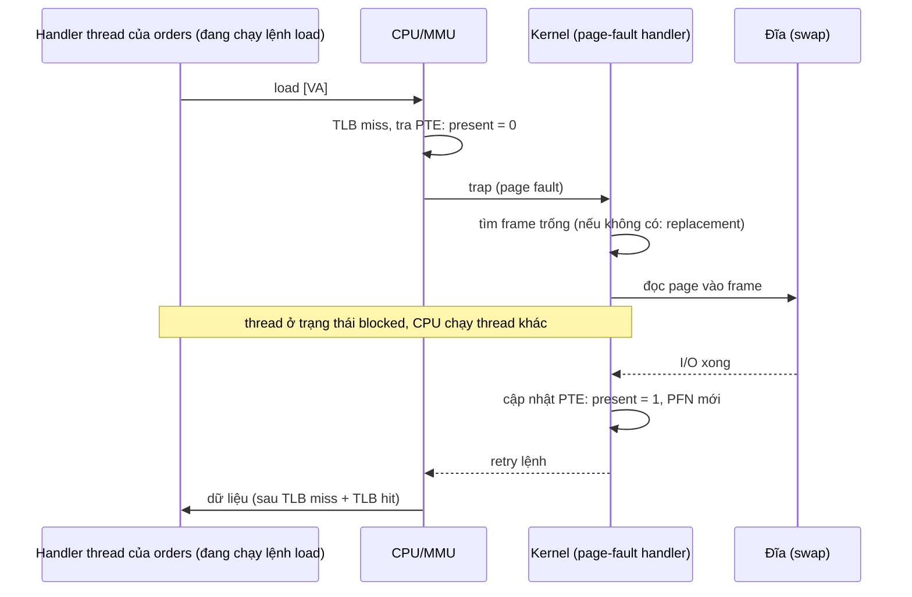
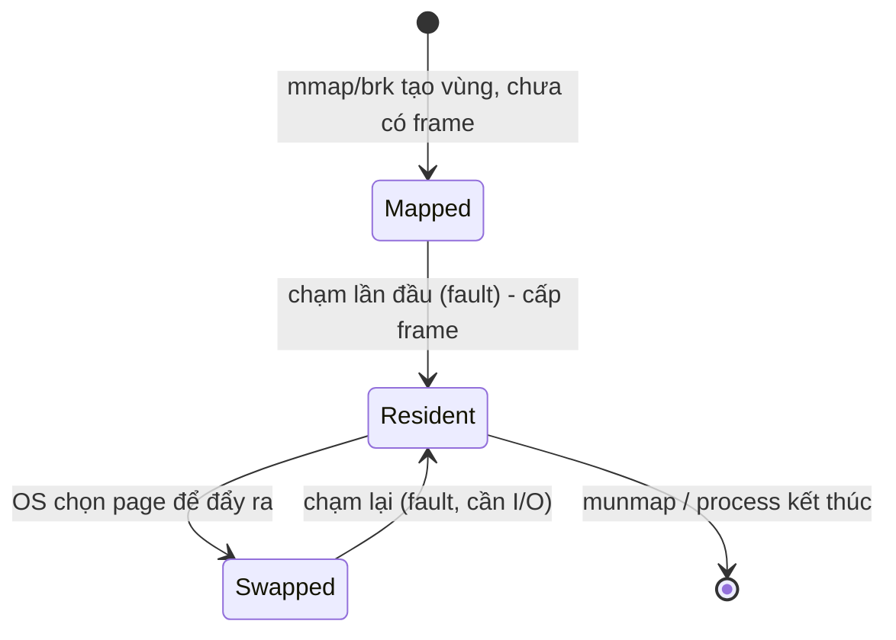
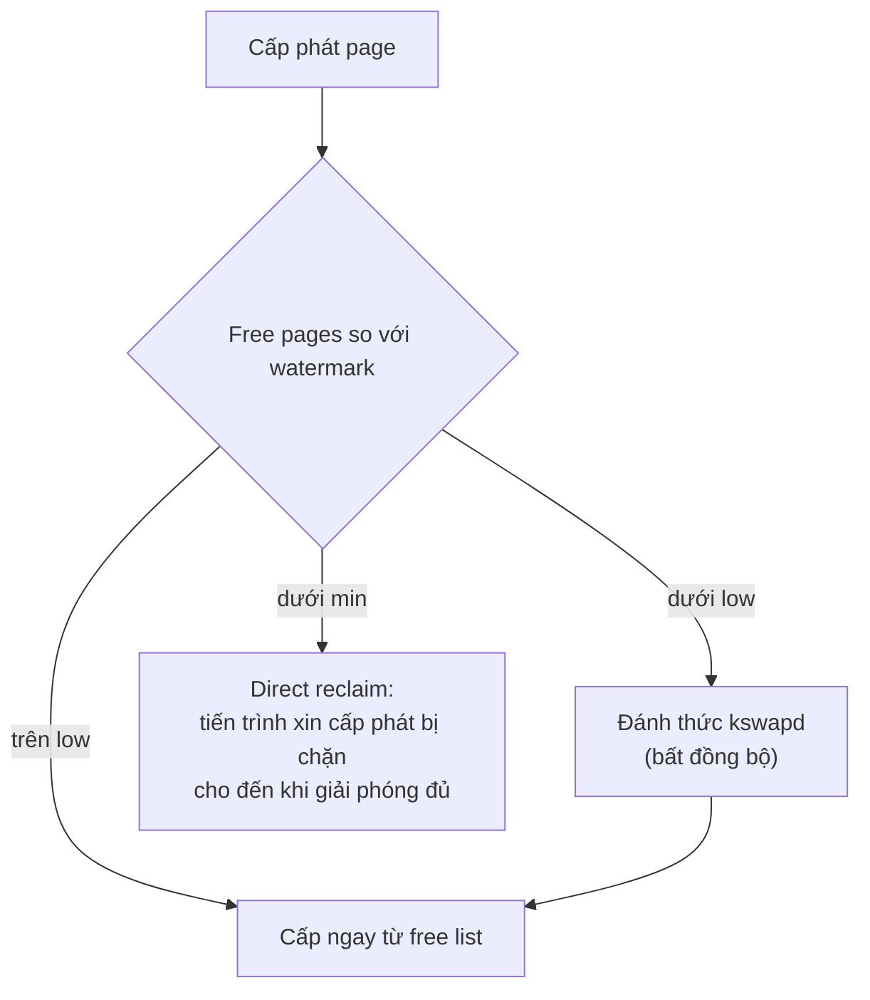

# P3 · Chương 04 — Page fault, demand paging và swapping

## Bạn sẽ hiểu được gì

Sau chương này bạn trả lời được:

1. **Q1.** Present bit trong PTE để làm gì, và khi nó bằng 0 thì CPU/kernel làm gì tiếp theo, theo thứ tự nào? → mục 1
2. **Q2.** Page fault có phải là "lỗi" không? Khi nào nó là chuyện bình thường (demand paging, demand zeroing), khi nào nó giết process? → mục 2
3. **Q3.** Swap space là gì, vì sao kernel không đợi hết RAM mới bắt đầu giải phóng bộ nhớ, và `kswapd` cùng low/high watermark phối hợp ra sao? → mục 3
4. **Q4.** Khi RAM đầy, chọn page nào để đẩy ra? So sánh OPT, FIFO, Random, LRU, clock; dirty bit làm thay đổi quyết định thế nào? → mục 4
5. **Q5.** Thrashing là gì, OOM killer xuất hiện ở đâu trong bức tranh đó và chọn nạn nhân thế nào (`oom_score`, `oom_score_adj`)? → mục 5
6. **Q6.** Minor fault và major fault khác nhau thế nào, đọc chúng ở đâu (`getrusage(2)`, `/proc/<pid>/stat`)? → mục 6
7. **Q7.** Trên Linux, `swappiness` và cgroup `memory.high`/`memory.max`/`memory.swap.max` điều khiển cái gì? → mục 7
8. **Q8.** Vì sao nhiều hệ thống production tắt hoặc hạn chế swap, và lập luận đó đúng đến đâu? → mục 8

## Kiến thức cần trước

- [Chương 01 — Address space](./01-address-space.md): virtual address, ba mục tiêu của VM.
- [Chương 02 — Dịch địa chỉ](./02-address-translation.md): base/bounds, segmentation, paging.
- [Chương 03 — Page table và TLB](./03-page-table-va-tlb.md): PTE, present/valid bit, TLB hit/miss. Chương này giả định bạn đã biết TLB miss khác page fault.

Xuyên suốt chương ta bám theo một service giả định tên `orders`: viết bằng Rust, chạy trong một container trên Linux, có một pool handler thread và giữ trong RAM một cache đơn hàng khá lớn. Đây là ví dụ của người soạn, không phải code trong repo. Mỗi mục sẽ mở đầu bằng việc cơ chế của mục đó chạm vào `orders` ở chỗ nào.

## 1. Present bit và page fault: cơ chế từng bước (Q1)

> **Trả lời ngắn.** Present bit trong PTE bằng 1 nghĩa là page đang ở RAM, bằng 0 nghĩa là nó nằm ở đâu đó trên đĩa[^ostep-present]. Chương trình chạm vào một page không có trong RAM thì gây ra page fault[^ostep-pf]. Lúc đó một đoạn code của OS, gọi là page-fault handler, chạy để xử lý[^ostep-pf-handler]. Handler tìm một frame trống rồi đọc page từ swap về[^ostep-handler-io]. Đọc xong, nó cập nhật PTE và cho lệnh bị fault chạy lại[^ostep-retry].

**Giải thích.**

*Với service `orders`.* Giả sử máy đang thiếu RAM nên kernel đã đẩy một phần cache đơn hàng ít dùng ra đĩa. Rồi một request hỏi đúng một đơn hàng nằm trong phần đó. Handler thread chạy một lệnh load hoàn toàn bình thường, nhưng page chứa đơn hàng không còn trong RAM. Câu hỏi của mục này: CPU và kernel làm gì để request vẫn nhận được đúng dữ liệu, và theo thứ tự nào?

### 1.1 Vì sao có page nằm ngoài RAM

Ở các chương trước ta coi như mọi page đều nằm sẵn trong RAM. Thực tế không như vậy. Ngay từ thời multiprogramming (nhiều chương trình cùng nằm trong máy), người ta đã cần đẩy bớt page ra ngoài, vì máy đời đầu không chứa nổi mọi page mà mọi process cần cùng lúc[^ostep-multiprog]. Muốn đẩy ra thì phải có chỗ cất: một nơi lớn hơn RAM, và vì thế chậm hơn. Trong memory hierarchy đó là ổ đĩa, nằm dưới đáy, còn RAM ngay phía trên[^ostep-hier].

Phần còn lại của chương đi theo thứ tự: cơ chế phát hiện "page không có trong RAM" rồi nạp lại nó (mục 1–2), swap và chính sách chọn page để đẩy ra (mục 3–4), hậu quả khi thiếu RAM (mục 5), và cách Linux đo lường, điều khiển nó (mục 6–8).

### 1.2 Present bit và page fault

Nhắc lại luồng ở [chương 03](./03-page-table-va-tlb.md): phần cứng lấy VPN từ virtual address rồi tra TLB; nếu miss thì tra page table, và nếu page vừa hợp lệ vừa nằm trong RAM thì lấy PFN, nạp vào TLB rồi chạy lại lệnh[^ostep-tlbpath]. Để cho phép swap, mỗi PTE cần thêm một thông tin nữa là *present bit*. Bằng 1 nghĩa là page đang ở physical memory; bằng 0 nghĩa là nó ở đâu đó trên đĩa[^ostep-present].

Khi CPU gặp present bit bằng 0, việc chạm vào page đó gọi là **page fault**[^ostep-pf]. Phần cứng không tự xử lý được nên trap vào kernel, và kernel chạy *page-fault handler*[^ostep-pf-handler]. Handler cần biết page đang nằm ở đâu trên đĩa. OSTEP nêu một cách tự nhiên: dùng luôn các bit của PTE thường chứa PFN để lưu địa chỉ trên đĩa, vì page đã ra khỏi RAM thì PFN không còn nghĩa nữa[^ostep-pte-disk].

Từ đó handler làm bốn bước (đây là phiên bản phần mềm trong sách):

1. Tìm một physical frame cho page sắp nạp[^ostep-handler-frame]. Nếu không còn frame trống thì phải chạy thuật toán thay thế (replacement) để đẩy bớt một page khác ra, xem mục 4.
2. Có frame rồi, phát I/O đọc page từ swap space[^ostep-handler-io].
3. Khi I/O xong, cập nhật page table (đánh dấu present, ghi PFN mới) và chạy lại lệnh bị fault[^ostep-retry].
4. Lần chạy lại có thể vẫn TLB miss (được xử lý và nạp TLB), rồi lần cuối mới TLB hit và đọc được dữ liệu[^ostep-retry2].



Trong lúc đợi I/O, thread ở trạng thái *blocked* và OS chạy được thread sẵn sàng khác[^ostep-blocked]. Với `orders`, nghĩa là request đó chậm đi một khoảng bằng thời gian đọc đĩa, các handler thread còn lại vẫn phục vụ bình thường, và code của handler không hề thấy chuyện gì xảy ra ngoài độ trễ.

<details><summary>Đi sâu: vì sao fault do phần mềm xử lý, thuật ngữ "page fault" lỏng, và chi phí đĩa so với RAM (AMAT)</summary>

- **Thuật ngữ lỏng.** Trong OSTEP, "page fault" cũng có thể chỉ bất kỳ lần tham chiếu page table nào sinh ra lỗi[^ostep-pfterm].
- **Ai xử lý fault.** Gần như mọi hệ thống xử lý page fault bằng phần mềm, kể cả khi TLB do phần cứng quản lý, phần cứng vẫn tin OS làm việc này[^ostep-pf-sw]. Lý do có hai. Truy cập đĩa vốn chậm đến mức chi phí chạy thêm phần mềm là không đáng kể. Và nếu phần cứng tự xử lý thì nó phải hiểu swap space, cách phát I/O xuống đĩa và nhiều chi tiết khác mà nó không biết[^ostep-why-sw].
- **AMAT.** Đây là con số minh họa của OSTEP về thời gian truy cập *trung bình*, không phải thời gian của một major fault: RAM khoảng 100 ns, đĩa khoảng 10 ms[^ostep-amat-cost]. Với miss rate 10% thì AMAT cỡ 1 ms; hit rate 99,9% cho 10,1 µs, nhanh hơn khoảng 100 lần[^ostep-amat-num]. Một miss rate rất nhỏ cũng nhanh chóng chi phối cả chương trình[^ostep-amat]. Những con số này là của đĩa quay đời cũ; OSTEP nhận xét SSD flash đã làm đổi lại tỉ lệ đó[^ostep-ssd].

</details>

**Quay lại Q1:** present bit = 0 nghĩa là page ở đĩa; chạm vào nó thì trap vào handler của OS, handler tìm frame, đọc swap, cập nhật PTE rồi chạy lại lệnh, còn thread chỉ thấy mình chậm đi.

## 2. Page fault không phải lúc nào cũng là lỗi (Q2)

> **Trả lời ngắn.** Page fault không nhất thiết là lỗi. Với hầu hết page, OS chỉ đưa page vào bộ nhớ khi nó thật sự được truy cập (demand paging)[^ostep-demand]. Khi process xin thêm page cho heap, OS cũng chỉ "hứa" cho tới lúc page bị chạm (demand zeroing)[^ostep-demand-zero]. Chỉ khi truy cập một page không hợp lệ, ví dụ do bug, process mới nhiều khả năng bị kết thúc[^ostep-pf-flow].

**Giải thích.**

*Với service `orders`.* Lúc khởi động, `orders` dựng cache: cấp phát một vùng nhớ rất lớn rồi dần dần điền đơn hàng vào. Ngay sau lệnh cấp phát, RSS (lượng RAM thật process đang giữ) gần như chưa nhúc nhích. Nó chỉ tăng khi request và các bước nạp dữ liệu thật sự chạm vào từng page. Vì sao kernel làm vậy, và những lúc nào page fault là chuyện bình thường?

### 2.1 Làm việc theo kiểu lười

Với hầu hết page, OS dùng *demand paging*: chỉ đưa page vào bộ nhớ khi có người truy cập, "on demand"[^ostep-demand]. Một dạng lười tương tự là *demand zeroing*. Khi process xin thêm page cho heap, OS không tìm frame, không xóa page về 0 và không map ngay; nó đợi đến khi page bị chạm. Nếu process không bao giờ chạm thì toàn bộ công việc đó được tránh[^ostep-demand-zero]. Đây là kỹ thuật của hầu hết hệ thống hiện đại[^ostep-lazy-modern].

Với `orders`: cấp phát cache 2 GiB (số giả định) chưa tốn 2 GiB RAM nào. Bộ nhớ chỉ bị tính khi page bị chạm, nên "RSS thấp ngay sau khi cấp phát" không có nghĩa là chưa tốn (nhận xét của người soạn).

### 2.2 Ba trường hợp khi tra PTE

Khi tra PTE sau một TLB miss, có ba khả năng, theo OSTEP:

1. Page vừa valid vừa present: chỉ là TLB miss thông thường.
2. Page hợp lệ nhưng không present: page-fault handler chạy, như ở mục 1.
3. Page không hợp lệ, ví dụ do bug: phần cứng trap, trap handler của OS chạy và nhiều khả năng kết thúc process vi phạm[^ostep-pf-flow].

Ở trường hợp (2), handler phục vụ xong thì lệnh được chạy lại, nên chương trình không thấy gì ngoài độ trễ. Chỉ trường hợp (3) mới có khả năng làm chương trình chết (suy luận của người soạn từ ba trường hợp trên). Với `orders`: chạm lần đầu vào một page của cache là trường hợp (2); dereference một con trỏ rác trong code `unsafe` là trường hợp (3).

Vòng đời của một page bộ nhớ ẩn danh (anonymous memory, tức bộ nhớ không có file phía sau) trông như sơ đồ dưới. Đây là mô hình khái niệm do người soạn tổng hợp: tên trạng thái và mũi tên là của người soạn, không phải thuật ngữ của OSTEP hay kernel.



Hệ quả thực dụng cho người vận hành (nhận xét của người soạn): một service vừa khởi động thường có nhiều page fault (code, thư viện, heap chạm lần đầu) rồi dịu dần. Đừng đọc đó là dấu hiệu bất thường.

<details><summary>Đi sâu: zero page trong kernel docs và SIGSEGV/SIGBUS trên Linux</summary>

- Kernel docs mô tả đúng cơ chế này cho anonymous memory: lần đọc đầu tạo ra một PTE trỏ tới một physical page đặc biệt toàn số 0, và khi chương trình ghi thì một page vật lý thật mới được cấp để chứa dữ liệu[^kdoc-anon-zero]. Page bị ghi được đánh dấu dirty, và nếu kernel quyết định tái sử dụng thì page dirty đó sẽ bị swap out[^kdoc-anon-dirty].
- Trên Linux, một truy cập bộ nhớ không hợp lệ có thể biểu hiện thành `SIGSEGV` hoặc `SIGBUS`. Man page `signal(7)` (mục BUGS) lưu ý rằng một truy cập gây `SIGSEGV` trên kiến trúc CPU này có thể gây `SIGBUS` trên kiến trúc khác, và ngược lại[^sig-segv].

</details>

**Quay lại Q2:** page fault thường chỉ là cơ chế lười của OS (demand paging, demand zeroing); chỉ truy cập page không hợp lệ mới có khả năng giết process.

## 3. Swap space, watermark và kswapd (Q3)

> **Trả lời ngắn.** Swap space là vùng trên đĩa mà OS dành để cất các page bị đẩy ra khỏi RAM[^ostep-swap]. OS không đợi RAM đầy hẳn: khi số page trống thấp hơn low watermark, một thread nền (trên Linux là `kswapd`) chạy để giải phóng bộ nhớ[^kdoc-kswapd]. Nếu số page trống vẫn tụt đến min watermark thì chính yêu cầu cấp phát bị chặn để tự dọn (direct reclaim)[^kdoc-direct].

**Giải thích.**

*Với service `orders`.* Một handler thread của `orders` parse request và xin thêm một ít page cho buffer. Nếu lúc đó RAM của máy đã cạn thì thread phải đứng chờ kernel dọn chỗ, và request của nó chậm theo. Kernel tránh tình huống đó bằng cách dọn bộ nhớ từ sớm, ở nền. Mục này giải thích cách làm đó, và việc gì xảy ra với handler thread khi cách làm đó không đủ.

### 3.1 Swap space

OS dành một vùng trên đĩa để chuyển page qua lại. OSTEP gọi nó là *swap space*, vì ta swap page ra khỏi bộ nhớ vào đó và swap page từ đó vào bộ nhớ[^ostep-swap]. Muốn dùng được, OS phải nhớ địa chỉ trên đĩa của từng page đã đẩy ra, và đọc ghi swap theo đơn vị page[^ostep-swap-unit]. Kích thước swap có ý nghĩa vì nó quyết định số page tối đa có thể đang được dùng trong hệ thống tại một thời điểm[^ostep-swapsize].

### 3.2 Page nào cần swap, page nào thì không

Swap không phải nơi duy nhất trên đĩa mà page có thể "ở nhờ". Page chứa code của chương trình đã có bản gốc trong file thực thi trên đĩa. Khi cần chỗ, OS dùng lại frame của các page code đó và nạp lại từ file nhị phân khi cần[^ostep-codepages]. Nói chung, page có "bản gốc" trong file mà chưa bị sửa thì đẩy ra không cần ghi lại (xem page clean ở mục 4). Còn page chỉ tồn tại trong RAM, như heap hay stack đã bị ghi, thì khi kernel tái sử dụng sẽ phải swap out[^kdoc-anon-dirty].

Linux phân biệt đúng như vậy. Bộ nhớ không có file phía sau (stack, heap, `mmap` ẩn danh) là *anonymous memory*[^kdoc-anon]. Dữ liệu file được giữ trong *page cache*; nếu bị sửa thì page được đánh dấu dirty và phải đồng bộ với thiết bị trước khi tái sử dụng[^kdoc-pagecache]. Page có thể giải phóng bất cứ lúc nào gọi là *reclaimable*[^kdoc-reclaimable].

Với `orders`: cache đơn hàng là anonymous memory, nên nếu bị đẩy ra thì chỉ còn swap là chỗ để cất. Còn file thực thi của `orders` và các file nó đọc thì đã có bản trên đĩa.

### 3.3 Khi nào bắt đầu dọn: watermark

Mô hình ngây thơ là đợi RAM đầy hoàn toàn rồi mới đẩy một page ra mỗi khi cần. OSTEP cho rằng cách đó không thực tế, nên nhiều hệ điều hành chủ động giữ một ít bộ nhớ trống. Cách làm dùng hai ngưỡng: *high watermark* (HW) và *low watermark* (LW). Khi OS thấy số page trống ít hơn LW, một thread nền chuyên giải phóng bộ nhớ chạy[^ostep-watermark]. Nó đẩy page ra cho tới khi có HW page trống[^ostep-hw], rồi đi ngủ. Thread này còn gọi là *swap daemon* hay *page daemon*[^ostep-daemon].

### 3.4 Cách Linux làm: kswapd và direct reclaim

Linux dùng đúng ý tưởng đó, thêm một ngưỡng nữa. Khi hệ thống ít tải, phần lớn bộ nhớ còn trống và yêu cầu cấp phát được đáp ứng ngay. Tải tăng thì page trống giảm dần, và khi chạm ngưỡng *low watermark*, một yêu cầu cấp phát sẽ đánh thức daemon `kswapd`[^kdoc-kswapd]. `kswapd` quét page một cách bất đồng bộ: page nào có dữ liệu sẵn ở nơi khác thì chỉ cần giải phóng, page còn lại thì đẩy ra thiết bị lưu trữ phía sau[^kdoc-kswapd2]. Nếu mức dùng bộ nhớ vẫn tăng đến ngưỡng thứ hai, *min watermark*, thì yêu cầu cấp phát kích hoạt *direct reclaim*: nó bị chặn cho đến khi đủ page được giải phóng[^kdoc-direct].



Hệ quả với `orders`: ở nhánh `kswapd`, handler thread xin page vẫn được cấp ngay và không biết có ai dọn nền. Ở nhánh direct reclaim, chính handler thread đó bị chặn để tự dọn bộ nhớ, nên latency của request bị kéo dài. `kswapd` tồn tại để tránh nhánh thứ hai (nhận xét của người soạn).

<details><summary>Đi sâu: các sysctl vm điều chỉnh watermark</summary>

- `watermark_scale_factor` kiểm soát độ hung hăng của `kswapd`. Đơn vị là phần mười nghìn; mặc định 10 nghĩa là khoảng cách giữa các watermark bằng 0,1% bộ nhớ khả dụng[^sysctl-wsf].
- `min_free_kbytes` buộc VM giữ tối thiểu một lượng KB trống để tính watermark `WMARK_MIN`[^sysctl-minfree]. Tài liệu cảnh báo đặt giá trị quá cao sẽ làm máy hết bộ nhớ (OOM) ngay lập tức[^sysctl-minfree-warn].
- Tín hiệu cho thấy cần chỉnh là nhiều thread vào direct reclaim (`allocstall`) hoặc `kswapd` ngủ quá sớm[^sysctl-wsf-hint].

</details>

**Quay lại Q3:** swap space là chỗ trên đĩa cất page bị đẩy ra; `kswapd` chạy nền khi page trống xuống dưới low watermark để request cấp phát không phải tự dọn (direct reclaim).

## 4. Chính sách thay trang (Q4)

> **Trả lời ngắn.** OPT (thay page sẽ được dùng xa nhất trong tương lai) là mốc lý tưởng nhưng không cài được vì không biết tương lai[^ostep-opt-tip]. FIFO (thay page vào trước nhất) dễ cài[^ostep-fifo]. Nhưng nó không phân biệt được page quan trọng[^ostep-fifo-imp]. LRU (thay page lâu nhất chưa được dùng) tận dụng locality nhưng chính xác thì quá đắt[^ostep-lru-cost]. Vì vậy hệ thống thật dùng xấp xỉ như clock với use bit[^ostep-clock-prop]. Page clean (chưa bị sửa) thì loại miễn phí, còn page dirty (đã bị sửa) phải ghi xuống đĩa trước[^ostep-dirty-free].

**Giải thích.**

*Với service `orders`.* Cache đơn hàng của `orders` lớn hơn phần RAM còn lại, nên khi cần chỗ kernel phải chọn page nào của nó (hoặc của process khác) để đẩy ra. Phần lớn request chạm vào một nhóm nhỏ đơn hàng gần đây, vậy nên giữ nhóm đó trong RAM là hợp lý. Ngược lại, một job export định kỳ quét lần lượt toàn bộ cache hết vòng này đến vòng khác lại có kiểu truy cập rất khác. Mục này so các chính sách chọn nạn nhân và xem chúng đối xử với hai kiểu truy cập đó ra sao (nhận xét của người soạn về cách ánh xạ).

### 4.1 Bài toán và thước đo

Khi RAM đầy, OS phải chọn một page làm nạn nhân. Chọn sai có thể khiến chương trình chạy ở tốc độ đĩa thay vì tốc độ bộ nhớ[^ostep-replace]. OSTEP coi bộ nhớ chính là cache của các page ảo, nên mục tiêu là giảm tối thiểu số lần phải nạp page từ đĩa[^ostep-cache]. Cache này là fully-associative nên không có conflict miss như cache phần cứng[^ostep-fullassoc].

Các ví dụ dưới đây dùng chuỗi tham chiếu của OSTEP `0, 1, 2, 0, 1, 3, 0, 3, 1, 2, 1` với cache 3 page[^ostep-trace]. Ba tham chiếu đầu luôn miss vì cache còn rỗng (*cold-start* hay *compulsory miss*)[^ostep-cold].

### 4.2 OPT, FIFO, Random

**OPT** (Belady's MIN) thay page sẽ được truy cập xa nhất trong tương lai, nên cho số miss ít nhất[^ostep-opt]. OS đa dụng không cài được nó vì không biết tương lai; giá trị của OPT là làm mốc so sánh[^ostep-opt-tip]. Trên chuỗi mẫu OPT có 6 hit, 5 miss[^ostep-opt-rate].

**FIFO** thay page vào trước nhất. Ưu điểm duy nhất của nó là dễ cài[^ostep-fifo]. Nhược điểm là không phân biệt được page quan trọng: page 0 dù được truy cập nhiều lần vẫn bị đá ra chỉ vì vào bộ nhớ đầu tiên[^ostep-fifo-imp]. Trên chuỗi mẫu FIFO chỉ đạt 36,4% hit rate (57,1% nếu bỏ compulsory miss)[^ostep-fifo-rate].

**Random** chọn ngẫu nhiên. Qua 10.000 lần thử trên chuỗi mẫu, hơn 40% số lần nó đạt 6 hit (bằng OPT), nhưng có lần chỉ 2 hit hoặc ít hơn[^ostep-random].

### 4.3 LRU

LRU dựa vào locality: page được truy cập càng gần đây thì càng dễ được truy cập lại[^ostep-recency]. Nó thay page ít được dùng gần đây nhất. Trên chuỗi mẫu LRU bằng OPT (6 hit)[^ostep-lru-match]. OSTEP thừa nhận chuỗi này được chọn để minh họa[^ostep-cooked]. Mô phỏng của người soạn khớp: OPT 6, LRU 6, FIFO 4 hit.

Với `orders`, LRU giữ đúng nhóm đơn hàng gần đây trong RAM. Cái giá là LRU chính xác đòi mỗi lần truy cập bộ nhớ phải cập nhật một cấu trúc dữ liệu, và OSTEP cảnh báo nếu không cẩn thận thì phần "accounting" này có thể kéo hiệu năng xuống nghiêm trọng[^ostep-lru-cost]. Máy 4 GB RAM với page 4 KB có 1 triệu page để quét[^ostep-lru-scan], nên hệ thống thật dùng xấp xỉ.

### 4.4 Clock, use bit và dirty bit

Phần cứng đặt *use bit* thành 1 mỗi khi page được tham chiếu; việc xóa bit là của OS[^ostep-usebit]. Thuật toán **clock** xếp các page thành một vòng tròn có một "kim"[^ostep-clock-ring]. Khi cần thay, nếu use bit của page kim đang trỏ là 1 thì page đó vừa được dùng nên không phải ứng viên tốt[^ostep-clock-1]; OS xóa bit rồi dịch kim, và gặp use bit 0 thì chọn làm nạn nhân. Ưu điểm là không phải quét lặp lại toàn bộ bộ nhớ để tìm page không dùng[^ostep-clock-prop].

Còn một yếu tố nữa là page đã bị sửa hay chưa. Page *clean* (chưa bị sửa) thì loại miễn phí, frame dùng lại ngay[^ostep-dirty-free]. Page *dirty* thì phải ghi xuống đĩa trước. Vì vậy một số hệ VM ưu tiên loại page clean[^ostep-dirty-prefer]. Để biết page nào dirty, chúng dựa vào *dirty bit* mà phần cứng đặt khi page bị ghi, và clock có thể sửa để tìm page vừa không dùng vừa clean trước[^ostep-dirty-bit]. Trên Linux, page cache dirty được đồng bộ ra thiết bị trước khi tái sử dụng[^kdoc-pagecache]. Còn anonymous page đã ghi thì bị swap out khi kernel tái sử dụng[^kdoc-anon-dirty].

Với `orders`: page của cache đơn hàng đã bị ghi là dirty nên đắt hơn để loại; page của file thực thi thì rẻ.

<details><summary>Đi sâu: Belady's anomaly, workload mô phỏng, biến thể clock, scan resistance</summary>

- **Belady's anomaly.** Với FIFO, tăng cache có thể làm hit rate *giảm* (chuỗi `1,2,3,4,1,2,5,1,2,3,4,5`, từ 3 lên 4 page)[^ostep-belady]. LRU có *stack property* (cache cỡ N+1 chứa cache cỡ N) nên không bị; FIFO và Random không có tính chất này[^ostep-stackprop]. Mô phỏng Python của người soạn xác nhận: FIFO 9 miss với 3 frame, 10 miss với 4 frame; LRU 10 miss với 3 frame, 8 miss với 4 frame.
- **Workload mô phỏng của OSTEP.** Không có locality thì mọi chính sách thực tế như nhau[^ostep-nolocality]. Workload 80-20 thì LRU tốt hơn vì giữ được page "nóng"[^ostep-8020]. Looping sequential qua 50 page là worst case của LRU và FIFO: cache 49 page vẫn hit rate 0%, còn Random thì khác 0[^ostep-loop]. Mô phỏng của người soạn khớp (50 page lặp 200 vòng, cache 49: LRU và FIFO 0 hit, OPT 9747 hit). Job export của `orders` ở đầu mục là kiểu truy cập này khi cache lớn hơn phần RAM dành cho nó (nhận xét của người soạn).
- **Clock trong mô phỏng.** Với workload 80-20, biến thể clock mà OSTEP mô phỏng (quét ngẫu nhiên) kém LRU hoàn hảo nhưng tốt hơn các cách không dùng lịch sử[^ostep-clock-80]. Mô phỏng clock chuẩn của người soạn (kim bắt đầu ở frame đầu, page mới nạp có use bit 1) cho 4 hit trên chuỗi mẫu 11 phần tử, như FIFO. Kết quả phụ thuộc biến thể nên đừng suy diễn rộng.
- **Scan resistance.** Hệ thống hiện đại còn thêm các tweak như *scan resistance*: thuật toán scan-resistant thường giống LRU nhưng cố tránh worst case của LRU với workload looping-sequential[^ostep-scanres]. Chương này không đi sâu chính sách cụ thể của Linux.

</details>

**Quay lại Q4:** OPT là mốc không đạt được, FIFO ngây thơ, LRU tốt nhưng đắt nên thực tế dùng clock; và page clean luôn rẻ hơn page dirty để loại.

## 5. Thrashing và OOM killer (Q5)

> **Trả lời ngắn.** Thrashing là khi các process đang chạy cần nhiều bộ nhớ hơn RAM thực có, nên hệ thống phải liên tục chuyển page qua lại giữa RAM và đĩa[^ostep-thrash]. Nếu kernel vẫn không giải phóng đủ bộ nhớ, OOM killer (bộ phận của kernel kết thúc bớt process khi hết bộ nhớ) chọn một process để "hy sinh" cho cả hệ thống sống tiếp[^kdoc-oom]. Mỗi process có một điểm `/proc/<pid>/oom_score`, điểm càng cao càng dễ bị chọn[^proc-oomscore]. Người vận hành chỉnh điểm bằng `oom_score_adj`, và giá trị −1000 tương đương loại process đó khỏi OOM-kill[^proc-oomadj-add].

**Giải thích.**

*Với service `orders`.* Giả sử lưu lượng tăng đột ngột: `orders` mở thêm kết nối, mỗi handler thread cần thêm bộ nhớ, trong khi cache vẫn phải nằm trong RAM. Nếu tổng bộ nhớ mà tất cả process đang dùng tích cực vượt RAM, mọi handler thread của `orders` sẽ liên tục chờ đĩa. Cuối cùng kernel có thể giết một process để lấy lại bộ nhớ, và `orders` hoàn toàn có thể là process bị chọn. Mục này đi theo chuỗi leo thang đó, rồi xem kernel chọn nạn nhân ra sao.

### 5.1 Từ thiếu RAM đến có process bị giết

Thứ tự dưới đây ghép từ các nguồn trong chương, thứ tự ghép là của người soạn:

1. *Thiếu RAM, paging không dứt.* Nếu tổng bộ nhớ các process đang dùng tích cực vượt RAM, hệ thống phải liên tục nạp page vào và đẩy page ra. Đó là *thrashing*[^ostep-thrash]. Mỗi lần nạp lại là một page fault chờ I/O đĩa như ở mục 1, nên thời gian trôi vào chờ đĩa thay vì chạy code (suy luận của người soạn từ mục 1 và mục 4).
2. *Giảm tải có chủ đích.* Một số hệ điều hành cũ phát hiện thrashing thì không chạy một tập con process, hy vọng *working set* (các page process đang dùng tích cực) của số còn lại vừa RAM. Cách này gọi là *admission control*, theo tinh thần "làm ít việc cho tốt còn hơn làm mọi thứ cùng lúc cho tệ"[^ostep-admission].
3. *Linux giải phóng bộ nhớ trước.* Khi page trống tụt dưới các watermark, `kswapd` rồi direct reclaim cố giải phóng page (mục 3).
4. *Hết cách thì giết.* Khi bộ nhớ cạn mà kernel không giải phóng đủ để tiếp tục hoạt động, nó gọi OOM killer[^kdoc-oom-trigger]. Thủ tục này chọn một task để hy sinh, hy vọng sau khi task thoát thì bộ nhớ được giải phóng đủ để hệ thống chạy bình thường[^kdoc-oom]. OSTEP mô tả đây là cách thô bạo hơn admission control: một số phiên bản Linux chạy OOM killer khi bộ nhớ bị oversubscribe (cấp phát vượt khả năng cung cấp)[^ostep-oom].

### 5.2 Chọn nạn nhân

Kernel gán cho mỗi process một điểm; `/proc/<pid>/oom_score` hiển thị điểm đó, và điểm càng cao thì process càng dễ bị OOM killer chọn[^proc-oomscore]. Cơ sở của điểm là lượng bộ nhớ process dùng[^proc-oomscore-basis]. Với `orders`, nghĩa là process giữ cache lớn dễ nằm gần đầu danh sách (suy luận của người soạn từ cơ sở tính điểm).

Người vận hành can thiệp bằng `oom_score_adj` (−1000 đến +1000). Giá trị này được cộng vào điểm trước khi kernel quyết định giết task nào[^proc-oomadj-added]. Đặt −1000 thì tương đương tắt hoàn toàn OOM-kill cho task đó[^proc-oomadj-add]. Thang điểm chi tiết nằm ở phần Đi sâu bên dưới.

<details><summary>Đi sâu: thang điểm badness, process root, ngữ cảnh cgroup và các sysctl OOM</summary>

- **Thang điểm.** `oom_score_adj` điều chỉnh một heuristic cho điểm "badness" từ 0 (không bao giờ giết) đến 1000 (luôn giết)[^proc-oomadj-range]. Task dùng hết bộ nhớ được phép có điểm 1000, dùng nửa thì 500[^proc-oomadj-example]. Với process root, man page nói kernel tính như thể chúng có thêm 3% bộ nhớ so với task khác[^proc-oomadj-root].
- **Ngữ cảnh cgroup.** "Bộ nhớ được phép" phụ thuộc ngữ cảnh: nếu OOM xảy ra do chạm giới hạn bộ nhớ (hoặc swap) thì đó là giới hạn đã cấu hình[^proc-oomadj-context]. Vì vậy trong container có `memory.max`, OOM killer chạy trong cgroup đó và không giết task ngoài cgroup[^cg-oom-scope] (mục 7).
- **sysctl.** `vm.oom_kill_allocating_task` khác 0 thì kernel giết ngay task gây ra tình trạng hết bộ nhớ, tránh quét tasklist tốn kém[^sysctl-oomalloc]. `vm.panic_on_oom` bằng 0 thì kernel giết một process (oom_killer) và thường hệ thống vẫn sống tiếp[^sysctl-panic0]. Giá trị 1 và 2 dành cho failover trong cluster[^sysctl-panic].

</details>

**Quay lại Q5:** thrashing là paging liên tục khi working set vượt RAM; nếu reclaim vẫn không đủ thì OOM killer là biện pháp cuối, chọn task theo `oom_score` đã chỉnh bởi `oom_score_adj`.

## 6. Minor fault và major fault (Q6)

> **Trả lời ngắn.** Linux phân loại page fault theo việc có phải đọc đĩa hay không: *minor fault* không cần nạp page từ đĩa[^proc-minflt]. Còn *major fault* thì cần[^proc-majflt]. Hai con số này đọc được từ `getrusage(2)` (`ru_minflt`, `ru_majflt`) hoặc từ `/proc/<pid>/stat` (các trường minflt, majflt).

**Giải thích.**

*Với service `orders`.* Giả sử p99 của `orders` tăng và bạn nghi do page fault. Gọi chung là "page fault" thì chưa đủ để kết luận gì: fault do chạm lần đầu một page vừa cấp phát thì rẻ, còn fault phải đọc page từ đĩa thì đắt hơn nhiều. Linux tách hai loại đó thành hai bộ đếm để bạn nhìn ra `orders` đang gặp loại nào.

*Minor fault* là fault không cần nạp page từ đĩa[^proc-minflt]. *Major fault* là fault cần nạp page từ đĩa[^proc-majflt]. `getrusage(2)` trả hai đại lượng này, trước hết là `ru_minflt`: số page fault được phục vụ mà không có hoạt động I/O[^rusage-min]. Đại lượng kia là `ru_majflt`: số page fault được phục vụ mà cần I/O[^rusage-maj]. Cùng thông tin có thể đọc từ `/proc/<pid>/stat` (các trường minflt, majflt) mà không cần viết code.

Man page còn giải thích `ru_minflt` bao gồm trường hợp fault được phục vụ mà không cần I/O nhờ lấy lại ("reclaiming") một page frame từ danh sách page đang chờ cấp phát lại[^rusage-reclaim]. Major fault chờ I/O đĩa nên chậm hơn minor nhiều lần (suy luận của người soạn từ định nghĩa "cần I/O" và con số AMAT ở mục 1). Với `orders`: minor fault tăng đều lúc khởi động là bình thường (mục 2); major fault tăng trong lúc phục vụ request mới là dấu hiệu page của `orders` đang phải đọc lại từ đĩa.

<details><summary>Đi sâu: thí nghiệm đo minor fault bằng Rust</summary>

Đoạn Rust dưới (chỉ dùng `std`) đọc `minflt`/`majflt` từ `/proc/self/stat`, cấp `vec![0u8; 64 MiB]`, rồi chạm mỗi page (bước 4096 byte) hai lượt:

```rust
use std::fs;
fn faults() -> (u64, u64) {
    let s = fs::read_to_string("/proc/self/stat").unwrap();
    let rest = &s[s.rfind(')').unwrap() + 2..];
    let f: Vec<&str> = rest.split_whitespace().collect();
    (f[7].parse().unwrap(), f[9].parse().unwrap()) // minflt, majflt
}
fn main() {
    const N: usize = 64 * 1024 * 1024;
    let (a_min, a_maj) = faults();
    let mut v = vec![0u8; N];
    let (b_min, b_maj) = faults();
    for i in (0..N).step_by(4096) { v[i] = 1; }
    let (c_min, c_maj) = faults();
    for i in (0..N).step_by(4096) { v[i] = 2; }
    let (d_min, d_maj) = faults();
    println!("after vec![0;64MiB]: minor +{} major +{}", b_min - a_min, b_maj - a_maj);
    println!("first touch of 16384 pages: minor +{} major +{}", c_min - b_min, c_maj - b_maj);
    println!("second touch: minor +{} major +{}", d_min - c_min, d_maj - c_maj);
    std::hint::black_box(&v);
}
```

Chạy thật (rustc 1.95.0 `-O`, trong container Linux của lab, kernel 6.8.0, không có swap, hai lần chạy cho kết quả giống nhau):

```text
after vec![0;64MiB]: minor +2 major +0
first touch of 16384 pages: minor +16383 major +0
second touch: minor +0 major +0
```

Đọc kết quả (*quan sát* một lần chạy trên máy này, không phải bảo đảm của Rust hay kernel): cấp 64 MiB gần như không sinh fault. Lượt chạm đầu sinh gần đúng một minor fault cho mỗi page 4 KiB (16384 page; 16383 nghĩa là một page đã được chạm trước đó). Lượt hai không sinh fault vì các page đã present. Không có major fault vì không có gì phải đọc từ đĩa. Kết quả khớp với demand zeroing ở mục 2.

</details>

**Quay lại Q6:** minor fault không cần đọc đĩa, major fault cần; đọc chúng ở `getrusage(2)` hoặc `/proc/<pid>/stat`.

## 7. Linux: swappiness và cgroup (Q7)

> **Trả lời ngắn.** `vm.swappiness` (0–200) cho kernel biết chi phí I/O của swap so với paging filesystem, để cân áp lực giữa page cache và swap-backed page[^sysctl-swappiness]. Mặc định là 60[^sysctl-swap-default]. Trong cgroup v2, `memory.high` chỉ làm chậm (throttle) và không gọi OOM killer[^cg-high]. `memory.max` là giới hạn cứng, vượt thì OOM killer chạy trong cgroup đó[^cg-max]. Còn `memory.swap.max` giới hạn swap[^cg-swapmax].

**Giải thích.**

*Với service `orders`.* `orders` chạy trong một container, tức một cgroup có giới hạn bộ nhớ. Có hai núm điều khiển ảnh hưởng đến nó: `vm.swappiness` của cả máy, và các file `memory.*` của riêng cgroup. Mục này cho biết mỗi núm làm gì, để bạn không nhầm "đặt swappiness bằng 0" với "tắt swap".

`vm.swappiness` định nghĩa chi phí I/O tương đối của swap so với paging filesystem, trong khoảng 0 đến 200. Ở 100, VM coi hai chi phí bằng nhau và đặt áp lực lên page cache và swap-backed page như nhau[^sysctl-swappiness]. Giá trị mặc định là 60[^sysctl-swap-default].

Cần tránh một hiểu lầm: `swappiness=0` không phải "không bao giờ swap". Doc nói ở 0 kernel không *bắt đầu* swap cho đến khi free và file-backed page thấp hơn high watermark của zone[^sysctl-swap-zero]. Muốn tắt hẳn swap thì dùng `swapoff`, lệnh mà man page mô tả là tắt swapping trên các thiết bị và file chỉ định[^swapoff]. Với một cgroup, đặt `memory.swap.max` về 0 sẽ chặn swap out anonymous memory của cgroup đó (suy luận của người soạn từ định nghĩa `memory.swap.max` trong kernel docs[^cg-swapmax]).

cgroup v2 là nơi các khái niệm này gặp backend engineer nhiều nhất, vì mọi container đều là một cgroup. Với `orders`: vượt `memory.high` thì các thread của nó bị làm chậm nhưng không bị giết; vượt `memory.max` mà kernel không giảm được mức dùng thì OOM killer chạy trong chính cgroup đó và không đụng đến process ngoài cgroup. Các file `memory.high`, `memory.max`, `memory.swap.max`, `memory.oom.group` cùng các thí nghiệm đo (ghi file lớn, OOM, throttle) được trình bày một lần ở [Cgroups v2, mục 4](../08-containers/03-cgroups-v2.md).

<details><summary>Đi sâu: chọn giá trị swappiness và độ tuổi của tài liệu</summary>

- Doc nhắc rằng I/O filesystem dưới áp lực bộ nhớ thường hiệu quả hơn I/O ngẫu nhiên của swap, và giá trị tối ưu cần thử nghiệm theo workload[^sysctl-swap-opt]. Với swap trong bộ nhớ (zram, zswap) hoặc trên thiết bị nhanh hơn filesystem, có thể cân nhắc giá trị trên 100[^sysctl-swap-fast].
- Doc kernel mô tả phiên bản mới; hãy kiểm tra đúng phiên bản máy bạn (nhận xét của người soạn).

</details>

**Quay lại Q7:** swappiness cân áp lực giữa page cache và swap nhưng 0 không có nghĩa tắt; trong container, `memory.high` throttle còn `memory.max` mới gọi OOM killer (trong cgroup).

## 8. Vì sao production thường tắt hoặc hạn chế swap (Q8, nhận xét của người soạn)

> **Trả lời ngắn.** Lý do chính là latency khó đoán, và hệ thống suy giảm kéo dài thay vì chết rõ ràng (nhận xét của người soạn). Nhưng đây không phải chân lý chung. Kubernetes mặc định không khởi động kubelet trên node bật swap[^k8s-failswap], song vẫn có cơ chế để workload dùng swap khi footprint lớn mà chỉ truy cập một phần[^k8s-swap-use].

**Giải thích.**

Cả mục này là nhận xét của người soạn, dựa trên các sự kiện có nguồn ở trên; không phải khuyến nghị của tài liệu nào.

*Với service `orders`.* Giả sử bạn phải quyết định node chạy `orders` có bật swap hay không. Bật swap thì cache của `orders` có thêm chỗ để "tràn" ra đĩa thay vì bị OOM-kill ngay. Nhưng cái giá là những điều ở mục 1 và 5, và bốn lý do dưới đây giải thích vì sao nhiều đội vẫn chọn tắt.

1. **Latency khó đoán.** RAM và đĩa chênh nhau nhiều bậc độ lớn trên đĩa quay: ví dụ minh họa của OSTEP là 100 ns so với 10 ms, chênh 10⁵ lần[^ostep-amat-cost]. SSD thu hẹp khoảng cách này[^ostep-ssd]. Dù vậy, một major fault trong request path vẫn là một cú dừng cỡ I/O, khó chấp nhận với SLO p99 thấp.
2. **Suy giảm kéo dài thay vì chết rõ ràng.** Process bị swap nặng rơi vào thrashing[^ostep-thrash]: vẫn "sống" nhưng chậm đến mức health check timeout, trong khi node chưa bị đánh dấu hỏng. Process bị OOM-kill thì chết nhanh và orchestrator khởi động lại. Với service stateless có replica như `orders`, "chết nhanh" thường dễ vận hành hơn.
3. **Database/cache tự quản lý working set trong RAM.** Để kernel đẩy page của buffer pool ra đĩa là trái ý đồ của chương trình. Dùng giới hạn cgroup thay vì để kernel đoán.
4. **Nếu vẫn bật swap**, bạn có sẵn bốn núm kiểm soát. `memory.swap.max` chặn swap out của cgroup khi chạm giới hạn[^cg-swapmax]. `swappiness` cân áp lực giữa page cache và swap[^sysctl-swappiness]. `memory.high` throttle thay vì giết[^cg-high]. `oom_score_adj = -1000` loại process quan trọng khỏi OOM-kill[^proc-oomadj-add]. Chọn dựa vào đo đạc (`pgmajfault`, `allocstall`), không theo thói quen.

<details><summary>Đi sâu: điều kiện của lập luận — swap trên Kubernetes</summary>

Kubernetes ghi nhận swap có ích cho workload có footprint lớn nhưng chỉ truy cập một phần tại mỗi thời điểm[^k8s-swap-use]. Mặc định kubelet không khởi động trên node Linux bật swap[^k8s-failswap]. Hỗ trợ swap cho workload (feature gate `NodeSwap`) đã graduate lên stable ở Kubernetes v1.34[^k8s-gate-stable]. Nó phải đi kèm `failSwapOn: false`[^k8s-gate-fail]. Khi đó `memorySwap.swapBehavior` mặc định là `NoSwap`: workload trong Pod không dùng swap[^k8s-noswap]. Nhưng process ngoài container như dịch vụ systemd (kể cả kubelet) vẫn có thể dùng swap[^k8s-noswap-note]. Chọn `LimitedSwap` thì workload mới được dùng swap[^k8s-limited]. Tài liệu hiện hành (v1.37) loại Pod QoS Guaranteed và BestEffort khỏi swap, chỉ Burstable được dùng[^k8s-burstable]. Tức "tắt swap" là mặc định của một nền tảng, không phải chân lý chung. Trang tài liệu Kubernetes này không ghim phiên bản trong URL; trạng thái trên là của bản đọc khi soạn (nhận xét của người soạn).

</details>

**Quay lại Q8:** tắt swap là lựa chọn vận hành hợp lý vì latency và kiểu hỏng, nhưng điều kiện của lập luận (như Kubernetes ở trên) cho thấy nó không phải chân lý.

## Liên hệ với Rust

Rust không có API xử lý page fault: đó là việc của kernel và trong suốt với code. Với `orders` viết bằng Rust, những gì bạn thấy từ chương này là gián tiếp:

- **Cấp phát không đồng nghĩa với chạm.** `Vec::with_capacity(n)` yêu cầu allocator cấp đúng n phần tử[^vec-exact]. Trong thí nghiệm ở mục 6, `vec![0u8; 64 MiB]` gần như không sinh minor fault, và fault chỉ xuất hiện khi chạm từng page (quan sát trên Linux 6.8, không phải hợp đồng của `Vec`). Vì vậy nếu muốn `orders` chịu fault lúc khởi động thay vì ở request đầu tiên thì phải chạm page chủ động (suy luận của người soạn từ thí nghiệm).
- **Rust không ngăn OOM-kill hay swap.** Ownership bảo vệ tính an toàn bộ nhớ, không phải mức tiêu thụ. Khi `Vec` hết chỗ, nó có thể phải cấp phát một vùng mới rồi sao chép phần tử cũ sang[^book-vec-realloc]. Lúc đó `orders` tạm thời cần cả bản cũ lẫn bản mới, và có thể chạm giới hạn cgroup (suy luận của người soạn, chưa đo).
- Allocator, `GlobalAlloc`, bố cục `Vec`/`String` ở [chương 06](./06-heap-allocator.md) và [chương 08](./08-rust-va-bo-nho.md).

## Tóm tắt

- Present bit phân biệt page ở RAM với page ở đĩa. Chạm vào page không present là page fault, và OS xử lý bằng phần mềm: tìm frame, đọc từ swap, cập nhật PTE, chạy lại lệnh.
- Page fault thường là chuyện bình thường (demand paging, demand zeroing); chỉ truy cập page không hợp lệ mới giết process.
- Page có bản gốc trong file (code) có thể bị bỏ rồi nạp lại từ file; page chỉ có trong RAM thì phải ghi vào swap.
- OS không đợi RAM đầy: dưới low watermark, thread nền (`kswapd`) giải phóng đến high watermark; dưới min watermark thì direct reclaim chặn chính request cấp phát.
- OPT là mốc không cài được; FIFO có Belady's anomaly; LRU tận dụng locality nhưng đắt và tệ với looping sequential; clock xấp xỉ LRU bằng use bit; page clean loại rẻ hơn page dirty.
- Thrashing là paging liên tục khi working set vượt RAM; OOM killer là biện pháp cuối, chọn theo `oom_score`/`oom_score_adj`.
- Minor fault không cần đọc đĩa, major fault cần; đọc ở `getrusage(2)` hoặc `/proc/<pid>/stat`.
- Trong container: `memory.high` throttle, `memory.max` giết trong cgroup, `memory.swap.max` giới hạn swap; `swappiness=0` không có nghĩa tắt swap.
- Server production hay tắt swap vì latency khó đoán và suy giảm kéo dài (nhận xét của người soạn).

## Câu hỏi tự kiểm tra

1. Khi present bit bằng 0, ai xử lý và vì sao không phải phần cứng?

<details><summary>Đáp án</summary>

OS chạy page-fault handler[^ostep-pf-handler]. Gần như mọi hệ thống xử lý bằng phần mềm[^ostep-pf-sw], vì I/O đĩa chậm nên chi phí phần mềm không đáng kể. Phần cứng thì khó hiểu swap space và I/O[^ostep-why-sw].

</details>

2. Ba trường hợp khi tra PTE sau TLB miss là gì?

<details><summary>Đáp án</summary>

Valid và present: nạp TLB và chạy lại. Hợp lệ nhưng không present: page-fault handler. Không hợp lệ: trap, thường kết thúc process[^ostep-pf-flow].

</details>

3. Handler làm gì, theo thứ tự, khi page ở swap và RAM đầy?

<details><summary>Đáp án</summary>

Đầu tiên tìm frame (có thể phải replacement)[^ostep-handler-frame]. Sau đó phát I/O đọc từ swap[^ostep-handler-io]. Cuối cùng cập nhật page table rồi chạy lại lệnh[^ostep-retry]. Process blocked trong lúc chờ[^ostep-blocked].

</details>

4. Với anonymous memory, Linux làm gì khi chương trình chỉ đọc và khi ghi lần đầu?

<details><summary>Đáp án</summary>

Đọc: PTE trỏ tới physical page toàn số 0. Ghi: cấp page thật[^kdoc-anon-zero]. Đây là demand zeroing[^ostep-demand-zero].

</details>

5. Vai trò của low/high/min watermark?

<details><summary>Đáp án</summary>

Dưới LW thread nền bắt đầu chạy[^ostep-watermark]. Nó đẩy page ra cho đến khi có HW page trống[^ostep-hw]. Trên Linux, low watermark đánh thức `kswapd`[^kdoc-kswapd]. Min watermark kích hoạt direct reclaim chặn request cấp phát[^kdoc-direct].

</details>

6. Belady's anomaly là gì và vì sao LRU không bị?

<details><summary>Đáp án</summary>

Với FIFO, cache lớn hơn có thể cho hit rate thấp hơn[^ostep-belady]. LRU có stack property[^ostep-stackprop].

</details>

7. Workload nào là worst case của LRU/FIFO? Dirty bit đổi quyết định ra sao?

<details><summary>Đáp án</summary>

Looping sequential: 50 page lặp, cache 49 thì 0% hit[^ostep-loop]. Page clean loại miễn phí[^ostep-dirty-free]. Vì vậy một số hệ VM ưu tiên loại nó trước page dirty[^ostep-dirty-prefer].

</details>

8. Minor và major fault khác nhau thế nào? Vì sao lượt chạm thứ hai ở thí nghiệm mục 6 không sinh fault?

<details><summary>Đáp án</summary>

Minor không cần đọc page từ đĩa[^proc-minflt]. Major thì cần[^proc-majflt]. Lượt hai: các page đã present sau lượt đầu (quan sát; khớp với demand zeroing).

</details>

9. `swappiness = 0` có nghĩa không swap không? `oom_score_adj = -1000` làm gì?

<details><summary>Đáp án</summary>

Không: kernel chỉ không bắt đầu swap cho đến khi free và file-backed page dưới high watermark[^sysctl-swap-zero]. −1000 tương đương tắt OOM-kill cho task đó[^proc-oomadj-add].

</details>

10. Vượt `memory.max` khác vượt `memory.high` ở đâu?

<details><summary>Đáp án</summary>

`memory.max`: nếu không giảm được mức dùng thì OOM killer chạy trong cgroup[^cg-max]. `memory.high`: throttle, không bao giờ gọi OOM killer[^cg-high].

</details>

## Đọc thêm

- OSTEP ch.21 *Beyond Physical Memory: Mechanisms* — <https://pages.cs.wisc.edu/~remzi/OSTEP/vm-beyondphys.pdf> — swap space, present bit, luồng page fault, watermark.
- OSTEP ch.22 *Beyond Physical Memory: Policies* — <https://pages.cs.wisc.edu/~remzi/OSTEP/vm-beyondphys-policy.pdf> — OPT/FIFO/Random/LRU/clock, workload mô phỏng, dirty page, thrashing.
- Kernel docs, *Concepts overview* (Reclaim, OOM killer) — <https://docs.kernel.org/admin-guide/mm/concepts.html> — reclaim, kswapd, direct reclaim và OOM killer ở mức khái niệm.
- Kernel docs, *Documentation for /proc/sys/vm* — <https://docs.kernel.org/admin-guide/sysctl/vm.html> — `swappiness`, `min_free_kbytes`, `watermark_scale_factor`, `panic_on_oom`.
- Kernel docs, *Control Group v2* (Memory) — <https://docs.kernel.org/admin-guide/cgroup-v2.html> — `memory.high`/`max`/`swap.max`/`oom.group`.
- `proc(5)`, mục `/proc/pid/oom_score`, `oom_score_adj` — <https://manpages.debian.org/bookworm/manpages/proc.5.en.html> — chi tiết heuristic chọn nạn nhân.
- `getrusage(2)` — <https://manpages.debian.org/bookworm/manpages-dev/getrusage.2.en.html> — `ru_minflt`, `ru_majflt`.
- Kubernetes, *Swap memory management* — <https://kubernetes.io/docs/concepts/cluster-administration/swap-memory-management/> — vì sao và khi nào bật swap ở node.
- Chương kế: [05 — Bộ nhớ của tiến trình Linux](./05-bo-nho-tien-trinh-linux.md) để xem `/proc/<pid>/maps`, `VmSwap`, RSS.

[^sig-segv]: signal(7), Linux man-pages (Debian bookworm), BUGS — <https://manpages.debian.org/bookworm/manpages/signal.7.en.html> — "an invalid memory access that causes delivery of SIGSEGV on one CPU architecture may cause delivery of SIGBUS on another architecture, or vice versa."
[^k8s-gate-stable]: Kubernetes blog, Kubernetes v1.34 release (Linux node swap support) — <https://kubernetes.io/blog/2025/08/27/kubernetes-v1-34-release/> — "It has progressed through alpha and beta stages and has graduated to stable in v1.34."
[^k8s-gate-fail]: Kubernetes docs, Feature Gates (NodeSwap) — <https://kubernetes.io/docs/reference/command-line-tools-reference/feature-gates/> — "Must be used with KubeletConfiguration.failSwapOn set to false."
[^k8s-limited]: Kubernetes docs, Swap memory management — <https://kubernetes.io/docs/concepts/cluster-administration/swap-memory-management/> — "Kubernetes workloads can utilize swap memory."
[^k8s-burstable]: Kubernetes docs, Swap memory management — <https://kubernetes.io/docs/concepts/cluster-administration/swap-memory-management/> — "Pods that do not fall under the Burstable QoS classification (i.e. BestEffort/Guaranteed QoS Pods) are prohibited from utilizing swap memory."
[^ostep-multiprog]: OSTEP, ch.21 Beyond Physical Memory: Mechanisms — <https://pages.cs.wisc.edu/~remzi/OSTEP/vm-beyondphys.pdf> — "almost demanded the ability to swap out some pages, as early machines clearly could not hold all the pages needed by all processes at once."
[^ostep-hier]: OSTEP, ch.21 Beyond Physical Memory: Mechanisms — <https://pages.cs.wisc.edu/~remzi/OSTEP/vm-beyondphys.pdf> — "Thus, in our memory hierarchy, big and slow hard drives sit at the bottom, with memory just above."
[^ostep-swap]: OSTEP, ch.21 Beyond Physical Memory: Mechanisms — <https://pages.cs.wisc.edu/~remzi/OSTEP/vm-beyondphys.pdf> — "we generally refer to such space as swap space, because we swap pages out of memory to it and swap pages into memory from it."
[^ostep-swap-unit]: OSTEP, ch.21 Beyond Physical Memory: Mechanisms — <https://pages.cs.wisc.edu/~remzi/OSTEP/vm-beyondphys.pdf> — "the OS can read from and write to the swap space, in page-sized units."
[^ostep-swapsize]: OSTEP, ch.21 Beyond Physical Memory: Mechanisms — <https://pages.cs.wisc.edu/~remzi/OSTEP/vm-beyondphys.pdf> — "The size of the swap space is important, as ultimately it determines the maximum number of memory pages that can be in use by a system at a given time."
[^ostep-codepages]: OSTEP, ch.21 Beyond Physical Memory: Mechanisms — <https://pages.cs.wisc.edu/~remzi/OSTEP/vm-beyondphys.pdf> — "it can safely re-use the memory space for these code pages, knowing that it can later swap them in again from the on-disk binary in the file system."
[^kdoc-anon]: Linux kernel docs, Concepts overview (Anonymous Memory) — <https://docs.kernel.org/admin-guide/mm/concepts.html> — "The anonymous memory or anonymous mappings represent memory that is not backed by a filesystem."
[^kdoc-pagecache]: Linux kernel docs, Concepts overview (Page cache) — <https://docs.kernel.org/admin-guide/mm/concepts.html> — "The written pages are marked as dirty and when Linux decides to reuse them for other purposes, it makes sure to synchronize the file contents on the device with the updated data."
[^kdoc-reclaimable]: Linux kernel docs, Concepts overview (Reclaim) — <https://docs.kernel.org/admin-guide/mm/concepts.html> — "or because they can be swapped out, again, to the hard disk, are called reclaimable."
[^ostep-tlbpath]: OSTEP, ch.21 Beyond Physical Memory: Mechanisms — <https://pages.cs.wisc.edu/~remzi/OSTEP/vm-beyondphys.pdf> — "If the page is valid and present in physical memory, the hardware extracts the PFN from the PTE, installs it in the TLB, and retries the instruction, this time generating a TLB hit; so far, so good."
[^ostep-present]: OSTEP, ch.21 Beyond Physical Memory: Mechanisms — <https://pages.cs.wisc.edu/~remzi/OSTEP/vm-beyondphys.pdf> — "If the present bit is set to one, it means the page is present in physical memory"
[^ostep-pf]: OSTEP, ch.21 Beyond Physical Memory: Mechanisms — <https://pages.cs.wisc.edu/~remzi/OSTEP/vm-beyondphys.pdf> — "The act of accessing a page that is not in physical memory is commonly referred to as a page fault."
[^ostep-pfterm]: OSTEP, ch.21 Beyond Physical Memory: Mechanisms — <https://pages.cs.wisc.edu/~remzi/OSTEP/vm-beyondphys.pdf> — "a page fault more generally could refer to any reference to a page table that generates a fault of some kind"
[^ostep-pf-handler]: OSTEP, ch.21 Beyond Physical Memory: Mechanisms — <https://pages.cs.wisc.edu/~remzi/OSTEP/vm-beyondphys.pdf> — "A particular piece of code, known as a page-fault handler, runs, and must service the page fault, as we now describe."
[^ostep-pf-sw]: OSTEP, ch.21 Beyond Physical Memory: Mechanisms — <https://pages.cs.wisc.edu/~remzi/OSTEP/vm-beyondphys.pdf> — "Virtually all systems handle page faults in software; even with a hardware-managed TLB, the hardware trusts the OS to manage this important duty."
[^ostep-why-sw]: OSTEP, ch.21 Beyond Physical Memory: Mechanisms — <https://pages.cs.wisc.edu/~remzi/OSTEP/vm-beyondphys.pdf> — "page faults to disk are slow; even if the OS takes a long time to handle a fault, executing tons of instructions, the disk operation itself is traditionally so slow that the extra overheads of running software are minimal."
[^ostep-pf-flow]: OSTEP, ch.21 Beyond Physical Memory: Mechanisms — <https://pages.cs.wisc.edu/~remzi/OSTEP/vm-beyondphys.pdf> — "the hardware traps this invalid access, and the OS trap handler runs, likely terminating the offending process."
[^ostep-pte-disk]: OSTEP, ch.21 Beyond Physical Memory: Mechanisms — <https://pages.cs.wisc.edu/~remzi/OSTEP/vm-beyondphys.pdf> — "the OS could use the bits in the PTE normally used for data such as the PFN of the page for a disk address."
[^ostep-handler-frame]: OSTEP, ch.21 Beyond Physical Memory: Mechanisms — <https://pages.cs.wisc.edu/~remzi/OSTEP/vm-beyondphys.pdf> — "First, the OS must find a physical frame for the soon-to-be-faulted-in page to reside within"
[^ostep-handler-io]: OSTEP, ch.21 Beyond Physical Memory: Mechanisms — <https://pages.cs.wisc.edu/~remzi/OSTEP/vm-beyondphys.pdf> — "With a physical frame in hand, the handler then issues the I/O request to read in the page from swap space."
[^ostep-retry]: OSTEP, ch.21 Beyond Physical Memory: Mechanisms — <https://pages.cs.wisc.edu/~remzi/OSTEP/vm-beyondphys.pdf> — "Finally, when that slow operation completes, the OS updates the page table and retries the instruction."
[^ostep-retry2]: OSTEP, ch.21 Beyond Physical Memory: Mechanisms — <https://pages.cs.wisc.edu/~remzi/OSTEP/vm-beyondphys.pdf> — "The retry will result in a TLB miss, and then, upon another retry, a TLB hit, at which point the hardware will be able to access the desired item."
[^ostep-blocked]: OSTEP, ch.21 Beyond Physical Memory: Mechanisms — <https://pages.cs.wisc.edu/~remzi/OSTEP/vm-beyondphys.pdf> — "Note that while the I/O is in flight, the process will be in the blocked state. Thus, the OS will be free to run other ready processes while the page fault is being serviced."
[^ostep-amat-num]: OSTEP, ch.22 Beyond Physical Memory: Policies — <https://pages.cs.wisc.edu/~remzi/OSTEP/vm-beyondphys-policy.pdf> — "AMAT is 10.1 microseconds, or roughly 100 times faster."
[^ostep-amat]: OSTEP, ch.22 Beyond Physical Memory: Policies — <https://pages.cs.wisc.edu/~remzi/OSTEP/vm-beyondphys-policy.pdf> — "even a tiny miss rate will quickly dominate the overall AMAT of running programs."
[^ostep-ssd]: OSTEP, ch.22 Beyond Physical Memory: Policies — <https://pages.cs.wisc.edu/~remzi/OSTEP/vm-beyondphys-policy.pdf> — "leading to a renaissance in page replacement algorithms."
[^ostep-demand]: OSTEP, ch.22 Beyond Physical Memory: Policies — <https://pages.cs.wisc.edu/~remzi/OSTEP/vm-beyondphys-policy.pdf> — "the OS simply uses demand paging, which means the OS brings the page into memory when it is accessed, “on demand” as it were."
[^ostep-demand-zero]: OSTEP, ch.23 Complete VM Systems — <https://pages.cs.wisc.edu/~remzi/OSTEP/vm-complete.pdf> — "If the process never accesses the page, all such work is avoided, and thus the virtue of demand zeroing."
[^ostep-lazy-modern]: OSTEP, ch.23 Complete VM Systems — <https://pages.cs.wisc.edu/~remzi/OSTEP/vm-complete.pdf> — "One form of laziness in VMS (and most modern systems) is demand zeroing of pages."
[^kdoc-anon-zero]: Linux kernel docs, Concepts overview (Anonymous Memory) — <https://docs.kernel.org/admin-guide/mm/concepts.html> — "The read accesses will result in creation of a page table entry that references a special physical page filled with zeroes. When the program performs a write, a regular physical page will be allocated to hold the written data."
[^kdoc-anon-dirty]: Linux kernel docs, Concepts overview (Anonymous Memory) — <https://docs.kernel.org/admin-guide/mm/concepts.html> — "if the kernel decides to repurpose it, the dirty page will be swapped out."
[^proc-minflt]: proc(5), Linux man-pages (Debian bookworm), /proc/pid/stat — <https://manpages.debian.org/bookworm/manpages/proc.5.en.html> — "The number of minor faults the process has made which have not required loading a memory page from disk."
[^proc-majflt]: proc(5), Linux man-pages (Debian bookworm), /proc/pid/stat — <https://manpages.debian.org/bookworm/manpages/proc.5.en.html> — "The number of major faults the process has made which have required loading a memory page from disk."
[^rusage-min]: getrusage(2), Linux man-pages (Debian bookworm) — <https://manpages.debian.org/bookworm/manpages-dev/getrusage.2.en.html> — "The number of page faults serviced without any I/O activity;"
[^rusage-maj]: getrusage(2), Linux man-pages (Debian bookworm) — <https://manpages.debian.org/bookworm/manpages-dev/getrusage.2.en.html> — "The number of page faults serviced that required I/O activity."
[^rusage-reclaim]: getrusage(2), Linux man-pages (Debian bookworm) — <https://manpages.debian.org/bookworm/manpages-dev/getrusage.2.en.html> — "from the list of pages awaiting reallocation."
[^vec-exact]: Rust std 1.95.0, `Vec` (Guarantees) — <https://doc.rust-lang.org/1.95.0/std/vec/struct.Vec.html> — "Vec::with_capacity(n) produce a Vec that requests an allocation of the exact size needed for precisely n elements from the allocator"
[^ostep-watermark]: OSTEP, ch.21 Beyond Physical Memory: Mechanisms — <https://pages.cs.wisc.edu/~remzi/OSTEP/vm-beyondphys.pdf> — "when the OS notices that there are fewer than LW pages available, a background thread that is responsible for freeing memory runs."
[^ostep-hw]: OSTEP, ch.21 Beyond Physical Memory: Mechanisms — <https://pages.cs.wisc.edu/~remzi/OSTEP/vm-beyondphys.pdf> — "The thread evicts pages until there are HW pages available."
[^ostep-daemon]: OSTEP, ch.21 Beyond Physical Memory: Mechanisms — <https://pages.cs.wisc.edu/~remzi/OSTEP/vm-beyondphys.pdf> — "The background thread, sometimes called the swap daemon"
[^kdoc-kswapd]: Linux kernel docs, Concepts overview (Reclaim) — <https://docs.kernel.org/admin-guide/mm/concepts.html> — "an allocation request will awaken the kswapd daemon."
[^kdoc-kswapd2]: Linux kernel docs, Concepts overview (Reclaim) — <https://docs.kernel.org/admin-guide/mm/concepts.html> — "It will asynchronously scan memory pages and either just free them if the data they contain is available elsewhere, or evict to the backing storage device"
[^kdoc-direct]: Linux kernel docs, Concepts overview (Reclaim) — <https://docs.kernel.org/admin-guide/mm/concepts.html> — "an allocation will trigger direct reclaim. In this case allocation is stalled until enough memory pages are reclaimed to satisfy the request."
[^sysctl-wsf]: Linux kernel docs, /proc/sys/vm (watermark_scale_factor) — <https://docs.kernel.org/admin-guide/sysctl/vm.html> — "The unit is in fractions of 10,000. The default value of 10 means the distances between watermarks are 0.1% of the available memory in the node/system."
[^sysctl-wsf-hint]: Linux kernel docs, /proc/sys/vm (watermark_scale_factor) — <https://docs.kernel.org/admin-guide/sysctl/vm.html> — "A high rate of threads entering direct reclaim (allocstall) or kswapd going to sleep prematurely (kswapd_low_wmark_hit_quickly) can indicate"
[^sysctl-minfree]: Linux kernel docs, /proc/sys/vm (min_free_kbytes) — <https://docs.kernel.org/admin-guide/sysctl/vm.html> — "This is used to force the Linux VM to keep a minimum number of kilobytes free."
[^sysctl-minfree-warn]: Linux kernel docs, /proc/sys/vm (min_free_kbytes) — <https://docs.kernel.org/admin-guide/sysctl/vm.html> — "Setting this too high will OOM your machine instantly."
[^ostep-replace]: OSTEP, ch.21 Beyond Physical Memory: Mechanisms — <https://pages.cs.wisc.edu/~remzi/OSTEP/vm-beyondphys.pdf> — "Making the wrong decision can cause a program to run at disk-like speeds instead of memory-like speeds"
[^ostep-cache]: OSTEP, ch.22 Beyond Physical Memory: Policies — <https://pages.cs.wisc.edu/~remzi/OSTEP/vm-beyondphys-policy.pdf> — "our goal in picking a replacement policy for this cache is to minimize the number of cache misses, i.e., to minimize the number of times that we have to fetch a page from disk."
[^ostep-fullassoc]: OSTEP, ch.22 Beyond Physical Memory: Policies — <https://pages.cs.wisc.edu/~remzi/OSTEP/vm-beyondphys-policy.pdf> — "it does not arise in the OS page cache because such caches are always fully-associative"
[^ostep-trace]: OSTEP, ch.22 Beyond Physical Memory: Policies — <https://pages.cs.wisc.edu/~remzi/OSTEP/vm-beyondphys-policy.pdf> — "Assume a program accesses the following stream of virtual pages: 0, 1, 2, 0, 1, 3, 0, 3, 1, 2, 1."
[^ostep-cold]: OSTEP, ch.22 Beyond Physical Memory: Policies — <https://pages.cs.wisc.edu/~remzi/OSTEP/vm-beyondphys-policy.pdf> — "such a miss is sometimes referred to as a cold-start miss (or compulsory miss)."
[^ostep-opt]: OSTEP, ch.22 Beyond Physical Memory: Policies — <https://pages.cs.wisc.edu/~remzi/OSTEP/vm-beyondphys-policy.pdf> — "replaces the page that will be accessed furthest in the future is the optimal policy, resulting in the fewest-possible cache misses."
[^ostep-opt-tip]: OSTEP, ch.22 Beyond Physical Memory: Policies — <https://pages.cs.wisc.edu/~remzi/OSTEP/vm-beyondphys-policy.pdf> — "Although optimal is not very practical as a real policy, it is incredibly useful as a comparison point in simulation or other studies."
[^ostep-opt-rate]: OSTEP, ch.22 Beyond Physical Memory: Policies — <https://pages.cs.wisc.edu/~remzi/OSTEP/vm-beyondphys-policy.pdf> — "We can also calculate the hit rate for the cache: with 6 hits and 5 misses"
[^ostep-fifo]: OSTEP, ch.22 Beyond Physical Memory: Policies — <https://pages.cs.wisc.edu/~remzi/OSTEP/vm-beyondphys-policy.pdf> — "FIFO has one great strength: it is quite simple to implement."
[^ostep-fifo-rate]: OSTEP, ch.22 Beyond Physical Memory: Policies — <https://pages.cs.wisc.edu/~remzi/OSTEP/vm-beyondphys-policy.pdf> — "Comparing FIFO to optimal, FIFO does notably worse: a 36.4% hit rate (or 57.1% excluding compulsory misses)."
[^ostep-random]: OSTEP, ch.22 Beyond Physical Memory: Policies — <https://pages.cs.wisc.edu/~remzi/OSTEP/vm-beyondphys-policy.pdf> — "sometimes (just over 40% of the time), Random is as good as optimal, achieving 6 hits on the example trace; sometimes it does much worse, achieving 2 hits or fewer."
[^ostep-belady]: OSTEP, ch.22 Beyond Physical Memory: Policies — <https://pages.cs.wisc.edu/~remzi/OSTEP/vm-beyondphys-policy.pdf> — "In general, you would expect the cache hit rate to increase (get better) when the cache gets larger. But in this case, with FIFO, it gets worse!"
[^ostep-stackprop]: OSTEP, ch.22 Beyond Physical Memory: Policies — <https://pages.cs.wisc.edu/~remzi/OSTEP/vm-beyondphys-policy.pdf> — "FIFO and Random (among others) clearly do not obey the stack property, and thus are susceptible to anomalous behavior."
[^ostep-recency]: OSTEP, ch.22 Beyond Physical Memory: Policies — <https://pages.cs.wisc.edu/~remzi/OSTEP/vm-beyondphys-policy.pdf> — "the more recently a page has been accessed, perhaps the more likely it will be accessed again."
[^ostep-lru-match]: OSTEP, ch.22 Beyond Physical Memory: Policies — <https://pages.cs.wisc.edu/~remzi/OSTEP/vm-beyondphys-policy.pdf> — "LRU does as well as possible"
[^ostep-cooked]: OSTEP, ch.22 Beyond Physical Memory: Policies — <https://pages.cs.wisc.edu/~remzi/OSTEP/vm-beyondphys-policy.pdf> — "OK, we cooked the results. But sometimes cooking is necessary to prove a point."
[^ostep-nolocality]: OSTEP, ch.22 Beyond Physical Memory: Policies — <https://pages.cs.wisc.edu/~remzi/OSTEP/vm-beyondphys-policy.pdf> — "when there is no locality in the workload, it doesn’t matter much which realistic policy you are using"
[^ostep-8020]: OSTEP, ch.22 Beyond Physical Memory: Policies — <https://pages.cs.wisc.edu/~remzi/OSTEP/vm-beyondphys-policy.pdf> — "LRU does better, as it is more likely to hold onto the hot pages"
[^ostep-loop]: OSTEP, ch.22 Beyond Physical Memory: Policies — <https://pages.cs.wisc.edu/~remzi/OSTEP/vm-beyondphys-policy.pdf> — "even with a cache of size 49, a looping-sequential workload of 50 pages results in a 0% hit rate."
[^ostep-lru-cost]: OSTEP, ch.22 Beyond Physical Memory: Policies — <https://pages.cs.wisc.edu/~remzi/OSTEP/vm-beyondphys-policy.pdf> — "the system has to do some accounting work on every memory reference."
[^ostep-lru-scan]: OSTEP, ch.22 Beyond Physical Memory: Policies — <https://pages.cs.wisc.edu/~remzi/OSTEP/vm-beyondphys-policy.pdf> — "Imagine a modern machine with 4GB of memory, chopped into 4KB pages. This machine has 1 million pages"
[^ostep-usebit]: OSTEP, ch.22 Beyond Physical Memory: Policies — <https://pages.cs.wisc.edu/~remzi/OSTEP/vm-beyondphys-policy.pdf> — "Whenever a page is referenced (i.e., read or written), the use bit is set by hardware to 1."
[^ostep-clock-ring]: OSTEP, ch.22 Beyond Physical Memory: Policies — <https://pages.cs.wisc.edu/~remzi/OSTEP/vm-beyondphys-policy.pdf> — "Imagine all the pages of the system arranged in a circular list."
[^ostep-clock-1]: OSTEP, ch.22 Beyond Physical Memory: Policies — <https://pages.cs.wisc.edu/~remzi/OSTEP/vm-beyondphys-policy.pdf> — "If 1, this implies that page P was recently used and thus is not a good candidate for replacement."
[^ostep-clock-prop]: OSTEP, ch.22 Beyond Physical Memory: Policies — <https://pages.cs.wisc.edu/~remzi/OSTEP/vm-beyondphys-policy.pdf> — "had the nice property of not repeatedly scanning through all of memory looking for an unused page."
[^ostep-clock-80]: OSTEP, ch.22 Beyond Physical Memory: Policies — <https://pages.cs.wisc.edu/~remzi/OSTEP/vm-beyondphys-policy.pdf> — "As you can see, although it doesn’t do quite as well as perfect LRU, it does better than approaches that don’t consider history at all."
[^ostep-dirty-free]: OSTEP, ch.22 Beyond Physical Memory: Policies — <https://pages.cs.wisc.edu/~remzi/OSTEP/vm-beyondphys-policy.pdf> — "the eviction is free; the physical frame can simply be reused for other purposes without additional I/O."
[^ostep-dirty-prefer]: OSTEP, ch.22 Beyond Physical Memory: Policies — <https://pages.cs.wisc.edu/~remzi/OSTEP/vm-beyondphys-policy.pdf> — "Thus, some VM systems prefer to evict clean pages over dirty pages."
[^ostep-dirty-bit]: OSTEP, ch.22 Beyond Physical Memory: Policies — <https://pages.cs.wisc.edu/~remzi/OSTEP/vm-beyondphys-policy.pdf> — "This bit is set any time a page is written, and thus can be incorporated into the page-replacement algorithm."
[^ostep-scanres]: OSTEP, ch.22 Beyond Physical Memory: Policies — <https://pages.cs.wisc.edu/~remzi/OSTEP/vm-beyondphys-policy.pdf> — "Scan-resistant algorithms are usually LRU-like but also try to avoid the worst-case behavior of LRU, which we saw with the looping-sequential workload."
[^ostep-thrash]: OSTEP, ch.22 Beyond Physical Memory: Policies — <https://pages.cs.wisc.edu/~remzi/OSTEP/vm-beyondphys-policy.pdf> — "In this case, the system will constantly be paging, a condition sometimes referred to as thrashing"
[^ostep-admission]: OSTEP, ch.22 Beyond Physical Memory: Policies — <https://pages.cs.wisc.edu/~remzi/OSTEP/vm-beyondphys-policy.pdf> — "it is sometimes better to do less work well than to try to do everything at once poorly"
[^ostep-oom]: OSTEP, ch.22 Beyond Physical Memory: Policies — <https://pages.cs.wisc.edu/~remzi/OSTEP/vm-beyondphys-policy.pdf> — "some versions of Linux run an out-of-memory killer when memory is oversubscribed"
[^kdoc-oom]: Linux kernel docs, Concepts overview (OOM killer) — <https://docs.kernel.org/admin-guide/mm/concepts.html> — "The OOM killer selects a task to sacrifice for the sake of the overall system health."
[^proc-oomscore]: proc(5), Linux man-pages (Debian bookworm), /proc/pid/oom_score — <https://manpages.debian.org/bookworm/manpages/proc.5.en.html> — "A higher score means that the process is more likely to be selected by the OOM-killer."
[^proc-oomscore-basis]: proc(5), Linux man-pages (Debian bookworm), /proc/pid/oom_score — <https://manpages.debian.org/bookworm/manpages/proc.5.en.html> — "The basis for this score is the amount of memory used by the process"
[^proc-oomadj-range]: proc(5), Linux man-pages (Debian bookworm), /proc/pid/oom_score_adj — <https://manpages.debian.org/bookworm/manpages/proc.5.en.html> — "The badness heuristic assigns a value to each candidate task ranging from 0 (never kill) to 1000 (always kill) to determine which process is targeted."
[^proc-oomadj-example]: proc(5), Linux man-pages (Debian bookworm), /proc/pid/oom_score_adj — <https://manpages.debian.org/bookworm/manpages/proc.5.en.html> — "if a task is using all allowed memory, its badness score will be 1000. If it is using half of its allowed memory, its score will be 500."
[^proc-oomadj-add]: proc(5), Linux man-pages (Debian bookworm), /proc/pid/oom_score_adj — <https://manpages.debian.org/bookworm/manpages/proc.5.en.html> — "The lowest possible value, -1000, is equivalent to disabling OOM-killing entirely for that task"
[^proc-oomadj-root]: proc(5), Linux man-pages (Debian bookworm), /proc/pid/oom_score_adj — <https://manpages.debian.org/bookworm/manpages/proc.5.en.html> — "root processes are given 3% extra memory over other tasks."
[^proc-oomadj-context]: proc(5), Linux man-pages (Debian bookworm), /proc/pid/oom_score_adj — <https://manpages.debian.org/bookworm/manpages/proc.5.en.html> — "If it is due to a memory limit (or swap limit) being reached, the allowed memory is that configured limit."
[^sysctl-oomalloc]: Linux kernel docs, /proc/sys/vm (oom_kill_allocating_task) — <https://docs.kernel.org/admin-guide/sysctl/vm.html> — "If this is set to non-zero, the OOM killer simply kills the task that triggered the out-of-memory condition. This avoids the expensive tasklist scan."
[^swapoff]: swapoff(8), util-linux man-pages (Debian bookworm) — <https://manpages.debian.org/bookworm/mount/swapoff.8.en.html> — "swapoff disables swapping on the specified devices and files."
[^sysctl-panic0]: Linux kernel docs, /proc/sys/vm (panic_on_oom) — <https://docs.kernel.org/admin-guide/sysctl/vm.html> — "Usually, oom_killer can kill rogue processes and system will survive."
[^sysctl-panic]: Linux kernel docs, /proc/sys/vm (panic_on_oom) — <https://docs.kernel.org/admin-guide/sysctl/vm.html> — "1 and 2 are for failover of clustering."
[^sysctl-swappiness]: Linux kernel docs, /proc/sys/vm (swappiness) — <https://docs.kernel.org/admin-guide/sysctl/vm.html> — "This control is used to define the rough relative IO cost of swapping and filesystem paging, as a value between 0 and 200."
[^sysctl-swap-opt]: Linux kernel docs, /proc/sys/vm (swappiness) — <https://docs.kernel.org/admin-guide/sysctl/vm.html> — "Keep in mind that filesystem IO patterns under memory pressure tend to be more efficient than swap’s random IO. An optimal value will require experimentation and will also be workload-dependent."
[^sysctl-swap-default]: Linux kernel docs, /proc/sys/vm (swappiness) — <https://docs.kernel.org/admin-guide/sysctl/vm.html> — "The default value is 60."
[^sysctl-swap-fast]: Linux kernel docs, /proc/sys/vm (swappiness) — <https://docs.kernel.org/admin-guide/sysctl/vm.html> — "For in-memory swap, like zram or zswap, as well as hybrid setups that have swap on faster devices than the filesystem, values beyond 100 can be considered."
[^sysctl-swap-zero]: Linux kernel docs, /proc/sys/vm (swappiness) — <https://docs.kernel.org/admin-guide/sysctl/vm.html> — "At 0, the kernel will not initiate swap until the amount of free and file-backed pages is less than the high watermark in a zone."
[^cg-high]: Linux kernel docs, Control Group v2 (memory.high) — <https://docs.kernel.org/admin-guide/cgroup-v2.html> — "If a cgroup’s usage goes over the high boundary, the processes of the cgroup are throttled and put under heavy reclaim pressure. Going over the high limit never invokes the OOM killer"
[^cg-max]: Linux kernel docs, Control Group v2 (memory.max) — <https://docs.kernel.org/admin-guide/cgroup-v2.html> — "If a cgroup’s memory usage reaches this limit and can’t be reduced, the OOM killer is invoked in the cgroup."
[^cg-swapmax]: Linux kernel docs, Control Group v2 (memory.swap.max) — <https://docs.kernel.org/admin-guide/cgroup-v2.html> — "If a cgroup’s swap usage reaches this limit, anonymous memory of the cgroup will not be swapped out."
[^cg-oom-scope]: Linux kernel docs, Control Group v2 (memory.oom.group) — <https://docs.kernel.org/admin-guide/cgroup-v2.html> — "If the OOM killer is invoked in a cgroup, it’s not going to kill any tasks outside of this cgroup, regardless memory.oom.group values of ancestor cgroups."
[^k8s-swap-use]: Kubernetes docs, Swap memory management — <https://kubernetes.io/docs/concepts/cluster-administration/swap-memory-management/> — "such as those that have large memory footprints but only access a portion of that memory at any given time."
[^k8s-failswap]: Kubernetes docs, Swap memory management — <https://kubernetes.io/docs/concepts/cluster-administration/swap-memory-management/> — "By default, the kubelet will not start on a Linux node that has swap enabled."
[^k8s-noswap]: Kubernetes docs, Swap memory management — <https://kubernetes.io/docs/concepts/cluster-administration/swap-memory-management/> — "Workloads running as Pods on this node do not and cannot use swap."
[^k8s-noswap-note]: Kubernetes docs, Swap memory management — <https://kubernetes.io/docs/concepts/cluster-administration/swap-memory-management/> — "However, processes outside of Kubernetes-managed containers, such as systemd services (and even the kubelet itself!) can utilize swap."
[^book-vec-realloc]: The Rust Programming Language, 8.1 Storing Lists of Values with Vectors — <https://doc.rust-lang.org/1.95.0/book/ch08-01-vectors.html> — "adding a new element onto the end of the vector might require allocating new memory and copying the old elements to the new space, if there isn’t enough room to put all the elements next to each other where the vector is currently stored."
[^ostep-amat-cost]: OSTEP, ch.22 Beyond Physical Memory: Policies — <https://pages.cs.wisc.edu/~remzi/OSTEP/vm-beyondphys-policy.pdf> — "the cost of accessing memory (TM ) is around 100 nanoseconds, and the cost of accessing disk (TD ) is about 10 milliseconds"
[^ostep-fifo-imp]: OSTEP, ch.22 Beyond Physical Memory: Policies — <https://pages.cs.wisc.edu/~remzi/OSTEP/vm-beyondphys-policy.pdf> — "FIFO simply can’t determine the importance of blocks: even though page 0 had been accessed a number of times, FIFO still kicks it out, simply because it was the first one brought into memory."
[^kdoc-oom-trigger]: Linux kernel docs, Concepts overview (OOM killer) — <https://docs.kernel.org/admin-guide/mm/concepts.html> — "the kernel will be unable to reclaim enough memory to continue to operate."
[^proc-oomadj-added]: proc(5), Linux man-pages (Debian bookworm), /proc/pid/oom_score_adj — <https://manpages.debian.org/bookworm/manpages/proc.5.en.html> — "The value of oom_score_adj is added to the badness score before it is used to determine which task to kill."
