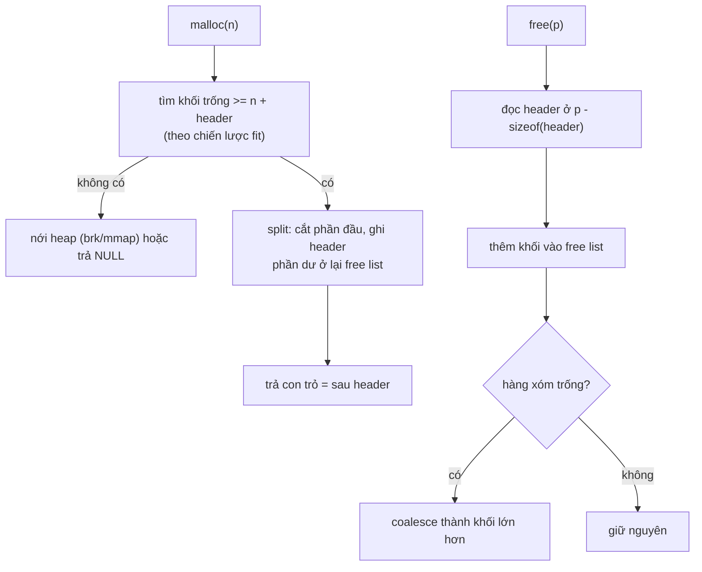
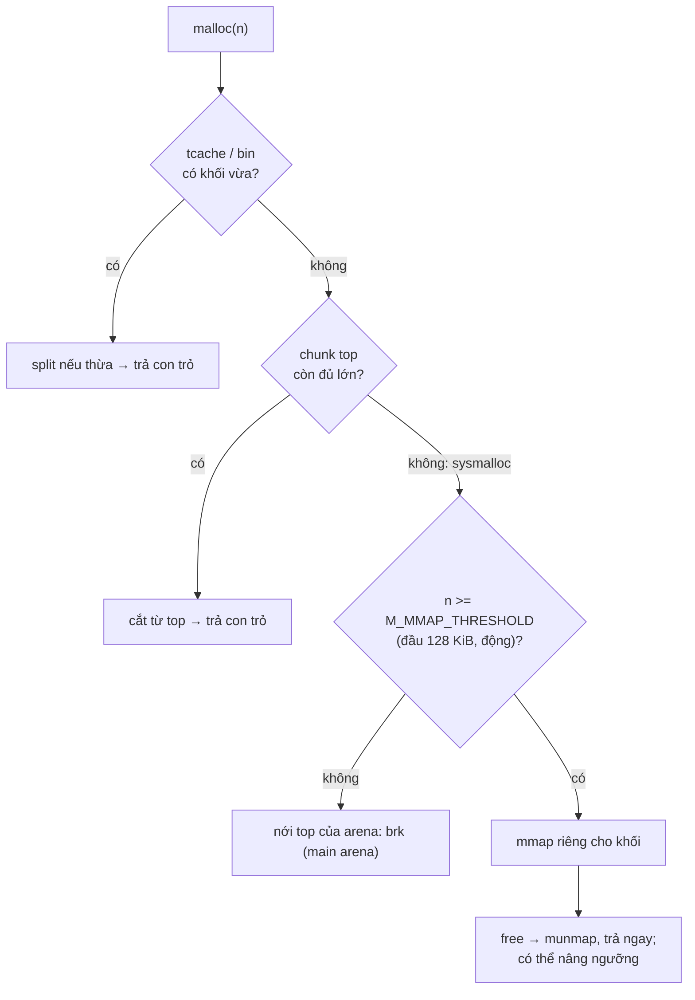

# P3 · Chương 06 — Heap allocator

## Bạn sẽ hiểu được gì

1. **Q1.** `free(ptr)` không nhận kích thước, vậy allocator biết khối dài bao nhiêu bằng cách nào, và nó giữ danh sách chỗ trống ở đâu khi chính nó không được phép gọi `malloc`? → mục 2
2. **Q2.** *Splitting* và *coalescing* là gì; best/worst/first/next fit khác nhau ở đâu, mỗi chiến lược trả giá gì? → mục 3
3. **Q3.** Fragmentation trong và ngoài khác nhau thế nào; vì sao không allocator nào xóa sạch được external fragmentation trong C? → mục 4
4. **Q4.** Segregated list, slab và buddy allocator giải quyết điểm yếu nào của một free list duy nhất? → mục 5
5. **Q5.** Arena và thread cache là gì, `M_ARENA_MAX` đánh đổi cái gì? → mục 7 (mục 6 là bối cảnh glibc)
6. **Q6.** `malloc` của glibc chia việc cho `brk` và `mmap` theo quy tắc nào, ngưỡng `M_MMAP_THRESHOLD` thay đổi ra sao, và vì sao `free` đôi khi không làm RSS giảm? → mục 8
7. **Q7.** jemalloc và mimalloc khác ptmalloc ở những ý tưởng nào, và tài liệu của chính họ nói gì về RSS và latency? → mục 9
8. **Q8.** Global allocator trong Rust là gì (chỉ ở mức nhận diện; chi tiết ở [chương 08](08-rust-va-bo-nho.md))? → mục 10

## Kiến thức cần trước

- [Chương 01 — Address space](01-address-space.md): heap là gì trong address space, `malloc` cho bộ nhớ "chưa khởi tạo".
- [Chương 04 — Page fault, demand paging và swapping](04-page-fault-va-swapping.md): demand paging/zeroing — vì sao xin bộ nhớ từ kernel chưa có nghĩa là RAM đã được cấp.
- [Chương 05 — Bộ nhớ của tiến trình trên Linux](05-bo-nho-tien-trinh-linux.md): `[heap]`, `brk`, vùng mmap trong `/proc/self/maps`.

## 1. Bối cảnh: bài toán quản lý vùng trống

Stack chỉ chứa dữ liệu có kích thước cố định biết trước; dữ liệu có kích thước không biết lúc biên dịch hoặc có thể đổi phải nằm ở heap[^book-stack-fixed]. Với heap, allocator tìm một chỗ trống đủ lớn, đánh dấu đang dùng và trả về một pointer[^book-heap-alloc]. Nghe đơn giản, nhưng yêu cầu là *tùy ý*: kích thước bất kỳ, thứ tự `malloc`/`free` bất kỳ, do chương trình quyết định. OSTEP nêu hệ quả thẳng thắn: vì chuỗi yêu cầu cấp/giải phóng có thể tùy ý, bất kỳ chiến lược nào cũng có thể chạy rất tệ với một đầu vào xấu[^ostep-anystrategy], và allocator lý tưởng vừa nhanh vừa ít phân mảnh[^ostep-ideal].

Một ràng buộc quyết định mọi thiết kế bên dưới: khi chương trình C đã cầm một con trỏ vào khối, thư viện không thể dời khối đó đi, nên không thể "nén" (compaction) vùng trống để chống phân mảnh[^ostep-nocompact]. Lý do chi tiết và hệ quả ở mục 4.

API bề mặt: `malloc(size)` trả con trỏ tới vùng nhớ chưa khởi tạo[^malloc-man], căn (align) phù hợp cho mọi kiểu vừa trong kích thước yêu cầu[^malloc-align]. `free(ptr)` đòi `ptr` phải do họ `malloc` trả về; nếu không, hoặc đã `free` rồi, hành vi là *undefined*[^free-ub].

## 2. `free` biết kích thước khối bằng cách nào, và free list nằm đâu? (Q1)

> **Trả lời ngắn.** `free(ptr)` không nhận kích thước, nên allocator cất kích thước vào một *header* ngay trước khối đã cấp và đọc lại khi `free`[^ostep-header][^ostep-hdr-where]. Danh sách chỗ trống (*free list*) không thể cấp nút bằng `malloc`, nên được dựng ngay trong các byte đang trống[^ostep-embed].

**Giải thích.**

Hình dung (nhận xét của người soạn): kho hàng dán nhãn kích thước ngay trước mỗi kiện, và sổ ghi chỗ trống được viết thẳng lên chính các ô trống.

Phần 2–5 theo mô hình đơn giản hóa của OSTEP ch.17: allocator quản lý một vùng byte liên tục có kích thước cố định suốt đời[^ostep-fixed]. Allocator thật có thể nhờ kernel nới vùng ra khi hết chỗ, chẳng hạn bằng `sbrk`[^ostep-grow] (mục 8).

**Header: nhớ kích thước của khối đã cấp.**

`free(void *ptr)` không có tham số kích thước[^ostep-header], nên thư viện malloc phải tự theo dõi kích thước vùng đã cấp[^ostep-freesize]. Cách phổ biến: cất thông tin trong một *header* ngay trước khối trả cho người dùng[^ostep-hdr-where]. OSTEP minh họa header gồm `size` và một `magic number` để kiểm tra toàn vẹn; `free` dùng phép trừ con trỏ để tìm header[^ostep-hdr-math]. Hệ quả đáng nhớ: khi người dùng xin N byte, allocator không tìm khối N byte mà tìm khối "N cộng kích thước header"[^ostep-hdr-n].

**Free list nằm ngay trong vùng trống.**

*Free list* là tập phần tử mô tả chỗ trống còn lại của heap[^ostep-freelist]. Vấn đề "con gà–quả trứng": allocator không thể gọi `malloc` để cấp nút cho danh sách của chính nó. OSTEP giải bằng cách dựng danh sách ngay trong vùng trống: nút `{size, next}` được ghi vào chính các byte đang trống[^ostep-embed].

<details><summary>Đi sâu: chunk, bin và top trong glibc 2.36</summary>

Chi tiết cài đặt của glibc 2.36 (bối cảnh ở mục 6), không phải bảo đảm của C.

Đơn vị quản lý của glibc là *chunk*, quản lý bằng boundary tag[^glibc-btag]. Một chunk đang dùng có trường kích thước (chứa luôn các bit cờ A/M/P), vùng dữ liệu người dùng bắt đầu ngay sau đó; chunk trống thì dùng phần dữ liệu để chứa con trỏ nối danh sách đôi[^glibc-freelayout]. Chunk trống nằm trong *bin* (các danh sách), xếp theo kích thước; các bin cách nhau xấp xỉ tỉ lệ (log) theo kích thước và có 128 bin[^glibc-nbins]; trong bin, chunk xếp theo kích thước, hòa thì chunk ít được dùng gần nhất; thứ tự này không cần cho small bin (mọi chunk cùng cỡ) nhưng giúp best-fit cho chunk lớn[^glibc-bins]. Chunk đặc biệt `top` ở cuối arena luôn tồn tại và được nới thêm khi cần[^glibc-top].

</details>

**Quay lại Q1:** allocator cất kích thước ở header trước khối, và dựng free list ngay trong vùng trống.

## 3. Splitting, coalescing và các chiến lược chọn khối trống (Q2)

> **Trả lời ngắn.** *Splitting* cắt một khối trống đủ lớn làm hai: phần đầu trả cho người gọi, phần còn lại ở lại danh sách[^ostep-split]. *Coalescing* gộp khối vừa free với các khối trống kề nó thành khối lớn hơn[^ostep-coal-how]. Chiến lược chọn khối (best/worst/first/next fit) đánh đổi tốc độ tìm với mức phân mảnh, và không chiến lược nào thắng ở mọi đầu vào[^ostep-anystrategy].

**Giải thích.**

Hình dung (nhận xét của người soạn): cắt một dải đất lớn thành lô nhỏ khi bán, và khi lô liền kề được trả lại thì gộp lại thành dải lớn.

**Splitting.**

Với heap 30 byte gồm hai khối trống 10 byte (byte 0–9 và 20–29) và một khối đang dùng ở giữa, free list có hai phần tử. Yêu cầu lớn hơn 10 byte thất bại (trả `NULL`), vì không có một khối liên tục đủ lớn[^ostep-30]. Yêu cầu 1 byte thì allocator thực hiện *splitting*: tìm khối trống đủ lớn, cắt làm hai, trả phần đầu cho người gọi, phần còn lại ở lại danh sách; trong ví dụ của OSTEP, nếu allocator chọn khối trống thứ hai thì `malloc` trả địa chỉ 20 và khối trống còn lại bắt đầu từ 21 với độ dài 9[^ostep-split].

**Coalescing.**

Giả sử người dùng `free` khối giữa. Nếu chỉ chèn nó vào danh sách "không suy nghĩ", ta có ba khối 10 byte rời rạc dù cả heap đã trống; một yêu cầu 20 byte sẽ thất bại[^ostep-nocoal]. *Coalescing* sửa việc này: khi trả một khối, nhìn địa chỉ của nó và các khối trống liền kề; nếu nằm sát một (hoặc hai) khối trống thì gộp lại thành một khối lớn[^ostep-coal-how]. Nhờ vậy allocator đảm bảo hơn rằng vẫn còn các khối trống lớn cho ứng dụng[^ostep-coal-why].



**Chiến lược chọn khối trống.**

Khi nhiều khối đủ lớn, chọn khối nào? OSTEP liệt kê bốn chính sách cơ bản; ví dụ của sách dùng free list độ dài 10 → 30 → 20 và yêu cầu 15[^ostep-example].

| Chiến lược | Cách chọn | Điểm mạnh / yếu theo OSTEP | Với ví dụ 10-30-20, xin 15 |
|---|---|---|---|
| Best fit | khối nhỏ nhất vẫn đủ lớn[^ostep-best] | cố giảm lãng phí, nhưng bản ngây thơ trả giá hiệu năng vì phải tìm toàn bộ[^ostep-best-cost] | chọn 20, còn lại 5 |
| Worst fit | khối lớn nhất, phần dư lớn ở lại[^ostep-worst] | cần quét toàn bộ; phần lớn nghiên cứu cho thấy hoạt động tệ, phân mảnh thừa mà overhead cao[^ostep-worst-bad] | chọn 30, còn lại 15 |
| First fit | khối đầu tiên đủ lớn[^ostep-first] | nhanh vì không quét hết, nhưng làm "ô nhiễm" đầu danh sách bằng các mảnh nhỏ[^ostep-first-pollute] | chọn 30 (cùng kết quả worst fit), còn 15 |
| Next fit | như first fit nhưng bắt đầu từ chỗ tìm lần trước[^ostep-next] | trải đều việc tìm kiếm, tránh vỡ vụn đầu danh sách; hiệu năng gần first fit[^ostep-next-perf] | phụ thuộc con trỏ hiện tại |

<details><summary>Đi sâu: thứ tự danh sách, boundary tag và fastbin của glibc</summary>

Với first fit, thứ tự danh sách là vấn đề; một cách OSTEP nêu là sắp theo địa chỉ, vì khi đó coalescing dễ hơn và phân mảnh có xu hướng giảm[^ostep-addr-order]. OSTEP cũng lưu ý rằng ví dụ chỉ "chạm bề mặt"; muốn hiểu sâu cần phân tích với workload thật[^ostep-scratch].

Coalescing rẻ nhờ *boundary tag*: comment trong source glibc 2.36 mô tả: kích thước khối trống được lưu cả ở đầu lẫn cuối khối, nhờ đó gộp các khối phân mảnh thành khối lớn hơn "rất nhanh"[^glibc-btag]. Bit thấp của trường size mang thêm trạng thái: bit P cho biết khối *trước* có đang dùng không[^glibc-pbit].

Với các chunk nhỏ vừa được free, glibc có *fastbin*: danh sách đơn liên kết các chunk nhỏ vừa free[^glibc-fastbin]. Chunk trong fastbin vẫn giữ bit "in use" nên **không** bị gộp với chunk trống kề bên; chỉ `malloc_consolidate` mới giải phóng chúng ra để gộp[^glibc-fastbin-nocoal]. Comment giải thích fastbin dùng danh sách đơn vì nhanh hơn và vì chunk không bao giờ bị gỡ từ giữa danh sách[^glibc-fastbin-single]. Bỏ coalescing tức thời để đổi lấy tốc độ là trade-off ở đây (nhận xét của người soạn).

</details>

**Quay lại Q2:** splitting cắt khối vừa đủ, coalescing gộp khối kề nhau, còn chiến lược fit chọn khối nào là đánh đổi không có đáp án thắng mọi trường hợp.

## 4. Fragmentation trong và ngoài (Q3)

> **Trả lời ngắn.** Phân mảnh ngoài là vùng trống bị chặt thành nhiều mảnh nhỏ nên yêu cầu lớn thất bại dù tổng chỗ trống đủ[^ostep-ext]; phân mảnh trong là khối cấp lớn hơn yêu cầu, phần thừa bị bỏ phí[^ostep-int]. Trong C, khối đã giao cho chương trình không dời được nên không nén được vùng trống[^ostep-nocompact]; ghép với nhận xét của OSTEP rằng external fragmentation vẫn tồn tại dù thuật toán thông minh đến đâu[^ostep-seg-ext-always], phân mảnh ngoài chỉ giảm chứ không hết (suy luận của người soạn từ hai câu này).

**Giải thích.**

Hình dung (nhận xét của người soạn): bãi đỗ xe có chỗ trống rải rác nhưng không đủ cho xe tải là phân mảnh ngoài; đỗ xe máy vào ô dành cho ô tô là phân mảnh trong.

**Phân mảnh ngoài: từng bước.**

Quay lại heap 30 byte ở mục 3: hai khối trống 10 byte nằm hai đầu, khối đang dùng 10 byte ở giữa. Tổng chỗ trống là 20 byte nhưng không có khối liên tục nào lớn hơn 10, nên yêu cầu lớn hơn 10 byte thất bại[^ostep-30]. Ví dụ này minh họa phân mảnh ngoài, tức vùng trống bị chặt thành các mảnh nhỏ[^ostep-ext] (nhận xét của người soạn). Coalescing (mục 3) chỉ gộp được các mảnh trống *kề nhau*; khối đang dùng nằm xen giữa thì không gộp được cho tới khi chủ của nó `free`.

**Phân mảnh trong: từng bước.**

Allocator thường không giao đúng số byte được xin mà giao một khối lớn hơn; phần thừa nằm *bên trong* khối đã giao và không ai dùng[^ostep-int]. Hai ví dụ có nguồn trong chương này: buddy chỉ phát khối kích thước lũy thừa của 2, nên xin 7 KB nhận 8 KB (mục 5.3)[^ostep-buddy-int]; jemalloc làm tròn yêu cầu lên một size class và nhờ cách chia lớp mà giới hạn phần thừa khoảng 20% với hầu hết các lớp (mục 9)[^je-sizeclass].

**Vì sao không nén được.**

Muốn dồn các khối đang dùng về một đầu để gộp chỗ trống, allocator phải sửa mọi con trỏ trỏ vào khối bị dời. OSTEP nói: khi đã đưa con trỏ cho chương trình C, rất khó xác định mọi tham chiếu tới vùng đó, vì chúng có thể nằm trong biến khác hoặc thậm chí trong thanh ghi[^ostep-nocompact-why]. Vì vậy khối "thuộc về" chương trình cho tới khi nó gọi `free`[^ostep-nocompact]. Ngôn ngữ kiểu mạnh có garbage collector thì khác, OSTEP viết rằng họ có thể dùng compaction[^ostep-gc-compact].

<details><summary>Đi sâu: external fragmentation không biến mất, và đánh đổi giữa hai loại</summary>

Câu "dù thuật toán thông minh thế nào, external fragmentation vẫn tồn tại" nằm trong chương Segmentation của OSTEP, nói về các thuật toán quản lý free list khi cấp segment trong RAM (cùng họ best-fit, worst-fit, first-fit, buddy); ở đây dùng như nguyên lý chung, không phải mệnh đề riêng về `malloc`[^ostep-seg-ext-always]. Hai loại phân mảnh thường đánh đổi nhau: gom kích thước vào các cỡ cố định làm giảm external nhưng tăng internal (nhận xét của người soạn; buddy ở mục 5.3 là ví dụ có nguồn về internal fragmentation).

</details>

**Quay lại Q3:** hai loại phân mảnh khác nhau ở chỗ phần phí nằm giữa các khối hay bên trong khối, và C không nén được nên phân mảnh ngoài không hết hẳn.

## 5. Segregated list, slab và buddy: vượt qua một free list duy nhất (Q4)

> **Trả lời ngắn.** Một free list tuyến tính không co giãn tốt vì tìm kiếm có thể rất chậm[^ostep-scale]. Segregated list giữ danh sách riêng cho cỡ hay gặp để cấp/giải phóng nhanh[^ostep-seg-benefit]; slab áp dụng ý đó cho object kernel và giữ object ở trạng thái đã khởi tạo[^ostep-slab][^ostep-slab-init]; buddy chia đôi khối lũy thừa 2 để gộp khối dễ, đổi lại có internal fragmentation[^ostep-buddy][^ostep-buddy-int].

**Giải thích.**

Hình dung (nhận xét của người soạn): thay vì một ngăn kéo lẫn mọi cỡ ốc vít, mỗi cỡ hay dùng có một hộp riêng.

Một free list tuyến tính không co giãn tốt: OSTEP viết rằng nhiều cách tiếp cận ở trên có vấn đề "thiếu khả năng mở rộng" vì tìm kiếm danh sách có thể rất chậm, nên allocator cao cấp dùng cấu trúc dữ liệu phức tạp hơn như cây nhị phân cân bằng, splay tree, partially-ordered tree[^ostep-scale].

**5.1 Segregated list.**

Nếu ứng dụng hay xin một (vài) kích thước nhất định, giữ một danh sách riêng cho kích thước đó, còn yêu cầu khác chuyển sang allocator tổng quát[^ostep-seglist]. Lợi ích: phân mảnh ít đáng lo hơn và cấp/giải phóng nhanh khi đúng cỡ vì không phải tìm kiếm phức tạp[^ostep-seg-benefit]. Câu hỏi mới: dành bao nhiêu bộ nhớ cho pool chuyên dụng so với pool chung?[^ostep-seg-q] *Size class* (lớp kích thước) trong các allocator hiện đại (mục 9) chính là ý tưởng này được tổng quát hóa: thay vì một vài cỡ phổ biến, yêu cầu được làm tròn lên một lớp kích thước cố định (nhận xét của người soạn; jemalloc ở mục 9 là ví dụ có nguồn).

**5.2 Slab allocator.**

Slab allocator của Jeff Bonwick (thiết kế cho kernel Solaris) cài đặt ý tưởng trên: khi kernel khởi động, nó tạo các *object cache* cho kernel object được xin thường xuyên (lock, inode…); mỗi cache là một segregated free list cho một kích thước, phục vụ cấp/giải phóng nhanh[^ostep-slab]. Khi một cache sắp hết chỗ, nó xin các slab từ allocator tổng quát; ngược lại khi mọi object trong một slab hết được tham chiếu, allocator chung có thể thu hồi slab[^ostep-slab-return]. Điểm hơn nữa: slab giữ object đã giải phóng ở trạng thái *đã khởi tạo sẵn*, tránh chi phí khởi tạo/hủy lặp lại[^ostep-slab-init].

**5.3 Buddy allocator.**

Vì coalescing quan trọng nên có thiết kế sinh ra để coalescing đơn giản[^ostep-buddy]. Binary buddy xem bộ nhớ trống là một khối 2^N; khi có yêu cầu, nó chia đôi đệ quy cho tới khi khối vừa đủ lớn (chia nữa sẽ quá nhỏ) rồi trả khối đó[^ostep-buddy-split]. Ví dụ OSTEP: khối 64 KB, xin 7 KB → chia 64→32→16→8, trả khối 8 KB ngoài cùng bên trái; free nó thì gộp với buddy 8 KB thành 16 KB, rồi lên 32 KB… nếu buddy trống. Cái giá: chỉ phát được khối kích thước lũy thừa của 2 nên có internal fragmentation[^ostep-buddy-int] (ở ví dụ, 8 KB cho yêu cầu 7 KB).

<details><summary>Đi sâu: buddy giải phóng và gộp khối thế nào</summary>

Khi `free`, allocator xem "buddy" (khối kề cùng cặp) có trống không; nếu có thì gộp thành khối gấp đôi, rồi lặp lên cây cho đến khi gặp buddy đang dùng hoặc khôi phục cả khối[^ostep-buddy-free]. Lý do phương pháp hiệu quả: tìm buddy của một khối rất đơn giản, vì địa chỉ của hai buddy chỉ khác nhau đúng một bit, bit nào phụ thuộc cấp trong cây[^ostep-buddy-bit].

</details>

**Quay lại Q4:** segregated list, slab và buddy đều thay một danh sách chung bằng cấu trúc theo cỡ để tìm nhanh hoặc gộp dễ, trả giá bằng internal fragmentation hoặc pool riêng.

## 6. Bối cảnh cho Q5–Q6: glibc ptmalloc

Mọi chi tiết dưới đây là của **glibc**, kiểm trên glibc 2.36 (Debian bookworm). Đó là chi tiết cài đặt, không phải bảo đảm của POSIX hay C; macOS, musl hay Windows hành xử khác. Nguồn: `mallopt(3)` và `malloc/malloc.c` tag `glibc-2.36`.

glibc malloc là phiên bản ptmalloc2 do Wolfram Gloger chỉnh từ malloc của Doug Lea cho nhiều thread/arena[^glibc-origin]. Comment đầu file thừa nhận nó không phải malloc nhanh nhất, tiết kiệm bộ nhớ nhất, portable nhất hay chỉnh được nhiều nhất, nhưng khẳng định nó vừa "among the fastest" vừa "among the most space-conserving"; sự cân bằng nhất quán giữa các tiêu chí là lý do nó là allocator đa dụng tốt (lời tự mô tả của tác giả, không phải benchmark)[^glibc-why]. Chính sách trong comment (mặc định): yêu cầu lớn (≥ 512 byte) là best-fit thuần túy, hòa thì theo FIFO[^glibc-policy]; yêu cầu nhỏ (≤ 64 byte "by default") là allocator kiểu *caching* giữ pool các chunk tái chế nhanh[^glibc-policy-small]; yêu cầu rất lớn (≥ 128 KB mặc định) dựa vào memory mapping của hệ điều hành[^glibc-policy-mmap]. Con số 64 chỉ là con số trong comment: cũng trong file này, bảng tùy chọn ghi `DEFAULT_MXFAST` là 64 cho 32-bit và 128 cho 64-bit[^glibc-mxfast]. Ba chính sách này tương ứng với best-fit (mục 3), segregated list (mục 5.1) và mmap trực tiếp (nhận xét của người soạn).


## 7. Thread cache và arena (Q5)

> **Trả lời ngắn.** *Arena* là một pool bộ nhớ mà các lời gọi `malloc` dùng để phục vụ yêu cầu cấp phát[^mallopt-arena-def]; glibc cho mỗi thread mới một arena đến một giới hạn cấu hình được, rồi các thread dùng chung arena[^glibc-arena-thread]. *Thread cache* (tcache) là cache theo thread được thử trước khi vào arena; đọc code glibc 2.36 thì đường nhanh của nó không đụng mutex arena[^glibc-tcache-malloc][^glibc-tcache-free]. `M_ARENA_MAX` đánh đổi: nhiều arena thì ít tranh chấp theo thread nhưng tốn bộ nhớ hơn[^mallopt-arena-tradeoff].

**Giải thích.**

Hình dung (nhận xét của người soạn): quán đông khách, mỗi nhân viên giữ một ngăn kéo các món hay gọi (tcache) nên khỏi chen vào kho chung; có nhiều quầy kho (arena) thì ít chen hơn nhưng tốn chỗ hơn.

**Thread cache (tcache).**

*tcache* là cấu trúc `tcache_perthread_struct`, mỗi thread một cái, chứa cache theo thread[^glibc-tcache]; `malloc`/`free` thử nó trước khi đi vào arena (đoạn code ngay bên dưới). Theo comment trong source, có 64 bin (giới hạn tùy ý, tunable có thể giảm)[^glibc-tcache-bins] và mỗi bin giữ tối đa 7 chunk theo mặc định (tunable có thể đổi)[^glibc-tcache-limits][^glibc-tcache-fill].

Về khóa: không có comment nào trong `malloc.c` nói thẳng "tcache tránh khóa arena" (dòng đầu file chỉ nói về nhiều thread mà không tranh chấp khóa[^glibc-nolock]), nên kết luận dưới đây là kết quả đọc code, không phải lời của nguồn. Trong `__libc_malloc`, nếu bin tcache tương ứng còn chunk, hàm lấy chunk ra rồi `return` ngay[^glibc-tcache-malloc]; chỉ đường đi qua `arena_get` và `_int_malloc` mới kết thúc bằng mở khóa mutex của arena[^glibc-arena-unlock]. Phía `free`, `_int_free` đặt chunk vào tcache rồi `return` khi bin chưa đầy[^glibc-tcache-free]; việc lấy `av->mutex` nằm ở nhánh phía sau trong cùng hàm. Vậy trong glibc 2.36, đường nhanh tcache của `malloc`/`free` không đụng mutex arena; khi tcache rỗng (malloc) hoặc đầy (free) mới đi vào arena (đọc từ code, chi tiết cài đặt chứ không phải bảo đảm). Lần gọi đầu tiên của mỗi thread còn phải khởi tạo tcache (`MAYBE_INIT_TCACHE`), việc này không nằm trong đường nhanh. jemalloc có cơ chế tương tự và nêu rõ cái giá (mục 9).

**Arena và `M_ARENA_MAX`.**

Nếu mọi thread dùng chung một heap thì phải khóa quanh mỗi `malloc` (nhận xét của người soạn). glibc cho mỗi thread mới một *arena* riêng, đến một giới hạn cấu hình được, sau đó các arena được dùng chung giữa nhiều thread[^glibc-arena-thread]. Theo man page, arena thread-safe nên phục vụ được nhiều yêu cầu đồng thời[^mallopt-arena-def]; số arena càng nhiều thì tranh chấp theo thread càng ít nhưng tốn bộ nhớ hơn[^mallopt-arena-tradeoff]. `M_ARENA_MAX` khác 0 là giới hạn cứng số arena; mặc định 0, khi đó giới hạn được xác định theo `M_ARENA_TEST`[^mallopt-arena-default]. `M_ARENA_TEST` là số arena đã tạo mà tại đó hệ thống mới được xem xét để tính giới hạn cứng; mặc định 8 trên hệ có `sizeof(long)` ≠ 4[^mallopt-arena-test]. Man page nói giá trị giới hạn "usually" là bội số của số CPU[^mallopt-arena-hard]; source 2.36 cho công thức cụ thể: 8 × số CPU trên 64-bit[^glibc-narenas]. Cơ chế trong `arena_get2`: giới hạn chỉ được tính (từ `M_ARENA_MAX`, hoặc từ số CPU) khi số arena hiện có đã vượt `arena_test`[^glibc-arena-limit]. Hệ quả: dưới ngưỡng `arena_test`, số arena chỉ phụ thuộc số thread, chưa phụ thuộc số CPU. Man page cũng gợi ý: nếu thấy tranh chấp arena cao thì có thể tăng `M_ARENA_MAX` cho bằng số thread, tương tự cách tcmalloc và jemalloc dùng pool theo thread[^mallopt-arena-hint]. Biến môi trường `MALLOC_ARENA_MAX` điều khiển cùng tham số[^mallopt-env].

<details><summary>Đi sâu: thí nghiệm đếm arena trên glibc 2.36</summary>

**Thí nghiệm đã chạy** (container Linux của repo, glibc 2.36, aarch64, 4 CPU): 8 thread cùng giữ một khối 100 byte trong lúc main gọi `malloc_stats()`. Số dòng `Arena` in ra:

| Cấu hình | Số arena |
|---|---|
| mặc định | 9 (main + 8 thread) |
| `MALLOC_ARENA_MAX=1` | 1 |
| `MALLOC_ARENA_MAX=2` | 2 |

Mỗi arena báo `system bytes = 135168` (132 KiB). Đó là quan sát một lần chạy trên máy này, không phải bảo đảm.

Lưu ý khi đọc bảng: 9 arena với 8 thread **chưa** kiểm chứng công thức theo số CPU, vì 8 thread (cộng arena chính) vẫn nằm dưới ngưỡng `arena_test = 8` nên chưa có giới hạn nào được tính. Thí nghiệm bổ sung với cùng chương trình (mỗi thread `malloc(100)`, ghi vào, rồi chờ ở barrier trong lúc main gọi `malloc_stats()`; lưu ý phải ghi vào khối, nếu không compiler tối ưu bỏ cặp malloc/free) trên cùng container 4 CPU, glibc 2.36: 8 thread → 9 arena; 9 → 10; 31 → 32; 32, 33, 40, 100 thread → đều 32 arena; đặt `MALLOC_ARENA_TEST=100` thì 40 thread → 41 arena. Trần 32 = 8 × 4 CPU khớp với công thức source ở trên (quan sát một lần chạy; biến thể tối ưu hóa của compiler đã được loại trừ). Điều rút ra (nhận xét của người soạn): trong service nhiều thread, số arena là tham số trực tiếp của memory footprint; trong container giới hạn RAM, hạ `MALLOC_ARENA_MAX` là một núm có thể thử để giảm footprint (đánh đổi: nhiều thread dồn vào ít arena hơn nên tranh chấp khóa tăng, theo man page ở trên); không có nguồn nào ở đây cho mức tiết kiệm cụ thể, nên phải đo trước khi đổi.

</details>

**Quay lại Q5:** tcache giúp đường nhanh khỏi khóa arena, còn số arena (`M_ARENA_MAX`) là núm đổi tranh chấp lấy bộ nhớ.

## 8. `brk` hay `mmap`: ngưỡng động và vì sao `free` không giảm RSS (Q6)

> **Trả lời ngắn.** glibc xin kernel bộ nhớ theo hai đường: dời program break (`brk`) hoặc tạo mapping mới (`mmap`)[^brk-man][^mmap-new]. Yêu cầu từ `M_MMAP_THRESHOLD` (mặc định 128 KiB) mà free list không đáp ứng thì dùng `mmap`[^mallopt-thresh][^mallopt-default], và ngưỡng này tự nâng khi `free` một khối lớn[^mallopt-dyn]. `free` đôi khi không giảm RSS vì heap chỉ trim được khi phần giải phóng nằm ở đỉnh[^mallopt-adv].

**Giải thích.**

Hình dung (nhận xét của người soạn): `brk` giống thuê thêm dãy kệ nối liền kho hiện có, chỉ trả lại được dãy ngoài cùng; `mmap` giống thuê một gian riêng, trả lại nguyên gian lúc nào cũng được.

Allocator không tự có bộ nhớ; nó xin kernel bằng `brk`/`sbrk` (dời program break, tăng là cấp bộ nhớ, giảm là trả[^brk-man]) hoặc `mmap` (tạo mapping mới[^mmap-new]). Định nghĩa program break, mapping anonymous và cách đọc chúng trong `/proc/self/maps` ở [chương 05, mục 4](05-bo-nho-tien-trinh-linux.md); thư viện allocator đã gọi sẵn các hàm này nên người dùng không nên gọi trực tiếp[^ostep-nobrk].

Quy tắc của glibc theo `mallopt(3)`: với yêu cầu ≥ `M_MMAP_THRESHOLD` mà free list không đáp ứng được, hàm cấp phát dùng `mmap` thay vì tăng program break[^mallopt-thresh]. Trong source, thứ tự là: tcache/bin trước, rồi cắt từ chunk `top` nếu `top` còn đủ lớn[^glibc-use-top]; chỉ khi `top` không đủ (và nếu đang có fastbin chunk thì `malloc_consolidate` gộp chúng rồi thử lại trước), `_int_malloc` mới chuyển sang `sysmalloc`[^glibc-relay], và ở đó yêu cầu ≥ ngưỡng (và chưa quá giới hạn số mapping) được `mmap` trực tiếp thay vì nới `top`[^glibc-sysmalloc]. Nghĩa là ngưỡng quyết định *cách nới heap*, không phải là phép thử đầu tiên: một yêu cầu 200 KiB vẫn có thể được cắt từ `top` nếu `top` đang đủ lớn. Ưu điểm của `mmap`: khối luôn có thể được trả riêng lẻ cho hệ thống, trong khi heap chỉ trim được nếu giải phóng ở đỉnh[^mallopt-adv]. Nhược điểm man page nêu: chỗ đã giải phóng không vào free list để tái dùng, có thể lãng phí do phải căn theo page, và kernel phải zero bộ nhớ (việc đắt)[^mallopt-disadv]. Cân bằng các yếu tố này cho mặc định `128*1024`[^mallopt-default].

Nhưng ngưỡng không cố định. glibc dùng **ngưỡng động**: khi một khối lớn hơn ngưỡng hiện tại và nhỏ hơn hoặc bằng `DEFAULT_MMAP_THRESHOLD_MAX` bị `free`, ngưỡng được nâng lên bằng kích thước khối đó[^mallopt-dyn]; trần `DEFAULT_MMAP_THRESHOLD_MAX` là `4*1024*1024*sizeof(long)` trên 64-bit (tức 32 MiB, phép tính của người soạn)[^mallopt-max][^glibc-thr-max]. Đồng thời ngưỡng trim heap cũng được chỉnh thành gấp đôi ngưỡng mmap động; chỉnh động bị tắt nếu đặt bất kỳ `M_TRIM_THRESHOLD`, `M_TOP_PAD`, `M_MMAP_THRESHOLD` hay `M_MMAP_MAX`[^mallopt-dyn2]. Source xác nhận cơ chế ngay trong `free` của chunk mmapped: nếu chưa tắt chỉnh động, kích thước chunk > `mmap_threshold` và ≤ trần thì `mmap_threshold = chunksize(p)` và `trim_threshold = 2 * mmap_threshold`[^glibc-dyn-src].



Sơ đồ rút gọn: chunk mmapped không nằm trong arena và không kề chunk trống nào[^glibc-mmapped].

<details><summary>Đi sâu: thí nghiệm ngưỡng động và "free không trả RSS"</summary>

Chương trình C nhỏ (chạy thật, glibc 2.36 aarch64, `strace -e trace=brk,mmap,munmap`):

```c
void *p   = malloc(100);
void *big = malloc(200*1024);     // >= 128 KiB
free(big);
void *big2 = malloc(200*1024);    // cùng cỡ, sau khi free
void *big3 = malloc(2*1024*1024);
```

Quan sát: `p` nằm cạnh `sbrk(0)` (trong heap); `big` ở một địa chỉ xa hẳn (vùng mmap); sau khi `free(big)`, `big2` lại **nằm trong heap** (cạnh `sbrk(0)`) chứ không còn qua `mmap`; `big3` 2 MiB vượt ngưỡng mới nên lại ở vùng mmap. Đúng như ngưỡng động ở trên (đây là quan sát một lần chạy, minh họa cho cơ chế đã có nguồn).

Thí nghiệm thứ hai: cấp 20.000 khối 1000 byte (ghi vào để chạm page), rồi `free` 19.999 khối, **giữ lại khối cuối cùng** (nằm sát đỉnh heap). Đọc `/proc/self/statm`:

| Mốc | RSS (KiB) |
|---|---|
| lúc đầu | 1200 |
| sau khi cấp 20.000 khối | 21040 |
| sau khi free 19.999 khối (giữ khối đỉnh) | 21040 |
| sau khi free nốt khối đỉnh | 1488 |

RSS không đổi sau khi trả gần hết, rồi rơi ngay khi khối ở đỉnh được giải phóng. Điều này phù hợp với câu trong man page rằng heap chỉ trim được khi bộ nhớ được giải phóng ở đầu trên[^mallopt-adv] và với `M_TRIM_THRESHOLD`: khi lượng bộ nhớ trống liền kề ở đỉnh heap đủ lớn, `free` dùng `sbrk` trả lại cho hệ thống[^mallopt-trim-thr]. Source còn ghi rằng việc trim tự động không xảy ra khi free chunk nhỏ trong phạm vi fastbin (trừ khi định nghĩa `TRIM_FASTBINS`), và bị hoãn tới lần free chunk lớn hơn[^glibc-trim-fast]. Một khối sống ở đỉnh "ghim" cả heap bên dưới nó; đó là lý do một service dài ngày có thể giữ RSS cao dù dữ liệu sống ít (nhận xét của người soạn, từ thí nghiệm này, không từ đo production).

</details>

**Quay lại Q6:** ngưỡng `mmap` là cách glibc quyết định nới heap, tự nâng khi free khối lớn, còn heap chỉ co lại từ đỉnh nên một khối sống ở đỉnh giữ RSS cao.

## 9. jemalloc và mimalloc (Q7)

> **Trả lời ngắn.** Cả hai chia yêu cầu theo lớp kích thước và tách tài nguyên để giảm tranh chấp và phân mảnh: jemalloc dùng nhiều arena, cache theo thread và slab[^je-arenas][^je-tcache][^je-sizeclass]; mimalloc chia free list nhỏ theo từng trang[^mi-shard-page]. Tài liệu của họ không hứa một chiều chung về RSS hay latency mà mô tả các núm chỉnh[^je-tuning-intro][^mi-delay].

**Giải thích.**

Hình dung (nhận xét của người soạn): thay vì một kho chung cho cả công ty, mỗi phòng ban có kho riêng và đồ trả lại được xử lý ở nơi gần nhất.

Hai allocator này là bản thay thế `malloc`: README mimalloc tự mô tả là drop-in replacement, dùng được mà không sửa code, kèm ví dụ nạp bằng `LD_PRELOAD`[^mi-dropin]; jemalloc là một cài đặt `malloc(3)` đa dụng[^je-readme]. Việc đăng ký chúng làm global allocator của Rust là nhận xét của người soạn, không có trong nguồn ghim ở đây. Dưới đây chỉ dùng tài liệu chính thức, ghim bản: **jemalloc 5.3.0** (tag trên GitHub) và **mimalloc v2.1.7** (tag; README ghi đây là release tag mới nhất lúc đó, 2024-05-21)[^mi-tag].

**jemalloc 5.3.0.**

jemalloc là cài đặt `malloc(3)` đa dụng, nhấn mạnh tránh phân mảnh và mở rộng đồng thời[^je-readme]; lần đầu được dùng làm allocator của libc FreeBSD năm 2005[^je-2005]. Từ man page (mục Implementation Notes):

- **Không dựa chỉ vào `sbrk`**: allocator truyền thống dùng `sbrk` là chưa tối ưu vì race condition, tăng phân mảnh và giới hạn nhân tạo về bộ nhớ dùng được; jemalloc dùng cả `mmap` lẫn `sbrk`, ưu tiên theo thứ tự đó[^je-sbrk].
- **Nhiều arena** để giảm tranh chấp khóa; đổi lại có overhead cố định nhỏ cho mỗi arena và các arena quản lý bộ nhớ hoàn toàn độc lập, nên phân mảnh tổng thể tăng một chút. Man page nói dùng nhiều arena hơn mặc định đáng kể không chắc cải thiện hiệu năng, chủ yếu do cache kém hơn; nếu ứng dụng ít dùng hàm cấp phát thì giảm số arena có thể hợp lý[^je-arenas].
- **Thread-specific cache (tcache)** để tránh đồng bộ cho hầu hết yêu cầu; cho phép cấp phát rất nhanh ở trường hợp thường gặp, nhưng tăng bộ nhớ dùng và phân mảnh vì một số object có thể nằm lại trong mỗi thread cache[^je-tcache]. `opt.tcache_max` mặc định 32 KiB[^je-tcache-max].
- **Size class**: object nhỏ được quản lý theo nhóm trong *slab*, mỗi slab dùng bitmap theo dõi vùng nào đang dùng; các size class lớn hơn quantum cách nhau để có bốn lớp cho mỗi lần gấp đôi kích thước, giới hạn internal fragmentation khoảng 20% cho mọi lớp trừ lớp nhỏ nhất[^je-sizeclass]. Đó là segregated list + slab của mục 5 ở dạng sản phẩm.

**mimalloc v2.1.7.**

README của mimalloc nêu các ý tưởng thiết kế:

- **Free list sharding**: thay vì một free list lớn cho mỗi size class, có nhiều danh sách nhỏ hơn cho mỗi "trang mimalloc" (trang chứa các block cùng một size class, thường 64 KiB trên hệ 64-bit)[^mi-page-size], nhằm giảm phân mảnh và tăng locality: thứ cấp phát gần nhau về thời gian thì gần nhau trong bộ nhớ[^mi-shard].
- **Free list multi-sharding**: mỗi trang có thêm danh sách riêng cho `free` đồng thời từ thread khác, nên `free` từ thread khác chỉ là một CAS, không cần phối hợp phức tạp[^mi-multishard].
- **Eager page purging**: khi một trang trống thì bộ nhớ được báo cho OS là không dùng, giảm áp lực bộ nhớ thật và phân mảnh, nhất là chương trình chạy lâu[^mi-purge].

Điều có nguồn: RSS và latency phụ thuộc số arena và cache theo thread, *khi nào* và *bao nhiêu* bộ nhớ được trả cho OS, và việc purge chạy ở thread ứng dụng hay thread nền. Các tài liệu này **không** cho con số RSS/latency cho workload của bạn, và benchmark trong README mimalloc là của chính dự án; muốn kết luận cho một service phải đo.

<details><summary>Đi sâu: các núm chỉnh RSS và latency theo từng tài liệu</summary>

Các tài liệu chính thức không hứa một chiều chung ("A luôn tốt hơn B"); họ mô tả các núm vặn:

- jemalloc: cấu hình mặc định "làm việc tạm ổn trong thực tế và hầu hết ứng dụng không cần chỉnh option nào"; khi chỉnh đúng cho workload, cải thiện chỉ số hệ thống "vài phần trăm" là phổ biến[^je-tuning-intro].
- jemalloc: thời gian *decay* quyết định tốc độ trả page không dùng cho OS và cho một đánh đổi "khá thẳng thắn" giữa CPU và bộ nhớ: decay ngắn thì giải phóng nhanh, giảm bộ nhớ, thường phải trả bằng nhiều chu kỳ CPU hơn cho purge[^je-decay].
- jemalloc: bật *background thread* thường cải thiện tail latency cho thread ứng dụng vì việc purge bộ nhớ không dùng được chuyển sang thread riêng[^je-bg].
- jemalloc: ít arena thường cải thiện mức dùng bộ nhớ khi không cần song song cao ở tầng allocator, vì arena nhiều làm tăng phân mảnh tổng thể[^je-narenas].
- mimalloc: `MIMALLOC_PURGE_DELAY` là độ trễ (mặc định 10 ms) trước khi purge page không dùng; đặt 0 thì purge ngay, tốt cho bộ nhớ nhưng giảm hiệu năng; đặt cao như 100 có thể cải thiện hiệu năng (đôi khi nhiều) với cái giá có lúc dùng nhiều bộ nhớ hơn[^mi-delay]. Theo README, mặc định "purge" nghĩa là decommit, trên hệ `mmap` là `MADV_DONTNEED` (giảm RSS ngay); đặt `MIMALLOC_PURGE_DECOMMITS=0` thì chuyển sang "reset", thường là `MADV_FREE` (không giảm RSS ngay)[^mi-purge-decommit].

</details>

**Quay lại Q7:** jemalloc và mimalloc đều là biến thể của ý tưởng size class + tách theo arena/trang, và hiệu quả RSS/latency phụ thuộc núm chỉnh nên phải đo.

## 10. Global allocator trong Rust (Q8)

> **Trả lời ngắn.** `Box` và `Vec` xin bộ nhớ qua một *global allocator* duy nhất của chương trình[^alloc-one]; thư viện chuẩn không đặc tả allocator mặc định là gì[^alloc-global]. Bạn thay nó bằng một `static` có kiểu implement `GlobalAlloc` và gắn `#[global_allocator]`[^globalalloc][^ref-global-alloc]; `System`, allocator do OS cung cấp, trên Unix dựa vào `malloc`[^std-system].

**Giải thích.**

Hình dung (nhận xét của người soạn): global allocator như số điện thoại kho duy nhất của cả chương trình; `Box`, `Vec`, `String` đều gọi chung số đó và bạn đổi nhà cung cấp mà không sửa lời gọi.

Chương này chỉ nhắc để bạn nhận ra chỗ nối; chi tiết (`GlobalAlloc`, `Layout`, hợp đồng của `dealloc`, allocator đếm, thay global allocator) ở [chương 08, mục 5](08-rust-va-bo-nho.md). Chuỗi từ code Rust xuống `malloc`:

1. `Box<T>`, `Vec<T>` cần bộ nhớ heap, nên thư viện chuẩn gọi allocator toàn cục của chương trình[^alloc-one].
2. Allocator đó do chương trình chọn: một `static` kiểu implement `GlobalAlloc` gắn `#[global_allocator]` sẽ thay chỗ mặc định[^globalalloc][^ref-global-alloc]. Nếu không gắn gì, mặc định hiện *chưa được đặc tả*[^alloc-global]; riêng cdylib và staticlib được bảo đảm dùng `System`[^alloc-cdylib].
3. `System` là allocator do OS cung cấp; trên Unix nó dựa vào `malloc`[^std-system].
4. Hệ quả cho chương này (suy luận của người soạn): nếu một chương trình Rust trên Linux/glibc thực sự đi qua `System` và `malloc` là của glibc, thì arena, tcache, ngưỡng `mmap` và trim ở mục 7 và 8 áp dụng cho nó; docs không hứa mặc định đó cho binary thông thường.

<details><summary>Đi sâu: <code>System::alloc</code> gọi <code>malloc</code> thế nào</summary>

- Source 1.95.0 của `System::alloc` trên Unix gọi `libc::malloc(layout.size())` khi alignment không vượt `MIN_ALIGN` và không vượt size[^rust-sys-malloc][^rust-sys-cond]; ngoài điều kiện đó nó dùng đường cấp phát có căn riêng (`aligned_malloc`).
- Khác `free` ở mục 2, `dealloc` của Rust nhận lại `Layout` lúc giải phóng; hợp đồng và lý do thiết kế được trình bày một lần ở [chương 08, mục 5](08-rust-va-bo-nho.md).

</details>

**Quay lại Q8:** Rust xin bộ nhớ qua một global allocator thay thế được bằng `#[global_allocator]`; mặc định chưa được đặc tả, còn `System` (allocator do OS cung cấp) trên Unix dựa vào `malloc`.

## Tóm tắt

- `free` không có tham số kích thước nên allocator giữ header ngay trước khối[^ostep-hdr-where]; free list dựng ngay trong vùng trống[^ostep-embed].
- Splitting cắt khối đủ lớn; coalescing gộp khối kề nhau[^ostep-coal-how]. Không chiến lược fit nào thắng ở mọi đầu vào[^ostep-anystrategy].
- External fragmentation không biến mất hoàn toàn[^ostep-seg-ext-always]; size class và buddy đổi external lấy internal.
- glibc: best-fit cho khối lớn, caching cho khối nhỏ, mmap cho khối rất lớn[^glibc-policy]; ngưỡng mmap 128 KiB và tự nâng khi free khối lớn[^mallopt-dyn].
- Heap chỉ trim được ở đỉnh[^mallopt-adv], nên một khối sống ở đỉnh giữ RSS cao.
- Arena giảm tranh chấp nhưng tốn bộ nhớ[^mallopt-arena-tradeoff]; thread cache (theo jemalloc) nhanh nhưng tăng bộ nhớ[^je-tcache].
- jemalloc/mimalloc công bố các núm chỉnh RSS/latency; kết luận cho workload của bạn phải đo.
- Rust: `Box`/`Vec` dùng một global allocator thay được bằng `#[global_allocator]`; mặc định chưa được đặc tả[^alloc-global], `System` trên Unix dựa vào `malloc`[^std-system].

## Câu hỏi tự kiểm tra

1. Vì sao `malloc` phải tìm khối N + header chứ không phải N byte, và `free` tìm header bằng cách nào?
<details><summary>Đáp án</summary>

Vì <code>free</code> không nhận kích thước nên header ngay trước khối lưu size[^ostep-header][^ostep-hdr-where]; kích thước vùng trống bằng header cộng phần người dùng[^ostep-hdr-n]; <code>free</code> lùi con trỏ một header để tìm nó[^ostep-hdr-math].

</details>

2. Allocator có thể gọi `malloc` để cấp các nút cho free list của chính nó không? Giải quyết thế nào?
<details><summary>Đáp án</summary>

Không; danh sách phải được dựng ngay trong vùng trống[^ostep-embed].

</details>

3. Free list 10 → 30 → 20, xin 15 byte. Mỗi chiến lược best/worst/first chọn khối nào, phần dư là gì?
<details><summary>Đáp án</summary>

Best: 20, dư 5. Worst: 30, dư 15. First: 30 (khối đầu tiên đủ lớn), dư 15[^ostep-example]. Next fit tùy vị trí con trỏ lần tìm trước[^ostep-next].

</details>

4. Vì sao thiếu coalescing làm heap trống hoàn toàn vẫn không cấp nổi 20 byte?
<details><summary>Đáp án</summary>

Ba mảnh 10 byte rời rạc, danh sách không có khối liên tục đủ lớn[^ostep-nocoal]; gộp lại mới có khối 30 byte[^ostep-coal-how].

</details>

5. Phân biệt internal và external fragmentation; buddy allocator nghiêng về loại nào?
<details><summary>Đáp án</summary>

Định nghĩa ở [^ostep-ext] và [^ostep-int]. Buddy chỉ cấp khối lũy thừa 2 nên có internal fragmentation[^ostep-buddy-int], đổi lại coalescing đơn giản[^ostep-buddy].

</details>

6. Vì sao tìm "buddy" của một khối rẻ?
<details><summary>Đáp án</summary>

Địa chỉ hai buddy chỉ khác nhau một bit, bit phụ thuộc cấp của cây[^ostep-buddy-bit].

</details>

7. Slab allocator hơn một segregated list thường ở điểm nào?
<details><summary>Đáp án</summary>

Giữ object đã giải phóng ở trạng thái đã khởi tạo, tránh khởi tạo/hủy lặp[^ostep-slab-init]; cache xin/trả slab cho allocator chung[^ostep-slab-return].

</details>

8. Khi nào glibc `malloc` dùng `mmap` thay `brk`, và ngưỡng thay đổi thế nào?
<details><summary>Đáp án</summary>

Yêu cầu ≥ <code>M_MMAP_THRESHOLD</code> mà free list không đáp ứng[^mallopt-thresh]; mặc định 128 KiB[^mallopt-default]; nâng lên bằng kích thước khối khi free khối lớn hơn ngưỡng và ≤ trần[^mallopt-dyn]; ngưỡng trim thành gấp đôi, và chỉnh động tắt nếu đặt các tham số liên quan[^mallopt-dyn2].

</details>

9. Vì sao `free` hàng loạt khối nhỏ có thể không làm RSS giảm?
<details><summary>Đáp án</summary>

Heap chỉ trim được khi bộ nhớ giải phóng ở đỉnh[^mallopt-adv]; trim cần lượng trống liền kề ở đỉnh đủ lớn[^mallopt-trim-thr]; trim tự động bị hoãn với chunk fastbin[^glibc-trim-fast]. Thí nghiệm mục 8 cho thấy một khối sống ở đỉnh giữ RSS 21040 KiB, free nốt thì về 1488 KiB (quan sát một lần chạy).

</details>

10. `M_ARENA_MAX` đánh đổi gì? Bạn thấy bao nhiêu arena khi 8 thread cùng sống trên máy 4 CPU?
<details><summary>Đáp án</summary>

Nhiều arena: ít tranh chấp theo thread nhưng tốn bộ nhớ hơn[^mallopt-arena-tradeoff]. Thí nghiệm mục 7: 9 arena mặc định, 1 khi <code>MALLOC_ARENA_MAX=1</code>, 2 khi đặt 2 (quan sát trên glibc 2.36, không phải bảo đảm).

</details>

11. Docs Rust 1.95.0 bảo đảm gì về allocator mặc định của `Box`/`Vec`, và `System` liên quan thế nào đến `malloc`?
<details><summary>Đáp án</summary>

Thư viện chuẩn có một global allocator dùng cho <code>Box</code> và <code>Vec</code>[^alloc-one], nhưng mặc định hiện chưa được đặc tả[^alloc-global]; chỉ cdylib/staticlib được bảo đảm dùng <code>System</code>[^alloc-cdylib]. <code>System</code> dựa vào <code>malloc</code> trên Unix[^std-system].

</details>

## Đọc thêm

- OSTEP ch.17 *Free-Space Management* — toàn bộ nội dung mục 2–5, kèm bài tập mô phỏng `malloc.py`: <https://pages.cs.wisc.edu/~remzi/OSTEP/vm-freespace.pdf>
- `mallopt(3)` — các tham số `M_MMAP_THRESHOLD`, `M_TRIM_THRESHOLD`, `M_ARENA_MAX`, biến môi trường `MALLOC_*`: <https://manpages.debian.org/bookworm/manpages-dev/mallopt.3.en.html>
- Source `malloc/malloc.c` glibc 2.36, phần comment đầu file và mô tả chunk/bin/tcache: <https://raw.githubusercontent.com/bminor/glibc/glibc-2.36/malloc/malloc.c>
- jemalloc 5.3.0, `TUNING.md` và mục Implementation Notes trong `doc/jemalloc.xml.in`: <https://raw.githubusercontent.com/jemalloc/jemalloc/5.3.0/TUNING.md>
- mimalloc v2.1.7 README, mục thiết kế và biến môi trường: <https://raw.githubusercontent.com/microsoft/mimalloc/v2.1.7/readme.md>
- [Chương 08 — Rust và bộ nhớ](08-rust-va-bo-nho.md): `GlobalAlloc`, `Layout`, thay global allocator.

[^book-stack-fixed]: The Rust Programming Language, 4.1 What Is Ownership? — <https://doc.rust-lang.org/1.95.0/book/ch04-01-what-is-ownership.html> — "All data stored on the stack must have a known, fixed size. Data with an unknown size at compile time or a size that might change must be stored on the heap instead."
[^book-heap-alloc]: The Rust Programming Language, 4.1 What Is Ownership? — <https://doc.rust-lang.org/1.95.0/book/ch04-01-what-is-ownership.html> — "The memory allocator finds an empty spot in the heap that is big enough, marks it as being in use, and returns a pointer, which is the address of that location."
[^ostep-anystrategy]: OSTEP, ch.17 Free-Space Management — <https://pages.cs.wisc.edu/~remzi/OSTEP/vm-freespace.pdf> — "any particular strategy can do quite badly given the wrong set of inputs."
[^ostep-ideal]: OSTEP, ch.17 Free-Space Management — <https://pages.cs.wisc.edu/~remzi/OSTEP/vm-freespace.pdf> — "The ideal allocator is both fast and minimizes fragmentation."
[^ostep-nocompact]: OSTEP, ch.17 Free-Space Management — <https://pages.cs.wisc.edu/~remzi/OSTEP/vm-freespace.pdf> — "Thus, no compaction of free space is possible, which"
[^malloc-man]: malloc(3), Linux man-pages (Debian bookworm) — <https://manpages.debian.org/bookworm/manpages-dev/malloc.3.en.html> — "The malloc() function allocates size bytes and returns a pointer to the allocated memory. The memory is not initialized."
[^malloc-align]: malloc(3), Linux man-pages (Debian bookworm) — <https://manpages.debian.org/bookworm/manpages-dev/malloc.3.en.html> — "return a pointer to the allocated memory, which is suitably aligned for any type that fits into the requested size or less."
[^free-ub]: malloc(3), Linux man-pages (Debian bookworm) — <https://manpages.debian.org/bookworm/manpages-dev/malloc.3.en.html> — "Otherwise, or if ptr has already been freed, undefined behavior occurs."
[^ostep-grow]: OSTEP, ch.17 Free-Space Management — <https://pages.cs.wisc.edu/~remzi/OSTEP/vm-freespace.pdf> — "a user-level memory-allocation library might call into the kernel to grow the heap (via a system call such as sbrk) when it runs out of space."
[^ostep-header]: OSTEP, ch.17 Free-Space Management — <https://pages.cs.wisc.edu/~remzi/OSTEP/vm-freespace.pdf> — "You might have noticed that the interface to free(void *ptr) does not take a size parameter"
[^ostep-freesize]: OSTEP, ch.14 Interlude: Memory API — <https://pages.cs.wisc.edu/~remzi/OSTEP/vm-api.pdf> — "the size of the allocated region is not passed in by the user, and must be tracked by the memory-allocation library itself."
[^ostep-hdr-where]: OSTEP, ch.17 Free-Space Management — <https://pages.cs.wisc.edu/~remzi/OSTEP/vm-freespace.pdf> — "most allocators store a little bit of extra information in a header block which is kept in memory, usually just before the handed-out chunk of memory."
[^ostep-hdr-math]: OSTEP, ch.17 Free-Space Management — <https://pages.cs.wisc.edu/~remzi/OSTEP/vm-freespace.pdf> — "the library then uses simple pointer arithmetic to figure out where the header begins"
[^ostep-hdr-n]: OSTEP, ch.17 Free-Space Management — <https://pages.cs.wisc.edu/~remzi/OSTEP/vm-freespace.pdf> — "the size of the free region is the size of the header plus the size of the space allocated to the user."
[^ostep-freelist]: OSTEP, ch.17 Free-Space Management — <https://pages.cs.wisc.edu/~remzi/OSTEP/vm-freespace.pdf> — "Splitting and Coalescing A free list contains a set of elements that describe the free space still remaining in the heap."
[^ostep-embed]: OSTEP, ch.17 Free-Space Management — <https://pages.cs.wisc.edu/~remzi/OSTEP/vm-freespace.pdf> — "Instead, you need to build the list inside the free space itself."
[^ostep-30]: OSTEP, ch.17 Free-Space Management — <https://pages.cs.wisc.edu/~remzi/OSTEP/vm-freespace.pdf> — "a request for anything greater than 10 bytes will fail (returning NULL); there just isn’t a single contiguous chunk of memory of that size available."
[^ostep-split]: OSTEP, ch.17 Free-Space Management — <https://pages.cs.wisc.edu/~remzi/OSTEP/vm-freespace.pdf> — "a free chunk of memory that can satisfy the request and split it into two. The first chunk it will return to the caller; the second chunk will remain on the list."
[^ostep-nocoal]: OSTEP, ch.17 Free-Space Management — <https://pages.cs.wisc.edu/~remzi/OSTEP/vm-freespace.pdf> — "Thus, if a user requests 20 bytes, a simple list traversal will not find such a free chunk, and return failure."
[^ostep-coal-how]: OSTEP, ch.17 Free-Space Management — <https://pages.cs.wisc.edu/~remzi/OSTEP/vm-freespace.pdf> — "merge them into a single larger free chunk."
[^ostep-coal-why]: OSTEP, ch.17 Free-Space Management — <https://pages.cs.wisc.edu/~remzi/OSTEP/vm-freespace.pdf> — "With coalescing, an allocator can better ensure that large free extents are available for the application."
[^glibc-btag]: glibc 2.36, malloc/malloc.c (malloc_chunk details) — <https://raw.githubusercontent.com/bminor/glibc/glibc-2.36/malloc/malloc.c> — "Sizes of free chunks are stored both in the front of each chunk and at the end. This makes consolidating fragmented chunks into bigger chunks very fast."
[^glibc-pbit]: glibc 2.36, malloc/malloc.c (malloc_chunk details) — <https://raw.githubusercontent.com/bminor/glibc/glibc-2.36/malloc/malloc.c> — "is an in-use bit for the *previous* chunk."
[^ostep-example]: OSTEP, ch.17 Free-Space Management — <https://pages.cs.wisc.edu/~remzi/OSTEP/vm-freespace.pdf> — "Envision a free list with three elements on it, of sizes 10, 30, and 20"
[^ostep-best]: OSTEP, ch.17 Free-Space Management — <https://pages.cs.wisc.edu/~remzi/OSTEP/vm-freespace.pdf> — "Then, return the one that is the smallest in that group of candidates; this is the so called best-fit chunk"
[^ostep-best-cost]: OSTEP, ch.17 Free-Space Management — <https://pages.cs.wisc.edu/~remzi/OSTEP/vm-freespace.pdf> — "naive implementations pay a heavy performance penalty when performing an exhaustive search for the correct free block."
[^ostep-worst]: OSTEP, ch.17 Free-Space Management — <https://pages.cs.wisc.edu/~remzi/OSTEP/vm-freespace.pdf> — "The worst fit approach is the opposite of best fit; find the largest chunk and return the requested amount; keep the remaining (large) chunk on the free list."
[^ostep-worst-bad]: OSTEP, ch.17 Free-Space Management — <https://pages.cs.wisc.edu/~remzi/OSTEP/vm-freespace.pdf> — "Worse, most studies show that it performs badly, leading to excess fragmentation while still having high overheads."
[^ostep-first]: OSTEP, ch.17 Free-Space Management — <https://pages.cs.wisc.edu/~remzi/OSTEP/vm-freespace.pdf> — "The first fit method simply finds the first block that is big enough and returns the requested amount to the user."
[^ostep-first-pollute]: OSTEP, ch.17 Free-Space Management — <https://pages.cs.wisc.edu/~remzi/OSTEP/vm-freespace.pdf> — "but sometimes pollutes the beginning of the free list with small objects."
[^ostep-next]: OSTEP, ch.17 Free-Space Management — <https://pages.cs.wisc.edu/~remzi/OSTEP/vm-freespace.pdf> — "the next fit algorithm keeps an extra pointer to the location within the list where one was looking last."
[^ostep-next-perf]: OSTEP, ch.17 Free-Space Management — <https://pages.cs.wisc.edu/~remzi/OSTEP/vm-freespace.pdf> — "The performance of such an approach is quite similar to first fit, as an exhaustive search is once again avoided."
[^ostep-addr-order]: OSTEP, ch.17 Free-Space Management — <https://pages.cs.wisc.edu/~remzi/OSTEP/vm-freespace.pdf> — "by keeping the list ordered by the address of the free space, coalescing becomes easier, and fragmentation tends to be reduced."
[^ostep-scratch]: OSTEP, ch.17 Free-Space Management — <https://pages.cs.wisc.edu/~remzi/OSTEP/vm-freespace.pdf> — "These examples just scratch the surface of allocation policies."
[^ostep-ext]: OSTEP, ch.17 Free-Space Management — <https://pages.cs.wisc.edu/~remzi/OSTEP/vm-freespace.pdf> — "external fragmentation: the free space gets chopped into little pieces of different sizes and is thus fragmented"
[^ostep-int]: OSTEP, ch.17 Free-Space Management — <https://pages.cs.wisc.edu/~remzi/OSTEP/vm-freespace.pdf> — "if an allocator hands out chunks of memory bigger than that requested, any unasked for (and thus unused) space in such a chunk is considered internal fragmentation"
[^ostep-seg-ext-always]: OSTEP, ch.16 Segmentation — <https://pages.cs.wisc.edu/~remzi/OSTEP/vm-segmentation.pdf> — "no matter how smart the algorithm, external fragmentation will still exist; a good algorithm attempts to minimize it."
[^ostep-scale]: OSTEP, ch.17 Free-Space Management — <https://pages.cs.wisc.edu/~remzi/OSTEP/vm-freespace.pdf> — "Examples include balanced binary trees, splay trees, or partially-ordered trees"
[^ostep-seglist]: OSTEP, ch.17 Free-Space Management — <https://pages.cs.wisc.edu/~remzi/OSTEP/vm-freespace.pdf> — "if a particular application has one (or a few) popular-sized request that it makes, keep a separate list just to manage objects of that size; all other requests are forwarded to a more general memory allocator."
[^ostep-seg-benefit]: OSTEP, ch.17 Free-Space Management — <https://pages.cs.wisc.edu/~remzi/OSTEP/vm-freespace.pdf> — "fragmentation is much less of a concern; moreover, allocation and free requests can be served quite quickly when they are of the right size, as no complicated search of a list is required."
[^ostep-seg-q]: OSTEP, ch.17 Free-Space Management — <https://pages.cs.wisc.edu/~remzi/OSTEP/vm-freespace.pdf> — "how much memory should one dedicate to the pool of memory that serves specialized requests of a given size, as opposed to the general pool?"
[^ostep-slab]: OSTEP, ch.17 Free-Space Management — <https://pages.cs.wisc.edu/~remzi/OSTEP/vm-freespace.pdf> — "the object caches thus are each segregated free lists of a given size and serve memory allocation and free requests quickly."
[^ostep-slab-return]: OSTEP, ch.17 Free-Space Management — <https://pages.cs.wisc.edu/~remzi/OSTEP/vm-freespace.pdf> — "when the reference counts of the objects within a given slab all go to zero, the general allocator can reclaim them from the specialized allocator"
[^ostep-slab-init]: OSTEP, ch.17 Free-Space Management — <https://pages.cs.wisc.edu/~remzi/OSTEP/vm-freespace.pdf> — "by keeping freed objects in a particular list in their initialized state, the slab allocator thus avoids frequent initialization and destruction cycles per object"
[^ostep-buddy]: OSTEP, ch.17 Free-Space Management — <https://pages.cs.wisc.edu/~remzi/OSTEP/vm-freespace.pdf> — "Because coalescing is critical for an allocator, some approaches have been designed around making coalescing simple."
[^ostep-buddy-split]: OSTEP, ch.17 Free-Space Management — <https://pages.cs.wisc.edu/~remzi/OSTEP/vm-freespace.pdf> — "the search for free space recursively divides free space by two until a block that is big enough to accommodate the request is found"
[^ostep-buddy-int]: OSTEP, ch.17 Free-Space Management — <https://pages.cs.wisc.edu/~remzi/OSTEP/vm-freespace.pdf> — "note that this scheme can suffer from internal fragmentation, as you are only allowed to give out power-of-two-sized blocks."
[^ostep-buddy-free]: OSTEP, ch.17 Free-Space Management — <https://pages.cs.wisc.edu/~remzi/OSTEP/vm-freespace.pdf> — "This recursive coalescing process continues up the tree, either restoring the entire free space or stopping when a buddy is found to be in use."
[^ostep-buddy-bit]: OSTEP, ch.17 Free-Space Management — <https://pages.cs.wisc.edu/~remzi/OSTEP/vm-freespace.pdf> — "the address of each buddy pair only differs by a single bit; which bit is determined by the level in the buddy tree."
[^glibc-origin]: glibc 2.36, malloc/malloc.c (comment đầu file) — <https://raw.githubusercontent.com/bminor/glibc/glibc-2.36/malloc/malloc.c> — "Doug Lea and adapted to multiple threads/arenas by Wolfram Gloger."
[^glibc-why]: glibc 2.36, malloc/malloc.c (Why use this malloc?) — <https://raw.githubusercontent.com/bminor/glibc/glibc-2.36/malloc/malloc.c> — "This is not the fastest, most space-conserving, most portable, or most tunable malloc ever written. However it is among the fastest while also being among the most space-conserving, portable and tunable."
[^glibc-policy]: glibc 2.36, malloc/malloc.c (Why use this malloc?) — <https://raw.githubusercontent.com/bminor/glibc/glibc-2.36/malloc/malloc.c> — "For large (>= 512 bytes) requests, it is a pure best-fit allocator, with ties normally decided via FIFO (i.e. least recently used)."
[^glibc-policy-small]: glibc 2.36, malloc/malloc.c (Why use this malloc?) — <https://raw.githubusercontent.com/bminor/glibc/glibc-2.36/malloc/malloc.c> — "For small (<= 64 bytes by default) requests, it is a caching allocator, that maintains pools of quickly recycled chunks."
[^glibc-policy-mmap]: glibc 2.36, malloc/malloc.c (Why use this malloc?) — <https://raw.githubusercontent.com/bminor/glibc/glibc-2.36/malloc/malloc.c> — "For very large requests (>= 128KB by default), it relies on system memory mapping facilities, if supported."
[^glibc-mxfast]: glibc 2.36, malloc/malloc.c (Synopsis of compile-time options) — <https://raw.githubusercontent.com/bminor/glibc/glibc-2.36/malloc/malloc.c> — "DEFAULT_MXFAST 64 (for 32bit), 128 (for 64bit)"
[^glibc-freelayout]: glibc 2.36, malloc/malloc.c (malloc_chunk details) — <https://raw.githubusercontent.com/bminor/glibc/glibc-2.36/malloc/malloc.c> — "Free chunks are stored in circular doubly-linked lists, and look like this:"
[^glibc-bins]: glibc 2.36, malloc/malloc.c (Bins) — <https://raw.githubusercontent.com/bminor/glibc/glibc-2.36/malloc/malloc.c> — "Chunks in bins are kept in size order, with ties going to the approximately least recently used chunk. Ordering isn't needed for the small bins, which all contain the same-sized chunks, but facilitates best-fit allocation for larger chunks."
[^glibc-nbins]: glibc 2.36, malloc/malloc.c (Bins) — <https://raw.githubusercontent.com/bminor/glibc/glibc-2.36/malloc/malloc.c> — "The bins are approximately proportionally (log) spaced. There are a lot of these bins (128)."
[^glibc-top]: glibc 2.36, malloc/malloc.c (malloc_chunk details) — <https://raw.githubusercontent.com/bminor/glibc/glibc-2.36/malloc/malloc.c> — "After initialization, `top' is forced to always exist."
[^glibc-fastbin]: glibc 2.36, malloc/malloc.c (Fastbins) — <https://raw.githubusercontent.com/bminor/glibc/glibc-2.36/malloc/malloc.c> — "An array of lists holding recently freed small chunks."
[^glibc-fastbin-nocoal]: glibc 2.36, malloc/malloc.c (Fastbins) — <https://raw.githubusercontent.com/bminor/glibc/glibc-2.36/malloc/malloc.c> — "Chunks in fastbins keep their inuse bit set, so they cannot be consolidated with other free chunks."
[^glibc-fastbin-single]: glibc 2.36, malloc/malloc.c (Fastbins) — <https://raw.githubusercontent.com/bminor/glibc/glibc-2.36/malloc/malloc.c> — "Fastbins are not doubly linked. It is faster to single-link them, and since chunks are never removed from the middles of these lists, double linking is not necessary."
[^glibc-tcache]: glibc 2.36, malloc/malloc.c (tcache_perthread_struct) — <https://raw.githubusercontent.com/bminor/glibc/glibc-2.36/malloc/malloc.c> — "There is one of these for each thread, which contains the per-thread cache"
[^glibc-tcache-limits]: glibc 2.36, malloc/malloc.c (TCACHE_FILL_COUNT) — <https://raw.githubusercontent.com/bminor/glibc/glibc-2.36/malloc/malloc.c> — "This is another arbitrary limit, which tunables can change. Each tcache bin will hold at most this number of chunks."
[^glibc-tcache-bins]: glibc 2.36, malloc/malloc.c (TCACHE_MAX_BINS) — <https://raw.githubusercontent.com/bminor/glibc/glibc-2.36/malloc/malloc.c> — "We want 64 entries. This is an arbitrary limit, which tunables can reduce."
[^glibc-nolock]: glibc 2.36, malloc/malloc.c (dòng đầu file) — <https://raw.githubusercontent.com/bminor/glibc/glibc-2.36/malloc/malloc.c> — "Malloc implementation for multiple threads without lock contention."
[^glibc-tcache-malloc]: glibc 2.36, malloc/malloc.c (__libc_malloc) — <https://raw.githubusercontent.com/bminor/glibc/glibc-2.36/malloc/malloc.c> — "&& tcache->counts[tc_idx] > 0) { victim = tcache_get (tc_idx); return tag_new_usable (victim); }"
[^glibc-arena-unlock]: glibc 2.36, malloc/malloc.c (__libc_malloc) — <https://raw.githubusercontent.com/bminor/glibc/glibc-2.36/malloc/malloc.c> — "if (ar_ptr != NULL) __libc_lock_unlock (ar_ptr->mutex);"
[^glibc-tcache-free]: glibc 2.36, malloc/malloc.c (_int_free) — <https://raw.githubusercontent.com/bminor/glibc/glibc-2.36/malloc/malloc.c> — "if (tcache->counts[tc_idx] < mp_.tcache_count) { tcache_put (p, tc_idx); return; }"
[^glibc-arena-thread]: glibc 2.36, malloc/malloc.c (malloc_chunk details) — <https://raw.githubusercontent.com/bminor/glibc/glibc-2.36/malloc/malloc.c> — "each thread receives its own arena (up to a configurable limit, after which arenas are reused for multiple threads)"
[^mallopt-arena-tradeoff]: mallopt(3), Linux man-pages (Debian bookworm) — <https://manpages.debian.org/bookworm/manpages-dev/mallopt.3.en.html> — "The more arenas you have, the lower the per-thread contention, but the higher the memory usage."
[^mallopt-arena-default]: mallopt(3), Linux man-pages (Debian bookworm) — <https://manpages.debian.org/bookworm/manpages-dev/mallopt.3.en.html> — "The default value of this parameter is 0, meaning that the limit on the number of arenas is determined according to the setting of M_ARENA_TEST."
[^mallopt-arena-hard]: mallopt(3), Linux man-pages (Debian bookworm) — <https://manpages.debian.org/bookworm/manpages-dev/mallopt.3.en.html> — "The computation of the arena hard limit is implementation-defined and is usually calculated as a multiple of the number of available CPUs."
[^mallopt-arena-test]: mallopt(3), Linux man-pages (Debian bookworm) — <https://manpages.debian.org/bookworm/manpages-dev/mallopt.3.en.html> — "The default value for the M_ARENA_TEST parameter is 2 on systems where sizeof(long) is 4; otherwise the default value is 8."
[^glibc-narenas]: glibc 2.36, malloc/malloc.c (mp_) — <https://raw.githubusercontent.com/bminor/glibc/glibc-2.36/malloc/malloc.c> — "#define NARENAS_FROM_NCORES(n) ((n) * (sizeof (long) == 4 ? 2 : 8))"
[^glibc-arena-limit]: glibc 2.36, malloc/arena.c (arena_get2) — <https://raw.githubusercontent.com/bminor/glibc/glibc-2.36/malloc/arena.c> — "if (mp_.arena_max != 0) narenas_limit = mp_.arena_max; else if (narenas > mp_.arena_test) { int n = __get_nprocs_sched (); if (n >= 1) narenas_limit = NARENAS_FROM_NCORES (n);"
[^mallopt-arena-hint]: mallopt(3), Linux man-pages (Debian bookworm) — <https://manpages.debian.org/bookworm/manpages-dev/mallopt.3.en.html> — "it may be beneficial to increase M_ARENA_MAX to match the number of threads."
[^mallopt-env]: mallopt(3), Linux man-pages (Debian bookworm) — <https://manpages.debian.org/bookworm/manpages-dev/mallopt.3.en.html> — "Controls the same parameter as mallopt() M_ARENA_MAX."
[^brk-man]: brk(2), Linux man-pages (Debian bookworm) — <https://manpages.debian.org/bookworm/manpages-dev/brk.2.en.html> — "Increasing the program break has the effect of allocating memory to the process; decreasing the break deallocates memory."
[^ostep-nobrk]: OSTEP, ch.14 Interlude: Memory API — <https://pages.cs.wisc.edu/~remzi/OSTEP/vm-api.pdf> — "Note that you should never directly call either brk or sbrk. They are used by the memory-allocation library"
[^mmap-new]: mmap(2), Linux man-pages (Debian bookworm) — <https://manpages.debian.org/bookworm/manpages-dev/mmap.2.en.html> — "mmap() creates a new mapping in the virtual address space of the calling process."
[^mallopt-thresh]: mallopt(3), Linux man-pages (Debian bookworm) — <https://manpages.debian.org/bookworm/manpages-dev/mallopt.3.en.html> — "the memory-allocation functions employ mmap(2) instead of increasing the program break using sbrk(2)."
[^glibc-sysmalloc]: glibc 2.36, malloc/malloc.c (sysmalloc) — <https://raw.githubusercontent.com/bminor/glibc/glibc-2.36/malloc/malloc.c> — "If have mmap, and the request size meets the mmap threshold, and the system supports mmap, and there are few enough currently allocated mmapped regions, try to directly map this request rather than expanding top."
[^mallopt-adv]: mallopt(3), Linux man-pages (Debian bookworm) — <https://manpages.debian.org/bookworm/manpages-dev/mallopt.3.en.html> — "Allocating memory using mmap(2) has the significant advantage that the allocated memory blocks can always be independently released back to the system. (By contrast, the heap can be trimmed only if memory is freed at the top end.)"
[^mallopt-disadv]: mallopt(3), Linux man-pages (Debian bookworm) — <https://manpages.debian.org/bookworm/manpages-dev/mallopt.3.en.html> — "deallocated space is not placed on the free list for reuse by later allocations; memory may be wasted because mmap(2) allocations must be page-aligned; and the kernel must perform the expensive task of zeroing out memory allocated via mmap(2)."
[^mallopt-default]: mallopt(3), Linux man-pages (Debian bookworm) — <https://manpages.debian.org/bookworm/manpages-dev/mallopt.3.en.html> — "Balancing these factors leads to a default setting of 128*1024 for the M_MMAP_THRESHOLD parameter."
[^mallopt-dyn]: mallopt(3), Linux man-pages (Debian bookworm) — <https://manpages.debian.org/bookworm/manpages-dev/mallopt.3.en.html> — "Nowadays, glibc uses a dynamic mmap threshold by default. The initial value of the threshold is 128*1024, but when blocks larger than the current threshold and less than or equal to DEFAULT_MMAP_THRESHOLD_MAX are freed, the threshold is adjusted upward to the size of the freed block."
[^mallopt-max]: mallopt(3), Linux man-pages (Debian bookworm) — <https://manpages.debian.org/bookworm/manpages-dev/mallopt.3.en.html> — "The upper limit is DEFAULT_MMAP_THRESHOLD_MAX: 512*1024 on 32-bit systems or 4*1024*1024*sizeof(long) on 64-bit systems."
[^glibc-thr-max]: glibc 2.36, malloc/malloc.c (DEFAULT_MMAP_THRESHOLD_MAX) — <https://raw.githubusercontent.com/bminor/glibc/glibc-2.36/malloc/malloc.c> — "# define DEFAULT_MMAP_THRESHOLD_MAX (4 * 1024 * 1024 * sizeof(long))"
[^mallopt-dyn2]: mallopt(3), Linux man-pages (Debian bookworm) — <https://manpages.debian.org/bookworm/manpages-dev/mallopt.3.en.html> — "the threshold for trimming the heap is also dynamically adjusted to be twice the dynamic mmap threshold."
[^glibc-dyn-src]: glibc 2.36, malloc/malloc.c (__libc_free) — <https://raw.githubusercontent.com/bminor/glibc/glibc-2.36/malloc/malloc.c> — "mp_.trim_threshold = 2 * mp_.mmap_threshold;"
[^glibc-mmapped]: glibc 2.36, malloc/malloc.c (malloc_chunk details) — <https://raw.githubusercontent.com/bminor/glibc/glibc-2.36/malloc/malloc.c> — "(because mmapped chunks are neither in an arena, nor adjacent to a freed chunk)."
[^mallopt-trim-thr]: mallopt(3), Linux man-pages (Debian bookworm) — <https://manpages.debian.org/bookworm/manpages-dev/mallopt.3.en.html> — "When the amount of contiguous free memory at the top of the heap grows sufficiently large, free(3) employs sbrk(2) to release this memory back to the system."
[^glibc-trim-fast]: glibc 2.36, malloc/malloc.c (M_TRIM_THRESHOLD) — <https://raw.githubusercontent.com/bminor/glibc/glibc-2.36/malloc/malloc.c> — "Unless TRIM_FASTBINS is defined, automatic trimming never takes place upon freeing a chunk with size less than or equal to MXFAST."
[^mi-tag]: mimalloc README (tag v2.1.7) — <https://raw.githubusercontent.com/microsoft/mimalloc/v2.1.7/readme.md> — "Latest release tag: `v2.1.7` (2024-05-21)."
[^je-readme]: jemalloc README (tag 5.3.0) — <https://raw.githubusercontent.com/jemalloc/jemalloc/5.3.0/README> — "jemalloc is a general purpose malloc(3) implementation that emphasizes fragmentation avoidance and scalable concurrency support."
[^je-sbrk]: jemalloc man page, doc/jemalloc.xml.in (tag 5.3.0), Implementation Notes — <https://raw.githubusercontent.com/jemalloc/jemalloc/5.3.0/doc/jemalloc.xml.in> — "which is suboptimal for several reasons, including race conditions, increased fragmentation, and artificial limitations on maximum usable memory."
[^je-arenas]: jemalloc man page, doc/jemalloc.xml.in (tag 5.3.0), Implementation Notes — <https://raw.githubusercontent.com/jemalloc/jemalloc/5.3.0/doc/jemalloc.xml.in> — "arenas manage memory completely independently of each other, which means a small fixed increase in overall memory fragmentation."
[^je-tcache]: jemalloc man page, doc/jemalloc.xml.in (tag 5.3.0), Implementation Notes — <https://raw.githubusercontent.com/jemalloc/jemalloc/5.3.0/doc/jemalloc.xml.in> — "Such caching allows very fast allocation in the common case, but it increases memory usage and fragmentation, since a bounded number of objects can remain allocated in each thread cache."
[^je-tcache-max]: jemalloc man page, doc/jemalloc.xml.in (tag 5.3.0), opt.tcache_max — <https://raw.githubusercontent.com/jemalloc/jemalloc/5.3.0/doc/jemalloc.xml.in> — "The default maximum is 32 KiB (2^15)."
[^je-sizeclass]: jemalloc man page, doc/jemalloc.xml.in (tag 5.3.0), Implementation Notes — <https://raw.githubusercontent.com/jemalloc/jemalloc/5.3.0/doc/jemalloc.xml.in> — "spaced such that there are four size classes for each doubling in size, which limits internal fragmentation to approximately 20% for all but the smallest size classes."
[^mi-shard]: mimalloc README (tag v2.1.7) — <https://raw.githubusercontent.com/microsoft/mimalloc/v2.1.7/readme.md> — "things that are allocated close in time get allocated close in memory."
[^mi-multishard]: mimalloc README (tag v2.1.7) — <https://raw.githubusercontent.com/microsoft/mimalloc/v2.1.7/readme.md> — "Free-ing from another thread can now be a single CAS without needing sophisticated coordination between threads."
[^mi-purge]: mimalloc README (tag v2.1.7) — <https://raw.githubusercontent.com/microsoft/mimalloc/v2.1.7/readme.md> — "reducing (real) memory pressure and fragmentation, especially in long running programs."
[^je-tuning-intro]: jemalloc TUNING.md (tag 5.3.0) — <https://raw.githubusercontent.com/jemalloc/jemalloc/5.3.0/TUNING.md> — "The default configuration of jemalloc tends to work reasonably well in practice, and most applications should not have to tune any options."
[^je-decay]: jemalloc TUNING.md (tag 5.3.0) — <https://raw.githubusercontent.com/jemalloc/jemalloc/5.3.0/TUNING.md> — "Decay time determines how fast jemalloc returns unused pages back to the operating system, and therefore provides a fairly straightforward trade-off between CPU and memory usage."
[^je-bg]: jemalloc TUNING.md (tag 5.3.0) — <https://raw.githubusercontent.com/jemalloc/jemalloc/5.3.0/TUNING.md> — "Enabling jemalloc background threads generally improves the tail latency for application threads, since unused memory purging is shifted to the dedicated background threads."
[^je-narenas]: jemalloc TUNING.md (tag 5.3.0) — <https://raw.githubusercontent.com/jemalloc/jemalloc/5.3.0/TUNING.md> — "When high degree of parallelism is not expected at the allocator level, lower number of arenas often improves memory usage."
[^mi-delay]: mimalloc README (tag v2.1.7) — <https://raw.githubusercontent.com/microsoft/mimalloc/v2.1.7/readme.md> — "Setting `N` to a higher value like `100` can improve performance (sometimes by a lot) at the cost of potentially using more memory at times."
[^mi-purge-decommit]: mimalloc README (tag v2.1.7) — <https://raw.githubusercontent.com/microsoft/mimalloc/v2.1.7/readme.md> — "`MADV_DONTNEED` (which decresease rss immediately) on `mmap` systems"
[^alloc-global]: Rust std 1.95.0, module `std::alloc` — <https://doc.rust-lang.org/1.95.0/std/alloc/index.html> — "Currently the default global allocator is unspecified."
[^globalalloc]: Rust std 1.95.0, `GlobalAlloc` — <https://doc.rust-lang.org/1.95.0/std/alloc/trait.GlobalAlloc.html> — "A memory allocator that can be registered as the standard library’s default through the #[global_allocator] attribute."
[^ref-global-alloc]: The Rust Reference, The global_allocator attribute — <https://doc.rust-lang.org/1.95.0/reference/runtime.html> — "The global_allocator attribute may only be applied to a static item whose type implements the GlobalAlloc trait."
[^std-system]: Rust std 1.95.0, `std::alloc::System` — <https://doc.rust-lang.org/1.95.0/std/alloc/struct.System.html> — "This is based on malloc on Unix platforms and HeapAlloc on Windows, plus related functions."
[^rust-sys-malloc]: rust-lang/rust tag 1.95.0, library/std/src/sys/alloc/unix.rs, `System::alloc` — <https://raw.githubusercontent.com/rust-lang/rust/1.95.0/library/std/src/sys/alloc/unix.rs> — "unsafe { libc::malloc(layout.size()) as *mut u8 }"
[^ostep-fixed]: OSTEP, ch.17 Free-Space Management — <https://pages.cs.wisc.edu/~remzi/OSTEP/vm-freespace.pdf> — "However, for simplicity, we’ll just assume that the region is a single fixed size throughout its life."
[^ostep-nocompact-why]: OSTEP, ch.17 Free-Space Management — <https://pages.cs.wisc.edu/~remzi/OSTEP/vm-freespace.pdf> — "Once you hand a pointer to a chunk of memory to a C program, it is generally difficult to determine all references (pointers) to that region"
[^ostep-gc-compact]: OSTEP, ch.17 Free-Space Management — <https://pages.cs.wisc.edu/~remzi/OSTEP/vm-freespace.pdf> — "garbage-collected languages, which would thus enable compaction as a technique to combat fragmentation."
[^mallopt-arena-def]: mallopt(3), Linux man-pages (Debian bookworm) — <https://manpages.debian.org/bookworm/manpages-dev/mallopt.3.en.html> — "An arena represents a pool of memory that can be used by malloc(3) (and similar) calls to service allocation requests. Arenas are thread safe and therefore may have multiple concurrent memory requests."
[^glibc-tcache-fill]: glibc 2.36, malloc/malloc.c (TCACHE_FILL_COUNT) — <https://raw.githubusercontent.com/bminor/glibc/glibc-2.36/malloc/malloc.c> — "# define TCACHE_FILL_COUNT 7"
[^glibc-use-top]: glibc 2.36, malloc/malloc.c (_int_malloc, use_top) — <https://raw.githubusercontent.com/bminor/glibc/glibc-2.36/malloc/malloc.c> — "If large enough, split off the chunk bordering the end of memory (held in av->top)."
[^glibc-relay]: glibc 2.36, malloc/malloc.c (_int_malloc, use_top) — <https://raw.githubusercontent.com/bminor/glibc/glibc-2.36/malloc/malloc.c> — "Otherwise, relay to handle system-dependent cases"
[^je-2005]: jemalloc README (tag 5.3.0) — <https://raw.githubusercontent.com/jemalloc/jemalloc/5.3.0/README> — "jemalloc first came into use as the FreeBSD libc allocator in 2005"
[^mi-dropin]: mimalloc README (tag v2.1.7) — <https://raw.githubusercontent.com/microsoft/mimalloc/v2.1.7/readme.md> — "mimalloc is a drop-in replacement for `malloc` and can be used in other programs without code changes"
[^mi-shard-page]: mimalloc README (tag v2.1.7) — <https://raw.githubusercontent.com/microsoft/mimalloc/v2.1.7/readme.md> — "Not only do we shard the free list per mimalloc page, but for each page we have multiple free lists."
[^mi-page-size]: mimalloc README (tag v2.1.7) — <https://raw.githubusercontent.com/microsoft/mimalloc/v2.1.7/readme.md> — "A mimalloc page contains blocks of one size class and is usually 64KiB on a 64-bit system"
[^alloc-one]: Rust std 1.95.0, module `std::alloc` — <https://doc.rust-lang.org/1.95.0/std/alloc/index.html> — "that is used for example by Box\<T> and Vec\<T>."
[^alloc-cdylib]: Rust std 1.95.0, module `std::alloc` — <https://doc.rust-lang.org/1.95.0/std/alloc/index.html> — "Libraries, however, like cdylibs and staticlibs are guaranteed to use the System by default."
[^rust-sys-cond]: rust-lang/rust tag 1.95.0, library/std/src/sys/alloc/unix.rs, `System::alloc` — <https://raw.githubusercontent.com/rust-lang/rust/1.95.0/library/std/src/sys/alloc/unix.rs> — "if layout.align() <= MIN_ALIGN && layout.align() <= layout.size() {"
