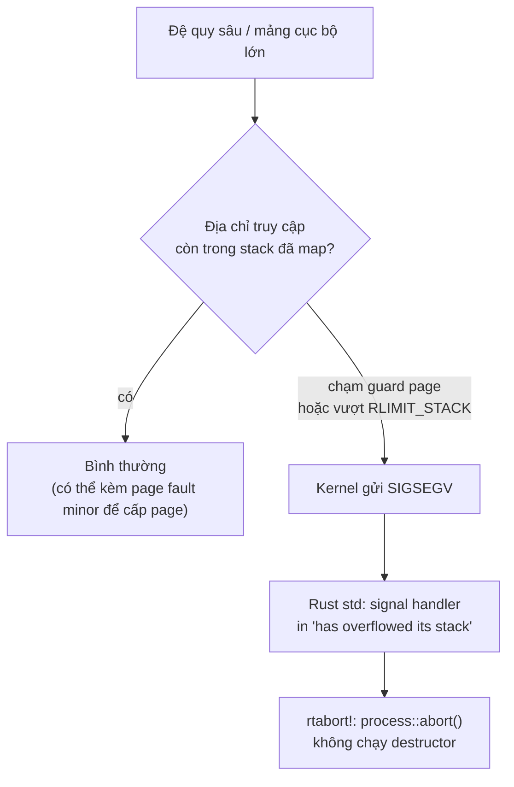
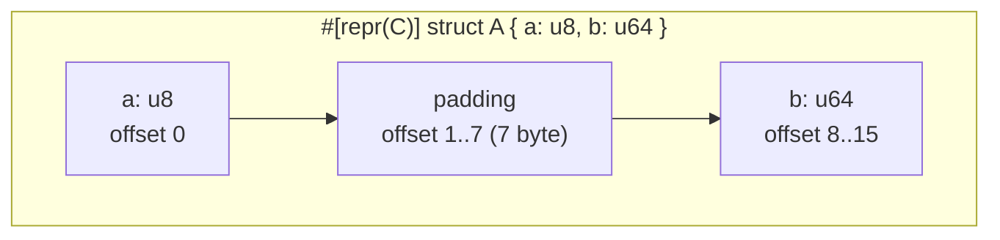

# P3 · Chương 07 — Stack, alignment và padding

## Bạn sẽ hiểu được gì

1. **Q1.** Stack tăng về phía nào, và làm sao tự đo điều đó trên máy của mình? → mục 2
2. **Q2.** Stack của process khác stack của thread ở chỗ nào, ai quyết định kích thước của từng loại, và `RLIMIT_STACK` giới hạn cái gì? → mục 3
3. **Q3.** Guard page là gì, tràn stack khác một lỗi truy cập bộ nhớ thông thường ở điểm nào, và vì sao một chương trình Rust tràn stack bị `abort` chứ không phải panic? → mục 4
4. **Q4.** Alignment là gì, vì sao phần cứng quan tâm, và "unaligned access" nghĩa là gì ở mức lệnh máy? → mục 5
5. **Q5.** Padding xuất hiện trong struct ở bước nào của thuật toán layout; tính tay `size`/offset của một struct `repr(C)` ra sao? → mục 6
6. **Q6.** Sắp xếp lại field làm struct nhỏ đi bao nhiêu, và Rust có cho compiler tự làm việc đó không? → mục 7
7. **Q7.** Dùng `size_of`, `align_of`, `offset_of!`, `Layout` để kiểm chứng layout thay vì đoán như thế nào? → mục 8
8. **Q8.** Chỉnh stack của thread con trong Rust bằng gì (`Builder::stack_size`, `RUST_MIN_STACK`)? → mục 9

## Kiến thức cần trước

- [P2 · Chương 04 — Calling convention và stack frame](../02-cpu/04-calling-convention-va-stack-frame.md): stack frame gồm gì, thanh ghi stack pointer, call/return; mục 4 của chương đó nói về căn lề stack 16 byte. Chương này chỉ nhắc lại ở mức đủ dùng.
- [P3 · Chương 05 — Bộ nhớ của tiến trình trên Linux](05-bo-nho-tien-trinh-linux.md): bố cục text/data/heap/mmap/stack, `/proc/self/maps` (mục 3).
- Nên biết qua [P3 · Chương 04 — Page fault, demand paging và swapping](04-page-fault-va-swapping.md) (mục 2: demand paging, tức page chỉ được cấp khi bị chạm), và [P2 · Chương 06 — Cache hierarchy và NUMA](../02-cpu/06-cache-va-numa.md) (mục 2: cache line) cho phần cache line.

Ví dụ chạy suốt chương là `ingest`, một service Rust giả định, giới thiệu ở mục 1.

## 1. Bối cảnh: stack giải quyết vấn đề gì

*Với service `ingest`.* Hãy hình dung `ingest`, một service Rust nhận event từ client qua TCP rồi giao cho một pool worker thread xử lý. Event có hai dạng: JSON lồng nhau và frame nhị phân với header cố định. Ngoài ra service giữ vài triệu record trong RAM. Ta sẽ bám theo `ingest` suốt chương (nhận xét của người soạn: đây là ví dụ giả định, không phải code trong repo). Các câu hỏi gom thành hai nhóm. Nhóm stack: worker gọi hàm lồng nhau thì dùng bao nhiêu chỗ, và hết chỗ thì chuyện gì xảy ra (mục 2–4 và 9). Nhóm layout: một record nằm trong bộ nhớ ra sao, và vì sao giữa các field có byte đệm (mục 5–8).

Khi một worker parse event, nó gọi hàm này rồi hàm kia, và mỗi lần gọi cần chỗ cho biến cục bộ, tham số, giá trị trả về và địa chỉ quay lại. Stack lo chỗ đó mà không cần ai gọi allocator: compiler tự cấp rồi tự giải phóng, nên người ta còn gọi nó là "automatic memory"[^ostep-stackmem]. Vì allocator không phải đi tìm chỗ, đẩy dữ liệu lên stack nhanh hơn cấp phát trên heap[^book-push-faster]. Cái giá là dữ liệu trên stack phải có kích thước biết trước và cố định[^book-stack-fixed].

Nhắc lại từ [chương 04 của phase P2 — Calling convention và stack frame](../02-cpu/04-calling-convention-va-stack-frame.md): mỗi lần gọi hàm tạo ra một **stack frame**, tức vùng nhỏ trên stack giữ dữ liệu của lần gọi đó, và khi hàm trả về thì frame bị bỏ. Frame gồm chính xác những gì (thanh ghi callee-saved, địa chỉ trả về, frame pointer…) tùy ABI của từng kiến trúc, nên đó là chuyện của chương kia. Ở đây ta chỉ cần hai tính chất: frame của lần gọi sâu hơn nằm *kề* frame của lần gọi cha, và tổng kích thước các frame đang sống chính là mức dùng stack hiện tại.

## 2. Hướng tăng của stack (Q1)

> **Trả lời ngắn.** Không nguồn nào của chương hứa mọi máy đều giống nhau, nên cách chắc chắn là tự đo: gọi hàm lồng nhau rồi so địa chỉ một biến cục bộ ở tầng nông với tầng sâu; địa chỉ nhỏ đi nghĩa là stack mọc xuống. Hai nguồn ta có đều mô tả trường hợp "xuống". Ví dụ trong sách OSTEP cho stack mọc về phía địa chỉ thấp[^ostep-seg-stack]. Linux thì có cờ `MAP_GROWSDOWN` cho vùng nhớ mở rộng xuống phía thấp[^mmap-growsdown].

**Giải thích.**

*Với `ingest`.* Parser JSON của `ingest` gọi đệ quy cho mỗi tầng lồng, và mỗi tầng thêm một frame kề frame của tầng cha (mục 1). Vậy frame mới nằm ở địa chỉ cao hơn hay thấp hơn frame cũ? Mục này trả lời bằng cách đo, không dựa vào một mô tả có sẵn.

Phép đo gồm ba bước. Bước một, viết một hàm đệ quy gọi chính nó; mỗi lần gọi tạo một frame mới nằm kề frame của lần gọi cha. Bước hai, mỗi tầng ghi lại địa chỉ của một biến cục bộ; biến đó nằm trong frame của tầng ấy nên địa chỉ của nó đại diện cho vị trí frame. Bước ba, so sánh: tầng gọi sau (sâu hơn) có địa chỉ nhỏ hơn thì stack mọc về phía thấp, lớn hơn thì mọc về phía cao. Thí nghiệm trong phần Đi sâu làm đúng ba bước này.

Vì sao phải đo mà không tin một mô tả có sẵn? Trong mô hình segmentation của OSTEP, phần cứng cần thêm một bit cho mỗi segment để biết nó mọc theo chiều dương hay chiều âm[^ostep-seg-growbit]. Nói cách khác, chiều mọc là một thuộc tính phải khai báo, không hiển nhiên (nhận xét của người soạn). Phía Linux, man page `mmap(2)` ghi rằng `MAP_GROWSDOWN` dùng cho stack và báo cho hệ thống bộ nhớ ảo của kernel rằng mapping nên mở rộng xuống phía địa chỉ thấp[^mmap-growsdown]. Đó là hai mô tả riêng lẻ, một mô hình trong sách giáo khoa và một cờ của mmap, chứ không phải lời hứa rằng kiến trúc nào cũng thế.

<details><summary>Đi sâu: thí nghiệm đo hướng tăng bằng đệ quy</summary>

**Thí nghiệm (đã chạy).** Một hàm đệ quy `#[inline(never)]` ghi lại địa chỉ biến cục bộ ở mỗi tầng:

```rust
#[inline(never)]
fn addr(n: u32) -> usize {
    let z = n;
    let a = &z as *const u32 as usize;
    if n == 0 { a } else { std::hint::black_box(addr(n - 1)) }
}
fn main() {
    let top = addr(0);        // frame nông
    let deeper = addr(5);     // địa chỉ biến ở tầng sâu nhất của chuỗi 5 lần gọi
    println!("depth0 {:x} depth5 {:x}", top, deeper);
}
```

Biên dịch `rustc -C opt-level=0` rồi chạy trong container Linux aarch64 của repo (`./labs/linux.sh`), kết quả quan sát được: `depth0 ffffc9ccd0ac depth5 ffffc9cccfbc`. Địa chỉ tầng sâu hơn **nhỏ hơn** 0xf0 = 240 byte, tức khoảng 48 byte mỗi tầng. Đây là quan sát một lần chạy trên aarch64 Linux với `opt-level=0`; con số 48 byte phụ thuộc compiler và mức tối ưu hóa, không phải hằng số. Khi tối ưu hóa, compiler có thể inline hoặc bỏ bớt frame nên thí nghiệm kiểu này phải dùng `inline(never)` và `black_box`.

</details>

**Quay lại Q1:** hướng tăng là quan sát theo từng máy/ABI; trên aarch64 Linux thí nghiệm cho thấy stack đi xuống địa chỉ thấp.

## 3. Stack của process và của thread (Q2)

> **Trả lời ngắn.** Main thread (thread đầu tiên của process) dùng một vùng stack nằm trong address space của process[^proc-stack]. Kích thước tối đa của nó bị `RLIMIT_STACK` chặn, và vượt trần thì kernel gửi tín hiệu lỗi bộ nhớ `SIGSEGV`[^rlimit-stack]. Mỗi thread con có stack riêng do thư viện luồng cấp lúc tạo thread. Với glibc/NPTL, khi soft limit `RLIMIT_STACK` lúc khởi động không phải "unlimited" thì nó quyết định kích thước mặc định của stack đó, còn chương trình cũng có thể đặt tường minh[^pthread-default].

**Giải thích.**

*Với `ingest`.* `ingest` có hai loại thread: main thread nhận kết nối, và một pool worker do chương trình tạo ra để xử lý event. Stack của hai loại đến từ hai nơi khác nhau, nên giới hạn của chúng cũng khác nhau. Mục này trả lời: ai cấp stack cho từng loại, ai quyết định kích thước, và vì sao con số bộ nhớ mà container báo có thể lệch xa tổng stack bạn nghĩ mình đã khai.

### 3.1 Stack của main thread

Stack của main thread là một vùng trong address space của process; bạn thấy nó trong `/proc/self/maps` dưới nhãn `[stack]`[^proc-stack] (xem [mục 3 chương 05](05-bo-nho-tien-trinh-linux.md)). Kích thước tối đa của vùng này bị chặn bởi resource limit `RLIMIT_STACK`, tức kích thước tối đa của stack process tính bằng byte; chạm trần thì kernel sinh `SIGSEGV`[^rlimit-stack]. Muốn xử lý tín hiệu này, process phải dùng một *alternate signal stack* (`sigaltstack(2)`)[^rlimit-altstack]. Lý do là handler của `SIGSEGV` do hết chỗ stack thường không chạy được trên chính cái stack đã hết chỗ, nên muốn bắt nó thì phải có một stack riêng cho handler[^sigaltstack-why].

Giới hạn có hai mức: *soft* (`rlim_cur`) là mức đang áp dụng, còn *hard* (`rlim_max`) là trần mà soft có thể nâng lên[^rlimit-soft-hard]. Đọc nó bằng `getrlimit(RLIMIT_STACK, &r)`.

### 3.2 Stack của thread con

Thread con thì khác: mỗi native thread có stack và trạng thái cục bộ riêng[^std-thread-model]. Stack này do thư viện luồng (pthread) cấp lúc `pthread_create`, và kích thước nằm trong *thuộc tính thread*. Man page `pthread_attr_setstacksize(3)` ghi rằng thuộc tính đó xác định kích thước tối thiểu cấp cho các thread tạo từ nó[^pthread-attr-stacksize]. Khi chương trình không đặt gì, glibc/NPTL dùng `RLIMIT_STACK`: nếu soft limit lúc khởi động khác "unlimited" thì nó quyết định kích thước stack mặc định của thread mới, và chương trình vẫn đặt tường minh được qua `pthread_attr_setstacksize(3)`[^pthread-default]. Trường hợp limit là "unlimited" nằm ở phần Đi sâu cuối mục.

### 3.3 Hệ quả cho `ingest`

Giả sử pool của `ingest` có 200 worker, mỗi worker một stack 8 MiB. Tổng không gian địa chỉ ảo *dành sẵn* là 200 × 8 = 1600 MiB (khoảng 1,56 GiB), nhưng chỉ phần stack mà worker thực sự chạm tới mới tốn RAM thật nhờ demand paging ([mục 2 chương 04](04-page-fault-va-swapping.md)). Vì vậy khi đọc số liệu của container, phải tách con số "ảo" (VmSize) khỏi RSS (nhận xét của người soạn).

<details><summary>Đi sâu: khi <code>RLIMIT_STACK</code> là unlimited, đo <code>RLIMIT_STACK</code>, mapping <code>[stack]</code> tăng dần, VmSize của 50 thread</summary>

**Khi `RLIMIT_STACK` là unlimited.** Man page `pthread_create(3)` ghi rằng khi đó glibc dùng một giá trị theo kiến trúc[^pthread-x86]. Bảng trong man page liệt kê, chẳng hạn, x86_64 là 2 MB[^pthread-x86-table].

**Thí nghiệm (đã chạy)** trong container Linux của repo: chương trình C gọi `getrlimit(RLIMIT_STACK)` in `cur=8388608 max=18446744073709551615` (tức soft 8 MiB, hard không giới hạn), và `ulimit -s` của shell in `8192` (đơn vị KiB). Sau `ulimit -s 1024`, cùng chương trình in `cur=1048576 max=1048576`: `ulimit -s` hạ cả soft lẫn hard. Đây là giá trị mặc định của container này, máy/distro/Kubernetes pod khác có thể khác.

Một quan sát bổ sung (cũng từ container, trên tiến trình `bash`): dòng `[stack]` trong `/proc/self/maps` có kích thước `0x21000` byte = 132 KiB, nhỏ hơn nhiều so với trần 8 MiB. Mapping này tăng dần theo nhu cầu — đã đo: một chương trình Rust ghi `/proc/self/maps` ở ba thời điểm cho `[stack]` dài `0x21000` (132 KiB) lúc bắt đầu, `0x261000` (2436 KiB) sau 200 tầng đệ quy mỗi tầng giữ mảng 4 KiB, và `0x4bd000` (4852 KiB) sau 400 tầng (khớp `VmStk: 4852 kB` trong `/proc/self/status`); đầu thấp lùi xuống, đầu cao đứng yên. Đây là quan sát (aarch64 Linux, `opt-level=0`). Việc có phải nhờ cờ `MAP_GROWSDOWN` ở trên hay không là suy luận của người soạn; ta không đọc source kernel để khẳng định cơ chế cụ thể.

**Thí nghiệm (đã chạy, aarch64 Linux, glibc, `-O`).** Chương trình đọc `VmSize`/`VmRSS` trong `/proc/self/status`, spawn 50 thread `Builder::stack_size(8 << 20)` rồi cho chúng chờ ở barrier. Với `MALLOC_ARENA_MAX=1`: `VmSize` tăng 413 800 KiB (50 × 8192 = 409 600 KiB là stack), `VmRSS` chỉ tăng 480 KiB. Không đặt biến đó, `VmSize` tăng tới 2 445 416 KiB: phần chênh không phải stack mà là các malloc arena theo thread của glibc, vốn được cấp cho từng thread mới đến một trần theo số CPU (nguồn và thí nghiệm đếm arena ở [Chương 06, mục 7](06-heap-allocator.md)). Việc quy phần chênh này cho arena là suy luận của người soạn từ hai thí nghiệm (`MALLOC_ARENA_MAX=1` làm chênh lệch biến mất); chương này không kiểm kích thước mỗi arena.

</details>

**Quay lại Q2:** main thread bị `RLIMIT_STACK` chặn; thread con có stack riêng do thư viện luồng cấp, nên khi đọc số liệu phải tách "ảo" (VmSize) khỏi RSS.

## 4. Guard page và tràn stack (Q3)

> **Trả lời ngắn.** Guard page là một vùng địa chỉ chương trình không được dùng, đặt ngay cuối stack[^pthread-guard]. Stack lấn vào đó thì lỗi truy cập (tín hiệu `SIGSEGV`) nổ ngay[^mmap-growsdown-guard], thay vì âm thầm ghi đè vùng nhớ kề bên (đó là mục đích của guard page, nhận xét của người soạn). Rust std cài một signal handler bắt tín hiệu này[^std-guard]. Handler in thông báo tràn stack rồi `abort` cả process[^std-fault-in-guard]. Vì đây là `abort` chứ không phải panic, không có gì để `catch_unwind` bắt[^std-rtabort-macro].

**Giải thích.**

*Với `ingest`.* Parser JSON của worker đệ quy theo độ sâu của input, mà input do client gửi. Một client gửi mảng lồng hàng chục nghìn tầng thì mỗi tầng thêm một frame, và stack của worker cạn. Câu hỏi của mục này: stack cạn rồi thì chuyện gì xảy ra, và chuyện đó dừng ở một request hay kéo cả service xuống.

**Vấn đề.** Nếu stack tràn qua đầu của nó, chương trình sẽ ghi đè lên bất cứ thứ gì nằm kề: một stack khác, heap hay một mapping khác. Đó là lỗi âm thầm và nguy hiểm (nhận xét của người soạn). Giải pháp là đặt giữa stack và hàng xóm một vùng địa chỉ **không truy cập được**, để chạm vào là phần cứng và kernel báo lỗi ngay.

**Cơ chế ở mức pthread.** Với thread POSIX, nếu `guardsize` lớn hơn 0 thì hệ thống cấp thêm một vùng ít nhất `guardsize` byte ở cuối stack làm *guard area*; nếu `guardsize` bằng 0 thì thread không có guard area. Kích thước mặc định bằng page size của hệ thống[^pthread-guard].

**Cơ chế ở mức mmap.** Với mapping `MAP_GROWSDOWN`, kernel dùng một "guard page" ngay dưới mapping. Chạm vào nó thì mapping nở thêm một page, và việc này lặp lại cho tới khi mapping sát mapping thấp kế tiếp. Lúc đó chạm vào guard page sinh `SIGSEGV`[^mmap-growsdown-guard].



Rust không tự đo độ sâu stack. Source `library/std/src/sys/pal/unix/stack_overflow.rs` cho thấy nó cài một *signal handler* (hàm được gọi khi process nhận một tín hiệu) cho `SIGSEGV` và `SIGBUS`. Comment trong source ghi rằng cuối stack của mỗi thread có guard page (trang không được map), nên thread nào chạy vào guard page sẽ kích hoạt handler này[^std-guard]. Mỗi lần handler chạy, nó làm ba việc:

1. Lấy địa chỉ gây lỗi và so với khoảng guard page của thread hiện tại; nếu nằm trong đó thì in thông báo rồi `abort`[^std-fault-in-guard].
2. Thông báo có dạng `thread '{name}' ... has overflowed its stack`, rồi `rtabort!("stack overflow")`[^std-rtabort-call]. Macro `rtabort!` in `fatal runtime error: ..., aborting` rồi gọi `crate::process::abort()`[^std-rtabort-macro].
3. Nếu `SIGSEGV` không do guard page, handler gỡ chính nó (trả về `SIG_DFL`) rồi return để tín hiệu gốc được phát lại[^std-handler-unreg]. Đây là điểm khác với lỗi truy cập bộ nhớ thông thường: chỉ lỗi trúng guard page mới bị dán nhãn "stack overflow", còn mọi `SIGSEGV` khác đi theo đường mặc định.

Vì sao `abort` mà không để `SIGSEGV` đi tiếp? Handler chỉ tồn tại để in một thông báo hữu ích[^std-handler-purpose]. Sau đó nó `abort` để process thoát với dấu hiệu crash chứ không để lộ một `SIGSEGV` trần, vì `SIGSEGV` trần dễ làm người dùng tưởng `unsafe` code truy cập con trỏ sai: source ghi rằng `SIGSEGV` do tràn stack là điều "dự kiến" và có định nghĩa rõ ràng[^std-handler-abort]. Còn `abort` thì không chạy destructor nào, trên stack hiện tại lẫn stack của thread khác[^std-process-abort]. Vì vậy tràn stack **không phải panic có thể unwind**: `Drop` không chạy và `catch_unwind` không bắt được.

Handler chạy trên **alternate signal stack** (`sigaltstack`), vì stack thường đã hết chỗ. Std tự `mmap` một vùng riêng cho việc này và đặt guard page cho cả vùng đó (hàm `get_stack` trong cùng file, dùng `mprotect(..., PROT_NONE)`)[^std-altstack-guard].

**Hiểu lầm phổ biến.** "Tràn stack ném panic nên `catch_unwind` bắt được." Sai theo source ở trên: đường đi là `abort`, không unwind[^std-rtabort-macro]. Và `abort` không chạy destructor nào[^std-process-abort].

**Với `ingest` (nhận xét của người soạn).** Parser hay serializer đệ quy trên input do client kiểm soát (JSON lồng sâu) là vector tràn stack kinh điển. Vì tràn stack là `abort` cả process, một request độc hại có thể hạ cả service, kể cả các request của client khác đang chạy trên worker khác. Cách chặn là đặt giới hạn độ sâu ở parser, đừng chỉ tăng stack.

<details><summary>Đi sâu: main thread trên Linux và thí nghiệm tràn stack</summary>

**Main thread trên Linux (không phải musl) là trường hợp đặc biệt** (source tách `install_main_guard_linux` cho target này và `install_main_guard_linux_musl` cho musl; phần dưới nói về nhánh thứ nhất). Source ghi rằng Linux không cấp toàn bộ stack ngay và kernel đã có cơ chế stack-guard riêng; nếu std tự map thêm guard, kernel sẽ bắt đầu giữ một khoảng trống lớn phía trên, phí nhiều chỗ stack; vì vậy std chỉ ghi lại nơi nó *kỳ vọng* rlimit bắt đầu gây lỗi để handler báo được "stack overflow", rồi tin vào guard của kernel[^std-main-guard].

**Thí nghiệm (đã chạy, aarch64 Linux, `opt-level=0`).** Hàm `rec(n)` mỗi tầng giữ một mảng `[u8; 1024]` (khoảng 1 KiB/tầng, qua `black_box`):

| Kịch bản | Kết quả quan sát |
|---|---|
| main thread, 100 tầng (~100 KiB), `ulimit -s` = 8192 | chạy bình thường, exit 0 |
| main thread, 100 000 tầng (~100 MB) | `thread 'main' (…) has overflowed its stack` / `fatal runtime error: stack overflow, aborting`, exit 134 (SIGABRT) |
| main thread, 2000 tầng (~2 MB) với `ulimit -s 1024` | cùng thông báo, exit 134 |
| thread con `stack_size(1 << 20)`, 100 tầng | `Ok(...)`, exit 0 |
| thread con `stack_size(1 << 20)`, 5000 tầng (~5 MB) | `thread '<unknown>' (…) has overflowed its stack`, exit 134 |

Điểm đáng chú ý: thread con không đặt tên in `<unknown>`; và tràn stack ở thread con **kéo sập cả process** (exit 134), không chỉ thread đó.

</details>

**Quay lại Q3:** guard page biến tràn stack thành `SIGSEGV` có kiểm soát; Rust std biến nó thành thông báo rồi `abort`, không unwind.

## 5. Alignment: phần cứng muốn gì (Q4)

> **Trả lời ngắn.** Alignment là quy tắc: giá trị có alignment n chỉ được đặt ở địa chỉ chia hết cho n[^ref-align]. Phần cứng quan tâm vì một lệnh đọc/ghi nhiều byte tại địa chỉ không chia hết cho kích thước của nó (gọi là *unaligned access*) cho kết quả khác nhau tùy kiến trúc. Có kiến trúc làm được nhưng chậm[^kdoc-transparent]. Có kiến trúc phát exception rồi sửa, với giá hiệu năng lớn[^kdoc-trap-fix]. Có kiến trúc còn âm thầm truy cập sai chỗ[^kdoc-silent].

**Giải thích.**

*Với `ingest`.* `ingest` đụng alignment ở hai chỗ. Một là struct record trong RAM: compiler tự lo cho field căn đúng (mục 6). Hai là frame nhị phân từ client: parser phải đọc số nguyên 4 byte ra từ một buffer byte, và ở đây chính ta, chứ không phải compiler, chọn địa chỉ để đọc (§5.3 và mục 8). Mục này nói alignment là gì và phần cứng phản ứng thế nào khi nó bị vi phạm.

### 5.1 Một truy cập là một lệnh máy

Tài liệu kernel Linux đặt khái niệm này ở mức lệnh máy: có những lệnh đọc hoặc ghi một số byte cố định từ hoặc vào bộ nhớ, ví dụ `movb`, `movw`, `movl` trong assembly x86[^kdoc-machine-level]. Alignment là quy tắc về địa chỉ mà các lệnh đó dùng.

### 5.2 Aligned và unaligned

Khi truy cập N byte, địa chỉ nền phải chia hết cho N; đó là *natural alignment*[^kdoc-natural]. Vi phạm (`addr % N != 0`) là unaligned access. Ví dụ trong tài liệu: đọc 4 byte từ `0x10004` thì ổn, từ `0x10005` thì không[^kdoc-unaligned-def]. Truy cập 1 byte không bao giờ unaligned, vì mọi địa chỉ đều chia hết cho 1[^kdoc-byte]. Phía Rust, alignment của một kiểu cũng đo bằng byte, tối thiểu 1 và luôn là lũy thừa của 2[^ref-align-pow2].

### 5.3 Compiler giữ field aligned, còn con trỏ tự tính thì không

Với field của struct, compiler lo việc này. Tài liệu kernel lấy ví dụ struct C gồm `u16`, `u32`, `u8`: nếu `field2` (4 byte) nằm ngay sau `field1` (2 byte) thì nó ở offset 2, không chia hết cho 4, nên compiler chèn 2 byte padding giữa hai field[^kdoc-compiler-pad]. Đó chính là padding của mục 6.

Unaligned vẫn xảy ra khi ta tự tính địa chỉ. Tài liệu kể hai tình huống chính. Một là ép con trỏ sang kiểu có độ dài khác[^kdoc-cast]. Hai là cộng hoặc trừ con trỏ rồi truy cập ít nhất 2 byte[^kdoc-ptr-arith]. Với `ingest`, parser đọc một số 4 byte từ buffer byte ở offset lẻ là ví dụ điển hình (nhận xét của người soạn; cách đọc an toàn ở mục 8).

### 5.4 Phần cứng xử lý theo bốn kiểu

Tài liệu kernel chia thành bốn kiểu, tùy kiến trúc. Kiểu (a) làm được một cách trong suốt nhưng thường chậm đáng kể[^kdoc-transparent]. Kiểu (b) phát processor exception (ngoại lệ do CPU báo), và handler sửa được truy cập với giá hiệu năng lớn[^kdoc-trap-fix]. Kiểu (c) cũng phát exception nhưng thông tin không đủ để sửa[^kdoc-trap-nofix]. Kiểu (d) không làm được và âm thầm thực hiện một truy cập khác với yêu cầu, gây lỗi khó phát hiện[^kdoc-silent]. Thực tế chỉ vài kiến trúc đòi natural alignment cho mọi kích thước truy cập, nhưng code phải tính đến *mọi* kiến trúc được hỗ trợ[^kdoc-few-arch].

Còn vì sao chi phí có thật? Lý do vật lý (suy luận của người soạn, không có nguồn ở đây): một lần đọc rộng có thể bắc qua ranh giới cache line; xem [mục 2 của chương P2·06 — Cache hierarchy và NUMA](../02-cpu/06-cache-va-numa.md).

<details><summary>Đi sâu: alignment của allocator, <code>Layout</code> và size của kiểu</summary>

- Allocator: `malloc` trả con trỏ đã căn cho mọi kiểu vừa trong kích thước yêu cầu — chi tiết và nguồn ở [mục 1 chương 06](06-heap-allocator.md).
- `Layout` của Rust (size cộng alignment lũy thừa 2) dùng đúng các khái niệm này; cách dùng ở mục 8.
- Kích thước của kiểu là khoảng cách byte giữa hai phần tử liên tiếp của mảng kiểu đó, đã tính padding, và luôn là bội của alignment[^ref-size].

Hệ quả quan trọng của bullet cuối: vì size là bội của alignment, `[T; N]` đặt các phần tử sát nhau mà phần tử nào cũng căn đúng.

</details>

**Quay lại Q4:** alignment n nghĩa là địa chỉ chia hết cho n; truy cập không căn là đọc N byte từ địa chỉ `addr % N != 0`, hành vi của phần cứng tùy kiến trúc.

## 6. Padding trong struct và cách tính (Q5)

> **Trả lời ngắn.** Padding là các byte đệm compiler chèn vào struct ở hai chỗ. Giữa các field, để field sau bắt đầu ở địa chỉ đúng alignment[^sizeof-pad]. Ở cuối struct, để size là bội của alignment[^ref-c-algo]. Tính tay theo thuật toán của `repr(C)` (cách bố trí field đúng thứ tự khai báo): căn offset, đặt field, cộng size, cuối cùng làm tròn size.

**Giải thích.**

*Với `ingest`.* Mỗi record `ingest` giữ trong RAM là một struct gồm vài field có kích thước khác nhau (cờ trạng thái, id, loại, cổng, timestamp). Vài triệu record nhân với số byte đệm trong mỗi cái là một con số đáng kể (mục 7). Mục này cho bạn cách tính tay xem padding nằm ở đâu và bao nhiêu byte.

Thuật toán layout của `repr(C)` đi như sau. Bắt đầu với offset hiện tại bằng 0. Với mỗi field theo thứ tự khai báo, nếu offset chưa là bội của alignment của field thì thêm byte padding cho tới khi là bội; đó là offset của field, rồi cộng size của field vào offset. Cuối cùng, size của struct là offset hiện tại làm tròn lên bội của alignment của struct[^ref-c-algo]. Còn alignment của struct là alignment lớn nhất trong các field[^ref-c-align].

Padding sinh ra ở hai nơi vì hai lý do khác nhau. Giữa các field, nó để offset của field kế tiếp chia hết cho alignment của nó; `std::mem::size_of` mô tả cùng quy tắc, là làm tròn size hiện tại lên bội alignment của field kế tiếp[^sizeof-pad]. Ở cuối struct, lý do đến từ mảng: `size_of` là khoảng cách byte giữa hai phần tử liên tiếp của mảng[^sizeof]. Mặt khác size luôn là bội của alignment[^ref-size]. Nếu không đệm cuối thì phần tử thứ hai của mảng sẽ rơi vào địa chỉ không chia hết cho alignment của struct (suy ra từ hai định nghĩa trên).



Chạy bằng `rustc 1.95.0` (macOS aarch64) với `size_of`, `align_of`, `offset_of!`:

```rust
use std::mem::{size_of, align_of, offset_of};
#[repr(C)] struct A { a: u8, b: u64 }
#[repr(C)] struct B { b: u64, a: u8 }
#[repr(C)] struct C { a: u8, b: u32, c: u8, d: u16, e: u64 }
fn main() {
    println!("A {} {} b@{}", size_of::<A>(), align_of::<A>(), offset_of!(A, b));
    println!("B {} {} a@{}", size_of::<B>(), align_of::<B>(), offset_of!(B, a));
    println!("C {} {}", size_of::<C>(), align_of::<C>());
}
```

Kết quả: `A 16 8 b@8`, `B 16 8 a@8`, `C 24 8`. Tính tay khớp:

- `A`: `a`@0 (1 byte) → offset 1, chưa chia hết 8 nên +7 padding → `b`@8 (8 byte) → offset 16; align 8, 16 đã là bội → size 16.
- `B`: `b`@0 → offset 8; `a`@8 → offset 9; làm tròn lên bội của 8 → size 16 (7 byte padding cuối). Đảo thứ tự **không** thu nhỏ struct này — padding chỉ chuyển từ giữa xuống cuối.

<details><summary>Đi sâu: tính tay struct <code>C</code> từng field</summary>

- `C { a: u8, b: u32, c: u8, d: u16, e: u64 }` — chạy thật cho offset `a0 b4 c8 d10 e16`, size 24:

| Field | size | align | offset | padding trước field |
|---|---|---|---|---|
| `a: u8` | 1 | 1 | 0 | 0 |
| `b: u32` | 4 | 4 | 4 | 3 |
| `c: u8` | 1 | 1 | 8 | 0 |
| `d: u16` | 2 | 2 | 10 | 1 |
| `e: u64` | 8 | 8 | 16 | 4 |
| (cuối) | | | 24 | 0 (đã là bội của 8) |

Tổng padding = 3 + 1 + 4 = 8 byte trên 24 byte, tức một phần ba.

</details>

**Quay lại Q5:** padding sinh ra khi căn offset cho field kế tiếp và khi làm tròn size cuối; tính tay khớp kết quả `size_of`/`offset_of!`.

## 7. Sắp xếp field và `repr(Rust)` (Q6)

> **Trả lời ngắn.** Với `repr(C)`, xếp field theo alignment giảm dần thường bỏ được padding giữa field (struct `C` trong thí nghiệm giảm từ 24 xuống 16 byte). Với `repr(Rust)`, biểu diễn mặc định, Reference cho phép compiler tự đổi thứ tự field[^ref-rust-order]. Reference chỉ bảo đảm những gì cần cho tính đúng đắn của code an toàn, chẳng hạn field căn đúng và không chồng nhau[^ref-rust-guar].

**Giải thích.**

*Với `ingest`.* Giả sử `ingest` giữ vài triệu record dạng struct `C` ở mục 6, mỗi record 24 byte mà 8 byte là padding. Có hai câu hỏi: tự xếp lại field để bỏ padding có đáng không, và nếu không làm gì thì compiler có tự xếp giúp không?

Quy tắc kinh nghiệm là xếp field theo alignment giảm dần. Với `repr(C)`, thứ tự khai báo chính là thứ tự layout, nên việc sắp xếp thuộc về người viết. Lấy các field của `C` nhưng khai báo lại `{ e: u64, b: u32, d: u16, a: u8, c: u8 }` (đặt tên `D`). Chạy thật cho `size 16, align 8`, offset `e0 b8 d12 a14 c15`. Không còn padding giữa field, vì mỗi field bắt đầu đúng ở bội alignment của nó; tổng 8+4+2+1+1 = 16 vốn đã là bội của 8.

Mỗi struct tiết kiệm 8 byte (24 → 16). Tính số học, không đo: mảng một triệu record `C` chiếm 24 MB, còn `D` chiếm 16 MB.

**Đánh đổi (nhận xét của người soạn).** Sắp xếp theo alignment có thể phá nhóm field hay dùng chung (hot/cold). Với `repr(C)` dùng cho FFI thì thứ tự do ABI phía bên kia quy định. Vì vậy chỉ tối ưu khi struct xuất hiện hàng triệu lần hoặc nằm trên đường nóng.

**`repr(Rust)` được phép sắp xếp lại field.**

Biểu diễn mặc định (không có attribute `repr`) hứa rất ít. Các bảo đảm duy nhất là những gì cần cho tính đúng đắn (soundness): field căn đúng, không chồng lấn, và alignment của kiểu ít nhất bằng alignment lớn nhất của các field[^ref-rust-guar-list]. Về thứ tự, thứ tự layout của field không nhất thiết trùng thứ tự khai báo[^ref-rust-order]. Biểu diễn này không đưa ra bảo đảm layout nào khác[^ref-rust-unspec]. Tuple cũng dùng biểu diễn Rust[^ref-tuple].

**Quan sát (không phải bảo đảm).** Struct `R { a: u8, b: u32, c: u8, d: u16, e: u64 }` — cùng thứ tự field với `C` nhưng không có `repr(C)`. Chạy thật bằng `rustc 1.95.0` trên aarch64 cho `size 16, align 8`, offset `a14 b8 c15 d12 e0`: compiler đã tự sắp xếp thành chính thứ tự "alignment giảm dần" ở trên. Tuple `(u8, u32, u8)` cho `size_of` = 8 trên cùng máy. Reference không hứa điều này; bản compiler khác có thể khác. Việc phải làm: không dựa vào offset của `repr(Rust)`; cần layout xác định (FFI, đọc/ghi file nhị phân, `unsafe` ép kiểu con trỏ) thì dùng `repr(C)`.

<details><summary>Đi sâu: <code>align</code>, <code>packed</code>, kiểu kích thước 0 (ZST)</summary>

Modifier `align(N)` nâng và `packed(N)` hạ alignment của struct/union; chúng đổi biểu diễn đã chọn, và nếu không chọn biểu diễn nào thì đổi biểu diễn mặc định[^ref-align-packed]. `packed` cũng có thể thay đổi padding giữa field; `repr(packed)` (tức `packed(1)`) không có padding giữa field[^ref-packed-pad]. `align` và `packed` không dùng chung trên một kiểu[^ref-align-packed-excl].

Chạy thật: `#[repr(C, packed)] struct P { a: u8, b: u32 }` cho `size 5, align 1, b@1`. Struct nhỏ hơn (5 thay vì 8), nhưng `b` nằm ở địa chỉ có thể không chia hết cho 4, nên đọc nó là unaligned access. Reference xếp "accessing a place that is dangling or based on a misaligned pointer" vào hành vi undefined[^ref-ub-misaligned]; vì thế với field của struct `packed`, đọc phải qua cách an toàn như copy giá trị ra hoặc `ptr::read_unaligned` (xem mục 8). Lưu ý: tạo con trỏ tới field `packed` bằng `&packed.field as *const _` đã là UB ngay, vì nó tạo một tham chiếu lệch tạm thời; docs của `read_unaligned` yêu cầu dùng cú pháp `&raw const`[^read-unaligned-packed].

**ZST và mảng.**

Reference nêu rằng có kiểu kích thước 0 (zero-sized), và 0 được coi là bội của mọi alignment[^ref-size]. Unit `()` được bảo đảm size 0 và alignment 1[^ref-unit]. Vì zero-sized, field kiểu này có thể có cùng địa chỉ với field khác[^ref-rust-zst]. (Chạy thật `#[repr(C)] struct Z { x: u32, y: () }` cho size 4, align 4.)

Chi tiết về `repr(transparent)`, niche và ZST trong layout (đọc từ Reference, không lặp lại ở đây): [P10 · Chương 02, mục 3 và 7](../10-rust-internals/02-type-layout.md).

</details>

**Quay lại Q6:** xếp field alignment giảm dần giảm padding; `repr(Rust)` được phép tự làm việc đó nhưng không hứa layout cụ thể, cần layout cố định thì dùng `repr(C)`.

## 8. Liên hệ với Rust: API để đo layout và đọc dữ liệu không căn (Q7)

> **Trả lời ngắn.** `size_of`, `align_of`, `offset_of!` và `Layout` cho phép hỏi thẳng compiler thay vì đoán layout. Dữ liệu không căn thì đọc bằng `ptr::read_unaligned`, đừng deref con trỏ lệch[^read-unaligned].

**Giải thích.**

*Với `ingest`.* Chương này để lại cho `ingest` hai thói quen. Thứ nhất, muốn biết một record chiếm bao nhiêu byte thì hỏi compiler bằng bốn công cụ dưới đây, đừng tự nhẩm. Thứ hai, khi parse frame nhị phân từ buffer byte của client thì đừng ép con trỏ sang `*const u32`.

- `size_of::<T>()` cho khoảng cách tính bằng byte giữa các phần tử liên tiếp của một mảng kiểu đó, đã gồm padding căn lề[^sizeof].
- `align_of::<T>()` cho alignment tối thiểu mà ABI yêu cầu cho kiểu, tính bằng byte[^alignof].
- `offset_of!(Type, field)` cho offset tính bằng byte của một field so với đầu kiểu đã cho[^offset-of]. Nó trả về `usize`[^offset-of-usize]. `Type` có thể là struct, enum, union hoặc tuple[^offset-of-types], nên dùng được cả với `repr(Rust)`. Khi đó nó cho biết layout compiler chọn, nhưng đó chỉ là giá trị của lần biên dịch này vì Reference không bảo đảm layout đó (suy luận của người soạn).
- `Layout` gồm size và alignment lũy thừa 2[^layout]. `Layout::extend(next)` trả `(layout, offset)` của `next` (bọc trong `Result`), có chèn padding để `next` căn đúng nhưng **không** có padding cuối[^layout-extend-pad]. Để khớp `repr(C)`, phải gọi thêm `pad_to_align` sau khi `extend` tất cả field[^layout-extend]. `pad_to_align` làm tròn size lên bội của alignment[^layout-pad]. Doc cũng nói thẳng: không có cách khớp layout `repr(Rust)` vì nó unspecified[^layout-extend].

Với parser frame nhị phân của `ingest`, buffer là `&[u8]` nên không bảo đảm căn. Hãy dựng số nguyên bằng `u32::from_le_bytes(...)` (dựng số từ mảng byte little endian, không cần con trỏ căn[^u32-from-le]) hoặc `read_unaligned`, đừng ép con trỏ (nhận xét của người soạn).

<details><summary>Đi sâu: kết quả chạy thật và <code>read_unaligned</code></summary>

Chạy thật: `Layout::new::<C>()` in `Layout { size: 24, align: 8 (1 << 3) }`; `Layout::new::<u8>().extend(Layout::new::<u64>())` trả `(Layout { size: 16, align: 8 }, 8)`, khớp offset của `b` trong `A`.

`ptr::read_unaligned` khác `ptr::read` ở chỗ nó dùng được với con trỏ không căn[^read-unaligned]. Chạy thật: lấy mảng `[u8; 9]` = `1..=9`, con trỏ `as_ptr().add(1) as *const u32` có địa chỉ `% 4 == 1`; `read_unaligned()` trả `84148994` = `0x05040302` (little-endian: byte 2,3,4,5 → 0x05040302), đúng với byte thực. Dùng `*p` (deref thường) trên con trỏ đó là UB theo Reference[^ref-ub-misaligned] — đó là lý do ví dụ không thử.

</details>

**Quay lại Q7:** dùng `size_of`/`align_of`/`offset_of!`/`Layout` để kiểm chứng layout, và `read_unaligned`/`from_le_bytes` để đọc dữ liệu không căn.

## 9. Chỉnh stack của thread con: `Builder::stack_size` và `RUST_MIN_STACK` (Q8)

> **Trả lời ngắn.** Đổi kích thước stack của thread con bằng `thread::Builder::stack_size` hoặc biến môi trường `RUST_MIN_STACK`; nếu có cả hai thì `Builder::stack_size` thắng[^std-thread-stack]. Stack của main thread thì không do Rust quyết định[^std-thread-main].

**Giải thích.**

*Với `ingest`.* Pool worker của `ingest` chủ yếu chạy việc nhẹ, nhưng có thể một nhóm riêng parse JSON lồng sâu và cần stack lớn hơn. Mục này cho thấy cách chỉnh stack cho riêng nhóm đó, thay vì tăng cho cả pool.

Chọn stack cho thread con là chọn *một con số* trước khi thread được tạo, theo thứ tự ưu tiên sau. Một, nếu gọi `Builder::stack_size(n)` thì giá trị này thắng mọi thứ khác[^std-thread-stack]. Hai, nếu không thì dùng biến môi trường `RUST_MIN_STACK` (số byte) khi nó được đặt[^std-thread-stack]. Ba, nếu không có cả hai thì dùng mặc định của nền tảng: docs ghi giá trị này phụ thuộc nền tảng, có thể đổi, và hiện là 2 MiB trên mọi nền tảng Tier-1[^std-thread-2mib].

Docs cảnh báo rằng thay đổi `RUST_MIN_STACK` có thể bị bỏ qua sau khi chương trình đã khởi động[^std-thread-stack-late]. Docs không nêu cơ chế. Đọc source 1.95.0 thì thấy giá trị đọc từ biến môi trường được lưu vào một biến `static` sau lần đọc đầu, và các lần spawn sau dùng lại bản lưu[^std-min-cache] (suy luận của người soạn từ source). Còn stack của main thread thì không do Rust quyết định[^std-thread-main]; nó do hệ điều hành và `RLIMIT_STACK` (mục 3).

**Với `ingest` (nhận xét của người soạn).** Stack to cho mọi worker nhân với số worker thành chi phí không gian địa chỉ ảo (mục 3). Vì vậy chỉ tăng stack cho thread thực sự đệ quy sâu, tách riêng bằng `Builder`.

<details><summary>Đi sâu: giá trị mặc định trong source, ví dụ <code>Builder</code> và đặt tên thread</summary>

Giá trị mặc định: source `library/std/src/sys/thread/unix.rs` (1.95.0) có `DEFAULT_MIN_STACK_SIZE = 2 * 1024 * 1024` cho các target không ngoại lệ (có nhánh riêng cho l4re, vxworks, espidf, nuttx)[^std-default-stack]. Nhớ đây là chi tiết cài đặt đọc từ source, không phải lời hứa trong docs; và nó khác với "RLIMIT_STACK mặc định của pthread" (mục 3): Rust gọi `pthread_attr_setstacksize` với `max(stack, min_stack_size(attr))`[^std-setstacksize] (trừ espidf/nuttx khi `stack` = 0, nơi cấu hình menuconfig được dùng). Giá trị `stack` này lấy từ `Builder::stack_size`, hoặc `RUST_MIN_STACK` nếu đặt và parse được, hoặc `DEFAULT_MIN_STACK_SIZE`[^std-min-stack-env].

```rust
use std::thread;
let h = thread::Builder::new()
    .name("parser".into())
    .stack_size(32 * 1024 * 1024)   // 32 MiB, ví dụ
    .spawn(|| deep_recursive_work())?;
```

Đặt tên thread (`Builder::name`) giúp thông báo tràn stack có tên thay vì `<unknown>`: handler lấy `name` từ thông tin thread và rơi về `"<unknown>"` khi không có[^std-unknown-name]; đã chạy lại với `.name("parser")` cho `thread 'parser' (…) has overflowed its stack`.

</details>

**Quay lại Q8:** `Builder::stack_size` (hoặc `RUST_MIN_STACK`) đặt stack thread con; chỉ tăng cho thread thực sự cần.

## Tóm tắt

- Stack không cần allocator: compiler tự cấp và giải phóng, nên dữ liệu trên stack phải có kích thước biết trước và cố định; frame của lần gọi sâu hơn nằm kề frame cha.
- Hướng tăng là quan sát theo từng máy/ABI: OSTEP mô hình hóa "xuống", `MAP_GROWSDOWN` mở rộng xuống; thí nghiệm của chương cho "xuống" trên aarch64 Linux.
- Main thread: trần stack là `RLIMIT_STACK` (mặc định 8 MiB trong container thử), vượt thì `SIGSEGV`. Thread con: stack do thư viện luồng cấp; Rust đặt kích thước qua `Builder::stack_size` / `RUST_MIN_STACK`.
- Guard page là vùng không truy cập được ở cuối stack; chạm vào sinh `SIGSEGV`. Rust std bắt tín hiệu, in "has overflowed its stack" rồi `abort`: không unwind, không chạy `Drop`, sập cả process.
- Alignment: giá trị align n đặt ở địa chỉ bội của n; mọi alignment là lũy thừa 2; size luôn là bội của alignment.
- Padding sinh ra giữa field (để field sau căn đúng) và ở cuối (để size là bội alignment). Tính theo thuật toán `repr(C)`: align offset → đặt field → cộng size → làm tròn cuối.
- Sắp xếp field alignment giảm dần có thể giảm struct `C` từ 24 xuống 16 byte (đã chạy); `repr(Rust)` được phép tự làm việc này và không hứa layout nào ngoài soundness.
- Dùng `size_of`, `align_of`, `offset_of!`, `Layout` để kiểm chứng; đọc dữ liệu không căn bằng `read_unaligned`/`from_le_bytes`, không deref con trỏ lệch.

## Câu hỏi tự kiểm tra

1. Hai thread trong cùng một process Rust: stack của chúng đến từ đâu, và ai quyết định kích thước từng cái?
<details><summary>Đáp án</summary>

Main thread: stack do OS cấp, trần là `RLIMIT_STACK` (mục 3)[^rlimit-stack]. Rust không quyết định stack của nó[^std-thread-main]. Thread con: mỗi native thread có stack riêng[^std-thread-model]. Kích thước đặt qua `Builder::stack_size` hoặc `RUST_MIN_STACK`[^std-thread-stack].

</details>

2. Chạm <code>RLIMIT_STACK</code> thì kernel làm gì, và vì sao muốn bắt tín hiệu cần <code>sigaltstack</code>?
<details><summary>Đáp án</summary>

Gửi `SIGSEGV`[^rlimit-stack]. Handler phải chạy trên alternate signal stack[^rlimit-altstack]. Lý do là stack thường đã hết chỗ, và `sigaltstack(2)` nói thẳng như vậy[^sigaltstack-why]. Rust std làm đúng vậy[^std-altstack-guard].

</details>

3. Tràn stack trong một thread con của chương trình Rust có thể bị <code>catch_unwind</code> bắt không? Hậu quả với process?
<details><summary>Đáp án</summary>

Không. Handler gọi `rtabort!("stack overflow")`[^std-rtabort-call]. Macro này gọi `process::abort()`[^std-rtabort-macro]. Abort không chạy destructor nào[^std-process-abort]. Thí nghiệm: tràn ở thread con → exit 134 cho cả process.

</details>

4. Vì sao main thread trên Linux không có guard page do std tự map?
<details><summary>Đáp án</summary>

Nếu tự map guard, kernel sẽ áp một khoảng trống lớn phía trên và lãng phí stack; std chỉ ghi nhận vị trí kỳ vọng và tin guard của kernel[^std-main-guard].

</details>

5. Tính size và offset cho <code>#[repr(C)] struct { a: u8, b: u16, c: u8, d: u32 }</code>.
<details><summary>Đáp án</summary>

Theo thuật toán[^ref-c-algo], a@0, b@2 (1 byte padding), c@4, d@8 (3 byte padding), offset 12 là bội của 4 → size 12, align 4. (Đã chạy bằng rustc 1.95.0: <code>size 12, align 4</code>, offset <code>a0 b2 c4 d8</code>, khớp tính tay.) Xếp lại <code>d, b, a, c</code> → d@0,b@4,a@6,c@7 → size 8 (cũng đã chạy: <code>size 8</code>, offset <code>d0 b4 a6 c7</code>).

</details>

6. Vì sao đảo thứ tự <code>A { a: u8, b: u64 }</code> thành <code>B { b: u64, a: u8 }</code> không giảm size?
<details><summary>Đáp án</summary>

Size của struct phải là bội của alignment của nó (8)[^ref-size]. Thuật toán `repr(C)` làm tròn size cuối cùng lên bội đó[^ref-c-algo]. Vì vậy padding chỉ chuyển từ giữa xuống cuối: cả hai 16 byte (mục 6).

</details>

7. Rust có hứa <code>struct { a: u8, b: u32 }</code> (không <code>repr</code>) đặt <code>a</code> trước <code>b</code> không?
<details><summary>Đáp án</summary>

Không. Chỉ có các bảo đảm về soundness[^ref-rust-guar]. Thứ tự có thể khác khai báo[^ref-rust-order]. Ngoài ra không có bảo đảm layout nào khác[^ref-rust-unspec]. Cần layout xác định → `repr(C)`.

</details>

8. Truy cập unaligned: nó luôn crash không?
<details><summary>Đáp án</summary>

Không; mỗi phần cứng một kiểu. Có nơi làm trong suốt nhưng chậm[^kdoc-transparent]. Có nơi trap rồi sửa với giá cao[^kdoc-trap-fix]. Có nơi không sửa được. Trong Rust, deref con trỏ lệch là UB[^ref-ub-misaligned]. Vì vậy nên dùng `read_unaligned`[^read-unaligned].

</details>

9. <code>Layout::extend</code> có cho layout giống <code>repr(C)</code> không?
<details><summary>Đáp án</summary>

Chỉ khi gọi thêm `pad_to_align` sau khi extend mọi field[^layout-extend]. Lý do: `extend` không thêm padding cuối, còn `pad_to_align` làm tròn size lên bội của alignment[^layout-pad].

</details>

10. Đặt <code>RUST_MIN_STACK</code> và <code>Builder::stack_size</code> cùng lúc, cái nào thắng?
<details><summary>Đáp án</summary>

<code>Builder::stack_size</code>[^std-thread-stack].

</details>

11. Một service Rust có 500 thread, mỗi thread stack 8 MiB. Dành bao nhiêu không gian ảo, và có nghĩa là dùng 4 GiB RAM không?
<details><summary>Đáp án</summary>

500 × 8 MiB = 4000 MiB (~3,9 GiB) không gian địa chỉ ảo dành sẵn (phép tính; lưu ý Rust std mặc định chỉ 2 MiB/thread, 8 MiB ở đây là do cấu hình tường minh)[^std-min-stack-env]. Không nhất thiết là RAM: trang chỉ được cấp khi chạm. Thí nghiệm mục 3 với 50 thread × 8 MiB: <code>VmSize</code> tăng ~400 MiB nhưng <code>VmRSS</code> chỉ tăng 480 KiB.

</details>

## Đọc thêm

- [P2 · Chương 04 — Calling convention và stack frame](../02-cpu/04-calling-convention-va-stack-frame.md): nội dung frame, thanh ghi, quy ước gọi hàm; đọc mục 4 để hiểu vì sao ABI đòi căn lề stack 16 byte.
- [P3 · Chương 05 — Bộ nhớ của tiến trình trên Linux](05-bo-nho-tien-trinh-linux.md): `[stack]` trong `/proc/self/maps`, ASLR (mục 3).
- [P3 · Chương 06 — Heap allocator](06-heap-allocator.md): `malloc` căn thế nào (mục 1), so sánh với stack.
- [P3 · Chương 08 — Rust và bộ nhớ](08-rust-va-bo-nho.md): `Layout`, `GlobalAlloc`, `Vec`/`Box` trên heap.
- [P2 · Chương 06 — Cache hierarchy và NUMA](../02-cpu/06-cache-va-numa.md): mục 2 giải thích cache line, mục 6 (false sharing) cho thấy khi nào người ta cố ý thêm padding.
- [P11 · Chương 05 — Core dump và backtrace, mục 7](../11-do-dac-va-go-loi/05-core-dump-va-backtrace.md): tràn stack nhìn từ phía core dump (`SIGSEGV` không do guard page vẫn sinh core); cơ chế guard page và handler của std đã giải thích ở mục 4 chương này.
- [Rust Reference — Type layout](https://doc.rust-lang.org/1.95.0/reference/type-layout.html): đặc tả `repr(Rust)`, `repr(C)`, `align`, `packed`.
- [Linux kernel docs — Unaligned Memory Accesses](https://docs.kernel.org/core-api/unaligned-memory-access.html): vì sao và khi nào truy cập không căn là vấn đề.
- [stack_overflow.rs (std 1.95.0)](https://raw.githubusercontent.com/rust-lang/rust/1.95.0/library/std/src/sys/pal/unix/stack_overflow.rs): toàn bộ cơ chế phát hiện tràn stack của Rust.

[^ostep-stackmem]: OSTEP, ch.14 Interlude: Memory API — <https://pages.cs.wisc.edu/~remzi/OSTEP/vm-api.pdf> — "stack memory, and allocations and deallocations of it are managed implicitly by the compiler for you, the programmer; for this reason it is sometimes called automatic memory."
[^book-push-faster]: The Rust Programming Language, 4.1 What Is Ownership? — <https://doc.rust-lang.org/1.95.0/book/ch04-01-what-is-ownership.html> — "Pushing to the stack is faster than allocating on the heap because the allocator never has to search for a place to store new data"
[^book-stack-fixed]: The Rust Programming Language, 4.1 What Is Ownership? — <https://doc.rust-lang.org/1.95.0/book/ch04-01-what-is-ownership.html> — "All data stored on the stack must have a known, fixed size. Data with an unknown size at compile time or a size that might change must be stored on the heap instead."
[^ostep-seg-stack]: OSTEP, ch.16 Segmentation — <https://pages.cs.wisc.edu/~remzi/OSTEP/vm-segmentation.pdf> — "it grows backwards (i.e., towards lower addresses)."
[^mmap-growsdown]: mmap(2), Linux man-pages (Debian bookworm) — <https://manpages.debian.org/bookworm/manpages-dev/mmap.2.en.html> — "This flag is used for stacks. It indicates to the kernel virtual memory system that the mapping should extend downward in memory."
[^mmap-growsdown-guard]: mmap(2), Linux man-pages (Debian bookworm) — <https://manpages.debian.org/bookworm/manpages-dev/mmap.2.en.html> — "Touching an address in the "guard" page below the mapping will cause the mapping to grow by a page. This growth can be repeated until the mapping grows to within a page of the high end of the next lower mapping, at which point touching the "guard" page will result in a SIGSEGV signal."
[^rlimit-stack]: getrlimit(2), Linux man-pages (Debian bookworm) — <https://manpages.debian.org/bookworm/manpages-dev/getrlimit.2.en.html> — "This is the maximum size of the process stack, in bytes. Upon reaching this limit, a SIGSEGV signal is generated."
[^rlimit-altstack]: getrlimit(2), Linux man-pages (Debian bookworm) — <https://manpages.debian.org/bookworm/manpages-dev/getrlimit.2.en.html> — "To handle this signal, a process must employ an alternate signal stack"
[^rlimit-soft-hard]: getrlimit(2), Linux man-pages (Debian bookworm) — <https://manpages.debian.org/bookworm/manpages-dev/getrlimit.2.en.html> — "rlim_t rlim_cur;  /* Soft limit */"
[^std-thread-model]: Rust std 1.95.0, module `std::thread` — <https://doc.rust-lang.org/1.95.0/std/thread/index.html> — "An executing Rust program consists of a collection of native OS threads, each with their own stack and local state."
[^pthread-default]: pthread_create(3), Linux man-pages (Debian bookworm) — <https://manpages.debian.org/bookworm/manpages-dev/pthread_create.3.en.html> — "then it determines the default stack size of new threads."
[^sigaltstack-why]: sigaltstack(2), Linux man-pages (Debian bookworm) — <https://manpages.debian.org/bookworm/manpages-dev/sigaltstack.2.en.html> — "The most common usage of an alternate signal stack is to handle the SIGSEGV signal that is generated if the space available for the standard stack is exhausted: in this case, a signal handler for SIGSEGV cannot be invoked on the standard stack; if we wish to handle it, we must use an alternate signal stack."
[^std-unknown-name]: rust-lang/rust tag 1.95.0, library/std/src/sys/pal/unix/stack_overflow.rs — <https://raw.githubusercontent.com/rust-lang/rust/1.95.0/library/std/src/sys/pal/unix/stack_overflow.rs> — "let name = thread_info.name.as_deref().unwrap_or("\<unknown>");"
[^std-min-stack-env]: rust-lang/rust tag 1.95.0, library/std/src/thread/lifecycle.rs — <https://raw.githubusercontent.com/rust-lang/rust/1.95.0/library/std/src/thread/lifecycle.rs> — ".unwrap_or(imp::DEFAULT_MIN_STACK_SIZE);"
[^std-thread-2mib]: Rust std 1.95.0, module `std::thread` (Stack size) — <https://doc.rust-lang.org/1.95.0/std/thread/index.html> — "it is 2 MiB on all Tier-1 platforms."
[^pthread-x86]: pthread_create(3), Linux man-pages (Debian bookworm) — <https://manpages.debian.org/bookworm/manpages-dev/pthread_create.3.en.html> — "a per-architecture value is used for the stack size."
[^pthread-guard]: pthread_attr_setguardsize(3), Linux man-pages (Debian bookworm) — <https://manpages.debian.org/bookworm/manpages-dev/pthread_attr_setguardsize.3.en.html> — "If guardsize is greater than 0, then for each new thread created using attr the system allocates an additional region of at least guardsize bytes at the end of the thread's stack to act as the guard area for the stack (but see BUGS). If guardsize is 0, then new threads created with attr will not have a guard area. The default guard size is the same as the system page size."
[^std-guard]: rust-lang/rust tag 1.95.0, library/std/src/sys/pal/unix/stack_overflow.rs — <https://raw.githubusercontent.com/rust-lang/rust/1.95.0/library/std/src/sys/pal/unix/stack_overflow.rs> — "We've got guard pages (unmapped pages) at the end of every thread's stack, so if a thread ends up running into the guard page it'll trigger this handler."
[^std-handler-purpose]: rust-lang/rust tag 1.95.0, library/std/src/sys/pal/unix/stack_overflow.rs — <https://raw.githubusercontent.com/rust-lang/rust/1.95.0/library/std/src/sys/pal/unix/stack_overflow.rs> — "This handler currently exists purely to print an informative message whenever a thread overflows its stack."
[^std-handler-unreg]: rust-lang/rust tag 1.95.0, library/std/src/sys/pal/unix/stack_overflow.rs — <https://raw.githubusercontent.com/rust-lang/rust/1.95.0/library/std/src/sys/pal/unix/stack_overflow.rs> — "If this is not a stack overflow, the handler un-registers itself and then returns (to allow the original signal to be delivered again)."
[^std-altstack-guard]: rust-lang/rust tag 1.95.0, library/std/src/sys/pal/unix/stack_overflow.rs — <https://raw.githubusercontent.com/rust-lang/rust/1.95.0/library/std/src/sys/pal/unix/stack_overflow.rs> — "let guard_result = libc::mprotect(stackp, page_size, PROT_NONE);"
[^std-main-guard]: rust-lang/rust tag 1.95.0, library/std/src/sys/pal/unix/stack_overflow.rs — <https://raw.githubusercontent.com/rust-lang/rust/1.95.0/library/std/src/sys/pal/unix/stack_overflow.rs> — "Instead, we'll just note where we expect rlimit to start faulting, so our handler can report "stack overflow", and trust that the kernel's own stack guard will work."
[^std-rtabort-call]: rust-lang/rust tag 1.95.0, library/std/src/sys/pal/unix/stack_overflow.rs — <https://raw.githubusercontent.com/rust-lang/rust/1.95.0/library/std/src/sys/pal/unix/stack_overflow.rs> — "rtprintpanic!("\nthread '{name}' ({tid}) has overflowed its stack\n"); rtabort!("stack overflow");"
[^std-rtabort-macro]: rust-lang/rust tag 1.95.0, library/std/src/rt.rs, `rtabort!` — <https://raw.githubusercontent.com/rust-lang/rust/1.95.0/library/std/src/rt.rs> — "rtprintpanic!("fatal runtime error: {}, aborting\n", format_args!($($t)*)); crate::process::abort();"
[^std-process-abort]: Rust std 1.95.0, `std::process::abort` — <https://doc.rust-lang.org/1.95.0/std/process/fn.abort.html> — "As a consequence, no destructors on the current stack or any other thread’s stack will be run"
[^kdoc-unaligned-def]: Linux kernel docs, Unaligned Memory Accesses — <https://docs.kernel.org/core-api/unaligned-memory-access.html> — "Unaligned memory accesses occur when you try to read N bytes of data starting from an address that is not evenly divisible by N (i.e. addr % N != 0)."
[^kdoc-transparent]: Linux kernel docs, Unaligned Memory Accesses — <https://docs.kernel.org/core-api/unaligned-memory-access.html> — "Some architectures are able to perform unaligned memory accesses transparently, but there is usually a significant performance cost."
[^kdoc-trap-fix]: Linux kernel docs, Unaligned Memory Accesses — <https://docs.kernel.org/core-api/unaligned-memory-access.html> — "Some architectures raise processor exceptions when unaligned accesses happen. The exception handler is able to correct the unaligned access, at significant cost to performance."
[^kdoc-few-arch]: Linux kernel docs, Unaligned Memory Accesses — <https://docs.kernel.org/core-api/unaligned-memory-access.html> — "In reality, only a few architectures require natural alignment on all sizes of memory access."
[^ref-align]: The Rust Reference, Type layout — <https://doc.rust-lang.org/1.95.0/reference/type-layout.html> — "The alignment of a value specifies what addresses are valid to store the value at. A value of alignment n must only be stored at an address that is a multiple of n."
[^ref-align-pow2]: The Rust Reference, Type layout — <https://doc.rust-lang.org/1.95.0/reference/type-layout.html> — "Alignment is measured in bytes, and must be at least 1, and always a power of 2."
[^ref-size]: The Rust Reference, Type layout — <https://doc.rust-lang.org/1.95.0/reference/type-layout.html> — "The size of a value is always a multiple of its alignment. Note that some types are zero-sized; 0 is considered a multiple of any alignment"
[^layout]: Rust std 1.95.0, `Layout` — <https://doc.rust-lang.org/1.95.0/std/alloc/struct.Layout.html> — "All layouts have an associated size and a power-of-two alignment."
[^ref-c-algo]: The Rust Reference, Type layout (repr(C) structs) — <https://doc.rust-lang.org/1.95.0/reference/type-layout.html> — "Finally, the size of the struct is the current offset rounded up to the nearest multiple of the struct’s alignment."
[^ref-c-align]: The Rust Reference, Type layout (repr(C) structs) — <https://doc.rust-lang.org/1.95.0/reference/type-layout.html> — "The alignment of the struct is the alignment of the most-aligned field in it."
[^sizeof-pad]: Rust std 1.95.0, `mem::size_of` (Size of Structs) — <https://doc.rust-lang.org/1.95.0/std/mem/fn.size_of.html> — "Round up the current size to the nearest multiple of the next field’s alignment."
[^sizeof]: Rust std 1.95.0, `mem::size_of` — <https://doc.rust-lang.org/1.95.0/std/mem/fn.size_of.html> — "this is the offset in bytes between successive elements in an array with that item type including alignment padding."
[^ref-rust-guar]: The Rust Reference, Type layout (The Rust representation) — <https://doc.rust-lang.org/1.95.0/reference/type-layout.html> — "The only data layout guarantees made by this representation are those required for soundness."
[^ref-rust-order]: The Rust Reference, Type layout (The Rust representation) — <https://doc.rust-lang.org/1.95.0/reference/type-layout.html> — "The ordering does not have to be the same as the order in which the fields are specified in the declaration of the type."
[^ref-rust-unspec]: The Rust Reference, Type layout (The Rust representation) — <https://doc.rust-lang.org/1.95.0/reference/type-layout.html> — "There are no other guarantees of data layout made by this representation."
[^ref-rust-zst]: The Rust Reference, Type layout (The Rust representation) — <https://doc.rust-lang.org/1.95.0/reference/type-layout.html> — "zero-sized types may have the same address as other fields in the same struct."
[^ref-tuple]: The Rust Reference, Type layout (Tuple layout) — <https://doc.rust-lang.org/1.95.0/reference/type-layout.html> — "Tuples are laid out according to the Rust representation."
[^ref-unit]: The Rust Reference, Type layout (Tuple layout) — <https://doc.rust-lang.org/1.95.0/reference/type-layout.html> — "The exception to this is the unit tuple (()), which is guaranteed as a zero-sized type to have a size of 0 and an alignment of 1."
[^ref-align-packed]: The Rust Reference, Type layout (The alignment modifiers) — <https://doc.rust-lang.org/1.95.0/reference/type-layout.html> — "The alignment may be raised or lowered with the align and packed modifiers respectively. They alter the representation specified in the attribute. If no representation is specified, the default one is altered."
[^ref-packed-pad]: The Rust Reference, Type layout (The alignment modifiers) — <https://doc.rust-lang.org/1.95.0/reference/type-layout.html> — "An important consequence of these rules is that a type with #[repr(packed(1))] (or #[repr(packed)]) will have no inter-field padding."
[^ref-align-packed-excl]: The Rust Reference, Type layout (The alignment modifiers) — <https://doc.rust-lang.org/1.95.0/reference/type-layout.html> — "The align and packed modifiers cannot be applied on the same type"
[^ref-ub-misaligned]: The Rust Reference, Behavior considered undefined — <https://doc.rust-lang.org/1.95.0/reference/behavior-considered-undefined.html> — "Accessing (loading from or storing to) a place that is dangling or based on a misaligned pointer."
[^alignof]: Rust std 1.95.0, `mem::align_of` — <https://doc.rust-lang.org/1.95.0/std/mem/fn.align_of.html> — "Returns the ABI-required minimum alignment of a type in bytes."
[^offset-of]: Rust std 1.95.0, `mem::offset_of!` — <https://doc.rust-lang.org/1.95.0/std/mem/macro.offset_of.html> — "Expands to the offset in bytes of a field from the beginning of the given type."
[^layout-extend]: Rust std 1.95.0, `Layout::extend` — <https://doc.rust-lang.org/1.95.0/std/alloc/struct.Layout.html> — "In order to match C representation layout repr(C), you should call pad_to_align after extending the layout with all fields. (There is no way to match the default Rust representation layout repr(Rust), as it is unspecified.)"
[^layout-pad]: Rust std 1.95.0, `Layout::pad_to_align` — <https://doc.rust-lang.org/1.95.0/std/alloc/struct.Layout.html> — "Creates a layout by rounding the size of this layout up to a multiple of the layout’s alignment."
[^read-unaligned]: Rust std 1.95.0, `ptr::read_unaligned` — <https://doc.rust-lang.org/1.95.0/std/ptr/fn.read_unaligned.html> — "Unlike read, read_unaligned works with unaligned pointers."
[^std-thread-stack]: Rust std 1.95.0, module `std::thread` (Stack size) — <https://doc.rust-lang.org/1.95.0/std/thread/index.html> — "Set the RUST_MIN_STACK environment variable to an integer representing the desired stack size (in bytes). Note that setting Builder::stack_size will override this."
[^std-thread-stack-late]: Rust std 1.95.0, module `std::thread` (Stack size) — <https://doc.rust-lang.org/1.95.0/std/thread/index.html> — "Be aware that changes to RUST_MIN_STACK may be ignored after program start."
[^std-thread-main]: Rust std 1.95.0, module `std::thread` (Stack size) — <https://doc.rust-lang.org/1.95.0/std/thread/index.html> — "Note that the stack size of the main thread is not determined by Rust."
[^std-default-stack]: rust-lang/rust tag 1.95.0, library/std/src/sys/thread/unix.rs — <https://raw.githubusercontent.com/rust-lang/rust/1.95.0/library/std/src/sys/thread/unix.rs> — "pub const DEFAULT_MIN_STACK_SIZE: usize = 2 * 1024 * 1024;"
[^std-setstacksize]: rust-lang/rust tag 1.95.0, library/std/src/sys/thread/unix.rs — <https://raw.githubusercontent.com/rust-lang/rust/1.95.0/library/std/src/sys/thread/unix.rs> — "cmp::max(stack, min_stack_size(attr.as_ptr()))"
[^ostep-seg-growbit]: OSTEP, ch.16 Segmentation — <https://pages.cs.wisc.edu/~remzi/OSTEP/vm-segmentation.pdf> — "the hardware also needs to know which way the segment grows (a bit, for example, that is set to 1 when the segment grows in the positive direction, and 0 for negative)."
[^proc-stack]: proc(5), /proc/pid/maps, Debian bookworm — <https://manpages.debian.org/bookworm/manpages/proc.5.en.html> — "The initial process's (also known as the main thread's) stack."
[^pthread-attr-stacksize]: pthread_attr_setstacksize(3), Linux man-pages (Debian bookworm) — <https://manpages.debian.org/bookworm/manpages-dev/pthread_attr_setstacksize.3.en.html> — "The stack size attribute determines the minimum size (in bytes) that will be allocated for threads created using the thread attributes object attr."
[^pthread-x86-table]: pthread_create(3), Linux man-pages (Debian bookworm) — <https://manpages.debian.org/bookworm/manpages-dev/pthread_create.3.en.html> — "Sparc-64 4 MB x86_64 2 MB"
[^std-fault-in-guard]: rust-lang/rust tag 1.95.0, library/std/src/sys/pal/unix/stack_overflow.rs — <https://raw.githubusercontent.com/rust-lang/rust/1.95.0/library/std/src/sys/pal/unix/stack_overflow.rs> — "If the faulting address is within the guard page, then we print a message saying so and abort."
[^std-handler-abort]: rust-lang/rust tag 1.95.0, library/std/src/sys/pal/unix/stack_overflow.rs — <https://raw.githubusercontent.com/rust-lang/rust/1.95.0/library/std/src/sys/pal/unix/stack_overflow.rs> — "the SIGSEGV encountered when overflowing the stack is expected and well-defined."
[^kdoc-machine-level]: Linux kernel docs, Unaligned Memory Accesses — <https://docs.kernel.org/core-api/unaligned-memory-access.html> — "The context here is at the machine code level: certain instructions read or write a number of bytes to or from memory (e.g. movb, movw, movl in x86 assembly)."
[^kdoc-natural]: Linux kernel docs, Unaligned Memory Accesses — <https://docs.kernel.org/core-api/unaligned-memory-access.html> — "When accessing N bytes of memory, the base memory address must be evenly divisible by N, i.e. addr % N == 0."
[^kdoc-byte]: Linux kernel docs, Unaligned Memory Accesses — <https://docs.kernel.org/core-api/unaligned-memory-access.html> — "accessing a single byte (u8 or char) will never cause an unaligned access, because all memory addresses are evenly divisible by one."
[^kdoc-compiler-pad]: Linux kernel docs, Unaligned Memory Accesses — <https://docs.kernel.org/core-api/unaligned-memory-access.html> — "Fortunately, the compiler understands the alignment constraints, so in the above case it would insert 2 bytes of padding in between field1 and field2."
[^kdoc-cast]: Linux kernel docs, Unaligned Memory Accesses — <https://docs.kernel.org/core-api/unaligned-memory-access.html> — "Casting variables to types of different lengths"
[^kdoc-ptr-arith]: Linux kernel docs, Unaligned Memory Accesses — <https://docs.kernel.org/core-api/unaligned-memory-access.html> — "Pointer arithmetic followed by access to at least 2 bytes of data"
[^kdoc-trap-nofix]: Linux kernel docs, Unaligned Memory Accesses — <https://docs.kernel.org/core-api/unaligned-memory-access.html> — "Some architectures raise processor exceptions when unaligned accesses happen, but the exceptions do not contain enough information for the unaligned access to be corrected."
[^kdoc-silent]: Linux kernel docs, Unaligned Memory Accesses — <https://docs.kernel.org/core-api/unaligned-memory-access.html> — "Some architectures are not capable of unaligned memory access, but will silently perform a different memory access to the one that was requested, resulting in a subtle code bug that is hard to detect!"
[^ref-rust-guar-list]: The Rust Reference, Type layout (The Rust representation) — <https://doc.rust-lang.org/1.95.0/reference/type-layout.html> — "The fields are properly aligned. The fields do not overlap. The alignment of the type is at least the maximum alignment of its fields."
[^read-unaligned-packed]: Rust std 1.95.0, `ptr::read_unaligned` (On packed structs) — <https://doc.rust-lang.org/1.95.0/std/ptr/fn.read_unaligned.html> — "As a result, using &packed.unaligned as *const FieldType causes immediate undefined behavior in your program."
[^offset-of-usize]: Rust std 1.95.0, `mem::offset_of!` — <https://doc.rust-lang.org/1.95.0/std/mem/macro.offset_of.html> — "The offset is returned as a usize."
[^offset-of-types]: Rust std 1.95.0, `mem::offset_of!` — <https://doc.rust-lang.org/1.95.0/std/mem/macro.offset_of.html> — "The type may be a struct, enum, union, or tuple."
[^layout-extend-pad]: Rust std 1.95.0, `Layout::extend` — <https://doc.rust-lang.org/1.95.0/std/alloc/struct.Layout.html> — "including any necessary padding to ensure that next will be properly aligned, but no trailing padding."
[^u32-from-le]: Rust std 1.95.0, `u32::from_le_bytes` — <https://doc.rust-lang.org/1.95.0/std/primitive.u32.html> — "Creates a native endian integer value from its representation as a byte array in little endian."
[^std-min-cache]: rust-lang/rust tag 1.95.0, library/std/src/thread/lifecycle.rs — <https://raw.githubusercontent.com/rust-lang/rust/1.95.0/library/std/src/thread/lifecycle.rs> — "MIN.store(amt + 1, Ordering::Relaxed);"
