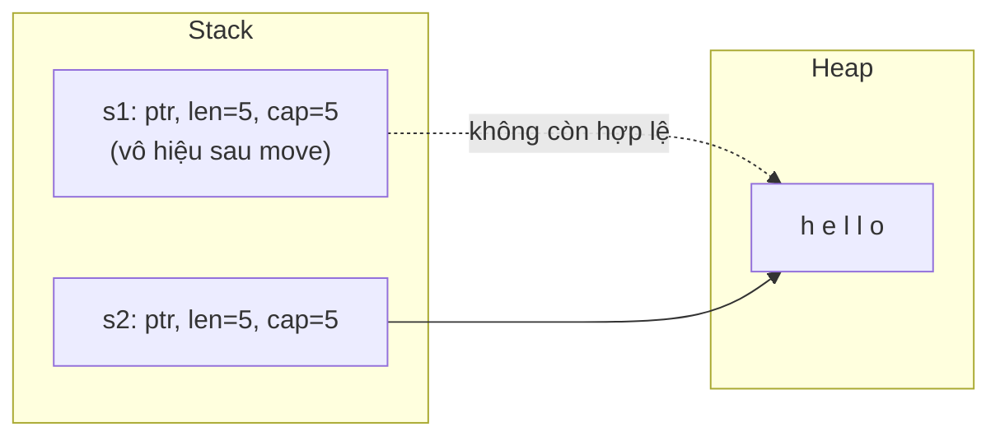
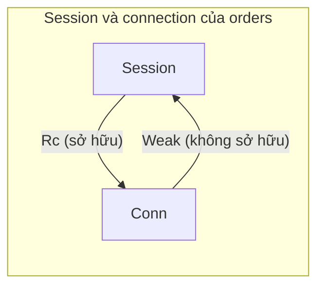

# P3 · Chương 08 — Rust và bộ nhớ

Bảy chương trước đã dựng xong nền: address space, page table, heap allocator, stack, alignment. Chương này là chương **thuần Rust**: ta xem Rust đặt những thứ đó vào hệ thống kiểu như thế nào, và vì sao nhờ vậy nó không cần garbage collector mà vẫn chặn được phần lớn lỗi bộ nhớ kinh điển của C.

## Bạn sẽ hiểu được gì

1. **Q1.** "Ownership" là gì xét như một cơ chế quản lý tài nguyên, và `move` thực sự làm gì với các bit trong bộ nhớ (có sao chép dữ liệu heap không)? → mục 2
2. **Q2.** Vì sao một kiểu có `Drop` thì không thể là `Copy`, và thứ tự các giá trị bị drop được quy định thế nào? → mục 3
3. **Q3.** `Box`, `Vec`, `String` có bố cục (con trỏ / độ dài / capacity) ra sao; docs *hứa* gì về cách `Vec` tăng capacity và source 1.95.0 *thực tế* làm gì? → mục 4
4. **Q4.** `GlobalAlloc`, `System`, `Layout`, `#[global_allocator]` hợp đồng với nhau ra sao; Allocator API ở trạng thái nào? → mục 5
5. **Q5.** `Rc`/`Arc`/`Weak` giữ bộ đếm ở đâu, vì sao vòng tham chiếu gây leak, và vì sao leak vẫn là *safe*? → mục 6
6. **Q6.** `MaybeUninit` giải quyết bài toán gì mà "cứ để biến chưa khởi tạo" không giải được? → mục 7
7. **Q7.** Từng lỗi bộ nhớ trong C (use-after-free, double free, đọc vùng chưa khởi tạo, tràn buffer, data race) bị Rust chặn bằng cơ chế nào, và lỗi nào *không* bị chặn? → mục 8
8. **Q8.** Khi viết Rust, chọn stack hay heap dựa trên điều gì? → mục 9

## Kiến thức cần trước

- [Chương 01 — Address space, mục 6](01-address-space.md): `malloc`/`free` và các lỗi bộ nhớ kinh điển của C (OSTEP).
- [Chương 05 — Bộ nhớ của tiến trình trên Linux](05-bo-nho-tien-trinh-linux.md): vùng stack/heap/mmap của một process.
- [Chương 06 — Heap allocator](06-heap-allocator.md): `malloc`/`free`, free list, vì sao `free` cần biết kích thước.
- [Chương 07 — Stack, alignment và padding](07-stack-alignment-padding.md): stack frame, guard page, size/align.

Mọi con số "chạy thật" đo bằng `rustc 1.95.0` trên macOS aarch64 (64-bit); chúng là quan sát, không phải hợp đồng ngôn ngữ, trừ khi có chú thích trỏ về docs.

## 1. Bối cảnh: ai chịu trách nhiệm giải phóng?

Xuyên suốt chương ta bám theo `orders`, một service Rust nhận request HTTP. Mỗi request, `orders` đọc body vào một `String`, parse thành `Vec<Item>`, tra một cache dùng chung giữa các handler thread rồi trả kết quả (nhận xét của người soạn: đây là ví dụ giả định, không phải code trong repo). `String`, `Vec` và cache đều chiếm bộ nhớ, nên câu hỏi chung của cả chương là: ai trả lại chỗ nhớ đó, và vào lúc nào?

Trong C, người trả là lập trình viên. Quên `free` thì leak[^ostep-leak]. `free` hai lần là double free, và kết quả là undefined[^ostep-doublefree]. Một handler C chỉ cần quên `free` ở một nhánh lỗi là service rò bộ nhớ ở mọi request đi vào nhánh đó (nhận xét của người soạn).

Ngôn ngữ có garbage collector (GC) giao việc này cho một chương trình chạy nền: nó theo dõi vùng nhớ nào không còn dùng rồi dọn đi[^book-gc]. Rust chọn đường thứ ba: bộ nhớ tự được trả khi biến sở hữu nó ra khỏi scope[^book-auto]. Nói cách khác, compiler quyết định "khi nào free", dựa trên một quy tắc đủ đơn giản để kiểm tra ngay lúc biên dịch: ownership. Mục 2 bắt đầu từ quy tắc đó.

## 2. Ownership và move: chuyện gì xảy ra với các bit? (Q1)

> **Trả lời ngắn.** Ownership là ba quy tắc: mỗi giá trị có đúng một owner, một lúc chỉ có một owner, và khi owner ra khỏi scope thì giá trị bị drop[^book-rules]. Nhờ vậy không ai free hai lần[^book-doublefree]. Khi `move`, chỉ "cái vỏ" nhỏ nằm trên stack (con trỏ, độ dài, capacity) được chuyển; dữ liệu heap không bị sao chép, còn biến cũ bị vô hiệu hóa[^book-move].

**Giải thích.**

*Với service `orders`.* Handler đọc body vào một `String`, rồi trao nó cho hàm parse. Từ lúc đó, ai giữ buffer heap của `String`: handler hay hàm parse? Và vì sao buffer ấy không bị free hai lần, một lần ở mỗi bên? Ba quy tắc ở trên trả lời cả hai câu. Ta xem chúng chạy ra sao với một `String`.

**Từng bước với một `String`.** Trước hết, `String::from("hello")` xin allocator một buffer trên heap và dựng "vỏ" ba từ trên stack. Biến nhận giá trị này là owner duy nhất của buffer. Vì owner là duy nhất nên compiler biết chính xác chỗ nó ra khỏi scope, và chèn lời gọi dọn dẹp (drop) đúng chỗ đó[^book-drop-auto]. Từ ba quy tắc, ta suy ra buffer được free đúng một lần (suy luận của người soạn[^book-rules]); chi tiết drop ở mục 3.

**Vì sao phải "chỉ một owner".** Thử cho hai biến cùng sở hữu một `String`, tức cùng trỏ vào một buffer. Khi cả hai ra scope, cả hai cùng cố free một vùng nhớ. Book gọi đó là double free và xếp nó vào các lỗi memory-safety[^book-doublefree]. Vì vậy sau `let s2 = s1;`, Rust coi `s1` không còn hợp lệ. Chính chuyện biến cũ bị vô hiệu hóa khiến thao tác này được gọi là **move**, thay vì shallow copy[^book-move].

Thử với đoạn tối giản `let s1 = String::from("a"); let s2 = s1; println!("{s1} {s2}");` (chạy thật): compiler báo `error[E0382]: borrow of moved value: s1`. Error index mô tả E0382 là biến được dùng sau khi nội dung đã bị chuyển đi nơi khác[^e0382].



**Move ở mức bit.** `String` gồm ba phần: con trỏ tới bộ nhớ chứa nội dung, độ dài và capacity. Cả nhóm này nằm trên stack[^book-string]. Move sao chép đúng ba thứ đó sang biến mới *mà không sao chép dữ liệu*, rồi vô hiệu hóa biến cũ[^book-move]. Buffer heap vì thế không bị đụng đến. Với `orders`, khi handler trao body cho hàm parse, thứ đi qua chỉ là ba từ này; nội dung body đứng yên trên heap (suy luận của người soạn từ hai đoạn trên).

<details><summary>Đi sâu: Reference và docs <code>Copy</code> nói gì về move; kiểm chứng bằng allocator đếm</summary>

The Rust Reference mô tả move ở mức ngữ nghĩa và không nhắc đến memcpy. Khi một place expression được dùng ở ngữ cảnh value expression (hoặc bind theo giá trị trong pattern), nó biểu thị giá trị đang nằm ở ô nhớ đó[^ref-move-intro]. Nếu kiểu implement `Copy` thì giá trị được copy[^ref-move-copy]. Ở các trường hợp còn lại, nếu kiểu là `Sized`, có thể move giá trị[^ref-move-sized].

Docs của `Copy` nói sát phần cứng hơn: về mặt bit, cả copy lẫn move đều có thể khiến các bit bị sao chép trong bộ nhớ, dù đôi khi bị tối ưu bỏ đi[^copy-bits]. Trong hai ví dụ của docs đó, khác biệt duy nhất mà lập trình viên thấy là sau phép gán có được dùng lại biến cũ hay không.

Để kiểm chứng, dùng một allocator đếm lời gọi (mục 5). Với `let s2 = s1;` trên `String::from("hello")`, số lần `alloc` không đổi (delta = 0), con trỏ heap (`as_ptr()`) giữ nguyên, còn địa chỉ biến `String` trên stack thì **khác** (`&s1 as *const _ != &s2 as *const _`). Tức dữ liệu heap đứng yên, chỉ "cái vỏ" ba từ được chuyển. Quan sát này đúng cả với `-O` lẫn không; đừng dựa vào địa chỉ stack cụ thể vì compiler được phép tối ưu.

</details>

**Quay lại Q1:** ownership là "một owner, ra scope thì drop"; move chỉ chuyển cái vỏ ba từ trên stack, dữ liệu heap (body của `orders`) đứng yên và biến cũ bị cấm dùng.

## 3. `Copy`, `Drop` và thứ tự drop (Q2)

> **Trả lời ngắn.** Kiểu có `Drop` quản lý một tài nguyên ngoài chính các byte của nó, nên sao chép bit sẽ nhân đôi quyền sở hữu tài nguyên đó; vì vậy kiểu có `Drop` không thể là `Copy`[^copy-doc-drop]. Compiler tự chèn lời gọi drop khi giá trị ra khỏi scope[^book-drop-auto]. Biến thì bị drop theo thứ tự ngược khai báo[^ref-drop-scope].

**Giải thích.**

*Với service `orders`.* Khi xử lý một request, handler của `orders` nắm vài thứ phải dọn: socket của client đang mở, buffer chứa body. Hết handler thì mỗi thứ phải được dọn đúng một lần. Số nguyên thì chép thoải mái, nhưng "chép" một socket đang mở rồi để hai bản cùng đóng nó thì hỏng. Mục này nói Rust phân biệt hai loại giá trị đó bằng `Copy` và `Drop` ra sao, compiler dọn từng thứ vào lúc nào, và theo thứ tự nào.

**`Copy` loại trừ `Drop`.** Kiểu `Copy` là kiểu có giá trị nhân bản được chỉ bằng cách sao chép bit[^copy-def]. Với kiểu như vậy, phép gán không làm biến cũ mất hiệu lực. Nhưng nếu kiểu đó, hoặc bất kỳ phần nào của nó, implement `Drop` thì nó không thể là `Copy`[^book-copy-drop]. Lý do nằm ở docs của `Copy`: mọi kiểu `Drop` đều quản lý một tài nguyên ngoài chính `size_of::<T>` byte của nó, nên sao chép bit sẽ nhân đôi quyền sở hữu tài nguyên[^copy-doc-drop]. Với một socket, nhân đôi quyền sở hữu nghĩa là hai bản cùng cố đóng nó (suy luận của người soạn).

Compiler từ chối ngay cả khi bạn cố làm vậy. Chạy thật đoạn

```rust
#[derive(Clone, Copy)] struct X(u8);
impl Drop for X { fn drop(&mut self) {} }
```

thì compiler báo `error[E0184]: the trait Copy cannot be implemented for this type; the type has a destructor`, khớp mô tả của error index[^e0184].

**`Drop`: destructor do compiler chèn.** Trait `Drop` cho phép tùy biến điều xảy ra khi giá trị sắp ra khỏi scope[^book-drop-trait]. Compiler chèn lời gọi tự động, nên bạn không phải rải code dọn dẹp khắp chương trình[^book-drop-auto]. Đổi lại, bạn không được gọi `x.drop()` bằng tay; muốn drop sớm thì dùng `std::mem::drop`[^book-drop-manual].

Một destructor gồm hai phần. Phần thứ nhất là gọi `Drop::drop` nếu kiểu có implement[^drop-two-parts]. Phần thứ hai là "drop glue" do compiler sinh, gọi đệ quy destructor của mọi field[^drop-glue]. Reference ghi cùng ý ở dạng khác: destructor của `T` là gọi `<T as Drop>::drop` nếu `T: Drop`, rồi chạy đệ quy destructor của các field[^ref-destr-op]. Nhờ vậy bạn hiếm khi phải tự viết `Drop`: struct chứa `Vec` tự giải phóng buffer của vec.

Tài nguyên ở đây không chỉ là bộ nhớ. Docs của `Drop` nêu rõ tài nguyên có thể là bộ nhớ, file descriptor hay network socket[^drop-resources]. Nomicon gọi mô hình này là "ownership-based resource management": lấy tài nguyên khi tạo đối tượng và nhả khi nó bị hủy[^nomicon-orm].

**Thứ tự drop.** Một scope thường chứa nhiều giá trị, nên cần biết cái nào bị dọn trước. Bảng dưới tóm tắt (temporary là giá trị tạm sinh ra giữa chừng khi tính một biểu thức):

| Đối tượng | Thứ tự drop |
|---|---|
| Biến trong một scope | ngược thứ tự khai báo (temporary: ngược thứ tự tạo)[^ref-drop-scope] |
| Field của struct | theo thứ tự khai báo[^ref-drop-fields] |
| Phần tử của tuple | theo thứ tự[^ref-drop-tuple] |
| Phần tử của array / owned slice | từ phần tử đầu đến cuối[^ref-destr-array] |

Áp vào handler của `orders`: biến khai báo sau thì bị drop trước, nên thứ lấy sau cùng được nhả đầu tiên (suy ra từ dòng đầu của bảng).

<details><summary>Đi sâu: ví dụ chạy thật in thứ tự drop, và <code>let _</code></summary>

Chạy thật với kiểu `P(&str)` in tên khi drop:

```rust
let _x = P("x"); let _y = P("y");
let _s = S { a: P("s.a"), b: P("s.b") };
let _t = (P("t0"), P("t1"));
```

Kết quả in ra: `t0 t1 s.a s.b y x`. Đọc từ dưới lên: `_t` khai báo cuối nên bị drop đầu tiên (và bên trong nó `t0` trước `t1`), rồi `_s` (field `a` trước `b`), rồi `_y`, `_x`.

Điểm tinh tế (chạy thật): `let _ = P("underscore");` drop **ngay** (in `drop underscore` trước dòng kế tiếp), còn `let _n = P("named");` sống đến hết scope, vì `_` không bind giá trị vào biến.

</details>

**Quay lại Q2:** `Copy` nhân đôi bit nên không đi với `Drop`; socket và buffer của handler được drop tự động khi ra scope, biến theo thứ tự ngược khai báo, còn field và tuple theo thứ tự xuôi.

## 4. `Box`, `Vec`, `String`: bố cục trong bộ nhớ (Q3)

> **Trả lời ngắn.** `Box<T>` là một con trỏ sở hữu một vùng heap[^box-owns]. `Vec<T>` là bộ ba (con trỏ, capacity, length) nằm trên stack, trỏ tới buffer ở heap[^vec-triplet]. `String` cũng gồm ba thành phần như vậy[^string-repr]. Docs không hứa chiến lược tăng capacity cụ thể[^vec-growth]. Thứ duy nhất được hứa là `push` O(1) amortized[^vec-amort]; việc "gấp đôi" là chi tiết của source 1.95.0.

**Giải thích.**

*Với service `orders`.* Trên stack của một handler, `orders` giữ một `String` (body), một `Vec<Item>` (các dòng hàng) và có thể một `Box<Order>` cho đơn đã parse. Cả ba chỉ là cái vỏ nhỏ; dữ liệu thật nằm ở heap. Mục này xem cái vỏ gồm những gì. Cũng chính bố cục đó giải thích vì sao move rẻ (mục 2) và vì sao borrow checker phải canh mỗi lần `push` vào `Vec`.

| Kiểu | Biểu diễn (theo docs) | Nằm ở đâu |
|---|---|---|
| `Box<T>` | con trỏ sở hữu duy nhất một heap allocation kiểu `T`[^box-owns] | con trỏ ở stack, `T` ở heap; `Box::new` không cấp phát nếu `T` kích thước 0[^box-zst] |
| `Vec<T>` | bộ ba (pointer, capacity, length)[^vec-triplet] | bộ ba nằm nơi `Vec` được đặt; nếu đã cấp phát thì vùng nó trỏ tới nằm trên heap theo allocator mặc định[^vec-heap] |
| `String` | con trỏ tới byte, length, capacity[^string-repr] | như `Vec<u8>`: nội dung nằm trong buffer cấp phát trên heap, và `String` sở hữu buffer đó[^string-doc] |

Số đo trên aarch64 (64-bit): `size_of::<Box<u64>>()` là 8, còn `Vec<u64>` và `String` đều là 24. `Box<[u8]>` và `&str` mỗi cái 16 byte. Lý do là con trỏ tới kiểu không biết kích thước lúc biên dịch (DST, như `[u8]` hay `str`) lớn gấp đôi con trỏ tới kiểu `Sized` (con trỏ cộng độ dài), đúng như chương DST của Reference mô tả[^dst-fat]. Đây là con số quan sát chứ không phải lời hứa: mục Type layout của Reference chỉ bảo đảm kích thước "ít nhất bằng" con trỏ thường và dặn không nên dựa vào chuyện "gấp đôi" (xem [P10·03, mục 2](../10-rust-internals/03-dst-fat-pointer-vtable.md)).

Con trỏ heap có kích thước cố định nên bản thân nó lưu trên stack được, còn dữ liệu thật phải đi theo con trỏ[^book-ptr-on-stack].

**`Box`.** Hai tình huống điển hình để dùng `Box`. Một là kiểu có kích thước không biết lúc biên dịch mà ngữ cảnh lại đòi kích thước chính xác, như kiểu đệ quy[^book-box-unknown]. Hai là dữ liệu lớn mà bạn muốn chuyển ownership nhưng không muốn chép[^book-box-large]. `Box<T, A>` còn có tham số allocator (mục 5).

**`Vec`: length và capacity.** Capacity là lượng chỗ đã cấp cho các phần tử sẽ thêm vào sau, khác với length[^vec-cap]. `Vec::new()` chưa cấp phát gì cho đến khi có phần tử được push[^vec-new]. Docs hứa chặt hơn: `Vec` cấp phát khi và chỉ khi `size_of::<T>() * capacity() > 0`[^vec-zst]. Lý do nằm ở Nomicon: allocator toàn cục không cho cấp khối kích thước 0 (UB), nên `Vec` rỗng không cấp phát mà dùng con trỏ "dangling" thay chỗ[^nomicon-vec-empty].

**Vì sao realloc kéo borrow checker vào cuộc.** Khi `Vec` đầy, nó cần thêm chỗ: có thể phải cấp phát vùng nhớ mới rồi chép phần tử cũ sang đó[^book-vec-realloc]. Nghĩa là buffer có thể bị dời đi, và một tham chiếu vào phần tử cũ có thể thành treo. Trong `orders`, đây là tình huống handler giữ `&items[0]` rồi `push` thêm một item. Borrow checker chặn chuyện này ngay lúc biên dịch. Chạy thật đoạn tối giản:

```rust
let mut v = vec![1]; let first = &v[0]; v.push(2); println!("{first}");
```

→ `error[E0502]: cannot borrow v as mutable because it is also borrowed as immutable`, khớp mô tả "đã mượn với một mutability rồi lại mượn với mutability khác"[^e0502]. Đây chính là use-after-free của C bị biến thành lỗi biên dịch (xem mục 8).

*Liên hệ backend (nhận xét của người soạn):* khi biết trước số phần tử, chẳng hạn số dòng kết quả của một truy vấn, `Vec::with_capacity(n)` tránh được các lần realloc trung gian; docs cũng khuyên dùng khi có thể[^vec-recommend]. Ý này giống việc cấp trước buffer trong connection/buffer pool.

<details><summary>Đi sâu: chiến lược tăng capacity (docs hứa vs source), kiểm chứng allocator đếm, niche của <code>Option&lt;Box&gt;</code></summary>

**Chiến lược tăng capacity: bảo đảm vs quan sát.**

- *Bảo đảm (docs):* không có chiến lược tăng cụ thể nào được hứa khi đầy hay khi `reserve`[^vec-growth]. Chỉ có `push` O(1) amortized được hứa[^vec-amort]. Còn `with_capacity(n)` yêu cầu allocator đúng kích thước cho n phần tử[^vec-exact].
- *Quan sát (source 1.95.0, chi tiết cài đặt, có thể đổi):* công thức tăng trưởng của `grow_amortized` và capacity tối thiểu theo cỡ phần tử được đọc từ source ở [P10·09, mục 2](../10-rust-internals/09-collections-internals.md). Chạy thật, push 40 phần tử vào `Vec<u64>` cho dãy capacity `4 8 16 32 64`, còn `Vec<u8>` cho `8 16 32 64`. Kết quả khớp công thức đọc từ source đó, nhưng chương trình không được dựa vào điều này.

Kiểm chứng bằng allocator đếm: `Vec::<u64>::new()` làm số lần `alloc` tăng 0; `Vec::with_capacity(0)` rồi `push(1)` tăng 1; `vec![0u8; 1<<20]` tăng 1 lần, và `let moved = big;` tăng 0. Với `Vec<()>`, `capacity()` in ra `18446744073709551615` (= `usize::MAX`, quan sát) và `Box::new(())` không gọi allocator, khớp [^box-zst].

Về niche: std bảo đảm `Option<T>` có cùng size, alignment và ABI với `T` cho một số kiểu `T`[^opt-npo]. `Box<U>` nằm trong danh sách đó, nhưng chỉ khi allocator là `Global`[^opt-box]. Cách đọc bảng `std::option` và điều kiện `U: Sized` ở [P10·02, mục 6](../10-rust-internals/02-type-layout.md). Đo thật: `size_of::<Option<Box<u64>>>() = 8`.

</details>

**Quay lại Q3:** `Box` là một con trỏ; `Vec`/`String` là bộ ba (ptr, cap, len) trỏ vào heap (với `orders`, vỏ ở stack của handler, body và danh sách item ở heap); docs chỉ hứa `push` O(1) amortized, còn dãy capacity cụ thể là chi tiết source.

## 5. `GlobalAlloc`, `Layout` và allocator (Q4)

> **Trả lời ngắn.** `Box` và `Vec` lấy bộ nhớ từ một allocator toàn cục của chương trình. Allocator mặc định hiện chưa được chỉ định[^alloc-global]; `System` là allocator do OS cung cấp[^std-system]. Muốn thay, bạn implement trait `GlobalAlloc` và đăng ký bằng `#[global_allocator]`[^globalalloc]. Allocator API tổng quát hơn (`Allocator`) vẫn chỉ có trên nightly[^allocator-unstable].

**Giải thích.**

*Với service `orders`.* `orders` không gọi `malloc` ở đâu cả, nhưng mỗi `String`, `Vec`, `Box` nó tạo đều xin bộ nhớ từ một allocator. Muốn đếm xem mỗi request cấp phát bao nhiêu lần, hay đổi sang một allocator khác, bạn phải biết allocator đó nằm ở đâu và hợp đồng với nó gồm những gì.

**Allocator toàn cục.** Thư viện chuẩn có một allocator "toàn cục", và `Box<T>`, `Vec<T>` dùng chính allocator này[^alloc-one]. Allocator mặc định hiện **chưa được chỉ định** (unspecified)[^alloc-global]. `System` là allocator do OS cung cấp, và trên Unix nó dựa trên `malloc`[^std-system]. Cơ chế `malloc` ở [chương 06](06-heap-allocator.md); phần nhận diện global allocator ở [chương 06 mục 10](06-heap-allocator.md).

`GlobalAlloc` là trait cho allocator có thể đăng ký làm mặc định bằng `#[global_allocator]`[^globalalloc]. Thuộc tính này chỉ áp dụng được cho một `static` có kiểu implement `GlobalAlloc`[^ref-global-alloc].

**`Layout` và hợp đồng của `GlobalAlloc`.** `Layout` mô tả một khối nhớ bằng size và alignment, trong đó alignment là lũy thừa của 2[^layout]. Ràng buộc kèm theo: size làm tròn lên bội của align không được tràn `isize::MAX`[^layout-isize]. Khi tự viết allocator, bạn phải nhớ ba điều:

- `alloc` với layout kích thước 0 là UB[^ga-zero]. Vì vậy `Vec` rỗng và `Box::new(())` không gọi allocator.
- Allocator mà unwind là UB[^ga-unwind].
- `dealloc` phải nhận đúng `Layout` đã dùng để cấp khối đó, nếu không là UB[^ga-dealloc].

Điều cuối là khác biệt lớn nhất với C. `free(ptr)` không nhận tham số kích thước[^ostep-header]. Vì vậy allocator phải tự ghi nhớ kích thước từng vùng[^ostep-freesize]; cơ chế đầy đủ ở [chương 06 mục 2](06-heap-allocator.md). `dealloc` của Rust thì nhận lại `Layout`. `Vec` vốn biết capacity của mình nên truyền lại được, và allocator có thể không cần lưu kích thước của từng khối (suy luận của người soạn từ hợp đồng).

**Allocator API: vẫn unstable.** Trait `Allocator` mô tả một allocator có thể cấp, nới, co và giải phóng các khối dữ liệu bất kỳ, được mô tả bằng `Layout`[^allocator-doc]. Trong docs 1.95.0, nó được đánh dấu là API thử nghiệm chỉ có trên nightly (`allocator_api`, issue #32838)[^allocator-unstable]. Hệ quả (suy luận của người soạn): trên stable, bạn chỉ chọn được allocator cho cả chương trình qua `#[global_allocator]`.

<details><summary>Đi sâu: allocator đếm lời gọi đầy đủ, và lý do thiết kế theo RFC 1398</summary>

Đây là code đã chạy thật, bọc `System` để đếm:

```rust
use std::alloc::{GlobalAlloc, Layout, System};
use std::sync::atomic::{AtomicUsize, Ordering::Relaxed};
struct Count;
static ALLOCS: AtomicUsize = AtomicUsize::new(0);
unsafe impl GlobalAlloc for Count {
    unsafe fn alloc(&self, l: Layout) -> *mut u8 {
        ALLOCS.fetch_add(1, Relaxed);
        unsafe { System.alloc(l) }
    }
    unsafe fn dealloc(&self, p: *mut u8, l: Layout) {
        unsafe { System.dealloc(p, l) }
    }
}
#[global_allocator] static G: Count = Count;
```

Mọi số "allocs delta" ở chương này đo bằng allocator kiểu này, lấy *hiệu* hai lần đọc (runtime đã cấp phát trước `main`).

Docs của `GlobalAlloc` chỉ nêu hợp đồng, không nêu lý do. Lý do ở mức thiết kế API được RFC 1398 phát biểu: malloc buộc allocator tự theo dõi kích thước, trong khi client code thường đã biết, nên RFC muốn client cung cấp metadata như size và alignment cho cả hai lời gọi cấp phát và giải phóng[^rfc1398-why]. (Đây là RFC, không phải tài liệu hợp đồng của std 1.95.0.)

</details>

**Quay lại Q4:** `Box`/`Vec` của `orders` gọi allocator toàn cục; bạn thay nó bằng `GlobalAlloc` + `#[global_allocator]`, tuân hợp đồng `Layout` (khác 0, `dealloc` đúng layout), còn Allocator API vẫn là nightly.

## 6. `Rc`, `Arc`, `Weak`, vòng tham chiếu và leak (Q5)

> **Trả lời ngắn.** `Rc`/`Arc` cho phép nhiều owner bằng cách đặt bộ đếm tham chiếu cạnh giá trị, trong cùng một khối heap[^rc-inner]. Giá trị chỉ bị dọn khi bộ đếm mạnh về 0[^book-rc]. Hai giá trị giữ `Rc` của nhau thì bộ đếm không bao giờ về 0 nên leak[^book-leak-rc]; `Weak` không biểu diễn sở hữu nên phá được vòng[^book-weak]. Leak vẫn là *safe* vì bảo đảm của Rust không gồm việc ngăn memory leak[^book-leak].

**Giải thích.**

*Với service `orders`.* Cache và cấu hình của `orders` được mọi handler thread dùng chung, nên "một owner" không đủ: phải có nhiều owner cùng giữ một giá trị, và giá trị chỉ được dọn khi owner cuối cùng buông tay. Đó là việc của `Arc`. Còn nếu một event loop đơn luồng giữ `Session` và `Conn` trỏ qua lại nhau bằng `Rc`, thì cả hai sẽ không bao giờ được dọn. Mục này giải thích hai chuyện đó, và vì sao Rust vẫn gọi chuyện thứ hai là safe (ví dụ giả định của người soạn).

**Nhiều owner, trả bằng bộ đếm.** Ownership "một owner" không đủ cho dữ liệu dùng chung. `Rc<T>` là con trỏ reference-counted đơn luồng[^rc-doc]. Nó đếm số tham chiếu để biết giá trị còn dùng hay không[^book-rc]. Trong source 1.95.0, `Rc` cấp phát một `RcInner` chứa hai bộ đếm `strong` và `weak` cạnh `value`[^rc-inner]. `Arc` có `ArcInner` cùng dạng, nhưng bộ đếm là số nguyên atomic[^arc-inner].

**Vì sao có hai kiểu.** `Rc` không thể `Send`: nếu clone rồi chuyển clone sang thread khác, hai thread có thể cập nhật bộ đếm cùng lúc[^book-rc-send]. `Arc` ("Atomically Reference Counted") là bản thread-safe[^arc-doc]. Khi con trỏ `Arc` cuối cùng bị hủy thì giá trị bên trong bị drop[^arc-last]. Cái giá là hiệu năng, và Book nói thẳng rằng chỉ nên trả khi thật sự cần[^book-arc-cost]. Đây là chỗ Rust bước ra khỏi mô hình "một owner, kiểm tra lúc biên dịch" một cách *tường minh*: refcount là chi phí runtime để có nhiều owner (nhận xét của người soạn). Chi tiết `Rc`/`Arc` trong đa luồng ở [P4·08 mục 4](../04-concurrency/08-rust-concurrency.md); atomic và ordering của refcount ở [P4·07 mục 8](../04-concurrency/07-lock-free.md).

**Vòng tham chiếu và `Weak`.** `Rc` chỉ được dọn khi `strong_count` về 0. Nếu hai giá trị giữ `Rc` của nhau thì bộ đếm không bao giờ về 0 và bộ nhớ leak. Book minh họa bằng `Rc<T>` kết hợp `RefCell<T>`[^book-leak-rc].

Cách phá vòng là `Weak<T>`. Tham chiếu yếu không biểu diễn quan hệ sở hữu, và số đếm của chúng không ảnh hưởng đến lúc `Rc` được dọn[^book-weak]. Nói cách khác, `weak_count` không cần về 0[^book-weak-count]. Với `Weak`, *giá trị* vẫn bị drop, nhưng *vùng cấp phát* (backing store) thì chưa được giải phóng[^weak-alloc]. Vì thế `upgrade()` trả `Option<Rc<T>>` và có thể là `None`[^weak-upgrade]. Docs cũng nêu công dụng chặn vòng tham chiếu giữa các `Rc`[^weak-cycle]. Trong ví dụ của `orders`, `Session` giữ `Rc<Conn>` còn `Conn` giữ `Weak<Session>`:



(Sơ đồ minh họa của người soạn.)

**Leak là safe.** `mem::forget` nhận ownership và "quên" giá trị mà không chạy destructor[^forget]. Mọi tài nguyên giá trị đó quản lý (heap, file handle) sẽ nằm lại mãi trong trạng thái không với tới được[^forget-linger]. Dù vậy `forget` *không* `unsafe`, vì các bảo đảm an toàn của Rust không gồm việc destructor luôn chạy[^forget-safe]. Reference nói cùng ý: ngăn destructor chạy là safe, và kiểu không được dựa vào việc destructor chạy để giữ soundness (ngoài những chỗ Reference bảo đảm destructor chạy)[^ref-forget-sound]. `Box::leak` tiêu thụ Box và trả `&'a mut T`[^box-leak]; làm rơi tham chiếu đó thì gây leak[^box-leak-drop]. Chạy thật: `Box::leak(Box::new(vec![1,2,3]))` cho một `&'static mut Vec<i32>` dùng được đến hết chương trình.

Từ đó Book kết luận: ngăn memory leak hoàn toàn không phải bảo đảm của Rust, tức leak là memory safe[^book-leak]. Nomicon cũng thừa nhận niềm tin "Rust loại trừ rò rỉ tài nguyên" về cơ bản đúng trong thực tế nhưng không đúng về lý thuyết[^nomicon-leak].

<details><summary>Đi sâu: số đo khối heap 24 byte, thí nghiệm vòng <code>Rc</code> và <code>Weak</code></summary>

Đo thật bằng allocator đếm (mục 5): `Rc::new(7u64)` làm allocator nhận một yêu cầu với `layout.size()` = **24**, `Arc::new(7u64)` cũng 24, còn `Box::new(7u64)` là 8. Đây là **kích thước khối heap được cấp**, không phải `size_of` của các kiểu đó: với `u64`, 24 = hai bộ đếm 8 byte + giá trị 8 byte (`Rc<u8>` cũng 24 do padding; `Box<u64>` không có bộ đếm nên chỉ 8). Còn `size_of` của `Rc<u64>`, `Arc<u64>`, `Box<u64>` đều là 8 (đo thật): chỉ là con trỏ. Con số 24 là quan sát, không phải hợp đồng.

Chạy thật: hai `Node` trỏ vòng tròn A → B → A, mỗi node giữ một `Rc`. Trong scope: `strong a=2 b=2`. Ra khỏi scope, allocator đếm được `allocs=2 deallocs=0`, và dòng `drop cycA`/`drop cycB` (in từ `Drop` của node) **không bao giờ xuất hiện**. Lưu ý đây là leak trong *safe Rust*, không cần `unsafe`.

Chạy thật với `Weak`: sau `Rc::downgrade`, `strong=1 weak=1`; `drop(r)` in `drop weak-target` ngay (giá trị bị drop dù còn `Weak`), và `w.upgrade().is_none()` là `true`.

</details>

**Quay lại Q5:** `Rc`/`Arc` đếm owner bằng bộ đếm cạnh giá trị (`Arc` cho cache dùng chung giữa các thread của `orders`); vòng `Rc` không bao giờ về 0 nên leak, `Weak` phá vòng, và leak vẫn safe vì ngăn leak không nằm trong bảo đảm của Rust.

## 7. `MaybeUninit`: bộ nhớ chưa khởi tạo trong hệ thống kiểu (Q6)

> **Trả lời ngắn.** Compiler Rust giả định mọi biến luôn được khởi tạo đúng yêu cầu của kiểu nó[^maybe-invariant]. Vì vậy "cứ để biến chưa khởi tạo" không được phép[^e0381]. `MaybeUninit<T>` là kiểu bao dùng để tạo thể hiện chưa khởi tạo của `T`[^maybe-doc]. Nó đồng thời báo cho compiler biết dữ liệu ở đó có thể chưa khởi tạo[^maybe-signal].

**Giải thích.**

*Với service `orders`.* Để đọc body, handler cần một buffer lớn rồi gọi `read` để socket ghi dữ liệu vào. Lúc cấp phát, buffer đó chưa chứa gì có nghĩa; nếu phải điền số 0 vào trước chỉ để Rust yên tâm thì hơi thừa (nhận xét của người soạn). Muốn chừa buffer ở trạng thái "chưa khởi tạo" mà vẫn đúng luật, Rust cần một kiểu riêng. Đó là `MaybeUninit`.

**Vấn đề.** `malloc` trả về bộ nhớ chưa khởi tạo[^malloc-man]. Đọc vùng nhớ ấy là một trong các lỗi kinh điển: chương trình gặp một "uninitialized read", đọc từ heap dữ liệu không biết giá trị[^ostep-uninit]. Rust cấm dùng biến chưa khởi tạo ở safe code (mục 8), nhưng đôi khi bạn cần chính vùng nhớ chưa khởi tạo, như buffer vừa cấp phát và sắp được ghi vào (nhận xét của người soạn).

**Vì sao không thể "cứ để trống".** Compiler giả định biến luôn được khởi tạo đúng yêu cầu của kiểu, ví dụ tham chiếu phải căn đúng và không null[^maybe-invariant]. Vì thế khởi tạo một tham chiếu bằng 0 là UB tức thời, kể cả khi chưa dùng tham chiếu đó để truy cập bộ nhớ[^maybe-zeroed]. Compiler còn khai thác giả định này để tối ưu, chẳng hạn bỏ kiểm tra lúc chạy và tối ưu layout enum[^maybe-exploit]. Hệ quả là không có cách "giả vờ" một ô nhớ rác là một `T` mà không rủi ro.

**Lời giải.** Đặt vùng chưa khởi tạo vào bên trong `MaybeUninit<T>`. Thể hiện này không buộc phải thỏa yêu cầu hợp lệ của `T` (suy luận của người soạn từ docs về tín hiệu cho compiler[^maybe-signal]). Mẫu dùng là: `uninit()`, `write` giá trị vào, và chỉ `assume_init()` (là `unsafe`) khi chắc đã khởi tạo xong. Chi tiết ở [P10·07 mục 6](../10-rust-internals/07-unsafe-ub-miri.md).

<details><summary>Đi sâu: bảo đảm layout của <code>MaybeUninit</code></summary>

`MaybeUninit<T>` được bảo đảm cùng size, alignment, ABI với `T`[^maybe-layout]; đo thật `size_of::<MaybeUninit<u64>>() = 8` và `MaybeUninit<String> = 24`.

</details>

**Quay lại Q6:** `MaybeUninit<T>` là kiểu bao dành cho bộ nhớ chưa khởi tạo, như buffer đọc body của `orders` trước khi `read` ghi vào, nên compiler không coi nó là một `T` đã hợp lệ[^maybe-signal]; chỉ `assume_init` khi đã chắc.

## 8. Lỗi bộ nhớ của C bị Rust chặn ra sao (Q7)

> **Trả lời ngắn.** Rust không dùng GC: bộ nhớ được trả khi owner ra scope[^book-auto], và compiler quyết định điều đó lúc biên dịch. Nhờ ownership, borrow checker (phần của compiler kiểm tra việc mượn tham chiếu) và kiểm tra chỉ số, safe code chặn được use-after-free, double free, đọc vùng chưa khởi tạo, tràn buffer và data race. Leak thì *không* bị chặn[^book-leak].

**Giải thích.**

*Với service `orders`.* Giả sử bạn viết lại một handler C của `orders` bằng Rust. Những lỗi từng gây sự cố ở bản C (free rồi còn dùng, free hai lần, đọc buffer chưa ghi, ghi tràn, hai thread cùng sửa một biến) giờ hoặc không biên dịch được, hoặc panic ngay chỗ lỗi. Riêng một lỗi vẫn lọt qua: leak. Mục này đi qua từng lỗi (nhận xét của người soạn).

Nomicon nói ownership cho phép Rust hoàn toàn memory-safe và hiệu quả, đồng thời tránh được garbage collection[^nomicon-nogc]. Hệ quả vận hành (nhận xét của người soạn): service không có pause của GC, nhưng đổi lại thời điểm giải phóng là một phần ngữ nghĩa chương trình mà bạn phải hiểu (mục 3), và vòng `Rc` thì không ai dọn.

Bảng dưới đối chiếu các lỗi mà OSTEP liệt kê cho C ([chương 01 mục 6](01-address-space.md); chương 01 mục 7 có bản tóm lược ngắn của bảng này, còn bảng dưới là bản đầy đủ) với cơ chế của Rust:

| Lỗi trong C | Rust chặn bằng | Bằng chứng |
|---|---|---|
| Dangling pointer / use-after-free: free rồi còn dùng[^ostep-dangling] | borrow checker: compiler bảo đảm dữ liệu không ra khỏi scope trước tham chiếu tới nó[^book-dangling] | `let r; { let x = 5; r = &x; } println!("{r}");` → `E0597`: "giá trị bị drop khi vẫn đang được mượn"[^e0597] (chạy thật) |
| Double free[^ostep-doublefree] | một owner; move vô hiệu hóa biến cũ[^book-doublefree] | `E0382` (mục 2) |
| Quên khởi tạo, đọc rác[^ostep-uninit] | không cho dùng biến chưa khởi tạo[^e0381]; muốn bộ nhớ chưa khởi tạo phải qua `MaybeUninit` | mục 7 |
| Tràn buffer / đọc quá cuối[^ostep-overflow] | chỉ số `[]` ngoài miền thì panic[^book-panic] | chạy thật: `v[10]` trên `Vec` 3 phần tử → `panicked ... index out of bounds: the len is 3 but the index is 10`, exit code 101 |
| Data race | borrow checker: tại một thời điểm hoặc một `&mut` hoặc nhiều `&`[^book-ref-rule] | Rust từ chối biên dịch code có data race[^book-datarace]; qua ranh giới thread còn có `Send`/`Sync`, xem [P4·08](../04-concurrency/08-rust-concurrency.md) |
| Quên free (leak)[^ostep-leak] | **không chặn**: leak là safe[^book-leak] | mục 6 |

Hai lưu ý cho bảng. Một là mục đích chính của lifetime là chặn dangling reference[^book-lifetime-aim]. Hai là ở dòng tràn buffer, C không panic mà là UB, và đọc quá cuối cấu trúc dữ liệu có thể thành lỗ hổng bảo mật[^book-overread-c].

<details><summary>Đi sâu: phạm vi bảo đảm của Rust — leak, tràn stack và <code>unsafe</code></summary>

Bảo đảm của Rust là *safe code không gây UB* (nhận xét của người soạn, tổng hợp từ các nguồn trên). Leak vẫn xảy ra được[^book-leak], và tràn stack cũng vậy (mục 9; cơ chế ở [chương 07 mục 4](07-stack-alignment-padding.md)). Code `unsafe` (và allocator tự viết ở mục 5) là nơi bạn tự gánh các hợp đồng này.

</details>

**Quay lại Q7:** safe Rust chặn use-after-free, double free, đọc rác, tràn buffer và data race bằng kiểm tra lúc biên dịch hoặc panic; leak và tràn stack trong `orders` vẫn xảy ra được.

## 9. Chọn stack hay heap trong Rust (Q8)

> **Trả lời ngắn.** Stack chỉ chứa được dữ liệu có kích thước biết trước và cố định; dữ liệu có kích thước chưa biết lúc biên dịch hoặc có thể đổi thì phải ở heap[^book-stack-fixed]. Khi cả hai chỗ đều dùng được, nên ưu tiên stack vì rẻ hơn: đẩy lên stack không cần allocator đi tìm chỗ trống[^book-push-faster] (khuyến nghị của người soạn).

**Giải thích.**

*Với service `orders`.* Trong một request, `orders` giữ vài thứ có kích thước biết trước: id đơn hàng (một số nguyên), một struct `Item` nhỏ, một mảng cỡ cố định cho header. Nó cũng giữ vài thứ không biết trước: body request (độ dài do client quyết định) và danh sách item (số lượng tùy đơn). Vậy mỗi thứ nên đặt ở đâu? Hai tiêu chí chính là kích thước có biết trước không, và giá trị có cần sống lâu hơn hay chuyển ownership rẻ hơn không.

**Hai con đường cấp chỗ cho một giá trị.**

1. *Stack.* Đẩy một giá trị lên stack nhanh hơn cấp phát heap vì không có allocator nào phải tìm chỗ[^book-push-faster]. Đổi lại, kích thước phải biết trước và cố định[^book-stack-fixed].
2. *Heap.* Allocator tìm một chỗ trống đủ lớn, đánh dấu đang dùng rồi trả về con trỏ[^book-heap-alloc]. Con trỏ có kích thước cố định nên lưu được trên stack, còn dữ liệu thật phải đi theo con trỏ[^book-ptr-on-stack].
3. Vì thế `Vec`/`String`/`Box` là cái vỏ nhỏ trên stack trỏ tới dữ liệu ở heap (mục 4). Quyết định stack hay heap thực chất là quyết định *có biết kích thước trước hay không* và *có cần sống lâu hoặc chuyển ownership rẻ không*.

Bảng dưới là hướng dẫn chọn rút ra từ các tính chất trên (nhận xét của người soạn):

| Tình huống | Chọn | Lý do |
|---|---|---|
| Số nguyên, struct nhỏ, tuple, array cỡ cố định nhỏ | stack (mặc định) | kích thước biết trước; không gọi allocator |
| Kích thước chỉ biết lúc chạy hoặc co giãn (danh sách, chuỗi) | `Vec`, `String` | dữ liệu ở heap, bản thân handle 3 từ ở stack (mục 4) |
| Kiểu đệ quy, hoặc cần kiểu có kích thước cố định cho giá trị kích thước không rõ | `Box<T>` | kích thước không biết lúc biên dịch[^book-box-unknown] |
| Dữ liệu lớn, muốn chuyển ownership mà không copy | `Box<T>`, hoặc `Vec` | chỉ chuyển con trỏ (mục 2)[^book-box-large] |
| Nhiều owner, đơn luồng / đa luồng | `Rc<T>` / `Arc<T>` | trả bằng refcount (mục 6) |
| Sống đến hết chương trình, cần `&'static` | `Box::leak` | leak có chủ đích (mục 6) |

<details><summary>Đi sâu: stack có giới hạn — tràn stack và handler của std</summary>

Stack có giới hạn nên array rất lớn hoặc đệ quy sâu có thể làm tràn stack (nhận xét của người soạn). Trên Unix, comment trong source std 1.95.0 ghi rằng std cài signal handler cho `SIGSEGV` và `SIGBUS`, và mỗi stack của thread có guard page ở cuối: chạm vào guard page thì handler này được kích hoạt[^std-guard]. Cơ chế đầy đủ (guard page, alternate signal stack, vì sao kết cục là `abort`) ở [chương 07 mục 4](07-stack-alignment-padding.md).

</details>

**Quay lại Q8:** với `orders`, id và struct nhỏ nằm ở stack; body và danh sách item co giãn nên ở heap qua `String`/`Vec`; cache dùng chung giữa các thread thì `Arc`. Quy tắc gọn: kích thước biết trước và nhỏ thì stack, co giãn, đệ quy hoặc lớn thì heap, nhiều owner thì `Rc`/`Arc`.

## Tóm tắt

- Ownership: một owner, drop khi ra scope[^book-rules]. Move chỉ copy "vỏ" ba từ của `String` (đo: 0 cấp phát thêm, con trỏ heap không đổi), nên trao body của `orders` cho hàm parse là rẻ.
- `Copy` và `Drop` loại trừ nhau[^copy-doc-drop]. Thứ tự drop: biến ngược khai báo, field và tuple xuôi.
- `Vec`/`String` là bộ ba (ptr, cap, len). Docs chỉ hứa `push` O(1) amortized, còn "4, 8, 16…" là chi tiết source.
- `GlobalAlloc` đòi layout khác 0 và `dealloc` nhận đúng `Layout`. Allocator mặc định là unspecified, và Allocator API vẫn chỉ trên nightly.
- `Rc`/`Arc` đặt bộ đếm cạnh giá trị (khối heap 24 byte cho `u64`). Vòng `Rc` leak mà không gọi `Drop`, còn `Weak` phá vòng.
- Leak là safe: `forget`, `Box::leak`, vòng `Rc` đều không cần `unsafe`. Vì vậy code `unsafe` không được dựa vào việc destructor chạy.
- `MaybeUninit<T>` biểu diễn bộ nhớ chưa khởi tạo mà không vi phạm giả định của compiler.
- Chọn stack cho dữ liệu cỡ cố định, nhỏ; heap (`Box`/`Vec`/`String`) cho dữ liệu co giãn, đệ quy hoặc lớn; `Rc`/`Arc` khi thật sự cần nhiều owner.

## Câu hỏi tự kiểm tra

1. Ba quy tắc ownership là gì, và quy tắc nào chặn double free?
<details><summary>Đáp án</summary>

Mỗi giá trị có một owner, một owner tại một thời điểm, và owner ra scope thì giá trị bị drop[^book-rules]. Quy tắc "một owner" chặn double free[^book-doublefree]. Sau move, biến cũ không còn hợp lệ[^book-move]. Dùng lại nó là lỗi `E0382`[^e0382].

</details>

2. Sau `let s2 = s1;` với `s1: String`, dữ liệu heap có bị sao chép không? Bằng chứng?
<details><summary>Đáp án</summary>

Không. Thứ được move là struct ba phần (ptr, len, cap) nằm trên stack[^book-string]. Đo thật bằng allocator đếm: số `alloc` không tăng và `as_ptr()` giữ nguyên (mục 2).

</details>

3. Vì sao `#[derive(Clone, Copy)] struct X; impl Drop for X {…}` không biên dịch?
<details><summary>Đáp án</summary>

Kiểu `Drop` quản lý tài nguyên ngoài chính các byte của nó nên không thể `Copy`[^copy-doc-drop]. Compiler báo `E0184`[^e0184].

</details>

4. Đoán thứ tự in khi drop: `let _a = P("a"); let _b = (P("b0"), P("b1"));`.
<details><summary>Đáp án</summary>

`b0`, `b1`, rồi `a`. Biến drop ngược thứ tự khai báo[^ref-drop-scope]. Phần tử tuple thì drop theo thứ tự[^ref-drop-tuple].

</details>

5. Docs `Vec` hứa gì và không hứa gì về chiến lược tăng capacity?
<details><summary>Đáp án</summary>

Docs không hứa chiến lược cụ thể[^vec-growth]. Chỉ có `push` O(1) amortized được hứa[^vec-amort]. `with_capacity(n)` thì yêu cầu đúng kích thước cho n phần tử[^vec-exact]. Cấp số nhân với capacity tối thiểu 4 hoặc 8 là chi tiết source 1.95.0 ([P10·09, mục 2](../10-rust-internals/09-collections-internals.md)).

</details>

6. `dealloc` của `GlobalAlloc` khác `free` của C ở điểm nào về tham số, và hợp đồng đi kèm?
<details><summary>Đáp án</summary>

`free(ptr)` không nhận kích thước nên allocator phải tự lưu[^ostep-freesize]. `dealloc` thì nhận `Layout`, và phải là đúng layout đã dùng khi cấp, nếu không là UB[^ga-dealloc].

</details>

7. Vì sao vòng `Rc` leak, và `Weak` sửa thế nào?
<details><summary>Đáp án</summary>

Mỗi `Rc` trong vòng giữ `strong_count` của cái kia nên không về 0[^book-leak-rc]. `Weak` không biểu diễn sở hữu và không ảnh hưởng lúc `Rc` được dọn[^book-weak]. Vì thế `upgrade()` trả `Option`: giá trị có thể đã bị drop[^weak-upgrade].

</details>

8. `mem::forget` có `unsafe` không? Vì sao?
<details><summary>Đáp án</summary>

Không, vì bảo đảm an toàn của Rust không gồm việc destructor luôn chạy[^forget-safe]. Hệ quả: code `unsafe` không được dựa vào destructor để giữ soundness[^ref-forget-sound].

</details>

9. Vì sao `let r: &i32 = unsafe { MaybeUninit::zeroed().assume_init() };` là UB dù chưa đọc `*r`?
<details><summary>Đáp án</summary>

Compiler giả định tham chiếu luôn căn đúng và không null[^maybe-invariant]. Zero-init một tham chiếu là UB tức thời, bất kể có dùng nó để truy cập bộ nhớ hay không[^maybe-zeroed].

</details>

10. Lỗi C nào Rust *không* chặn được ở safe code, và vì sao điều đó vẫn "safe"?
<details><summary>Đáp án</summary>

Leak: nó không nằm trong bảo đảm của Rust[^book-leak]. Vùng nhớ không bao giờ được free thì không thể bị dùng sai, chỉ bị lãng phí (suy luận của người soạn).

</details>

## Đọc thêm

- [The Rust Book, 4.1 What Is Ownership?](https://doc.rust-lang.org/1.95.0/book/ch04-01-what-is-ownership.html): bản gốc của ba quy tắc và minh họa move/stack/heap.
- [The Rust Reference, Destructors](https://doc.rust-lang.org/1.95.0/reference/destructors.html): quy tắc đầy đủ về drop scope, temporary và partial move.
- [`std::alloc`](https://doc.rust-lang.org/1.95.0/std/alloc/index.html) và [`GlobalAlloc`](https://doc.rust-lang.org/1.95.0/std/alloc/trait.GlobalAlloc.html): hợp đồng an toàn khi tự viết allocator.
- [`MaybeUninit`](https://doc.rust-lang.org/1.95.0/std/mem/union.MaybeUninit.html): các ví dụ khởi tạo mảng và những cách gây UB.
- [Chương 06 — Heap allocator](06-heap-allocator.md): bên dưới `System` là `malloc`, free list và `brk`/`mmap`.
- [Chương 07 — Stack, alignment và padding, mục 4](07-stack-alignment-padding.md): guard page và cách std biến tràn stack thành `abort`.

[^ostep-leak]: OSTEP, ch.14 Interlude: Memory API — <https://pages.cs.wisc.edu/~remzi/OSTEP/vm-api.pdf> — "Another common error is known as a memory leak, and it occurs when you forget to free memory."
[^ostep-doublefree]: OSTEP, ch.14 Interlude: Memory API — <https://pages.cs.wisc.edu/~remzi/OSTEP/vm-api.pdf> — "Programs also sometimes free memory more than once; this is known as the double free. The result of doing so is undefined."
[^book-gc]: The Rust Programming Language, 4.1 What Is Ownership? — <https://doc.rust-lang.org/1.95.0/book/ch04-01-what-is-ownership.html> — "In languages with a garbage collector (GC), the GC keeps track of and cleans up memory that isn’t being used anymore, and we don’t need to think about it."
[^book-auto]: The Rust Programming Language, 4.1 What Is Ownership? — <https://doc.rust-lang.org/1.95.0/book/ch04-01-what-is-ownership.html> — "Rust takes a different path: The memory is automatically returned once the variable that owns it goes out of scope."
[^book-rules]: The Rust Programming Language, 4.1 What Is Ownership? — <https://doc.rust-lang.org/1.95.0/book/ch04-01-what-is-ownership.html> — "Each value in Rust has an owner. There can only be one owner at a time. When the owner goes out of scope, the value will be dropped."
[^book-doublefree]: The Rust Programming Language, 4.1 What Is Ownership? — <https://doc.rust-lang.org/1.95.0/book/ch04-01-what-is-ownership.html> — "When s2 and s1 go out of scope, they will both try to free the same memory. This is known as a double free error and is one of the memory safety bugs we mentioned previously."
[^book-move]: The Rust Programming Language, 4.1 What Is Ownership? — <https://doc.rust-lang.org/1.95.0/book/ch04-01-what-is-ownership.html> — "But because Rust also invalidates the first variable, instead of being called a shallow copy, it’s known as a move."
[^e0382]: Rust error index 1.95.0, E0382 — <https://doc.rust-lang.org/1.95.0/error_codes/E0382.html> — "A variable was used after its contents have been moved elsewhere."
[^book-string]: The Rust Programming Language, 4.1 What Is Ownership? — <https://doc.rust-lang.org/1.95.0/book/ch04-01-what-is-ownership.html> — "A String is made up of three parts, shown on the left: a pointer to the memory that holds the contents of the string, a length, and a capacity. This group of data is stored on the stack."
[^ref-move-intro]: The Rust Reference, Expressions (Moved and copied types) — <https://doc.rust-lang.org/1.95.0/reference/expressions.html> — "When a place expression is evaluated in a value expression context, or is bound by value in a pattern, it denotes the value held in that memory location."
[^ref-move-copy]: The Rust Reference, Expressions (Moved and copied types) — <https://doc.rust-lang.org/1.95.0/reference/expressions.html> — "If the type of that value implements Copy, then the value will be copied."
[^ref-move-sized]: The Rust Reference, Expressions (Moved and copied types) — <https://doc.rust-lang.org/1.95.0/reference/expressions.html> — "In the remaining situations, if that type is Sized, then it may be possible to move the value."
[^copy-bits]: Rust std 1.95.0, trait `Copy` — <https://doc.rust-lang.org/1.95.0/std/marker/trait.Copy.html> — "Under the hood, both a copy and a move can result in bits being copied in memory, although this is sometimes optimized away."
[^book-box-large]: The Rust Programming Language, 15.1 Using Box\<T> to Point to Data on the Heap — <https://doc.rust-lang.org/1.95.0/book/ch15-01-box.html> — "When you have a large amount of data, and you want to transfer ownership but ensure that the data won’t be copied when you do so"
[^copy-def]: Rust std 1.95.0, trait `Copy` — <https://doc.rust-lang.org/1.95.0/std/marker/trait.Copy.html> — "Types whose values can be duplicated simply by copying bits."
[^book-copy-drop]: The Rust Programming Language, 4.1 What Is Ownership? — <https://doc.rust-lang.org/1.95.0/book/ch04-01-what-is-ownership.html> — "Rust won’t let us annotate a type with Copy if the type, or any of its parts, has implemented the Drop trait."
[^copy-doc-drop]: Rust std 1.95.0, trait `Copy` (When can’t my type be Copy?) — <https://doc.rust-lang.org/1.95.0/std/marker/trait.Copy.html> — "any type implementing Drop can’t be Copy, because it’s managing some resource besides its own size_of::\<T> bytes."
[^e0184]: Rust error index 1.95.0, E0184 — <https://doc.rust-lang.org/1.95.0/error_codes/E0184.html> — "The Copy trait was implemented on a type with a Drop implementation."
[^book-drop-trait]: The Rust Programming Language, 15.3 Running Code on Cleanup with the Drop Trait — <https://doc.rust-lang.org/1.95.0/book/ch15-03-drop.html> — "The second trait important to the smart pointer pattern is Drop, which lets you customize what happens when a value is about to go out of scope."
[^book-drop-auto]: The Rust Programming Language, 15.3 Running Code on Cleanup with the Drop Trait — <https://doc.rust-lang.org/1.95.0/book/ch15-03-drop.html> — "and the compiler will insert this code automatically. As a result, you don’t need to be careful about placing cleanup code everywhere in a program"
[^book-drop-manual]: The Rust Programming Language, 15.3 Running Code on Cleanup with the Drop Trait — <https://doc.rust-lang.org/1.95.0/book/ch15-03-drop.html> — "Rust doesn’t let you call the Drop trait’s drop method manually; instead, you have to call the std::mem::drop function provided by the standard library if you want to force a value to be dropped before the end of its scope."
[^drop-two-parts]: Rust std 1.95.0, trait `Drop` — <https://doc.rust-lang.org/1.95.0/std/ops/trait.Drop.html> — "A call to Drop::drop for that value, if this special Drop trait is implemented for its type."
[^drop-glue]: Rust std 1.95.0, trait `Drop` — <https://doc.rust-lang.org/1.95.0/std/ops/trait.Drop.html> — "which recursively calls the destructors of all the fields of this value."
[^ref-destr-op]: The Rust Reference, Destructors — <https://doc.rust-lang.org/1.95.0/reference/destructors.html> — "Recursively running the destructor of all of its fields."
[^drop-resources]: Rust std 1.95.0, trait `Drop` — <https://doc.rust-lang.org/1.95.0/std/ops/trait.Drop.html> — "That resource may be memory, it may be a file descriptor, it may be a network socket."
[^nomicon-orm]: The Rustonomicon, Leaking — <https://doc.rust-lang.org/1.95.0/nomicon/leaking.html> — "You acquire resources when you create the object, and you release the resources when it gets destroyed."
[^ref-drop-scope]: The Rust Reference, Destructors — <https://doc.rust-lang.org/1.95.0/reference/destructors.html> — "all variables associated to that scope are dropped in reverse order of declaration (for variables) or creation (for temporaries)."
[^ref-drop-fields]: The Rust Reference, Destructors — <https://doc.rust-lang.org/1.95.0/reference/destructors.html> — "The fields of a struct are dropped in declaration order."
[^ref-drop-tuple]: The Rust Reference, Destructors — <https://doc.rust-lang.org/1.95.0/reference/destructors.html> — "The fields of a tuple are dropped in order."
[^ref-destr-array]: The Rust Reference, Destructors — <https://doc.rust-lang.org/1.95.0/reference/destructors.html> — "The elements of an array or owned slice are dropped from the first element to the last."
[^box-owns]: Rust std 1.95.0, `Box` — <https://doc.rust-lang.org/1.95.0/std/boxed/struct.Box.html> — "A pointer type that uniquely owns a heap allocation of type T."
[^box-zst]: Rust std 1.95.0, `Box::new` — <https://doc.rust-lang.org/1.95.0/std/boxed/struct.Box.html> — "This doesn’t actually allocate if T is zero-sized."
[^vec-triplet]: Rust std 1.95.0, `Vec` (Guarantees) — <https://doc.rust-lang.org/1.95.0/std/vec/struct.Vec.html> — "Most fundamentally, Vec is and always will be a (pointer, capacity, length) triplet."
[^vec-heap]: Rust std 1.95.0, `Vec` — <https://doc.rust-lang.org/1.95.0/std/vec/struct.Vec.html> — "If a Vec has allocated memory, then the memory it points to is on the heap (as defined by the allocator Rust is configured to use by default)"
[^string-repr]: Rust std 1.95.0, `String` (Representation) — <https://doc.rust-lang.org/1.95.0/std/string/struct.String.html> — "A String is made up of three components: a pointer to some bytes, a length, and a capacity."
[^string-doc]: Rust std 1.95.0, `String` — <https://doc.rust-lang.org/1.95.0/std/string/struct.String.html> — "It has ownership over the contents of the string, stored in a heap-allocated buffer"
[^dst-fat]: The Rust Reference, Dynamically Sized Types — <https://doc.rust-lang.org/1.95.0/reference/dynamically-sized-types.html> — "Pointer types to DSTs are sized but have twice the size of pointers to sized types"
[^book-ptr-on-stack]: The Rust Programming Language, 4.1 What Is Ownership? — <https://doc.rust-lang.org/1.95.0/book/ch04-01-what-is-ownership.html> — "Because the pointer to the heap is a known, fixed size, you can store the pointer on the stack, but when you want the actual data, you must follow the pointer."
[^book-box-unknown]: The Rust Programming Language, 15.1 Using Box\<T> to Point to Data on the Heap — <https://doc.rust-lang.org/1.95.0/book/ch15-01-box.html> — "When you have a type whose size can’t be known at compile time"
[^opt-npo]: Rust std 1.95.0, `std::option` (Representation) — <https://doc.rust-lang.org/1.95.0/std/option/index.html> — "Rust guarantees to optimize the following types T such that Option\<T> has the same size, alignment, and function call ABI as T."
[^opt-box]: Rust std 1.95.0, `std::option` (Representation) — <https://doc.rust-lang.org/1.95.0/std/option/index.html> — "Box\<U> (specifically, only Box\<U, Global>)"
[^vec-cap]: Rust std 1.95.0, `Vec` (Capacity and reallocation) — <https://doc.rust-lang.org/1.95.0/std/vec/struct.Vec.html> — "The capacity of a vector is the amount of space allocated for any future elements that will be added onto the vector."
[^vec-new]: Rust std 1.95.0, `Vec::new` — <https://doc.rust-lang.org/1.95.0/std/vec/struct.Vec.html> — "The vector will not allocate until elements are pushed onto it."
[^vec-zst]: Rust std 1.95.0, `Vec` (Guarantees) — <https://doc.rust-lang.org/1.95.0/std/vec/struct.Vec.html> — "Vec will allocate if and only if size_of::\<T>() * capacity() > 0."
[^nomicon-vec-empty]: The Rustonomicon, Implementing Vec: Allocating Memory — <https://doc.rust-lang.org/1.95.0/nomicon/vec/vec-alloc.html> — "creating an empty Vec doesn’t actually allocate at all. This is not the same as allocating a zero-sized memory block, which is not allowed by the global allocator (it results in undefined behavior!)."
[^vec-growth]: Rust std 1.95.0, `Vec` (Guarantees) — <https://doc.rust-lang.org/1.95.0/std/vec/struct.Vec.html> — "Vec does not guarantee any particular growth strategy when reallocating when full, nor when reserve is called."
[^vec-amort]: Rust std 1.95.0, `Vec` (Guarantees) — <https://doc.rust-lang.org/1.95.0/std/vec/struct.Vec.html> — "Whatever strategy is used will of course guarantee O(1) amortized push."
[^vec-exact]: Rust std 1.95.0, `Vec` (Guarantees) — <https://doc.rust-lang.org/1.95.0/std/vec/struct.Vec.html> — "Vec::with_capacity(n) produce a Vec that requests an allocation of the exact size needed for precisely n elements from the allocator"
[^book-vec-realloc]: The Rust Programming Language, 8.1 Storing Lists of Values with Vectors — <https://doc.rust-lang.org/1.95.0/book/ch08-01-vectors.html> — "adding a new element onto the end of the vector might require allocating new memory and copying the old elements to the new space, if there isn’t enough room to put all the elements next to each other where the vector is currently stored."
[^e0502]: Rust error index 1.95.0, E0502 — <https://doc.rust-lang.org/1.95.0/error_codes/E0502.html> — "A variable already borrowed with a certain mutability (either mutable or immutable) was borrowed again with a different mutability."
[^vec-recommend]: Rust std 1.95.0, `Vec` (Capacity and reallocation) — <https://doc.rust-lang.org/1.95.0/std/vec/struct.Vec.html> — "it is recommended to use Vec::with_capacity whenever possible to specify how big the vector is expected to get."
[^alloc-one]: Rust std 1.95.0, module `std::alloc` — <https://doc.rust-lang.org/1.95.0/std/alloc/index.html> — "that is used for example by Box\<T> and Vec\<T>."
[^alloc-global]: Rust std 1.95.0, module `std::alloc` — <https://doc.rust-lang.org/1.95.0/std/alloc/index.html> — "Currently the default global allocator is unspecified."
[^std-system]: Rust std 1.95.0, `std::alloc::System` — <https://doc.rust-lang.org/1.95.0/std/alloc/struct.System.html> — "The default memory allocator provided by the operating system. This is based on malloc on Unix platforms and HeapAlloc on Windows, plus related functions."
[^globalalloc]: Rust std 1.95.0, `GlobalAlloc` — <https://doc.rust-lang.org/1.95.0/std/alloc/trait.GlobalAlloc.html> — "A memory allocator that can be registered as the standard library’s default through the #[global_allocator] attribute."
[^ref-global-alloc]: The Rust Reference, The global_allocator attribute — <https://doc.rust-lang.org/1.95.0/reference/runtime.html> — "The global_allocator attribute may only be applied to a static item whose type implements the GlobalAlloc trait."
[^layout]: Rust std 1.95.0, `Layout` — <https://doc.rust-lang.org/1.95.0/std/alloc/struct.Layout.html> — "All layouts have an associated size and a power-of-two alignment."
[^layout-isize]: Rust std 1.95.0, `Layout` — <https://doc.rust-lang.org/1.95.0/std/alloc/struct.Layout.html> — "The size, when rounded up to the nearest multiple of align, does not overflow isize (i.e., the rounded value will always be less than or equal to isize::MAX)."
[^ga-zero]: Rust std 1.95.0, `GlobalAlloc::alloc` (Safety) — <https://doc.rust-lang.org/1.95.0/std/alloc/trait.GlobalAlloc.html> — "layout must have non-zero size. Attempting to allocate for a zero-sized layout will result in undefined behavior."
[^ga-unwind]: Rust std 1.95.0, `GlobalAlloc` (Safety) — <https://doc.rust-lang.org/1.95.0/std/alloc/trait.GlobalAlloc.html> — "It’s undefined behavior if global allocators unwind."
[^ga-dealloc]: Rust std 1.95.0, `GlobalAlloc::dealloc` (Safety) — <https://doc.rust-lang.org/1.95.0/std/alloc/trait.GlobalAlloc.html> — "layout is the same layout that was used to allocate that block of memory. Otherwise the behavior is undefined."
[^ostep-header]: OSTEP, ch.17 Free-Space Management — <https://pages.cs.wisc.edu/~remzi/OSTEP/vm-freespace.pdf> — "You might have noticed that the interface to free(void *ptr) does not take a size parameter"
[^ostep-freesize]: OSTEP, ch.14 Interlude: Memory API — <https://pages.cs.wisc.edu/~remzi/OSTEP/vm-api.pdf> — "the size of the allocated region is not passed in by the user, and must be tracked by the memory-allocation library itself."
[^rfc1398-why]: RFC 1398 (Kinds of allocators), "Why not just `free(ptr)` for deallocation?" — <https://raw.githubusercontent.com/rust-lang/rfcs/d2705ad64ba47e812a2b6b19d6f613fb4c14c5e0/text/1398-kinds-of-allocators.md> — "we want to require client code to provide the metadata like size and alignment to both the allocation and deallocation call sites."
[^allocator-doc]: Rust std 1.95.0, trait `Allocator` — <https://doc.rust-lang.org/1.95.0/std/alloc/trait.Allocator.html> — "An implementation of Allocator can allocate, grow, shrink, and deallocate arbitrary blocks of data described via Layout."
[^allocator-unstable]: Rust std 1.95.0, trait `Allocator` — <https://doc.rust-lang.org/1.95.0/std/alloc/trait.Allocator.html> — "This is a nightly-only experimental API. (allocator_api #32838)"
[^rc-doc]: Rust std 1.95.0, `Rc` — <https://doc.rust-lang.org/1.95.0/std/rc/struct.Rc.html> — "A single-threaded reference-counting pointer."
[^book-rc]: The Rust Programming Language, 15.4 Rc\<T>, the Reference Counted Smart Pointer — <https://doc.rust-lang.org/1.95.0/book/ch15-04-rc.html> — "The Rc\<T> type keeps track of the number of references to a value to determine whether or not the value is still in use."
[^rc-inner]: rust-lang/rust tag 1.95.0, library/alloc/src/rc.rs, `RcInner` — <https://raw.githubusercontent.com/rust-lang/rust/1.95.0/library/alloc/src/rc.rs> — "struct RcInner\<T: ?Sized> { strong: Cell\<usize>, weak: Cell\<usize>, value: T, }"
[^arc-inner]: rust-lang/rust tag 1.95.0, library/alloc/src/sync.rs, `ArcInner` — <https://raw.githubusercontent.com/rust-lang/rust/1.95.0/library/alloc/src/sync.rs> — "struct ArcInner\<T: ?Sized> { strong: Atomic\<usize>,"
[^book-rc-send]: The Rust Programming Language, 16.4 Extensible Concurrency with Send and Sync — <https://doc.rust-lang.org/1.95.0/book/ch16-04-extensible-concurrency-sync-and-send.html> — "This cannot implement Send because if you cloned an Rc\<T> value and tried to transfer ownership of the clone to another thread, both threads might update the reference count at the same time."
[^arc-doc]: Rust std 1.95.0, `Arc` — <https://doc.rust-lang.org/1.95.0/std/sync/struct.Arc.html> — "A thread-safe reference-counting pointer. ‘Arc’ stands for ‘Atomically Reference Counted’."
[^arc-last]: Rust std 1.95.0, `Arc` — <https://doc.rust-lang.org/1.95.0/std/sync/struct.Arc.html> — "When the last Arc pointer to a given allocation is destroyed, the value stored in that allocation (often referred to as “inner value”) is also dropped."
[^book-arc-cost]: The Rust Programming Language, 16.3 Shared-State Concurrency — <https://doc.rust-lang.org/1.95.0/book/ch16-03-shared-state.html> — "The reason is that thread safety comes with a performance penalty that you only want to pay when you really need to."
[^book-leak-rc]: The Rust Programming Language, 15.6 Reference Cycles Can Leak Memory — <https://doc.rust-lang.org/1.95.0/book/ch15-06-reference-cycles.html> — "We can see that Rust allows memory leaks by using Rc\<T> and RefCell\<T>"
[^book-weak]: The Rust Programming Language, 15.6 Reference Cycles Can Leak Memory — <https://doc.rust-lang.org/1.95.0/book/ch15-06-reference-cycles.html> — "Weak references don’t express an ownership relationship, and their count doesn’t affect when an Rc\<T> instance is cleaned up."
[^book-weak-count]: The Rust Programming Language, 15.6 Reference Cycles Can Leak Memory — <https://doc.rust-lang.org/1.95.0/book/ch15-06-reference-cycles.html> — "The difference is the weak_count doesn’t need to be 0 for the Rc\<T> instance to be cleaned up."
[^weak-alloc]: Rust std 1.95.0, `rc::Weak` — <https://doc.rust-lang.org/1.95.0/std/rc/struct.Weak.html> — "Note however that a Weak reference does prevent the allocation itself (the backing store) from being deallocated."
[^weak-upgrade]: Rust std 1.95.0, `rc::Weak` — <https://doc.rust-lang.org/1.95.0/std/rc/struct.Weak.html> — "The allocation is accessed by calling upgrade on the Weak pointer, which returns an Option\<Rc\<T>>."
[^weak-cycle]: Rust std 1.95.0, `rc::Weak` — <https://doc.rust-lang.org/1.95.0/std/rc/struct.Weak.html> — "It is also used to prevent circular references between Rc pointers, since mutual owning references would never allow either Rc to be dropped."
[^forget]: Rust std 1.95.0, `mem::forget` — <https://doc.rust-lang.org/1.95.0/std/mem/fn.forget.html> — "Takes ownership and “forgets” about the value without running its destructor."
[^forget-linger]: Rust std 1.95.0, `mem::forget` — <https://doc.rust-lang.org/1.95.0/std/mem/fn.forget.html> — "Any resources the value manages, such as heap memory or a file handle, will linger forever in an unreachable state."
[^forget-safe]: Rust std 1.95.0, `mem::forget` (Safety) — <https://doc.rust-lang.org/1.95.0/std/mem/fn.forget.html> — "forget is not marked as unsafe, because Rust’s safety guarantees do not include a guarantee that destructors will always run."
[^ref-forget-sound]: The Rust Reference, Destructors (Not running destructors) — <https://doc.rust-lang.org/1.95.0/reference/destructors.html> — "types may not safely rely on a destructor being run for soundness."
[^box-leak]: Rust std 1.95.0, `Box::leak` — <https://doc.rust-lang.org/1.95.0/std/boxed/struct.Box.html> — "Consumes and leaks the Box, returning a mutable reference, &'a mut T."
[^box-leak-drop]: Rust std 1.95.0, `Box::leak` — <https://doc.rust-lang.org/1.95.0/std/boxed/struct.Box.html> — "Dropping the returned reference will cause a memory leak."
[^book-leak]: The Rust Programming Language, 15.6 Reference Cycles Can Leak Memory — <https://doc.rust-lang.org/1.95.0/book/ch15-06-reference-cycles.html> — "Preventing memory leaks entirely is not one of Rust’s guarantees, meaning memory leaks are memory safe in Rust."
[^nomicon-leak]: The Rustonomicon, Leaking — <https://doc.rust-lang.org/1.95.0/nomicon/leaking.html> — "Many people like to believe that Rust eliminates resource leaks. In practice, this is basically true. You would be surprised to see a Safe Rust program leak resources in an uncontrolled way. However from a theoretical perspective this is absolutely not the case, no matter how you look at it."
[^malloc-man]: malloc(3), Linux man-pages (Debian bookworm) — <https://manpages.debian.org/bookworm/manpages-dev/malloc.3.en.html> — "The malloc() function allocates size bytes and returns a pointer to the allocated memory. The memory is not initialized."
[^ostep-uninit]: OSTEP, ch.14 Interlude: Memory API — <https://pages.cs.wisc.edu/~remzi/OSTEP/vm-api.pdf> — "your program will eventually encounter an uninitialized read, where it reads from the heap some data of unknown value."
[^maybe-doc]: Rust std 1.95.0, `MaybeUninit` — <https://doc.rust-lang.org/1.95.0/std/mem/union.MaybeUninit.html> — "A wrapper type to construct uninitialized instances of T."
[^maybe-invariant]: Rust std 1.95.0, `MaybeUninit` (Initialization invariant) — <https://doc.rust-lang.org/1.95.0/std/mem/union.MaybeUninit.html> — "The compiler, in general, assumes that a variable is properly initialized according to the requirements of the variable’s type. For example, a variable of reference type must be aligned and non-null."
[^maybe-zeroed]: Rust std 1.95.0, `MaybeUninit` (Initialization invariant) — <https://doc.rust-lang.org/1.95.0/std/mem/union.MaybeUninit.html> — "zero-initializing a variable of reference type causes instantaneous undefined behavior, no matter whether that reference ever gets used to access memory"
[^maybe-exploit]: Rust std 1.95.0, `MaybeUninit` (Initialization invariant) — <https://doc.rust-lang.org/1.95.0/std/mem/union.MaybeUninit.html> — "This is exploited by the compiler for various optimizations, such as eliding run-time checks and optimizing enum layout."
[^maybe-signal]: Rust std 1.95.0, `MaybeUninit` (Examples) — <https://doc.rust-lang.org/1.95.0/std/mem/union.MaybeUninit.html> — "MaybeUninit\<T> serves to enable unsafe code to deal with uninitialized data. It is a signal to the compiler indicating that the data here might not be initialized:"
[^maybe-layout]: Rust std 1.95.0, `MaybeUninit` (Layout) — <https://doc.rust-lang.org/1.95.0/std/mem/union.MaybeUninit.html> — "MaybeUninit\<T> is guaranteed to have the same size, alignment, and ABI as T:"
[^nomicon-nogc]: The Rustonomicon, Ownership and Lifetimes — <https://doc.rust-lang.org/1.95.0/nomicon/ownership.html> — "It allows Rust to be completely memory-safe and efficient, while avoiding garbage collection."
[^ostep-dangling]: OSTEP, ch.14 Interlude: Memory API — <https://pages.cs.wisc.edu/~remzi/OSTEP/vm-api.pdf> — "such a mistake is called a dangling pointer, and it, as you can guess, is also a bad thing."
[^book-dangling]: The Rust Programming Language, 4.2 References and Borrowing — <https://doc.rust-lang.org/1.95.0/book/ch04-02-references-and-borrowing.html> — "the compiler guarantees that references will never be dangling references"
[^book-lifetime-aim]: The Rust Programming Language, 10.3 Validating References with Lifetimes — <https://doc.rust-lang.org/1.95.0/book/ch10-03-lifetime-syntax.html> — "The main aim of lifetimes is to prevent dangling references"
[^e0597]: Rust error index 1.95.0, E0597 — <https://doc.rust-lang.org/1.95.0/error_codes/E0597.html> — "This error occurs because a value was dropped while it was still borrowed."
[^e0381]: Rust error index 1.95.0, E0381 — <https://doc.rust-lang.org/1.95.0/error_codes/E0381.html> — "It is not allowed to use or capture an uninitialized variable."
[^ostep-overflow]: OSTEP, ch.14 Interlude: Memory API — <https://pages.cs.wisc.edu/~remzi/OSTEP/vm-api.pdf> — "A related error is not allocating enough memory, sometimes called a buffer"
[^book-overread-c]: The Rust Programming Language, 9.1 Unrecoverable Errors with panic! — <https://doc.rust-lang.org/1.95.0/book/ch09-01-unrecoverable-errors-with-panic.html> — "In C, attempting to read beyond the end of a data structure is undefined behavior."
[^book-panic]: The Rust Programming Language, 9.1 Unrecoverable Errors with panic! — <https://doc.rust-lang.org/1.95.0/book/ch09-01-unrecoverable-errors-with-panic.html> — "In this situation, Rust will panic."
[^book-datarace]: The Rust Programming Language, 4.2 References and Borrowing — <https://doc.rust-lang.org/1.95.0/book/ch04-02-references-and-borrowing.html> — "Rust prevents this problem by refusing to compile code with data races!"
[^book-ref-rule]: The Rust Programming Language, 4.2 References and Borrowing — <https://doc.rust-lang.org/1.95.0/book/ch04-02-references-and-borrowing.html> — "At any given time, you can have either one mutable reference or any number of immutable references."
[^book-stack-fixed]: The Rust Programming Language, 4.1 What Is Ownership? — <https://doc.rust-lang.org/1.95.0/book/ch04-01-what-is-ownership.html> — "All data stored on the stack must have a known, fixed size. Data with an unknown size at compile time or a size that might change must be stored on the heap instead."
[^book-push-faster]: The Rust Programming Language, 4.1 What Is Ownership? — <https://doc.rust-lang.org/1.95.0/book/ch04-01-what-is-ownership.html> — "Pushing to the stack is faster than allocating on the heap because the allocator never has to search for a place to store new data"
[^book-heap-alloc]: The Rust Programming Language, 4.1 What Is Ownership? — <https://doc.rust-lang.org/1.95.0/book/ch04-01-what-is-ownership.html> — "The memory allocator finds an empty spot in the heap that is big enough, marks it as being in use, and returns a pointer, which is the address of that location."
[^std-guard]: rust-lang/rust tag 1.95.0, library/std/src/sys/pal/unix/stack_overflow.rs — <https://raw.githubusercontent.com/rust-lang/rust/1.95.0/library/std/src/sys/pal/unix/stack_overflow.rs> — "Signal handler for the SIGSEGV and SIGBUS handlers. We've got guard pages (unmapped pages) at the end of every thread's stack, so if a thread ends up running into the guard page it'll trigger this handler."
