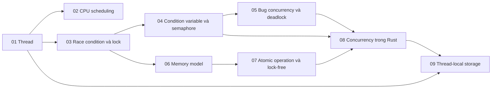

# P4 · Tổng quan — Concurrency

> Trang này chỉ điều hướng: mục tiêu, bản đồ chương, thứ tự đọc, sách gốc và câu hỏi tổng hợp. Mọi khẳng định kỹ thuật có chú thích nằm trong từng chương; các lời khuyên về thứ tự đọc là của người soạn.

## Mục tiêu của phase

Phase này dựng concurrency từ thấp lên cao: thread, scheduling, lock, condition variable và semaphore, bug và deadlock, memory model, atomic và lock-free. Phần cuối nối tất cả với `Send`/`Sync`, `Arc`, `Mutex`, `Condvar` và `mpsc` của Rust. Mục tiêu là bạn giải thích được vì sao Rust chặn data race nhưng không chặn race condition hay deadlock.

## Bản đồ chương

Mũi tên nghĩa là chương đích dùng khái niệm của chương nguồn (nhận xét của người soạn về thứ tự học).

## Các chương

| Chương | Nội dung chính |
|---|---|
| [01 — Thread](01-thread.md) | Vì sao cần thread và vì sao thứ tự chạy không đoán trước; thread vs process; thread trên Linux và `clone(2)`; PID/TGID/TID; thuộc tính chung/riêng theo `pthreads(7)`; thread-local storage; chi phí tạo thread, thread pool; kernel/user/green thread. |
| [02 — CPU scheduling](02-scheduling.md) | Cơ chế vs chính sách; FIFO/SJF/STCF/RR; MLFQ; lottery/stride; scheduler đa CPU, cache affinity; CFS và EEVDF; `nice` và weight; sáu policy `SCHED_*`; `sched_setaffinity`, CPU quota của container. |
| [03 — Race condition và lock](03-lock.md) | `counter += 1` là race condition, critical section, mutual exclusion, atomicity; tiêu chí của lock tốt; test-and-set, CAS, LL/SC, ticket lock; spin, yield, ngủ; `futex(2)`; `std::sync::Mutex` trên Linux; đo các lock; lock thô vs mịn, reader-writer lock. |
| [04 — Condition variable và semaphore](04-condition-variable-va-semaphore.md) | Vì sao mutex không đủ để chờ điều kiện; `wait` làm gì; `while` vs `if` (Mesa, spurious wakeup); producer/consumer bounded buffer; `notify_all`; semaphore và công dụng; bounded buffer, reader-writer, dining philosophers; cài semaphore từ mutex + condvar; `Condvar` của Rust, vì sao `std` không có semaphore, `tokio::sync::Semaphore`. |
| [05 — Bug concurrency và deadlock](05-concurrency-bug-va-deadlock.md) | Mẫu bug concurrency ngoài đời; atomicity vs order violation; deadlock và điều kiện Coffman; prevention, lock ordering, `trylock` và livelock; avoidance, detect-and-recover; `Mutex` Rust không reentrant; deadlock ở DB/connection pool; priority inversion. |
| [06 — Memory model](06-memory-model.md) | Compiler và CPU làm đảo thứ tự; MESI vs memory ordering; data race là UB, mô hình trừu tượng của Rust; happens-before; `Relaxed`/`Acquire`/`Release`/`AcqRel`; `SeqCst` và fence; spin lock đúng nhờ Acquire/Release; x86-64 vs ARM64. |
| [07 — Atomic operation và lock-free](07-lock-free.md) | `load`/`store`/`swap`/`fetch_add`/`compare_exchange`; `compare_exchange_weak` và vòng CAS; spurious failure, lệnh máy (LSE); lock-free/wait-free/obstruction-free; ABA, hazard pointer, epoch; futex wait/notify; khi nào không dùng lock-free; `Arc::clone`/`drop`. |
| [08 — Concurrency trong Rust](08-rust-concurrency.md) | `thread::spawn` đòi `Send + 'static`, `thread::scope`; định nghĩa `Send`/`Sync`; `Rc` và `Arc`; `Cell`/`RefCell`/`UnsafeCell`; `Mutex<T>`, poisoning, `RwLock`; `OnceLock`/`LazyLock`; `mpsc`; Safe Rust chặn và không chặn gì. |
| [09 — Thread-local storage](09-thread-local-storage.md) | Vì sao cần biến riêng mỗi thread (`errno`); `__thread`/`_Thread_local` vs `pthread_key_create`, vì sao ELF TLS ra đời; `.tdata`/`.tbss` và thread pointer (`%fs`, `TPIDR_EL0`); bốn TLS model (global-dynamic, local-dynamic, initial-exec, local-exec) và chi phí truy cập; `thread_local!`, `LocalKey::with`/`set`/`take`, `const { }`; destructor khi thread kết thúc, `AccessError`; vì sao không dùng TLS cho task async, `tokio::task_local!`. |

## Thứ tự đọc

Đọc 01 → 09 theo số. Chương 02 (scheduling) có thể đọc sau 05 nếu bạn muốn vào lock sớm (nhận xét của người soạn). Chương 06 là chương khó nhất của phase; đọc 03 xong mới vào 06, rồi 07, và để 08 làm điểm hội tụ. Chương 09 (thread-local storage) đọc sau 08 vì nó dùng `Send`/`Sync` và `Cell`/`RefCell` của chương đó, và nối sang tầng ELF/loader ở [P11 chương 06](../11-do-dac-va-go-loi/06-elf-linker-loader.md) (lời khuyên của người soạn).

## Lộ trình đọc sách gốc

Các nguồn dưới đây đều là nguồn mà chương của phase đã dùng; mở đọc song song với chương tương ứng. Không bắt buộc: chương đã tự chứa phần cần thiết.

- [OSTEP — Concurrency: An Introduction](https://pages.cs.wisc.edu/~remzi/OSTEP/threads-intro.pdf) — chương 01.
- [OSTEP — Scheduling: Introduction](https://pages.cs.wisc.edu/~remzi/OSTEP/cpu-sched.pdf) — chương 02.
- [OSTEP — Scheduling: The Multi-Level Feedback Queue](https://pages.cs.wisc.edu/~remzi/OSTEP/cpu-sched-mlfq.pdf) — chương 02.
- [OSTEP — Locks](https://pages.cs.wisc.edu/~remzi/OSTEP/threads-locks.pdf) — chương 03.
- [OSTEP — Condition Variables](https://pages.cs.wisc.edu/~remzi/OSTEP/threads-cv.pdf) — chương 04.
- [OSTEP — Semaphores](https://pages.cs.wisc.edu/~remzi/OSTEP/threads-sema.pdf) — chương 04.
- [OSTEP — Common Concurrency Problems](https://pages.cs.wisc.edu/~remzi/OSTEP/threads-bugs.pdf) — chương 05.
- [Rust Atomics and Locks — Rust Concurrency Basics](https://marabos.nl/atomics/basics.html) — chương 08.
- [Rust Atomics and Locks — Atomics](https://marabos.nl/atomics/atomics.html) — chương 07.
- [Rust Atomics and Locks — Memory Ordering](https://marabos.nl/atomics/memory-ordering.html) — chương 06.
- [Rust Atomics and Locks — Understanding the Processor](https://marabos.nl/atomics/hardware.html) — chương 06.
- [Rust Atomics and Locks — Building Our Own Spin Lock](https://marabos.nl/atomics/building-spinlock.html) — chương 03.
- [Rust Atomics and Locks — Operating System Primitives](https://marabos.nl/atomics/os-primitives.html) — chương 03.
- [The Rustonomicon — Atomics](https://doc.rust-lang.org/1.95.0/nomicon/atomics.html) — chương 06.
- [The Rustonomicon — Races](https://doc.rust-lang.org/1.95.0/nomicon/races.html) — chương 06, 08.
- [The Rustonomicon — Send and Sync](https://doc.rust-lang.org/1.95.0/nomicon/send-and-sync.html) — chương 08.
- [The Rust Book — Shared-State Concurrency](https://doc.rust-lang.org/1.95.0/book/ch16-03-shared-state.html) — chương 08.

## Câu hỏi tổng hợp xuyên chương

Không có đáp án ở đây; mỗi câu trỏ về chương cần đọc lại.

1. `counter += 1` từ race condition đến `std::sync::Mutex`: lệnh máy, atomic, futex và hàng đợi ngủ nối nhau thế nào? ([chương 03](03-lock.md), [chương 07](07-lock-free.md)).
2. Vì sao `Acquire`/`Release` cần thiết dù cache đã coherent (MESI)? ([chương 06](06-memory-model.md), [chương 07](07-lock-free.md)).
3. Thiết kế một hàng đợi producer/consumer có giới hạn: dùng `Condvar`, semaphore hay `mpsc`, và mỗi cách chặn lỗi nào? ([chương 04](04-condition-variable-va-semaphore.md), [chương 08](08-rust-concurrency.md)).
4. Data race, race condition và deadlock: Rust chặn cái nào, không chặn cái nào, và vì sao? ([chương 08](08-rust-concurrency.md), [chương 05](05-concurrency-bug-va-deadlock.md), [chương 06](06-memory-model.md)).
5. Một thread pool dùng trong container có CPU quota: scheduler, CPU affinity và quota tương tác thế nào khi chọn số thread? ([chương 02](02-scheduling.md), [chương 01](01-thread.md); P8 [chương 03](../08-containers/03-cgroups-v2.md) cho số đo `available_parallelism` với `--cpus`).
6. Vì sao `Arc::clone` và `drop` dùng các ordering khác nhau? ([chương 07](07-lock-free.md), [chương 06](06-memory-model.md)).
7. Deadlock giữa hai mutex và deadlock giữa transaction DB/connection pool giống và khác nhau ở đâu? ([chương 05](05-concurrency-bug-va-deadlock.md), [chương 03](03-lock.md)).
8. Spin lock và ngủ trên futex: khi nào chọn cái nào? Còn `std::thread::park`/`unpark` của Rust thì xem thêm ở đâu? ([chương 03](03-lock.md) mục 4, [chương 07](07-lock-free.md) mục 6; `park`/`unpark` của Rust: P7 [chương 05](../07-io-async/05-future-poll-waker.md) mục 7).

## Lab

Làm sau khi đã đọc lý thuyết:

- [Lab 04 — Concurrency](../labs/04-concurrency-lab.md)
