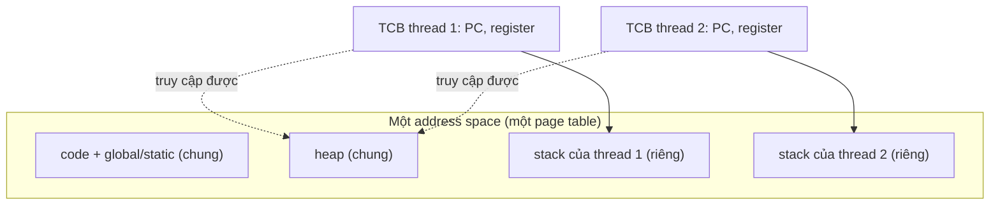
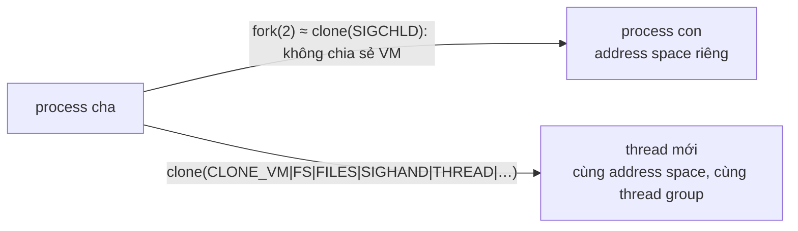

# P4 · Chương 01 — Thread

## Bạn sẽ hiểu được gì

1. **Q1.** Vì sao người ta cần thread (parallelism, che I/O chậm), và vì sao thứ tự chạy không đoán trước được? → mục 1
2. **Q2.** Thread khác process ở đâu: cái gì chung, cái gì riêng, và "thread control block" lưu gì? → mục 2
3. **Q3.** Trên Linux, thread thực chất là gì? `clone(2)` với những cờ nào biến một "process con" thành một thread? → mục 3
4. **Q4.** PID, TGID, TID khác nhau thế nào; `getpid(2)` và `gettid(2)` trả về gì ở thread thứ hai? → mục 4
5. **Q5.** `pthreads(7)` nói thuộc tính nào của process là chung cho mọi thread, thuộc tính nào là riêng? → mục 5
6. **Q6.** Thread-local storage là gì, ở mức khái niệm lẫn ở mức Rust (`thread_local!`)? → mục 6
7. **Q7.** Tạo một thread tốn gì (stack, thời gian), có số đo thật nào không, và thread pool giải quyết gì? → mục 7
8. **Q8.** Kernel thread, user-level thread, green thread khác nhau thế nào ở mức khái niệm? → mục 8

## Kiến thức cần trước

- [Process và vòng đời process (Chương P1·03)](../01-linux/03-process.md), đặc biệt mục `clone(2)`: ở đây ta đào sâu vào nửa "thread" của câu chuyện.
- [Address space (P3·01)](../03-memory/01-address-space.md) và [dịch địa chỉ (P3·02)](../03-memory/02-address-translation.md): để hiểu vì sao "cùng address space" nghĩa là cùng page table.
- [Cache và NUMA (P2·06)](../02-cpu/06-cache-va-numa.md): khi hai thread chạy song song trên hai core, dữ liệu chung đi qua cache coherence; chương này không lặp lại phần đó.

Chương này là chương mở đầu của phase concurrency. Việc *lên lịch* thread nằm ở [chương 02 — scheduling](02-scheduling.md); *khóa* ở [chương 03 — lock](03-lock.md); phần Rust chi tiết (`Send`/`Sync`, `thread::scope`, `Mutex`…) ở [chương 08 — Rust concurrency](08-rust-concurrency.md). Ở đây Rust chỉ được nhắc ngắn ở cuối.

---

## 1. Vì sao cần thread, và vì sao thứ tự chạy không đoán được (Q1)

> **Trả lời ngắn.** Để chạy song song trên nhiều CPU[^ostep-why-par] và không đứng chờ I/O chậm[^ostep-why-io]. Đổi lại, thread nào chạy trước do OS scheduler quyết định, ta không được giả định thứ tự[^ostep-sched-order].

**Giải thích.**

Hình dung (nhận xét của người soạn): nhiều đầu bếp chung một bếp — xong nhanh hơn, nhưng không biết ai mở tủ lạnh trước.


Ở các chương trước, một process có một dòng thực thi: một program counter (PC) đi qua code. Một **thread** (luồng) là một dòng thực thi như vậy bên trong process; process có thể có nhiều thread. Có hai lý do chính để làm vậy. Theo OSTEP, lý do thứ nhất đơn giản là parallelism[^ostep-why-par] — ví dụ chia việc cộng hai mảng rất lớn cho nhiều CPU. Lý do thứ hai là để chương trình không bị chặn vì I/O chậm[^ostep-why-io]. Sách giải thích: khi một thread chờ I/O, CPU scheduler có thể chuyển sang thread khác sẵn sàng chạy, nhờ đó I/O được chồng lấp với việc khác trong cùng một chương trình; nhiều ứng dụng server (web server, DBMS) dùng thread vì lý do này[^ostep-io-overlap].

Tại sao không dùng nhiều process? OSTEP thừa nhận ở cả hai trường hợp ta *có thể* dùng nhiều process, nhưng thread chia sẻ address space nên chia sẻ dữ liệu dễ, vì thế là lựa chọn tự nhiên khi các tác vụ cần chia sẻ nhiều dữ liệu[^ostep-vs-proc]. (Nhận xét của người soạn: đổi lại, process tách biệt nhau hơn; đó là trade-off cốt lõi, xem mục 2.)

<details><summary>Đi sâu: thứ tự chạy sau khi tạo thread</summary>

Một cảnh báo ngay từ đầu, cũng từ OSTEP: sau khi tạo thread, thread mới có thể chạy ngay hoặc chưa; thread nào chạy tiếp do OS scheduler quyết định[^ostep-sched-order]. Không có lý do để giả định thứ tự. Mọi bug ở các chương sau của phase này đều sinh ra từ đây.

</details>

**Quay lại Q1:** thread để chạy song song và che I/O chậm; đổi lại, thứ tự chạy do scheduler quyết định.

## 2. Thread so với process: chung gì, riêng gì (Q2)

> **Trả lời ngắn.** Thread cùng process chung address space nên chuyển giữa chúng không đổi page table[^ostep-no-pt]. Riêng mỗi thread: PC, register[^ostep-thread] và stack[^ostep-stacks], lưu trong thread control block (TCB)[^ostep-tcb-def].

**Giải thích.**

Hình dung (nhận xét của người soạn): hai nhân viên chung văn phòng và tủ hồ sơ, mỗi người một bàn riêng.

OSTEP định nghĩa thread bằng cách so với process: mỗi thread rất giống một process riêng, trừ một điểm khác — các thread chia sẻ cùng address space nên truy cập được cùng dữ liệu[^ostep-thread]. Trạng thái của một thread gần giống một process: có PC riêng theo dõi nơi nó đang nạp lệnh, và có bộ register riêng để tính toán.

Hệ quả cho context switch: chuyển từ thread T1 sang T2 trên một CPU thì phải lưu register của T1 và khôi phục của T2, giống context switch giữa process[^ostep-tcb]. Như process có process control block (PCB), thread cần một hoặc nhiều thread control block (TCB) để lưu trạng thái của từng thread trong process[^ostep-tcb-def]. Address space giữ nguyên, tức không cần đổi page table đang dùng[^ostep-no-pt].

Điểm khác thứ hai là stack. Process cổ điển có một stack; process nhiều thread thì có một stack cho mỗi thread[^ostep-stacks]. Biến cục bộ, tham số, giá trị trả về nằm trên stack của thread tương ứng — OSTEP gọi chỗ này là thread-local storage theo nghĩa rộng, tức chính stack của thread đó[^ostep-tls]. (Suy luận của người soạn từ các định nghĩa trên: phần chung là mọi thứ còn lại trong address space — code, global, heap; phần riêng là register, PC và stack.)

Sơ đồ dưới là minh họa của người soạn, tổng hợp từ các định nghĩa OSTEP ở trên:



**Bảng so sánh.**

| Khía cạnh | Process (sau `fork`) | Thread cùng process |
|---|---|---|
| Address space / page table | riêng (bản sao logic) | chung[^ostep-no-pt] |
| Stack | riêng | riêng cho từng thread[^ostep-stacks] |
| Register, PC | riêng | riêng cho từng thread[^ostep-thread] |
| Đổi ngữ cảnh | phải đổi page table | không đổi page table[^ostep-no-pt] |
| Chia sẻ dữ liệu | qua pipe, socket, shared memory | đọc/ghi thẳng cùng bộ nhớ[^ostep-vs-proc] |

Cột "Process (sau `fork`)" là tổng hợp của người soạn (không có chú thích riêng, trừ ý chung về address space của OSTEP ở các mục trước); cột thread có nguồn như đã chú thích.

<details><summary>Đi sâu: "stack riêng" không có nghĩa là được bảo vệ</summary>

Lưu ý: "stack riêng" là *một vùng stack riêng trong cùng address space*, không phải vùng được bảo vệ khỏi thread khác. Suy luận từ định nghĩa trên (và từ `CLONE_VM`: mọi bộ nhớ của hai bên nằm trong cùng một vùng nhớ[^clone-vm]) đã được chốt bằng thí nghiệm: một chương trình C (glibc 2.36, container Linux aarch64) cho thread phụ đưa địa chỉ biến cục bộ của nó cho thread chính; thread chính đọc được giá trị `1234` và ghi đè thành `99` thẳng vào stack của thread kia, không lỗi gì (một lần chạy, **quan sát**). Trong Rust, thứ chặn việc này là lifetime/borrow checker chứ không phải phần cứng hay kernel (chương 08).

</details>

**Quay lại Q2:** chung address space; riêng PC, register và stack.

## 3. Trên Linux: thread là một task tạo bằng `clone(2)` (Q3)

> **Trả lời ngắn.** Thread Linux của pthreads được tạo bằng `clone(2)`[^pthreads-11], syscall cho chọn chia sẻ phần nào của execution context[^clone-fork]; để kernel chấp nhận `CLONE_THREAD` cần tối thiểu `CLONE_VM` + `CLONE_SIGHAND` + `CLONE_THREAD`[^clone-einval-thread][^clone-einval-sighand].

**Giải thích.**

Hình dung (nhận xét của người soạn): `fork` như photocopy cả bộ hồ sơ; `clone` hỏi "tờ nào dùng chung" — dùng chung đủ nhiều thì bên con thành thread.


Cả hai cài đặt pthreads trên Linux (LinuxThreads và NPTL) đều dùng syscall `clone(2)`[^pthreads-11], nên ta đọc `clone` để hiểu thread. Theo man page, `clone` giống `fork(2)` nhưng cho kiểm soát chính xác hơn phần nào của execution context được chia sẻ giữa process gọi và process con[^clone-fork]. Chọn cờ nào thì chia sẻ cái đó. `fork` tương đương `clone` với cờ chỉ là `SIGCHLD`[^fork-clone-eq] (xem [P1·03](../01-linux/03-process.md)).

Các cờ liên quan đến thread:

| Cờ | Tác dụng (theo man page) |
|---|---|
| `CLONE_VM` | bên gọi và bên con chạy trong cùng một vùng nhớ; ghi vào bộ nhớ ở bên này thì bên kia cũng thấy[^clone-vm] |
| `CLONE_FS` | chia sẻ thông tin filesystem: root, thư mục hiện hành và umask; `chdir`/`chroot`/`umask` của bên nào cũng ảnh hưởng bên kia[^clone-fs] |
| `CLONE_FILES` | bên gọi và bên con dùng chung một bảng file descriptor[^clone-files] |
| `CLONE_SIGHAND` | chia sẻ bảng signal handler: `sigaction(2)` của một bên đổi hành vi cho cả hai; nhưng signal mask và tập pending signal vẫn riêng[^clone-sighand] |
| `CLONE_THREAD` | bên con được đặt vào cùng thread group với bên gọi[^clone-thread] |

Các cờ ràng buộc nhau: `CLONE_THREAD` mà thiếu `CLONE_SIGHAND` thì `EINVAL`[^clone-einval-thread]; `CLONE_SIGHAND` mà thiếu `CLONE_VM` cũng `EINVAL`[^clone-einval-sighand]. Vậy để kernel chấp nhận `CLONE_THREAD`, cần tối thiểu bộ ba `CLONE_VM` + `CLONE_SIGHAND` + `CLONE_THREAD` (đó là điều kiện của kernel; thư viện pthreads còn truyền thêm cờ, xem phần Đi sâu bên dưới).

Sơ đồ (minh họa của người soạn, dựa vào bảng cờ và ràng buộc ở trên):



<details><summary>Đi sâu: quan sát <code>strace</code> và bốn cờ còn lại của glibc</summary>

**Quan sát thật: chương trình Rust tạo thread gọi `clone` với cờ gì?**

Để khỏi đoán bộ cờ mà thư viện thực sự truyền, tôi chạy một chương trình Rust (rustc 1.95.0) tạo vài thread trong container Linux (kernel 6.8.0, aarch64) dưới `strace -f -e trace=clone,clone3`. Kết quả (một lần chạy, một nền tảng — **quan sát**, không phải bảo đảm của docs):

```text
clone(child_stack=0xe29e2d74e9e0, flags=CLONE_VM|CLONE_FS|CLONE_FILES|CLONE_SIGHAND|CLONE_THREAD|CLONE_SYSVSEM|CLONE_SETTLS|CLONE_PARENT_SETTID|CLONE_CHILD_CLEARTID, parent_tid=[12], tls=0xe29e2d74f860, child_tidptr=0xe29e2d74f1f0) = 12
[pid 11] futex(0xe29e2d74f1f0, FUTEX_WAIT_BITSET|FUTEX_CLOCK_REALTIME, 12, NULL, FUTEX_BITSET_MATCH_ANY <unfinished ...>
[pid 12] +++ exited with 0 +++
[pid 11] <... futex resumed>)        = 0
```

Một chương trình C dùng `pthread_create` + `pthread_join` trần (gcc, glibc 2.36) cho đúng cùng bộ cờ — nên đây là hành vi của glibc/NPTL, không phải của Rust riêng. Lưu ý đây là `clone`, không phải `clone3`, ở glibc 2.36. Thread chính (pid 11) không gọi `wait(2)` mà gọi `futex(FUTEX_WAIT…)` trên **đúng địa chỉ** `0xe29e2d74f1f0` đã truyền làm `child_tidptr`, với giá trị chờ là 12, chính là TID của thread con (`parent_tid=[12]`, kết quả trả về của `clone`); futex đó trở về ngay sau khi thread 12 thoát.

Ngoài năm cờ ở bảng trên còn có bốn cờ nữa trong dòng `clone` thật (theo man page):

- `CLONE_SETTLS`: đặt descriptor TLS của thread mới; trên x86-64 đó là giá trị mới của thanh ghi base `%fs`, trên kiến trúc có thanh ghi TLS riêng thì là giá trị của thanh ghi đó; man page cảnh báo nhìn chung không nên dùng cờ này ngoài các thư viện cài đặt threading[^clone-settls].
- `CLONE_PARENT_SETTID`: lưu TID của thread con vào bộ nhớ của bên gọi, và việc lưu hoàn tất trước khi `clone` trả về user space[^clone-parent-settid].
- `CLONE_CHILD_CLEARTID`: khi thread con thoát, xóa (ghi 0) TID tại địa chỉ đã cho và làm một thao tác wakeup trên futex tại địa chỉ đó — man page ghi cờ này được dùng bởi các thư viện threading[^clone-cleartid]. (Suy luận của người soạn: đây là cơ chế `pthread_join` dựa vào.) Man page `clone(2)` không nhắc `pthread_join` và nói rõ một thread `CLONE_THREAD` không thể được `wait(2)` (xem mục 4), nhưng `strace` ở trên cho thấy thread chính chờ trên futex tại đúng địa chỉ `child_tidptr` với giá trị chờ là TID của thread con, rồi được đánh thức khi thread con thoát (**quan sát** một lần chạy ở glibc 2.36, kết hợp mô tả của man page); điều này khớp với `pthreads(7)`: "thread joining" trong NPTL cài bằng futex[^pthreads-futex].
- `CLONE_SYSVSEM`: các bên chia sẻ một danh sách giá trị điều chỉnh semaphore System V (`semadj`)[^clone-sysvsem]. Cờ này không liên quan trực tiếp đến TLS hay join; nó xuất hiện trong dòng `strace` vì glibc truyền nó (nguồn: quan sát).

`pthreads(7)` xác nhận mô hình này từ phía thư viện: cả LinuxThreads (cũ) và NPTL là cài đặt 1:1, mỗi thread ứng với một kernel scheduling entity, và cả hai dùng syscall `clone(2)` của Linux[^pthreads-11]. Chuẩn bị cho các phần sau: trong NPTL, các primitive đồng bộ (mutex, join…) được cài bằng syscall `futex(2)` của Linux[^pthreads-futex] — chủ đề của [chương 03](03-lock.md).

</details>

**Quay lại Q3:** thread Linux là task do `clone(2)` tạo với cờ chia sẻ VM, signal handler và thread group.

## 4. PID, TGID và TID (Q4)

> **Trả lời ngắn.** Mọi thread trong một process có chung "PID" — thực chất là thread group ID (TGID), và `getpid(2)` trả về TGID[^clone-tgroup]. Mỗi thread có một TID riêng, lấy bằng `gettid(2)`; thread chính có TID bằng PID[^gettid-def].

**Giải thích.**

Hình dung (nhận xét của người soạn): PID là số nhà, TID là số phòng của từng người ở trong.


Khi nhiều thread chung một "process", cần phân biệt "định danh của process" và "định danh của từng thread". Man page `clone(2)` mô tả: thread group là tính năng thêm từ Linux 2.4 để hỗ trợ khái niệm của POSIX threads về một tập thread chung một PID; PID chung này nội bộ gọi là thread group identifier (TGID), và từ Linux 2.4 `getpid(2)` trả về TGID của bên gọi[^clone-tgroup]. Các thread trong nhóm được phân biệt bằng TID duy nhất toàn hệ thống; TID của thread mới có sẵn dưới dạng giá trị trả về của `clone`, và một thread tự lấy TID của mình bằng `gettid(2)`[^clone-tid].

`gettid(2)` nói gọn: ở process đơn luồng, thread ID bằng process ID (giá trị `getpid(2)` trả về); ở process đa luồng, mọi thread có cùng PID nhưng mỗi thread có một TID riêng[^gettid-def]. Nếu `clone` được gọi *không* có `CLONE_THREAD` thì tạo một thread group mới có TGID bằng TID của thread đó, thread này là leader của nhóm[^clone-leader].

| Tên | Lấy bằng | Giá trị với thread thứ hai |
|---|---|---|
| PID = TGID | `getpid(2)` | giống thread chính |
| TID | `gettid(2)` | duy nhất cho từng thread |
| `pthread_t` | `pthread_self(3)` | giá trị opaque của thư viện — không phải cùng một thứ với TID[^gettid-posix] |
| `ThreadId` của Rust | `thread::current().id()` | ID opaque, duy nhất cho mỗi thread[^rust-threadid] |

<details><summary>Đi sâu: số đo <code>/proc/self/task</code>, vòng đời thread, LinuxThreads</summary>

**Số đo thật.**

Chương trình thử (rustc 1.95.0, container Linux aarch64, kernel 6.8.0) tạo một thread phụ rồi in PID/TID từ cả hai thread, và liệt kê `/proc/self/task`:

```text
main: pid=32 tid=32
w1: pid=32 tid=33 X=7
/proc/self/task = ["32", "33"]
main X=0
```

Đọc kết quả: thread chính có TID bằng PID (nó là leader); thread phụ có cùng PID (32) nhưng TID khác (33); thư mục `/proc/self/task` có một mục cho mỗi thread. Điều này khớp với `proc(5)`: dưới `/proc/<pid>/task` có `task/tid` chứa thông tin của từng thread, với tid là kernel thread ID của thread đó[^proc-task]. (Dòng `X=7` / `main X=0` là chủ đề mục 6: mỗi thread một bản biến thread-local.)

Hai chi tiết vòng đời cũng nằm trong man page `clone(2)`: thread tạo bằng `CLONE_THREAD` có cùng parent process với bên gọi (nên `getppid(2)` giống nhau trong nhóm); khi nó kết thúc, bên tạo không nhận `SIGCHLD` và không thể lấy trạng thái bằng `wait(2)` ("The thread is said to be detached"); chỉ khi *mọi* thread của nhóm đã kết thúc thì parent của nhóm mới nhận `SIGCHLD`[^clone-detached]. (Suy luận của người soạn: đây là lý do thư viện cần `CLONE_CHILD_CLEARTID` + futex để cài `join`.)

**LinuxThreads: vì sao PID chung là một yêu cầu thật.**

Trước NPTL, LinuxThreads cài thread như process *không chung process ID*, nên hiện ra như các process riêng trong `ps(1)`[^pthreads-lt-pid]. So với LinuxThreads, NPTL tuân thủ đặc tả POSIX.1 sát hơn và nhanh hơn khi tạo số lượng lớn thread[^pthreads-nptl]; nó có từ glibc 2.3.2 và cần tính năng của kernel Linux 2.6[^pthreads-nptl-ver]. Thread group (Linux 2.4) và `CLONE_THREAD` là phần kernel cho phép "nhiều thread, một PID".

</details>

**Quay lại Q4:** TGID chung, TID riêng; thread chính có TID bằng PID.

## 5. `pthreads(7)`: thuộc tính chung và riêng (Q5)

> **Trả lời ngắn.** Mọi thread chung bộ nhớ global (data, heap)[^pthreads-mem] và một loạt thuộc tính cấp process như fd đang mở, signal disposition, thư mục hiện hành[^pthreads-shared]. Mỗi thread có riêng stack, thread ID, signal mask, `errno`…[^pthreads-private].

**Giải thích.**

Hình dung (nhận xét của người soạn): cả nhà chung ví và giấy tờ, mỗi người một bàn học riêng.


Chuẩn POSIX quy định thread nào chung gì, riêng gì. Man page `pthreads(7)`: một process có thể chứa nhiều thread cùng chạy một chương trình; các thread chung bộ nhớ global (data và heap segment) nhưng mỗi thread có stack riêng (biến automatic)[^pthreads-mem].

Về thuộc tính khác, `pthreads(7)` viết rằng POSIX.1 còn yêu cầu các thread chia sẻ một loạt thuộc tính khác (tức là thuộc tính cấp process chứ không phải cấp thread)[^pthreads-shared] và liệt kê, trong số đó: process ID, parent process ID, process group ID và session ID, controlling terminal, user và group ID, **open file descriptors**, record lock, **signal dispositions**, umask, thư mục hiện hành và thư mục root, interval timer và POSIX timer, nice value, resource limit, và số đo CPU time / resource usage. Ngược lại, ngoài stack, POSIX.1 quy định nhiều thuộc tính khác là riêng cho từng thread[^pthreads-private], gồm: thread ID (`pthread_t`), signal mask, biến `errno`, alternate signal stack, và real-time scheduling policy/priority; Linux thêm capabilities cũng là per-thread (cùng đoạn man page).

Hệ quả (nhận xét của người soạn): vì fd table chung, một thread `close(fd)` làm fd đó mất hiệu lực với *mọi* thread; `chdir` trong một thread đổi thư mục hiện hành của cả process.

<details><summary>Đi sâu: đối chiếu với các cờ <code>clone</code></summary>

Ghép với bảng cờ `clone` ở mục 3, ta thấy sự tương ứng: *chung* ⇔ cờ chia sẻ (`CLONE_VM` ↔ bộ nhớ, `CLONE_FILES` ↔ fd, `CLONE_FS` ↔ cwd/umask, `CLONE_SIGHAND` ↔ signal disposition, `CLONE_THREAD` ↔ PID); *riêng* ⇔ thứ kernel luôn giữ theo task (register, stack, signal mask — `clone(2)` nói rõ sau `CLONE_SIGHAND` hai bên vẫn có signal mask và pending signal riêng[^clone-sighand]).

</details>

**Quay lại Q5:** chung bộ nhớ và thuộc tính cấp process; riêng stack, register, signal mask, `errno`.

## 6. Thread-local storage (TLS) (Q6)

> **Trả lời ngắn.** TLS là biến khai báo như global nhưng mỗi thread có một bản riêng, nên các thread không cần đồng bộ khi truy cập[^rust-tls]. Trong Rust, TLS tạo bằng macro `thread_local!` và truy cập qua shared reference, nên muốn sửa thì dùng `Cell`/`RefCell`[^rust-tls-key].

**Giải thích.**

Hình dung (nhận xét của người soạn): thay vì một biển "số hiện tại" chung, phát mỗi người một tờ giấy riêng cùng tên.


**Vấn đề.** Đôi khi mỗi thread cần một bản riêng của một biến "toàn cục" — `errno` là ví dụ điển hình (`pthreads(7)` liệt kê nó là thuộc tính riêng của từng thread[^pthreads-private]). (Suy luận của người soạn: nếu `errno` là một biến global thật sự chung, hai thread gọi syscall lỗi cùng lúc sẽ ghi đè nhau.)

Trong Rust: module `std::thread` viết rằng thread-local storage là cách lưu dữ liệu vào một biến global mà mỗi thread trong chương trình có bản sao riêng; các thread không chia sẻ dữ liệu này nên truy cập không cần đồng bộ[^rust-tls]. Khóa TLS được tạo bằng macro `thread_local!`, sở hữu giá trị bên trong và hủy nó khi thread thoát; chỉ cho truy cập chia sẻ (`with` trả về shared reference), nên muốn sửa thì dùng interior mutability như `Cell`/`RefCell`[^rust-tls-key]. Kết quả quan sát ở mục 4 (`X=7` trong thread phụ nhưng `X=0` ở thread chính) minh họa đúng điều này.

Cơ chế cài đặt TLS (kernel, libc, Rust) được đào sâu ở [chương 09 — Thread-local storage](09-thread-local-storage.md).

<details><summary>Đi sâu: hai nghĩa của "thread-local storage" và vai trò của <code>CLONE_SETTLS</code></summary>

**Hai nghĩa của "thread-local storage".** Cần phân biệt (nhận xét của người soạn, dựa trên hai nguồn dưới):

1. Nghĩa rộng của OSTEP: biến cục bộ trên stack của thread, vốn riêng cho thread[^ostep-tls].
2. Nghĩa của thư viện/ngôn ngữ: một biến có tuổi thọ toàn thread, được khai báo như global nhưng mỗi thread có một bản. Ở phía kernel, `CLONE_SETTLS` là chỗ kernel nhận địa chỉ vùng TLS cho thread mới[^clone-settls]; trên x86-64 nó nạp vào base register `%fs`, và trên các kiến trúc có thanh ghi TLS riêng thì nạp vào thanh ghi đó. Phần còn lại (cấp phát vùng TLS, truy cập qua base register) do libc và compiler làm; chi tiết ABI của từng kiến trúc tôi không đào sâu ở đây vì chưa đọc nguồn ABI.

</details>

**Quay lại Q6:** TLS cho mỗi thread một bản biến riêng; Rust dùng `thread_local!`.

## 7. Thread tốn gì, và thread pool giải quyết gì (Q7)

> **Trả lời ngắn.** Mỗi thread cần stack riêng; mặc định 2 MiB với thread Rust[^rust-stack]. Số đo trong chương (một lần chạy, aarch64, **quan sát**): ≈ 10 KB RSS mỗi thread đang chờ, ≈ 40–45 µs để tạo+join thread rỗng. Thread pool tái dùng một nhóm thread tạo sẵn thay vì tạo thread cho từng việc[^book-pool].

**Giải thích.**

Hình dung (nhận xét của người soạn): tuyển người mới cho từng đơn thì tốn thời gian; nuôi sẵn đội cố định rẻ hơn, nhưng đơn phải xếp hàng khi hết người.

**Stack.**

Mỗi thread cần stack riêng (mục 2). Kích thước mặc định phụ thuộc cách tạo:

- **pthreads/NPTL**: nếu giới hạn mềm `RLIMIT_STACK` lúc chương trình khởi động có giá trị khác "unlimited" thì nó quyết định stack mặc định của thread mới; có thể đặt riêng bằng `pthread_attr_setstacksize(3)`[^pthread-create-stack]. Man page ví dụ với `ulimit -s` là 8192, tức giới hạn 8 MB[^pthread-create-8mb].
- **Rust `std::thread`**: mặc định phụ thuộc nền tảng và có thể đổi; hiện là 2 MiB trên mọi nền tảng Tier-1, đổi được bằng `Builder::stack_size` hoặc biến môi trường `RUST_MIN_STACK`; stack của *main thread* không do Rust quyết định[^rust-stack]. Mã nguồn 1.95.0 đặt `DEFAULT_MIN_STACK_SIZE` là `2 * 1024 * 1024` cho cấu hình phổ biến (một số nền tảng khác như L4Re, VxWorks có giá trị khác)[^rust-stack-src], và `std::thread::spawn` trên Unix gọi `pthread_create`[^rust-pthread-create] — tức thread Rust trên Linux là thread của pthreads/NPTL (chi tiết cài đặt, có thể đổi giữa các bản). Đoạn code đó truyền kích thước stack tường minh qua `pthread_attr_setstacksize` trước `pthread_create`, nên với thread do Rust spawn, stack mặc định là 2 MiB chứ không phải 8 MiB của `RLIMIT_STACK` (suy luận của người soạn từ đoạn code, khớp với đo ở mục 7: mỗi stack là một vùng nhớ đúng 2 MiB).

Stack là bộ nhớ **ảo** được cấp trước; trang vật lý chỉ có khi được chạm tới (demand paging, xem [P3·04](../03-memory/04-page-fault-va-swapping.md)). Vì vậy kích thước ảo và RSS khác nhau xa.

**Tạo và hủy.**

Cùng container, vòng lặp 10.000 lần `thread::spawn(|| {}).join()` (thread rỗng) đo trung bình khoảng **40–45 µs** mỗi vòng (chạy lại ở lần review: 45 µs và 43 µs, `-O`; số này gồm `clone`, cấp stack, lên lịch trên core khác, thoát và join). Con số thay đổi mạnh theo máy/kernel/tải, nên chỉ dùng để thấy bậc độ lớn (hàng chục micro giây). Vì vậy backend thường không tạo thread cho từng việc nhỏ (xem thread pool bên dưới, nhận xét của người soạn).

Chi phí khi *chạy* nhiều thread hơn số core (context switch) thuộc [chương 02](02-scheduling.md).

**Thread pool.**

**Vấn đề.** Server có thể tạo một thread cho mỗi kết nối, nhưng số thread không bị chặn sẽ phình theo tải (mỗi thread tốn không gian ảo và thời gian tạo, như trên). Sách Rust (chương xây web server) nêu rõ vấn đề số thread không giới hạn và dùng thread pool làm cải tiến[^book-pool-unlimited].

**Định nghĩa.** Theo sách Rust, thread pool là một nhóm thread đã được sinh ra, sẵn sàng chờ nhận việc; khi chương trình nhận tác vụ mới, nó giao tác vụ cho một thread trong pool và thread đó xử lý tác vụ[^book-pool]. Khi xong, thread trở về nhóm thread rảnh để nhận việc mới; pool cho phép xử lý kết nối đồng thời và tăng throughput[^book-pool-return].

**Nhận xét backend (của người soạn, không phải fact có nguồn).**

- Pool trả chi phí tạo thread (như trên) một lần lúc khởi động.
- Pool *giới hạn* độ song song: kích thước pool là một tham số cần chọn (CPU-bound thì gần số core; I/O-bound thì lớn hơn, hoặc dùng async). Hàng đợi phía trước pool là nơi latency tích tụ khi quá tải.
- Một handler giữ thread của pool trong lúc chờ I/O chậm thì trực tiếp giảm throughput — đúng vấn đề "request chậm chặn các request sau" mà sách Rust dùng để dẫn vào thread pool[^book-pool-slow].

<details><summary>Đi sâu: đo thật 1000 thread đang ngủ</summary>

**Đo thật: 1000 thread đang ngủ.**

Thí nghiệm (rustc 1.95.0 `-O`, container Linux aarch64 kernel 6.8.0, 4 core; tạo 1000 thread cùng chờ trên một `Barrier`, đọc `/proc/self/status` khi tất cả đang chờ; một lần chạy, **quan sát**):

| | `Threads` | `VmSize` | `VmRSS` |
|---|---|---|---|
| trước khi tạo | 1 | ≈ 2,7 MB | ≈ 1,7 MB |
| 1000 thread đang chờ | 1001 | ≈ 4,17 GB | ≈ 11,4 MB |

Tức khoảng 4,2 MB không gian địa chỉ ảo mỗi thread — gấp đôi 2 MiB stack mặc định của Rust — nhưng chỉ khoảng 10 KB RSS mỗi thread. Phần "gấp đôi" **không** do stack hay guard page. Tôi chạy lại và đọc `/proc/self/maps` khi 1000 thread đang chờ: có đúng 1000 vùng nhớ kích thước 2.097.152 byte (= 2 MiB, stack) và thêm 31 vùng lớn ≈ 64 MiB (66.973.696 byte) — tổng 31 vùng này ≈ 2,08 GB, đúng phần chênh. Đặt `MALLOC_ARENA_MAX=1` thì 31 vùng đó biến mất và `VmSize` chỉ còn ≈ 2,14 GB (≈ 2,14 MB/thread: 2 MiB stack cộng guard page và vùng TLS/descriptor), `VmRSS` gần như không đổi (≈ 11,2 MB). Vậy phần dư là các *arena* của `malloc` glibc (man page `mallopt(3)` mô tả arena là một vùng bộ nhớ mà `malloc(3)` dùng, cho phép nhiều thread cấp phát đồng thời, và số arena bị giới hạn bởi một mức thường tính bằng bội số của số CPU hiện có[^mallopt-arena]; suy luận của người soạn: vì thế máy 4 core dừng ở 31 arena phụ chứ không phải 1000, và các vùng ≈ 64 MiB đo được chính là các arena đó — tôi chưa đối chiếu với mã nguồn glibc). Kích thước ≈ 64 MiB mỗi arena là **quan sát** ở glibc 2.36 — không có nguồn trích dẫn cho con số này, và đó là chi tiết cài đặt của glibc, không phải bảo đảm. Hệ quả (nhận xét của người soạn): con số VmSize/thread phụ thuộc vào allocator, số core và việc thread có cấp phát hay không, không chỉ vào kích thước stack. Bài học: chi phí chính của thread *không chờ* nằm ở không gian địa chỉ ảo (đáng kể với process 32-bit hoặc khi có giới hạn `ulimit -v`/cgroup tính theo ảo — nhận xét của người soạn), còn bộ nhớ thật mỗi thread nhỏ nếu stack ít được dùng. Nếu thread gọi đệ quy sâu hoặc dùng mảng lớn trên stack, RSS tăng theo.

</details>

**Quay lại Q7:** thread tốn stack riêng và hàng chục µs để tạo; pool trả chi phí đó một lần và giới hạn số thread.

## 8. Kernel thread, user-level thread, green thread (Q8)

> **Trả lời ngắn.** Mô hình 1:1: mỗi thread ứng với một thực thể do kernel lên lịch[^pthreads-11]. Mô hình M:N (user-level/green thread): scheduler ở user space ghép nhiều task lên vài worker thread[^rfc-mn]. Std của Rust hiện dùng 1:1[^book-11].

**Giải thích.**

Hình dung (nhận xét của người soạn): 1:1 là mỗi khách một nhân viên riêng; M:N là một quản lý nội bộ chia nhiều khách cho vài nhân viên.


Từ "thread" nghĩa khác nhau tùy tầng. Mức khái niệm, mỗi thuật ngữ kèm nguồn:

| Loại | Ai lên lịch | Ghi chú có nguồn |
|---|---|---|
| **Thread nhân (kernel thread / kernel scheduling entity)** | kernel | Trong mô hình 1:1 của `pthreads(7)`, mỗi thread ứng với một kernel scheduling entity[^pthreads-11]; Rust std dùng mô hình này: mỗi thread của ngôn ngữ ứng với một thread của hệ điều hành[^book-11] |
| **Kernel thread theo nghĩa "thread chạy bên trong kernel"** | kernel | Kernel có API `kthread_create`; tài liệu mô tả nó tạo một kthread trên node hiện tại[^kdoc-kthread]. Theo tên API, đây là thread chạy code của kernel; (nhận xét của người soạn) khác với thread của một process user — trang tài liệu trích dẫn không nói rõ điểm này |
| **User-level / green thread (M:N)** | scheduler ở user space | RFC 230 của Rust định nghĩa: M:N là mô hình có một scheduler ở user space ghép các task lên các worker thread, đối lập 1:1 nơi một task ứng với một thread của OS[^rfc-mn] |

Một ví dụ M:N: runtime của Go có ba thực thể G (goroutine), M (OS thread) và P (tài nguyên để chạy code Go); tài liệu nói việc của scheduler là ghép một G (code cần chạy) với một M (nơi chạy) và một P (quyền và tài nguyên để chạy)[^go-gmp]. Tài liệu định nghĩa G là một goroutine[^go-g] và M là một OS thread[^go-m]; scheduler ghép G lên M — nên (suy luận của người soạn từ các định nghĩa này) goroutine không đồng nhất với thread của OS.

<details><summary>Đi sâu: green thread trong lịch sử Rust và trade-off M:N</summary>

**Green thread trong lịch sử Rust.** RFC 230 kể: Rust đã dần chuyển từ mô hình threading "green" sang mô hình native[^rfc-migrated]; ở mô hình green, task được lên lịch M:N và có stack riêng[^rfc-green-stack], và vì stack được cấp trước nên green thread của Rust không "lightweight"[^rfc-nolight]; ở mô hình native, task 1:1 với thread OS[^rfc-history]. RFC 230 *đề xuất* bỏ runtime hỗ trợ cả hai mô hình khỏi thư viện chuẩn[^rfc-summary]; còn hiện trạng của Rust 1.95.0 thì sách Rust ghi: thư viện chuẩn dùng mô hình 1:1 và có crate cài mô hình khác[^book-11][^book-other].

**Trade-off M:N (theo RFC 230).** Ở mô hình M:N, blocking theo nghĩa OS chặn cả worker thread (và cả page fault, vòng lặp dài tương tự)[^rfc-mn-block]; việc chọn số worker thread tối ưu là khó[^rfc-optimal]. Ở mô hình 1:1, một task chặn thoải mái mà không ảnh hưởng task khác vì mỗi task là một thread OS[^rfc-1to1-block]. (Nhận xét của người soạn: đây chính là lý do async/await và runtime như tokio quan trọng với server nhiều kết nối — ta quay lại ở chương async.)

</details>

**Quay lại Q8:** "thread" là thực thể do kernel lên lịch (1:1) hay do scheduler user space ghép lên worker (M:N); Rust std chọn 1:1.

## 9. Liên hệ với Rust (ngắn; chi tiết ở chương 08)

- `std::thread::spawn(f)` tạo thread mới và trả `JoinHandle<T>`. Closure phải `Send + 'static` — lý do của `'static` theo docs: thread có thể sống lâu hơn lifetime nơi nó được tạo[^rust-spawn-static]. `join()` chờ thread kết thúc và trả `Err` chứa giá trị panic nếu thread panic[^rust-spawn-join].
- **Drop `JoinHandle` = detach**: thread tiếp tục chạy nhưng không còn cách `join`; chương trình phải tự `join` hoặc chấp nhận detach, nếu không là rò rỉ tài nguyên[^rust-spawn-detach]. Khi main thread kết thúc, toàn bộ chương trình tắt, kể cả khi các thread khác vẫn đang chạy[^rust-main-exit]. Không có quan hệ cha/con giữa thread tạo và thread được tạo[^rust-no-parent] — (suy luận của người soạn) điều này tương thích với việc ở mức kernel thread `CLONE_THREAD` không được `wait(2)` như mục 4, nhưng docs Rust không nêu liên hệ đó.
- `thread::Builder` đặt tên và stack size trước khi spawn (`stack_size`, `name`); tên hiện chỉ dùng để nhận diện trong thông báo panic theo docs[^rust-builder-name]. Mặc định stack 2 MiB (mục 7).
- `thread_local!` / `LocalKey::with`: TLS của Rust (mục 6).
- Mô hình là 1:1[^book-11]; (suy luận của người soạn từ mục 3 và 7) mỗi `thread::spawn` ≈ một `pthread_create` ≈ một `clone`. Vì thế các chi phí ở mục 7 áp dụng nguyên vẹn.
- Cái Rust *không* làm hộ: chọn số thread hợp lý, dựng thread pool (thư viện chuẩn không có pool; sách Rust tự cài một pool tối giản[^book-pool]), và tránh race condition mức logic. `Send`/`Sync`, `thread::scope` (mượn biến cục bộ an toàn trong thread con), `Mutex`, channel: [chương 08](08-rust-concurrency.md).

## Tóm tắt

- Thread: chung address space, riêng PC, register, stack[^ostep-thread][^ostep-stacks]; chuyển cùng process không đổi page table[^ostep-no-pt].
- Dùng thread để chạy song song và che I/O chậm[^ostep-why-par][^ostep-why-io]; thứ tự chạy do scheduler quyết định[^ostep-sched-order].
- Trên Linux, thread là task tạo bằng `clone(2)` với cờ chia sẻ; `strace` thấy `CLONE_VM|FS|FILES|SIGHAND|THREAD` cộng cờ hỗ trợ TLS và join.
- `getpid(2)` trả TGID, `gettid(2)` trả TID; `pthread_t` và `ThreadId` của Rust là giá trị khác, opaque[^clone-tgroup][^gettid-def][^gettid-posix].
- `pthreads(7)` liệt kê thuộc tính chung (fd, signal disposition, cwd…) và riêng (stack, signal mask, errno…)[^pthreads-shared][^pthreads-private]; TLS trong Rust là `thread_local!`[^rust-tls].
- Chi phí đo thật (aarch64, một lần chạy): ≈ 10 KB RSS mỗi thread đang chờ; spawn+join thread rỗng ≈ 40–45 µs; bộ nhớ ảo lớn phần nhiều do arena malloc.
- 1:1 khác M:N; Rust từng có green thread rồi chuyển sang native (RFC 230)[^rfc-history]; pool tái dùng thread[^book-pool].

## Câu hỏi tự kiểm tra

1. Kể ba thứ chung và ba thứ riêng giữa các thread cùng process.

<details><summary>Đáp án</summary>

Chung: global memory, fd, signal disposition. Riêng: stack, register/PC, signal mask, `errno` ([^pthreads-mem], [^pthreads-shared], [^pthreads-private], [^ostep-thread]). Chuyển ngữ cảnh giữa thread cùng process không đổi page table ([^ostep-no-pt]).

</details>

2. Thread trên Linux được tạo bằng syscall nào, và ba cờ nào là tối thiểu hợp lệ?

<details><summary>Đáp án</summary>

`clone(2)`; `CLONE_VM`, `CLONE_SIGHAND`, `CLONE_THREAD`, do ràng buộc `EINVAL` giữa chúng ([^clone-einval-thread], [^clone-einval-sighand]). Thực tế `strace` thấy thêm FS, FILES, SYSVSEM, SETTLS, PARENT_SETTID, CHILD_CLEARTID ([^clone-settls], [^clone-cleartid]).

</details>

3. Trong process 2 thread, `getpid()` và `gettid()` ở hai thread trả giá trị thế nào? `pthread_self()` có phải TID không?

<details><summary>Đáp án</summary>

`getpid` giống nhau (TGID), `gettid` khác nhau; ở thread chính TID bằng PID vì nó là leader ([^clone-tgroup], [^gettid-def], [^clone-leader]). `pthread_self()` không phải TID ([^gettid-posix]).

</details>

4. Một thread gọi `close(fd)` trong lúc thread khác dùng fd đó — chuyện gì nằm sau hiện tượng này theo cờ `clone`?

<details><summary>Đáp án</summary>

`CLONE_FILES`: các thread chung một bảng fd, nên đóng ở một nơi có hiệu lực với tất cả ([^clone-files], [^pthreads-shared]).

</details>

5. Vì sao không thể `wait(2)` một thread, và thư viện biết thread kết thúc bằng cách nào?

<details><summary>Đáp án</summary>

Thread `CLONE_THREAD` là "detached" đối với `wait(2)` ([^clone-detached]); thư viện dùng `CLONE_CHILD_CLEARTID`: kernel xóa TID và wakeup futex khi thread thoát ([^clone-cleartid]). `strace` thấy thread chính `futex(FUTEX_WAIT)` trên địa chỉ `child_tidptr` (mục 3).

</details>

6. Mặc định stack của thread Rust là bao nhiêu, đổi bằng cách nào; main thread có do Rust quyết định không?

<details><summary>Đáp án</summary>

2 MiB trên các nền tảng Tier-1; `Builder::stack_size` hoặc `RUST_MIN_STACK`; main thread thì không ([^rust-stack]). Thí nghiệm 1000 thread: chi phí lớn là bộ nhớ ảo, một lần chạy, không phải bảo đảm (mục 7).

</details>

7. M:N khác 1:1 ở đâu, và vì sao blocking syscall là vấn đề với M:N?

<details><summary>Đáp án</summary>

M:N có scheduler user space ghép task lên một số worker thread; blocking theo nghĩa OS chặn cả worker thread. 1:1 thì mỗi task là một thread OS nên chặn không ảnh hưởng task khác ([^rfc-mn], [^rfc-mn-block], [^rfc-1to1-block]).

</details>

8. Thread pool là gì? Drop `JoinHandle` làm gì; main thread kết thúc thì thread khác ra sao?

<details><summary>Đáp án</summary>

Nhóm thread tạo sẵn chờ việc, tái dùng sau mỗi việc ([^book-pool], [^book-pool-return]). Drop `JoinHandle` = detach ([^rust-spawn-detach]); chương trình thoát cùng main thread ([^rust-main-exit]).

</details>

## Đọc thêm

- OSTEP, chương 26 *Concurrency: An Introduction* — <https://pages.cs.wisc.edu/~remzi/OSTEP/threads-intro.pdf>: hình address space đa thread, TCB, và ví dụ `counter += 1` chuẩn bị cho chương 03.
- `clone(2)` — <https://manpages.debian.org/bookworm/manpages-dev/clone.2.en.html>: mô tả đầy đủ từng cờ và thread group; đọc phần `CLONE_THREAD`.
- `pthreads(7)` — <https://manpages.debian.org/bookworm/manpages/pthreads.7.en.html>: danh sách thuộc tính chung/riêng và so sánh LinuxThreads với NPTL.
- `std::thread` (Rust 1.95.0) — <https://doc.rust-lang.org/1.95.0/std/thread/index.html>: spawn, join, detach, stack size, TLS.
- Rust Book, chương 21 (final project: multithreaded web server) — <https://doc.rust-lang.org/1.95.0/book/ch21-02-multithreaded.html>: dựng thread pool từng bước.
- RFC 230 *Remove runtime* — <https://rust-lang.github.io/rfcs/0230-remove-runtime.html>: phân tích 1:1 vs M:N và vì sao Rust bỏ green thread.
- [Chương P1·03 — Process](../01-linux/03-process.md), [chương 02 — Scheduling](02-scheduling.md), [chương 03 — Lock](03-lock.md): các chương liền kề.

---

[^ostep-why-par]: OSTEP, ch.26 Concurrency: An Introduction — <https://pages.cs.wisc.edu/~remzi/OSTEP/threads-intro.pdf> — "there are at least two major reasons you should use threads. The first is simple: parallelism."
[^ostep-why-io]: OSTEP, ch.26 Concurrency: An Introduction — <https://pages.cs.wisc.edu/~remzi/OSTEP/threads-intro.pdf> — "to avoid blocking program progress due to slow I/O."
[^ostep-io-overlap]: OSTEP, ch.26 Concurrency: An Introduction — <https://pages.cs.wisc.edu/~remzi/OSTEP/threads-intro.pdf> — "Threading enables overlap of I/O with other activities within a single program, much like multiprogramming did for processes across programs"
[^ostep-vs-proc]: OSTEP, ch.26 Concurrency: An Introduction — <https://pages.cs.wisc.edu/~remzi/OSTEP/threads-intro.pdf> — "threads share an address space and thus make it easy to share data, and hence are a natural choice when"
[^ostep-sched-order]: OSTEP, ch.26 Concurrency: An Introduction — <https://pages.cs.wisc.edu/~remzi/OSTEP/threads-intro.pdf> — "What runs next is determined by the OS scheduler, and although the scheduler likely implements some sensible algorithm, it is hard to know what will run at any given moment in time."
[^ostep-thread]: OSTEP, ch.26 Concurrency: An Introduction — <https://pages.cs.wisc.edu/~remzi/OSTEP/threads-intro.pdf> — "each thread is very much like a separate process, except for one difference: they share the same address space and thus can access the same data. The state of a single thread is thus very similar to that of a process. It has a program counter (PC) that tracks where the program is fetching instructions from. Each thread has its own private set of registers it uses for computation"
[^ostep-tcb]: OSTEP, ch.26 Concurrency: An Introduction — <https://pages.cs.wisc.edu/~remzi/OSTEP/threads-intro.pdf> — "The context switch between threads is quite similar to the context switch between processes, as the register state of T1 must be saved and the register state of T2 restored before running T2."
[^ostep-tcb-def]: OSTEP, ch.26 Concurrency: An Introduction — <https://pages.cs.wisc.edu/~remzi/OSTEP/threads-intro.pdf> — "one or more thread control blocks (TCBs) to store the state of each thread of a process."
[^ostep-no-pt]: OSTEP, ch.26 Concurrency: An Introduction — <https://pages.cs.wisc.edu/~remzi/OSTEP/threads-intro.pdf> — "the address space remains the same (i.e., there is no need to switch which page table we are using)."
[^ostep-stacks]: OSTEP, ch.26 Concurrency: An Introduction — <https://pages.cs.wisc.edu/~remzi/OSTEP/threads-intro.pdf> — "Instead of a single stack in the address space, there will be one per thread."
[^ostep-tls]: OSTEP, ch.26 Concurrency: An Introduction — <https://pages.cs.wisc.edu/~remzi/OSTEP/threads-intro.pdf> — "will be placed in what is sometimes called thread-local storage, i.e., the stack of the relevant thread."
[^clone-fork]: clone(2), Linux man-pages (Debian bookworm) — <https://manpages.debian.org/bookworm/manpages-dev/clone.2.en.html> — "By contrast with fork(2), these system calls provide more precise control over what pieces of execution context are shared between the calling process and the child process."
[^fork-clone-eq]: fork(2), Linux man-pages (Debian bookworm) — <https://manpages.debian.org/bookworm/manpages-dev/fork.2.en.html> — "A call to fork() is equivalent to a call to clone(2) specifying flags as just SIGCHLD."
[^clone-vm]: clone(2), Linux man-pages (Debian bookworm) — <https://manpages.debian.org/bookworm/manpages-dev/clone.2.en.html> — "If CLONE_VM is set, the calling process and the child process run in the same memory space. In particular, memory writes performed by the calling process or by the child process are also visible in the other process."
[^clone-fs]: clone(2), Linux man-pages (Debian bookworm) — <https://manpages.debian.org/bookworm/manpages-dev/clone.2.en.html> — "If CLONE_FS is set, the caller and the child process share the same filesystem information. This includes the root of the filesystem, the current working directory, and the umask."
[^clone-files]: clone(2), Linux man-pages (Debian bookworm) — <https://manpages.debian.org/bookworm/manpages-dev/clone.2.en.html> — "If CLONE_FILES is set, the calling process and the child process share the same file descriptor table."
[^clone-sighand]: clone(2), Linux man-pages (Debian bookworm) — <https://manpages.debian.org/bookworm/manpages-dev/clone.2.en.html> — "However, the calling process and child processes still have distinct signal masks and sets of pending signals."
[^clone-thread]: clone(2), Linux man-pages (Debian bookworm) — <https://manpages.debian.org/bookworm/manpages-dev/clone.2.en.html> — "If CLONE_THREAD is set, the child is placed in the same thread group as the calling process."
[^clone-einval-thread]: clone(2), Linux man-pages (Debian bookworm) — <https://manpages.debian.org/bookworm/manpages-dev/clone.2.en.html> — "EINVAL CLONE_THREAD was specified in the flags mask, but CLONE_SIGHAND was not."
[^clone-einval-sighand]: clone(2), Linux man-pages (Debian bookworm) — <https://manpages.debian.org/bookworm/manpages-dev/clone.2.en.html> — "EINVAL CLONE_SIGHAND was specified in the flags mask, but CLONE_VM was not."
[^clone-settls]: clone(2), Linux man-pages (Debian bookworm) — <https://manpages.debian.org/bookworm/manpages-dev/clone.2.en.html> — "On x86-64 it is the new value to be set for the %fs base register (see the ARCH_SET_FS argument to arch_prctl(2)). On architectures with a dedicated TLS register, it is the new value of that register. Use of this flag requires detailed knowledge and generally it should not be used except in libraries implementing threading."
[^clone-parent-settid]: clone(2), Linux man-pages (Debian bookworm) — <https://manpages.debian.org/bookworm/manpages-dev/clone.2.en.html> — "in the parent's memory. (In Linux 2.5.32-2.5.48 there was a flag CLONE_SETTID that did this.) The store operation completes before the clone call returns control to user space."
[^clone-cleartid]: clone(2), Linux man-pages (Debian bookworm) — <https://manpages.debian.org/bookworm/manpages-dev/clone.2.en.html> — "in child memory when the child exits, and do a wakeup on the futex at that address."
[^clone-sysvsem]: clone(2), Linux man-pages (Debian bookworm) — <https://manpages.debian.org/bookworm/manpages-dev/clone.2.en.html> — "If CLONE_SYSVSEM is set, then the child and the calling process share a single list of System V semaphore adjustment (semadj) values"
[^clone-tgroup]: clone(2), Linux man-pages (Debian bookworm) — <https://manpages.debian.org/bookworm/manpages-dev/clone.2.en.html> — "Thread groups were a feature added in Linux 2.4 to support the POSIX threads notion of a set of threads that share a single PID. Internally, this shared PID is the so-called thread group identifier (TGID) for the thread group. Since Linux 2.4, calls to getpid(2) return the TGID of the caller."
[^clone-tid]: clone(2), Linux man-pages (Debian bookworm) — <https://manpages.debian.org/bookworm/manpages-dev/clone.2.en.html> — "The threads within a group can be distinguished by their (system-wide) unique thread IDs (TID). A new thread's TID is available as the function result returned to the caller, and a thread can obtain its own TID using gettid(2)."
[^clone-leader]: clone(2), Linux man-pages (Debian bookworm) — <https://manpages.debian.org/bookworm/manpages-dev/clone.2.en.html> — "the resulting thread is placed in a new thread group whose TGID is the same as the thread's TID. This thread is the leader of the new thread group."
[^clone-detached]: clone(2), Linux man-pages (Debian bookworm) — <https://manpages.debian.org/bookworm/manpages-dev/clone.2.en.html> — "When a CLONE_THREAD thread terminates, the thread that created it is not sent a SIGCHLD (or other termination) signal; nor can the status of such a thread be obtained using wait(2). (The thread is said to be detached.)"
[^gettid-def]: gettid(2), Linux man-pages (Debian bookworm) — <https://manpages.debian.org/bookworm/manpages-dev/gettid.2.en.html> — "In a single-threaded process, the thread ID is equal to the process ID (PID, as returned by getpid(2)). In a multithreaded process, all threads have the same PID, but each one has a unique TID."
[^gettid-posix]: gettid(2), Linux man-pages (Debian bookworm) — <https://manpages.debian.org/bookworm/manpages-dev/gettid.2.en.html> — "The thread ID returned by this call is not the same thing as a POSIX thread ID (i.e., the opaque value returned by pthread_self(3))."
[^proc-task]: proc(5), Linux man-pages (Debian bookworm) — <https://manpages.debian.org/bookworm/manpages/proc.5.en.html> — "which contain corresponding information about each of the threads in the process, where tid is the kernel thread ID of the thread."
[^pthreads-mem]: pthreads(7), Linux man-pages (Debian bookworm) — <https://manpages.debian.org/bookworm/manpages/pthreads.7.en.html> — "These threads share the same global memory (data and heap segments), but each thread has its own stack (automatic variables)."
[^pthreads-shared]: pthreads(7), Linux man-pages (Debian bookworm) — <https://manpages.debian.org/bookworm/manpages/pthreads.7.en.html> — "POSIX.1 also requires that threads share a range of other attributes (i.e., these attributes are process-wide rather than per-thread):"
[^pthreads-private]: pthreads(7), Linux man-pages (Debian bookworm) — <https://manpages.debian.org/bookworm/manpages/pthreads.7.en.html> — "As well as the stack, POSIX.1 specifies that various other attributes are distinct for each thread, including:"
[^pthreads-11]: pthreads(7), Linux man-pages (Debian bookworm) — <https://manpages.debian.org/bookworm/manpages/pthreads.7.en.html> — "Both of these are so-called 1:1 implementations, meaning that each thread maps to a kernel scheduling entity. Both threading implementations employ the Linux clone(2) system call."
[^mallopt-arena]: mallopt(3), Linux man-pages (Debian bookworm) — <https://manpages.debian.org/bookworm/manpages-dev/mallopt.3.en.html> — "The computation of the arena hard limit is implementation-defined and is usually calculated as a multiple of the number of available CPUs."
[^pthreads-futex]: pthreads(7), Linux man-pages (Debian bookworm) — <https://manpages.debian.org/bookworm/manpages/pthreads.7.en.html> — "In NPTL, thread synchronization primitives (mutexes, thread joining, and so on) are implemented using the Linux futex(2) system call."
[^pthreads-nptl]: pthreads(7), Linux man-pages (Debian bookworm) — <https://manpages.debian.org/bookworm/manpages/pthreads.7.en.html> — "By comparison with LinuxThreads, NPTL provides closer conformance to the requirements of the POSIX.1 specification and better performance when creating large numbers of threads."
[^pthreads-nptl-ver]: pthreads(7), Linux man-pages (Debian bookworm) — <https://manpages.debian.org/bookworm/manpages/pthreads.7.en.html> — "NPTL is available since glibc 2.3.2, and requires features that are present in the Linux 2.6 kernel."
[^pthreads-lt-pid]: pthreads(7), Linux man-pages (Debian bookworm) — <https://manpages.debian.org/bookworm/manpages/pthreads.7.en.html> — "Threads do not share process IDs. (In effect, LinuxThreads threads are implemented as processes which share more information than usual, but which do not share a common process ID.) LinuxThreads threads (including the manager thread) are visible as separate processes using ps(1)."
[^pthread-create-stack]: pthread_create(3), Linux man-pages (Debian bookworm) — <https://manpages.debian.org/bookworm/manpages-dev/pthread_create.3.en.html> — "Under the NPTL threading implementation, if the RLIMIT_STACK soft resource limit at the time the program started has any value other than"
[^pthread-create-8mb]: pthread_create(3), Linux man-pages (Debian bookworm) — <https://manpages.debian.org/bookworm/manpages-dev/pthread_create.3.en.html> — "8192 # The stack size limit is 8 MB (0x800000 bytes)"
[^rust-threadid]: Rust std 1.95.0, `std::thread::ThreadId` — <https://doc.rust-lang.org/1.95.0/std/thread/struct.ThreadId.html> — "A ThreadId is an opaque object that uniquely identifies each thread created during the lifetime of a process."
[^rust-tls]: Rust std 1.95.0, module `std::thread` — <https://doc.rust-lang.org/1.95.0/std/thread/index.html> — "Thread-local storage is a method of storing data into a global variable that each thread in the program will have its own copy of. Threads do not share this data, so accesses do not need to be synchronized."
[^rust-tls-key]: Rust std 1.95.0, module `std::thread` — <https://doc.rust-lang.org/1.95.0/std/thread/index.html> — "A thread-local key owns the value it contains and will destroy the value when the thread exits. It is created with the thread_local! macro and can contain any value that is 'static (no borrowed pointers)."
[^rust-stack]: Rust std 1.95.0, module `std::thread` — <https://doc.rust-lang.org/1.95.0/std/thread/index.html> — "The default stack size is platform-dependent and subject to change. Currently, it is 2 MiB on all Tier-1 platforms."
[^rust-stack-src]: rust-lang/rust tag 1.95.0, library/std/src/sys/thread/unix.rs — <https://raw.githubusercontent.com/rust-lang/rust/1.95.0/library/std/src/sys/thread/unix.rs> — "pub const DEFAULT_MIN_STACK_SIZE: usize = 2 * 1024 * 1024;"
[^rust-pthread-create]: rust-lang/rust tag 1.95.0, library/std/src/sys/thread/unix.rs — <https://raw.githubusercontent.com/rust-lang/rust/1.95.0/library/std/src/sys/thread/unix.rs> — "let ret = libc::pthread_create(&mut native, attr.as_ptr(), thread_start, data as *mut _);"
[^rust-spawn-static]: Rust std 1.95.0, `std::thread::spawn` — <https://doc.rust-lang.org/1.95.0/std/thread/fn.spawn.html> — "is that threads can outlive the lifetime they have been created in."
[^rust-spawn-join]: Rust std 1.95.0, `std::thread::spawn` — <https://doc.rust-lang.org/1.95.0/std/thread/fn.spawn.html> — "If the spawned thread panics, join will return an Err containing the argument given to panic!."
[^rust-spawn-detach]: Rust std 1.95.0, `std::thread::spawn` — <https://doc.rust-lang.org/1.95.0/std/thread/fn.spawn.html> — "If the join handle is dropped, the spawned thread will implicitly be detached."
[^rust-main-exit]: Rust std 1.95.0, module `std::thread` — <https://doc.rust-lang.org/1.95.0/std/thread/index.html> — "When the main thread of a Rust program terminates, the entire program shuts down, even if other threads are still running."
[^rust-no-parent]: Rust std 1.95.0, module `std::thread` — <https://doc.rust-lang.org/1.95.0/std/thread/index.html> — "Note that there is no parent/child relationship between a thread that spawns a new thread and the thread being spawned."
[^rust-builder-name]: Rust std 1.95.0, `std::thread::Builder` — <https://doc.rust-lang.org/1.95.0/std/thread/struct.Builder.html> — "Currently the name is used for identification only in panic messages."
[^book-11]: The Rust Programming Language, 16.1 Using Threads — <https://doc.rust-lang.org/1.95.0/book/ch16-01-threads.html> — "The Rust standard library uses a 1:1 model of thread implementation, whereby a program uses one operating system thread per one language thread."
[^rfc-mn]: Rust RFC 0230 Remove runtime — <https://rust-lang.github.io/rfcs/0230-remove-runtime.html> — "whether there is some userspace scheduler that maps tasks onto worker threads (the M:N model)."
[^rfc-history]: Rust RFC 0230 Remove runtime — <https://rust-lang.github.io/rfcs/0230-remove-runtime.html> — "In Rust's native threading model, tasks are 1:1 with OS threads."
[^rfc-migrated]: Rust RFC 0230 Remove runtime — <https://rust-lang.github.io/rfcs/0230-remove-runtime.html> — "Rust has gradually migrated from a “green” threading model toward a native"
[^rfc-green-stack]: Rust RFC 0230 Remove runtime — <https://rust-lang.github.io/rfcs/0230-remove-runtime.html> — "In Rust's green threading, tasks are scheduled M:N and are equipped with their own stack."
[^rfc-nolight]: Rust RFC 0230 Remove runtime — <https://rust-lang.github.io/rfcs/0230-remove-runtime.html> — "in favor of pre-allocated stacks, which means Rust's green threads are not"
[^rfc-summary]: Rust RFC 0230 Remove runtime — <https://rust-lang.github.io/rfcs/0230-remove-runtime.html> — "This RFC proposes to remove the runtime system that is currently part of the standard library"
[^go-g]: Go runtime HACKING.md (go1.22.0) — <https://raw.githubusercontent.com/golang/go/go1.22.0/src/runtime/HACKING.md> — "A "G" is simply a goroutine."
[^go-m]: Go runtime HACKING.md (go1.22.0) — <https://raw.githubusercontent.com/golang/go/go1.22.0/src/runtime/HACKING.md> — "An "M" is an OS thread"
[^book-other]: The Rust Programming Language, 16.1 Using Threads — <https://doc.rust-lang.org/1.95.0/book/ch16-01-threads.html> — "There are crates that implement other models of threading"
[^rfc-optimal]: Rust RFC 0230 Remove runtime — <https://rust-lang.github.io/rfcs/0230-remove-runtime.html> — "Choosing the optimal number of worker threads is difficult"
[^rfc-mn-block]: Rust RFC 0230 Remove runtime — <https://rust-lang.github.io/rfcs/0230-remove-runtime.html> — "In the M:N model, however, blocking in the OS sense means blocking the worker thread. (The same applies to long-running loops or page faults.)"
[^rfc-1to1-block]: Rust RFC 0230 Remove runtime — <https://rust-lang.github.io/rfcs/0230-remove-runtime.html> — "In the 1:1 model, a task can block freely without any risk for other tasks, since each task is an OS thread."
[^go-gmp]: Go runtime HACKING.md (go1.22.0) — <https://raw.githubusercontent.com/golang/go/go1.22.0/src/runtime/HACKING.md> — "The scheduler's job is to match up a G (the code to execute), an M (where to execute it), and a P (the rights and resources to execute it)."
[^kdoc-kthread]: Linux kernel documentation, driver-api basics (kthread_create) — <https://docs.kernel.org/driver-api/basics.html> — "create a kthread on the current node"
[^book-pool]: The Rust Programming Language, 21.2 Turning Our Single-Threaded Server into a Multithreaded Server — <https://doc.rust-lang.org/1.95.0/book/ch21-02-multithreaded.html> — "A thread pool is a group of spawned threads that are ready and waiting to handle a task. When the program receives a new task, it assigns one of the threads in the pool to the task, and that thread will process the task."
[^book-pool-return]: The Rust Programming Language, 21.2 Turning Our Single-Threaded Server into a Multithreaded Server — <https://doc.rust-lang.org/1.95.0/book/ch21-02-multithreaded.html> — "When the first thread is done processing its task, it's returned to the pool of idle threads, ready to handle a new task."
[^book-pool-slow]: The Rust Programming Language, 21.2 Turning Our Single-Threaded Server into a Multithreaded Server — <https://doc.rust-lang.org/1.95.0/book/ch21-02-multithreaded.html> — "There are multiple techniques we could use to avoid requests backing up behind a slow request"
[^book-pool-unlimited]: The Rust Programming Language, 21.2 Turning Our Single-Threaded Server into a Multithreaded Server — <https://doc.rust-lang.org/1.95.0/book/ch21-02-multithreaded.html> — "problems with potentially spawning an unlimited number of threads"
