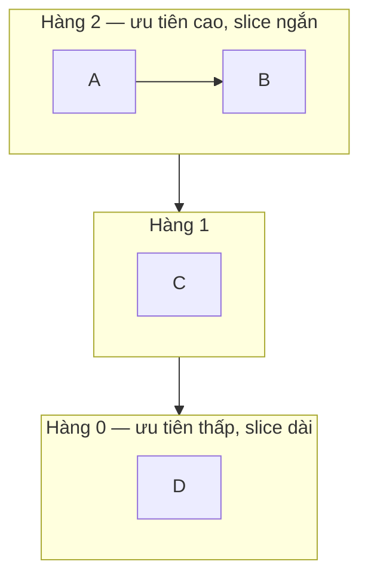

# P4 · Chương 02 — CPU scheduling

## Bạn sẽ hiểu được gì

1. **Q1.** Vì sao OS tách *cơ chế* khỏi *chính sách*; turnaround time và response time đo gì; FIFO, SJF, STCF, Round Robin tối ưu metric nào và tệ ở đâu? → mục 1
2. **Q2.** MLFQ xấp xỉ SJF khi không biết trước độ dài job bằng những rule nào, và mỗi rule vá lỗi gì? → mục 2
3. **Q3.** Lottery/stride chia CPU theo tỉ lệ ra sao? → mục 3
4. **Q4.** Vì sao scheduler đa CPU cần hàng đợi riêng mỗi CPU, cache affinity và load balancing? → mục 4
5. **Q5.** Kernel docs nói gì về CFS và EEVDF? → mục 5
6. **Q6.** `nice` của Linux biến thành weight và phần CPU thế nào? → mục 6
7. **Q7.** Sáu policy `SCHED_*` khác nhau ra sao? → mục 7
8. **Q8.** `sched_setaffinity(2)` và CPU quota của container nằm ở đâu? → mục 8

## Kiến thức cần trước

- [Process và `clone`](../01-linux/03-process.md): process/thread là gì dưới góc nhìn kernel.
- [Cache và NUMA](../02-cpu/06-cache-va-numa.md): cache coherence và vì sao dữ liệu "nóng" nằm trong cache của một core.
- [Thread](01-thread.md): chương trước trong phase này — nhiều thread chung address space.

## 1. Cơ chế, chính sách, hai metric và các chính sách kinh điển (Q1)

> **Trả lời ngắn.** OS tách hai việc: *cơ chế* lấy lại CPU từ thread đang chạy (timer interrupt, rồi context switch)[^ostep-timer], và *chính sách* chọn thread nào chạy tiếp. Để so sánh các chính sách ta cần hai thước đo. Turnaround time là thời gian từ lúc job đến tới lúc xong[^ostep-turnaround]; response time là thời gian từ lúc đến tới lần đầu được chạy[^ostep-response]. Với các giả định của sách, STCF (và SJF khi mọi job đến cùng lúc) tối ưu turnaround[^ostep-stcf-opt]. Round Robin thì tốt cho response nhưng là một trong những chính sách tệ nhất cho turnaround[^ostep-rr-worst].

**Giải thích.**

*Với service của bạn.* Ta dùng lại `orders`, service Rust ở [Phase 1](../01-linux/01-os-va-kernel.md), và đặt nó vào một pod có 2 CPU (nhận xét của người soạn: đây là ví dụ giả định, không phải code trong repo). Trong process có hai kiểu thread. Vài handler thread xử lý request, mỗi request chỉ cần một lát CPU ngắn. Còn thread `export` thỉnh thoảng chạy để dựng báo cáo và ngốn CPU liền một lúc dài. Cả hai kiểu cùng sẵn sàng chạy mà chỉ có 2 CPU, nên kernel phải chọn ai chạy trước, và lựa chọn đó quyết định request nào phải đứng chờ `export`. Ta sẽ đi từ các chính sách đơn giản nhất đến scheduler thật của Linux, rồi quay về câu hỏi của người vận hành `orders`: chỉnh được gì (nice, policy, affinity, quota).

### 1.1 Cơ chế và chính sách

Số thread sẵn sàng chạy thường nhiều hơn số CPU, nên OS cần hai thứ.

Thứ nhất là **cơ chế** lấy CPU lại từ thread đang chạy. Timer device được lập trình để ngắt sau mỗi vài mili giây; mỗi lần ngắt, process đang chạy bị dừng và một interrupt handler của OS chạy[^ostep-timer]. Sau đó context switch lưu một số giá trị register của process đang chạy (ví dụ lên kernel stack của nó) và khôi phục của process sắp chạy[^ostep-ctx]. Nhờ vậy `export` không thể giữ CPU mãi.

Thứ hai là **chính sách** (policy): chọn ai chạy tiếp và chạy bao lâu. Đây là phần chương này bàn. Cơ chế đã nằm ở [chương system call](../01-linux/02-system-call.md) và [chương process](../01-linux/03-process.md).

### 1.2 Hai thước đo

Muốn nói một chính sách "tốt" thì phải có thước đo. Ta dùng hai cái. **Turnaround time** là thời điểm job hoàn thành trừ thời điểm job đến hệ thống: `T_turnaround = T_completion − T_arrival`[^ostep-turnaround]. **Response time** là thời gian từ lúc job đến tới lần đầu nó được lên lịch chạy: `T_response = T_firstrun − T_arrival`[^ostep-response].

Với `orders`, nếu coi mỗi request là một job thì turnaround xấp xỉ "cả request xong mất bao lâu", còn response xấp xỉ "bao lâu thì request bắt đầu được xử lý" (nhận xét của người soạn). Turnaround hợp với tải batch như `export`, response hợp với tải tương tác như request của client (cũng nhận xét của người soạn).

Hai thước đo này hay kéo ngược chiều nhau, và còn thêm *fairness* (công bằng) nữa. Performance và fairness thường đối nghịch[^ostep-fairness]: ta sẽ thấy điều đó ngay ở các chính sách dưới đây.

### 1.3 Các chính sách kinh điển, với số liệu tính lại

Mọi con số dưới đây được tính lại bằng một chương trình mô phỏng nhỏ tự viết (bước 1 giây, hòa thì theo thứ tự tên; quy ước thêm cho RR nằm ở phần Đi sâu cuối mục). Các giá trị 20, 110, 50, 103,33, 3,33 và 14 trùng với số OSTEP in trong chương 7. Đơn vị "giây" là đơn vị của sách, chỉ để số tròn: request thật của `orders` ngắn hơn nhiều, điều quan trọng là tỉ lệ giữa các job (nhận xét của người soạn).

**FIFO.** First In, First Out (còn gọi FCFS): job đến trước chạy trước, chạy đến hết. Giả sử ba request A, B, C đến lúc 0, mỗi cái cần 10 giây CPU. A xong lúc 10, B lúc 20, C lúc 30[^ostep-fifo-ex]. Turnaround trung bình `(10+20+30)/3 = 20`; response là 0, 10, 20 (trung bình 10).

Chính sách này chỉ ổn khi mọi job dài bằng nhau. Giờ cho `export` vào: A là `export` cần 100 giây, B và C là hai request 10 giây, cả ba đến lúc 0. Turnaround là 100, 110, 120, trung bình 110 giây, và sách gọi đó là "a painful 110 seconds"[^ostep-fifo-110]. Hai request ngắn phải xếp sau job dài; hiện tượng này có tên **convoy effect**[^ostep-convoy].

**SJF.** Cách chữa tự nhiên là cho job ngắn chạy trước. Shortest Job First chạy job ngắn nhất, rồi job ngắn kế tiếp, cứ thế[^ostep-sjf]. Với ví dụ trên thứ tự thành B, C, A. Turnaround là 10, 20, 120, trung bình `(10+20+120)/3 = 50`: SJF hạ trung bình từ 110 xuống 50[^ostep-sjf-50]. Response là B=0, C=10, A=20, trung bình 10.

Nhưng SJF giả định mọi job đến cùng lúc, mà thực tế thì không. Cho A (`export`, 100 giây) đến lúc 0, còn B và C (hai request, mỗi cái 10 giây) đến lúc 10, tức là khi `export` đã chạy được một lúc. SJF thuần là non-preemptive[^ostep-sjf-nonpreempt]. Vì vậy A đã chạy thì phải chạy hết, và B với C bị kẹt sau A đúng kiểu convoy[^ostep-sjf-late]. A xong lúc 100, B lúc 110, C lúc 120. Trừ thời điểm đến, turnaround là A=100, B=`110−10=100`, C=`120−10=110`, trung bình `103,33`.

**STCF.** Muốn request chen được vào thì scheduler phải có quyền dừng job đang chạy. Shortest Time-to-Completion First (còn gọi Preemptive SJF) thêm preemption: mỗi khi có job mới, scheduler xét các job còn lại, kể cả job mới, và chạy job còn ít thời gian nhất[^ostep-stcf]. Trong ví dụ, A chạy 0–10; B và C đến lúc 10, preempt A và chạy 10–30; rồi A chạy nốt 30–120. Turnaround là A=120, B=10, C=20, trung bình `50`. Với các giả định của sách, STCF tối ưu turnaround và điều này đã được chứng minh[^ostep-stcf-opt]. Response là A=0, B=0, C=10, trung bình `3,33`, khớp với sách[^ostep-resp-ex].

**Round Robin.** STCF và SJF tốt cho turnaround, nhưng với ba job đến cùng lúc, job thứ ba phải đợi hai job trước chạy trọn rồi mới được chạy lần đầu. Round Robin (RR) sửa việc đó: chạy mỗi job một **time slice** (còn gọi scheduling quantum) rồi chuyển sang job kế trong run queue[^ostep-rr]. Độ dài slice phải là bội số của chu kỳ timer interrupt[^ostep-rr-slice].

Lấy ba job A, B, C đến cùng lúc, mỗi job 5 giây, slice 1 giây. Lịch chạy là `ABCABCABCABCABC`. Response là 0, 1, 2 (trung bình 1), so với 0, 5, 10 (trung bình 5) của SJF. Nhưng RR kéo dài mọi job: chúng xong lúc 13, 14, 15, trung bình 14, so với 10 của SJF/FIFO. Sách ghi đúng con số này và gọi là "pretty awful"[^ostep-rr-ex]. Tóm lại, RR với slice hợp lý rất tốt nếu response là thước đo duy nhất[^ostep-rr-resp]. Nhưng nó là một trong những chính sách tệ nhất cho turnaround[^ostep-rr-worst].

| Workload (arrival, burst) | Chính sách | Turnaround TB | Response TB |
|---|---|---|---|
| A,B,C (0,10) | FIFO/SJF/STCF | 20 | 10 |
| cùng workload | RR slice 1 | 29 | 1 |
| A(0,100) B,C(0,10) | FIFO | 110 | 70 |
| cùng workload | SJF / STCF | 50 | 10 |
| cùng workload | RR slice 1 | 59,67 | 1 |
| cùng workload | RR slice 10 | 56,67 | 10 |
| A(0,100) B,C(10,10) | FIFO / SJF | 103,33 | 63,33 |
| cùng workload | STCF | 50 | 3,33 |
| cùng workload | RR slice 1 | 59 | 0,33 |
| A,B,C (0,5) | SJF | 10 | 5 |
| cùng workload | RR slice 1 | 14 | 1 |

Bảng cho thấy một **trade-off nội tại**. Nếu chịu bất công thì chạy trọn được job ngắn, nhưng response kém; nếu coi trọng fairness thì response tốt, nhưng turnaround kém[^ostep-fair-tradeoff]. Với `orders`, STCF là thứ ta muốn (request xong nhanh, `export` chịu chờ), nhưng nó cần biết trước job dài bao lâu. Scheduler thật không biết, và đó là chuyện của mục 2.

Đi sâu: quy ước mô phỏng RR, giả định workload, time slice, chi phí chuyển ngữ cảnh (có số đo) và giả định I/O

**Quy ước mô phỏng RR.** Khi job mới đến đúng lúc một job khác hết slice, tôi xếp job mới vào hàng *trước* job bị ngắt. Đổi quy ước thì hàng RR của A(0,100) B,C(10,10) thành 59,67 và 1.

**Các giả định về workload.** OSTEP bắt đầu bằng cách đơn giản hóa workload (tập job). Sách thừa nhận những giả định này "mostly unrealistic" rồi nới dần[^ostep-assump-unreal]. Đó là: mọi job chạy cùng một khoảng thời gian; mọi job đến cùng lúc; đã bắt đầu thì chạy đến hết; job chỉ dùng CPU, không I/O[^ostep-assump-io]; và thời gian chạy của mỗi job được biết trước[^ostep-assume]. Mỗi chính sách ở trên ra đời khi một giả định bị nới.

**Nới giả định I/O và "oracle".** Job thật gọi I/O. OSTEP coi mỗi CPU burst là một job độc lập, để CPU chạy process khác trong lúc process này chờ I/O (overlap)[^ostep-io]. Giả định cuối, biết trước độ dài job, là giả định tệ nhất: OS đa dụng thường biết rất ít về độ dài job[^ostep-oracle].

**Time slice và chi phí chuyển ngữ cảnh.** Slice càng ngắn thì response càng tốt, nhưng chi phí context switch bắt đầu chi phối. Phải chọn slice đủ dài để amortize chi phí chuyển mà không dài đến mức hệ thống kém đáp ứng[^ostep-rr-tradeoff]. OSTEP minh họa bằng số giả định: slice 10 ms, chi phí switch 1 ms thì khoảng 10% thời gian bị lãng phí[^ostep-amort] (không phải số đo). Chi phí không chỉ là register: chương trình đã tích lũy trạng thái trong CPU cache, TLB, branch predictor…[^ostep-ctx-cache]; xem [cache và NUMA](../02-cpu/06-cache-va-numa.md), [TLB](../03-memory/03-page-table-va-tlb.md).

**Một phép đo (quan sát, không phải bảo đảm).** Tôi chạy chương trình C ping-pong qua hai pipe giữa hai process (mỗi vòng: 2 lần ngủ/đánh thức và 4 syscall), 200 000 vòng, trong container Linux 6.8.0 aarch64 chạy trong VM (Colima), 3 lần mỗi cấu hình. Hai process ghim cùng CPU 0 bằng `sched_setaffinity`: 1820, 1773, 1785 ns mỗi vòng. Ghim vào CPU 0 và CPU 1: 24674, 24549, 24908 ns. Con số gộp cả syscall và pipe nên **không** là chi phí một context switch thuần: mỗi vòng có hai lần chuyển, nên chi phí một lần chuyển kèm syscall và pipe chỉ là cận trên, không quá khoảng nửa số đo. Trong môi trường này, cùng CPU rẻ hơn khoảng 14 lần so với hai CPU. Nguyên nhân (đánh thức CPU đang idle trong VM) là suy luận của người soạn, chưa đo; đừng ngoại suy sang máy thật.

**Quay lại Q1:** cơ chế lấy lại CPU tách khỏi chính sách chọn job; SJF/STCF tối ưu turnaround (dưới giả định của sách) nên đẩy request ngắn lên trước `export`, RR tốt cho response, và theo OSTEP chính sách công bằng như RR đánh đổi turnaround để lấy response.

## 2. MLFQ — học từ lịch sử (Q2)

> **Trả lời ngắn.** MLFQ không biết trước job dài hay ngắn mà quan sát hành vi rồi xếp mức ưu tiên[^ostep-mlfq-learn]. Job nhả CPU sớm (ví dụ do I/O) thì giữ mức, job dùng hết allotment thì bị hạ một hàng[^ostep-rule4b]. Bản đầu có hai lỗi là starvation và gaming. Priority boost chữa lỗi thứ nhất[^ostep-mlfq-boost]. Cách tính allotment chặt hơn chữa lỗi thứ hai[^ostep-mlfq-rule4].

**Giải thích.**

*Với service `orders`.* STCF cần biết trước thread nào ngắn, nhưng kernel không có thông tin đó: nó không biết thread nào là handler, thread nào là `export`. Điều nó nhìn thấy được là hành vi. Một handler chạy một lát rồi chặn ở socket hay DB; `export` thì chạy liên tục tới hết lượt. MLFQ (Multi-Level Feedback Queue) khai thác đúng khác biệt này: không đòi biết trước bản chất job mà quan sát cách nó chạy rồi xếp ưu tiên tương ứng[^ostep-mlfq-learn]. Mục tiêu là vừa giảm response cho request, vừa giảm turnaround như SJF. Sách lưu ý chi tiết của nhiều MLFQ thật khác nhau[^ostep-mlfq-differ], nên các rule dưới đây là mô hình giảng dạy.

### 2.1 Nhiều hàng đợi, nhiều mức ưu tiên

**Rule 1–2**: có nhiều hàng đợi, mỗi hàng một mức ưu tiên; job ưu tiên cao hơn thì chạy, cùng mức thì round-robin[^ostep-mlfq-rules].

Sơ đồ minh họa của người soạn (hàng đợi và tên job là ví dụ; OSTEP nói hàng ưu tiên cao thường được cho slice ngắn, xem phần Đi sâu cuối mục):

### 2.2 Lần thử 1: đổi ưu tiên theo hành vi

Cần một khái niệm: *allotment* là lượng thời gian job được ở một mức trước khi scheduler hạ mức của nó[^ostep-allotment]. Rule 3: job mới vào ở hàng cao nhất[^ostep-mlfq-rule3]. Rule 4a/4b: job dùng hết allotment thì bị hạ một hàng; job nhả CPU trước khi hết (ví dụ do I/O) thì giữ mức[^ostep-rule4b]. Kết quả: handler của `orders` ở lại hàng cao, `export` trôi xuống đáy. Đây là xấp xỉ SJF mà không cần biết trước độ dài.

Ví dụ tính lại (mô phỏng của tôi: 3 hàng, slice 10 ms, allotment = slice, không I/O). A là `export` cần 120 ms, đến lúc 0. B là một request nặng cần 20 ms, đến lúc 100. A chạy 0–10 ở Q2, 10–20 ở Q1, rồi ở Q0 đến lúc 100. B đến lúc 100, vào Q2, preempt A, chạy 10 ms ở Q2 và 10 ms ở Q1, xong lúc 120; A chạy nốt đến 140. Turnaround của B là 20 ms, response 0: scheduler đối xử với B như SJF dù không biết trước B ngắn.

### 2.3 Hai lỗi của lần thử 1

Lỗi thứ nhất là *starvation*: nếu có "quá nhiều" job tương tác thì chúng ăn hết CPU, và job chạy lâu không bao giờ được chạy[^ostep-mlfq-starve]. Trên `orders`, đó là lúc tải request cao tới mức `export` không bao giờ nhúc nhích. Lỗi thứ hai là *gaming*: một người dùng khôn ngoan có thể viết lại chương trình để qua mặt scheduler[^ostep-gaming]. Cách làm là phát một lệnh I/O ngay trước khi hết allotment để ở lại mức cao (nhận xét của người soạn: `export` chỉ cần ghi vài byte ra file đúng lúc đó).

### 2.4 Lần thử 2 và 3: vá hai lỗi

**Priority boost** chữa starvation. Rule 5: sau mỗi khoảng S, chuyển mọi job lên hàng cao nhất[^ostep-mlfq-boost]. Nhưng chọn S thế nào cũng khó: Ousterhout gọi S là "voo-doo constant", vì quá cao thì job dài có thể đói, quá thấp thì job tương tác không được chia đủ CPU[^ostep-voodoo].

**Accounting tốt hơn** chữa gaming. Rule 4 gộp 4a và 4b làm một: job dùng hết allotment ở một mức, bất kể đã nhả CPU bao nhiêu lần, thì bị hạ một hàng[^ostep-mlfq-rule4]. Chia nhỏ I/O ra không còn giúp `export` ở lại hàng cao.

Đi sâu: tham số của MLFQ và các hệ thống thật

Các tham số còn lại (số hàng, slice mỗi hàng, allotment, chu kỳ boost) không có đáp án dễ; đa số biến thể cho hàng cao slice ngắn[^ostep-mlfq-slices]. Hai ví dụ hiện thực: lớp Time-Sharing của Solaris dùng bảng cấu hình (mặc định 60 hàng, slice từ 20 ms đến vài trăm ms)[^ostep-solaris]. FreeBSD 4.3 thì tính ưu tiên bằng công thức theo lượng CPU đã dùng[^ostep-freebsd].

**Quay lại Q2:** MLFQ học độ dài job từ hành vi, nên handler của `orders` ở trên còn `export` ở dưới; hai rule (boost, accounting) chặn starvation và gaming.

## 3. Proportional share: lottery và stride (Q3)

> **Trả lời ngắn.** Lottery cho mỗi job một số ticket rồi bốc thăm mỗi slice, nên đạt tỉ lệ ticket theo xác suất chứ không tất định[^ostep-lottery-prob]. Stride là bản tất định: mỗi lần chạy xong, cộng stride (tỉ lệ nghịch với ticket) vào pass, và luôn chạy job có pass nhỏ nhất[^ostep-stride-rule].

**Giải thích.**

*Với service `orders`.* Giả sử người vận hành không muốn tối ưu turnaround hay response, mà muốn một cam kết đơn giản hơn: các handler luôn có khoảng ba phần tư CPU, `export` có một phần tư, dù có bao nhiêu thread. Đây là họ chính sách khác với các mục trước: thay vì tối ưu một thước đo, scheduler cố bảo đảm mỗi job nhận một tỉ lệ CPU nhất định[^ostep-ps-intro]. Ý tưởng "ticket tỉ lệ với phần CPU" gần với "weight" trong scheduler Linux (suy luận của người soạn; nguồn không nối hai khái niệm này).

### 3.1 Lottery scheduling

Mỗi job giữ một số *ticket*, và tỉ lệ ticket là tỉ lệ CPU mong muốn. Ví dụ của OSTEP: A có 75 ticket, B có 25; mỗi slice, scheduler bốc ngẫu nhiên một số từ 0 đến 99 và job giữ ticket trúng được chạy. Với `orders`, A là nhóm handler, B là `export`.

Vì dựa vào xác suất, lottery đạt tỉ lệ mong muốn theo xác suất chứ không tất định[^ostep-lottery-prob]. Trong một ví dụ của sách, B chỉ chạy 4 trên 20 slice (20%) thay vì 25%[^ostep-lottery-ex]. Khi job ngắn thì độ công bằng trung bình có thể khá thấp[^ostep-lottery-fair]. Tôi mô phỏng lại (5 seed mỗi mức): tỉ lệ slice của B là 0,10–0,35 với 20 slice, nhưng 0,242–0,251 với 20 000, tức hội tụ về 0,25. Còn "gán ticket thế nào" vẫn là câu hỏi mở[^ostep-ticket-assign].

### 3.2 Stride scheduling

Muốn bỏ may rủi thì dùng stride, bản tất định. Mỗi job có một *stride* tỉ lệ nghịch với số ticket; mỗi lần job chạy xong, scheduler cộng stride vào *pass* của nó; lần sau luôn chạy job có pass nhỏ nhất[^ostep-stride-rule].

Ví dụ của sách: A, B, C có 100, 50, 250 ticket; chia 10 000 cho số ticket được stride 100, 200, 40. Mô phỏng của tôi (hòa thì chọn theo tên) cho dãy `ABCCCACC ABCCCACC …`. Trong 800 lượt, A chạy 200, B chạy 100, C chạy 500: đúng tỉ lệ 2 : 1 : 5 = 100 : 50 : 250, và không có độ lệch xác suất như lottery.

Đi sâu: nối với weight và vruntime của Linux

**Nối với Linux (suy luận của người soạn):** weight của task trong CFS/EEVDF (mục 5 và 6) đóng vai "ticket", `vruntime` đóng vai "pass". Hai thuật toán không giống hệt nhau: kernel docs chỉ nói `vruntime` là runtime chuẩn hóa.

**Quay lại Q3:** lottery chia CPU giữa handler và `export` theo xác suất, stride chia tất định, cả hai theo tỉ lệ ticket.

## 4. Multiprocessor scheduling (Q4)

> **Trả lời ngắn.** Mỗi CPU có cache riêng, nên chạy tiếp ở CPU cũ thì nhanh hơn nhờ cache affinity[^ostep-affinity]. Một hàng đợi chung cho mọi CPU phải tranh lock[^ostep-sqms-lock]. Nó cũng làm job nhảy CPU[^ostep-sqms-bounce]. Hàng đợi riêng mỗi CPU scale tốt hơn[^ostep-mqms-adv]. Nhưng nó gây load imbalance[^ostep-imbalance], mà cách chữa là migration[^ostep-migration] và work stealing[^ostep-steal].

**Giải thích.**

*Với service `orders`.* Từ đầu chương ta chỉ nói về một CPU. Pod thật có nhiều core, và các handler thread của `orders` chạy song song trên đó. Câu hỏi mới: scheduler giữ một hàng đợi cho cả máy, hay mỗi core một hàng? Và khi một handler dậy sau lúc chờ socket, nó nên chạy ở core nào?

### 4.1 Vấn đề mới: cache và đồng bộ

Mỗi CPU có cache riêng, cùng chia sẻ bộ nhớ chính. Một process sửa dữ liệu trong cache của CPU 1 rồi bị chuyển sang CPU 2 sẽ đọc giá trị cũ nếu không có cơ chế bảo đảm. Đó là bài toán **cache coherence**[^ostep-coherence], do phần cứng giải quyết; xem [cache và NUMA](../02-cpu/06-cache-va-numa.md). Cấu trúc dữ liệu chung thì vẫn cần lock ([chương lock](03-lock.md)).

**Cache affinity** là hệ quả thực tế cho scheduler. Một process chạy trên một CPU sẽ tích lũy trạng thái trong cache (và TLB) của CPU đó. Lần sau nên cho nó chạy tiếp ở CPU cũ, vì nó nhanh hơn nếu một phần trạng thái còn nằm trong cache[^ostep-affinity]. Chạy ở CPU khác vẫn cho kết quả đúng nhờ coherence, chỉ chậm hơn. Với `orders`, một handler vừa parse xong request, buffer còn nóng trong cache của core 1; dậy lại ở core 1 thì rẻ hơn ở core 3 (nhận xét của người soạn).

### 4.2 Single-queue (SQMS)

Cách đơn giản nhất là một hàng đợi chung cho cả máy, mỗi CPU lấy job tốt nhất từ đó. Cách này dễ cài từ scheduler đơn CPU, nhưng có hai vấn đề.

Thứ nhất là không scale: mọi CPU tranh một lock, và lock có thể làm hiệu năng giảm mạnh khi số CPU tăng[^ostep-sqms-lock]. Thứ hai là mất affinity, vì job bị chuyển vòng quanh các CPU[^ostep-sqms-bounce]. Với 5 job A–E trên 4 CPU, lịch trong sách cho thấy job nhảy CPU liên tục. Cách sửa là để A–D ở yên và chỉ cho E di chuyển giữa các CPU, nhưng cài đặt phức tạp[^ostep-sqms-aff].

### 4.3 Multi-queue (MQMS) và load balancing

Hướng ngược lại là mỗi CPU một hàng đợi. Job vào đúng một hàng theo heuristic rồi được lập lịch độc lập. MQMS vốn scale tốt hơn SQMS[^ostep-mqms-adv], và job ở yên một CPU nên có affinity.

Cái giá là **load imbalance**, vấn đề nền tảng của hướng này[^ostep-imbalance]. Theo ví dụ trong sách: nếu C xong, A một mình chiếm CPU 0 còn B và D chia nhau CPU 1, nên A nhận gấp đôi CPU so với B hoặc D. Nếu A và C cùng xong thì CPU 0 idle. Trên `orders`, đó là cảnh một core đứng không trong khi core bên cạnh có ba handler xếp hàng.

Giải pháp là **migration**: chuyển job từ CPU này sang CPU khác thì mới cân tải thật sự[^ostep-migration]. Khi một lần chuyển không đủ thì phải chuyển liên tục. Kỹ thuật cơ bản là **work stealing**: hàng ít việc thỉnh thoảng nhìn sang hàng khác và lấy bớt job nếu hàng đó đầy hơn đáng kể[^ostep-steal]. Ở đây có một căng thẳng. Nhìn sang hàng khác quá thường thì overhead cao và mất khả năng scale[^ostep-steal-tension], còn nhìn quá hiếm thì mất cân bằng nặng.

Đi sâu: tình trạng multiprocessor scheduler của Linux theo các nguồn

OSTEP ghi nhận trong cộng đồng Linux chưa có giải pháp chung nào xuất hiện cho multiprocessor scheduler[^ostep-linux-multi]; đây là nội dung theo phiên bản sách, không mô tả load balancer hiện nay của kernel. Kernel docs CFS chỉ có một câu trong danh sách thay đổi so với scheduler cũ: SMP load-balancing đã được làm lại và chỉnh cho gọn (reworked/sanitized)[^kdoc-cfs-smp]. Trang đó không mô tả thuật toán cân bằng tải.

**Quay lại Q4:** hàng đợi riêng mỗi CPU giữ affinity và scale, đổi lại cần migration/work stealing để cân tải giữa các core của `orders`.

## 5. Scheduler của Linux: CFS và EEVDF (Q5)

> **Trả lời ngắn.** CFS luôn chạy task có `vruntime` nhỏ nhất, tức runtime chuẩn hóa theo số task đang chạy[^kdoc-cfs-pick]. EEVDF đang thay dần CFS, bắt đầu từ kernel 6.6[^kdoc-eevdf-transition]. Trong các task có lag ≥ 0, EEVDF chọn task có virtual deadline sớm nhất[^kdoc-eevdf-pick].

**Giải thích.**

*Với service `orders`.* Các mục trước là mô hình trong sách. Mục này nói scheduler thật của Linux, thứ quyết định handler thread của `orders` có CPU hay phải chờ `export`. Ta sẽ xem nó đo "ai đã chạy ít nhất" bằng gì (CFS), rồi nó thêm gì để thread nhạy độ trễ như handler được chọn sớm (EEVDF).

### 5.1 CFS và `vruntime`

CFS ("Completely Fair Scheduler") là scheduler "desktop" do Ingo Molnar cài đặt và merge vào Linux 2.6.23[^kdoc-cfs-intro]. Từ bản đó nó là scheduler mặc định[^man-sched-cfs]. Trang kernel docs về CFS ghi rằng giờ nó đang nhường chỗ cho EEVDF[^kdoc-cfs-room], nên phần này là khung khái niệm, còn kernel mới chọn task bằng EEVDF (xem Đi sâu cuối mục).

CFS bắt đầu từ một ý tưởng: mô hình hóa một "ideal, precise multi-tasking CPU" trên phần cứng thật[^kdoc-cfs-ideal]. CPU lý tưởng đó chạy mọi task song song với tốc độ bằng nhau, mỗi task `1/nr_running` tốc độ[^kdoc-cfs-ideal-def]. Chẳng hạn hai handler và `export` cùng sẵn sàng trên một CPU thì mỗi cái chạy với một phần ba tốc độ. Phần cứng thật chỉ chạy được một task một lúc, nên CFS cần cách ghi sổ ai đã được bao nhiêu. Cách đó là *virtual runtime*: runtime thực của task, chuẩn hóa theo số task đang chạy[^kdoc-cfs-vruntime].

Mỗi task có `p->se.vruntime` (nanosecond). CFS luôn cố chạy task có `vruntime` nhỏ nhất, tức task đã chạy ít nhất cho tới giờ[^kdoc-cfs-pick]. Để tìm nhanh task đó, CFS giữ các task runnable trong một rbtree sắp theo khóa `vruntime`[^kdoc-cfs-rbtree]. Khi task đang chạy, thời gian nó vừa dùng được cộng vào `vruntime`[^kdoc-cfs-account]. Khi có task khác trở thành "leftmost" (nhỏ nhất) trong cây, task hiện tại bị preempt, nhưng chỉ khi chênh một khoảng "granularity" nhất định, để không đổi task quá thường làm hỏng cache[^kdoc-cfs-preempt-gran].

### 5.2 EEVDF

EEVDF ("Earliest Eligible Virtual Deadline First") giữ cùng mục tiêu: chia CPU đều cho các task runnable cùng ưu tiên[^kdoc-eevdf-same]. Thuật toán này được giới thiệu lần đầu trong một bài báo khoa học năm 1995[^kdoc-eevdf-1995]. Kernel bắt đầu chuyển từ CFS sang nó từ phiên bản 6.6[^kdoc-eevdf-transition].

Chỗ khác là cách ghi sổ. Mỗi task có một *lag*. Lag dương nghĩa là task còn được nợ CPU, lag âm nghĩa là nó đã dùng quá phần của mình[^kdoc-eevdf-lag]. EEVDF chỉ xét các task có lag ≥ 0, tính *virtual deadline* (VD) cho từng task và chạy task có VD sớm nhất[^kdoc-eevdf-pick].

Ý nghĩa với `orders`: task nhạy độ trễ với time slice ngắn được ưu tiên, nên đáp ứng tốt hơn[^kdoc-eevdf-latency]. Task cũng có thể tự xin time slice qua `sched_setattr()`[^kdoc-eevdf-slice]. Còn việc task ngủ ngắn để xóa lag âm thì docs chặn bằng cơ chế lag "decay"[^kdoc-eevdf-decay].

Đi sâu: phiên bản kernel và scheduling class

**Về phiên bản.** Hai trang docs.kernel.org trên là bản hiện hành, không ghim. Ở tag v6.8, tải `Documentation/scheduler/sched-eevdf.rst` trả HTTP 404 (docs EEVDF chưa có trong cây đó), nhưng `kernel/sched/fair.c` v6.8 đã chứa EEVDF. Một comment mở đầu nêu tên thuật toán Earliest Eligible Virtual Deadline First[^src-eevdf-title]. Hàm `update_deadline()` thì tính `vd_i = ve_i + r_i / w_i`[^src-eevdf-vd] (`w_i` là weight, tức nice). Suy luận của người soạn: kernel 6.8 của container lab chọn task theo EEVDF, nên phần CFS ở trên là khung khái niệm chứ không phải thuật toán chọn task chính xác của kernel mới; bảng weight ở mục 6 dùng chung.

**Scheduling class.** CFS được thiết kế với "Scheduling Classes", một hệ phân cấp mở rộng các module scheduler[^kdoc-cfs-classes]. Mỗi class cài các hook (`enqueue_task`, `pick_next_task`, `task_tick`…) mà core gọi khi có sự kiện[^kdoc-cfs-hooks]. `sched/fair.c` cài CFS, còn `sched/rt.c` cài `SCHED_FIFO`/`SCHED_RR`[^kdoc-cfs-rt].

**Quay lại Q5:** CFS chọn `vruntime` nhỏ nhất, EEVDF chọn virtual deadline sớm nhất trong các task còn được nợ CPU; cả hai đều chia đều CPU giữa handler và `export` khi cùng ưu tiên.

## 6. Nice và weight (Q6)

> **Trả lời ngắn.** `nice` là thuộc tính để scheduler thiên vị hoặc bất lợi một thread[^man-sched-nice]. Trên Linux hiện đại nó nằm trong khoảng −20 (ưu tiên cao) đến +19 (thấp)[^man-sched-nice-range]. Mỗi bậc chênh cho hệ số 1,25[^man-sched-nice-125]. Trong source kernel v6.8, nice được ánh xạ sang weight (nice 0 ứng 1024)[^src-weight]. Phần CPU dự kiến của hai task CPU-bound là weight chia tổng weight (suy luận của người soạn).

**Giải thích.**

*Với service `orders`.* Cách rẻ nhất để bảo scheduler "handler quan trọng hơn `export`" là chạy `export` với nice cao hơn. Nhưng nice 5 nghĩa là bao nhiêu phần CPU? Mục này quy nice ra weight rồi ra tỉ lệ cụ thể, và đối chiếu với một phép đo.

`nice` là thuộc tính để scheduler thiên vị hoặc bất lợi một process, và tác động lên `SCHED_OTHER` và `SCHED_BATCH`[^man-sched-nice]. Trên Linux hiện đại giá trị đi từ −20 (ưu tiên cao) đến +19 (thấp)[^man-sched-nice-range]. Khác POSIX, trên Linux nice là thuộc tính của *thread*[^man-sched-nice-thread]: `export` có thể có nice riêng, khác handler dù cùng process. Từ CFS, mỗi đơn vị chênh nice giữa hai process cho hệ số 1,25 về mức scheduler thiên vị bên ưu tiên cao hơn[^man-sched-nice-125].

Kernel cụ thể hóa điều đó thành **weight**. Bảng `sched_prio_to_weight[40]` trong source kernel v6.8 có nice 0 ứng 1024, nice 5 ứng 335, nice 10 ứng 110, nice 19 ứng 15[^src-weight]. Comment trong source nói mỗi bậc là thay đổi khoảng 10% CPU, dùng hệ số 1,25[^src-weight-comment] (chi tiết source, có thể đổi giữa phiên bản). Kernel docs CFS nói `rq->cfs.load` là tổng weight của các task trong runqueue[^kdoc-cfs-load]. Từ đó, phần CPU dự kiến của hai task CPU-bound trên một CPU là `weight / tổng weight` (suy luận của người soạn). Bảng dưới so dự kiến với số đo; hai task CPU-bound ở đây đóng vai một handler bận và `export`.

| Cặp task trên 1 CPU | Dự kiến từ bảng weight | Đo 8 giây (một lần chạy) |
|---|---|---|
| nice 0 vs nice 0 | 50% / 50% → 4,00 s / 4,00 s | 4,00 s / 4,00 s |
| nice 0 vs nice 5 | 1024/1359 = 75,3% → 6,03 s; 335/1359 = 24,7% → 1,97 s | 6,03 s / 1,98 s |
| nice 0 vs nice 10 | 1024/1134 = 90,3% → 7,22 s; 110/1134 = 9,7% → 0,78 s | 7,23 s / 0,78 s |

Vậy nếu `export` chạy ở nice 5 trên cùng CPU với một thread nice 0 đang bận, nó nhận khoảng một phần tư CPU, đúng với số đo ở dòng giữa.

Đi sâu: phương pháp đo và hai ngoại lệ (SCHED_IDLE, autogroup)

Phép đo: hai vòng lặp bận (Python) cùng ghim vào CPU 0 bằng `taskset -c 0`, mỗi cái chạy 8 giây wall-clock, đọc CPU time bằng `time.process_time()`, trong container Linux 6.8.0 aarch64. Một lần chạy (chạy lại khi review: 6,04/1,99 s và 7,24/0,80 s), khớp sát dự đoán và cùng chiều với `sched(7)`: nice cao nhận rất ít CPU khi có tải ưu tiên hơn[^man-sched-nice-125] (thí nghiệm dừng ở nice 10).

Hai điều cần nhớ. (1) Với `SCHED_IDLE` nice không có tác dụng[^man-sched-idle]. (2) Tính năng *autogroup* (từ Linux 2.6.38) tạo nhóm mới mỗi khi có session mới qua `setsid(2)`[^man-sched-autogroup-session]. Vì vậy `nice(2)` cảnh báo rằng nice không còn tác dụng truyền thống trong nhiều trường hợp[^man-nice-autogroup]. Ví dụ của `sched(7)` (hai autogroup tranh cùng một CPU): 10 process `make -j10` và một video player. Nhờ autogroup, player nhận 50% CPU thay vì 9%[^man-sched-autogroup]. Trên SMP tình huống phức tạp hơn.

**Quay lại Q6:** nice quy ra weight; hai task cùng một CPU chia CPU theo weight, và số đo nice 0 vs 5 khớp dự đoán 75/25.

## 7. Scheduling policy của Linux theo sched(7) (Q7)

> **Trả lời ngắn.** Mỗi thread có một policy và một static priority[^man-sched-policy-prio]. `SCHED_OTHER`, `SCHED_BATCH`, `SCHED_IDLE` là policy thường. `SCHED_FIFO` và `SCHED_RR` là real-time với priority 1–99, luôn ưu tiên hơn thread thường[^man-sched-rt-range]. `SCHED_DEADLINE` cao nhất trong các policy người dùng điều khiển được[^man-sched-dl-top]. Vòng lặp không block ở FIFO/RR/DEADLINE có thể chặn mọi thread khác vĩnh viễn[^man-sched-rt-runaway].

**Giải thích.**

*Với service `orders`.* Nice chỉ là gợi ý mềm. Nếu muốn handler *luôn* thắng thì có real-time policy; nếu muốn `export` chỉ chạy khi máy rảnh thì có `SCHED_IDLE` hoặc `SCHED_BATCH`. Mục này liệt kê các lựa chọn đó, và lý do vì sao đặt `SCHED_FIFO` cho handler là ý tưởng nguy hiểm: một handler dính `loop {}` như ở [Phase 1](../01-linux/01-os-va-kernel.md) sẽ không còn bị timer cắt nhường cho thread thường nữa.

Mỗi thread có một policy và một static priority `sched_priority`[^man-sched-policy-prio]. Với policy thường (`SCHED_OTHER`, `SCHED_BATCH`, `SCHED_IDLE`) `sched_priority` không dùng và phải là 0. Với real-time (`SCHED_FIFO`, `SCHED_RR`) nó từ 1 đến 99, và thread real-time luôn ưu tiên hơn thread thường[^man-sched-rt-range]. Mọi scheduling đều preemptive: thread có static priority cao hơn mà sẵn sàng chạy thì thread đang chạy bị preempt[^man-sched-preemptive].

| Policy | Theo `sched(7)` / kernel docs |
|---|---|
| `SCHED_OTHER` (`SCHED_NORMAL` trong source) | time-sharing chuẩn, chỉ ở static priority 0, chọn theo dynamic priority dựa trên nice[^man-sched-other] |
| `SCHED_BATCH` | giống OTHER nhưng scheduler luôn giả định thread CPU-intensive[^man-sched-batch]; ít preempt hơn, tận dụng cache tốt hơn nhưng giảm tương tác[^kdoc-cfs-batch] |
| `SCHED_IDLE` | job ưu tiên cực thấp, thấp hơn cả nice +19[^man-sched-idle-purpose] |
| `SCHED_FIFO` | real-time, thuật toán đơn giản không time slicing[^man-sched-fifo-slicing]; chạy đến khi block I/O, bị thread ưu tiên cao hơn preempt hoặc gọi `sched_yield`[^man-sched-fifo] |
| `SCHED_RR` | như FIFO nhưng mỗi thread chỉ chạy tối đa một time quantum[^man-sched-rr] |
| `SCHED_DEADLINE` | từ Linux 3.14[^man-sched-dl]; cao nhất trong các policy người dùng điều khiển được[^man-sched-dl-top] |

CFS cài ba policy `SCHED_NORMAL`, `SCHED_BATCH`, `SCHED_IDLE`[^kdoc-cfs-policies]. Với `orders`, `SCHED_BATCH` hợp cho `export` (chạy lâu, không cần tương tác), còn handler nên ở `SCHED_OTHER` mặc định (nhận xét của người soạn).

Đi sâu: giới hạn real-time, quyền và thừa hưởng policy

**Rủi ro và giới hạn.** Vòng lặp không block ở policy FIFO/RR/DEADLINE có thể chặn mọi thread khác khỏi CPU vĩnh viễn[^man-sched-rt-runaway]. Vì vậy `/proc/sys/kernel/sched_rt_runtime_us` mặc định 950 000 µs trên mỗi 1 giây: 5% CPU dành cho process không real-time/deadline[^man-sched-rt-throttle]. Container lab của tôi đọc ra đúng 950000. Đặt policy real-time cần `CAP_SYS_NICE` hoặc `RLIMIT_RTPRIO`[^man-sched-rtprio]; `SCHED_DEADLINE` cần `CAP_SYS_NICE`[^man-sched-dl-priv]. Trong container lab, `chrt -f 10` bằng root bị `Operation not permitted` (không điều tra nguyên nhân), còn `chrt -b 0` và `chrt -i 0` được.

**Thừa hưởng.** Policy và tham số được con thừa hưởng qua `fork` và giữ qua `execve`[^man-sched-inherit]. Có cờ reset-on-fork để con không thừa hưởng policy đặc quyền[^man-sched-reset].

**Quay lại Q7:** policy chọn lớp ưu tiên của thread; real-time mạnh nhưng nguy hiểm với một handler có bug nên có giới hạn và đòi quyền.

## 8. CPU affinity và CPU quota trong container (Q8)

> **Trả lời ngắn.** Affinity mask quyết định thread được chạy trên *CPU nào*[^man-aff-desc]. Cgroup `cpu.max` quyết định nhóm được dùng *bao nhiêu thời gian*: tối đa `$MAX` trong mỗi `$PERIOD`[^cg2-max]. Còn `cpu.weight` chia CPU theo tỉ lệ giữa các nhóm đang hoạt động[^cg2-prop].

**Giải thích.**

*Với service `orders`.* Nice và policy chỉ nói thread nào được ưu tiên. Hai câu hỏi còn lại của người vận hành là: `orders` được phép chạy trên những core nào, và nếu pod chia máy với pod khác thì `orders` được dùng tổng cộng bao nhiêu CPU? Câu đầu là affinity, câu sau là quota của cgroup.

### 8.1 Affinity: chạy trên CPU nào

**Affinity mask** của một thread xác định tập CPU mà thread được phép chạy. Đặt mask có thể đem lại lợi ích hiệu năng, ví dụ dành riêng một CPU cho một thread, hoặc tránh chi phí invalidate cache khi thread đổi CPU[^man-aff-desc]. Nếu thread đang không chạy trên CPU nào trong mask, nó bị migrate sang một CPU trong mask[^man-aff-migrate]. Mask là thuộc tính của từng thread[^man-aff-perthread]; con từ `fork` thừa hưởng mask, và mask được giữ qua `execve`[^man-aff-inherit].

Tập CPU thực sự được chạy là giao của mask với các CPU hiện có, và kernel có thể giới hạn thêm (ví dụ do cpuset) một cách âm thầm[^man-aff-silent]. Nếu `orders` có `sched_setaffinity` mà không chạy được như mong đợi, đây là chỗ cần kiểm tra. Tùy chọn boot `isolcpus` cô lập một hay nhiều CPU lúc boot sao cho không process nào được lập lịch lên đó; sau đó chỉ còn `sched_setaffinity()` hoặc cpuset(7) mới đưa process vào các CPU này[^man-aff-isolcpus].

### 8.2 CPU quota trong container

Affinity quyết định *CPU nào*; quota quyết định *bao nhiêu thời gian*. Kernel có group scheduling: `CONFIG_CGROUP_SCHED` cho phép gom task thành nhóm và chia CPU công bằng giữa các nhóm[^kdoc-cfs-group].

Giao diện cgroup v2 có ba file đáng biết:

- `cpu.weight` chia CPU theo tỉ lệ cho các nhóm con đang hoạt động[^cg2-prop]. Giá trị nằm trong khoảng [1, 10000][^cg2-weight].
- `cpu.weight.nice` cho phép đọc và đặt weight theo cùng thang giá trị với `nice(2)`[^cg2-nice].
- `cpu.max` có dạng `$MAX $PERIOD`: nhóm được dùng tối đa `$MAX` trong mỗi `$PERIOD`[^cg2-max].

Weight chia theo tỉ lệ khi có tranh chấp, giống proportional share ở mục 3. Còn `cpu.max` là trần cứng: hết quota thì nhóm phải chờ tới chu kỳ sau dù máy còn rảnh (nhận xét của người soạn). Chi tiết ở [chương cgroups v2](../08-containers/03-cgroups-v2.md).

Đi sâu: thí nghiệm affinity và hệ quả cho load balancing

Thí nghiệm của tôi: dưới `taskset -c 1,2`, `os.sched_getaffinity(0)` trả `[1, 2]`. (Nhận xét của người soạn: mask cứng triệt tiêu khả năng load balancing ở mục 4, nên chỉ dùng khi cần cache/NUMA locality hoặc cô lập.)

**Quay lại Q8:** affinity chọn CPU cho thread của `orders`, cgroup quota chọn lượng thời gian CPU của cả pod.

## 9. Liên hệ với Rust

- `std` của Rust không đặt nice, policy hay affinity. Thứ gần nhất là `std::thread::yield_now`, mà docs mô tả là báo OS rằng thread sẵn sàng nhường phần time slice còn lại[^rust-yield]. Docs cảnh báo yield trong vòng lặp có thể thành busy-wait khi không có thread nào khác sẵn sàng, và khuyên chờ bằng channel, `Condvar`, `Mutex` hoặc `join`[^rust-yield-warn]. Muốn đặt policy hay affinity cho thread của `orders` thì phải gọi `sched_setaffinity`/`sched_setattr` qua FFI (suy luận của người soạn; tôi không duyệt toàn bộ API của `std` để chứng minh "không có").
- `std::thread::available_parallelism` có thể đếm quá khi bị giới hạn bởi affinity mask hoặc cgroup quota mà `sched_getaffinity()` hay cgroup fs không truy vấn được (ví dụ do sandbox)[^rust-ap]. Thử bằng rustc 1.95.0 trong container lab (4 CPU): in `4`; dưới `taskset -c 1,2` in `2`; dưới `taskset -c 0` in `1`, tức tôn trọng affinity mask. Với cgroup quota, mục "Liên hệ với Rust" của [chương cgroups v2](../08-containers/03-cgroups-v2.md) đã đo và đọc source: hàm đọc `cpu.max`, làm tròn xuống, tối thiểu 1 (ví dụ `--cpus 1.5` ra `1`).
- (Nhận xét của người soạn.) Vì vậy nếu `orders` cỡ thread pool cố định, hoặc theo số CPU của host đọc bằng cách khác (`nproc` không theo `--cpus`, bảng đo ở chương cgroups v2), thì trong pod có `cpu.max` thấp nó vẫn tạo nhiều worker hơn quota. Hệ quả là bị throttle chứ không phải ít thread hơn.

## Tóm tắt

- Cơ chế (timer interrupt + context switch) tách khỏi chính sách (scheduler chọn ai chạy)[^ostep-timer].
- Turnaround và response đối nghịch: SJF/STCF tối ưu turnaround (50 so với 110 của FIFO trên ví dụ 100/10/10), RR tốt cho response (1 so với 5) nhưng turnaround kém (14 so với 10).
- MLFQ quan sát hành vi để xấp xỉ SJF; 5 rule vá lỗi starvation và gaming.
- Đa CPU: SQMS đơn giản nhưng khóa và mất affinity; MQMS scale nhưng cần migration/work stealing.
- Linux: mô tả CFS chọn `vruntime` nhỏ nhất; EEVDF (kernel bắt đầu chuyển sang từ 6.6) chọn virtual deadline sớm nhất trong các task lag ≥ 0.
- Nice → weight; đo thật: nice 0 vs 5 trên một CPU chia khoảng 75/25.
- Sáu policy: OTHER, BATCH, IDLE (thường); FIFO, RR (real-time 1–99); DEADLINE. Affinity ghim *CPU nào*, cgroup `cpu.max` giới hạn *bao nhiêu thời gian*.

## Câu hỏi tự kiểm tra

1. Tính turnaround và response trung bình của FIFO cho A(0,100), B(0,10), C(0,10).

Đáp án

Turnaround 100, 110, 120 (TB 110)[^ostep-fifo-110]; response 0, 100, 110 (TB 70, từ mô phỏng).

2. Với B, C đến lúc 10, STCF cho kết quả gì và vì sao SJF thuần không làm được?

Đáp án

STCF cho turnaround 120, 10, 20 (TB 50) và response TB 3,33[^ostep-resp-ex]. SJF thuần là non-preemptive nên B, C phải đợi A, ra TB 103,33[^ostep-sjf-nonpreempt]. B và C bị kẹt đúng kiểu convoy dù đến sau A không lâu[^ostep-sjf-late].

3. Vì sao RR tệ cho turnaround dù response tốt?

Đáp án

RR kéo dài mọi job; ba job 5 giây xong lúc 13, 14, 15 (TB 14) so với 10[^ostep-rr-ex]. Sách xếp RR vào nhóm chính sách tệ nhất về turnaround[^ostep-rr-worst].

4. Nêu rule 4 và rule 5 của MLFQ và lỗi mỗi rule vá.

Đáp án

Rule 4: hết allotment thì hạ hàng bất kể đã nhả CPU bao lần[^ostep-mlfq-rule4]. Nó chống gaming[^ostep-gaming]. Rule 5: boost sau S[^ostep-mlfq-boost]. Nó chống starvation[^ostep-mlfq-starve].

5. Ticket 100/50/250: stride và tỉ lệ chạy dài hạn?

Đáp án

Stride 100, 200, 40[^ostep-stride-rule]; tỉ lệ 2:1:5 (mô phỏng 800 lượt: 200/100/500).

6. Vì sao MQMS cần migration?

Đáp án

Hàng đợi riêng gây load imbalance[^ostep-imbalance]. Cách chữa là migration[^ostep-migration]. Kỹ thuật cụ thể nhất là work stealing[^ostep-steal].

7. CFS và EEVDF chọn task nào?

Đáp án

CFS: `vruntime` nhỏ nhất[^kdoc-cfs-pick]. EEVDF: trong các task lag ≥ 0, virtual deadline sớm nhất[^kdoc-eevdf-pick].

8. nice 0 và nice 5 cùng một CPU: dự đoán và số đo?

Đáp án

1024/(1024+335) ≈ 75,3% và 24,7%[^src-weight]; đo 8 giây: 6,03 s và 1,98 s (một lần chạy).

9. `cpu.weight` khác `cpu.max` thế nào?

Đáp án

`cpu.weight` chia CPU theo tỉ lệ[^cg2-prop]. Giá trị của nó nằm trong [1, 10000][^cg2-weight]. `cpu.max` là `$MAX $PERIOD`, trần thời gian mỗi chu kỳ[^cg2-max].

## Đọc thêm

- OSTEP chương 7, *Scheduling: Introduction* — workload, metric, FIFO/SJF/STCF/RR đầy đủ với hình: <https://pages.cs.wisc.edu/~remzi/OSTEP/cpu-sched.pdf>
- OSTEP chương 8, *Scheduling: MLFQ* — các lần thử, hình minh họa, Solaris/FreeBSD: <https://pages.cs.wisc.edu/~remzi/OSTEP/cpu-sched-mlfq.pdf>
- OSTEP chương 9, *Scheduling: Proportional Share* — lottery, ticket currency, stride: <https://pages.cs.wisc.edu/~remzi/OSTEP/cpu-sched-lottery.pdf>
- OSTEP chương 10, *Multiprocessor Scheduling* — SQMS, MQMS, work stealing: <https://pages.cs.wisc.edu/~remzi/OSTEP/cpu-sched-multi.pdf>
- Kernel docs, *CFS Scheduler* và *EEVDF Scheduler* — mô tả chính thức của scheduler Linux: <https://docs.kernel.org/scheduler/sched-design-CFS.html>, <https://docs.kernel.org/scheduler/sched-eevdf.html>
- `sched(7)` — policy, nice, autogroup, giới hạn real-time: <https://manpages.debian.org/bookworm/manpages/sched.7.en.html>
- [Chương lock](03-lock.md) — vì sao thread bị preempt khi giữ lock là chuyện của scheduler; [cgroups v2](../08-containers/03-cgroups-v2.md) — quota CPU cho container.

[^ostep-timer]: OSTEP, ch.6 Limited Direct Execution — <https://pages.cs.wisc.edu/~remzi/OSTEP/cpu-mechanisms.pdf> — "A timer device can be programmed to raise an interrupt every so many milliseconds; when the interrupt is raised, the currently running process is halted, and a pre-configured interrupt handler in the OS runs."
[^ostep-ctx]: OSTEP, ch.6 Limited Direct Execution — <https://pages.cs.wisc.edu/~remzi/OSTEP/cpu-mechanisms.pdf> — "A context switch is conceptually simple: all the OS has to do is save a few register values for the currently-executing process (onto its kernel stack, for example) and restore a few for the soon-to-be-executing process"
[^ostep-assump-unreal]: OSTEP, ch.7 Scheduling: Introduction — <https://pages.cs.wisc.edu/~remzi/OSTEP/cpu-sched.pdf> — "The workload assumptions we make here are mostly unrealistic, but that is alright (for now), because we will relax them as we go"
[^ostep-assump-io]: OSTEP, ch.7 Scheduling: Introduction — <https://pages.cs.wisc.edu/~remzi/OSTEP/cpu-sched.pdf> — "All jobs only use the CPU (i.e., they perform no I/O)"
[^ostep-assume]: OSTEP, ch.7 Scheduling: Introduction — <https://pages.cs.wisc.edu/~remzi/OSTEP/cpu-sched.pdf> — "The run-time of each job is known."
[^ostep-turnaround]: OSTEP, ch.7 Scheduling: Introduction — <https://pages.cs.wisc.edu/~remzi/OSTEP/cpu-sched.pdf> — "The turnaround time of a job is defined as the time at which the job completes minus the time at which the job arrived in the system."
[^ostep-response]: OSTEP, ch.7 Scheduling: Introduction — <https://pages.cs.wisc.edu/~remzi/OSTEP/cpu-sched.pdf> — "We define response time as the time from when the job arrives in a system to the first time"
[^ostep-fairness]: OSTEP, ch.7 Scheduling: Introduction — <https://pages.cs.wisc.edu/~remzi/OSTEP/cpu-sched.pdf> — "Performance and fairness are often at odds in scheduling"
[^ostep-fifo-ex]: OSTEP, ch.7 Scheduling: Introduction — <https://pages.cs.wisc.edu/~remzi/OSTEP/cpu-sched.pdf> — "From Figure 7.1, you can see that A finished at 10, B at 20, and C at 30."
[^ostep-fifo-110]: OSTEP, ch.7 Scheduling: Introduction — <https://pages.cs.wisc.edu/~remzi/OSTEP/cpu-sched.pdf> — "is high: a painful 110 seconds"
[^ostep-convoy]: OSTEP, ch.7 Scheduling: Introduction — <https://pages.cs.wisc.edu/~remzi/OSTEP/cpu-sched.pdf> — "This problem is generally referred to as the convoy effect"
[^ostep-sjf]: OSTEP, ch.7 Scheduling: Introduction — <https://pages.cs.wisc.edu/~remzi/OSTEP/cpu-sched.pdf> — "This new scheduling discipline is known as Shortest Job First (SJF), and the name should be easy to remember because it describes the policy quite completely: it runs the shortest job first, then the next shortest, and so on."
[^ostep-sjf-50]: OSTEP, ch.7 Scheduling: Introduction — <https://pages.cs.wisc.edu/~remzi/OSTEP/cpu-sched.pdf> — "average turnaround from 110 seconds to 50"
[^ostep-sjf-nonpreempt]: OSTEP, ch.7 Scheduling: Introduction — <https://pages.cs.wisc.edu/~remzi/OSTEP/cpu-sched.pdf> — "SJF by our definition is a non-preemptive scheduler, and thus suffers from the problems described above."
[^ostep-sjf-late]: OSTEP, ch.7 Scheduling: Introduction — <https://pages.cs.wisc.edu/~remzi/OSTEP/cpu-sched.pdf> — "even though B and C arrived shortly after A, they still are forced to wait until A has completed, and thus suffer the same convoy problem."
[^ostep-stcf]: OSTEP, ch.7 Scheduling: Introduction — <https://pages.cs.wisc.edu/~remzi/OSTEP/cpu-sched.pdf> — "Any time a new job enters the system, the STCF scheduler determines which of the remaining jobs (including the new job) has the least time left, and schedules that one."
[^ostep-stcf-opt]: OSTEP, ch.7 Scheduling: Introduction — <https://pages.cs.wisc.edu/~remzi/OSTEP/cpu-sched.pdf> — "STCF is provably optimal; given that SJF is optimal if all jobs arrive at the same time"
[^ostep-resp-ex]: OSTEP, ch.7 Scheduling: Introduction — <https://pages.cs.wisc.edu/~remzi/OSTEP/cpu-sched.pdf> — "the response time of each job is as follows: 0 for job A, 0 for B, and 10 for C (average: 3.33)."
[^ostep-rr]: OSTEP, ch.7 Scheduling: Introduction — <https://pages.cs.wisc.edu/~remzi/OSTEP/cpu-sched.pdf> — "RR runs a job for a time slice (sometimes called a scheduling quantum) and then switches to the next job in the run queue."
[^ostep-rr-slice]: OSTEP, ch.7 Scheduling: Introduction — <https://pages.cs.wisc.edu/~remzi/OSTEP/cpu-sched.pdf> — "the length of a time slice must be a multiple of the timer-interrupt period"
[^ostep-rr-ex]: OSTEP, ch.7 Scheduling: Introduction — <https://pages.cs.wisc.edu/~remzi/OSTEP/cpu-sched.pdf> — "A finishes at 13, B at 14, and C at 15, for an average of 14. Pretty awful!"
[^ostep-rr-resp]: OSTEP, ch.7 Scheduling: Introduction — <https://pages.cs.wisc.edu/~remzi/OSTEP/cpu-sched.pdf> — "RR, with a reasonable time slice, is thus an excellent scheduler if response time is our only metric."
[^ostep-rr-worst]: OSTEP, ch.7 Scheduling: Introduction — <https://pages.cs.wisc.edu/~remzi/OSTEP/cpu-sched.pdf> — "RR is indeed one of the worst policies if turnaround time is our metric."
[^ostep-fair-tradeoff]: OSTEP, ch.7 Scheduling: Introduction — <https://pages.cs.wisc.edu/~remzi/OSTEP/cpu-sched.pdf> — "if you are willing to be unfair, you can run shorter jobs to completion, but at the cost of response time"
[^ostep-rr-tradeoff]: OSTEP, ch.7 Scheduling: Introduction — <https://pages.cs.wisc.edu/~remzi/OSTEP/cpu-sched.pdf> — "making it long enough to amortize the cost of switching without making it so long that the system is no longer responsive."
[^ostep-amort]: OSTEP, ch.7 Scheduling: Introduction — <https://pages.cs.wisc.edu/~remzi/OSTEP/cpu-sched.pdf> — "roughly 10% of time is spent context switching and is thus wasted."
[^ostep-ctx-cache]: OSTEP, ch.7 Scheduling: Introduction — <https://pages.cs.wisc.edu/~remzi/OSTEP/cpu-sched.pdf> — "When programs run, they build up a great deal of state in CPU caches, TLBs, branch predictors, and other on-chip hardware."
[^ostep-io]: OSTEP, ch.7 Scheduling: Introduction — <https://pages.cs.wisc.edu/~remzi/OSTEP/cpu-sched.pdf> — "Doing so allows for overlap, with the CPU being used by one process while waiting for the I/O of another process to complete"
[^ostep-oracle]: OSTEP, ch.7 Scheduling: Introduction — <https://pages.cs.wisc.edu/~remzi/OSTEP/cpu-sched.pdf> — "the OS usually knows very little about the length of each job."
[^ostep-mlfq-learn]: OSTEP, ch.8 Scheduling: The Multi-Level Feedback Queue — <https://pages.cs.wisc.edu/~remzi/OSTEP/cpu-sched-mlfq.pdf> — "instead of demanding a priori knowledge of the nature of a job, it observes the execution of a job and prioritizes it accordingly."
[^ostep-mlfq-differ]: OSTEP, ch.8 Scheduling: The Multi-Level Feedback Queue — <https://pages.cs.wisc.edu/~remzi/OSTEP/cpu-sched-mlfq.pdf> — "although the specifics of many implemented MLFQs differ"
[^ostep-mlfq-rules]: OSTEP, ch.8 Scheduling: The Multi-Level Feedback Queue — <https://pages.cs.wisc.edu/~remzi/OSTEP/cpu-sched-mlfq.pdf> — "MLFQ uses priorities to decide which job should run at a given time: a job with higher priority (i.e., a job on a higher queue) is chosen to run. Of course, more than one job may be on a given queue, and thus have the same priority. In this case, we will just use round-robin scheduling among those jobs."
[^ostep-allotment]: OSTEP, ch.8 Scheduling: The Multi-Level Feedback Queue — <https://pages.cs.wisc.edu/~remzi/OSTEP/cpu-sched-mlfq.pdf> — "The allotment is the amount of time a job can spend at a given priority level before the scheduler reduces its priority."
[^ostep-mlfq-rule3]: OSTEP, ch.8 Scheduling: The Multi-Level Feedback Queue — <https://pages.cs.wisc.edu/~remzi/OSTEP/cpu-sched-mlfq.pdf> — "Rule 3: When a job enters the system, it is placed at the highest priority (the topmost queue)."
[^ostep-rule4b]: OSTEP, ch.8 Scheduling: The Multi-Level Feedback Queue — <https://pages.cs.wisc.edu/~remzi/OSTEP/cpu-sched-mlfq.pdf> — "If a job gives up the CPU (for example, by performing an I/O operation) before the allotment is up, it stays at the same priority level"
[^ostep-mlfq-starve]: OSTEP, ch.8 Scheduling: The Multi-Level Feedback Queue — <https://pages.cs.wisc.edu/~remzi/OSTEP/cpu-sched-mlfq.pdf> — "if there are “too many” interactive jobs in the system, they will combine to consume all CPU time, and thus long-running jobs will never receive any CPU time (they starve)."
[^ostep-gaming]: OSTEP, ch.8 Scheduling: The Multi-Level Feedback Queue — <https://pages.cs.wisc.edu/~remzi/OSTEP/cpu-sched-mlfq.pdf> — "a smart user could rewrite their program to game the scheduler."
[^ostep-mlfq-boost]: OSTEP, ch.8 Scheduling: The Multi-Level Feedback Queue — <https://pages.cs.wisc.edu/~remzi/OSTEP/cpu-sched-mlfq.pdf> — "Rule 5: After some time period S, move all the jobs in the system to the topmost queue."
[^ostep-voodoo]: OSTEP, ch.8 Scheduling: The Multi-Level Feedback Queue — <https://pages.cs.wisc.edu/~remzi/OSTEP/cpu-sched-mlfq.pdf> — "If it is set too high, long-running jobs could starve; too low, and interactive jobs may not get a proper share of the CPU."
[^ostep-mlfq-rule4]: OSTEP, ch.8 Scheduling: The Multi-Level Feedback Queue — <https://pages.cs.wisc.edu/~remzi/OSTEP/cpu-sched-mlfq.pdf> — "Rule 4: Once a job uses up its time allotment at a given level (regardless of how many times it has given up the CPU), its priority is reduced (i.e., it moves down one queue)."
[^ostep-mlfq-slices]: OSTEP, ch.8 Scheduling: The Multi-Level Feedback Queue — <https://pages.cs.wisc.edu/~remzi/OSTEP/cpu-sched-mlfq.pdf> — "The high-priority queues are usually given short time slices"
[^ostep-solaris]: OSTEP, ch.8 Scheduling: The Multi-Level Feedback Queue — <https://pages.cs.wisc.edu/~remzi/OSTEP/cpu-sched-mlfq.pdf> — "Default values for the table are 60 queues, with slowly increasing time-slice lengths from 20 milliseconds (highest priority) to a few hundred milliseconds (lowest)"
[^ostep-freebsd]: OSTEP, ch.8 Scheduling: The Multi-Level Feedback Queue — <https://pages.cs.wisc.edu/~remzi/OSTEP/cpu-sched-mlfq.pdf> — "the FreeBSD scheduler (version 4.3) uses a formula to calculate the current priority level of a job, basing it on how much CPU the process has used"
[^ostep-ps-intro]: OSTEP, ch.9 Scheduling: Proportional Share — <https://pages.cs.wisc.edu/~remzi/OSTEP/cpu-sched-lottery.pdf> — "instead of optimizing for turnaround or response time, a scheduler might instead try to guarantee that each job obtain a certain percentage of CPU time."
[^ostep-lottery-prob]: OSTEP, ch.9 Scheduling: Proportional Share — <https://pages.cs.wisc.edu/~remzi/OSTEP/cpu-sched-lottery.pdf> — "Lottery scheduling achieves this probabilistically (but not deterministically)"
[^ostep-lottery-ex]: OSTEP, ch.9 Scheduling: Proportional Share — <https://pages.cs.wisc.edu/~remzi/OSTEP/cpu-sched-lottery.pdf> — "B only gets to run 4 out of 20 time slices (20%), instead of the desired 25% allocation."
[^ostep-lottery-fair]: OSTEP, ch.9 Scheduling: Proportional Share — <https://pages.cs.wisc.edu/~remzi/OSTEP/cpu-sched-lottery.pdf> — "when the job length is not very long, average fairness can be quite low."
[^ostep-ticket-assign]: OSTEP, ch.9 Scheduling: Proportional Share — <https://pages.cs.wisc.edu/~remzi/OSTEP/cpu-sched-lottery.pdf> — "One problem we have not addressed with lottery scheduling is: how to assign tickets to jobs?"
[^ostep-stride-rule]: OSTEP, ch.9 Scheduling: Proportional Share — <https://pages.cs.wisc.edu/~remzi/OSTEP/cpu-sched-lottery.pdf> — "pick the process to run that has the lowest pass value so far; when you run a process, increment its pass counter by its stride."
[^ostep-coherence]: OSTEP, ch.10 Multiprocessor Scheduling — <https://pages.cs.wisc.edu/~remzi/OSTEP/cpu-sched-multi.pdf> — "This general problem is called the problem of cache coherence"
[^ostep-affinity]: OSTEP, ch.10 Multiprocessor Scheduling — <https://pages.cs.wisc.edu/~remzi/OSTEP/cpu-sched-multi.pdf> — "it is often advantageous to run it on the same CPU, as it will run faster if some of its state is already present in the caches on that CPU."
[^ostep-sqms-lock]: OSTEP, ch.10 Multiprocessor Scheduling — <https://pages.cs.wisc.edu/~remzi/OSTEP/cpu-sched-multi.pdf> — "Locks, unfortunately, can greatly reduce performance, particularly as the number of CPUs in the systems grows"
[^ostep-sqms-bounce]: OSTEP, ch.10 Multiprocessor Scheduling — <https://pages.cs.wisc.edu/~remzi/OSTEP/cpu-sched-multi.pdf> — "each job ends up bouncing around from CPU to CPU"
[^ostep-sqms-aff]: OSTEP, ch.10 Multiprocessor Scheduling — <https://pages.cs.wisc.edu/~remzi/OSTEP/cpu-sched-multi.pdf> — "jobs A through D are not moved across processors, with only job E migrating from CPU to CPU"
[^ostep-mqms-adv]: OSTEP, ch.10 Multiprocessor Scheduling — <https://pages.cs.wisc.edu/~remzi/OSTEP/cpu-sched-multi.pdf> — "MQMS has a distinct advantage over SQMS in that it should be inherently more scalable."
[^ostep-imbalance]: OSTEP, ch.10 Multiprocessor Scheduling — <https://pages.cs.wisc.edu/~remzi/OSTEP/cpu-sched-multi.pdf> — "which is fundamental in the multi-queue based approach: load imbalance"
[^ostep-migration]: OSTEP, ch.10 Multiprocessor Scheduling — <https://pages.cs.wisc.edu/~remzi/OSTEP/cpu-sched-multi.pdf> — "By migrating a job from one CPU to another, true load balance can be achieved."
[^ostep-steal]: OSTEP, ch.10 Multiprocessor Scheduling — <https://pages.cs.wisc.edu/~remzi/OSTEP/cpu-sched-multi.pdf> — "a (source) queue that is low on jobs will occasionally peek at another (target) queue, to see how full it is."
[^ostep-steal-tension]: OSTEP, ch.10 Multiprocessor Scheduling — <https://pages.cs.wisc.edu/~remzi/OSTEP/cpu-sched-multi.pdf> — "If you look around at other queues too often, you will suffer from high overhead and have trouble scaling"
[^ostep-linux-multi]: OSTEP, ch.10 Multiprocessor Scheduling — <https://pages.cs.wisc.edu/~remzi/OSTEP/cpu-sched-multi.pdf> — "in the Linux community, no common solution has emerged to building a multiprocessor scheduler."
[^kdoc-cfs-smp]: Linux kernel docs, CFS Scheduler — <https://docs.kernel.org/scheduler/sched-design-CFS.html> — "SMP load-balancing has been reworked/sanitized"
[^kdoc-cfs-intro]: Linux kernel docs, CFS Scheduler — <https://docs.kernel.org/scheduler/sched-design-CFS.html> — "CFS stands for “Completely Fair Scheduler,” and is the “desktop” process scheduler implemented by Ingo Molnar and merged in Linux 2.6.23."
[^man-sched-cfs]: sched(7), Debian bookworm man-pages — <https://manpages.debian.org/bookworm/manpages/sched.7.en.html> — "Since Linux 2.6.23, the default scheduler is CFS, the "Completely Fair Scheduler"."
[^kdoc-cfs-ideal]: Linux kernel docs, CFS Scheduler — <https://docs.kernel.org/scheduler/sched-design-CFS.html> — "CFS basically models an “ideal, precise multi-tasking CPU” on real hardware."
[^kdoc-cfs-ideal-def]: Linux kernel docs, CFS Scheduler — <https://docs.kernel.org/scheduler/sched-design-CFS.html> — "which can run each task at precise equal speed, in parallel, each at 1/nr_running speed."
[^kdoc-cfs-vruntime]: Linux kernel docs, CFS Scheduler — <https://docs.kernel.org/scheduler/sched-design-CFS.html> — "In practice, the virtual runtime of a task is its actual runtime normalized to the total number of running tasks."
[^kdoc-cfs-pick]: Linux kernel docs, CFS Scheduler — <https://docs.kernel.org/scheduler/sched-design-CFS.html> — "it always tries to run the task with the smallest p->se.vruntime value (i.e., the task which executed least so far)."
[^kdoc-cfs-rbtree]: Linux kernel docs, CFS Scheduler — <https://docs.kernel.org/scheduler/sched-design-CFS.html> — "CFS maintains a time-ordered rbtree, where all runnable tasks are sorted by the p->se.vruntime key."
[^kdoc-cfs-account]: Linux kernel docs, CFS Scheduler — <https://docs.kernel.org/scheduler/sched-design-CFS.html> — "the (small) time it just spent using the physical CPU is added to p->se.vruntime."
[^kdoc-cfs-preempt-gran]: Linux kernel docs, CFS Scheduler — <https://docs.kernel.org/scheduler/sched-design-CFS.html> — "plus a small amount of “granularity” distance relative to the leftmost task so that we do not over-schedule tasks and trash the cache"
[^kdoc-eevdf-1995]: Linux kernel docs, EEVDF Scheduler — <https://docs.kernel.org/scheduler/sched-eevdf.html> — "was first introduced in a scientific publication in 1995"
[^kdoc-eevdf-transition]: Linux kernel docs, EEVDF Scheduler — <https://docs.kernel.org/scheduler/sched-eevdf.html> — "The Linux kernel began transitioning to EEVDF in version 6.6 (as a new option in 2024), moving away from the earlier Completely Fair Scheduler (CFS)"
[^kdoc-eevdf-same]: Linux kernel docs, EEVDF Scheduler — <https://docs.kernel.org/scheduler/sched-eevdf.html> — "EEVDF aims to distribute CPU time equally among all runnable tasks with the same priority."
[^kdoc-eevdf-lag]: Linux kernel docs, EEVDF Scheduler — <https://docs.kernel.org/scheduler/sched-eevdf.html> — "a task with a positive lag is owed CPU time, while a negative lag means the task has exceeded its portion."
[^kdoc-eevdf-pick]: Linux kernel docs, EEVDF Scheduler — <https://docs.kernel.org/scheduler/sched-eevdf.html> — "EEVDF picks tasks with lag greater or equal to zero and calculates a virtual deadline (VD) for each, selecting the task with the earliest VD to execute next."
[^kdoc-eevdf-latency]: Linux kernel docs, EEVDF Scheduler — <https://docs.kernel.org/scheduler/sched-eevdf.html> — "this allows latency-sensitive tasks with shorter time slices to be prioritized, which helps with their responsiveness."
[^kdoc-eevdf-slice]: Linux kernel docs, EEVDF Scheduler — <https://docs.kernel.org/scheduler/sched-eevdf.html> — "tasks can request specific time slices using the new sched_setattr() system call, which further facilitates the job of latency-sensitive applications."
[^kdoc-eevdf-decay]: Linux kernel docs, EEVDF Scheduler — <https://docs.kernel.org/scheduler/sched-eevdf.html> — "This prevents tasks from exploiting the system by sleeping briefly to reset their negative lag"
[^kdoc-cfs-classes]: Linux kernel docs, CFS Scheduler — <https://docs.kernel.org/scheduler/sched-design-CFS.html> — "an extensible hierarchy of scheduler modules."
[^kdoc-cfs-hooks]: Linux kernel docs, CFS Scheduler — <https://docs.kernel.org/scheduler/sched-design-CFS.html> — "Scheduling classes are implemented through the sched_class structure, which contains hooks to functions that must be called whenever an interesting event occurs."
[^kdoc-cfs-rt]: Linux kernel docs, CFS Scheduler — <https://docs.kernel.org/scheduler/sched-design-CFS.html> — "SCHED_FIFO/_RR are implemented in sched/rt.c and are as specified by POSIX."
[^man-sched-nice]: sched(7), Debian bookworm man-pages — <https://manpages.debian.org/bookworm/manpages/sched.7.en.html> — "The nice value is an attribute that can be used to influence the CPU scheduler to favor or disfavor a process in scheduling decisions."
[^man-sched-nice-range]: sched(7), Debian bookworm man-pages — <https://manpages.debian.org/bookworm/manpages/sched.7.en.html> — "On modern Linux, the range is -20 (high priority) to +19 (low priority)."
[^man-sched-nice-thread]: sched(7), Debian bookworm man-pages — <https://manpages.debian.org/bookworm/manpages/sched.7.en.html> — "on Linux, the nice value is a per-thread attribute: different threads in the same process may have different nice values."
[^man-sched-nice-125]: sched(7), Debian bookworm man-pages — <https://manpages.debian.org/bookworm/manpages/sched.7.en.html> — "each unit of difference in the nice values of two processes results in a factor of 1.25 in the degree to which the scheduler favors the higher priority process."
[^src-weight]: Linux v6.8, kernel/sched/core.c — <https://raw.githubusercontent.com/torvalds/linux/v6.8/kernel/sched/core.c> — "/* 0 */ 1024, 820, 655, 526, 423,"
[^src-weight-comment]: Linux v6.8, kernel/sched/core.c — <https://raw.githubusercontent.com/torvalds/linux/v6.8/kernel/sched/core.c> — "it's -10% CPU usage, if you go down 1 level it's +10% CPU usage. (to achieve that we use a multiplier of 1.25."
[^kdoc-cfs-load]: Linux kernel docs, CFS Scheduler — <https://docs.kernel.org/scheduler/sched-design-CFS.html> — "which is the sum of the weights of the tasks queued on the runqueue."
[^man-sched-idle]: sched(7), Debian bookworm man-pages — <https://manpages.debian.org/bookworm/manpages/sched.7.en.html> — "SCHED_IDLE can be used only at static priority 0; the process nice value has no influence for this policy."
[^man-nice-autogroup]: nice(2), Debian bookworm man-pages — <https://manpages.debian.org/bookworm/manpages-dev/nice.2.en.html> — "the addition of the "autogroup" feature in Linux 2.6.38 means that the nice value no longer has its traditional effect in many circumstances."
[^man-sched-autogroup]: sched(7), Debian bookworm man-pages — <https://manpages.debian.org/bookworm/manpages/sched.7.en.html> — "the video player will receive 50% of the CPU cycles, rather than just 9% of the cycles"
[^man-sched-policy-prio]: sched(7), Debian bookworm man-pages — <https://manpages.debian.org/bookworm/manpages/sched.7.en.html> — "Each thread has an associated scheduling policy and a static scheduling priority, sched_priority."
[^man-sched-rt-range]: sched(7), Debian bookworm man-pages — <https://manpages.debian.org/bookworm/manpages/sched.7.en.html> — "(As the numbers imply, real-time threads always have higher priority than normal threads.)"
[^man-sched-preemptive]: sched(7), Debian bookworm man-pages — <https://manpages.debian.org/bookworm/manpages/sched.7.en.html> — "All scheduling is preemptive: if a thread with a higher static priority becomes ready to run, the currently running thread will be preempted"
[^man-sched-other]: sched(7), Debian bookworm man-pages — <https://manpages.debian.org/bookworm/manpages/sched.7.en.html> — "SCHED_OTHER can be used at only static priority 0"
[^man-sched-batch]: sched(7), Debian bookworm man-pages — <https://manpages.debian.org/bookworm/manpages/sched.7.en.html> — "this policy will cause the scheduler to always assume that the thread is CPU-intensive."
[^kdoc-cfs-batch]: Linux kernel docs, CFS Scheduler — <https://docs.kernel.org/scheduler/sched-design-CFS.html> — "Does not preempt nearly as often as regular tasks would, thereby allowing tasks to run longer and make better use of caches but at the cost of interactivity."
[^man-sched-idle-purpose]: sched(7), Debian bookworm man-pages — <https://manpages.debian.org/bookworm/manpages/sched.7.en.html> — "This policy is intended for running jobs at extremely low priority (lower even than a +19 nice value with the SCHED_OTHER or SCHED_BATCH policies)."
[^man-sched-fifo]: sched(7), Debian bookworm man-pages — <https://manpages.debian.org/bookworm/manpages/sched.7.en.html> — "A SCHED_FIFO thread runs until either it is blocked by an I/O request, it is preempted by a higher priority thread, or it calls sched_yield(2)."
[^man-sched-fifo-slicing]: sched(7), Debian bookworm man-pages — <https://manpages.debian.org/bookworm/manpages/sched.7.en.html> — "SCHED_FIFO is a simple scheduling algorithm without time slicing."
[^man-sched-autogroup-session]: sched(7), Debian bookworm man-pages — <https://manpages.debian.org/bookworm/manpages/sched.7.en.html> — "A new autogroup is created when a new session is created via"
[^man-sched-rr]: sched(7), Debian bookworm man-pages — <https://manpages.debian.org/bookworm/manpages/sched.7.en.html> — "except that each thread is allowed to run only for a maximum time quantum."
[^man-sched-dl]: sched(7), Debian bookworm man-pages — <https://manpages.debian.org/bookworm/manpages/sched.7.en.html> — "Since Linux 3.14, Linux provides a deadline scheduling policy (SCHED_DEADLINE)."
[^man-sched-dl-top]: sched(7), Debian bookworm man-pages — <https://manpages.debian.org/bookworm/manpages/sched.7.en.html> — "SCHED_DEADLINE threads are the highest priority (user controllable) threads in the system"
[^kdoc-cfs-policies]: Linux kernel docs, CFS Scheduler — <https://docs.kernel.org/scheduler/sched-design-CFS.html> — "CFS implements three scheduling policies:"
[^man-sched-rt-runaway]: sched(7), Debian bookworm man-pages — <https://manpages.debian.org/bookworm/manpages/sched.7.en.html> — "can potentially block all other threads from accessing the CPU forever."
[^man-sched-rt-throttle]: sched(7), Debian bookworm man-pages — <https://manpages.debian.org/bookworm/manpages/sched.7.en.html> — "The default value in this file is 950,000 (0.95 seconds), meaning that 5% of the CPU time is reserved for processes that don't run under a real-time or deadline scheduling policy."
[^man-sched-rtprio]: sched(7), Debian bookworm man-pages — <https://manpages.debian.org/bookworm/manpages/sched.7.en.html> — "the RLIMIT_RTPRIO resource limit defines a ceiling on an unprivileged thread's static priority for the SCHED_RR and SCHED_FIFO policies."
[^man-sched-dl-priv]: sched(7), Debian bookworm man-pages — <https://manpages.debian.org/bookworm/manpages/sched.7.en.html> — "A thread must be privileged (CAP_SYS_NICE) in order to set or modify a SCHED_DEADLINE policy."
[^man-sched-inherit]: sched(7), Debian bookworm man-pages — <https://manpages.debian.org/bookworm/manpages/sched.7.en.html> — "Child processes inherit the scheduling policy and parameters across a fork(2)."
[^man-sched-reset]: sched(7), Debian bookworm man-pages — <https://manpages.debian.org/bookworm/manpages/sched.7.en.html> — "When this flag is set, children created by fork(2) do not inherit privileged scheduling policies."
[^man-aff-desc]: sched_setaffinity(2), Debian bookworm man-pages — <https://manpages.debian.org/bookworm/manpages-dev/sched_setaffinity.2.en.html> — "A thread's CPU affinity mask determines the set of CPUs on which it is eligible to run."
[^man-aff-migrate]: sched_setaffinity(2), Debian bookworm man-pages — <https://manpages.debian.org/bookworm/manpages-dev/sched_setaffinity.2.en.html> — "If the thread specified by pid is not currently running on one of the CPUs specified in mask, then that thread is migrated to one of the CPUs specified in mask."
[^man-aff-perthread]: sched_setaffinity(2), Debian bookworm man-pages — <https://manpages.debian.org/bookworm/manpages-dev/sched_setaffinity.2.en.html> — "The affinity mask is a per-thread attribute that can be adjusted independently for each of the threads in a thread group."
[^man-aff-inherit]: sched_setaffinity(2), Debian bookworm man-pages — <https://manpages.debian.org/bookworm/manpages-dev/sched_setaffinity.2.en.html> — "A child created via fork(2) inherits its parent's CPU affinity mask. The affinity mask is preserved across an execve(2)."
[^man-aff-silent]: sched_setaffinity(2), Debian bookworm man-pages — <https://manpages.debian.org/bookworm/manpages-dev/sched_setaffinity.2.en.html> — "These restrictions on the actual set of CPUs on which the thread will run are silently imposed by the kernel."
[^man-aff-isolcpus]: sched_setaffinity(2), Debian bookworm man-pages — <https://manpages.debian.org/bookworm/manpages-dev/sched_setaffinity.2.en.html> — "The isolcpus boot option can be used to isolate one or more CPUs at boot time, so that no processes are scheduled onto those CPUs."
[^kdoc-cfs-group]: Linux kernel docs, CFS Scheduler — <https://docs.kernel.org/scheduler/sched-design-CFS.html> — "It lets tasks to be grouped and divides CPU time fairly among such groups."
[^cg2-weight]: Linux kernel docs, Control Group v2 — <https://docs.kernel.org/admin-guide/cgroup-v2.html> — "For non idle groups (cpu.idle = 0), the weight is in the range [1, 10000]."
[^cg2-prop]: Linux kernel docs, Control Group v2 — <https://docs.kernel.org/admin-guide/cgroup-v2.html> — "proportionally distributes CPU cycles to active children"
[^cg2-nice]: Linux kernel docs, Control Group v2 — <https://docs.kernel.org/admin-guide/cgroup-v2.html> — "allows reading and setting weight using the same values used by nice(2)."
[^cg2-max]: Linux kernel docs, Control Group v2 — <https://docs.kernel.org/admin-guide/cgroup-v2.html> — "which indicates that the group may consume up to $MAX in each $PERIOD duration."
[^rust-yield]: Rust std, thread::yield_now — <https://doc.rust-lang.org/1.95.0/std/thread/fn.yield_now.html> — "signaling that the calling thread is willing to give up its remaining timeslice so that the OS may schedule other threads on the CPU."
[^rust-yield-warn]: Rust std, thread::yield_now — <https://doc.rust-lang.org/1.95.0/std/thread/fn.yield_now.html> — "A drawback of yielding in a loop is that if the OS does not have any other ready threads to run on the current CPU, the thread will effectively busy-wait, which wastes CPU time and energy."
[^rust-ap]: Rust std, thread::available_parallelism — <https://doc.rust-lang.org/1.95.0/std/thread/fn.available_parallelism.html> — "It may overcount the amount of parallelism available when limited by a process-wide affinity mask or cgroup quotas and sched_getaffinity() or cgroup fs can’t be queried, e.g. due to sandboxing."
[^kdoc-cfs-room]: Linux kernel docs, CFS Scheduler — <https://docs.kernel.org/scheduler/sched-design-CFS.html> — "Nowadays, CFS is making room for EEVDF, for which documentation can be found in EEVDF Scheduler."
[^src-eevdf-title]: Linux v6.8, kernel/sched/fair.c — <https://raw.githubusercontent.com/torvalds/linux/v6.8/kernel/sched/fair.c> — "Earliest Eligible Virtual Deadline First"
[^src-eevdf-vd]: Linux v6.8, kernel/sched/fair.c — <https://raw.githubusercontent.com/torvalds/linux/v6.8/kernel/sched/fair.c> — "EEVDF: vd_i = ve_i + r_i / w_i"
