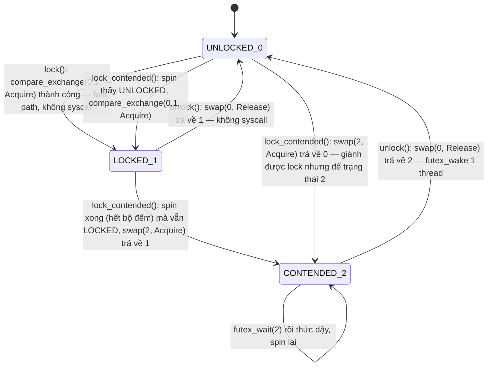

# P4 · Chương 03 — Race condition và lock

## Bạn sẽ hiểu được gì

1. **Q1.** Vì sao `counter += 1` là một race condition, nó biên dịch ra những lệnh máy nào, và critical section, mutual exclusion, atomicity khác nhau thế nào? → mục 1
2. **Q2.** Một lock tốt được đánh giá theo ba tiêu chí nào? Vì sao tắt interrupt hay "một cờ + load/store thường" đều không đủ? → mục 2
3. **Q3.** Test-and-set, compare-and-swap, LL/SC, fetch-and-add là gì, và ticket lock dùng chúng ra sao? → mục 3
4. **Q4.** Spin, yield, ngủ trong hàng đợi, two-phase lock: mỗi cách tốn gì? → mục 4
5. **Q5.** `futex(2)` giải quyết "wakeup/waiting race" thế nào? → mục 5
6. **Q6.** `std::sync::Mutex` trên Linux dùng futex ra sao (3 trạng thái, 100 vòng spin)? → mục 6
7. **Q7.** Các lock khác nhau đo ra sao trên cùng một bộ đếm? → mục 7
8. **Q8.** Một lock to và nhiều lock nhỏ khác nhau thế nào; reader-writer lock giải quyết gì? → mục 8

## Kiến thức cần trước

- [Chương 01 — Thread](01-thread.md) và [Chương 02 — Scheduling](02-scheduling.md): thread có register riêng nhưng chung bộ nhớ, timer interrupt có thể chuyển CPU giữa hai lệnh bất kỳ.
- [Assembly x86-64 và AArch64](../02-cpu/03-assembly-x86-64-va-aarch64.md): đọc được `mov`, `add`, `ldr`, `str`.

Cả chương bám theo một service giả định tên `orders`, viết bằng Rust, chạy trên Linux, có vài handler thread cùng phục vụ request. Mỗi handler đụng vào hai thứ dùng chung: biến đếm `served` (số request đã phục vụ) và một cache đơn hàng. Hai thứ đó là lý do ta cần lock.

## 1. Race condition: `counter += 1` không phải một bước (Q1)

> **Trả lời ngắn.** `counter += 1` nhìn như một bước nhưng máy làm ba bước: nạp giá trị từ bộ nhớ, cộng 1, ghi lại[^ostep-ctr-seq]. Nếu thread khác chen vào giữa chừng, một lần cộng bị mất[^ostep-lost-update]. Vì thế kết quả cuối không đoán trước được[^ostep-indeterminate]. Ba thuật ngữ cần phân biệt khi nói về lỗi này (critical section, mutual exclusion, atomicity) được giải nghĩa ngay dưới đây.

**Giải thích.**

*Với service `orders`.* Mỗi handler thread, sau khi trả lời xong một request, chạy `served += 1` trên biến đếm chung. Một con số metrics lệch vài đơn vị thì chưa chết ai, nhưng cùng một lỗi trên số dư hay tồn kho thì đã là bug thật. Câu hỏi của mục này: khi hai handler cùng chạy `served += 1`, chuyện gì xảy ra?

### 1.1 Một phép cộng, ba lệnh

Ở mã máy x86, "cộng 1 vào biến trong bộ nhớ" có thể là ba lệnh: nạp giá trị vào register, cộng 1 vào register, ghi register ngược lại bộ nhớ[^ostep-ctr-seq]. Giữa ba lệnh này, timer interrupt (chương 02) có thể chuyển CPU sang thread khác. Ta thử xem một lịch chạy xấu, khi `served` đang là 50:


(Biểu đồ là minh họa của người soạn; sách OSTEP mô tả đúng kịch bản này với giá trị khởi đầu 50[^ostep-lost-update].) Hai handler đều tăng `served`, vậy mà biến chỉ lên 51. Handler 1 ghi đè kết quả của handler 2 bằng một giá trị tính từ số liệu đã cũ.

Lỗi mà kết quả phụ thuộc vào thời điểm từng thread chạy như vậy gọi là *race condition*, hay cụ thể hơn là data race[^ostep-race]. Chạy lại lần sau, `served` có thể ra số khác: kết quả kiểu này gọi là *indeterminate*, tức không biết trước và có thể khác nhau giữa các lần chạy[^ostep-indeterminate].

### 1.2 Ba khái niệm cần phân biệt

- **Critical section**: đoạn code đụng vào biến hoặc tài nguyên chung và không được để nhiều hơn một thread chạy cùng lúc[^ostep-cs]. Trong `orders`, dòng `served += 1` là một critical section.
- **Mutual exclusion**: tính chất bảo đảm rằng khi một thread đang ở trong critical section thì các thread khác bị chặn, không vào được[^ostep-mutex].
- **Atomicity**: "atomically" nghĩa là "như một đơn vị", đôi khi hiểu là "tất cả hoặc không gì cả"[^ostep-atomic-def]. Thứ ta muốn là cả chuỗi load, cộng, store chạy như một đơn vị, không ai chen vào giữa.

Muốn có atomicity thì ta không thể đòi phần cứng làm sẵn từng thao tác phức tạp mà ta cần. Hướng thực tế hơn: xin phần cứng vài lệnh đơn giản nhưng hữu ích, rồi dựng các *synchronization primitive* (lock và họ hàng của nó) từ những lệnh ấy[^ostep-sync-prims]. Các mục 2 và 3 đi theo hướng này.

<details><summary>Đi sâu: assembly thật và race condition so với data race</summary>

**Nhìn vào assembly thật.**

Ba hàm Rust dưới đây tăng một `AtomicU64` theo ba cách. Tôi biên dịch với `rustc -C opt-level=3 --emit asm` (rustc 1.95.0) cho x86-64 và AArch64; đây là kết quả quan sát trên máy người soạn, không phải bảo đảm của ngôn ngữ:

```rust
use std::sync::atomic::{AtomicU64, Ordering::*};
pub fn racy(c: &AtomicU64)       { let v = c.load(Relaxed); c.store(v + 1, Relaxed); }
pub fn atomic_add(c: &AtomicU64) { c.fetch_add(1, Relaxed); }
pub fn cas_loop(c: &AtomicU64)   { let mut cur = c.load(Relaxed);
    loop { match c.compare_exchange_weak(cur, cur + 1, Relaxed, Relaxed) { Ok(_) => break, Err(v) => cur = v } } }
```

| Hàm | x86-64 (`x86_64-unknown-linux-gnu`) | AArch64 (`aarch64-apple-darwin`) |
|---|---|---|
| `racy` (load rồi store) | `incq (%rdi)` — một lệnh, **không** có tiền tố `lock` | `ldr` → `add` → `str` |
| `atomic_add` (`fetch_add`) | `lock incq (%rdi)` | `ldadd x8, x8, [x0]` |
| `cas_loop` | `lock cmpxchgq %rcx, (%rdi)` + `jne` quay lại | `cas x8, x10, [x0]` + `b.ne` quay lại |

Hai điều rút ra:

1. Trên AArch64, `racy` đúng là ba bước rời như mô tả ở mục 1. Trên x86-64, trình biên dịch gộp thành *một* lệnh `inc` trên bộ nhớ, nhưng một lệnh chưa chắc đã atomic giữa các core: sách *Rust Atomics and Locks* nói rõ phiên bản x86-64 của phép cộng non-atomic vẫn không atomic[^atomics-x86-notatomic]. Mục 7 đo `racy` trên máy lab aarch64 (không phải x86-64), nên ta chỉ quan sát được mất cập nhật ở AArch64; với x86-64 ta chỉ có lập luận của sách.
2. Phần cứng có lệnh atomic thật. Trên x86, tiền tố `lock` biến các lệnh như `add`, `sub`, `and`, `or`, `xor` thành atomic[^atomics-lockprefix]. Trên ARMv8.1, `ldadd` tương đương `fetch_add` còn `cas` tương đương `compare_exchange`[^atomics-ldadd].

Bảng là cho `aarch64-apple-darwin`; trong container Linux aarch64 (target mặc định) `fetch_add` thành `bl __aarch64_ldadd8_relax`, tức gọi hàm helper (quan sát của người review).

**Race condition không đồng nghĩa data race.**

*Data race* là khái niệm hẹp của memory model. Docs `std::sync::atomic` định nghĩa nó là các truy cập xung đột, không đồng bộ, trong đó ít nhất một truy cập là non-atomic, và nói data race là undefined behavior[^std-datarace]. Nomicon phát biểu bằng ba điều kiện: hai thread trở lên truy cập đồng thời cùng một vị trí nhớ, ít nhất một là ghi, ít nhất một không đồng bộ[^nomicon-race-def]. Hai cách phát biểu khác chữ nhau và người soạn không khẳng định chúng trùng. Cả khóa dùng định nghĩa của `std`; phần so sánh nằm ở [chương 06, mục 3](06-memory-model.md).

*Race condition* là bug logic về thứ tự thời gian, rộng hơn data race: Nomicon nói Rust không ngăn được race condition nói chung[^nomicon-race-cond]. Ví dụ ngay trong bảng trên: `racy` chỉ dùng atomic nên không có data race, nhưng vẫn mất cập nhật vì `load` rồi `store` là hai thao tác tách rời. Thao tác đúng là một lệnh đọc-sửa-ghi atomic như `fetch_add`[^atomics-fetch].

</details>

**Quay lại Q1:** `served += 1` là chuỗi nhiều bước nên hai handler có thể giẫm lên nhau; muốn đúng thì cần mutual exclusion hoặc một thao tác atomic thật sự.

## 2. Lock: giao diện, ba tiêu chí và hai lối tắt thất bại (Q2)

> **Trả lời ngắn.** Lock là một biến có hai trạng thái, rảnh hoặc đang bị giữ[^ostep-lock-states]. Thread gọi `lock()` khi lock đang bị giữ sẽ chờ tới khi lock được nhả[^ostep-lock-block]. Một lock tốt phải đúng, công bằng và nhanh; ba tiêu chí này được nêu chi tiết bên dưới. Tự dựng lock bằng một cờ với load/store thường thì hỏng vì "kiểm tra rồi đặt" lại là hai bước[^ostep-flag-fail], còn tắt interrupt thì không chạy được trên máy nhiều CPU[^ostep-intr-mp].

**Giải thích.**

*Với service `orders`.* Để `served += 1` không bị chen, ta cần đúng một handler thread ở trong dòng đó tại một thời điểm, tức là cần mutual exclusion. Công cụ làm việc này là lock. Mục này nói lock hứa gì, đo nó bằng thước nào, và vì sao hai cách tự chế dễ nghĩ nhất đều hỏng.

### 2.1 Giao diện của lock

Một lock chỉ là một biến giữ trạng thái: *available* (còn gọi unlocked hay free, không thread nào giữ) hoặc *acquired* (locked hay held, đúng một thread đang giữ và có lẽ đang ở trong critical section)[^ostep-lock-states]. Handler gọi `lock(&mutex)` trước `served += 1` và `unlock(&mutex)` ngay sau đó. Nếu lúc ấy một handler khác đang giữ lock, lời gọi `lock()` không trả về cho đến khi lock được nhả, nhờ vậy handler kia không vào critical section được[^ostep-lock-block].

### 2.2 Ba tiêu chí

Có nhiều cách dựng lock, nên cần thước đo để so sánh. Sách OSTEP dùng ba:

1. **Đúng**: lock có làm được việc cơ bản của nó là mutual exclusion không[^ostep-lock-criteria].
2. **Fairness**: khi lock rảnh, mỗi thread đang tranh có cơ hội công bằng để giành nó không, hay có thread bị đói (starve)[^ostep-lock-fairness].
3. **Performance**: chi phí thời gian mà lock thêm vào[^ostep-lock-perf]. Cần xét riêng ba tình huống: một thread không có tranh chấp, nhiều thread tranh chấp trên một CPU, và nhiều thread tranh chấp trên nhiều CPU[^ostep-lock-perf-cases].

### 2.3 Lối tắt thứ nhất: một cờ và load/store thường

Cách dễ nghĩ nhất là dùng một biến `flag`: `lock()` quay `while (flag == 1)` rồi đặt `flag = 1`, còn `unlock()` đặt `flag = 0`. Lock này hỏng đúng ở chỗ ta vừa học ở mục 1. Giả sử handler 1 thấy `flag == 0`, và trước khi kịp ghi `flag = 1` thì có interrupt chen vào. Handler 2 chạy, cũng thấy `flag == 0`, đặt cờ rồi vào critical section. Khi handler 1 chạy lại, nó cũng đặt cờ và vào, và thế là cả hai cùng ở trong critical section[^ostep-flag-fail]. Nói cách khác, race condition của `served` chỉ chuyển sang biến `flag`: "kiểm tra rồi đặt" cũng là hai bước.

Lỗi thứ hai là hiệu năng: thread chờ lock phải quay vòng liên tục (spin-waiting), và việc đó phí thời gian CPU của thread đang chờ[^ostep-spinwait].

<details><summary>Đi sâu: lối tắt thứ hai, tắt interrupt</summary>

Cách này từng dùng cho máy một CPU: tắt interrupt trước critical section rồi bật lại, nên đoạn code bên trong không thể bị ngắt và chạy "như thể atomic"[^ostep-intr-works]. Ưu điểm chính của nó là đơn giản[^ostep-intr-simple]. Nhược điểm thì có ba:

- Chương trình nào cũng phải được phép tắt và bật interrupt, mà đây là thao tác đặc quyền. Tức là ta phải tin mọi chương trình: một chương trình có thể độc chiếm CPU, hoặc lặp vô hạn để hệ điều hành không bao giờ giành lại quyền điều khiển[^ostep-intr-trust].
- Không dùng được trên máy nhiều CPU: thread chạy ở CPU khác vẫn vào được critical section[^ostep-intr-mp].
- Tắt interrupt quá lâu có thể làm mất interrupt, ví dụ không biết đĩa đã đọc xong[^ostep-intr-lost].

</details>

**Quay lại Q2:** lock tốt phải đúng, công bằng và nhanh; cờ thường và tắt interrupt đều hỏng vì thiếu một thao tác atomic thật của phần cứng, và đó là chuyện của mục 3.

## 3. Các lệnh atomic phần cứng và lock xây trên chúng (Q3)

> **Trả lời ngắn.** Phần cứng cung cấp vài lệnh đọc-sửa-ghi chạy atomic, trong đó test-and-set là dễ hiểu nhất[^ostep-tas]. Spin lock dựng được từ test-and-set hoặc compare-and-swap[^ostep-spin]. Ticket lock dựng từ fetch-and-add và thêm một bảo đảm: mọi thread đều tiến triển[^ostep-ticket-progress].

**Giải thích.**

*Với service `orders`.* Ở mục 2 ta cần một thao tác "kiểm tra cờ rồi đặt cờ" mà không ai chen vào được. Tới đây phần cứng đã có sẵn lệnh làm việc đó trong một bước, và `orders` chỉ cần dựng lock của mình lên trên. Mục này đi qua hai lock: spin lock (đơn giản, nhưng không công bằng) và ticket lock (công bằng hơn).

### 3.1 Test-and-set và spin lock

Mã trong sách mô tả test-and-set như sau: nó lấy giá trị cũ tại một địa chỉ, ghi giá trị mới vào đó và trả giá trị cũ về, cả chuỗi này chạy atomic[^ostep-tas-code]. Tên gọi thay đổi theo kiến trúc: trên x86 nó là phiên bản có khóa của `xchg`[^ostep-tas-names]. Sách *Rust Atomics and Locks* nói thêm rằng `xchg` có tiền tố `lock` ngầm định, và nó tương ứng với phép `swap` atomic của Rust[^atomics-xchg].

Dùng nó làm lock thì như sau (nhận xét của người soạn): nếu giá trị cũ trả về là "đã khóa" thì handler biết lock đang bị giữ; nếu là "rảnh" thì đồng thời nó đã tự đặt thành "khóa", tức là đã giành được lock. Vì chỉ có một thao tác atomic nên chỉ một thread giành được lock[^ostep-spin]. Loại lock quay vòng cho đến khi lock rảnh như vậy gọi là **spin lock**. Trong Rust, sách *Rust Atomics and Locks* viết đúng như thế bằng `swap`[^atomics-spin-code]:

```rust
// Khái niệm: test-and-set bằng AtomicBool::swap (rút từ chương 4 của sách)
while self.locked.swap(true, Acquire) { std::hint::spin_loop(); }   // lock
self.locked.store(false, Release);                                  // unlock
```

Cặp `Acquire`/`Release` bảo đảm mỗi lần `unlock()` thiết lập quan hệ happens-before với các lần `lock()` sau nó[^atomics-spin-hb]. Thiếu quan hệ đó thì có data race, và data race là UB[^atomics-spin-race]. Memory ordering là đề tài của [chương 06](06-memory-model.md).

### 3.2 Fetch-and-add và ticket lock

Spin lock đơn giản có một điểm yếu: nó không bảo đảm fairness, một thread đang quay có thể quay mãi dưới tranh chấp[^ostep-spin-fair]. Với `orders`, một handler xui xẻo có thể không bao giờ giành được lock của cache dù các handler khác vào ra liên tục.

**Ticket lock** sửa điều này bằng *fetch-and-add*, lệnh atomic tăng một giá trị và trả về giá trị cũ[^ostep-faa]. Thay vì một biến, nó dùng cặp biến `ticket` và `turn`[^ostep-ticket-vars]. Muốn lấy lock, thread `fetch_add` vào `ticket` để lấy một "số thứ tự" `myturn`, rồi quay cho tới khi `turn == myturn`. Unlock chỉ cần tăng `turn` để thread kế tiếp (nếu có) được vào[^ostep-ticket-algo]. Vì mỗi thread giữ một số thứ tự riêng, lock bảo đảm mọi thread đều tiến triển[^ostep-ticket-progress].

<details><summary>Đi sâu: compare-and-swap và load-linked/store-conditional</summary>

**Compare-and-swap.**

Compare-and-swap (CAS; x86 gọi là compare-and-exchange) kiểm tra giá trị tại một địa chỉ có bằng `expected` không, và chỉ khi bằng mới ghi giá trị mới vào[^ostep-cas]. Sách nói CAS là lệnh mạnh hơn test-and-set[^ostep-cas-stronger], nhưng nếu chỉ dùng nó để xây spin lock đơn giản thì hành vi y hệt[^ostep-cas-same]. Trong Rust, `compare_exchange` trả về một `Result` mang giá trị cũ. Biến thể `compare_exchange_weak` có thể thất bại giả (trả `Err` dù giá trị khớp) nhưng trên một số nền tảng chạy hiệu quả hơn[^atomics-weak]. Trên x86-64 hai biến thể biên dịch ra cùng một `lock cmpxchg`[^atomics-weak-x86], khớp với bảng ở mục 1. Mẫu "đọc, tính giá trị mới, CAS, thất bại thì thử lại" là nền của lock-free ([chương 07](07-lock-free.md)).

**Load-linked / store-conditional.**

Một số kiến trúc cung cấp cặp lệnh này thay cho CAS. *Load-linked* đọc như load thường. *Store-conditional* chỉ thành công, và chỉ khi đó mới cập nhật giá trị, nếu không có store nào khác vào địa chỉ ấy kể từ lần load-linked[^ostep-llsc]. OSTEP nêu MIPS làm ví dụ và nói Alpha, PowerPC, ARM có lệnh tương tự[^ostep-llsc-arch]. Lock dựng trên cặp lệnh này quay đến khi cờ bằng 0, rồi thử `store-conditional` đặt thành 1; nếu thread khác chen vào giữa thì store-conditional thất bại và thread phải thử lại từ đầu[^ostep-llsc-lock].

Trên ARM64 (phiên bản ARMv8 đầu tiên) cặp lệnh này là `ldxr` / `stxr`[^atomics-ldxr]. Mỗi core chỉ theo dõi được một địa chỉ, và `store-conditional` được phép thất bại giả, nên phần cứng có thể theo dõi thô mà vẫn đúng, đổi lại thêm vài vòng lặp[^atomics-llsc-weak]. Đó cũng là lý do `compare_exchange_weak` tồn tại[^atomics-weak-reason].

</details>

**Quay lại Q3:** lock xây từ lệnh atomic của phần cứng: test-and-set hoặc CAS cho spin lock, fetch-and-add cho ticket lock công bằng.

## 4. Quay, nhường CPU, hay ngủ (Q4)

> **Trả lời ngắn.** Khi lock đang bị giữ, thread đến sau có ba lựa chọn. Quay (spin) thì phí CPU, nhất là khi thread đang giữ lock bị preempt[^ostep-spin-preempt]. Nhường CPU (yield) đỡ phí hơn nhưng tốn context switch và không chống được đói[^ostep-yield-starve]. Ngủ trong hàng đợi (park/unpark) cho phép chọn thread nhận lock tiếp theo[^ostep-queue-why]; còn two-phase lock quay một lúc rồi mới ngủ[^ostep-twophase].

**Giải thích.**

*Với service `orders`.* Giả sử cache của `orders` đang do handler A giữ lock, và 99 handler khác cùng cần nó (con số 100 thread lấy từ ví dụ của sách). Hàng trăm handler đó phải làm gì trong lúc chờ? Mục này đi qua ba câu trả lời, mỗi câu sửa một nhược điểm của câu trước.

### 4.1 Quay

Spin-waiting là đứng chờ mà vẫn chạy CPU, và việc đó phí thời gian chờ thread khác nhả lock[^ostep-spinwait]. Tệ nhất là khi handler A bị preempt ngay giữa critical section. Lúc đó scheduler có thể chạy lần lượt mọi thread còn lại, và mỗi thread quay hết cả một time slice mà không làm được gì[^ostep-spin-preempt]. Với N thread tranh lock, có N − 1 time slice bị phí như vậy[^ostep-spin-nminus1]. Trên máy một CPU, spin lock còn đòi scheduler phải preemptive mới chạy đúng[^ostep-uni-preempt].

### 4.2 Yield

Cách thứ nhất là: khi sắp phải quay, hãy nhường CPU cho thread khác[^ostep-yield]. `yield` là system call chuyển thread gọi từ trạng thái running sang ready[^ostep-yield-state]. Với hai thread trên một CPU, cách này chạy tốt. Nhưng với 100 handler, nếu A bị preempt thì 99 handler còn lại mỗi cái gọi `lock()`, thấy lock bị giữ rồi yield[^ostep-yield-99]. Như vậy tốt hơn quay, nhưng 99 lần context switch vẫn đắt. Hơn nữa yield không giải quyết chuyện đói: một thread có thể kẹt mãi trong vòng yield trong khi các thread khác liên tục vào ra critical section[^ostep-yield-starve].

### 4.3 Ngủ trong hàng đợi (park/unpark)

Gốc của vấn đề là các cách trên để quá nhiều thứ cho may rủi. Muốn công bằng thì phải chủ động kiểm soát thread nào nhận lock sau khi người giữ nhả nó[^ostep-queue-why]. Sách dùng hai lời gọi của Solaris: `park()` đưa thread gọi vào trạng thái ngủ, còn `unpark(threadID)` đánh thức đúng thread có ID đó[^ostep-park].

Lock dựng trên hai lời gọi này gồm một cờ `flag`, một hàng đợi các thread đang chờ, và một `guard`, tức một spin lock ngắn bảo vệ `flag` và hàng đợi. Khi unlock mà hàng đợi không rỗng, lock được **chuyển thẳng** cho thread kế tiếp mà không đặt `flag` về 0[^ostep-handoff]. Còn spin ở `guard` chỉ kéo dài vài lệnh trong code `lock`/`unlock`, không kéo dài suốt critical section của người dùng[^ostep-guard-short].

### 4.4 Two-phase lock

Quay có ích khi lock sắp được nhả; ngủ có ích khi phải chờ lâu. **Two-phase lock** lấy cả hai: pha một thread quay một lúc, hy vọng giành được lock; không được thì sang pha hai là ngủ[^ostep-twophase]. OSTEP nhận xét lock Linux ở dạng futex là một dạng two-phase, nhưng chỉ quay một lần, và có thể tổng quát hóa thành quay trong vòng lặp[^ostep-twophase-linux]. Mục 6 sẽ cho thấy `std::sync::Mutex` có cấu trúc tương tự: quay có giới hạn rồi `futex_wait` (suy luận của người soạn).

<details><summary>Đi sâu: wakeup/waiting race</summary>

Cách ngủ trong hàng đợi có một lỗ hổng về thời điểm. Giả sử thread bị ngắt ngay trước khi gọi `park()`, và trong khoảng đó thread đang giữ lock nhả lock rồi `unpark` nó. Khi thread chạy lại, `park()` có thể ngủ mãi, vì lời đánh thức đã đến trước khi nó ngủ. OSTEP gọi vấn đề này là "wakeup/waiting race"[^ostep-park-race]. Solaris vá bằng `setpark()`: nếu `unpark` đến trước khi `park` được gọi thật, thì `park` trả về ngay thay vì ngủ[^ostep-setpark]. Một cách khác là đưa `guard` vào kernel, để nhả lock và đưa thread vào hàng đợi trong một thao tác atomic[^ostep-guard-kernel]. Futex (mục 5) đi theo hướng so sánh giá trị ngay trong kernel.

</details>

**Quay lại Q4:** quay phí CPU, yield tốn context switch, ngủ trong hàng đợi chống được đói nhưng có wakeup/waiting race; two-phase lock lấy phần tốt của cả hai.

## 5. Futex: fast path ở user space, slow path ở kernel (Q5)

> **Trả lời ngắn.** Futex là một số nguyên nằm trong shared memory. Khi không ai tranh lock, thread đổi số đó bằng lệnh atomic và kernel không hay biết gì[^futex-uncontended]. Khi phải chờ, thread gọi `FUTEX_WAIT`: kernel đọc giá trị, so với giá trị mong đợi rồi ngủ, cả ba việc trong một thao tác atomic[^futex-wait-atomic]. Nếu giá trị đã đổi thì `FUTEX_WAIT` trả `EAGAIN` ngay, nên không mất wake-up[^futex-eagain]. `FUTEX_WAKE` đánh thức tối đa `val` thread[^futex-wake].

**Giải thích.**

*Với service `orders`.* Phần lớn thời gian cache của `orders` không có ai tranh, và lúc đó lock/unlock nên rẻ như vài lệnh atomic, không syscall. Chỉ khi một handler thực sự phải chờ thì mới đáng gọi kernel để nó ngủ, và kernel cần đánh thức đúng lúc. Futex là cơ chế Linux cho cả hai việc.

### 5.1 Vì sao cần futex

Spin mãi thì phí CPU, còn gọi syscall để ngủ và đánh thức mỗi lần lock thì chậm. Futex tránh cả hai bằng cách để phần lớn thao tác đồng bộ diễn ra ở user space và chỉ gọi syscall khi cần chặn hoặc đánh thức[^futex-userspace]. Với trường hợp không tranh chấp, mọi việc chạy hoàn toàn ở user space, và kernel chỉ phân xử khi có tranh chấp[^futex7-nonc].

Futex là khối xây rất cơ bản, hợp để xây mutex, condition variable, read-write lock, barrier, semaphore ở tầng cao hơn[^futex7-build]. Vì thế hầu hết lập trình viên không gọi futex trực tiếp mà dùng thư viện hệ thống xây trên nó[^futex7-lib]. Trên Linux, các primitive đồng bộ của pthread đều cài bằng syscall futex[^atomics-futex-linux].

### 5.2 Cơ chế

- **Fast path**: trạng thái lock là một số nguyên ("futex word") nằm trong shared memory. Khi không tranh chấp, thread đổi trạng thái chỉ bằng lệnh atomic như compare-and-exchange (ví dụ từ "chưa ai giữ" sang "đã giữ"), và kernel không biết gì về lock[^futex-uncontended].
- **`FUTEX_WAIT`** kiểm tra giá trị tại địa chỉ futex còn bằng giá trị mong đợi `val` không, và nếu còn thì ngủ chờ `FUTEX_WAKE`. Việc đọc giá trị, so sánh và bắt đầu ngủ chạy atomic[^futex-wait-atomic]. Nếu giá trị đã khác thì lời gọi thất bại ngay với `EAGAIN`. Phép so sánh này để tránh mất wake-up: nếu thread khác đã đổi giá trị rồi gọi wake trước khi ta kịp ngủ, ta nhìn thấy giá trị mới và không ngủ[^futex-eagain]. Man page gọi đó là phép so sánh-rồi-chặn atomic (atomic compare-and-block)[^futex-cab].
- **`FUTEX_WAKE`** đánh thức tối đa `val` thread đang chờ trên futex word đó[^futex-wake].

Phép so sánh-rồi-ngủ atomic chính là lời giải cho wakeup/waiting race ở mục 4. OSTEP mô tả `futex_wait(address, expected)` đúng như vậy: ngủ nếu giá trị tại địa chỉ bằng `expected`, còn nếu không bằng thì trả về ngay[^ostep-futex-wait].

<details><summary>Đi sâu: wrapper của glibc, futex ở Linux theo OSTEP và mutex tự viết</summary>

glibc không có wrapper cho `futex()`, nên muốn gọi trực tiếp thì phải dùng `syscall(2)`[^futex-nowrapper]. OSTEP nói thêm rằng futex của Linux giống giao diện của Solaris nhưng có thêm nhiều chức năng trong kernel[^ostep-futex-linux].

Với mutex tự viết ở chương 9 của *Rust Atomics and Locks*, tác giả nói rằng ở trường hợp không tranh chấp, cả `wait()` lẫn `wake_one()` đều bị bỏ qua hoàn toàn[^atomics-fastpath].

</details>

**Quay lại Q5:** futex để fast path hoàn toàn ở user space và chỉ vào kernel khi phải chờ; việc so sánh-rồi-ngủ atomic loại bỏ wakeup/waiting race.

## 6. `std::sync::Mutex` trên Linux (Rust 1.95.0) (Q6)

> **Trả lời ngắn.** Trên Linux (source Rust 1.95.0), `Mutex` là một futex word có ba trạng thái 0/1/2[^std-futex-states]. Lock không tranh chấp là một `compare_exchange`, không syscall[^std-futex-fast]. Nếu lock đang bị giữ thì thread spin tối đa 100 vòng[^std-futex-spin100] rồi gọi `futex_wait`[^std-futex-wait]. Unlock chỉ gọi wake khi trạng thái cũ là `CONTENDED`[^std-futex-unlock].

**Giải thích.**

*Với service `orders`.* Giả sử cache của `orders` nằm trong một `Mutex<HashMap<…>>`. Khi cache rảnh, handler chỉ cần một lệnh atomic để vào. Khi một handler khác đang giữ, handler đến sau thử quay một lúc, rồi mới ngủ. Lúc unlock, nó chỉ phải gọi kernel nếu thực sự có handler đang ngủ. Mục này đọc source để thấy từng bước đó nằm ở đâu.

Trên Linux, `std::sync::Mutex` dùng hiện thực trong `library/std/src/sys/sync/mutex/futex.rs`. Ba trạng thái được định nghĩa ngay đầu file: `UNLOCKED = 0`, `LOCKED = 1` (đã khóa, không ai chờ) và `CONTENDED = 2` (đã khóa, có thread khác đang chờ)[^std-futex-states]. Đây là chi tiết cài đặt trong source, không phải bảo đảm của docs, nên có thể đổi giữa các phiên bản. Trên macOS thư mục `sys/sync/mutex/` có cài đặt khác, người soạn không đọc nên không khẳng định.



### 6.1 Fast path

`lock()` thử `compare_exchange(UNLOCKED, LOCKED, Acquire, Relaxed)`, và chỉ khi nó lỗi mới gọi `lock_contended()`[^std-futex-fast]. Nghĩa là handler nào gặp lock rảnh thì vào luôn, không qua bước nào dưới đây.

### 6.2 Pha spin

Nếu lock đang bị giữ, `lock_contended` mở đầu bằng một comment nói nên spin trước để tăng tốc nếu lock được nhả nhanh[^std-futex-spin]. Cấu trúc này giống two-phase lock ở mục 4. Trong vòng spin, thread chỉ dùng `load` chứ không dùng `swap` hay `compare_exchange`, để thân thiện với cache[^std-futex-spin-load]. Bộ đếm spin khởi đầu ở 100, mỗi vòng gọi `spin_loop()` rồi giảm 1[^std-futex-spin100].

Vòng spin dừng sớm khi trạng thái không còn là `LOCKED`, tức đã `UNLOCKED` hoặc đã `CONTENDED`[^std-futex-spin-stop]. Nếu spin trả về `UNLOCKED`, thread thử `compare_exchange(UNLOCKED, LOCKED)`; giành được thì trả về mà không đánh dấu `CONTENDED`[^std-futex-spin-cas].

### 6.3 Pha ngủ

Nếu lock vẫn bị chiếm, thread đặt trạng thái thành `CONTENDED`. Nếu `swap` này thấy giá trị cũ là `UNLOCKED` thì thread đã giành được lock rồi[^std-futex-contended-swap]. Ngược lại nó gọi `futex_wait(&self.futex, CONTENDED, None)` để chờ cho futex đổi khỏi `CONTENDED`[^std-futex-wait].

### 6.4 Unlock

`unlock` làm `swap(UNLOCKED, Release)`, và chỉ khi giá trị cũ là `CONTENDED` mới gọi wake[^std-futex-unlock]. Comment trong source giải thích vì sao chỉ đánh thức một thread: thread đó khi lock lại sẽ đặt `CONTENDED`, nên các thread còn chờ cuối cùng cũng được đánh thức[^std-futex-wake-one].

<details><summary>Đi sâu: lớp syscall, happens-before, fairness và quan sát bằng strace</summary>

- **Lớp syscall**: trên Linux, `futex_wait` gọi `SYS_futex` với `FUTEX_WAIT_BITSET | FUTEX_PRIVATE_FLAG`[^std-sys-futex]. Hàm trả về ngay nếu futex không giữ giá trị mong đợi[^std-sys-futex-ret].
- **Happens-before**: `lock` dùng `Acquire`, `unlock` dùng `Release` trên cùng futex word (suy luận của người soạn từ source). *Rust Atomics and Locks* ch.3 nêu cho mutex nói chung rằng có happens-before giữa unlock và lock kế tiếp[^atomics-mutex-ex] (chi tiết ở [chương 06, mục 4 và 7](06-memory-model.md)). Ch.9 nói với mutex tự viết cùng thiết kế rằng quan hệ này được thiết lập khi `swap` acquire thấy giá trị do `swap` release lưu[^atomics-mutex-hb]. Người review không thấy docs `std::sync::Mutex` 1.95.0 nói điều này riêng cho `Mutex` của `std`.
- **Fairness**: người review không thấy docs `std::sync::Mutex` 1.95.0 hứa thứ tự cấp lock, nên đừng giả định FIFO. Suy luận của người soạn từ source: `unlock` đặt `UNLOCKED` *rồi mới* đánh thức một thread[^std-futex-unlock], nên thread đang chạy có thể `compare_exchange` thắng trước thread vừa được đánh thức. Ticket lock thì cấp theo số thứ tự (mục 3).

**Quan sát bằng strace** (chạy thật trong container Linux aarch64; người review chạy lại, cùng kết quả): thread chính giữ `Mutex` 200 ms trong khi thread con gọi `lock()`. Thread con không giành được lock trong 100 vòng spin nên ngủ bằng `futex(addr, FUTEX_WAIT_BITSET_PRIVATE, 2, NULL, …)`; đối số `2` chính là `CONTENDED`. Khi thread chính nhả lock, nó gọi `futex(addr, FUTEX_WAKE_PRIVATE, 1)` và nhận về `1` (đã đánh thức một thread). 1000 lần lock/unlock không tranh chấp trước đó không sinh lệnh futex nào, khớp với fast path.

</details>

**Quay lại Q6:** `Mutex` trên Linux là một state machine futex 0/1/2: fast path không syscall, spin tối đa 100 vòng, rồi ngủ bằng `futex_wait`.

## 7. Đo thử: các lock trên cùng một bộ đếm (Q7)

> **Trả lời ngắn.** Trong thí nghiệm nhỏ này (4 thread, mỗi thread tăng 1.000.000 lần, một máy, **quan sát**), `load` rồi `store` atomic mất cập nhật, còn `fetch_add`, `Mutex`, spin lock và ticket lock đều ra đúng 4.000.000; thời gian tăng dần theo thứ tự đó.

**Giải thích.**

*Với service `orders`.* Thí nghiệm này chính là biến `served` của `orders`, thu gọn lại: 4 thread cùng tăng một bộ đếm. Ta thử năm cách tăng và nhìn hai thứ, kết quả có đúng không và mất bao lâu.

Chương trình lab chạy với rustc 1.95.0 `-O`, trong container Linux aarch64 có 4 vCPU: 4 thread, mỗi thread tăng một bộ đếm 1.000.000 lần, kỳ vọng 4.000.000. Hai lần chạy cho kết quả sau:

| Cách tăng | Kết quả cuối (lần 1 / lần 2) | Thời gian (lần 1 / lần 2) |
|---|---|---|
| `load` rồi `store` atomic (racy) | 1.670.161 / 1.030.726 | 0,003 s / 0,002 s |
| `fetch_add` | 4.000.000 / 4.000.000 | 0,026 s / 0,025 s |
| `std::sync::Mutex` | 4.000.000 / 4.000.000 | 0,050 s / 0,046 s |
| spin lock (`swap`) | 4.000.000 / 4.000.000 | 0,143 s / 0,132 s |
| ticket lock | 4.000.000 / 4.000.000 | 0,238 s / 0,258 s |

Cách nhanh nhất là cách sai: bỏ lock thì nhanh, nhưng mất số. Bốn cách còn lại đều đúng, và giá phải trả tăng dần.

<details><summary>Đi sâu: đọc kết quả và nguyên nhân (suy luận)</summary>

Đây là **một thí nghiệm nhỏ trên một máy**, không phải benchmark. Điều chắc chắn là cột kết quả: `racy` mất khoảng 58–74% số lần tăng, và con số khác nhau giữa hai lần chạy, đúng nghĩa "indeterminate"[^ostep-indeterminate]. Cột thời gian chỉ cho thấy thứ tự `fetch_add` < `Mutex` < spin < ticket (người review chạy lại 3 lần, thứ tự giữ nguyên). Nguyên nhân là **suy luận của người soạn, chưa đo riêng**: thread giữ lock bị preempt làm các thread quay đốt CPU (mục 4), và/hoặc cache line bị chuyển qua lại giữa các core.

</details>

**Quay lại Q7:** chỉ cột kết quả là chắc chắn (racy mất cập nhật); thứ tự thời gian chỉ là quan sát trên một máy.

## 8. Cấu trúc dữ liệu có lock (Q8)

> **Trả lời ngắn.** Một lock to bọc cả cấu trúc thì đúng và đơn giản, và nếu cấu trúc không quá chậm thì thế là đủ[^ostep-biglock-done]. Nhiều lock nhỏ (fine-grained) cho nhiều thread cùng ở trong code có lock hơn[^ostep-fine], nhưng không chắc nhanh hơn: hand-over-hand thường chậm hơn một lock[^ostep-hoh-slow]. Reader-writer lock cho nhiều reader chạy đồng thời khi không có writer[^ostep-rw-idea].

**Giải thích.**

*Với service `orders`.* Cache đơn hàng của `orders` cần được nhiều handler cùng đọc và thỉnh thoảng ghi. Ta có thể bọc cả cache trong một lock, chia nó thành nhiều lock nhỏ, hoặc cho phép nhiều handler cùng đọc. Mục này nói khi nào nên chọn cách nào.

### 8.1 Một lock to: đúng, đơn giản, có thể không scale

Thêm lock vào một cấu trúc dữ liệu để thread dùng được gọi là làm nó *thread safe*[^ostep-threadsafe]. Cách đơn giản nhất là một lock duy nhất: handler lấy lock khi gọi hàm thao tác cấu trúc và nhả khi hàm trả về[^ostep-biglock]. Cách này đúng, và sách nhấn mạnh: nếu cấu trúc không quá chậm thì bạn đã xong, không cần làm gì cầu kỳ[^ostep-biglock-done].

Cách này còn có tên là *coarse-grained*: một lock lớn cho mọi critical section[^ostep-coarse]. POSIX cũng cho phép dùng nhiều lock cho nhiều phần dữ liệu. Khi mỗi phần dữ liệu có lock riêng, nhiều thread cùng ở trong code có lock hơn, và đó là *fine-grained*[^ostep-fine].

### 8.2 Bộ đếm: lock đúng nhưng không scale

Quay lại `served`. OSTEP đo một bộ đếm có lock: một thread làm 1 triệu lần cập nhật trong khoảng 0,03 giây, nhưng hai thread cùng cập nhật 1 triệu lần mỗi thread thì chậm hẳn đi, hơn 5 giây trên máy của họ[^ostep-counter-slow]. Con số là của máy trong sách nên chỉ hình dạng của nó là đáng tin: nhiều core tranh một lock thì chậm hơn một core.

Cách khắc phục là **approximate counter**: mỗi CPU một bộ đếm cục bộ (có lock riêng) cộng với một bộ đếm toàn cục[^ostep-approx]. Cập nhật thông thường chỉ động tới bộ đếm cục bộ. Khi bộ đếm cục bộ đạt ngưỡng S thì giá trị của nó được chuyển sang bộ đếm toàn cục[^ostep-approx-flush]. Chọn S là đánh đổi: S nhỏ thì chính xác nhưng chậm, S lớn thì nhanh nhưng giá trị toàn cục tụt hậu[^ostep-approx-tradeoff]. Nhận xét của người soạn: cùng ý tưởng với việc shard metrics counter theo core hoặc theo thread rồi cộng lại khi scrape.

<details><summary>Đi sâu: danh sách liên kết, hand-over-hand locking và reader-writer lock</summary>

**Danh sách liên kết: lock chỉ bao quanh critical section thật.**

Với linked list, OSTEP nêu hai bài học. Một là **đường lỗi**: gần 40% bug trong một nghiên cứu patch Linux kernel nằm ở các đường code hiếm khi chạy[^ostep-errorpaths]. Ví dụ `malloc` thất bại khi đang giữ lock mà quên `unlock`. Hai là **thu hẹp phạm vi lock**: `lock`/`unlock` chỉ bao đúng critical section còn `malloc` làm ngoài lock, và hợp nhất các điểm thoát để ít chỗ quên `unlock`[^ostep-narrow]. (Mục 9: RAII guard của `Mutex` xử lý đúng điều này.)

**Hand-over-hand locking.**

Để tăng độ đồng thời, *hand-over-hand locking* (lock coupling) đặt một lock cho mỗi node. Khi duyệt, thread lấy lock của node kế tiếp rồi mới nhả node hiện tại[^ostep-handoverhand]. Nghe hợp lý, nhưng khó nhanh hơn một lock duy nhất vì chi phí lấy và nhả lock từng node quá lớn[^ostep-hoh-slow]. Bài học của sách: thêm lock và độ phức tạp có thể làm hỏng hơn là giúp; cách duy nhất để biết là xây cả hai rồi đo[^ostep-tip-concurrency].

**Reader-writer lock (mức khái niệm).**

Nhiều thao tác chỉ đọc (lookup), một số thì ghi (insert). Miễn là không có insert nào đang chạy, ta có thể cho nhiều lookup chạy đồng thời. Loại lock hỗ trợ điều đó là *reader-writer lock*[^ostep-rw-idea]. Trong hiện thực mẫu của OSTEP, nhiều reader được vào cùng lúc, còn writer phải chờ đến khi mọi reader ra; reader cuối cùng mở đường cho writer[^ostep-rw-impl]. Điểm yếu của hiện thực đơn giản này là fairness: reader dễ làm đói writer[^ostep-rw-starve]. Vì vậy sách khuyên dùng rw-lock thận trọng: chúng thường thêm overhead nên có thể không nhanh hơn lock đơn giản[^ostep-rw-caution].

</details>

**Quay lại Q8:** bắt đầu bằng một lock to, chia nhỏ chỉ khi đo thấy cần; reader-writer lock cho nhiều reader nhưng có overhead và nguy cơ đói writer.

## 9. Liên hệ với Rust

Với `orders`, Rust gói các ý trên vào hai kiểu của `std`.

- **`Mutex<T>` bọc dữ liệu.** Nếu cache nằm trong `Mutex<HashMap<…>>` thì handler chỉ chạm được vào nó qua RAII guard mà `lock`/`try_lock` trả về, nên dữ liệu chỉ bị đụng khi mutex đang khóa[^std-mutex-guard]. `MutexGuard` cài `Deref` để trỏ tới dữ liệu bên trong và `Drop` để lock tự nhả khi guard ra khỏi scope[^book-guard]. Từ hai nguồn trên ta suy ra (suy luận của người soạn) rằng handler không thể "quên lock", cũng không thể "quên unlock trên đường lỗi" như ví dụ `malloc` ở mục 8. Dưới Linux, `Mutex` chính là state machine futex 0/1/2 ở mục 6.
- **`RwLock<T>`** cho phép bao nhiêu reader cũng được miễn là không có writer đang giữ lock[^std-rwlock]. Docs không bảo đảm chính sách ưu tiên, vì nó phụ thuộc OS, và một writer đang chờ có thể chặn hoặc không chặn các lời gọi `read` mới[^std-rwlock-policy]. Docs còn đưa ví dụ có thể deadlock khi cùng một thread gọi `read` hai lần trong lúc có writer chờ[^std-rwlock-deadlock]. Về kiểu, `T` phải là `Send` để chia sẻ qua thread và `Sync` để nhiều reader truy cập đồng thời[^std-rwlock-bounds]. Đây là cùng chủ đề fairness và starvation của mục 8 (nhận xét của người soạn): docs không cam kết một chính sách cố định.
- **Poisoning, `Condvar`, `Send`/`Sync`**: `Condvar` ở [chương 04](04-condition-variable-va-semaphore.md); poisoning, `Send`/`Sync` và `Mutex`/`RwLock` chi tiết ở [chương 08](08-rust-concurrency.md) (mục 6 cho poisoning).

## Tóm tắt

- `counter += 1` là chuỗi nhiều bước (load, add, store); thread khác hoặc interrupt chen vào giữa gây race condition với kết quả "indeterminate".
- Tắt interrupt không chạy trên đa xử lý và đòi quá nhiều tin cậy; cờ + load/store thường lặp lại đúng race của counter. Cần lệnh atomic phần cứng.
- Spin lock xây trên TAS/CAS; ticket lock xây trên fetch-and-add để có fairness.
- Quay phí CPU, yield tốn context switch và không chống đói, hàng đợi + park/unpark chống đói nhưng có race wakeup/waiting; two-phase lock quay một lúc rồi ngủ.
- futex = số nguyên trong user space + `FUTEX_WAIT` (so sánh rồi ngủ atomic, `EAGAIN` nếu giá trị đã đổi) + `FUTEX_WAKE`; không tranh chấp thì không có syscall.
- `std::sync::Mutex` trên Linux (1.95.0): trạng thái 0/1/2, fast path `compare_exchange`, tối đa 100 vòng spin chỉ bằng `load`, rồi `futex_wait`; unlock chỉ gọi wake khi trạng thái cũ là 2.
- Một lock to thì đúng và đơn giản; lock mịn hơn có thể nhanh hơn nhưng không chắc (hand-over-hand thường chậm hơn); đo trước khi tối ưu. Reader-writer lock cho nhiều reader nhưng có overhead và nguy cơ đói writer.

## Câu hỏi tự kiểm tra

1. Vì sao hai thread cùng `counter += 1` có thể cho kết quả nhỏ hơn kỳ vọng? Vẽ interleaving với counter bắt đầu 50.
<details><summary>Đáp án</summary>

Thread 1 load 50 vào register rồi bị ngắt. Thread 2 load 50 và store 51. Thread 1 chạy lại và store 51 từ register cũ[^ostep-ctr-seq]. Kết quả: hai lần tăng chỉ ra 51[^ostep-lost-update].

</details>

2. Ba tiêu chí đánh giá lock là gì?
<details><summary>Đáp án</summary>

Mutual exclusion (đúng)[^ostep-lock-criteria], fairness (chống đói)[^ostep-lock-fairness] và performance (chi phí thời gian)[^ostep-lock-perf].

</details>

3. Vì sao lock chỉ dùng một biến cờ và load/store thường thất bại?
<details><summary>Đáp án</summary>

"Kiểm tra cờ" và "đặt cờ" là hai bước. Một interrupt chen vào giữa khiến cả hai thread đều đặt cờ và vào critical section[^ostep-flag-fail].

</details>

4. Test-and-set và compare-and-swap làm gì? Chúng khác `load` rồi `store` ở đâu?
<details><summary>Đáp án</summary>

TAS atomically trả giá trị cũ và ghi giá trị mới[^ostep-tas-code]. CAS chỉ ghi giá trị mới khi giá trị hiện tại bằng `expected`[^ostep-cas]. Cả đọc và ghi diễn ra như một thao tác atomic, không có khoảng hở.

</details>

5. "Wakeup/waiting race" là gì và futex ngăn nó thế nào?
<details><summary>Đáp án</summary>

Thread bị ngắt giữa lúc quyết định ngủ và lúc ngủ thật; thread khác nhả lock và đánh thức trước, nên thread kia ngủ mãi[^ostep-park-race]. `FUTEX_WAIT` so sánh giá trị rồi ngủ atomic, và thất bại với `EAGAIN` nếu giá trị đã đổi[^futex-eagain]. Man page gọi đó là atomic compare-and-block[^futex-cab].

</details>

6. Mô tả ba trạng thái của `std::sync::Mutex` trên Linux và khi nào có syscall.
<details><summary>Đáp án</summary>

UNLOCKED=0, LOCKED=1, CONTENDED=2[^std-futex-states]. Lock không tranh chấp là một `compare_exchange` không có syscall[^std-futex-fast]. Unlock không tranh chấp là một `swap` cũng không có syscall[^std-futex-unlock]. Syscall `futex_wait` chỉ xảy ra khi spin (tối đa 100 vòng) kết thúc mà lock vẫn chưa được nhả[^std-futex-spin100]. Lúc đó thread gọi `futex_wait`[^std-futex-wait]. Syscall `futex_wake` xảy ra khi unlock thấy trạng thái cũ là CONTENDED[^std-futex-unlock].

</details>

7. Khi nào nên chọn một lock to, khi nào chia nhỏ? Cho ví dụ cho thấy chia nhỏ không luôn nhanh hơn.
<details><summary>Đáp án</summary>

Bắt đầu bằng một lock to nếu nó đủ nhanh[^ostep-biglock-done]; chỉ chia nhỏ khi đo thấy cần. Hand-over-hand locking cho linked list khó nhanh hơn một lock vì chi phí lấy và nhả lock từng node[^ostep-hoh-slow]. Còn bộ đếm có lock thì scale kém[^ostep-counter-slow], và approximate counter giải quyết chuyện đó[^ostep-approx].

</details>

8. Vì sao vòng spin của `std::sync::Mutex` chỉ dùng `load`?
<details><summary>Đáp án</summary>

Source comment nói đây là để thân thiện với cache[^std-futex-spin-load]. Cơ chế (ghi cần quyền sở hữu cache line, load thì không) là suy luận của người soạn.

</details>

## Đọc thêm

- OSTEP ch.28 *Locks* — <https://pages.cs.wisc.edu/~remzi/OSTEP/threads-locks.pdf> — nguồn chính của chương này; đọc kỹ mã Figure 28.9–28.10 (hàng đợi và futex lock của glibc).
- futex(2) — <https://manpages.debian.org/bookworm/manpages-dev/futex.2.en.html> — các thao tác `FUTEX_WAIT`, `FUTEX_WAKE` và mã ví dụ.
- *Rust Atomics and Locks*, ch.4 và ch.9 — <https://marabos.nl/atomics/building-spinlock.html> và <https://marabos.nl/atomics/building-locks.html> — tự xây spin lock và mutex trên futex.
- Tiếp theo: [Chương 04 — Condition variable và semaphore](04-condition-variable-va-semaphore.md); nền memory model ở [Chương 06](06-memory-model.md).

[^ostep-ctr-seq]: OSTEP, ch.26 Concurrency: An Introduction — <https://pages.cs.wisc.edu/~remzi/OSTEP/threads-intro.pdf> — "In this case, we wish to simply add a number (1) to counter. Thus, the code sequence for doing so might look something like this (in x86); mov 0x8049a1c, %eax add $0x1, %eax mov %eax, 0x8049a1c"
[^ostep-lost-update]: OSTEP, ch.26 Concurrency: An Introduction — <https://pages.cs.wisc.edu/~remzi/OSTEP/threads-intro.pdf> — "the code to increment counter has been run twice, but counter, which started at 50, is now only equal to 51."
[^ostep-race]: OSTEP, ch.26 Concurrency: An Introduction — <https://pages.cs.wisc.edu/~remzi/OSTEP/threads-intro.pdf> — "What we have demonstrated here is called a race condition (or, more specifically, a data race): the results depend on the timing of the code's execution."
[^ostep-indeterminate]: OSTEP, ch.26 Concurrency: An Introduction — <https://pages.cs.wisc.edu/~remzi/OSTEP/threads-intro.pdf> — "we call this result indeterminate, where it is not known what the output will be and it is indeed likely to be different across runs."
[^ostep-cs]: OSTEP, ch.26 Concurrency: An Introduction — <https://pages.cs.wisc.edu/~remzi/OSTEP/threads-intro.pdf> — "A critical section is a piece of code that accesses a shared variable (or more generally, a shared resource) and must not be concurrently executed by more than one thread."
[^ostep-mutex]: OSTEP, ch.26 Concurrency: An Introduction — <https://pages.cs.wisc.edu/~remzi/OSTEP/threads-intro.pdf> — "This property guarantees that if one thread is executing within the critical section, the others will be prevented from doing so."
[^ostep-atomic-def]: OSTEP, ch.26 Concurrency: An Introduction — <https://pages.cs.wisc.edu/~remzi/OSTEP/threads-intro.pdf> — "Atomically, in this context, means “as a unit”, which sometimes we take as “all or none.”"
[^ostep-sync-prims]: OSTEP, ch.26 Concurrency: An Introduction — <https://pages.cs.wisc.edu/~remzi/OSTEP/threads-intro.pdf> — "what we will instead do is ask the hardware for a few useful instructions upon which we can build a general set of what we call synchronization primitives."
[^atomics-x86-notatomic]: Rust Atomics and Locks, ch.7 Understanding the Processor — <https://marabos.nl/atomics/hardware.html> — "While not directly obvious from the assembly itself, the x86-64 version is not atomic."
[^atomics-lockprefix]: Rust Atomics and Locks, ch.7 Understanding the Processor — <https://marabos.nl/atomics/hardware.html> — "To support multi-core systems, Intel introduced an instruction prefix called lock. It is used as a modifier to instructions like add to make their operation atomic."
[^atomics-ldadd]: Rust Atomics and Locks, ch.7 Understanding the Processor — <https://marabos.nl/atomics/hardware.html> — "the new ldadd (load and add) instruction is equivalent to an atomic fetch_add operation, without the need for an LL/SC loop."
[^std-datarace]: Rust std 1.95.0, module `std::sync::atomic` — <https://doc.rust-lang.org/1.95.0/std/sync/atomic/index.html> — "The most important aspect of this model is that data races are undefined behavior. A data race is defined as conflicting non-synchronized accesses where at least one of the accesses is non-atomic."
[^nomicon-race-def]: The Rustonomicon, Data Races and Race Conditions — <https://doc.rust-lang.org/1.95.0/nomicon/races.html> — "Safe Rust guarantees an absence of data races, which are defined as: two or more threads concurrently accessing a location of memory one or more of them is a write one or more of them is unsynchronized"
[^nomicon-race-cond]: The Rustonomicon, Data Races and Race Conditions — <https://doc.rust-lang.org/1.95.0/nomicon/races.html> — "However Rust does not prevent general race conditions."
[^atomics-fetch]: Rust Atomics and Locks, ch.2 Atomics — <https://marabos.nl/atomics/atomics.html> — "also load (fetch) the original value, as a single atomic operation. The most commonly used ones are fetch_add and fetch_sub"
[^ostep-lock-states]: OSTEP, ch.28 Locks — <https://pages.cs.wisc.edu/~remzi/OSTEP/threads-locks.pdf> — "It is either available (or unlocked or free) and thus no thread holds the lock, or acquired (or locked or held), and thus exactly one thread holds the lock and presumably is in a critical section."
[^ostep-lock-block]: OSTEP, ch.28 Locks — <https://pages.cs.wisc.edu/~remzi/OSTEP/threads-locks.pdf> — "it will not return while the lock is held by another thread; in this way, other threads are prevented from entering the critical section while the first thread that holds the lock is in there."
[^ostep-lock-criteria]: OSTEP, ch.28 Locks — <https://pages.cs.wisc.edu/~remzi/OSTEP/threads-locks.pdf> — "The first is whether the lock does its basic task, which is to provide mutual exclusion."
[^ostep-lock-fairness]: OSTEP, ch.28 Locks — <https://pages.cs.wisc.edu/~remzi/OSTEP/threads-locks.pdf> — "The second is fairness. Does each thread contending for the lock get a fair shot at acquiring it once it is free?"
[^ostep-lock-perf]: OSTEP, ch.28 Locks — <https://pages.cs.wisc.edu/~remzi/OSTEP/threads-locks.pdf> — "The final criterion is performance, specifically the time overheads added by using the lock."
[^ostep-lock-perf-cases]: OSTEP, ch.28 Locks — <https://pages.cs.wisc.edu/~remzi/OSTEP/threads-locks.pdf> — "Another is the case where multiple threads are contending for the lock on a single CPU; in this case, are there performance concerns?"
[^ostep-intr-works]: OSTEP, ch.28 Locks — <https://pages.cs.wisc.edu/~remzi/OSTEP/threads-locks.pdf> — "we ensure that the code inside the critical section will not be interrupted, and thus will execute as if it were atomic."
[^ostep-intr-trust]: OSTEP, ch.28 Locks — <https://pages.cs.wisc.edu/~remzi/OSTEP/threads-locks.pdf> — "an errant or malicious program could call lock() and go into an endless loop. In this latter case, the OS never regains control of the system, and there is only one recourse: restart the system."
[^ostep-intr-mp]: OSTEP, ch.28 Locks — <https://pages.cs.wisc.edu/~remzi/OSTEP/threads-locks.pdf> — "Second, the approach does not work on multiprocessors."
[^ostep-intr-lost]: OSTEP, ch.28 Locks — <https://pages.cs.wisc.edu/~remzi/OSTEP/threads-locks.pdf> — "turning off interrupts for extended periods of time can lead to interrupts becoming lost, which can lead to serious systems problems."
[^ostep-flag-fail]: OSTEP, ch.28 Locks — <https://pages.cs.wisc.edu/~remzi/OSTEP/threads-locks.pdf> — "and both threads are thus able to enter the critical section."
[^ostep-spinwait]: OSTEP, ch.28 Locks — <https://pages.cs.wisc.edu/~remzi/OSTEP/threads-locks.pdf> — "Spin-waiting wastes time waiting for another thread to release a lock."
[^ostep-tas]: OSTEP, ch.28 Locks — <https://pages.cs.wisc.edu/~remzi/OSTEP/threads-locks.pdf> — "The simplest bit of hardware support to understand is known as a test-and-set"
[^ostep-tas-code]: OSTEP, ch.28 Locks — <https://pages.cs.wisc.edu/~remzi/OSTEP/threads-locks.pdf> — "int old = *old_ptr; // fetch old value at old_ptr"
[^ostep-tas-names]: OSTEP, ch.28 Locks — <https://pages.cs.wisc.edu/~remzi/OSTEP/threads-locks.pdf> — "on x86 it is the locked version of the atomic exchange (xchg)."
[^atomics-xchg]: Rust Atomics and Locks, ch.7 Understanding the Processor — <https://marabos.nl/atomics/hardware.html> — "has an implicit lock prefix: it behaves like lock xchg regardless of the lock prefix."
[^ostep-spin]: OSTEP, ch.28 Locks — <https://pages.cs.wisc.edu/~remzi/OSTEP/threads-locks.pdf> — "a single atomic operation, we ensure that only one thread acquires the lock. And that's how to build a working mutual exclusion primitive! You may also now understand why this type of lock is usually referred to as a spin lock."
[^atomics-spin-code]: Rust Atomics and Locks, ch.4 Building Our Own Spin Lock — <https://marabos.nl/atomics/building-spinlock.html> — "while self.locked.swap(true, Acquire) { std::hint::spin_loop(); }"
[^atomics-spin-hb]: Rust Atomics and Locks, ch.4 Building Our Own Spin Lock — <https://marabos.nl/atomics/building-spinlock.html> — "We use acquire and release memory ordering to make sure that every unlock() call establishes a happens-before relationship with the lock() calls that follow."
[^atomics-spin-race]: Rust Atomics and Locks, ch.4 Building Our Own Spin Lock — <https://marabos.nl/atomics/building-spinlock.html> — "A happens-before relationship between unlock and lock operations is necessary to prevent a data race, which would result in undefined behavior."
[^ostep-cas]: OSTEP, ch.28 Locks — <https://pages.cs.wisc.edu/~remzi/OSTEP/threads-locks.pdf> — "The basic idea is for compare-and-swap to test whether the value at the address specified by ptr is equal to expected; if so, update the memory location pointed to by ptr with the new value."
[^ostep-cas-stronger]: OSTEP, ch.28 Locks — <https://pages.cs.wisc.edu/~remzi/OSTEP/threads-locks.pdf> — "compare-and-swap is a more powerful instruction than test-and-set."
[^ostep-cas-same]: OSTEP, ch.28 Locks — <https://pages.cs.wisc.edu/~remzi/OSTEP/threads-locks.pdf> — "its behavior is identical to the spin lock we analyzed above."
[^atomics-weak]: Rust Atomics and Locks, ch.2 Atomics — <https://marabos.nl/atomics/atomics.html> — "The difference is that the weak version may still sometimes leave the value untouched and return an Err, even though the atomic value matched the expected value."
[^atomics-weak-x86]: Rust Atomics and Locks, ch.7 Understanding the Processor — <https://marabos.nl/atomics/hardware.html> — "On x86-64, there is no difference between compare_exchange and compare_exchange_weak. Both compile down to a lock cmpxchg instruction."
[^ostep-llsc]: OSTEP, ch.28 Locks — <https://pages.cs.wisc.edu/~remzi/OSTEP/threads-locks.pdf> — "(and updates the value stored at the address just load-linked from) if no intervening store to the address has taken place."
[^ostep-llsc-arch]: OSTEP, ch.28 Locks — <https://pages.cs.wisc.edu/~remzi/OSTEP/threads-locks.pdf> — "Alpha, PowerPC, and ARM provide similar instructions"
[^ostep-llsc-lock]: OSTEP, ch.28 Locks — <https://pages.cs.wisc.edu/~remzi/OSTEP/threads-locks.pdf> — "and thus have to try to acquire the lock again."
[^atomics-ldxr]: Rust Atomics and Locks, ch.7 Understanding the Processor — <https://marabos.nl/atomics/hardware.html> — "ARM64’s load-linked and store-conditional instructions are called ldxr (load exclusive register) and stxr (store exclusive register)."
[^atomics-llsc-weak]: Rust Atomics and Locks, ch.7 Understanding the Processor — <https://marabos.nl/atomics/hardware.html> — "(1) only one memory address (per core) can be tracked at a time, and (2) the store-conditional is allowed to have false negatives, meaning that it may fail to store even though nothing has changed that particular piece of memory."
[^ostep-faa]: OSTEP, ch.28 Locks — <https://pages.cs.wisc.edu/~remzi/OSTEP/threads-locks.pdf> — "which atomically increments a value while returning the old value at a particular address."
[^ostep-spin-fair]: OSTEP, ch.28 Locks — <https://pages.cs.wisc.edu/~remzi/OSTEP/threads-locks.pdf> — "spin locks don’t provide any fairness guarantees. Indeed, a thread spinning may spin forever, under contention."
[^ostep-ticket-vars]: OSTEP, ch.28 Locks — <https://pages.cs.wisc.edu/~remzi/OSTEP/threads-locks.pdf> — "Instead of a single value, this solution uses a ticket and turn variable in combination to build a lock."
[^ostep-ticket-algo]: OSTEP, ch.28 Locks — <https://pages.cs.wisc.edu/~remzi/OSTEP/threads-locks.pdf> — "Unlock is accomplished simply by incrementing the turn such that the next waiting thread (if there is one) can now enter the critical section."
[^ostep-ticket-progress]: OSTEP, ch.28 Locks — <https://pages.cs.wisc.edu/~remzi/OSTEP/threads-locks.pdf> — "it ensures progress for all threads."
[^ostep-spin-preempt]: OSTEP, ch.28 Locks — <https://pages.cs.wisc.edu/~remzi/OSTEP/threads-locks.pdf> — "imagine the case where the thread holding the lock is preempted within a critical section. The scheduler might then run every other thread (imagine there are N − 1 others), each of which tries to acquire the lock."
[^ostep-spin-nminus1]: OSTEP, ch.28 Locks — <https://pages.cs.wisc.edu/~remzi/OSTEP/threads-locks.pdf> — "The problem gets worse with N threads contending for a lock; N − 1 time slices may be wasted in a similar manner"
[^ostep-uni-preempt]: OSTEP, ch.28 Locks — <https://pages.cs.wisc.edu/~remzi/OSTEP/threads-locks.pdf> — "To work correctly on a single processor, it requires a preemptive scheduler"
[^ostep-yield]: OSTEP, ch.28 Locks — <https://pages.cs.wisc.edu/~remzi/OSTEP/threads-locks.pdf> — "when you are going to spin, instead give up the CPU to another thread."
[^ostep-yield-state]: OSTEP, ch.28 Locks — <https://pages.cs.wisc.edu/~remzi/OSTEP/threads-locks.pdf> — "yield is simply a system call that moves the caller from the running state to the ready state"
[^ostep-yield-99]: OSTEP, ch.28 Locks — <https://pages.cs.wisc.edu/~remzi/OSTEP/threads-locks.pdf> — "the other 99 will each call lock(), find the lock held, and yield the CPU."
[^ostep-yield-starve]: OSTEP, ch.28 Locks — <https://pages.cs.wisc.edu/~remzi/OSTEP/threads-locks.pdf> — "this approach does not address starvation. A thread may get caught in an endless yield loop while other threads repeatedly enter and exit the critical section."
[^ostep-queue-why]: OSTEP, ch.28 Locks — <https://pages.cs.wisc.edu/~remzi/OSTEP/threads-locks.pdf> — "we must explicitly exert some control over which thread next gets to acquire the lock after the current holder releases it."
[^ostep-park]: OSTEP, ch.28 Locks — <https://pages.cs.wisc.edu/~remzi/OSTEP/threads-locks.pdf> — "park() to put a calling thread to sleep, and unpark(threadID) to wake a particular thread as designated by threadID."
[^ostep-handoff]: OSTEP, ch.28 Locks — <https://pages.cs.wisc.edu/~remzi/OSTEP/threads-locks.pdf> — "we just pass the lock directly from the thread releasing the lock to the next thread acquiring it"
[^ostep-guard-short]: OSTEP, ch.28 Locks — <https://pages.cs.wisc.edu/~remzi/OSTEP/threads-locks.pdf> — "the time spent spinning is quite limited (just a few instructions inside the lock and unlock code"
[^ostep-park-race]: OSTEP, ch.28 Locks — <https://pages.cs.wisc.edu/~remzi/OSTEP/threads-locks.pdf> — "a problem sometimes called the wakeup/waiting race"
[^ostep-setpark]: OSTEP, ch.28 Locks — <https://pages.cs.wisc.edu/~remzi/OSTEP/threads-locks.pdf> — "If it then happens to be interrupted and another thread calls unpark before park is actually called, the subsequent park returns immediately instead of sleeping."
[^ostep-guard-kernel]: OSTEP, ch.28 Locks — <https://pages.cs.wisc.edu/~remzi/OSTEP/threads-locks.pdf> — "A different solution could pass the guard into the kernel."
[^ostep-twophase]: OSTEP, ch.28 Locks — <https://pages.cs.wisc.edu/~remzi/OSTEP/threads-locks.pdf> — "A two-phase lock realizes that spinning can be useful, particularly if the lock is about to be released. So in the first phase, the lock spins for a while, hoping that it can acquire the lock."
[^ostep-twophase-linux]: OSTEP, ch.28 Locks — <https://pages.cs.wisc.edu/~remzi/OSTEP/threads-locks.pdf> — "The Linux lock above is a form of such a lock, but it only spins once"
[^futex7-build]: futex(7), Linux man-pages (Debian bookworm) — <https://manpages.debian.org/bookworm/manpages/futex.7.en.html> — "Futexes are very basic and lend themselves well for building higher-level locking abstractions such as mutexes, condition variables, read-write locks, barriers, and semaphores."
[^futex7-lib]: futex(7), Linux man-pages (Debian bookworm) — <https://manpages.debian.org/bookworm/manpages/futex.7.en.html> — "Most programmers will in fact not be using futexes directly but will instead rely on system libraries built on them"
[^futex-nowrapper]: futex(2), Linux man-pages (Debian bookworm) — <https://manpages.debian.org/bookworm/manpages-dev/futex.2.en.html> — "Note: glibc provides no wrapper for futex(), necessitating the use of syscall(2)."
[^atomics-futex-linux]: Rust Atomics and Locks, ch.8 Operating System Primitives — <https://marabos.nl/atomics/os-primitives.html> — "On Linux systems, the pthread synchronization primitives are all implemented using the futex syscall."
[^ostep-futex-linux]: OSTEP, ch.28 Locks — <https://pages.cs.wisc.edu/~remzi/OSTEP/threads-locks.pdf> — "Linux provides a futex which is similar to the Solaris interface but provides more in-kernel functionality."
[^futex-userspace]: futex(2), Linux man-pages (Debian bookworm) — <https://manpages.debian.org/bookworm/manpages-dev/futex.2.en.html> — "When using futexes, the majority of the synchronization operations are performed in user space."
[^futex7-nonc]: futex(7), Linux man-pages (Debian bookworm) — <https://manpages.debian.org/bookworm/manpages/futex.7.en.html> — "Futex operation occurs entirely in user space for the noncontended case. The kernel is involved only to arbitrate the contended case."
[^futex-uncontended]: futex(2), Linux man-pages (Debian bookworm) — <https://manpages.debian.org/bookworm/manpages-dev/futex.2.en.html> — "In the uncontended case, a thread can access or modify the lock state with atomic instructions, for example atomically changing it from not acquired to acquired using an atomic compare-and-exchange instruction."
[^futex-wait-atomic]: futex(2), Linux man-pages (Debian bookworm) — <https://manpages.debian.org/bookworm/manpages-dev/futex.2.en.html> — "This load, the comparison with the expected value, and starting to sleep are performed atomically and totally ordered with respect to other futex operations on the same futex word."
[^futex-eagain]: futex(2), Linux man-pages (Debian bookworm) — <https://manpages.debian.org/bookworm/manpages-dev/futex.2.en.html> — "If the futex value does not match val, then the call fails immediately with the error EAGAIN. The purpose of the comparison with the expected value is to prevent lost wake-ups."
[^futex-cab]: futex(2), Linux man-pages (Debian bookworm) — <https://manpages.debian.org/bookworm/manpages-dev/futex.2.en.html> — "blocking via a futex is an atomic compare-and-block operation."
[^ostep-futex-wait]: OSTEP, ch.28 Locks — <https://pages.cs.wisc.edu/~remzi/OSTEP/threads-locks.pdf> — "puts the calling thread to sleep, assuming the value at the address address is equal to expected. If it is not equal, the call returns immediately."
[^futex-wake]: futex(2), Linux man-pages (Debian bookworm) — <https://manpages.debian.org/bookworm/manpages-dev/futex.2.en.html> — "This operation wakes at most val of the waiters that are waiting (e.g., inside FUTEX_WAIT) on the futex word at the address uaddr."
[^atomics-fastpath]: Rust Atomics and Locks, ch.9 Building Our Own Locks — <https://marabos.nl/atomics/building-locks.html> — "in the uncontended case, the ideal situation where threads are not attempting to acquire the lock simultaneously, both the wait() and wake_one() calls are entirely avoided."
[^std-futex-states]: rust-lang/rust tag 1.95.0, library/std/src/sys/sync/mutex/futex.rs — <https://raw.githubusercontent.com/rust-lang/rust/1.95.0/library/std/src/sys/sync/mutex/futex.rs> — "const CONTENDED: State = 2; // locked, and other threads waiting (contended)"
[^std-futex-fast]: rust-lang/rust tag 1.95.0, library/std/src/sys/sync/mutex/futex.rs — <https://raw.githubusercontent.com/rust-lang/rust/1.95.0/library/std/src/sys/sync/mutex/futex.rs> — "if self.futex.compare_exchange(UNLOCKED, LOCKED, Acquire, Relaxed).is_err() { self.lock_contended(); }"
[^std-futex-spin]: rust-lang/rust tag 1.95.0, library/std/src/sys/sync/mutex/futex.rs — <https://raw.githubusercontent.com/rust-lang/rust/1.95.0/library/std/src/sys/sync/mutex/futex.rs> — "// Spin first to speed things up if the lock is released quickly."
[^std-futex-spin-load]: rust-lang/rust tag 1.95.0, library/std/src/sys/sync/mutex/futex.rs — <https://raw.githubusercontent.com/rust-lang/rust/1.95.0/library/std/src/sys/sync/mutex/futex.rs> — "// We only use `load` (and not `swap` or `compare_exchange`) while spinning, to be easier on the caches."
[^std-futex-spin100]: rust-lang/rust tag 1.95.0, library/std/src/sys/sync/mutex/futex.rs — <https://raw.githubusercontent.com/rust-lang/rust/1.95.0/library/std/src/sys/sync/mutex/futex.rs> — "fn spin(&self) -> State { let mut spin = 100;"
[^std-futex-spin-stop]: rust-lang/rust tag 1.95.0, library/std/src/sys/sync/mutex/futex.rs — <https://raw.githubusercontent.com/rust-lang/rust/1.95.0/library/std/src/sys/sync/mutex/futex.rs> — "// We stop spinning when the mutex is UNLOCKED, // but also when it's CONTENDED."
[^std-futex-contended-swap]: rust-lang/rust tag 1.95.0, library/std/src/sys/sync/mutex/futex.rs — <https://raw.githubusercontent.com/rust-lang/rust/1.95.0/library/std/src/sys/sync/mutex/futex.rs> — "// We changed it from UNLOCKED to CONTENDED, so we just successfully locked it."
[^std-futex-wait]: rust-lang/rust tag 1.95.0, library/std/src/sys/sync/mutex/futex.rs — <https://raw.githubusercontent.com/rust-lang/rust/1.95.0/library/std/src/sys/sync/mutex/futex.rs> — "// Wait for the futex to change state, assuming it is still CONTENDED. futex_wait(&self.futex, CONTENDED, None);"
[^std-futex-unlock]: rust-lang/rust tag 1.95.0, library/std/src/sys/sync/mutex/futex.rs — <https://raw.githubusercontent.com/rust-lang/rust/1.95.0/library/std/src/sys/sync/mutex/futex.rs> — "if self.futex.swap(UNLOCKED, Release) == CONTENDED {"
[^std-futex-wake-one]: rust-lang/rust tag 1.95.0, library/std/src/sys/sync/mutex/futex.rs — <https://raw.githubusercontent.com/rust-lang/rust/1.95.0/library/std/src/sys/sync/mutex/futex.rs> — "// We only wake up one thread. When that thread locks the mutex, it // will mark the mutex as CONTENDED (see lock_contended above), // which makes sure that any other waiting threads will also be // woken up eventually."
[^std-sys-futex]: rust-lang/rust tag 1.95.0, library/std/src/sys/pal/unix/futex.rs — <https://raw.githubusercontent.com/rust-lang/rust/1.95.0/library/std/src/sys/pal/unix/futex.rs> — "libc::FUTEX_WAIT_BITSET | libc::FUTEX_PRIVATE_FLAG,"
[^std-sys-futex-ret]: rust-lang/rust tag 1.95.0, library/std/src/sys/pal/unix/futex.rs — <https://raw.githubusercontent.com/rust-lang/rust/1.95.0/library/std/src/sys/pal/unix/futex.rs> — "Returns directly if the futex doesn't hold the expected value."
[^ostep-threadsafe]: OSTEP, ch.29 Lock-based Concurrent Data Structures — <https://pages.cs.wisc.edu/~remzi/OSTEP/threads-locks-usage.pdf> — "Adding locks to a data structure to make it usable by threads makes the structure thread safe."
[^ostep-biglock]: OSTEP, ch.29 Lock-based Concurrent Data Structures — <https://pages.cs.wisc.edu/~remzi/OSTEP/threads-locks-usage.pdf> — "it simply adds a single lock, which is acquired when calling a routine that manipulates the data structure, and is released when returning from the call."
[^ostep-biglock-done]: OSTEP, ch.29 Lock-based Concurrent Data Structures — <https://pages.cs.wisc.edu/~remzi/OSTEP/threads-locks-usage.pdf> — "Note that if the data structure is not too slow, you are done! No need to do something fancy if something simple will work."
[^ostep-coarse]: OSTEP, ch.28 Locks — <https://pages.cs.wisc.edu/~remzi/OSTEP/threads-locks.pdf> — "instead of one big lock that is used any time any critical section is accessed (a coarse-grained locking strategy)"
[^ostep-fine]: OSTEP, ch.28 Locks — <https://pages.cs.wisc.edu/~remzi/OSTEP/threads-locks.pdf> — "thus allowing more threads to be in locked code at once"
[^ostep-counter-slow]: OSTEP, ch.29 Lock-based Concurrent Data Structures — <https://pages.cs.wisc.edu/~remzi/OSTEP/threads-locks-usage.pdf> — "having two threads each update the counter one million times concurrently leads to a massive slowdown (taking over 5 seconds!)"
[^ostep-approx]: OSTEP, ch.29 Lock-based Concurrent Data Structures — <https://pages.cs.wisc.edu/~remzi/OSTEP/threads-locks-usage.pdf> — "The approximate counter works by representing a single logical counter via numerous local physical counters, one per CPU core, as well as a single global counter."
[^ostep-approx-flush]: OSTEP, ch.29 Lock-based Concurrent Data Structures — <https://pages.cs.wisc.edu/~remzi/OSTEP/threads-locks-usage.pdf> — "the local values are periodically transferred to the global counter, by acquiring the global lock and incrementing it by the local counter’s value; the local counter is then reset to zero."
[^ostep-approx-tradeoff]: OSTEP, ch.29 Lock-based Concurrent Data Structures — <https://pages.cs.wisc.edu/~remzi/OSTEP/threads-locks-usage.pdf> — "If S is low, performance is poor (but the global count is always quite accurate); if S is high, performance is excellent, but the global count lags"
[^ostep-errorpaths]: OSTEP, ch.29 Lock-based Concurrent Data Structures — <https://pages.cs.wisc.edu/~remzi/OSTEP/threads-locks-usage.pdf> — "a recent study of Linux kernel patches found that a huge fraction of bugs (nearly 40%) are found on such rarely-taken code paths"
[^ostep-narrow]: OSTEP, ch.29 Lock-based Concurrent Data Structures — <https://pages.cs.wisc.edu/~remzi/OSTEP/threads-locks-usage.pdf> — "so that the lock and release only surround the actual critical section in the insert code, and that a common exit path is used in the lookup code."
[^ostep-handoverhand]: OSTEP, ch.29 Lock-based Concurrent Data Structures — <https://pages.cs.wisc.edu/~remzi/OSTEP/threads-locks-usage.pdf> — "When traversing the list, the code first grabs the next node’s lock and then releases the current node’s lock (which inspires the name hand-over-hand)."
[^ostep-hoh-slow]: OSTEP, ch.29 Lock-based Concurrent Data Structures — <https://pages.cs.wisc.edu/~remzi/OSTEP/threads-locks-usage.pdf> — "in practice, it is hard to make such a structure faster than the simple single lock approach, as the overheads of acquiring and releasing locks for each node of a list traversal is prohibitive."
[^ostep-tip-concurrency]: OSTEP, ch.29 Lock-based Concurrent Data Structures — <https://pages.cs.wisc.edu/~remzi/OSTEP/threads-locks-usage.pdf> — "Adding more locks and complexity can be your downfall."
[^ostep-rw-idea]: OSTEP, ch.31 Semaphores — <https://pages.cs.wisc.edu/~remzi/OSTEP/threads-sema.pdf> — "as long as we can guarantee that no insert is on-going, we can allow many lookups to proceed concurrently."
[^ostep-rw-impl]: OSTEP, ch.31 Semaphores — <https://pages.cs.wisc.edu/~remzi/OSTEP/threads-sema.pdf> — "any thread that wishes to acquire the write lock will have to wait until all readers are finished; the last one to exit the critical section calls sem_post() on “writelock” and thus enables a waiting writer to acquire the lock."
[^ostep-rw-starve]: OSTEP, ch.31 Semaphores — <https://pages.cs.wisc.edu/~remzi/OSTEP/threads-sema.pdf> — "it would be relatively easy for readers to starve writers."
[^ostep-rw-caution]: OSTEP, ch.31 Semaphores — <https://pages.cs.wisc.edu/~remzi/OSTEP/threads-sema.pdf> — "They often add more overhead (especially with more sophisticated implementations)"
[^std-mutex-guard]: Rust std 1.95.0, `std::sync::Mutex` — <https://doc.rust-lang.org/1.95.0/std/sync/struct.Mutex.html> — "The data can only be accessed through the RAII guards returned from lock and try_lock, which guarantees that the data is only ever accessed when the mutex is locked."
[^book-guard]: The Rust Programming Language, 16.3 Shared-State Concurrency — <https://doc.rust-lang.org/1.95.0/book/ch16-03-shared-state.html> — "The MutexGuard type implements Deref to point at our inner data; the type also has a Drop implementation that releases the lock automatically when a MutexGuard goes out of scope"
[^std-rwlock]: Rust std 1.95.0, `std::sync::RwLock` — <https://doc.rust-lang.org/1.95.0/std/sync/struct.RwLock.html> — "An RwLock will allow any number of readers to acquire the lock as long as a writer is not holding the lock."
[^std-rwlock-policy]: Rust std 1.95.0, `std::sync::RwLock` — <https://doc.rust-lang.org/1.95.0/std/sync/struct.RwLock.html> — "The priority policy of the lock is dependent on the underlying operating system’s implementation, and this type does not guarantee that any particular policy will be used. In particular, a writer which is waiting to acquire the lock in write might or might not block concurrent calls to read"
[^std-rwlock-deadlock]: Rust std 1.95.0, `std::sync::RwLock` — <https://doc.rust-lang.org/1.95.0/std/sync/struct.RwLock.html> — "let _rg1 = lock.read(); | | // will block | let _wg = lock.write(); // may deadlock | let _rg2 = lock.read();"
[^std-rwlock-bounds]: Rust std 1.95.0, `std::sync::RwLock` — <https://doc.rust-lang.org/1.95.0/std/sync/struct.RwLock.html> — "It is required that T satisfies Send to be shared across threads and Sync to allow concurrent access through readers."
[^atomics-weak-reason]: Rust Atomics and Locks, ch.7 Understanding the Processor — <https://marabos.nl/atomics/hardware.html> — "In fact, this is the reason why a weak version of compare_exchange exists."
[^atomics-mutex-hb]: Rust Atomics and Locks, ch.9 Building Our Own Locks — <https://marabos.nl/atomics/building-locks.html> — "the happens-before relationship is established through the acquire swap operation observing the value stored by the release swap operation."
[^atomics-mutex-ex]: Rust Atomics and Locks, ch.3 Memory Ordering — <https://marabos.nl/atomics/memory-ordering.html> — "This means that there will be a happens-before relationship between unlocking a mutex and subsequently locking it."
[^std-futex-spin-cas]: rust-lang/rust tag 1.95.0, library/std/src/sys/sync/mutex/futex.rs — <https://raw.githubusercontent.com/rust-lang/rust/1.95.0/library/std/src/sys/sync/mutex/futex.rs> — "// If it's unlocked now, attempt to take the lock // without marking it as contended."
[^ostep-intr-simple]: OSTEP, ch.28 Locks — <https://pages.cs.wisc.edu/~remzi/OSTEP/threads-locks.pdf> — "The main positive of this approach is its simplicity."
