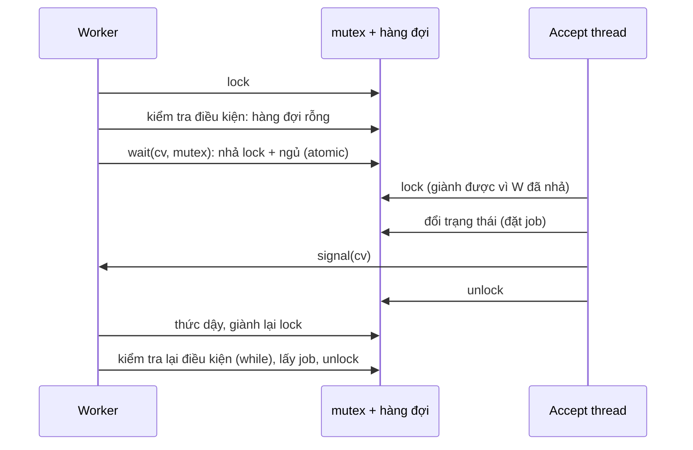

# P4 · Chương 04 — Condition variable và semaphore

## Bạn sẽ hiểu được gì

1. **Q1.** Vì sao mutex một mình không giải được bài "chờ cho đến khi điều kiện đúng", và vì sao vòng spin là lời giải tồi? → mục 1
2. **Q2.** `wait` làm chính xác những gì (nhả lock, ngủ, giành lại lock), và vì sao nó đòi hỏi bạn đang giữ lock? → mục 2
3. **Q3.** Vì sao điều kiện chờ phải nằm trong `while` chứ không phải `if` (Mesa vs Hoare, spurious wakeup)? → mục 3
4. **Q4.** Producer/consumer với bounded buffer: các bản sai kinh điển sai ở đâu, bản đúng cần những gì? → mục 4
5. **Q5.** Khi nào dùng `broadcast` / `notify_all` (covering condition)? → mục 5
6. **Q6.** Semaphore là gì, dùng làm lock, làm công cụ sắp thứ tự, throttling ra sao, và khác condvar chỗ nào? → mục 6
7. **Q7.** Semaphore giải bounded buffer, reader-writer lock và dining philosophers thế nào? → mục 7
8. **Q8.** Cài semaphore từ mutex + condvar ra sao, và vì sao chiều ngược lại khó? → mục 8

(Rust `Condvar`, vì sao `std` không có semaphore, `tokio::sync::Semaphore`: mục 9; chương trình đã chạy: mục 10.)

## Kiến thức cần trước

- [Chương 03 — Lock](./03-lock.md): mutex, spin vs block, futex (condvar của Rust trên Linux đứng trên futex).
- [Chương 01 — Thread](./01-thread.md), [Chương 02 — Scheduling](./02-scheduling.md) và [P1 Chương 03 — Process](../01-linux/03-process.md): thread/process bị chặn, được đưa lại vào hàng sẵn sàng (mô hình running/ready/blocked ở P1 Chương 03).

## 1. Vì sao mutex không đủ để chờ một điều kiện (Q1)

> **Trả lời ngắn.** Mutex chỉ cho một thread vào critical section tại một thời điểm; nó không giúp một thread *chờ* tới khi thread khác làm xong việc. Vòng `while (done == 0);` đốt CPU và có lúc còn sai[^cv-spin]. Muốn chờ mà không tốn CPU, thread phải ngủ và được đánh thức khi trạng thái đổi; đó là việc của condition variable (mục 2).

**Giải thích.**

*Với service của bạn.* Hãy hình dung `orders`, một service Rust xử lý đơn hàng. Một accept thread nhận kết nối rồi bỏ mỗi job vào một hàng đợi dùng chung; vài worker thread lấy job ra xử lý, và khi cần dữ liệu thì mượn một connection tới DB. Hàng đợi chứa tối đa 4 job. Ta bám theo `orders` suốt chương (nhận xét của người soạn: đây là ví dụ giả định, không phải code trong repo). Câu hỏi của mục này rất đời thường: worker mở hàng đợi ra mà thấy rỗng thì nó làm gì?

### 1.1 Mutex làm được gì, và chưa làm được gì

Hàng đợi của `orders` là dữ liệu dùng chung, nên nó nằm sau một mutex để hai worker không cùng sửa nó một lúc. Việc đó mutex làm tốt. Nhưng worker vừa lấy được mutex đã thấy hàng rỗng, và lúc này nó cần một thứ khác: *chờ* cho đến khi accept thread bỏ job vào. Loại trừ lẫn nhau không giúp gì cho chuyện chờ, và rộng hơn thế, nhiều chương trình đa luồng cần chờ một thread khác làm xong việc nào đó. Ví dụ đơn giản nhất là `join`: thread cha chờ thread con chạy xong.

### 1.2 Vì sao chờ bằng vòng lặp là tồi

Cách ngây thơ nhất là cho worker lặp `while queue.is_empty() {}` cho tới khi có job. Đây là phiên bản của `orders` cho bài mà OSTEP xét: cha dùng một biến chung `done` và lặp `while (done == 0);` để chờ con. OSTEP kết luận cách đó lãng phí chu kỳ CPU và trong một số trường hợp còn sai[^cv-spin].

Lý do thì dễ thấy (nhận xét của người soạn). Worker đang spin chiếm trọn một core, trong khi chính core đó có thể đang cần để chạy accept thread, tức thread duy nhất đặt job vào hàng đợi cho worker. Cách này cũng dễ sai khi không có đồng bộ đúng quanh việc đọc trạng thái chung.

Cái ta cần là cho worker đi ngủ, không tốn CPU, rồi accept thread đánh thức nó khi có job. Cơ chế đó tên là condition variable.

<details><summary>Đi sâu: hình dạng này lặp lại ở mọi nơi</summary>

Hàng đợi job của `orders` là một ca của bounded buffer. Ví dụ OSTEP đưa ra cũng quen với backend: web server nhận request, producer đặt HTTP request vào work queue, các consumer lấy ra xử lý[^ostep-pc-web]. Thread pool và connection pool có cùng hình dạng (nhận xét của người soạn). Câu hỏi chung của cả chương: làm sao để consumer **ngủ** khi queue rỗng, được **đánh thức** khi có việc, mà không mất tín hiệu và không sai khi nhiều thread cùng tranh?

</details>

**Quay lại Q1:** mutex chỉ loại trừ lẫn nhau; muốn worker của `orders` chờ job mà không đốt CPU thì nó phải ngủ và được đánh thức, và đó là việc của condition variable.

## 2. `wait`: nhả lock, ngủ, giành lại lock (Q2)

> **Trả lời ngắn.** Condition variable là một hàng đợi mà thread tự xếp vào khi điều kiện chưa đúng[^ostep-cv]. `wait` nhả mutex và đi ngủ như một bước không bị chen ngang, rồi khi được đánh thức thì giành lại mutex trước khi trả về[^ostep-cv-wait]. Vì thế bạn phải đang giữ mutex khi gọi `wait`, và kiểm tra điều kiện dưới cùng mutex đó, nếu không có thể mất wakeup và ngủ mãi[^cv-lost].

**Giải thích.**

*Với service `orders`.* Worker thấy hàng đợi rỗng và muốn ngủ tới khi có job. Nó phải làm hai việc: nhả mutex của hàng đợi (nếu không, accept thread không bỏ job vào được), rồi đi ngủ. Nếu hai việc này tách rời nhau thì có một khe hở giữa chúng, và job có thể lọt vào đúng khe đó. Mục này cho thấy `wait` gộp hai việc thành một bước ra sao, và vì sao bạn phải đang giữ mutex khi gọi nó.

### 2.1 Hai thao tác của condition variable

Condition variable (CV) là một hàng đợi tường minh. Thread tự xếp vào đó khi trạng thái của chương trình (một điều kiện nào đó) chưa như mong muốn[^ostep-cv]; thread khác sau khi đổi trạng thái thì đánh thức một hoặc nhiều thread đang xếp hàng. Trong `orders`, điều kiện của worker là "hàng đợi không rỗng", còn accept thread là bên đổi trạng thái. POSIX gọi hai thao tác chính là `pthread_cond_wait` và `pthread_cond_signal`/`pthread_cond_broadcast`:

- **wait(cv, mutex)**: yêu cầu thread gọi đang giữ `mutex`. Nó nhả lock và ngủ *một cách atomic*; khi được đánh thức thì phải giành lại lock rồi mới trả về[^ostep-cv-wait].
- **signal(cv)**: đánh thức (ít nhất) một thread đang chờ; **broadcast** đánh thức tất cả[^posix-signal-bcast].

Điểm dễ vấp nhất: nếu lúc `signal` chưa có thread nào đang chờ thì cả `signal` lẫn `broadcast` không có tác dụng gì[^posix-noeffect]. Tín hiệu **không được lưu lại**, khác semaphore (mục 6). Docs Rust nói cùng ý: các lời gọi `notify_one` không được đệm theo bất kỳ cách nào[^std-notify-nobuffer]. Trong `orders`, nếu accept thread bỏ job vào và `signal` đúng lúc chưa có worker nào ngủ, tín hiệu đó mất, và điều kiện "hàng đợi không rỗng" phải đủ để worker tự nhìn ra job.



(Sơ đồ là minh họa của người soạn cho mô tả `wait` ở trên, không phải trích nguyên từ nguồn.)

### 2.2 Vì sao `wait` phải được gọi khi đang giữ lock

Có hai lý do. Lý do thứ nhất là ngữ nghĩa của `wait`: OSTEP nói giữ lock khi `wait` không chỉ là mẹo mà là yêu cầu bắt buộc, vì `wait` luôn (a) giả định lock đang được giữ khi bạn gọi nó, (b) nhả lock đó khi đưa người gọi đi ngủ, và (c) giành lại lock ngay trước khi trả về[^cv-waitlock]. POSIX cũng yêu cầu ứng dụng gọi với mutex đã khóa, nếu không là lỗi hoặc undefined behavior tùy loại mutex[^posix-wait-locked].

Lý do thứ hai là tránh **lost wakeup**, tức mất tín hiệu đánh thức. OSTEP dựng ví dụ `join` bỏ lock: cha thấy `done == 0` và định ngủ, nhưng bị ngắt ngay trước khi gọi `wait`; con chạy, đặt `done = 1` rồi `signal`, nhưng không thread nào đang chờ nên không ai được đánh thức; khi cha chạy lại, nó ngủ mãi[^cv-lost]. Đem sang `orders`: worker thấy hàng rỗng, chưa kịp ngủ thì accept thread bỏ job vào và `signal`; worker đi ngủ sau đó và không ai gọi nó dậy nữa, dù job đang nằm sẵn trong hàng.

Khe hở giữa "kiểm tra điều kiện" và "đi ngủ" chỉ đóng được khi cả kiểm tra, đổi trạng thái và `wait` cùng nằm dưới một mutex, và `wait` nhả mutex atomic với việc ngủ. (Suy luận của người soạn: đây cùng ý tưởng "compare-and-block" của futex ở [Chương 03](./03-lock.md): kiểm tra giá trị và đi ngủ phải không bị xen ngang.)

<details><summary>Đi sâu: nguồn gốc của condvar, "atomic" theo POSIX và Rust, có nên giữ lock khi signal</summary>

Tên "condition variable" do Hoare đặt trong công trình về monitor, dựa trên ý tưởng "private semaphores" của Dijkstra[^cv-origin].

Với phía `signal`, OSTEP khuyên cũng nên giữ lock: cứ giữ lock khi gọi `signal` hoặc `wait` thì bạn luôn ở thế an toàn[^cv-holdlock]. POSIX nói chính xác hơn: có thể gọi `signal`/`broadcast` dù có giữ mutex hay không, nhưng nếu cần hành vi lập lịch có thể dự đoán được thì thread gọi chúng phải khóa mutex đó[^posix-signal-mutex]. Tức giữ lock khi signal là *khuyến nghị để dễ lập luận*, còn giữ lock khi wait là *bắt buộc*.

Còn "atomic" ở đây nghĩa là gì? POSIX định nghĩa: nhả mutex và chặn là atomic đối với truy cập của thread khác vào mutex rồi vào condition variable; nếu thread khác giành được mutex sau khi thread sắp ngủ đã nhả nó, thì một `signal`/`broadcast` sau đó phải xử sự như được gọi sau khi thread kia *đã bị chặn*[^posix-wait-atomic]. Docs Rust nói `wait` nhả mutex và chặn thread hiện tại một cách atomic, nên mọi `notify` xảy ra logic sau khi mutex được mở là ứng viên đánh thức thread này[^std-wait-atomic].

</details>

**Quay lại Q2:** `wait` = nhả lock và ngủ (không thể chen ngang) rồi giành lại lock; worker của `orders` phải giữ lock khi gọi, để khe hở giữa "kiểm tra hàng rỗng" và "ngủ" không để lọt tín hiệu.

## 3. Vì sao `while` chứ không `if` (Q3)

> **Trả lời ngắn.** Khi bạn được đánh thức, điều kiện có thể đã đổi lại: signal chỉ là gợi ý rằng trạng thái đã thay đổi[^ostep-mesa]. Ngoài ra `wait` còn có thể trả về mà không ai signal (spurious wakeup)[^posix-wait-pred]. Vì vậy phải kiểm tra lại điều kiện trong vòng `while` mỗi lần `wait` trả về[^ostep-while].

**Giải thích.**

*Với service `orders`.* Accept thread bỏ một job vào hàng rồi `signal`, và một worker thức dậy. Nhưng giữa lúc đó và lúc worker thực sự chạy, vẫn có thể có một worker khác lấy mất job. Vậy worker vừa dậy có nên lao vào lấy job luôn không? Mục này trả lời là không, vì hai lý do độc lập.

### 3.1 Mesa: được đánh thức chưa có nghĩa là điều kiện còn đúng

Sau khi `signal`, thread được đánh thức chỉ chuyển từ trạng thái chặn (blocked) sang sẵn sàng (ready), rồi còn phải giành lại mutex (mô hình ba trạng thái running/ready/blocked ở [P1 Chương 03](../01-linux/03-process.md); áp dụng cho thread là suy luận của người soạn). Trong khoảng đó thread khác có thể chen vào và đổi trạng thái; ở `orders`, đó là worker thứ hai nhanh tay lấy mất job. Việc được đánh thức chỉ là gợi ý rằng trạng thái đã đổi, không bảo đảm trạng thái còn đúng khi thread chạy. Cách hiểu này gọi là **Mesa semantics**[^ostep-mesa]. Hệ quả thành một quy tắc ngắn gọn: luôn dùng vòng `while` để kiểm tra lại điều kiện[^ostep-while].

### 3.2 Spurious wakeup: có khi không ai signal

Lý do thứ hai không liên quan Mesa: `wait` có thể trả về dù không ai signal. POSIX cho phép điều đó. Vì việc trả về từ `wait` không nói gì về predicate, predicate phải được đánh giá lại sau mỗi lần trả về[^posix-wait-pred]. Docs Rust cũng yêu cầu kiểm tra predicate mỗi lần `wait` trả về để chống spurious wakeup[^std-condvar-spurious]. Cho nên điều kiện chờ luôn là một **predicate trên trạng thái chung** (với `orders`: "hàng đợi không rỗng"), không phải "tôi đã nhận một tín hiệu".

<details><summary>Đi sâu: Hoare semantics, nguyên nhân spurious wakeup, race với timeout</summary>

- Đối lập với Mesa là **Hoare semantics**: khó cài hơn nhưng bảo đảm thread được đánh thức chạy ngay lập tức[^cv-hoare-def]. Dù vậy, gần như mọi hệ thống từng được xây dựng đều dùng Mesa[^cv-hoare].
- Phần giải thích của POSIX nêu một nguyên nhân thực tế của spurious wakeup: cài đặt trên hệ đa xử lý đôi khi đánh thức nhiều thread khi `signal` xảy ra đồng thời trên các CPU khác nhau[^posix-multi]. Vì thế POSIX khuyến nghị bọc `wait` trong thứ tương đương một vòng `while` kiểm tra predicate[^posix-while].
- `wait` có timeout có thể trả về lỗi timeout trong khi predicate đã đúng, do race giữa hết hạn và đổi trạng thái[^posix-timeout-race].

</details>

**Quay lại Q3:** `while` vì hai lẽ độc lập: Mesa (job có thể đã bị worker khác lấy trước khi bạn chạy) và spurious wakeup (có thể không ai signal).

## 4. Producer/consumer với bounded buffer (Q4)

> **Trả lời ngắn.** Bản đúng dùng một mutex, hai condition variable (`empty` và `fill`) và vòng `while`: producer chờ khi buffer đầy rồi đánh thức consumer, consumer chờ khi buffer rỗng rồi đánh thức producer[^cv-correct]. Bản dùng `if` vỡ khi có hai consumer[^cv-v1]; bản một CV dùng chung có thể làm mọi thread cùng ngủ[^ostep-cv-two].

**Giải thích.**

*Với service `orders`.* Hàng đợi job của `orders` chính là bounded buffer: accept thread là producer, các worker là consumer, và hàng đợi chứa tối đa `MAX = 4` job. Producer đợi cho tới khi buffer chưa đầy, consumer đợi cho tới khi nó không rỗng[^ostep-pc]. Nhìn thì đơn giản, nhưng OSTEP đi qua ba bản, hai bản đầu sai, và đáng đọc kỹ vì mỗi bản sai là một lớp lỗi có thật mà bạn sẽ tự viết ra nếu không biết trước.

### 4.1 Bản 1: một CV, dùng `if`

Với một producer và một consumer thì bản này chạy đúng, nhưng với hai consumer thì vỡ[^cv-v1]. Kịch bản trong `orders`: worker W1 thấy hàng rỗng và ngủ. Accept thread đặt một job rồi `signal`, W1 chuyển sang hàng sẵn sàng nhưng chưa chạy. Trước khi W1 chạy, W2 lẻn vào và lấy mất job duy nhất. Rồi W1 chạy, giành lại lock và gọi `get()` trên hàng rỗng, và assertion nổ[^cv-v1-trace]. Lỗi gốc là `if` giả định trạng thái lúc được đánh thức vẫn như lúc signal, đúng điều mục 3 đã cảnh báo.

### 4.2 Bản 2: một CV, dùng `while`

Đổi `if` thành `while` sửa được lỗi trên: W1 thức dậy, kiểm tra lại, thấy hàng rỗng và ngủ tiếp. Nhưng còn lỗi thứ hai. Khi producer và consumer dùng chung một CV, một consumer có thể đánh thức *một consumer khác* thay vì producer. Trong trace của OSTEP, kết cục là mọi thread cùng ngủ, vì consumer không nên đánh thức consumer khác mà chỉ nên đánh thức producer, và ngược lại[^ostep-cv-two].

### 4.3 Bản 3: hai CV, dùng `while` (bản đúng)

Ta tách thành hai CV, `empty` và `fill`. Producer chờ trên `empty` và signal `fill`; consumer chờ trên `fill` và signal `empty`. Nhờ vậy producer chỉ ngủ khi mọi ô đã đầy, còn consumer chỉ ngủ khi mọi ô rỗng[^cv-correct]. Trong `orders`: accept thread chỉ ngủ khi hàng đợi đủ 4 job, worker chỉ ngủ khi hàng rỗng, và mỗi bên chỉ gọi dậy bên kia.

Cả "công thức" gói trong ba điều: điều kiện chờ luôn được kiểm tra và đổi dưới cùng một mutex, mỗi CV gắn với đúng một predicate, và `wait` luôn nằm trong `while`.

<details><summary>Đi sâu: mã C của bản đúng (OSTEP Hình 30.14)</summary>

```c
// OSTEP Hình 30.14 (rút gọn): hai CV, while, signal đúng đối tượng
void *producer(void *arg) {
    for (int i = 0; i < loops; i++) {
        pthread_mutex_lock(&mutex);
        while (count == MAX)
            pthread_cond_wait(&empty, &mutex);
        put(i);
        pthread_cond_signal(&fill);
        pthread_mutex_unlock(&mutex);
    }
}
void *consumer(void *arg) {
    for (int i = 0; i < loops; i++) {
        pthread_mutex_lock(&mutex);
        while (count == 0)
            pthread_cond_wait(&fill, &mutex);
        int tmp = get();
        pthread_cond_signal(&empty);
        pthread_mutex_unlock(&mutex);
    }
}
```

</details>

**Quay lại Q4:** hàng đợi của `orders` cần một mutex, hai CV (mỗi bên chỉ đánh thức bên kia) và `while`; thiếu một trong ba là có kịch bản sai ở trên.

## 5. Covering condition và `broadcast` (Q5)

> **Trả lời ngắn.** `broadcast` (`notify_all` trong Rust) đánh thức mọi thread đang chờ; dùng khi người signal không biết nên đánh thức ai, như ví dụ bộ cấp phát bộ nhớ[^cv-cover]. Thread nào chưa thỏa điều kiện thì kiểm tra lại rồi ngủ tiếp; cái giá là đánh thức thừa, ảnh hưởng hiệu năng[^cv-bcast].

**Giải thích.**

*Với service `orders`.* Ở mục 4, accept thread biết chính xác ai cần dậy: mỗi job mới chỉ cần một worker, nên `signal` là đủ. Nhưng nếu `orders` nhận lệnh shutdown thì sao? Lúc đó mọi worker đang ngủ đều phải dậy để thoát. Mục này nói về những tình huống người signal không biết nên gọi ai, và cái giá của việc gọi tất cả.

### 5.1 Khi không biết đánh thức ai

Ví dụ kinh điển của OSTEP (lấy từ Lampson và Redell, hệ Pilot) là bộ cấp phát bộ nhớ. Giả sử không còn byte trống. Thread Ta xin 100 byte, Tb xin 10 byte, và cả hai ngủ. Rồi Tc `free(50)` và `signal`. Tín hiệu đó có thể đánh thức Ta (vẫn chưa đủ chỗ) thay vì Tb (đã đủ), nên Tb bị bỏ ngủ dù đã có thể chạy[^cv-cover]. Tc không có cách nào biết ai chờ bao nhiêu byte, nên nó không chọn đúng người được.

Lampson và Redell giải bằng cách thay `signal` bằng `broadcast`, đánh thức mọi thread đang chờ. Ai chưa thỏa predicate thì kiểm tra lại rồi ngủ tiếp. Cái giá là "negative performance impact" do đánh thức thừa[^cv-bcast]. Điều kiện kiểu này gọi là *covering condition*, vì nó bao (một cách thận trọng) mọi trường hợp cần đánh thức[^cv-covername].

### 5.2 `broadcast` trong `orders`

(Nhận xét của người soạn.) Đây là lý do `notify_all` hay xuất hiện ở các sự kiện "trạng thái toàn cục đổi" như shutdown hoặc đóng pool: cả đàn worker đều cần biết. Còn hàng đợi job thông thường dùng `notify_one`, vì mỗi job chỉ đủ cho một worker.

<details><summary>Đi sâu: dấu hiệu bug khi chỉ chạy đúng nhờ broadcast</summary>

OSTEP cảnh báo thêm một dấu hiệu bug: nếu chương trình chỉ chạy đúng khi bạn đổi `signal` thành `broadcast` mà bạn không nghĩ nó cần, thì nhiều khả năng đang có bug[^cv-bcast-bug]. Bản 2 ở mục 4 là đúng trường hợp như vậy, và lời giải tốt hơn là tách thành hai CV.

</details>

**Quay lại Q5:** `broadcast` là cách đúng nhưng đắt khi không biết ai cần dậy (như shutdown `orders` hay bộ cấp phát bộ nhớ); nếu dùng nó mà không rõ vì sao, hãy nghi bug.

## 6. Semaphore: bộ đếm có `wait`/`post` (Q6)

> **Trả lời ngắn.** Semaphore là một bộ đếm số nguyên không bao giờ âm với hai thao tác: `sem_wait` giảm một (chặn nếu đang là 0) và `sem_post` tăng một[^sem-overview]. Khác `signal` của condvar, `post` không bị mất khi chưa ai chờ vì nó để lại dấu vết trong giá trị[^ostep-sem-post]. Giá trị khởi tạo quyết định vai trò: 1 làm lock, 0 để sắp thứ tự[^sema-init-rule]. Còn N thì cho tối đa N thread cùng vào đoạn nặng, gọi là throttling[^sema-throttle].

**Giải thích.**

*Với service `orders`.* Mỗi worker của `orders` cần một connection để gọi DB, và DB chỉ chịu được 3 connection cùng lúc. Đó là một bộ đếm: còn 3 connection, mỗi worker lấy đi một thì đếm giảm, trả về thì đếm tăng, hết thì worker phải chờ. Semaphore chính là cấu trúc đó. Mục này nói semaphore làm gì và vì sao khởi tạo giá trị nào thì thành vai trò nấy.

### 6.1 Định nghĩa và hành vi

Semaphore là một đối tượng chứa một số nguyên mà ta thao tác bằng hai hàm; trong chuẩn POSIX, hai hàm đó là `sem_wait()` và `sem_post()`[^ostep-sem-def]. Dijkstra và cộng sự phát minh nó như một primitive duy nhất cho mọi việc đồng bộ, dùng được cả như lock lẫn như condition variable[^sema-dijkstra]. Man page Linux mô tả: giá trị là một số nguyên không bao giờ xuống dưới 0; `sem_post` tăng một, `sem_wait` giảm một, và nếu giá trị đang là 0 thì `sem_wait` chặn cho tới khi nó lớn hơn 0[^sem-overview].

Ba hành vi cần nhớ:

- `sem_wait()` hoặc trả về ngay (giá trị ≥ 1, giảm một), hoặc chặn chờ một `post` sau đó[^sema-wait-ret]. Với pool 3 connection: còn connection thì lấy luôn, hết thì worker ngủ.
- `sem_post()` không chờ điều kiện nào đúng; nó chỉ tăng giá trị rồi, nếu có thread đang chờ, đánh thức một trong số đó[^ostep-sem-post]. Khác `signal` của CV, **post không bị mất**, vì nó để lại dấu vết trong giá trị. Worker trả connection lúc chưa ai chờ thì connection đó vẫn được đếm cho worker đến sau.
- Trong định nghĩa gốc của Dijkstra, giá trị âm bằng số thread đang chờ[^ostep-sem-neg]. Bản cài đặt thực, kể cả Linux, không giữ bất biến đó: giá trị không bao giờ xuống dưới 0[^sema-zem].

### 6.2 Semaphore làm lock (binary semaphore)

Khởi tạo giá trị 1; gọi `sem_wait` trước critical section và `sem_post` sau nó[^ostep-sem-lock]. Thread đầu giảm giá trị về 0 và vào. Thread thứ hai giảm về −1 (theo mô hình OSTEP) và ngủ; khi thread đầu `post`, thread thứ hai được đánh thức[^sema-lock-trace]. OSTEP đưa ra quy tắc chọn giá trị khởi tạo (nhờ Perry Kivolowitz): đếm số tài nguyên bạn sẵn sàng "cho đi" ngay sau khi khởi tạo; lock là 1, ordering là 0[^sema-init-rule].

### 6.3 Semaphore làm công cụ sắp thứ tự

Trong `orders`, main thread spawn một worker rồi phải chờ worker khởi tạo xong mới mở cổng. Main gọi `sem_wait`; worker khởi tạo xong thì `sem_post`. Giá trị khởi tạo phải là 0. Nếu main chạy trước, nó giảm xuống −1 và ngủ; nếu worker chạy trước, `post` đưa giá trị lên 1 và `wait` của main trả về ngay[^sema-order-init]. OSTEP gọi cách dùng này là "ordering primitive"[^ostep-sem-order].

(Nhận xét của người soạn: với CV, chuyện "sự kiện đã xảy ra rồi" phải nằm trong một biến trạng thái do bạn giữ, còn semaphore *tự mang* trạng thái đó trong giá trị. Suy luận của người soạn: đây là lý do join-bằng-semaphore không cần vòng `while` hay mutex riêng.)

### 6.4 Throttling: pool 3 connection

Quay lại pool DB của `orders`: khởi tạo semaphore bằng 3, bọc đoạn gọi DB bằng `wait`/`post`, thì không bao giờ có quá 3 worker cùng nằm trong đoạn đó. OSTEP gọi cách dùng này là *throttling*, một dạng *admission control*, tức kiểm soát số thread được vào đoạn nặng[^sema-throttle].

<details><summary>Đi sâu: ví dụ throttling của OSTEP và bảng so sánh condvar với semaphore</summary>

Ví dụ gốc của OSTEP là hàng trăm thread, mỗi thread cần nhiều bộ nhớ trong một đoạn code. Nếu tất cả vào cùng lúc thì tổng yêu cầu vượt RAM và máy bị thrashing, nên đặt ngưỡng và khởi tạo semaphore bằng ngưỡng đó[^sema-throttle] (swap: xem [P3 Chương 04](../03-memory/04-page-fault-va-swapping.md)).

| | Condition variable | Semaphore |
|---|---|---|
| Có trạng thái nội tại | Không (chỉ hàng đợi); bạn tự giữ predicate trong biến được mutex bảo vệ | Có: một bộ đếm |
| Tín hiệu khi chưa có ai chờ | Mất ("no effect")[^posix-noeffect] | Được lưu thành giá trị |
| Điều kiện chờ | Tùy ý (mọi predicate) | Chỉ "đếm > 0" |
| Cần mutex đi kèm | Có, bắt buộc[^posix-wait-locked] | Không |
| Phù hợp | Điều kiện phức tạp, nhiều biến, broadcast | Đếm tài nguyên, thứ tự đơn giản, throttling |

(Bảng là tổng hợp của người soạn từ các nguồn đã dẫn ở từng ô và từ định nghĩa semaphore ở trên; hai dòng "Điều kiện chờ" và "Cần mutex đi kèm" phía semaphore là nhận xét của người soạn, rút ra từ việc `sem_wait` chỉ chờ giá trị lớn hơn 0[^sem-overview].)

(Nhận xét của người soạn: semaphore gọn khi bài toán *là* đếm, như pool connection. Khi điều kiện là "hàng đợi không rỗng và chưa đóng" thì CV + predicate rõ hơn, vì giá trị đếm che đi trạng thái thật.)

</details>

**Quay lại Q6:** semaphore là bộ đếm có `wait`/`post` và `post` không mất; với `orders`, khởi tạo 1 = lock, 0 = thứ tự (main chờ worker khởi động), 3 = tối đa 3 worker cùng gọi DB.

## 7. Semaphore trong các bài kinh điển (Q7)

> **Trả lời ngắn.** Bounded buffer dùng hai semaphore `empty` (khởi tạo `MAX`) và `full` (khởi tạo 0)[^sema-pc]; khi có nhiều producer/consumer thì cần thêm mutex, nhưng mutex chỉ được bao quanh `put`/`get`, không bao quanh `wait`/`post`, nếu không sẽ deadlock[^sema-pc-fix]. Reader-writer lock dựng được bằng hai semaphore nhưng thiên vị reader[^sema-rw-starve]. Dining philosophers deadlock khi ai cũng lấy nĩa trái trước, và được phá bằng cách cho một người lấy ngược thứ tự[^sema-phil-fix].

**Giải thích.**

*Với service `orders`.* Ba bài này đều xuất hiện trong `orders` dưới dạng khác. Hàng đợi job là bounded buffer. Cấu hình hoặc cache trong RAM, nhiều handler đọc và thỉnh thoảng một thread cập nhật, là reader-writer. Hai handler cùng cần hai lock, ví dụ khóa hai tài khoản khi chuyển tiền, là dining philosophers thu nhỏ (nhận xét của người soạn). Điểm chung của cả ba: thread giữ một thứ và chờ thứ khác, nên chỗ khó không nằm ở bộ đếm mà ở *thứ tự* giữ và chờ.

### 7.1 Bounded buffer bằng semaphore

Dùng hai semaphore: `empty` khởi tạo `MAX`, đếm số ô còn trống; `full` khởi tạo 0, đếm số ô có dữ liệu. Producer chạy `wait(empty)`, `put`, `post(full)`; consumer chạy `wait(full)`, `get`, `post(empty)`[^sema-pc]. Với `MAX = 1` thì bản này đúng. Với `MAX > 1` và nhiều producer/consumer thì `put`/`get` thành race condition, vì chẳng hạn hai producer cùng ghi vào một ô khi chưa ai kịp tăng chỉ số `fill`[^sema-pc-race]. Vậy cần thêm mutex.

Chỗ vấp kinh điển nằm ở đây: nếu bọc **toàn bộ** đoạn `wait(full); get(); post(empty)` trong `sem_wait(&mutex)` thì deadlock. Consumer (một worker của `orders`) chạy trước, giữ mutex rồi chặn ở `sem_wait(&full)`. Producer muốn đưa job vào, nhưng việc đầu tiên nó làm là `sem_wait(&mutex)`, và mutex đang bị giữ. Consumer giữ mutex và chờ ai đó signal `full`; producer có thể signal `full` nhưng lại đang chờ mutex[^sema-pc-deadlock]. Cách sửa là thu hẹp phạm vi lock: mutex chỉ bao quanh `put`/`get`, còn `wait`/`post` của `full`/`empty` nằm ngoài[^sema-pc-fix]. Bài học chung (nhận xét của người soạn; sẽ gặp lại ở [Chương 05](./05-concurrency-bug-va-deadlock.md)): đừng ngủ khi đang giữ một lock mà người đánh thức cần.

### 7.2 Reader-writer lock

Nhiều thao tác chỉ đọc có thể chạy đồng thời miễn không có writer. Bản của OSTEP dùng hai semaphore: `writelock`, và `lock` để bảo vệ biến đếm `readers`. Reader đầu tiên giành `writelock`, reader cuối cùng nhả nó; writer chỉ `wait`/`post` trên `writelock`. Bản này đơn giản và đúng, nhưng thiên vị reader: khá dễ để reader bỏ đói writer[^sema-rw-starve]. Với `orders`, nghĩa là nếu cache được đọc liên tục thì thread cập nhật có thể không bao giờ vào được.

### 7.3 Dining philosophers

Năm triết gia ngồi quanh bàn, mỗi cặp liền kề có một cái nĩa, và ăn thì cần cả hai nĩa. Yêu cầu: không deadlock, không ai chết đói, và độ song song cao[^sema-phil-goal]. Bản "ai cũng lấy nĩa trái trước rồi nĩa phải" sẽ deadlock khi cả năm cùng lấy được nĩa trái: mỗi người giữ một nĩa và chờ một nĩa, mãi mãi[^sema-phil-dead]. Lời giải của Dijkstra: ít nhất một triết gia (người số 4) lấy theo thứ tự ngược, phải trước trái sau, nên vòng chờ không khép được[^sema-phil-fix]. Hai handler khóa hai tài khoản theo thứ tự ngược nhau trong `orders` có cùng hình dạng, và cũng được giải bằng một thứ tự lấy lock nhất quán (nhận xét của người soạn).

<details><summary>Đi sâu: chính sách RwLock của Rust và giá trị thực tế của dining philosophers</summary>

- Rust `RwLock` không hứa chính sách ưu tiên nào: docs nói chính sách phụ thuộc cài đặt của hệ điều hành[^std-rwlock-policy] (xem [Chương 08](./08-rust-concurrency.md)).
- OSTEP nhận xét bài dining philosophers nổi tiếng nhưng tính ứng dụng thực tế thấp[^sema-phil-note]. Giá trị của nó là minh họa **thứ tự lấy lock**, tiên đề phá deadlock sẽ học ở Chương 05.

</details>

**Quay lại Q7:** với semaphore, đúng sai nằm ở thứ tự giữ và chờ: bao mutex quanh `put`/`get` của hàng đợi chứ không quanh `wait`, và phá vòng chờ bằng thứ tự lấy lock khác cho ít nhất một bên.

## 8. Cài semaphore từ mutex + condvar (Q8)

> **Trả lời ngắn.** Semaphore dựng được chỉ bằng một lock, một CV và một biến giá trị (Zemaphore)[^sema-zem]. Chiều ngược lại, dựng CV từ semaphore, khó hơn nhiều: OSTEP ghi lại rằng những lập trình viên giàu kinh nghiệm thử làm trên Windows đã gây ra nhiều bug khác nhau[^sema-cv-hard].

**Giải thích.**

*Với service `orders`.* Giả sử ngôn ngữ của bạn không có sẵn semaphore (và `std` của Rust đúng là không có, xem mục 9.2), nhưng `orders` vẫn cần pool 3 connection ở mục 6. Có tự dựng được không? Được, và chỉ cần những thứ mục 2 đã có.

### 8.1 Zemaphore

Zemaphore là cách OSTEP gọi bản cài này. `wait` giữ lock, lặp `while (value <= 0)` chờ trên CV, rồi giảm giá trị. `post` giữ lock, tăng giá trị, rồi `signal`[^sema-zem]. Vòng `while` ở đây chính là quy tắc của mục 3, và biến giá trị là predicate mà CV tự nó không có. Với pool của `orders`, `value` khởi tạo là 3.

### 8.2 Vì sao chiều ngược lại khó

Condvar cộng mutex là nguyên liệu thô, còn semaphore là sản phẩm làm từ chúng. Làm semaphore từ nguyên liệu thì gọn như trên. Dựng ngược condvar từ semaphore thì không: CV cần nhả lock và ngủ atomic, còn semaphore không có phép nào như vậy. Kinh nghiệm của OSTEP về chiều này đã nêu ở phần trả lời ngắn[^sema-cv-hard]. (Phần lý giải vì sao khó là của người soạn.)

<details><summary>Đi sâu: mã Rust tương ứng</summary>

Mã Rust ở mục 9.2 (tôi tự viết, chạy thật ở mục 10) là chính Zemaphore: `Mutex<usize>` + `Condvar`.

</details>

**Quay lại Q8:** lock + CV + một bộ đếm là đủ để `orders` có semaphore cho pool connection; làm ngược lại thì khó và dễ sinh bug.

## 9. Liên hệ với Rust

Với `orders` viết bằng Rust, chương này nghĩa là ba điều: `Condvar` là công cụ cho hàng đợi job, `wait_while` gói sẵn vòng `while`, và `std` không có semaphore cho pool connection nên bạn tự dựng hoặc mượn của Tokio (nhận xét của người soạn).

### 9.1 `std::sync::Condvar`

Docs Rust định nghĩa `Condvar` là khả năng chặn một thread sao cho nó không tốn CPU trong lúc chờ sự kiện xảy ra. Thường nó gắn với một predicate boolean và một mutex, và predicate luôn được kiểm tra bên trong mutex trước khi quyết định chặn[^std-cv-intro]. Ghép lại thì đúng như mục 2. API chính:

- `wait(guard) -> LockResult<MutexGuard>`: nhả mutex và chặn atomic, trả về khi đã giành lại lock. Nó **dễ bị spurious wakeup** nên phải kiểm tra predicate mỗi lần trả về[^std-condvar-spurious].
- `wait_while(guard, |t| điều_kiện_còn_phải_chờ)`: chờ đến khi closure trả `false`. Closure được kiểm tra ngay; nếu chưa thỏa thì chờ thông báo kế tiếp rồi kiểm tra lại, lặp tới khi thỏa[^std-waitwhile]. Nó gói sẵn vòng `while` nên nên dùng nó trước (nhận xét của người soạn).
- `wait_timeout`, `wait_timeout_while`: có hạn chờ. Docs khuyên dùng bản `_while` vì bản kia dễ sai khi lặp (timeout tính từ lúc gọi, phải trừ dần)[^std-wait-timeout].
- `notify_one`, `notify_all`: tương ứng `signal`/`broadcast`. `notify_one` đánh thức một thread nếu có và không đệm[^std-notify-nobuffer].
- Dùng cùng một `Condvar` với nhiều mutex khác nhau có thể gây panic lúc chạy[^std-condvar-mutex]. POSIX có ràng buộc tương tự: khi có thread đang chờ, một "dynamic binding" giữa CV và mutex được hình thành, và chờ bằng mutex khác trong lúc đó là hành vi không xác định[^posix-binding]. Hai bên tương tự về ý, không phải cùng một hành vi.
- Nếu mutex bị poisoned khi thread giành lại lock, `wait` trả lỗi[^std-condvar-poison] (poisoning: xem [Chương 08](./08-rust-concurrency.md)).

Trên Linux, `Condvar` là một biến đếm futex: `notify_*` tăng bộ đếm rồi `futex_wake`. `wait` đọc bộ đếm *trước khi* nhả mutex, nhả mutex, rồi `futex_wait` với giá trị đã đọc; nếu có thông báo xen vào giữa, futex thấy giá trị đã đổi và không ngủ[^std-cv-src]. Đây là cách cài đặt bảo đảm "không mất wakeup" mà mục 2 nói, đúng như suy luận về compare-and-block. Lưu ý: đó là chi tiết cài đặt của 1.95.0 trên nền futex, có thể đổi; bảo đảm công khai là phần docs ở trên.

### 9.2 Bounded buffer và semaphore trong Rust

Mã dưới đây (chạy thật với `rustc 1.95.0`, xem mục 10) là hàng đợi job của mục 4 viết bằng `Condvar`, với hai CV và `wait_while`. `not_full` ứng với `empty` của OSTEP (producer chờ khi đầy), `not_empty` ứng với `fill`:

```rust
struct Bounded<T> {
    q: Mutex<VecDeque<T>>,
    not_empty: Condvar,
    not_full: Condvar,
    cap: usize,
}
impl<T> Bounded<T> {
    fn put(&self, v: T) {
        let mut g = self.not_full
            .wait_while(self.q.lock().unwrap(), |q| q.len() == self.cap)
            .unwrap();
        g.push_back(v);
        self.not_empty.notify_one();
    }
    fn get(&self) -> T {
        let mut g = self.not_empty
            .wait_while(self.q.lock().unwrap(), |q| q.is_empty())
            .unwrap();
        let v = g.pop_front().unwrap();
        self.not_full.notify_one();
        v
    }
}
```

Semaphore từ Mutex + Condvar (Zemaphore, chiều đếm không âm), dùng được cho pool connection của mục 6:

```rust
struct Sem { n: Mutex<usize>, cv: Condvar }
impl Sem {
    fn wait(&self) {
        let mut g = self.cv.wait_while(self.n.lock().unwrap(), |n| *n == 0).unwrap();
        *g -= 1;
    }
    fn post(&self) {
        *self.n.lock().unwrap() += 1;
        self.cv.notify_one();
    }
}
```

**`std` không có semaphore.** Trang tổng quan `std::sync` liệt kê các đối tượng đồng bộ cấp cao gồm `Arc`, `Barrier`, `Condvar`, `mpsc`, `mpmc`…[^std-sync-list]. Không thấy `Semaphore` trong danh sách đó, cũng như trong các mục Modules, Structs, Enums, Constants, Type Aliases của trang. Đây là kết luận từ việc đọc trọn trang `std::sync` 1.95.0 mà không thấy tên, không phải một câu docs nói thẳng. Muốn semaphore đồng bộ thì tự cài như trên, hoặc dùng crate ngoài.

**`tokio::sync::Semaphore`** (docs.rs, tokio 1.53.2) là semaphore đếm cho **task async**: `acquire` đợi bất đồng bộ cho đến khi có permit, và permit được nhả khi `SemaphorePermit` bị drop[^tokio-sem]. Nó công bằng: permit cấp theo thứ tự yêu cầu[^tokio-fair]. Docs còn bảo đảm quan hệ happens-before: task ghi dữ liệu rồi nhả permit thì task nào lấy permit sau đó thấy dữ liệu đó[^tokio-hb]. Docs dùng nó cho đúng các việc ở throttling (mục 6): giới hạn số file mở, số request gửi đi, số request đang xử lý[^tokio-uses]. Docs cũng dùng nó để làm rate limiting kiểu token bucket[^tokio-bucket]. Phần cơ chế async (future, waker) thuộc [P7](../07-io-async/08-tokio.md); chương này chỉ cần biết nó là họ hàng của semaphore ở mục 6.

### 9.3 Liên hệ backend (nhận xét của người soạn)

- **Connection pool của `orders`**: là semaphore đếm (số connection) cộng danh sách connection rảnh; `acquire` chờ khi hết, `drop` trả lại. Pool lớn hơn số connection DB chịu được là đúng bài "throttling/admission control" ở mục 6.
- **Rate limit và concurrency limit**: giới hạn *đồng thời* (tối đa N request đang xử lý) là semaphore. Giới hạn *tốc độ* (N request mỗi giây) là token bucket. Tokio minh họa token bucket bằng một semaphore trong đó token được thêm lại theo nhịp thời gian bởi một timer task, chứ không phải khi xử lý xong request[^tokio-bucket]. Hai khái niệm này khác nhau.
- **Thread pool và work queue**: là bounded buffer ở mục 4. Chặn producer khi queue đầy (backpressure) chính là `wait` trên `not_full`; hàng đợi không giới hạn thì không có backpressure.

## 10. Ví dụ đã chạy

Chương trình đầy đủ (bounded buffer 3 producer × 3 consumer, dung lượng 4; semaphore tự cài với 8 thread và 3 permit; thử lost wakeup) đã biên dịch bằng `rustc --edition 2021 -O` (rustc 1.95.0) và chạy trên máy macOS của người soạn. Kết quả:

```
sum = 4501500 (expected 4501500)
max concurrent = 3
wait không-predicate sau notify sớm: timed_out = true
wait_timeout_while: timed_out = false
```

Ý nghĩa: (1) mỗi item được tiêu thụ đúng một lần, tổng 1..3000 khớp; (2) trong 8 thread tranh 3 permit, số thread đồng thời đo được không vượt 3 (đó là một lần chạy, minh họa chứ không phải chứng minh); (3) `notify_one` khi chưa ai chờ, rồi `wait_timeout` không kiểm predicate: `timed_out = true`, tức chờ đến hết hạn (300 ms theo chương trình của người soạn; con số này không có trong output) vì tín hiệu đã mất; (4) cùng tình huống nhưng dùng `wait_timeout_while` với predicate "cờ đã đặt" thì trả về ngay, `timed_out = false`.

## Tóm tắt

- Chờ điều kiện bằng spin đốt CPU[^cv-spin]. CV cho thread ngủ trong hàng đợi và được đánh thức khi trạng thái đổi[^ostep-cv].
- `wait` nhả mutex và ngủ atomic, trả về khi đã giữ lại mutex[^ostep-cv-wait]. Phải gọi khi đang giữ mutex[^posix-wait-locked]. Signal không được lưu lại nếu không ai chờ[^posix-noeffect].
- Gần như mọi hệ thật dùng Mesa semantics[^cv-hoare], và `wait` còn có thể bị spurious wakeup[^posix-wait-pred]. Vì vậy luôn kiểm tra predicate trong vòng `while`. Rust có `wait_while` gói sẵn[^std-waitwhile].
- Hàng đợi job của `orders` đúng khi có một mutex, hai CV (`empty`/`fill`) và `while`[^cv-correct]. Một CV dùng chung có thể làm mọi thread ngủ[^ostep-cv-two].
- Khi không biết đánh thức ai (như shutdown), dùng `broadcast`/`notify_all` (covering condition): đúng nhưng đắt[^cv-bcast]. Nếu chỉ chạy đúng nhờ broadcast mà không rõ vì sao, nghi bug[^cv-bcast-bug].
- Semaphore = bộ đếm + `wait`/`post`[^sem-overview]; post không mất[^ostep-sem-post]. Khởi tạo 1 = lock, 0 = thứ tự, N = N tài nguyên/throttling, như pool 3 connection của `orders`[^sema-init-rule].
- Bọc `wait(full)` bên trong mutex trong bounded buffer bằng semaphore gây deadlock; mutex chỉ bao `put`/`get`[^sema-pc-fix].
- Dining philosophers: phá vòng chờ bằng thứ tự lấy lock khác cho ít nhất một người[^sema-phil-fix].
- Semaphore dựng từ lock + CV dễ[^sema-zem]; ngược lại khó[^sema-cv-hard]. `std` Rust có `Condvar` mà không có semaphore[^std-sync-list]; `tokio::sync::Semaphore` phục vụ task async[^tokio-sem].

## Câu hỏi tự kiểm tra

1. Vì sao worker của `orders` không nên chờ job bằng `while queue.is_empty() {}`?
<details><summary>Đáp án</summary>

Vòng lặp đó đốt CPU và trong một số trường hợp còn sai[^cv-spin]. Worker spin còn chiếm đúng core mà accept thread có thể đang cần (nhận xét của người soạn).

</details>

2. `wait` làm những bước nào, và bước nào phải atomic?
<details><summary>Đáp án</summary>

Nhả lock và đưa thread vào ngủ (atomic), rồi khi được đánh thức giành lại lock trước khi trả về[^ostep-cv-wait]. POSIX định nghĩa "atomically" là đối với truy cập của thread khác vào mutex rồi CV[^posix-wait-atomic].

</details>

3. Chuyện gì xảy ra nếu bỏ lock quanh kiểm tra `done` và `wait`?
<details><summary>Đáp án</summary>

Lost wakeup: con signal đúng lúc cha chưa kịp chờ, cha ngủ mãi[^cv-lost]. Với `orders`, job nằm sẵn trong hàng mà worker vẫn ngủ.

</details>

4. Mesa và Hoare semantics khác nhau ở điểm nào? Hệ thật dùng loại nào?
<details><summary>Đáp án</summary>

Mesa: signal chỉ là gợi ý, thread được đánh thức có thể thấy trạng thái đã đổi[^ostep-mesa]. Hoare: bảo đảm thread được đánh thức chạy ngay[^cv-hoare-def]. Hầu như mọi hệ đều dùng Mesa[^cv-hoare].

</details>

5. Ngoài Mesa, vì sao vẫn phải dùng `while`?
<details><summary>Đáp án</summary>

Vì spurious wakeup: `wait` có thể trả về mà không ai signal, và việc trả về không nói gì về predicate[^posix-wait-pred]. Docs Rust cũng yêu cầu kiểm tra predicate mỗi lần `wait` trả về[^std-condvar-spurious].

</details>

6. Bản bounded buffer một CV + `if` sai thế nào?
<details><summary>Đáp án</summary>

Consumer thứ hai chen vào lấy mất item trước khi consumer được đánh thức chạy. Consumer đầu rồi gọi `get()` trên buffer rỗng[^cv-v1-trace].

</details>

7. Vì sao một CV + `while` vẫn sai, và sửa ra sao?
<details><summary>Đáp án</summary>

Consumer có thể đánh thức consumer khác, và kết cục là mọi thread ngủ[^ostep-cv-two]. Dùng hai CV, mỗi bên chỉ đánh thức bên kia[^cv-correct].

</details>

8. Covering condition là gì và giá của nó? Khi nào `orders` cần nó?
<details><summary>Đáp án</summary>

Là điều kiện mà người signal không biết ai cần dậy nên `broadcast` đánh thức tất cả[^cv-covername]. Giá là đánh thức thừa, tốn hiệu năng[^cv-bcast]. Ví dụ trong `orders`: lệnh shutdown cần mọi worker dậy (nhận xét của người soạn).

</details>

9. Vì sao `sem_post` khác `signal` khi chưa có ai chờ?
<details><summary>Đáp án</summary>

`post` tăng giá trị nên được lưu lại[^ostep-sem-post]. CV signal mà không có người chờ thì "no effect"[^posix-noeffect].

</details>

10. Giá trị khởi tạo semaphore cho lock và cho ordering là bao nhiêu, vì sao?
<details><summary>Đáp án</summary>

1 cho lock, vì sẵn sàng cho đi một tài nguyên ngay[^sema-init-rule]. 0 cho ordering, vì chưa có gì để cho đi, nên bên chờ phải ngủ tới khi bên kia `post`[^sema-order-init].

</details>

11. Vì sao bọc cả `sem_wait(&full)` trong `sem_wait(&mutex)` gây deadlock?
<details><summary>Đáp án</summary>

Consumer giữ mutex và chờ `full`, còn producer cần mutex để `post(full)`[^sema-pc-deadlock]. Sửa bằng thu hẹp phạm vi mutex[^sema-pc-fix].

</details>

12. `std` Rust có semaphore không? Thay thế thế nào?
<details><summary>Đáp án</summary>

Không có trong danh sách `std::sync`[^std-sync-list]. Bạn tự cài từ `Mutex` + `Condvar` (mục 9.2), hoặc dùng `tokio::sync::Semaphore` cho code async[^tokio-sem].

</details>

## Đọc thêm

- OSTEP ch.30 *Condition Variables* — <https://pages.cs.wisc.edu/~remzi/OSTEP/threads-cv.pdf>: đầy đủ các bản sai/đúng của producer/consumer và covering condition, có trace từng bước.
- OSTEP ch.31 *Semaphores* — <https://pages.cs.wisc.edu/~remzi/OSTEP/threads-sema.pdf>: reader-writer lock, dining philosophers, Zemaphore.
- POSIX `pthread_cond_wait` — <https://pubs.opengroup.org/onlinepubs/9699919799/functions/pthread_cond_wait.html> (Issue 7, 2018): phần RATIONALE về spurious wakeup và predicate.
- Rust std `Condvar` — <https://doc.rust-lang.org/1.95.0/std/sync/struct.Condvar.html>: `wait_while`, `wait_timeout_while`.
- `tokio::sync::Semaphore` — <https://docs.rs/tokio/1.53.2/tokio/sync/struct.Semaphore.html>; cơ chế async ở [P7 Chương 08](../07-io-async/08-tokio.md).
- Chương kế: [Bug concurrency và deadlock](./05-concurrency-bug-va-deadlock.md).

[^cv-spin]: OSTEP, ch.30 Condition Variables — <https://pages.cs.wisc.edu/~remzi/OSTEP/threads-cv.pdf> — "wastes CPU cycles, and in some cases, can be incorrect."
[^ostep-pc-web]: OSTEP, ch.30 Condition Variables — <https://pages.cs.wisc.edu/~remzi/OSTEP/threads-cv.pdf> — "in a multi-threaded web server, a producer puts HTTP requests into a work queue (i.e., the bounded buffer); consumer threads take requests out of this queue and process them."
[^ostep-pc]: OSTEP, ch.30 Condition Variables — <https://pages.cs.wisc.edu/~remzi/OSTEP/threads-cv.pdf> — "Producers generate data items and place them in a buffer; consumers grab said items from the buffer and consume them in some way."
[^ostep-cv]: OSTEP, ch.30 Condition Variables — <https://pages.cs.wisc.edu/~remzi/OSTEP/threads-cv.pdf> — "A condition variable is an explicit queue that threads can put themselves on when some state of execution (i.e., some condition) is not as desired (by waiting on the condition)"
[^cv-origin]: OSTEP, ch.30 Condition Variables — <https://pages.cs.wisc.edu/~remzi/OSTEP/threads-cv.pdf> — "The idea goes back to Dijkstra’s use of “private semaphores” [D68]; a similar idea was later named a “condition variable” by Hoare in his work on monitors [H74]."
[^ostep-cv-wait]: OSTEP, ch.30 Condition Variables — <https://pages.cs.wisc.edu/~remzi/OSTEP/threads-cv.pdf> — "The responsibility of wait() is to release the lock and put the calling thread to sleep (atomically); when the thread wakes up (after some other thread has signaled it), it must re-acquire the lock before returning to the caller."
[^posix-signal-bcast]: POSIX.1-2017 (Issue 7, 2018 edition), pthread_cond_broadcast, pthread_cond_signal — <https://pubs.opengroup.org/onlinepubs/9699919799/functions/pthread_cond_broadcast.html> — "The pthread_cond_signal() function shall unblock at least one of the threads that are blocked on the specified condition"
[^posix-noeffect]: POSIX.1-2017 (Issue 7, 2018 edition), pthread_cond_broadcast, pthread_cond_signal — <https://pubs.opengroup.org/onlinepubs/9699919799/functions/pthread_cond_broadcast.html> — "The pthread_cond_broadcast() and pthread_cond_signal() functions shall have no effect if there are no threads"
[^std-notify-nobuffer]: Rust std 1.95.0, `std::sync::Condvar::notify_one` — <https://doc.rust-lang.org/1.95.0/std/sync/struct.Condvar.html> — "Calls to notify_one are not buffered in any way."
[^posix-wait-atomic]: POSIX.1-2017 (Issue 7, 2018 edition), pthread_cond_wait — <https://pubs.opengroup.org/onlinepubs/9699919799/functions/pthread_cond_wait.html> — "atomically here means "atomically with respect to access by another thread to the mutex and then the condition variable"."
[^std-wait-atomic]: Rust std 1.95.0, `std::sync::Condvar::wait` — <https://doc.rust-lang.org/1.95.0/std/sync/struct.Condvar.html> — "This function will atomically unlock the mutex specified (represented by guard) and block the current thread."
[^cv-waitlock]: OSTEP, ch.30 Condition Variables — <https://pages.cs.wisc.edu/~remzi/OSTEP/threads-cv.pdf> — "because wait always (a) assumes the lock is held when you call it, (b) releases said lock when putting the caller to sleep, and (c) re-acquires the lock just before returning."
[^posix-wait-locked]: POSIX.1-2017 (Issue 7, 2018 edition), pthread_cond_wait — <https://pubs.opengroup.org/onlinepubs/9699919799/functions/pthread_cond_wait.html> — "application shall ensure that these functions are called with mutex locked by the calling thread"
[^cv-lost]: OSTEP, ch.30 Condition Variables — <https://pages.cs.wisc.edu/~remzi/OSTEP/threads-cv.pdf> — "The child changes the state variable done to 1 and signals, but no thread is waiting and thus no thread is woken. When the parent runs again, it sleeps forever, which is sad."
[^cv-holdlock]: OSTEP, ch.30 Condition Variables — <https://pages.cs.wisc.edu/~remzi/OSTEP/threads-cv.pdf> — "hold the lock when calling signal or wait, and you will always be in good shape."
[^posix-signal-mutex]: POSIX.1-2017 (Issue 7, 2018 edition), pthread_cond_broadcast, pthread_cond_signal — <https://pubs.opengroup.org/onlinepubs/9699919799/functions/pthread_cond_broadcast.html> — "however, if predictable scheduling behavior is required, then that mutex shall be locked by the thread calling"
[^ostep-mesa]: OSTEP, ch.30 Condition Variables — <https://pages.cs.wisc.edu/~remzi/OSTEP/threads-cv.pdf> — "Signaling a thread only wakes them up; it is thus a hint that the state of the world has changed"
[^cv-hoare]: OSTEP, ch.30 Condition Variables — <https://pages.cs.wisc.edu/~remzi/OSTEP/threads-cv.pdf> — "Virtually every system ever built employs Mesa semantics."
[^cv-hoare-def]: OSTEP, ch.30 Condition Variables — <https://pages.cs.wisc.edu/~remzi/OSTEP/threads-cv.pdf> — "Hoare semantics, is harder to build but provides a stronger guarantee that the woken thread will run immediately upon being woken"
[^ostep-while]: OSTEP, ch.30 Condition Variables — <https://pages.cs.wisc.edu/~remzi/OSTEP/threads-cv.pdf> — "a simple rule to remember with condition variables is to always use while loops."
[^posix-wait-pred]: POSIX.1-2017 (Issue 7, 2018 edition), pthread_cond_wait — <https://pubs.opengroup.org/onlinepubs/9699919799/functions/pthread_cond_wait.html> — "does not imply anything about the value of this predicate, the predicate should be re-evaluated upon such return."
[^posix-multi]: POSIX.1-2017 (Issue 7, 2018 edition), pthread_cond_wait, RATIONALE — <https://pubs.opengroup.org/onlinepubs/9699919799/functions/pthread_cond_wait.html> — "Some implementations, particularly on a multi-processor, may sometimes cause multiple threads to wake up when the condition"
[^posix-while]: POSIX.1-2017 (Issue 7, 2018 edition), pthread_cond_wait, RATIONALE — <https://pubs.opengroup.org/onlinepubs/9699919799/functions/pthread_cond_wait.html> — "It is thus recommended that a condition wait be enclosed in the equivalent of a "while loop" that checks the predicate."
[^std-condvar-spurious]: Rust std 1.95.0, `std::sync::Condvar` — <https://doc.rust-lang.org/1.95.0/std/sync/struct.Condvar.html> — "Note that this function is susceptible to spurious wakeups. Condition variables normally have a boolean predicate associated with them, and the predicate must always be checked each time this function returns to protect against spurious wakeups."
[^posix-timeout-race]: POSIX.1-2017 (Issue 7, 2018 edition), pthread_cond_wait, RATIONALE — <https://pubs.opengroup.org/onlinepubs/9699919799/functions/pthread_cond_wait.html> — "associated predicate may be true due to an unavoidable race between the expiration of the timeout and the predicate state"
[^cv-v1]: OSTEP, ch.30 Condition Variables — <https://pages.cs.wisc.edu/~remzi/OSTEP/threads-cv.pdf> — "With just a single producer and a single consumer, the code in Figure 30.8 works. However, if we have more than one of these threads (e.g., two consumers), the solution has two critical problems."
[^cv-v1-trace]: OSTEP, ch.30 Condition Variables — <https://pages.cs.wisc.edu/~remzi/OSTEP/threads-cv.pdf> — "It then calls get() (c4), but there are no buffers to consume! An assertion triggers, and the code has not functioned as desired."
[^ostep-cv-two]: OSTEP, ch.30 Condition Variables — <https://pages.cs.wisc.edu/~remzi/OSTEP/threads-cv.pdf> — "All three threads are left sleeping, a clear bug; see Figure 30.11 for the brutal step-by-step of this terrible calamity. Signaling is clearly needed, but must be more directed. A consumer should not wake other consumers, only producers, and vice-versa."
[^cv-correct]: OSTEP, ch.30 Condition Variables — <https://pages.cs.wisc.edu/~remzi/OSTEP/threads-cv.pdf> — "A producer only sleeps if all buffers are currently filled (p2); similarly, a consumer only sleeps if all buffers are currently empty (c2)."
[^cv-cover]: OSTEP, ch.30 Condition Variables — <https://pages.cs.wisc.edu/~remzi/OSTEP/threads-cv.pdf> — "it might not wake the correct waiting thread, Tb , which is waiting for only 10 bytes to be freed; Ta should remain waiting, as not enough memory is yet free."
[^cv-bcast]: OSTEP, ch.30 Condition Variables — <https://pages.cs.wisc.edu/~remzi/OSTEP/threads-cv.pdf> — "replace the pthread_cond_signal() call in the code above with a call to pthread_cond_broadcast(), which wakes up all waiting threads."
[^cv-covername]: OSTEP, ch.30 Condition Variables — <https://pages.cs.wisc.edu/~remzi/OSTEP/threads-cv.pdf> — "Lampson and Redell call such a condition a covering condition, as it covers all the cases where a thread needs to wake up (conservatively);"
[^cv-bcast-bug]: OSTEP, ch.30 Condition Variables — <https://pages.cs.wisc.edu/~remzi/OSTEP/threads-cv.pdf> — "if you find that your program only works when you change your signals to broadcasts (but you don’t think it should need to), you probably have a bug; fix it!"
[^ostep-sem-def]: OSTEP, ch.31 Semaphores — <https://pages.cs.wisc.edu/~remzi/OSTEP/threads-sema.pdf> — "A semaphore is an object with an integer value that we can manipulate with two routines; in the POSIX standard, these routines are sem_wait() and sem_post()"
[^sema-dijkstra]: OSTEP, ch.31 Semaphores — <https://pages.cs.wisc.edu/~remzi/OSTEP/threads-sema.pdf> — "Indeed, Dijkstra and colleagues invented the semaphore as a single primitive for all things related to synchronization; as you will see, one can use semaphores as both locks and condition variables."
[^sem-overview]: Debian bookworm manpages, sem_overview(7) — <https://manpages.debian.org/bookworm/manpages/sem_overview.7.en.html> — "A semaphore is an integer whose value is never allowed to fall below zero. Two operations can be performed on semaphores: increment the semaphore value by one (sem_post(3)); and decrement the semaphore value by one (sem_wait(3)). If the value of a semaphore is currently zero, then a sem_wait(3) operation will block until the value becomes greater than zero."
[^sema-wait-ret]: OSTEP, ch.31 Semaphores — <https://pages.cs.wisc.edu/~remzi/OSTEP/threads-sema.pdf> — "sem_wait() will either return right away (because the value of the semaphore was one or higher when we called sem_wait()), or it will cause the caller to suspend execution waiting for a subsequent post."
[^ostep-sem-post]: OSTEP, ch.31 Semaphores — <https://pages.cs.wisc.edu/~remzi/OSTEP/threads-sema.pdf> — "sem_post() does not wait for some particular condition to hold like sem_wait() does. Rather, it simply increments the value of the semaphore and then, if there is a thread waiting to be woken, wakes one of them up."
[^ostep-sem-neg]: OSTEP, ch.31 Semaphores — <https://pages.cs.wisc.edu/~remzi/OSTEP/threads-sema.pdf> — "the value of the semaphore, when negative, is equal to the number of waiting threads"
[^sema-zem]: OSTEP, ch.31 Semaphores — <https://pages.cs.wisc.edu/~remzi/OSTEP/threads-sema.pdf> — "indeed, the value will never be lower than zero. This behavior is easier to implement and matches the current Linux implementation."
[^ostep-sem-lock]: OSTEP, ch.31 Semaphores — <https://pages.cs.wisc.edu/~remzi/OSTEP/threads-sema.pdf> — "we can see that the initial value should be 1."
[^sema-lock-trace]: OSTEP, ch.31 Semaphores — <https://pages.cs.wisc.edu/~remzi/OSTEP/threads-sema.pdf> — "another thread (Thread 1) tries to enter the critical section by calling sem_wait(). In this case, Thread 1 will decrement the value of the semaphore to -1,"
[^sema-init-rule]: OSTEP, ch.31 Semaphores — <https://pages.cs.wisc.edu/~remzi/OSTEP/threads-sema.pdf> — "consider the number of resources you are willing to give away immediately after initialization."
[^sema-order-init]: OSTEP, ch.31 Semaphores — <https://pages.cs.wisc.edu/~remzi/OSTEP/threads-sema.pdf> — "The only way this will happen is if the value of the semaphore is not greater than 0; hence, 0 is the initial value."
[^ostep-sem-order]: OSTEP, ch.31 Semaphores — <https://pages.cs.wisc.edu/~remzi/OSTEP/threads-sema.pdf> — "We are thus using the semaphore as an ordering primitive"
[^sema-pc]: OSTEP, ch.31 Semaphores — <https://pages.cs.wisc.edu/~remzi/OSTEP/threads-sema.pdf> — "the producer first waits for a buffer to become empty in order to put data into it, and the consumer similarly waits for a buffer to become filled before using it."
[^sema-pc-deadlock]: OSTEP, ch.31 Semaphores — <https://pages.cs.wisc.edu/~remzi/OSTEP/threads-sema.pdf> — "The consumer holds the mutex and is waiting for the someone to signal full. The producer could signal full but is waiting for the mutex."
[^sema-pc-fix]: OSTEP, ch.31 Semaphores — <https://pages.cs.wisc.edu/~remzi/OSTEP/threads-sema.pdf> — "we simply move the mutex acquire and release to be just around the critical section"
[^sema-rw-starve]: OSTEP, ch.31 Semaphores — <https://pages.cs.wisc.edu/~remzi/OSTEP/threads-sema.pdf> — "In particular, it would be relatively easy for readers to starve writers."
[^sema-phil-goal]: OSTEP, ch.31 Semaphores — <https://pages.cs.wisc.edu/~remzi/OSTEP/threads-sema.pdf> — "The key challenge, then, is to write the routines get_forks() and put_forks() such that there is no deadlock, no philosopher starves and"
[^sema-phil-dead]: OSTEP, ch.31 Semaphores — <https://pages.cs.wisc.edu/~remzi/OSTEP/threads-sema.pdf> — "If each philosopher happens to grab the fork on their left before any philosopher can grab the fork on their right, each will be stuck holding one fork and waiting for another, forever."
[^sema-phil-fix]: OSTEP, ch.31 Semaphores — <https://pages.cs.wisc.edu/~remzi/OSTEP/threads-sema.pdf> — "Because the last philosopher tries to grab right before left, there is no situation where each philosopher grabs one fork and is stuck waiting for another"
[^sema-phil-note]: OSTEP, ch.31 Semaphores — <https://pages.cs.wisc.edu/~remzi/OSTEP/threads-sema.pdf> — "The problem is famous because it is fun and somewhat intellectually interesting; however, its practical utility is low."
[^sema-throttle]: OSTEP, ch.31 Semaphores — <https://pages.cs.wisc.edu/~remzi/OSTEP/threads-sema.pdf> — "We call this approach throttling [T99], and consider it a form of admission control."
[^sema-cv-hard]: OSTEP, ch.31 Semaphores — <https://pages.cs.wisc.edu/~remzi/OSTEP/threads-sema.pdf> — "building condition variables out of semaphores is a much trickier proposition."
[^std-cv-intro]: Rust std 1.95.0, `std::sync::Condvar` — <https://doc.rust-lang.org/1.95.0/std/sync/struct.Condvar.html> — "Condition variables represent the ability to block a thread such that it consumes no CPU time while waiting for an event to occur."
[^std-waitwhile]: Rust std 1.95.0, `std::sync::Condvar::wait_while` — <https://doc.rust-lang.org/1.95.0/std/sync/struct.Condvar.html> — "condition is checked immediately; if not met (returns true), this will wait for the next notification then check again."
[^std-wait-timeout]: Rust std 1.95.0, `std::sync::Condvar::wait_timeout` — <https://doc.rust-lang.org/1.95.0/std/sync/struct.Condvar.html> — "The wait_timeout_while method lets you wait with a timeout while a predicate is true, taking care of all these concerns."
[^std-condvar-mutex]: Rust std 1.95.0, `std::sync::Condvar` — <https://doc.rust-lang.org/1.95.0/std/sync/struct.Condvar.html> — "any attempt to use multiple mutexes on the same condition variable may result in a runtime panic."
[^posix-binding]: POSIX.1-2017 (Issue 7, 2018 edition), pthread_cond_wait — <https://pubs.opengroup.org/onlinepubs/9699919799/functions/pthread_cond_wait.html> — "a dynamic binding is formed between that mutex and condition variable that remains in"
[^std-condvar-poison]: Rust std 1.95.0, `std::sync::Condvar::wait` — <https://doc.rust-lang.org/1.95.0/std/sync/struct.Condvar.html> — "This function will return an error if the mutex being waited on is poisoned when this thread re-acquires the lock."
[^std-cv-src]: Rust 1.95.0 source, library/std/src/sys/sync/condvar/futex.rs — <https://raw.githubusercontent.com/rust-lang/rust/1.95.0/library/std/src/sys/sync/condvar/futex.rs> — "Wait, but only if there hasn't been any notification since we unlocked the mutex."
[^std-sync-list]: Rust std 1.95.0, module `std::sync` — <https://doc.rust-lang.org/1.95.0/std/sync/index.html> — "Condvar: Condition Variable, providing the ability to block a thread while waiting for an event to occur."
[^tokio-sem]: tokio 1.53.2, `tokio::sync::Semaphore` — <https://docs.rs/tokio/1.53.2/tokio/sync/struct.Semaphore.html> — "Counting semaphore performing asynchronous permit acquisition."
[^tokio-fair]: tokio 1.53.2, `tokio::sync::Semaphore` — <https://docs.rs/tokio/1.53.2/tokio/sync/struct.Semaphore.html> — "This Semaphore is fair, which means that permits are given out in the order they were requested."
[^tokio-hb]: tokio 1.53.2, `tokio::sync::Semaphore` — <https://docs.rs/tokio/1.53.2/tokio/sync/struct.Semaphore.html> — "If a task writes some data and then releases a permit, any task that later acquires a permit is guaranteed to see that data."
[^tokio-uses]: tokio 1.53.2, `tokio::sync::Semaphore` — <https://docs.rs/tokio/1.53.2/tokio/sync/struct.Semaphore.html> — "Limit the number of simultaneously opened files in your program Limit the number of outgoing requests being sent at the same time Limit the number of incoming requests being handled at the same time"
[^tokio-bucket]: tokio 1.53.2, `tokio::sync::Semaphore` — <https://docs.rs/tokio/1.53.2/tokio/sync/struct.Semaphore.html> — "we do not add tokens back when we finish handling a request. Instead, tokens are added only by a timer task."
[^sema-pc-race]: OSTEP, ch.31 Semaphores — <https://pages.cs.wisc.edu/~remzi/OSTEP/threads-sema.pdf> — "Let us now imagine that MAX is greater than 1 (say MAX=10). For this example, let us assume that there are multiple producers and multiple consumers. We now have a problem: a race condition."
[^std-rwlock-policy]: Rust std 1.95.0, `std::sync::RwLock` — <https://doc.rust-lang.org/1.95.0/std/sync/struct.RwLock.html> — "The priority policy of the lock is dependent on the underlying operating system's implementation, and this type does not guarantee that any particular policy will be used."
