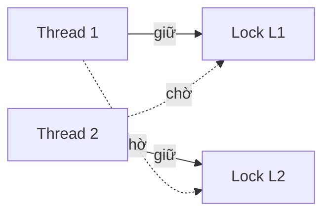

# P4 · Chương 05 — Bug concurrency và deadlock

## Bạn sẽ hiểu được gì

1. **Q1.** Bug concurrency ngoài đời thật rơi vào những mẫu nào (nghiên cứu Lu et al.)? → mục 1
2. **Q2.** Atomicity violation và order violation khác nhau thế nào, sửa bằng công cụ gì? → mục 2
3. **Q3.** Deadlock là gì và vì sao xảy ra dù quy tắc phòng tránh nghe đơn giản? → mục 3
4. **Q4.** Bốn điều kiện Coffman là gì; prevention phá từng điều kiện ra sao; vì sao lock ordering là cách "most practical"; `trylock` phá điều kiện nào và vì sao đẻ ra livelock? → mục 4
5. **Q5.** Avoidance và detect-and-recover khác prevention ra sao? → mục 5
6. **Q6.** `Mutex` của Rust có reentrant không; lock hai lần trên cùng thread thì docs hứa gì và máy thật làm gì? Safe Rust chặn lỗi nào, không chặn lỗi nào? → mục 6 (cũng là phần "Liên hệ với Rust")
7. **Q7.** Deadlock ở tầng DB và connection pool trông thế nào? → mục 7
8. **Q8.** Priority inversion là gì và chữa ra sao? → mục 8

## Kiến thức cần trước

- [Thread (P4·01)](01-thread.md): thread, interleaving do scheduler quyết định.
- [Lock (P4·03)](03-lock.md) và [Condition variable + semaphore (P4·04)](04-condition-variable-va-semaphore.md): `Mutex`, `Condvar` là công cụ để sửa bug trong chương này.
- Nền về memory model ở [P4·06](06-memory-model.md) (chỉ cần khi đọc phần data race).

---

## 1. Bức tranh: bug concurrency ngoài đời thật (Q1)

> **Trả lời ngắn.** Phần lớn bug concurrency ngoài đời thuộc vài mẫu lặp lại: trong nghiên cứu của Lu và cộng sự, gần như mọi bug không-deadlock là atomicity violation hoặc order violation[^ostep-97], và hầu hết bug chỉ liên quan tối đa hai thread[^lu-two-threads]. Số liệu chỉ từ bốn ứng dụng được khảo sát nên không phải định luật[^lu-caveat].

**Giải thích.**

Hình dung (nhận xét của người soạn): như báo cáo hậu kiểm sự cố — học các mẫu lỗi lặp lại trước khi học cách chữa.


OSTEP (chương 32) dựa vào một nghiên cứu của Lu và cộng sự về các bug concurrency đã được sửa trong MySQL, Apache, Mozilla và OpenOffice: 105 bug, gồm 74 không-deadlock và 31 deadlock[^lu-sample]. Chính các tác giả cảnh báo: kết quả gắn với bốn ứng dụng đó, không phải kết luận cho mọi chương trình concurrent[^lu-caveat]. Các con số dưới đây vì vậy là "bức tranh từ một nghiên cứu", không phải định luật.
Hai kết quả đáng nhớ: (1) 97% bug không-deadlock là atomicity violation hoặc order violation[^ostep-97], riêng order violation chiếm khoảng một phần ba[^lu-order-third]; (2) 101/105 bug chỉ liên quan tối đa hai thread[^lu-two-threads] — bài báo rút ra hàm ý rằng có thể test theo từng cặp thread mà giảm độ phức tạp, không mất nhiều khả năng lộ bug (phần "Implications" của Finding 3 trong bài; còn việc test hai thread có "bắt được phần lớn bug" hay không thì là suy luận của người soạn, không phải số đo).

<details><summary>Đi sâu: số bug theo từng ứng dụng (OSTEP Fig. 32.1)</summary>

| Ứng dụng | Không-deadlock | Deadlock |
|---|---|---|
| MySQL | 14 | 9 |
| Apache | 13 | 4 |
| Mozilla | 41 | 16 |
| OpenOffice | 6 | 2 |
| **Tổng** | **74** | **31** |

</details>

**Quay lại Q1:** bug concurrency không ngẫu nhiên — hầu hết là atomicity hoặc order violation, và đa số tái hiện được chỉ với hai thread.

---

## 2. Bug không-deadlock: atomicity và order violation (Q2)

> **Trả lời ngắn.** Atomicity violation là một khối check-rồi-act bị chen ngang; order violation là thứ tự "A trước B" không được ép. Cái đầu sửa bằng lock quanh mọi chỗ chạm biến chung[^ostep-atom-fix]; cái sau cần ép thứ tự, thường bằng condition variable hoặc semaphore[^ostep-order-fix], và lock đơn thuần không đủ[^lu-fix-locks].

**Giải thích.**

Hình dung (nhận xét của người soạn): atomicity là hai người cùng sửa một dòng trong tài liệu chung — ai kiểm tra rồi sửa phải giữ khóa suốt; order là đổ nước vào ấm trước khi bật bếp — khóa không giúp được thứ tự.

**Định nghĩa.** Theo Lu và cộng sự (OSTEP trích lại): tính tuần tự hóa mong muốn giữa nhiều truy cập bộ nhớ bị phá — tức một vùng code được *định* là atomic nhưng atomicity không được thực thi khi chạy[^ostep-atom-viol].

**Ví dụ gốc (MySQL, theo OSTEP).**

```c
// Thread 1                    // Thread 2
if (thd->proc_info) {          thd->proc_info = NULL;
    fputs(thd->proc_info, ...);
}
```

Nếu thread 1 kiểm tra xong rồi bị ngắt trước `fputs`, thread 2 chen vào đặt con trỏ NULL, thread 1 chạy lại sẽ deref NULL và crash[^ostep-atom-ex]. Code có một *giả định atomic* (check và use là một khối) mà không có gì thực thi giả định đó.

**Cách sửa theo OSTEP**: thêm lock quanh mọi chỗ tham chiếu biến chung, để thread nào chạm `proc_info` cũng đang giữ lock[^ostep-atom-fix].

**Order violation.** Thứ tự mong muốn giữa hai nhóm truy cập bị đảo: A phải chạy trước B nhưng thứ tự không được thực thi khi chạy[^ostep-order-viol]. Ví dụ gốc (OSTEP/Mozilla): thread 1 gọi `mThread = PR_CreateThread(mMain, ...)`; thread 2 (chạy `mMain`) đọc `mThread->State`. Nếu thread mới chạy ngay trước khi `mThread` được gán, nó deref con trỏ chưa khởi tạo; OSTEP nhận xét thread 2 dường như giả định `mThread` đã được khởi tạo[^ostep-order-ex].

Cách sửa: ép thứ tự — OSTEP nói thường dùng condition variable (hoặc semaphore)[^ostep-order-fix]. Thread 1 đặt cờ `mtInit = 1` và signal sau khi gán xong; thread 2 chờ trong vòng `while (mtInit == 0) cond_wait(...)`. Chi tiết `Condvar` và vì sao phải `while` xem [chương 04](04-condition-variable-va-semaphore.md). Khác atomicity violation, ở đây **lock đơn thuần không sửa được**: lock cho exclusion, không nói "X phải xảy ra trước Y" (nhận xét của người soạn). Bài báo ghi nhận chỉ 20/74 bug không-deadlock được sửa bằng thêm/đổi lock[^lu-fix-locks].

<details><summary>Đi sâu: bản backend của atomicity violation, đã chạy thật bằng Rust</summary>

**Bản backend.** "Check rồi act" có ở khắp nơi: trừ kho, "kiểm tra user chưa tồn tại rồi insert", "cache miss rồi tính và ghi" (nhận xét của người soạn). Trong Rust bug này *vẫn biên dịch được* dù mỗi truy cập đều có lock. Đã chạy thật (rustc 1.95.0, 8 thread, mỗi thread 1000 lần bán, kho ban đầu 1000):

```rust
if *s.lock().unwrap() > 0 {        // check: lock rồi nhả ngay (guard là temporary)
    *s.lock().unwrap() -= 1;       // act: lock lần khác
    *d.lock().unwrap() += 1;
}
```

Ba lần chạy cho `stock=0 sold=1000` (hai lần) và `stock=-1 sold=1001` (một lần bán lố). Giữa check và act lock đã được nhả — đúng cấu trúc ví dụ MySQL. Bản sửa giữ **một guard** suốt khối check+act (`let mut g = s.lock().unwrap(); if *g > 0 { *g -= 1; … }`) cho `stock=0 sold=1000`; một lần chạy không chứng minh gì, lập luận mới chứng minh: khối check+act nằm trọn trong một critical section.

</details>

**Quay lại Q2:** atomicity cần giữ lock suốt khối check+act; order cần một cơ chế báo "xong rồi" (condvar/semaphore), vì lock chỉ cho loại trừ lẫn nhau.

---

## 3. Deadlock: cơ chế và vì sao khó tránh (Q3)

> **Trả lời ngắn.** Deadlock là khi thread 1 giữ L1 chờ L2 trong lúc thread 2 giữ L2 chờ L1, nên không ai tiến được[^ostep-dl-def]. Nó chỉ *có thể* xảy ra, tùy interleaving[^ostep-dl-maybe]. Quy tắc "cùng thứ tự" nghe đơn giản nhưng khó giữ vì code lớn có phụ thuộc vòng tự nhiên[^ostep-why-dl] và encapsulation giấu việc lấy lock[^ostep-encap].

**Giải thích.**

Hình dung (nhận xét của người soạn): hai xe đi ngược chiều trên cầu một làn, mỗi xe đã tiến nửa cầu và chờ xe kia lùi.

**Cơ chế.**

Deadlock: thread 1 giữ lock L1 và chờ L2, trong khi thread 2 giữ L2 và chờ L1[^ostep-dl-def]. Code kinh điển:

```c
// Thread 1:            // Thread 2:
lock(L1);               lock(L2);
lock(L2);               lock(L1);
```

OSTEP nhấn mạnh code này *có thể* deadlock chứ không phải luôn luôn: nếu thread 1 lấy L1 rồi context switch sang thread 2 lấy L2 và xin L1, thì mới kẹt[^ostep-dl-maybe]. Đây là lý do deadlock khó test: nó phụ thuộc interleaving (nhận xét của người soạn).



Vòng tròn trong đồ thị (thread → lock đang chờ → thread đang giữ → …) chính là dấu hiệu deadlock[^ostep-dl-cycle].

**Vì sao deadlock xảy ra dù quy tắc "cùng thứ tự" đơn giản?**

OSTEP nêu hai lý do. **Một**, code base lớn có phụ thuộc vòng tự nhiên: virtual memory system có thể cần file system để nạp page từ đĩa, còn file system cần một page bộ nhớ để đọc block nên gọi ngược vào virtual memory system[^ostep-why-dl]. **Hai**, encapsulation chống lại việc quản lý lock: `Vector.AddAll()` của Java phải lấy lock của cả `v1` lẫn tham số `v2` theo thứ tự tùy ý; thread khác gọi `v2.AddAll(v1)` gần như cùng lúc thì có nguy cơ deadlock bị giấu khá kỹ khỏi ứng dụng gọi[^ostep-encap].

<details><summary>Đi sâu: AB-BA trong Rust</summary>

Tương tự trong Rust (nhận xét của người soạn): `transfer(from: &Mutex<Account>, to: &Mutex<Account>)` khóa `from` rồi `to`; `transfer(a, b)` song song với `transfer(b, a)` là đúng bài toán AB-BA mà người gọi không thấy.

</details>

**Quay lại Q3:** deadlock là vòng chờ giữa các thread giữ-và-chờ lock; nó phụ thuộc interleaving và ẩn trong code lớn nên khó tránh bằng quy ước đơn giản.

## 4. Bốn điều kiện Coffman và prevention (Q4)

> **Trả lời ngắn.** Deadlock cần đủ bốn điều kiện Coffman: mutual exclusion, hold-and-wait, no preemption, circular wait; thiếu một là không xảy ra[^ostep-dl-any]. Prevention là nhắm vào đúng một điều kiện. Thực dụng nhất là lock ordering, chống circular wait[^ostep-circ-practical]; `trylock` đối phó với no preemption (OSTEP nói nó không thật sự thêm preemption[^ostep-trylock-self]) và có thể đẻ ra livelock[^ostep-livelock].

**Giải thích.**

Hình dung (nhận xét của người soạn): bốn chân của một cái ghế — rút một chân là ghế đổ.


Bốn điều kiện phải cùng đúng để có deadlock[^ostep-dl4] (OSTEP trích từ bài khảo sát "System Deadlocks" của Coffman, Elphick, Shoshani, 1971[^ostep-coffman]):

| Điều kiện | Nghĩa (OSTEP) | Phá nó bằng |
|---|---|---|
| Mutual exclusion | thread giữ độc quyền tài nguyên cần dùng[^ostep-dl-mutex] | tránh dùng lock: lock-free/wait-free[^ostep-lockfree] |
| Hold-and-wait | giữ tài nguyên đã có trong lúc chờ tài nguyên khác[^ostep-dl-hold] | lấy mọi lock cùng lúc, atomically[^ostep-hold-wait] |
| No preemption | tài nguyên không thể bị rút khỏi thread đang giữ[^ostep-dl-nopre] | `trylock` + nhả lock đang giữ nếu thất bại[^ostep-trylock] |
| Circular wait | chuỗi vòng thread, mỗi thread giữ tài nguyên mà thread kế tiếp cần[^ostep-circ] | mọi thread lấy lock theo cùng một thứ tự[^ostep-order] |

Thiếu một trong bốn thì deadlock không thể xảy ra[^ostep-dl-any]. Mỗi chiến lược prevention dưới đây nhắm vào đúng một dòng của bảng.

**Prevention (phòng ngừa).**

**Phá circular wait: lock ordering.**

OSTEP: kỹ thuật phòng ngừa "probably the most practical" (và được dùng thường xuyên) là viết code locking sao cho không bao giờ tạo circular wait[^ostep-circ-practical]. Cách thẳng nhất là **total ordering**: có hai lock thì luôn lấy L1 trước L2[^ostep-total-order]. Hệ lớn thì total ordering khó và đôi khi thừa, nên **partial ordering** hữu ích: OSTEP dẫn comment đầu code memory mapping của Linux (v5.2) liệt kê mười nhóm thứ tự lock[^ostep-partial-order]. Mẹo khi hàm nhận hai lock làm tham số: dùng **địa chỉ** lock để định thứ tự, nhờ vậy `do_something(L1, L2)` và `do_something(L2, L1)` lấy lock cùng thứ tự[^ostep-addr-order]; code OSTEP giả định hai lock khác nhau[^ostep-addr-assume]. Điểm yếu: thứ tự chỉ là quy ước mà lập trình viên cẩu thả dễ bỏ qua[^ostep-order-limits].

**Ví dụ Rust đã chạy thật.** Hai thread giữ hai `Mutex`, khóa theo thứ tự ngược nhau; `Barrier` ép cả hai đã giữ lock đầu rồi mới xin lock thứ hai (để deadlock chắc chắn xảy ra thay vì chờ may rủi): t1 `lock(A); wait(); lock(B)`, t2 `lock(B); wait(); lock(A)`. Với `timeout 5`, chương trình in `t1 giu A, doi B` và `t2 giu B, doi A` rồi **không bao giờ kết thúc** (exit 124), giống nhau trên macOS aarch64 và container Linux (rustc 1.95.0). Không panic, không thông báo lỗi: process treo âm thầm, nên deadlock khó chẩn đoán trên production (nhận xét của người soạn).

Bản sửa bằng thứ tự địa chỉ (hàm `lock_both` so `&Mutex as *const _ as usize`, khóa địa chỉ thấp trước), mỗi thread lặp 100 000 lần với tham số ngược nhau: kết thúc, in `a=200000 b=200000`.

**Phá hold-and-wait: lấy tất cả cùng lúc.**

OSTEP: lấy mọi lock một lần, atomically — ví dụ bọc việc lấy lock trong một lock "prevention" toàn cục[^ostep-hold-wait]. Vấn đề: encapsulation lại chống ta (gọi một hàm là phải biết trước mọi lock nó cần), và giảm concurrency vì mọi lock phải lấy sớm thay vì lúc thật sự cần[^ostep-hold-wait-cost].

**Phá no preemption: `trylock`, và livelock.**

`pthread_mutex_trylock()` hoặc lấy được lock và trả thành công, hoặc trả mã lỗi báo lock đang bị giữ[^ostep-trylock]. Giao thức OSTEP: lấy L1, `trylock` L2; nếu thất bại thì nhả L1 và quay lại từ đầu[^ostep-trylock-proto]. Giao thức này không thật sự thêm preemption mà cho lập trình viên tự rút khỏi quyền sở hữu một cách êm thấm — OSTEP tự nhận điều đó[^ostep-trylock-self].

Cái giá đầu tiên là **livelock**: hai thread cùng lặp đi lặp lại chuỗi này và cùng thất bại; chúng vẫn chạy (nên không phải deadlock) nhưng không tiến triển[^ostep-livelock]. OSTEP gợi ý thêm độ trễ ngẫu nhiên trước khi thử lại để giảm xác suất đụng độ lặp[^ostep-livelock-delay]. Cái giá thứ hai lại là encapsulation: nếu lock nằm sâu trong một hàm được gọi, việc nhảy về đầu khó làm; và nếu đã cấp phát tài nguyên khác sau khi lấy L1, phải nhả chúng trước khi thử lại[^ostep-trylock-encap].

Trong Rust, `Mutex::try_lock` không block; nếu lock đang bị giữ nó trả lỗi `WouldBlock`[^std-trylock]. Tôi đã chạy giao thức OSTEP bằng hai thread, mỗi thread 100 000 lần, một thread khóa A rồi `try_lock` B, thread kia ngược lại: chương trình kết thúc với `a=200000 b=200000` và bộ đếm retry > 0 (tức đụng độ có thật và được giải quyết bằng thử lại). Một lần chạy không chứng minh livelock không bao giờ xảy ra; nó chỉ cho thấy livelock không xuất hiện trong lần đó.

<details><summary>Đi sâu: phá mutual exclusion bằng lock-free</summary>

Cách cuối là tránh hẳn nhu cầu mutual exclusion. OSTEP dẫn Herlihy: thiết kế cấu trúc dữ liệu lock-free/wait-free bằng lệnh phần cứng mạnh như compare-and-swap[^ostep-lockfree]. Khi không có lock thì không deadlock, nhưng livelock vẫn có thể, và một giải pháp thực tế phức tạp hơn đoạn code minh họa[^ostep-lockfree-live]. Lock-free được đào sâu ở [chương 07](07-lock-free.md); điểm cần nhớ ở đây là nó phá điều kiện thứ nhất và trả giá bằng độ phức tạp (OSTEP kết luận lock-free thiếu tính tổng quát và khó phát triển, nên lợi ích chung bị giới hạn[^ostep-lockfree-limit]).

</details>

**Quay lại Q4:** bốn điều kiện cùng đúng mới có deadlock; mỗi chiến lược prevention phá một điều kiện, và lock ordering là cách thực dụng nhất.

## 5. Avoidance, detect-and-recover (Q5)

> **Trả lời ngắn.** Avoidance cần biết trước mỗi thread có thể lấy lock nào rồi xếp lịch để deadlock không xảy ra, nhưng hiếm dùng đại trà[^ostep-avoid][^ostep-bankers-general]. Detect-and-recover để deadlock xảy ra rồi phát hiện và xử lý; database làm vậy bằng cách dựng đồ thị tài nguyên và tìm chu trình[^ostep-db-detect]. PostgreSQL abort một transaction và ứng dụng retry[^pg-detect][^pg-retry].

**Giải thích.**

Hình dung (nhận xét của người soạn): avoidance như chỉ huy giao thông biết trước mọi tuyến xe và không cho hai xe đối đầu cùng vào cầu; detect như đội cứu hộ gỡ kẹt sau khi kẹt đã xảy ra.

**Avoidance (tránh) bằng scheduling.**

Avoidance cần **hiểu biết toàn cục** về những lock mỗi thread có thể lấy, rồi xếp lịch để deadlock không thể xảy ra[^ostep-avoid]. Ví dụ OSTEP: T1, T2 đều lấy cả L1 và L2; T3 chỉ lấy L2; T4 không lấy lock. Chỉ cần không chạy T1 cùng T2; T3 chạy chồng với ai cũng được vì nó chỉ lấy một lock[^ostep-avoid-t3]. Nhưng khi T1, T2, T3 đều cần cả hai lock, lịch an toàn buộc cả ba chạy tuần tự trên một CPU, kéo dài tổng thời gian đáng kể[^ostep-avoid-cost].

**Banker's algorithm** (Dijkstra) thuộc họ này, nhưng OSTEP nói chỉ hữu ích trong môi trường rất hạn chế, ví dụ embedded biết trước mọi task và lock[^ostep-bankers]; avoidance bằng scheduling nhìn chung không phải giải pháp đa dụng được dùng rộng rãi[^ostep-bankers-general].

Cơ chế, theo ghi chú giáo trình Silberschatz của J. Bell (UIC): mỗi process khai báo trước mức tối đa nó có thể cần[^bell-claim]; trạng thái **safe** nếu tồn tại *safe sequence* mà yêu cầu của mỗi process thỏa được bằng tài nguyên đang giữ cộng tài nguyên các process đứng trước trả lại[^bell-safe]; unsafe *có thể* dẫn tới deadlock nhưng không phải unsafe nào cũng vậy[^bell-unsafe]; yêu cầu chỉ được cấp nếu trạng thái sau đó vẫn safe, không thì process chờ[^bell-grant].

Ví dụ số do người soạn tự dựng (một loại tài nguyên, 10 đơn vị): P1 tối đa 8, giữ 3; P2 tối đa 4, giữ 2; P3 tối đa 9, giữ 2; rảnh 3. P2 cần thêm 2 ≤ 3, xong → rảnh 5; P1 cần thêm 5 ≤ 5, xong → rảnh 8; P3 cần thêm 7 ≤ 8. ⟨P2, P1, P3⟩ là safe sequence. Nếu cấp thêm 1 đơn vị cho P3 (rảnh còn 2): P2 vẫn chạy được → rảnh 4, nhưng P1 cần 5 và P3 cần 6 đều > 4; không có safe sequence nên Banker's từ chối yêu cầu đó dù chưa có deadlock thật.

**Detect and recover.**

Chiến lược cuối: để deadlock thỉnh thoảng xảy ra rồi xử lý khi phát hiện. OSTEP: nếu deadlock hiếm thì một "non-solution" (ví dụ reboot) là khá thực dụng[^ostep-detect]. Nhiều hệ database chạy một detector định kỳ, dựng đồ thị tài nguyên và tìm chu trình[^ostep-db-detect]. Với mỗi loại tài nguyên một instance, đồ thị đó là **wait-for graph** (cạnh Pi→Pj: Pi chờ tài nguyên Pj đang giữ)[^bell-waitfor], và chu trình nghĩa là deadlock[^bell-waitfor-cycle]. Phát hiện khá đơn giản; recovery đòi abort process hoặc preempt tài nguyên, và cả hai đều không phải lựa chọn hấp dẫn[^bell-recover-cost].

**Ví dụ thực: PostgreSQL.** Docs nói hệ thống tự phát hiện deadlock và abort một trong các transaction liên quan để các transaction khác hoàn thành; transaction nào bị abort khó đoán và không nên dựa vào[^pg-detect]. Kiểm tra deadlock đắt nên không chạy mỗi lần chờ lock[^pg-timeout-cost]; `deadlock_timeout` mặc định một giây[^pg-timeout-default]. Deadlock cũng xảy ra với row-level lock dù không dùng lock tường minh[^pg-rowlevel]. Lời khuyên của docs: defense tốt nhất là mọi ứng dụng lấy lock trên nhiều đối tượng theo **thứ tự nhất quán**[^pg-order]; nếu không kiểm chứng trước được thì retry transaction bị abort vì deadlock[^pg-retry]. Đó là lock ordering (prevention) cộng retry (recover) trong cùng một hệ thống. Giữ transaction mở lâu (ví dụ chờ input người dùng) là ý tồi vì transaction chờ lock sẽ chờ vô hạn khi chưa có deadlock bị phát hiện[^pg-longtx].

<details><summary>Đi sâu: lockdep trong kernel Linux</summary>

Ở kernel Linux, **lockdep** tìm vòng phụ thuộc lock ("lock inversion deadlock") với độ phức tạp bất kỳ, kể cả khi giữa hai lệnh lấy lock có chuỗi lock khác chen vào[^lockdep-cycle]; chỉ cần mỗi chuỗi lock đơn giản từng xảy ra một lần (ở bất kỳ context nào) là validator (theo tuyên bố của docs) chứng minh được tính đúng đắn, kể cả cho tổ hợp nhiều CPU rất hiếm gặp[^lockdep-closure]. Lưu ý (suy luận của người soạn từ chữ "at least once"): lockdep chỉ thấy những chuỗi lock thực sự đã chạy trong lúc test, nên đường code chưa bao giờ được thực thi thì lockdep không nói được gì. Bắt lỗi thứ tự lock lúc test vì thế có tiền lệ nghiêm túc.

</details>

**Quay lại Q5:** avoidance cần hiểu biết trước nên hiếm; detect-and-recover chấp nhận deadlock thỉnh thoảng xảy ra rồi xử lý — cách các DB làm.

---

## 6. Liên hệ với Rust: deadlock trong Rust (Q6)

> **Trả lời ngắn.** Docs `Mutex::lock` chỉ hứa lần lock thứ hai trên cùng thread sẽ không return (có thể panic hoặc deadlock)[^std-mutex-reenter]; không hứa deadlock hay panic. Safe Rust bảo đảm không có data race[^nomicon-race-def] nhưng không ngăn race condition tổng quát[^nomicon-race-cond] hay deadlock[^nomicon-race-deadlock].

**Giải thích.**

Hình dung (nhận xét của người soạn): Rust là dây an toàn chống rơi (hỏng bộ nhớ), không phải bản đồ chống lạc đường (sai logic đồng bộ).

**`Mutex` không reentrant: đọc đúng docs.**

`Mutex::lock` docs ghi: hành vi khi khóa một mutex ở thread **đã giữ** lock đó là *unspecified* ("left unspecified"); tuy vậy hàm này sẽ không return ở lần gọi thứ hai, và có thể panic hoặc deadlock chẳng hạn[^std-mutex-reenter]. Phần `# Panics` nói thêm: hàm *might* panic nếu lock đã được thread hiện tại giữ[^std-mutex-panics]. Đọc chính xác nghĩa là:

- Docs **không hứa** deadlock, cũng **không hứa** panic — chỉ hứa "không return ở lần gọi thứ hai".
- Vì vậy không được dựa vào hành vi quan sát được ở một nền tảng.

Quan sát (không phải bảo đảm): với chương trình `let _a = m.lock().unwrap(); let _b = m.lock().unwrap();`, trên rustc 1.95.0 chạy `timeout 5`, cả macOS aarch64 lẫn container Linux đều in dòng "lan 1 xong" rồi treo đến khi `timeout` giết (exit 124); không có panic. Đây là hành vi cài đặt của hai nền tảng đó ở bản 1.95.0 và có thể đổi.

Điều này khớp với con số trong nghiên cứu Lu: 7/31 bug deadlock chỉ liên quan **một** thread[^lu-one-thread], thường là thread cố lấy tài nguyên đã tự giữ[^lu-self]. Bài báo nhận xét loại này tương đối dễ phát hiện vì không phải xét tranh chấp từ thread khác[^lu-self].

Std có `ReentrantLock`, cho phép thread đã khóa khóa lại nhiều lần mà không bị block, nhờ đó tránh một nguồn deadlock phổ biến[^std-reentrant], nhưng ở 1.95.0 nó là API **nightly-only**[^std-reentrant-nightly], không dùng được trên stable. Lời khuyên (nhận xét của người soạn): thay vì cần reentrancy, tách hàm thành phiên bản "đã giữ lock" nhận `&mut T` hoặc `&MutexGuard` và phiên bản "tự khóa".

`RwLock` cũng có bẫy tương tự: docs cảnh báo writer đang chờ có thể hoặc không chặn `read` mới, tùy chính sách của OS[^std-rwlock-policy], và đưa ví dụ có thể deadlock khi cùng thread `read` hai lần trong lúc có writer chờ[^std-rwlock-deadlock].

**Bẫy guard temporary: deadlock vô hình trong `match` và `if let`.**

Guard của `Mutex` được thả khi `drop`. Khi guard là *temporary* (không gán vào biến), nó sống tới hết "temporary scope". Docs `Mutex` minh họa bằng cách viết `*res_mutex.lock().unwrap() += result;` — guard không gán biến nên mutex được nhả ngay sau câu lệnh, không deadlock[^std-mutex-temp]. Nhưng reference Rust nói: scrutinee của `match` **không** phải temporary scope, nên temporary trong scrutinee có thể sống đến hết cả `match`[^ref-scrutinee]. Từ edition 2024, temporary của `if let` được thả *trước* khối `else`[^ref-2024].

Đã chạy thật (rustc 1.95.0, `timeout 5`):

```rust
let _unit = match m.lock().unwrap().take() {
    Some(v) => { *m.lock().unwrap() = Some(2); /* khóa lại trong arm */ }
    None => {}
};
```

| Mã | edition 2021 | edition 2024 |
|---|---|---|
| `match m.lock().unwrap().take() { Some(_) => m.lock()… }` | treo (exit 124) | treo (exit 124) |
| `if let Some(v) = m.lock().unwrap().take() { m.lock()… }` | treo | treo |
| `if let Some(v) = m.lock().unwrap().take() { … } else { m.lock()… }` (m = None) | **treo** | chạy được, in "else: khoa lai duoc" |
| tách `let t = m.lock().unwrap().take();` ra một câu lệnh riêng rồi `match t` | chạy được | chạy được |

Đây khớp với mô tả của reference về thay đổi 2024 (dòng thứ ba) và với việc scrutinee của `match` không phải temporary scope. Bài học (nhận xét của người soạn): đừng khóa lại cùng mutex bên trong `match`/`if let` mà scrutinee có gọi `.lock()`; lấy giá trị ra trong một câu lệnh `let` riêng để guard được thả ngay.

Tương tự với async: docs Tokio nói compiler không ngăn guard của `std::sync::Mutex` bị giữ qua `.await` khi task không di chuyển giữa các thread, nhưng điều này gần như không bao giờ cho code concurrent đúng và có thể dễ dàng dẫn tới deadlock[^tokio-await]. Tokio cho biết dùng `Mutex` thường của std trong code async là ổn và thường được ưa hơn, miễn là không giữ qua `.await`[^tokio-prefer]. Chi tiết async xem phase I/O.

**Safe Rust không ngăn deadlock.**

Nomicon: Safe Rust bảo đảm không có data race[^nomicon-race-def], nhưng không ngăn được race condition nói chung[^nomicon-race-cond], và không thể ngăn nói chung vì điều đó bất khả về toán học khi không kiểm soát scheduler như trong môi trường OS thông thường[^nomicon-race-impossible]. Nomicon nói rõ: Rust được coi là "safe" ngay cả khi deadlock hay làm điều vô nghĩa do đồng bộ sai[^nomicon-race-deadlock]. The Rust Book cũng cảnh báo `Mutex<T>` đi kèm rủi ro tạo deadlock[^book-deadlock]. Ngoài ra race condition tự nó không vi phạm memory safety; chỉ khi kết hợp với `unsafe` nào đó mới có thể[^nomicon-race-safe].

| Loại lỗi | Safe Rust có chặn không? |
|---|---|
| Data race | Có — là UB, không thực hiện được trong Safe Rust[^nomicon-race-ub] |
| Atomicity / order violation (race condition logic) | Không (ví dụ mục 2 biên dịch được) |
| Deadlock (AB-BA, lock hai lần) | Không (ví dụ mục 4, 6 biên dịch được) |
| Livelock, starvation, priority inversion | Không (suy luận của người soạn: Nomicon chỉ nói chung là không ngăn race condition và deadlock; ba loại này không nằm trong phần được trích) |

Phân biệt này quan trọng cho người quen "Rust đã lo hết": type system chặn *hỏng bộ nhớ* do race, không chặn *sai logic đồng bộ*.

<details><summary>Đi sâu: công cụ phát hiện deadlock trong hệ sinh thái Rust</summary>

Crate `parking_lot` có module `deadlock` mô tả là **Experimental**, bật bằng feature flag `deadlock_detection`[^pl-deadlock]; ví dụ trong docs tạo một thread nền định kỳ gọi `check_deadlock()` (mỗi 10 giây) và in các thread đang deadlock. Đây là detect-and-recover ở mức detect cho `parking_lot::Mutex`, không áp dụng cho `std::sync::Mutex` (suy luận từ việc detector nằm trong crate `parking_lot`).

</details>

**Quay lại Q6:** Rust không hứa gì về lock hai lần ngoài việc không return, và type system chặn hỏng bộ nhớ do race chứ không chặn sai logic đồng bộ như deadlock.

---

## 7. Deadlock ở tầng database và connection pool (Q7)

> **Trả lời ngắn.** Connection là tài nguyên hữu hạn nên cùng mô hình giữ-và-chờ + vòng áp dụng được (nhận xét của người soạn). Hai transaction khóa chéo thì DB abort một bên và ứng dụng retry[^pg-retry]; pool-locking xảy ra khi một tác vụ giữ connection rồi xin thêm từ cùng pool[^hikari-lock], và cỡ pool tối thiểu để tránh deadlock là `Tn × (Cm − 1) + 1`[^hikari-formula].

**Giải thích.**

Hình dung (nhận xét của người soạn): ba người mỗi người cầm một chìa và chờ chìa thứ hai, nhưng két chỉ có đúng ba chìa.

Connection cũng là tài nguyên hữu hạn nên cùng mô hình "giữ-và-chờ + vòng" áp dụng được (nhận xét của người soạn). Ba dạng hay gặp:

1. **Hai transaction khóa row/table chéo nhau**: DB tự phát hiện và abort một bên (mục 5); ứng dụng phải sẵn sàng retry[^pg-retry] và cập nhật các row theo thứ tự nhất quán (ví dụ sort theo id trước khi `UPDATE` hàng loạt — suy ra từ lời khuyên của docs PostgreSQL[^pg-order]).
2. **Pool-locking**: một tác vụ giữ một connection rồi xin thêm connection từ cùng pool. Wiki HikariCP gọi đó là "pool-locking", nói phần lớn là vấn đề cấp ứng dụng, và khuyên xem lại ở tầng ứng dụng trước khi tăng pool[^hikari-lock]. Cỡ pool tối thiểu để deadlock không thể xảy ra: `pool size = Tn × (Cm − 1) + 1`[^hikari-formula] (trang wiki này không ghim được theo URL như nguồn khác; đối chiếu bản clone `HikariCP.wiki.git`: lần sửa cuối của trang là commit `6a950a3` ngày 2021-12-07, công thức có ở đó, còn HEAD wiki lúc review là `dbcb678`), với Tn là số thread tối đa và Cm là số connection tối đa một thread giữ đồng thời[^hikari-vars]; ví dụ Tn=3, Cm=4 cho 3×3+1 = 10. Đó là mức tối thiểu để tránh deadlock, không nhất thiết tối ưu[^hikari-min]. Đây là điều kiện kiểu Banker's: luôn còn đủ tài nguyên để ít nhất một thread hoàn thành (nhận xét của người soạn).
3. **Giữ transaction/connection qua I/O chậm** (gọi HTTP, chờ người dùng): xem cảnh báo của PostgreSQL ở mục 5[^pg-longtx].

<details><summary>Đi sâu: ví dụ Rust đã chạy thật với pool token</summary>

**Ví dụ Rust đã chạy thật.** "Pool" là hàng đợi `mpsc` chứa N token connection; hai tác vụ, mỗi tác vụ lấy một token, qua `Barrier` (để cả hai chắc chắn đã giữ token đầu) rồi xin token thứ hai. Tn=2, Cm=2 nên mức tối thiểu theo công thức là 3.

- N=2: cả hai in "giu ket noi … xin ket noi thu hai" rồi treo vô hạn (`timeout 5`, exit 124).
- N=3: cả hai hoàn tất, in "ket thuc" (exit 0).

Kết quả khớp công thức trên ví dụ này (không phải chứng minh tổng quát). Không có `Mutex` nào bị khóa chéo, nhưng đủ bốn điều kiện: token độc quyền, giữ-và-chờ, không bị rút, chờ vòng giữa hai tác vụ (nhận xét của người soạn). Triệu chứng vận hành (nhận xét của người soạn): không có stack trace lỗi, chỉ là latency tăng vô hạn, request timeout dần, CPU thấp; kiểm tra bằng thread dump và số connection `active` của pool đã chạm tối đa chưa.

</details>

**Quay lại Q7:** pool nhỏ hơn mức tối thiểu có thể deadlock mà không Mutex nào bị khóa chéo; triệu chứng là latency tăng vô hạn, không có lỗi.

---

## 8. Priority inversion (Q8)

> **Trả lời ngắn.** Priority inversion là khi process ưu tiên thấp chạy trong lúc process ưu tiên cao muốn chạy[^kdoc-inversion]; không có chu trình chờ nên không phải deadlock. Cách chữa tổng quát là priority inheritance: thread cao đang chờ tạm nâng ưu tiên của thread thấp[^ostep-pi].

**Giải thích.**

Hình dung (nhận xét của người soạn): sếp chờ nhân viên giữ chìa kho, trong khi nhân viên đó bị đám việc vặt chen hết lịch.


Không phải mọi "treo" đều là deadlock. **Priority inversion** là khi process ưu tiên thấp chạy trong lúc process ưu tiên cao muốn chạy[^kdoc-inversion]; khi process cao cần tài nguyên đang do process thấp giữ thì nó phải chờ process thấp xong với tài nguyên đó[^kdoc-wait]. Điều cần ngăn là **unbounded** priority inversion: process cao bị chặn trong thời gian không xác định[^kdoc-unbounded]. Kịch bản kinh điển: A (cao) xin lock của C (thấp) và phải chờ; B (vừa) chạy và preempt C, nên thực chất cũng chặn A — B có thể là CPU hog khiến C không bao giờ nhả lock[^kdoc-abc]. Không có chu trình chờ nào, nên đây không phải deadlock.

<details><summary>Đi sâu: Mars Pathfinder, priority inheritance trong Linux, và Rust</summary>

**Ví dụ thật: Mars Pathfinder.** Nguồn là email ngày 15/12/1997 của Glenn Reeves (kỹ sư JPL) trả lời về sự cố; bản dùng ở đây là bản sao do OSTEP lưu trên trang của họ (đầu trang ghi sao từ trang UNC), không phải trang gốc của JPL, nên là nguồn có thẩm quyền về nội dung nhưng URL là bản chép lại (OSTEP dẫn làm nguồn về priority inversion trên Pathfinder[^ostep-mars-cite]): task `bc_dist` ưu tiên cao bị task `ASI/MET` ưu tiên thấp, đang giữ tài nguyên chung, chặn; `ASI/MET` đã bị nhiều task ưu tiên vừa preempt[^mars-cause]. Tài nguyên đó là một mutual-exclusion semaphore trong cơ chế `select()`[^mars-sem]. Cách sửa: đổi cờ tạo semaphore để bật **priority inheritance**[^mars-fix]; báo cáo nói đội JPL không có quyết định cố ý tắt tùy chọn này, họ chỉ bỏ sót[^mars-lesson].

**Giải pháp tổng quát** (OSTEP): thread ưu tiên cao đang chờ tạm thời nâng ưu tiên của thread thấp để nó chạy được — priority inheritance[^ostep-pi]. Linux hỗ trợ priority-inheritance futex cho việc này[^futex-pi].

**Với Rust.** Tôi không thấy trang docs `std::sync::Mutex` nêu bảo đảm priority inheritance (suy luận từ việc không thấy đề cập; không phải xác nhận là không có). Với backend dùng scheduler chia sẻ thời gian công bằng, tác động có lẽ thiên về latency đuôi hơn là treo hẳn (suy luận của người soạn).

</details>

**Quay lại Q8:** priority inversion là chặn gián tiếp qua một thread ưu tiên vừa; priority inheritance chữa bằng cách nâng tạm ưu tiên thread đang giữ lock.

## Tóm tắt

- Lu et al. (105 bug, 4 ứng dụng): 74 không-deadlock, 31 deadlock; 97% bug không-deadlock là atomicity hoặc order violation; 101/105 bug cần tối đa hai thread.
- Atomicity violation: vùng định là atomic nhưng không được bảo vệ → đưa cả khối check-act vào một critical section. Order violation: ép thứ tự bằng condvar/semaphore; lock đơn thuần không đủ.
- Deadlock cần đủ bốn điều kiện: mutual exclusion, hold-and-wait, no preemption, circular wait; phá một là hết.
- Prevention thực dụng nhất là lock ordering (total/partial, có thể theo địa chỉ lock); `trylock` phá no-preemption nhưng sinh livelock; lock-free phá mutual exclusion nhưng khó.
- Avoidance (Banker's) cần biết trước nhu cầu nên ít dùng đại trà; detect-and-recover là cách DB làm (PostgreSQL abort một transaction, ứng dụng retry).
- `Mutex` Rust không reentrant: lần lock thứ hai trên cùng thread "không return" (panic hoặc deadlock); trên macOS/Linux ở 1.95.0 quan sát thấy treo. Safe Rust chỉ chặn data race, không chặn deadlock hay race condition logic.
- Guard temporary trong scrutinee của `match`/`if let` giữ lock lâu hơn tưởng; với `if let`, edition 2024 thả temporary trước nhánh `else`, còn `match` giữ nguyên.
- Priority inversion là chặn gián tiếp, không phải deadlock; giải pháp là priority inheritance. Pool nhỏ hơn `Tn×(Cm−1)+1` có thể deadlock.

## Câu hỏi tự kiểm tra

1. Hai mẫu bug không-deadlock chính trong nghiên cứu Lu là gì, chiếm bao nhiêu?
<details><summary>Đáp án</summary>

Atomicity violation và order violation, 97% bug không-deadlock[^ostep-97]; mẫu 74 không-deadlock + 31 deadlock[^lu-sample].

</details>

2. Vì sao bọc thêm lock không sửa được order violation?
<details><summary>Đáp án</summary>

Lock chỉ cho exclusion; OSTEP sửa bằng condition variable/semaphore[^ostep-order-fix]. Chỉ 20/74 bug không-deadlock được sửa bằng lock[^lu-fix-locks].

</details>

3. Bốn điều kiện deadlock là gì và phá từng điều kiện bằng cách nào?
<details><summary>Đáp án</summary>

Bảng ở mục 4[^ostep-dl4][^ostep-hold-wait][^ostep-trylock][^ostep-order].

</details>

4. Vì sao lock ordering là kỹ thuật "most practical", và điểm yếu?
<details><summary>Đáp án</summary>

Theo OSTEP đó là kỹ thuật phòng ngừa "probably the most practical" và hay được dùng[^ostep-circ-practical]; điểm yếu: thứ tự chỉ là quy ước nên lập trình viên cẩu thả dễ bỏ qua[^ostep-order-limits].

</details>

5. Giao thức `trylock` gây hiện tượng gì? Giảm nhẹ ra sao?
<details><summary>Đáp án</summary>

Livelock[^ostep-livelock]; thêm độ trễ ngẫu nhiên trước khi thử lại[^ostep-livelock-delay].

</details>

6. Docs `Mutex::lock` bảo đảm gì khi cùng thread lock lần hai? Điều gì chỉ là quan sát?
<details><summary>Đáp án</summary>

Chỉ bảo đảm không return ở lần hai; có thể panic hoặc deadlock[^std-mutex-reenter]. Việc treo trên macOS/Linux ở 1.95.0 là quan sát từ lần chạy thử.

</details>

7. Safe Rust ngăn loại lỗi nào, không ngăn loại nào?
<details><summary>Đáp án</summary>

Ngăn data race[^nomicon-race-def]; không ngăn race condition tổng quát[^nomicon-race-cond] và deadlock[^nomicon-race-deadlock].

</details>

8. Vì sao `if let … = m.lock().unwrap().take() {…} else { m.lock()… }` treo ở edition 2021 nhưng chạy được ở 2024?
<details><summary>Đáp án</summary>

Guard temporary của scrutinee sống qua `else` ở 2021; 2024 thả temporary của `if let` trước `else`[^ref-2024]. Với `match`, scrutinee không phải temporary scope[^ref-scrutinee].

</details>

9. Priority inversion khác deadlock ở đâu? Giải pháp tổng quát?
<details><summary>Đáp án</summary>

Không có chu trình chờ; A chờ C giữ lock còn B chiếm CPU[^kdoc-abc]; giải pháp là priority inheritance[^ostep-pi].

</details>

10. Tn=8 thread, mỗi thread cần Cm=3 connection đồng thời: pool tối thiểu để không deadlock?
<details><summary>Đáp án</summary>

8 × (3 − 1) + 1 = 17, theo công thức Hikari[^hikari-formula]; đó là mức tối thiểu, không nhất thiết tối ưu[^hikari-min].

</details>

## Đọc thêm

- OSTEP ch.32 — <https://pages.cs.wisc.edu/~remzi/OSTEP/threads-bugs.pdf>: nguồn chính; code đầy đủ các ví dụ.
- Lu et al., "Learning from Mistakes" — <https://www.cs.columbia.edu/~junfeng/10fa-e6998/papers/concurrency-bugs.pdf>: số liệu gốc và bảng chiến lược sửa.
- Rustonomicon, "Data Races and Race Conditions" — <https://doc.rust-lang.org/1.95.0/nomicon/races.html>: ranh giới Rust bảo đảm / không bảo đảm.
- PostgreSQL, Explicit Locking §13.3.4 — <https://www.postgresql.org/docs/16/explicit-locking.html>: deadlock trong DB thật.
- Linux kernel docs, lockdep — <https://docs.kernel.org/locking/lockdep-design.html>: cách kernel bắt lỗi thứ tự lock.
- Linux kernel docs, RT-mutex design — <https://docs.kernel.org/locking/rt-mutex-design.html>: priority inheritance ở mức cài đặt.
- Chương kế: [Memory model](06-memory-model.md), [Lock-free](07-lock-free.md), [Rust concurrency](08-rust-concurrency.md).

[^bell-claim]: J. Bell (UIC), Operating Systems course notes, ch.7 Deadlocks — <https://www.cs.uic.edu/~jbell/CourseNotes/OperatingSystems/7_Deadlocks.html> — "When a process starts up, it must state in advance the maximum allocation of resources it may request, up to the amount available on the system."
[^bell-grant]: J. Bell (UIC), Operating Systems course notes, ch.7 Deadlocks — <https://www.cs.uic.edu/~jbell/CourseNotes/OperatingSystems/7_Deadlocks.html> — "When a request is made, the scheduler determines whether granting the request would leave the system in a safe state. If not, then the process must wait until the request can be granted safely."
[^bell-recover-cost]: J. Bell (UIC), Operating Systems course notes, ch.7 Deadlocks — <https://www.cs.uic.edu/~jbell/CourseNotes/OperatingSystems/7_Deadlocks.html> — "Deadlock detection is fairly straightforward, but deadlock recovery requires either aborting processes or preempting resources, neither of which is an attractive alternative."
[^bell-safe]: J. Bell (UIC), Operating Systems course notes, ch.7 Deadlocks — <https://www.cs.uic.edu/~jbell/CourseNotes/OperatingSystems/7_Deadlocks.html> — "a state is safe if there exists a safe sequence of processes { P0, P1, P2, ..., PN } such that all of the resource requests for Pi can be granted using the resources currently allocated to Pi and all processes Pj where j < i."
[^bell-unsafe]: J. Bell (UIC), Operating Systems course notes, ch.7 Deadlocks — <https://www.cs.uic.edu/~jbell/CourseNotes/OperatingSystems/7_Deadlocks.html> — "If a safe sequence does not exist, then the system is in an unsafe state, which MAY lead to deadlock. ( All safe states are deadlock free, but not all unsafe states lead to deadlocks. )"
[^bell-waitfor]: J. Bell (UIC), Operating Systems course notes, ch.7 Deadlocks — <https://www.cs.uic.edu/~jbell/CourseNotes/OperatingSystems/7_Deadlocks.html> — "An arc from Pi to Pj in a wait-for graph indicates that process Pi is waiting for a resource that process Pj is currently holding."
[^bell-waitfor-cycle]: J. Bell (UIC), Operating Systems course notes, ch.7 Deadlocks — <https://www.cs.uic.edu/~jbell/CourseNotes/OperatingSystems/7_Deadlocks.html> — "As before, cycles in the wait-for graph indicate deadlocks."
[^book-deadlock]: The Rust Programming Language, 16.3 Shared-State Concurrency — <https://doc.rust-lang.org/1.95.0/book/ch16-03-shared-state.html> — "Similarly, Mutex\<T> comes with the risk of creating deadlocks."
[^futex-pi]: futex(2), Linux man-pages (Debian bookworm) — <https://manpages.debian.org/bookworm/manpages-dev/futex.2.en.html> — "Linux supports priority-inheritance (PI) futexes in order to handle priority-inversion problems that can be encountered with normal futex locks."
[^hikari-formula]: HikariCP wiki, About Pool Sizing — <https://github.com/brettwooldridge/HikariCP/wiki/About-Pool-Sizing> — "The calculation of pool size in order to avoid deadlock is a fairly simple resource allocation formula: pool size = Tn x (Cm - 1) + 1"
[^hikari-lock]: HikariCP wiki, About Pool Sizing — <https://github.com/brettwooldridge/HikariCP/wiki/About-Pool-Sizing> — "The prospect of pool-locking has been raised with respect to single actors that acquire many connections. This is largely an application-level issue."
[^hikari-min]: HikariCP wiki, About Pool Sizing — <https://github.com/brettwooldridge/HikariCP/wiki/About-Pool-Sizing> — "This is not necessarily the optimal pool size, but the minimum required to avoid deadlock."
[^hikari-vars]: HikariCP wiki, About Pool Sizing — <https://github.com/brettwooldridge/HikariCP/wiki/About-Pool-Sizing> — "Where Tn is the maximum number of threads, and Cm is the maximum number of simultaneous connections held by a single thread."
[^kdoc-abc]: Linux kernel docs, RT-mutex implementation design — <https://docs.kernel.org/locking/rt-mutex-design.html> — "A tries to grab a lock that C owns and must wait and lets C run to release the lock. But in the meantime, B executes, and since B is of a higher priority than C, it preempts C"
[^kdoc-inversion]: Linux kernel docs, RT-mutex implementation design — <https://docs.kernel.org/locking/rt-mutex-design.html> — "Priority inversion is when a lower priority process executes while a higher priority process wants to run."
[^kdoc-unbounded]: Linux kernel docs, RT-mutex implementation design — <https://docs.kernel.org/locking/rt-mutex-design.html> — "What we want to prevent is something called unbounded priority inversion. That is when the high priority process is prevented from running by a lower priority process for an undetermined amount of time."
[^kdoc-wait]: Linux kernel docs, RT-mutex implementation design — <https://docs.kernel.org/locking/rt-mutex-design.html> — "the high priority process must wait until the lower priority process is done with the resource."
[^lockdep-closure]: Linux kernel docs, Runtime locking correctness validator — <https://docs.kernel.org/locking/lockdep-design.html> — "complex multi-CPU and multi-task locking scenarios do not have to occur in practice to prove a deadlock: only the simple ‘component’ locking chains have to occur at least once (anytime, in any task/context) for the validator to be able to prove correctness."
[^lockdep-cycle]: Linux kernel docs, Runtime locking correctness validator — <https://docs.kernel.org/locking/lockdep-design.html> — "The validator will find such dependency circle in arbitrary complexity, i.e., there can be any other locking sequence between the acquire-lock operations"
[^lu-caveat]: Lu et al., Learning from Mistakes (ASPLOS 2008) — <https://www.cs.columbia.edu/~junfeng/10fa-e6998/papers/concurrency-bugs.pdf> — "we do not intend to draw any general conclusions about all concurrent applications."
[^lu-fix-locks]: Lu et al., Learning from Mistakes (ASPLOS 2008) — <https://www.cs.columbia.edu/~junfeng/10fa-e6998/papers/concurrency-bugs.pdf> — "Adding or changing locks is not the major fix strategy. It is used for only 20 out of 74 non-deadlock concurrency bugs that we examined."
[^lu-one-thread]: Lu et al., Learning from Mistakes (ASPLOS 2008) — <https://www.cs.columbia.edu/~junfeng/10fa-e6998/papers/concurrency-bugs.pdf> — "The manifestation of some (7 out of 31) deadlock concurrency bugs involves only one thread."
[^lu-order-third]: Lu et al., Learning from Mistakes (ASPLOS 2008) — <https://www.cs.columbia.edu/~junfeng/10fa-e6998/papers/concurrency-bugs.pdf> — "About one third (32%) of the examined non-deadlock bugs are order-violation bugs"
[^lu-sample]: Lu et al., Learning from Mistakes (ASPLOS 2008) — <https://www.cs.columbia.edu/~junfeng/10fa-e6998/papers/concurrency-bugs.pdf> — "Our study is based on 105 randomly selected real world concurrency bugs, including 74 non-deadlock bugs and 31 deadlock bugs, collected from 4 large and mature open-source applications: MySQL, Apache, Mozilla and OpenOffice"
[^lu-self]: Lu et al., Learning from Mistakes (ASPLOS 2008) — <https://www.cs.columbia.edu/~junfeng/10fa-e6998/papers/concurrency-bugs.pdf> — "It usually happens when one thread tries to acquire a resource held by itself. Detecting and analyzing this type of bugs are relatively easy, because we do not need to consider the contention from other concurrent execution components."
[^lu-two-threads]: Lu et al., Learning from Mistakes (ASPLOS 2008) — <https://www.cs.columbia.edu/~junfeng/10fa-e6998/papers/concurrency-bugs.pdf> — "The manifestation of most (101 out of 105) examined concurrency bugs involves no more than two threads."
[^mars-cause]: Glenn Reeves, What Really Happened on Mars (hosted by OSTEP) — <https://pages.cs.wisc.edu/~remzi/OSTEP/Citations/mars.html> — "The higher priority bc_dist task was blocked by the much lower priority ASI/MET task that was holding a shared resource. The ASI/MET task had acquired this resource and then been preempted by several of the medium priority tasks."
[^mars-fix]: Glenn Reeves, What Really Happened on Mars (hosted by OSTEP) — <https://pages.cs.wisc.edu/~remzi/OSTEP/Citations/mars.html> — "change the creation flags for the semaphore so as to enable priority inheritance."
[^mars-lesson]: Glenn Reeves, What Really Happened on Mars (hosted by OSTEP) — <https://pages.cs.wisc.edu/~remzi/OSTEP/Citations/mars.html> — "there was no conscious decision to not have the priority inheritance option enabled. We just missed it."
[^mars-sem]: Glenn Reeves, What Really Happened on Mars (hosted by OSTEP) — <https://pages.cs.wisc.edu/~remzi/OSTEP/Citations/mars.html> — "The resource that caused this problem was a mutual exclusion semaphore used within the select() mechanism"
[^nomicon-race-cond]: The Rustonomicon, Data Races and Race Conditions — <https://doc.rust-lang.org/1.95.0/nomicon/races.html> — "However Rust does not prevent general race conditions."
[^nomicon-race-deadlock]: The Rustonomicon, Data Races and Race Conditions — <https://doc.rust-lang.org/1.95.0/nomicon/races.html> — "it is considered “safe” for Rust to get deadlocked or do something nonsensical with incorrect synchronization"
[^nomicon-race-def]: The Rustonomicon, Data Races and Race Conditions — <https://doc.rust-lang.org/1.95.0/nomicon/races.html> — "Safe Rust guarantees an absence of data races, which are defined as: two or more threads concurrently accessing a location of memory one or more of them is a write one or more of them is unsynchronized"
[^nomicon-race-impossible]: The Rustonomicon, Data Races and Race Conditions — <https://doc.rust-lang.org/1.95.0/nomicon/races.html> — "This is mathematically impossible in situations where you do not control the scheduler, which is true for the normal OS environment."
[^nomicon-race-safe]: The Rustonomicon, Data Races and Race Conditions — <https://doc.rust-lang.org/1.95.0/nomicon/races.html> — "a race condition cannot violate memory safety in a Rust program on its own. Only in conjunction with some other unsafe code can a race condition actually violate memory safety."
[^nomicon-race-ub]: The Rustonomicon, Data Races and Race Conditions — <https://doc.rust-lang.org/1.95.0/nomicon/races.html> — "A data race has Undefined Behavior, and is therefore impossible to perform in Safe Rust."
[^ostep-97]: OSTEP, ch.32 Common Concurrency Problems — <https://pages.cs.wisc.edu/~remzi/OSTEP/threads-bugs.pdf> — "A large fraction (97%) of non-deadlock bugs studied by Lu et al. are either atomicity or order violations."
[^ostep-addr-assume]: OSTEP, ch.32 Common Concurrency Problems — <https://pages.cs.wisc.edu/~remzi/OSTEP/threads-bugs.pdf> — "Code assumes that m1 != m2 (not the same lock)"
[^ostep-addr-order]: OSTEP, ch.32 Common Concurrency Problems — <https://pages.cs.wisc.edu/~remzi/OSTEP/threads-bugs.pdf> — "the clever programmer can use the address of each lock as a way of ordering lock acquisition."
[^ostep-atom-ex]: OSTEP, ch.32 Common Concurrency Problems — <https://pages.cs.wisc.edu/~remzi/OSTEP/threads-bugs.pdf> — "if the first thread performs the check but then is interrupted before the call to fputs, the second thread could run in-between, thus setting the pointer to NULL"
[^ostep-atom-fix]: OSTEP, ch.32 Common Concurrency Problems — <https://pages.cs.wisc.edu/~remzi/OSTEP/threads-bugs.pdf> — "ensuring that when either thread accesses the proc_info field, it has a lock held"
[^ostep-atom-viol]: OSTEP, ch.32 Common Concurrency Problems — <https://pages.cs.wisc.edu/~remzi/OSTEP/threads-bugs.pdf> — "The desired serializability among multiple memory accesses is violated (i.e. a code region is intended to be atomic, but the atomicity is not enforced during execution)."
[^ostep-avoid]: OSTEP, ch.32 Common Concurrency Problems — <https://pages.cs.wisc.edu/~remzi/OSTEP/threads-bugs.pdf> — "Avoidance requires some global knowledge of which locks various threads might grab during their execution, and subsequently schedules said threads in a way as to guarantee no deadlock can occur."
[^ostep-avoid-cost]: OSTEP, ch.32 Common Concurrency Problems — <https://pages.cs.wisc.edu/~remzi/OSTEP/threads-bugs.pdf> — "static scheduling leads to a conservative approach where T1, T2, and T3 are all run on the same processor, and thus the total time to complete the jobs is lengthened considerably."
[^ostep-avoid-t3]: OSTEP, ch.32 Common Concurrency Problems — <https://pages.cs.wisc.edu/~remzi/OSTEP/threads-bugs.pdf> — "Even though T3 grabs lock L2, it can never cause a deadlock by running concurrently with other threads because it only grabs one lock."
[^ostep-bankers]: OSTEP, ch.32 Common Concurrency Problems — <https://pages.cs.wisc.edu/~remzi/OSTEP/threads-bugs.pdf> — "Unfortunately, they are only useful in very limited environments, for example, in an embedded system where one has full knowledge of the entire set of tasks that must be run and the locks that they need."
[^ostep-bankers-general]: OSTEP, ch.32 Common Concurrency Problems — <https://pages.cs.wisc.edu/~remzi/OSTEP/threads-bugs.pdf> — "Thus, avoidance of deadlock via scheduling is not a widely-used general-purpose solution."
[^ostep-circ]: OSTEP, ch.32 Common Concurrency Problems — <https://pages.cs.wisc.edu/~remzi/OSTEP/threads-bugs.pdf> — "Circular wait: There exists a circular chain of threads such that each thread holds one or more resources (e.g., locks) that are being requested by the next thread in the chain."
[^ostep-circ-practical]: OSTEP, ch.32 Common Concurrency Problems — <https://pages.cs.wisc.edu/~remzi/OSTEP/threads-bugs.pdf> — "Probably the most practical prevention technique (and certainly one that is frequently employed) is to write your locking code such that you never induce a circular wait."
[^ostep-coffman]: OSTEP, ch.32 Common Concurrency Problems — <https://pages.cs.wisc.edu/~remzi/OSTEP/threads-bugs.pdf> — "The classic paper outlining the conditions for deadlock and how you might go about dealing with it."
[^ostep-db-detect]: OSTEP, ch.32 Common Concurrency Problems — <https://pages.cs.wisc.edu/~remzi/OSTEP/threads-bugs.pdf> — "A deadlock detector runs periodically, building a resource graph and checking it for cycles."
[^ostep-detect]: OSTEP, ch.32 Common Concurrency Problems — <https://pages.cs.wisc.edu/~remzi/OSTEP/threads-bugs.pdf> — "If deadlocks are rare, such a non-solution is indeed quite pragmatic."
[^ostep-dl-any]: OSTEP, ch.32 Common Concurrency Problems — <https://pages.cs.wisc.edu/~remzi/OSTEP/threads-bugs.pdf> — "If any of these four conditions are not met, deadlock cannot occur."
[^ostep-dl-cycle]: OSTEP, ch.32 Common Concurrency Problems — <https://pages.cs.wisc.edu/~remzi/OSTEP/threads-bugs.pdf> — "the presence of a cycle in the graph is indicative of the deadlock."
[^ostep-dl-def]: OSTEP, ch.32 Common Concurrency Problems — <https://pages.cs.wisc.edu/~remzi/OSTEP/threads-bugs.pdf> — "Deadlock occurs, for example, when a thread (say Thread 1) is holding a lock (L1) and waiting for another one (L2); unfortunately, the thread (Thread 2) that holds lock L2 is waiting for L1 to be released."
[^ostep-dl-hold]: OSTEP, ch.32 Common Concurrency Problems — <https://pages.cs.wisc.edu/~remzi/OSTEP/threads-bugs.pdf> — "Hold-and-wait: Threads hold resources allocated to them (e.g., locks that they have already acquired) while waiting for additional resources"
[^ostep-dl-maybe]: OSTEP, ch.32 Common Concurrency Problems — <https://pages.cs.wisc.edu/~remzi/OSTEP/threads-bugs.pdf> — "Note that if this code runs, deadlock does not necessarily occur; rather, it may occur, if, for example, Thread 1 grabs lock L1 and then a context switch occurs to Thread 2."
[^ostep-dl-mutex]: OSTEP, ch.32 Common Concurrency Problems — <https://pages.cs.wisc.edu/~remzi/OSTEP/threads-bugs.pdf> — "Mutual exclusion: Threads claim exclusive control of resources that they require (e.g., a thread grabs a lock)."
[^ostep-dl-nopre]: OSTEP, ch.32 Common Concurrency Problems — <https://pages.cs.wisc.edu/~remzi/OSTEP/threads-bugs.pdf> — "No preemption: Resources (e.g., locks) cannot be forcibly removed from threads that are holding them."
[^ostep-dl4]: OSTEP, ch.32 Common Concurrency Problems — <https://pages.cs.wisc.edu/~remzi/OSTEP/threads-bugs.pdf> — "Four conditions need to hold for a deadlock to occur"
[^ostep-encap]: OSTEP, ch.32 Common Concurrency Problems — <https://pages.cs.wisc.edu/~remzi/OSTEP/threads-bugs.pdf> — "we have the potential for deadlock, all in a way that is quite hidden from the calling application."
[^ostep-hold-wait]: OSTEP, ch.32 Common Concurrency Problems — <https://pages.cs.wisc.edu/~remzi/OSTEP/threads-bugs.pdf> — "The hold-and-wait requirement for deadlock can be avoided by acquiring all locks at once, atomically."
[^ostep-hold-wait-cost]: OSTEP, ch.32 Common Concurrency Problems — <https://pages.cs.wisc.edu/~remzi/OSTEP/threads-bugs.pdf> — "This technique also is likely to decrease concurrency as all locks must be acquired early on (at once) instead of when they are truly needed."
[^ostep-livelock]: OSTEP, ch.32 Common Concurrency Problems — <https://pages.cs.wisc.edu/~remzi/OSTEP/threads-bugs.pdf> — "It is possible (though perhaps unlikely) that two threads could both be repeatedly attempting this sequence and repeatedly failing to acquire both locks."
[^ostep-livelock-delay]: OSTEP, ch.32 Common Concurrency Problems — <https://pages.cs.wisc.edu/~remzi/OSTEP/threads-bugs.pdf> — "one could add a random delay before looping back and trying the entire thing over again, thus decreasing the odds of repeated interference among competing threads."
[^ostep-lockfree]: OSTEP, ch.32 Common Concurrency Problems — <https://pages.cs.wisc.edu/~remzi/OSTEP/threads-bugs.pdf> — "Herlihy had the idea that one could design various data structures without locks at all"
[^ostep-lockfree-limit]: OSTEP, ch.32 Common Concurrency Problems — <https://pages.cs.wisc.edu/~remzi/OSTEP/threads-bugs.pdf> — "However, their lack of generality and the complexity to develop a new wait-free data structure will likely limit the overall utility of this approach."
[^ostep-lockfree-live]: OSTEP, ch.32 Common Concurrency Problems — <https://pages.cs.wisc.edu/~remzi/OSTEP/threads-bugs.pdf> — "no lock is acquired, and no deadlock can arise (though livelock is still a possibility, and thus a robust solution will be more complex than the simple code snippet above)."
[^ostep-mars-cite]: OSTEP, ch.28 Locks (references) — <https://pages.cs.wisc.edu/~remzi/OSTEP/threads-locks.pdf> — "A description of priority inversion on Mars Pathfinder."
[^ostep-order]: OSTEP, ch.32 Common Concurrency Problems — <https://pages.cs.wisc.edu/~remzi/OSTEP/threads-bugs.pdf> — "if Thread 1 and 2 both made sure to grab locks in the same order, the deadlock would never arise."
[^ostep-order-ex]: OSTEP, ch.32 Common Concurrency Problems — <https://pages.cs.wisc.edu/~remzi/OSTEP/threads-bugs.pdf> — "the code in Thread 2 seems to assume that the variable mThread has already been initialized (and is not NULL)"
[^ostep-order-fix]: OSTEP, ch.32 Common Concurrency Problems — <https://pages.cs.wisc.edu/~remzi/OSTEP/threads-bugs.pdf> — "The fix to this type of bug is generally to enforce ordering. As discussed previously, using condition variables is an easy and robust way to add this style of synchronization"
[^ostep-order-limits]: OSTEP, ch.32 Common Concurrency Problems — <https://pages.cs.wisc.edu/~remzi/OSTEP/threads-bugs.pdf> — "ordering is just a convention, and a sloppy programmer can easily ignore the locking protocol and potentially cause deadlock."
[^ostep-order-viol]: OSTEP, ch.32 Common Concurrency Problems — <https://pages.cs.wisc.edu/~remzi/OSTEP/threads-bugs.pdf> — "The desired order between two (groups of) memory accesses is flipped (i.e., A should always be executed before B, but the order is not enforced during execution)"
[^ostep-partial-order]: OSTEP, ch.32 Common Concurrency Problems — <https://pages.cs.wisc.edu/~remzi/OSTEP/threads-bugs.pdf> — "the comment at the top of the source code reveals ten different groups of lock acquisition orders"
[^ostep-pi]: OSTEP, ch.28 Locks — <https://pages.cs.wisc.edu/~remzi/OSTEP/threads-locks.pdf> — "a higher-priority thread waiting for a lower-priority thread can temporarily boost the lower thread’s priority, thus enabling it to run and overcoming the inversion, a technique known as priority inheritance."
[^ostep-total-order]: OSTEP, ch.32 Common Concurrency Problems — <https://pages.cs.wisc.edu/~remzi/OSTEP/threads-bugs.pdf> — "The most straightforward way to do that is to provide a total ordering on lock acquisition."
[^ostep-trylock]: OSTEP, ch.32 Common Concurrency Problems — <https://pages.cs.wisc.edu/~remzi/OSTEP/threads-bugs.pdf> — "the routine pthread_mutex_trylock() either grabs the lock (if it is available) and returns success or returns an error code indicating the lock is held"
[^ostep-trylock-encap]: OSTEP, ch.32 Common Concurrency Problems — <https://pages.cs.wisc.edu/~remzi/OSTEP/threads-bugs.pdf> — "if one of these locks is buried in some routine that is getting called, the jump back to the beginning becomes more complex to implement."
[^ostep-trylock-proto]: OSTEP, ch.32 Common Concurrency Problems — <https://pages.cs.wisc.edu/~remzi/OSTEP/threads-bugs.pdf> — "Note that another thread could follow the same protocol but grab the locks in the other order (L2 then L1) and the program would still be deadlock free."
[^ostep-trylock-self]: OSTEP, ch.32 Common Concurrency Problems — <https://pages.cs.wisc.edu/~remzi/OSTEP/threads-bugs.pdf> — "this approach doesn't really add preemption (the forcible action of taking a lock away from a thread that owns it), but rather uses the trylock approach to allow a developer to back out of lock ownership"
[^ostep-why-dl]: OSTEP, ch.32 Common Concurrency Problems — <https://pages.cs.wisc.edu/~remzi/OSTEP/threads-bugs.pdf> — "The virtual memory system might need to access the file system in order to page in a block from disk; the file system might subsequently require a page of memory to read the block into and thus contact the virtual memory system."
[^pg-detect]: PostgreSQL 16 docs, 13.3.4 Deadlocks — <https://www.postgresql.org/docs/16/explicit-locking.html> — "PostgreSQL automatically detects deadlock situations and resolves them by aborting one of the transactions involved, allowing the other(s) to complete. (Exactly which transaction will be aborted is difficult to predict and should not be relied upon.)"
[^pg-longtx]: PostgreSQL 16 docs, 13.3.4 Deadlocks — <https://www.postgresql.org/docs/16/explicit-locking.html> — "So long as no deadlock situation is detected, a transaction seeking either a table-level or row-level lock will wait indefinitely for conflicting locks to be released. This means it is a bad idea for applications to hold transactions open for long periods of time (e.g., while waiting for user input)."
[^pg-order]: PostgreSQL 16 docs, 13.3.4 Deadlocks — <https://www.postgresql.org/docs/16/explicit-locking.html> — "The best defense against deadlocks is generally to avoid them by being certain that all applications using a database acquire locks on multiple objects in a consistent order."
[^pg-retry]: PostgreSQL 16 docs, 13.3.4 Deadlocks — <https://www.postgresql.org/docs/16/explicit-locking.html> — "deadlocks can be handled on-the-fly by retrying transactions that abort due to deadlocks."
[^pg-rowlevel]: PostgreSQL 16 docs, 13.3.4 Deadlocks — <https://www.postgresql.org/docs/16/explicit-locking.html> — "Note that deadlocks can also occur as the result of row-level locks (and thus, they can occur even if explicit locking is not used)."
[^pg-timeout-cost]: PostgreSQL 16 docs, 19.12 Lock Management (deadlock_timeout) — <https://www.postgresql.org/docs/16/runtime-config-locks.html> — "The check for deadlock is relatively expensive, so the server doesn't run it every time it waits for a lock."
[^pg-timeout-default]: PostgreSQL 16 docs, 19.12 Lock Management (deadlock_timeout) — <https://www.postgresql.org/docs/16/runtime-config-locks.html> — "The default is one second (1s), which is probably about the smallest value you would want in practice."
[^pl-deadlock]: parking_lot 0.12.3 docs, module `deadlock` — <https://docs.rs/parking_lot/0.12.3/parking_lot/deadlock/index.html> — "Experimental Deadlock detection This feature is optional and can be enabled via the deadlock_detection feature flag."
[^ref-2024]: The Rust Reference, Destructors (temporary scopes) — <https://doc.rust-lang.org/1.95.0/reference/destructors.html> — "The 2024 edition added two new temporary scope narrowing rules: if let temporaries are dropped before the else block, and temporaries of tail expressions of blocks are dropped immediately after the tail expression is evaluated."
[^ref-scrutinee]: The Rust Reference, Destructors (temporary scopes) — <https://doc.rust-lang.org/1.95.0/reference/destructors.html> — "The scrutinee of a match expression is not a temporary scope, so temporaries in the scrutinee can be dropped after the match expression."
[^std-mutex-panics]: Rust std 1.95.0, `std::sync::Mutex::lock` — <https://doc.rust-lang.org/1.95.0/std/sync/struct.Mutex.html> — "This function might panic when called if the lock is already held by the current thread."
[^std-mutex-reenter]: Rust std 1.95.0, `std::sync::Mutex::lock` — <https://doc.rust-lang.org/1.95.0/std/sync/struct.Mutex.html> — "The exact behavior on locking a mutex in the thread which already holds the lock is left unspecified. However, this function will not return on the second call (it might panic or deadlock, for example)."
[^std-mutex-temp]: Rust std 1.95.0, `std::sync::Mutex` (example) — <https://doc.rust-lang.org/1.95.0/std/sync/struct.Mutex.html> — "Here the mutex guard is not assigned to a variable and so, even if the scope does not end after this line, the mutex is still released: there is no deadlock."
[^std-reentrant]: Rust std 1.95.0, `std::sync::ReentrantLock` — <https://doc.rust-lang.org/1.95.0/std/sync/struct.ReentrantLock.html> — "The thread which has already locked the mutex can lock it multiple times without blocking, preventing a common source of deadlocks."
[^std-reentrant-nightly]: Rust std 1.95.0, `std::sync::ReentrantLock` — <https://doc.rust-lang.org/1.95.0/std/sync/struct.ReentrantLock.html> — "This is a nightly-only experimental API."
[^std-rwlock-deadlock]: Rust std 1.95.0, `std::sync::RwLock` — <https://doc.rust-lang.org/1.95.0/std/sync/struct.RwLock.html> — "let _rg1 = lock.read(); | | // will block | let _wg = lock.write(); // may deadlock | let _rg2 = lock.read();"
[^std-rwlock-policy]: Rust std 1.95.0, `std::sync::RwLock` — <https://doc.rust-lang.org/1.95.0/std/sync/struct.RwLock.html> — "The priority policy of the lock is dependent on the underlying operating system’s implementation, and this type does not guarantee that any particular policy will be used. In particular, a writer which is waiting to acquire the lock in write might or might not block concurrent calls to read"
[^std-trylock]: Rust std 1.95.0, `std::sync::Mutex::try_lock` — <https://doc.rust-lang.org/1.95.0/std/sync/struct.Mutex.html> — "If the mutex could not be acquired because it is already locked, then this call will return the WouldBlock error."
[^tokio-await]: Tokio 1.40.0 docs, `tokio::sync::Mutex` — <https://docs.rs/tokio/1.40.0/tokio/sync/struct.Mutex.html> — "this virtually never leads to correct concurrent code in practice as it can easily lead to deadlocks."
[^tokio-prefer]: Tokio 1.40.0 docs, `tokio::sync::Mutex` — <https://docs.rs/tokio/1.40.0/tokio/sync/struct.Mutex.html> — "Contrary to popular belief, it is ok and often preferred to use the ordinary Mutex from the standard library in asynchronous code."
