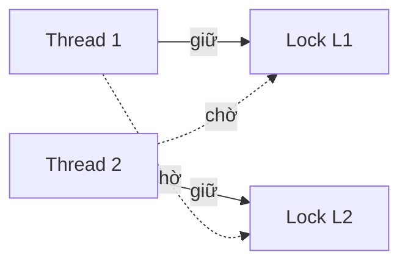

# P4 · Chương 05 — Bug concurrency và deadlock

## Bạn sẽ hiểu được gì

1. **Q1.** Bug concurrency ngoài đời thật rơi vào những mẫu nào (nghiên cứu Lu et al.), và đáng canh chỗ nào trước trong service của bạn? → mục 1
2. **Q2.** Atomicity violation và order violation khác nhau thế nào, sửa bằng công cụ gì? → mục 2
3. **Q3.** Deadlock là gì và vì sao xảy ra dù quy tắc phòng tránh nghe đơn giản? → mục 3
4. **Q4.** Bốn điều kiện Coffman là gì; prevention phá từng điều kiện ra sao; vì sao lock ordering là cách "most practical"; `trylock` phá điều kiện nào và vì sao dẫn tới livelock? → mục 4
5. **Q5.** Avoidance và detect-and-recover khác prevention ra sao? → mục 5
6. **Q6.** `Mutex` của Rust có reentrant không; lock hai lần trên cùng thread thì docs hứa gì và máy thật làm gì? Safe Rust chặn lỗi nào, không chặn lỗi nào? → mục 6 (cũng là phần "Liên hệ với Rust")
7. **Q7.** Deadlock ở tầng DB và connection pool trông thế nào? → mục 7
8. **Q8.** Priority inversion là gì và chữa ra sao? → mục 8

## Kiến thức cần trước

- [Thread (P4·01)](01-thread.md): thread, và việc interleaving (thứ tự các thread xen kẽ nhau) do scheduler quyết định.
- [Lock (P4·03)](03-lock.md) và [Condition variable + semaphore (P4·04)](04-condition-variable-va-semaphore.md): `Mutex` và `Condvar` là công cụ để sửa các bug trong chương này.
- Nền về memory model ở [P4·06](06-memory-model.md) (chỉ cần khi đọc phần data race).

---

## 1. Bức tranh: bug concurrency ngoài đời thật (Q1)

> **Trả lời ngắn.** Bug concurrency ngoài đời lặp lại vài mẫu quen thuộc. Trong nghiên cứu của Lu và cộng sự, gần như mọi bug không-deadlock là atomicity violation hoặc order violation[^ostep-97]. Hầu hết bug chỉ cần tối đa hai thread để xảy ra[^lu-two-threads]. Mẫu khảo sát chỉ gồm bốn ứng dụng nên đây là bức tranh từ một nghiên cứu chứ không phải định luật[^lu-caveat].

**Giải thích.**

*Với service của bạn.* Hãy hình dung `checkout`, một service Rust xử lý thanh toán. Mỗi request vào một handler thread. Thread đó trừ số hàng tồn trong bộ nhớ, chuyển tiền giữa hai tài khoản mỗi cái nằm sau một `Mutex`, rồi lấy một connection từ pool để ghi đơn vào Postgres. Bốn việc ấy đều đụng vào dữ liệu dùng chung, nên bốn chỗ đó đều có thể sinh bug concurrency. Ta sẽ bám theo `checkout` suốt chương (nhận xét của người soạn: đây là ví dụ giả định, không phải code trong repo). Câu hỏi của mục này: bug kiểu đó thường có hình dạng gì, để biết canh chỗ nào trước?

### 1.1 Nghiên cứu nói gì

Dữ liệu dễ trích nhất đến từ Lu và cộng sự: họ đọc lại các bug concurrency đã được sửa trong MySQL, Apache, Mozilla và OpenOffice, tổng cộng 105 bug, gồm 74 bug không-deadlock và 31 bug deadlock[^lu-sample]. Chính các tác giả nói rõ họ không định rút kết luận chung cho mọi chương trình concurrent[^lu-caveat]. Vì vậy các con số dưới đây cho ta một hướng nhìn, không hơn.

Hướng nhìn đó có hai điểm đáng nhớ. Điểm thứ nhất: trong số bug không-deadlock, 97% là atomicity violation hoặc order violation[^ostep-97]. Riêng order violation chiếm khoảng một phần ba[^lu-order-third]. Hai mẫu này là nội dung của mục 2. Điểm thứ hai: 101 trong 105 bug chỉ cần tối đa hai thread[^lu-two-threads]. Với `checkout`, điều đó gợi ý rằng một test cho hai request chạy song song đã có cơ hội lộ phần lớn loại bug này, không cần dựng cả đàn thread (suy luận của người soạn).

<details><summary>Đi sâu: số bug theo từng ứng dụng (OSTEP Fig. 32.1)</summary>

| Ứng dụng | Không-deadlock | Deadlock |
|---|---|---|
| MySQL | 14 | 9 |
| Apache | 13 | 4 |
| Mozilla | 41 | 16 |
| OpenOffice | 6 | 2 |
| **Tổng** | **74** | **31** |

</details>

**Quay lại Q1:** bug concurrency không ngẫu nhiên: hầu hết là atomicity hoặc order violation, và đa số tái hiện được chỉ với hai thread; với `checkout`, hai request song song là đủ để bắt đầu.

---

## 2. Bug không-deadlock: atomicity và order violation (Q2)

> **Trả lời ngắn.** Atomicity violation là một khối "kiểm tra rồi làm" bị thread khác chen vào giữa; order violation là thứ tự "A trước B" không ai ép. Cái đầu sửa bằng cách giữ lock quanh mọi chỗ chạm biến chung[^ostep-atom-fix]. Cái sau phải ép thứ tự, thường bằng condition variable hoặc semaphore[^ostep-order-fix]. Thêm hoặc đổi lock không phải cách sửa chủ yếu: chỉ 20 trong 74 bug không-deadlock của nghiên cứu được sửa như vậy[^lu-fix-locks].

**Giải thích.**

*Với service `checkout`.* Khi `checkout` có tải, hai chuyện sau rất dễ xảy ra. Thứ nhất, hai handler cùng thấy "còn 1 món trong kho" rồi cùng trừ, và kho xuống âm. Thứ hai, một thread nền (chẳng hạn thread gửi metrics) khởi động nhanh hơn dự kiến và đọc cấu hình pool trước khi `main` kịp gán xong. Hai chuyện này không cùng loại, và vì không cùng loại nên không cùng cách sửa. Mục này tách hai loại đó ra.

### 2.1 Atomicity violation: kiểm tra xong thì thế giới đã đổi

Định nghĩa: một vùng code được *định* là atomic, nhưng khi chạy không có gì thực thi tính atomic đó[^ostep-atom-viol]. Ví dụ gốc là một bug MySQL:

```c
// Thread 1                    // Thread 2
if (thd->proc_info) {          thd->proc_info = NULL;
    fputs(thd->proc_info, ...);
}
```

Thread 1 kiểm tra con trỏ khác NULL rồi bị ngắt trước khi gọi `fputs`. Thread 2 chen vào, đặt con trỏ thành NULL. Thread 1 chạy tiếp, dereference NULL và crash[^ostep-atom-ex]. Lỗi không nằm ở dòng nào riêng lẻ mà ở một giả định ngầm: "kiểm tra rồi dùng" là một khối không ai chen vào được. Chữa bằng cách thêm lock quanh mọi chỗ tham chiếu biến chung, để thread nào chạm vào `proc_info` cũng đang giữ lock[^ostep-atom-fix].

Trong `checkout`, cùng cấu trúc đó xuất hiện ở bước trừ kho. Mỗi truy cập đều có lock, nhưng lock bị nhả giữa lúc kiểm tra và lúc trừ:

```rust
if *s.lock().unwrap() > 0 {        // check: lock rồi nhả ngay (guard là temporary)
    *s.lock().unwrap() -= 1;       // act: lock lần khác
    *d.lock().unwrap() += 1;
}
```

Đoạn này vẫn biên dịch được: Rust không biết hai lần `lock()` kia lẽ ra phải là một khối. Đã chạy thật (rustc 1.95.0, 8 thread, mỗi thread 1000 lần bán, kho ban đầu 1000): ba lần chạy cho `stock=0 sold=1000` (hai lần) và `stock=-1 sold=1001` (một lần, bán lố một món). Giữa check và act lock đã được nhả, đúng cấu trúc của ví dụ MySQL.

### 2.2 Order violation: thứ tự không ai ép

Với order violation thì không có khối nào bị chen ngang. Vấn đề là hai nhóm truy cập đáng lẽ phải chạy theo thứ tự "A trước B", nhưng khi chạy không có gì ép thứ tự đó[^ostep-order-viol]. Ví dụ gốc (Mozilla): thread 1 gọi `mThread = PR_CreateThread(mMain, ...)`, còn thread 2 chạy `mMain` và đọc `mThread->State`. Nếu thread mới chạy ngay trước khi `mThread` được gán, nó dereference một con trỏ chưa khởi tạo. Thread 2 dường như đã giả định `mThread` được khởi tạo xong[^ostep-order-ex]. Thread metrics của `checkout` đọc cấu hình pool quá sớm là cùng một kiểu (nhận xét của người soạn).

Cách sửa là ép thứ tự, thường bằng condition variable hoặc semaphore[^ostep-order-fix]: thread 1 đặt một cờ và signal sau khi gán xong, thread 2 chờ trong vòng `while` cho tới khi cờ bật. Vì sao phải `while` thì xem [chương 04](04-condition-variable-va-semaphore.md). Điểm cần nhớ là ở loại bug này lock không giúp được: lock cho phép loại trừ nhau, nó không biết nói "X phải xảy ra trước Y" (nhận xét của người soạn). Con số 20/74 ở phần trả lời ngắn nhất quán với điều đó[^lu-fix-locks].

<details><summary>Đi sâu: sửa bản trừ kho, và những chỗ khác có cùng cấu trúc</summary>

**Bản sửa.** Giữ một guard suốt khối check+act: `let mut g = s.lock().unwrap(); if *g > 0 { *g -= 1; … }`. Chạy bản này cho `stock=0 sold=1000`. Một lần chạy không chứng minh gì; điều chứng minh là lập luận: cả khối check+act nằm trọn trong một critical section.

**Cùng cấu trúc, chỗ khác.** "Kiểm tra rồi làm" có ở khắp nơi trong backend: trừ kho, "kiểm tra user chưa tồn tại rồi insert", "cache miss thì tính rồi ghi" (nhận xét của người soạn). Chỗ nào có khoảng hở giữa check và act, chỗ đó cần được bao trong một critical section (hoặc, với DB, trong một transaction hoặc một câu lệnh có điều kiện).

</details>

**Quay lại Q2:** atomicity cần giữ lock suốt khối check+act; order cần một cơ chế báo "xong rồi" (condvar hoặc semaphore), vì lock chỉ cho loại trừ lẫn nhau.

---

## 3. Deadlock: cơ chế và vì sao khó tránh (Q3)

> **Trả lời ngắn.** Deadlock là khi thread 1 giữ L1 chờ L2 trong lúc thread 2 giữ L2 chờ L1, nên không ai tiến được[^ostep-dl-def]. Nó chỉ *có thể* xảy ra, tùy interleaving[^ostep-dl-maybe]. Quy tắc "luôn lấy lock cùng một thứ tự" nghe đơn giản nhưng khó giữ. Code lớn có phụ thuộc vòng tự nhiên[^ostep-why-dl]. Encapsulation lại giấu việc lấy lock đi[^ostep-encap].

**Giải thích.**

*Với service `checkout`.* Giả sử `checkout` có endpoint chuyển tiền giữa hai ví, mỗi ví là một `Mutex<Account>`. Hàm `transfer(from, to)` khóa `from` rồi khóa `to`. Hai request đến cùng lúc, một chuyển A sang B, một chuyển B sang A: handler thứ nhất giữ A và chờ B, handler thứ hai giữ B và chờ A. Không panic, không dòng log nào; hai request treo mãi, và mọi request sau cần A hoặc B cũng phải chờ theo (nhận xét của người soạn). Mục này giải thích cơ chế đó và vì sao ta vẫn hay dính.

### 3.1 Cơ chế

Mã giả kinh điển của cùng tình huống:

```c
// Thread 1:            // Thread 2:
lock(L1);               lock(L2);
lock(L2);               lock(L1);
```

Đoạn này không phải lúc nào cũng deadlock. Chỉ khi thread 1 lấy L1 xong, context switch sang thread 2, và thread 2 lấy L2 rồi xin L1 thì cả hai mới kẹt[^ostep-dl-maybe]. Cũng vì thế deadlock khó test: nó phụ thuộc interleaving, nên có thể chạy hàng nghìn lần đều ổn rồi kẹt đúng một lần (nhận xét của người soạn).



Đi theo các mũi tên (thread → lock đang chờ → thread đang giữ lock đó → …) sẽ quay về chỗ cũ. Một vòng như vậy trong đồ thị chính là dấu hiệu của deadlock[^ostep-dl-cycle].

### 3.2 Vì sao quy tắc đơn giản vẫn bị vi phạm

Cách tránh ai cũng biết là mọi thread lấy lock theo cùng một thứ tự. Vậy tại sao deadlock vẫn còn? Có hai lý do.

Lý do thứ nhất là code lớn có phụ thuộc vòng tự nhiên. Ví dụ virtual memory system có thể cần file system để nạp một page từ đĩa, còn file system lại cần một page bộ nhớ để đọc block vào nên gọi ngược lại virtual memory system[^ostep-why-dl]. Hai module gọi lẫn nhau như thế thì không có "thứ tự tự nhiên" nào để theo.

Lý do thứ hai là encapsulation giấu việc lấy lock. Trong Java, `Vector.AddAll()` phải lấy lock của cả `v1` lẫn tham số `v2` theo một thứ tự nào đó do bên trong quyết định. Nếu thread khác gọi `v2.AddAll(v1)` gần như cùng lúc thì có nguy cơ deadlock, và người gọi không hề thấy việc lấy lock xảy ra[^ostep-encap]. `transfer(from, to)` của `checkout` có đúng hình dạng đó: người gọi chỉ thấy hai tham số, còn thứ tự khóa nằm sau lưng hàm.

<details><summary>Đi sâu: AB-BA trong Rust</summary>

Trong Rust, tình huống trên là `transfer(from: &Mutex<Account>, to: &Mutex<Account>)` khóa `from` rồi khóa `to`. Gọi `transfer(a, b)` song song với `transfer(b, a)` đúng là bài toán AB-BA mà người gọi không thấy (nhận xét của người soạn). Ví dụ chạy thật và cách sửa nằm ở mục 4.

</details>

**Quay lại Q3:** deadlock là vòng chờ giữa các thread giữ-và-chờ lock; nó phụ thuộc interleaving và ẩn trong code lớn nên quy ước "cùng thứ tự" khó giữ, kể cả với một hàm `transfer` tưởng chừng vô hại.

---

## 4. Bốn điều kiện Coffman và prevention (Q4)

> **Trả lời ngắn.** Deadlock cần đủ bốn điều kiện Coffman: mutual exclusion, hold-and-wait, no preemption, circular wait; thiếu một là không xảy ra[^ostep-dl-any]. Prevention (phòng ngừa) là nhắm vào đúng một điều kiện. Thực dụng nhất là lock ordering, vì nó phá circular wait[^ostep-circ-practical]. `trylock` nhắm vào no preemption, nhưng có thể dẫn tới livelock[^ostep-livelock].

**Giải thích.**

*Với service `checkout`.* Hai request chuyển tiền chéo nhau ở mục 3 chỉ kẹt khi cả bốn điều kiện cùng đúng. Nghĩa là để sửa `transfer`, bạn không cần "làm cho nó thông minh hơn"; chỉ cần chọn một điều kiện và làm cho nó sai. Mục này đi qua bốn lựa chọn đó, và vì sao trên thực tế gần như luôn chọn lock ordering.

### 4.1 Bốn điều kiện

Bốn điều kiện phải cùng đúng thì deadlock mới xảy ra[^ostep-dl4]. Chúng đến từ bài báo kinh điển về deadlock của Coffman, Elphick và Shoshani (1971)[^ostep-coffman].

| Điều kiện | Nghĩa | Phá nó bằng |
|---|---|---|
| Mutual exclusion | Thread giữ độc quyền tài nguyên nó cần, ví dụ khi giữ lock[^ostep-dl-mutex] | Tránh dùng lock: cấu trúc lock-free/wait-free |
| Hold-and-wait | Thread giữ tài nguyên đã có trong lúc chờ tài nguyên khác[^ostep-dl-hold] | Lấy mọi lock cùng một lúc, atomically |
| No preemption | Không ai có thể lấy tài nguyên ra khỏi thread đang giữ[^ostep-dl-nopre] | `trylock`, và nhả lock đang giữ nếu thất bại |
| Circular wait | Có chuỗi vòng thread, mỗi thread giữ tài nguyên mà thread kế tiếp cần[^ostep-circ] | Mọi thread lấy lock theo cùng một thứ tự |

Mỗi chiến lược prevention dưới đây nhắm vào đúng một dòng của bảng.

### 4.2 Phá circular wait: lock ordering

Đây là cách bạn sẽ dùng nhiều nhất. Viết code locking sao cho không bao giờ tạo ra vòng chờ là kỹ thuật phòng ngừa thực dụng nhất, và cũng là kỹ thuật được dùng thường xuyên[^ostep-circ-practical]. Cách thẳng nhất là *total ordering*: có hai lock thì luôn lấy L1 trước L2[^ostep-total-order]. Với `checkout`, nghĩa là cả `transfer(a, b)` lẫn `transfer(b, a)` đều khóa tài khoản có id nhỏ hơn trước (nhận xét của người soạn). Khi hệ thống lớn, total ordering khó giữ và đôi khi thừa, nên người ta dùng *partial ordering*, tức chỉ quy định thứ tự giữa từng nhóm lock. Ví dụ điển hình là comment đầu code memory mapping của Linux, liệt kê mười nhóm thứ tự lock[^ostep-partial-order].

Khi một hàm nhận hai lock làm tham số, như `transfer`, còn một mẹo: dùng *địa chỉ* của lock để định thứ tự[^ostep-addr-order]. Nhờ vậy `transfer(a, b)` và `transfer(b, a)` cùng khóa lock có địa chỉ thấp trước, dù người gọi truyền tham số theo thứ tự nào. Điểm yếu của mọi cách trong nhóm này là thứ tự chỉ là quy ước, và một lập trình viên cẩu thả dễ phá nó mà không biết[^ostep-order-limits].

Đã chạy thật bằng Rust (rustc 1.95.0). Hai thread giữ hai `Mutex`, khóa theo thứ tự ngược nhau: t1 `lock(A); wait(); lock(B)`, t2 `lock(B); wait(); lock(A)`. Để deadlock chắc chắn xảy ra thay vì phụ thuộc may rủi, một `Barrier` ép cả hai thread đã giữ lock đầu rồi mới được xin lock thứ hai. Với `timeout 5`, chương trình in `t1 giu A, doi B` và `t2 giu B, doi A` rồi **không bao giờ kết thúc** (exit 124); kết quả giống nhau trên macOS aarch64 và container Linux. Không panic, không thông báo lỗi: process treo âm thầm, nên trên production deadlock rất khó chẩn đoán (nhận xét của người soạn).

Bản sửa bằng thứ tự địa chỉ (hàm `lock_both` so `&Mutex as *const _ as usize`, khóa địa chỉ thấp trước), mỗi thread lặp 100 000 lần với tham số ngược nhau: chương trình kết thúc và in `a=200000 b=200000`.

### 4.3 Phá hold-and-wait: lấy tất cả cùng lúc

Nếu thread không giữ lock nào trong lúc chờ lock khác thì hold-and-wait không còn. Cách làm: lấy mọi lock cần dùng trong một lần, atomically[^ostep-hold-wait]; ví dụ bọc việc lấy lock trong một lock "prevention" toàn cục. Với `transfer`, nghĩa là lấy cả hai tài khoản trong một bước. Cái giá thứ nhất: gọi một hàm là phải biết trước mọi lock nó sẽ cần, trong khi encapsulation chính là để người gọi khỏi biết. Cái giá thứ hai: concurrency giảm, vì lock phải lấy sớm thay vì lúc thật sự cần[^ostep-hold-wait-cost].

### 4.4 Phá no preemption: `trylock`, và livelock

Cách này đối phó với điều kiện thứ ba. `pthread_mutex_trylock()` hoặc lấy được lock và trả thành công, hoặc trả mã lỗi báo lock đang bị giữ[^ostep-trylock]. Từ đó có giao thức: lấy L1, `trylock` L2; nếu thất bại thì nhả L1 rồi làm lại từ đầu. Thread khác có thể theo cùng giao thức nhưng lấy lock theo thứ tự ngược lại (L2 rồi L1) mà chương trình vẫn không deadlock[^ostep-trylock-proto]. Lưu ý giao thức này không thật sự thêm preemption, tức không lấy lock khỏi thread đang giữ; nó chỉ cho lập trình viên tự rút khỏi quyền sở hữu một cách êm thấm[^ostep-trylock-self].

Cái giá đầu tiên là livelock. Có thể (dù không dễ) hai thread cùng lặp đi lặp lại chuỗi trên và lần nào cũng thất bại khi xin lock thứ hai[^ostep-livelock]. Chúng vẫn chạy, nên đây không phải deadlock, nhưng không thread nào tiến triển. Cách giảm nhẹ là thêm một độ trễ ngẫu nhiên trước khi thử lại, để giảm xác suất hai thread cứ đụng nhau[^ostep-livelock-delay]. Cái giá thứ hai là encapsulation: nếu lock nằm sâu trong một hàm được gọi thì việc nhảy về đầu khó làm, và nếu đã cấp phát thêm tài nguyên sau khi lấy L1 thì phải nhả chúng trước khi thử lại[^ostep-trylock-encap].

Trong Rust, `Mutex::try_lock` không block; nếu mutex đang bị giữ, nó trả lỗi `WouldBlock`[^std-trylock]. Đã chạy giao thức trên bằng hai thread, mỗi thread 100 000 lần, một thread khóa A rồi `try_lock` B, thread kia ngược lại: chương trình kết thúc với `a=200000 b=200000` và bộ đếm retry > 0, tức đụng độ có thật và được giải quyết bằng thử lại. Một lần chạy không chứng minh livelock không bao giờ xảy ra; nó chỉ cho thấy livelock không xuất hiện trong lần đó.

<details><summary>Đi sâu: lock-free, và hai chi tiết về lock ordering</summary>

**Phá mutual exclusion bằng lock-free.** Cách cuối là tránh hẳn nhu cầu mutual exclusion: Herlihy có ý tưởng thiết kế các cấu trúc dữ liệu không dùng lock, dựa vào lệnh phần cứng mạnh như compare-and-swap[^ostep-lockfree]. Không có lock thì không deadlock, nhưng livelock vẫn có thể xảy ra, và một giải pháp thực tế phức tạp hơn đoạn code minh họa[^ostep-lockfree-live]. Cách này phá điều kiện thứ nhất và trả giá bằng độ phức tạp: thiếu tính tổng quát và khó phát triển cấu trúc mới, nên lợi ích chung bị giới hạn[^ostep-lockfree-limit]. Lock-free được đào sâu ở [chương 07](07-lock-free.md).

**Địa chỉ lock giả định hai lock khác nhau.** Đoạn code minh họa mẹo địa chỉ ở trên giả định `m1 != m2`, tức hai lock không phải cùng một lock[^ostep-addr-assume]. Với `transfer(a, a)` (chuyển cho chính mình) thì hai địa chỉ bằng nhau, nên cần kiểm tra riêng, nếu không sẽ tự khóa chính mình (nhận xét của người soạn).

**Phiên bản của ví dụ Linux.** Comment mười nhóm thứ tự lock nói ở §4.2 là của code memory mapping Linux phiên bản 5.2 mà sách dẫn; số nhóm có thể đã khác ở bản kernel mới hơn (suy luận của người soạn).

</details>

**Quay lại Q4:** bốn điều kiện cùng đúng mới có deadlock; mỗi chiến lược prevention phá một điều kiện, và lock ordering là cách thực dụng nhất vì chỉ cần thống nhất thứ tự khóa trong code của bạn.

---

## 5. Avoidance, detect-and-recover (Q5)

> **Trả lời ngắn.** Avoidance cần biết trước mỗi thread có thể lấy lock nào rồi xếp lịch để deadlock không xảy ra[^ostep-avoid]. Vì đòi hỏi đó nên nó hiếm khi được dùng đại trà[^ostep-bankers-general]. Detect-and-recover làm ngược lại: cho deadlock xảy ra rồi mới phát hiện và xử lý. Database làm vậy bằng cách định kỳ dựng đồ thị tài nguyên và tìm chu trình[^ostep-db-detect]. PostgreSQL abort một transaction trong vòng đó, ứng dụng retry[^pg-detect].

**Giải thích.**

*Với service `checkout`.* Ba cách ở mục 4 đều nằm trong code của bạn: bạn chọn thứ tự khóa, bạn gọi `try_lock`. Hai chiến lược còn lại dịch trách nhiệm sang chỗ khác. Với avoidance, một bộ xếp lịch phải biết trước handler nào sẽ khóa tài khoản nào, điều mà request đến lúc nào cũng không báo trước (nhận xét của người soạn). Với detect-and-recover, người làm việc là database: khi hai transaction của `checkout` khóa chéo hàng của nhau, Postgres tự tìm ra và xử lý. Mục này nói avoidance rồi đi vào cách database phát hiện deadlock.

### 5.1 Avoidance: xếp lịch để không đụng nhau

Avoidance cần *hiểu biết toàn cục* về những lock mỗi thread có thể lấy, sau đó xếp lịch sao cho deadlock không thể xảy ra[^ostep-avoid]. Ví dụ: T1 và T2 đều lấy cả L1 và L2, T3 chỉ lấy L2, T4 không lấy lock nào. Lịch an toàn chỉ cần không cho T1 chạy cùng T2. T3 chạy chồng với ai cũng được, vì nó chỉ lấy một lock nên không thể gây deadlock[^ostep-avoid-t3]. Nhưng nếu T1, T2, T3 đều cần cả hai lock thì lịch an toàn buộc cả ba chạy tuần tự trên một CPU, và tổng thời gian hoàn thành bị kéo dài đáng kể[^ostep-avoid-cost].

Banker's algorithm của Dijkstra thuộc họ này, nhưng chỉ hữu ích trong môi trường rất hạn chế, ví dụ một hệ nhúng biết trước toàn bộ task và lock của chúng[^ostep-bankers]. Nói chung, avoidance bằng scheduling không phải giải pháp đa dụng được dùng rộng rãi[^ostep-bankers-general].

### 5.2 Detect and recover: chấp nhận rồi xử lý

Chiến lược cuối là để deadlock thỉnh thoảng xảy ra và xử lý khi phát hiện. Nếu deadlock hiếm, một "non-solution" như reboot cũng khá thực dụng[^ostep-detect]. Nhiều hệ database chạy một detector định kỳ, dựng đồ thị tài nguyên và tìm chu trình trong đó[^ostep-db-detect]. Với mỗi loại tài nguyên một instance, đồ thị này là *wait-for graph*: cạnh từ Pi sang Pj nghĩa là Pi đang chờ tài nguyên mà Pj đang giữ[^bell-waitfor]. Có chu trình nghĩa là có deadlock[^bell-waitfor-cycle]. Phát hiện thì khá đơn giản; recovery mới khó, vì phải abort process hoặc lấy lại tài nguyên, và cả hai đều không phải lựa chọn hấp dẫn[^bell-recover-cost].

### 5.3 Ví dụ thực: PostgreSQL

Với `checkout`, hãy tưởng tượng hai request cập nhật chéo hai hàng của cùng một bảng trong hai transaction. Docs PostgreSQL mô tả đúng trường hợp này: hệ thống tự phát hiện deadlock và abort một trong các transaction liên quan để các transaction khác hoàn thành; transaction nào bị abort thì khó đoán và không nên dựa vào[^pg-detect]. Kiểm tra deadlock khá tốn kém nên server không chạy nó mỗi lần phải chờ lock[^pg-timeout-cost]. Tham số `deadlock_timeout` mặc định là một giây[^pg-timeout-default]. Deadlock cũng xảy ra với row-level lock, kể cả khi bạn không dùng lock tường minh[^pg-rowlevel].

Lời khuyên của docs là phòng trước: cách phòng thủ tốt nhất là mọi ứng dụng lấy lock trên nhiều đối tượng theo một thứ tự nhất quán[^pg-order]. Nếu không kiểm chứng được điều đó trước thì retry transaction bị abort vì deadlock[^pg-retry]. Đó chính là lock ordering (prevention) cộng retry (recover) trong cùng một hệ thống. Thêm một lưu ý cho handler của `checkout`: giữ transaction mở lâu (ví dụ chờ input người dùng) là ý tồi, vì khi chưa phát hiện deadlock nào, transaction đang chờ lock sẽ chờ vô hạn[^pg-longtx].

<details><summary>Đi sâu: Banker's algorithm có số cụ thể, và lockdep trong kernel Linux</summary>

**Banker's algorithm.** Theo ghi chú giáo trình Silberschatz của J. Bell (UIC): mỗi process phải khai báo trước mức tối đa mỗi loại tài nguyên nó có thể xin[^bell-claim]. Một trạng thái là *safe* nếu tồn tại một *safe sequence*, tức thứ tự các process mà yêu cầu của mỗi process thỏa được bằng tài nguyên nó đang giữ cộng tài nguyên các process đứng trước trả lại[^bell-safe]. Trạng thái unsafe *có thể* dẫn tới deadlock, nhưng không phải trạng thái unsafe nào cũng vậy[^bell-unsafe]. Khi có yêu cầu, hệ thống chỉ cấp nếu trạng thái sau đó vẫn safe, không thì process phải chờ[^bell-grant].

Ví dụ số do người soạn tự dựng (một loại tài nguyên, 10 đơn vị): P1 tối đa 8, giữ 3; P2 tối đa 4, giữ 2; P3 tối đa 9, giữ 2; còn rảnh 3. P2 cần thêm 2 ≤ 3, chạy xong thì rảnh 5. P1 cần thêm 5 ≤ 5, xong thì rảnh 8. P3 cần thêm 7 ≤ 8. Vậy ⟨P2, P1, P3⟩ là một safe sequence. Giờ nếu cấp thêm 1 đơn vị cho P3 (rảnh còn 2): P2 vẫn chạy được và trả về, rảnh thành 4, nhưng P1 cần 5 và P3 cần 6 đều lớn hơn 4. Không còn safe sequence, nên Banker's từ chối yêu cầu đó dù chưa có deadlock thật.

**lockdep trong kernel Linux.** Với kernel Linux, *lockdep* tìm các vòng phụ thuộc lock ("lock inversion deadlock") với độ phức tạp bất kỳ, kể cả khi giữa hai lệnh lấy lock có chuỗi lock khác chen vào[^lockdep-cycle]. Theo docs, chỉ cần mỗi chuỗi lock đơn giản từng xảy ra một lần (ở bất kỳ context nào) là validator chứng minh được tính đúng đắn, kể cả cho những tổ hợp nhiều CPU rất hiếm gặp[^lockdep-closure]. Lưu ý (suy luận của người soạn từ chữ "at least once"): lockdep chỉ thấy những chuỗi lock đã thực sự chạy trong lúc test, nên đường code chưa từng được thực thi thì lockdep không nói được gì. Dù vậy, bắt lỗi thứ tự lock ngay lúc test là một tiền lệ nghiêm túc.

</details>

**Quay lại Q5:** avoidance cần biết trước nhu cầu của mọi thread nên hiếm dùng; detect-and-recover chấp nhận deadlock thỉnh thoảng xảy ra rồi xử lý, cách các DB làm, và với `checkout` thì việc của bạn là retry transaction bị abort.

---

## 6. Liên hệ với Rust: deadlock trong Rust (Q6)

> **Trả lời ngắn.** Docs `Mutex::lock` chỉ hứa rằng lần lock thứ hai trên cùng thread sẽ không return (có thể panic, có thể deadlock)[^std-mutex-reenter]; docs không hứa deadlock hay panic. Safe Rust bảo đảm không có data race[^nomicon-race-def]. Nó không ngăn race condition tổng quát[^nomicon-race-cond]. Nó cũng không ngăn deadlock[^nomicon-race-deadlock].

**Giải thích.**

*Với service `checkout`.* `checkout` viết bằng Rust, nên nhiều người trong nhóm sẽ nghĩ compiler đã lo hết chuyện đồng bộ. Mục này kiểm lại điều đó trên ba tình huống: một handler tự khóa lại mutex mà chính nó đang giữ, một guard "tạm" sống lâu hơn bạn nghĩ, và những lỗi mà type system thật sự không chặn.

### 6.1 `Mutex` không reentrant: đọc đúng docs

Docs của `Mutex::lock` ghi: hành vi khi khóa một mutex ở thread *đã giữ* lock đó được để *unspecified* ("left unspecified"). Tuy vậy hàm này sẽ không return ở lần gọi thứ hai, và có thể panic hoặc deadlock chẳng hạn[^std-mutex-reenter]. Phần `# Panics` nói thêm rằng hàm *might* panic nếu lock đã được thread hiện tại giữ[^std-mutex-panics]. Đọc cho chính xác, ta có hai điều:

- Docs **không hứa** deadlock, cũng **không hứa** panic; chỉ hứa "không return ở lần gọi thứ hai".
- Vì vậy bạn không được dựa vào hành vi quan sát được trên một nền tảng.

Quan sát (không phải bảo đảm): với chương trình `let _a = m.lock().unwrap(); let _b = m.lock().unwrap();`, trên rustc 1.95.0 chạy `timeout 5`, cả macOS aarch64 lẫn container Linux đều in dòng "lan 1 xong" rồi treo cho tới khi `timeout` giết (exit 124); không có panic. Đây là hành vi cài đặt của hai nền tảng đó ở bản 1.95.0 và có thể đổi.

Trong `checkout`, kiểu bug này thường xuất hiện khi một hàm đã giữ lock tài khoản lại gọi một hàm khác cũng khóa lại tài khoản đó. Nó khớp với số liệu của Lu: 7 trong 31 bug deadlock chỉ liên quan đến **một** thread[^lu-one-thread], thường là thread cố lấy tài nguyên chính nó đang giữ. Bài báo nhận xét loại này tương đối dễ phát hiện, vì không cần xét tranh chấp từ thread khác[^lu-self].

Lời khuyên (nhận xét của người soạn): thay vì cần reentrancy, hãy tách hàm thành hai phiên bản, một phiên bản "đã giữ lock" nhận `&mut T` (hoặc `&MutexGuard`), một phiên bản "tự khóa" gọi vào phiên bản kia.

### 6.2 Bẫy guard temporary: deadlock vô hình trong `match` và `if let`

Guard của `Mutex` được thả khi bị `drop`. Khi guard là *temporary* (không gán vào biến), nó sống tới hết "temporary scope" của biểu thức. Ví dụ trong docs: `*res_mutex.lock().unwrap() += result;` không gán guard vào biến, nên mutex được nhả ngay sau câu lệnh và không có deadlock[^std-mutex-temp]. Nhưng scrutinee của `match` thì *không* phải một temporary scope, nên temporary trong scrutinee có thể sống đến hết cả biểu thức `match`[^ref-scrutinee]. Còn từ edition 2024, temporary của `if let` được thả *trước* khối `else`[^ref-2024].

Với `checkout`, ví dụ dễ dính là lấy giá trị ra khỏi `Mutex<Option<_>>` bằng `match`, rồi ghi lại vào chính mutex đó trong một nhánh. Đã chạy thật (rustc 1.95.0, `timeout 5`):

```rust
let _unit = match m.lock().unwrap().take() {
    Some(v) => { *m.lock().unwrap() = Some(2); /* khóa lại trong arm */ }
    None => {}
};
```

| Mã | edition 2021 | edition 2024 |
|---|---|---|
| `match m.lock().unwrap().take() { Some(_) => m.lock()… }` | treo (exit 124) | treo (exit 124) |
| `if let Some(v) = m.lock().unwrap().take() { m.lock()… }` | treo | treo |
| `if let Some(v) = m.lock().unwrap().take() { … } else { m.lock()… }` (m = None) | **treo** | chạy được, in "else: khoa lai duoc" |
| tách `let t = m.lock().unwrap().take();` ra một câu lệnh riêng rồi `match t` | chạy được | chạy được |

Kết quả khớp với mô tả của reference: dòng thứ ba khớp thay đổi của edition 2024, còn dòng đầu khớp việc scrutinee của `match` không phải temporary scope. Bài học (nhận xét của người soạn): đừng khóa lại cùng mutex bên trong `match` hay `if let` mà scrutinee có gọi `.lock()`. Lấy giá trị ra trong một câu lệnh `let` riêng, để guard được thả ngay.

Với code async thì thêm một bẫy. Tokio ghi rằng compiler không ngăn guard của `std::sync::Mutex` bị giữ qua `.await` khi task không di chuyển giữa các thread, nhưng việc đó gần như không bao giờ cho ra code concurrent đúng và rất dễ gây deadlock[^tokio-await]. Mặt khác, dùng `Mutex` thường của std trong code async là ổn và thường được ưa hơn, miễn là không giữ guard qua `.await`[^tokio-prefer]. Chi tiết async xem phase I/O.

### 6.3 Safe Rust chặn gì, không chặn gì

Safe Rust bảo đảm không có data race[^nomicon-race-def]. Nhưng nó không ngăn được race condition nói chung[^nomicon-race-cond]. Lý do là điều đó bất khả về mặt toán học khi bạn không kiểm soát scheduler, mà trong môi trường OS thông thường ta không kiểm soát được nó[^nomicon-race-impossible]. Nomicon nói rõ: Rust vẫn được coi là "safe" khi bị deadlock hay làm điều vô nghĩa do đồng bộ sai[^nomicon-race-deadlock]. The Rust Book cũng cảnh báo `Mutex<T>` đi kèm rủi ro tạo ra deadlock[^book-deadlock]. Ngược lại, tự thân một race condition không vi phạm được memory safety; chỉ khi kết hợp với `unsafe` code nào đó mới có thể[^nomicon-race-safe].

| Loại lỗi | Safe Rust có chặn không? |
|---|---|
| Data race | Có: là UB, không thực hiện được trong Safe Rust[^nomicon-race-ub] |
| Atomicity / order violation (race condition logic) | Không (ví dụ ở mục 2 biên dịch được) |
| Deadlock (AB-BA, lock hai lần) | Không (ví dụ ở mục 4 và 6 biên dịch được) |
| Livelock, starvation, priority inversion | Không (suy luận của người soạn: Nomicon chỉ nói chung là không ngăn race condition và deadlock; ba loại này không nằm trong phần được trích) |

Với người quen nghĩ "Rust đã lo hết", đây là ranh giới cần nhớ: type system chặn *hỏng bộ nhớ* do race, không chặn *sai logic đồng bộ*. `checkout` trừ kho âm hay treo ở `transfer` vẫn là lỗi của bạn.

<details><summary>Đi sâu: <code>ReentrantLock</code>, <code>RwLock</code>, và công cụ phát hiện deadlock trong hệ sinh thái Rust</summary>

**`ReentrantLock`.** Std có `ReentrantLock`: thread đã khóa có thể khóa lại nhiều lần mà không bị block, nhờ đó tránh một nguồn deadlock phổ biến[^std-reentrant]. Nhưng ở 1.95.0 đó là API **nightly-only**[^std-reentrant-nightly], không dùng được trên stable.

**`RwLock`.** `RwLock` cũng có bẫy tương tự. Docs cảnh báo rằng một writer đang chờ có thể chặn hoặc không chặn các lời gọi `read` mới, tùy chính sách của OS bên dưới[^std-rwlock-policy]. Docs đưa ví dụ có thể deadlock khi cùng một thread `read` hai lần trong lúc có writer đang chờ[^std-rwlock-deadlock].

**Phát hiện deadlock.** Crate `parking_lot` có module `deadlock`, được mô tả là **Experimental** và bật bằng feature flag `deadlock_detection`[^pl-deadlock]. Ví dụ trong docs tạo một thread nền định kỳ gọi `check_deadlock()` (mỗi 10 giây) và in các thread đang deadlock. Đây là detect-and-recover ở mức detect cho `parking_lot::Mutex`; nó không áp dụng cho `std::sync::Mutex` (suy luận từ việc detector nằm trong crate `parking_lot`).

</details>

**Quay lại Q6:** Rust không hứa gì về lock hai lần ngoài việc không return; type system chặn hỏng bộ nhớ do race, nhưng không chặn sai logic đồng bộ như deadlock.

---

## 7. Deadlock ở tầng database và connection pool (Q7)

> **Trả lời ngắn.** Connection là tài nguyên hữu hạn, nên cùng mô hình giữ-và-chờ cộng vòng chờ áp dụng được cho nó (nhận xét của người soạn). Hai transaction khóa chéo thì DB abort một bên và ứng dụng retry[^pg-retry]. Pool-locking xảy ra khi một tác vụ giữ connection rồi xin thêm connection từ cùng pool[^hikari-lock]. Cỡ pool tối thiểu để tránh deadlock là `Tn × (Cm − 1) + 1`[^hikari-formula].

**Giải thích.**

*Với service `checkout`.* `checkout` không chỉ khóa `Mutex` trong process. Nó còn lấy connection từ pool để nói chuyện với Postgres, và connection cũng là thứ có số lượng cố định, được giữ rồi trả lại. Vì vậy cùng bốn điều kiện của mục 4 áp dụng được, chỉ khác là tài nguyên bị giữ không phải `Mutex` mà là slot trong pool, và lúc kẹt thì không có dòng lỗi nào. Có ba dạng hay gặp.

### 7.1 Ba dạng deadlock quanh DB

1. **Hai transaction khóa row hoặc table chéo nhau.** DB tự phát hiện và abort một bên (mục 5). Ứng dụng phải sẵn sàng retry[^pg-retry]. Nó cũng nên cập nhật các row theo thứ tự nhất quán, ví dụ sort theo id trước khi `UPDATE` hàng loạt (suy ra từ lời khuyên của docs PostgreSQL[^pg-order]).
2. **Pool-locking.** Một tác vụ giữ một connection rồi lại xin thêm connection từ cùng pool. Wiki HikariCP gọi đó là "pool-locking", cho rằng phần lớn đây là vấn đề cấp ứng dụng, và khuyên xem lại ở tầng ứng dụng trước khi tăng pool[^hikari-lock]. Với `checkout`, ví dụ là một handler giữ connection để ghi đơn rồi gọi một hàm khác cũng tự lấy connection (nhận xét của người soạn).
3. **Giữ transaction hoặc connection qua I/O chậm** (gọi HTTP, chờ người dùng): xem cảnh báo của PostgreSQL ở mục 5[^pg-longtx].

### 7.2 Cỡ pool tối thiểu để không deadlock

Wiki HikariCP đưa một công thức cho trường hợp 2: để deadlock không thể xảy ra, `pool size = Tn × (Cm − 1) + 1`[^hikari-formula]. Ở đây Tn là số thread tối đa, còn Cm là số connection tối đa mà một thread giữ đồng thời[^hikari-vars]. Ví dụ Tn = 3, Cm = 4 cho 3 × 3 + 1 = 10. Đó là mức tối thiểu để tránh deadlock, không nhất thiết là mức tối ưu[^hikari-min]. Đọc theo ngôn ngữ của mục 5, đây là một điều kiện kiểu Banker's: luôn còn đủ tài nguyên để ít nhất một thread hoàn thành (nhận xét của người soạn).

<details><summary>Đi sâu: ví dụ Rust đã chạy thật với pool token, và nguồn của công thức</summary>

**Ví dụ Rust đã chạy thật.** "Pool" là hàng đợi `mpsc` chứa N token connection. Hai tác vụ, mỗi tác vụ lấy một token, đi qua `Barrier` (để cả hai chắc chắn đã giữ token đầu) rồi xin token thứ hai. Tn = 2, Cm = 2 nên mức tối thiểu theo công thức là 3.

- N = 2: cả hai in "giu ket noi … xin ket noi thu hai" rồi treo vô hạn (`timeout 5`, exit 124).
- N = 3: cả hai hoàn tất, in "ket thuc" (exit 0).

Kết quả khớp công thức trên ví dụ này (không phải chứng minh tổng quát). Không có `Mutex` nào bị khóa chéo, nhưng đủ bốn điều kiện: token độc quyền, giữ-và-chờ, không bị rút, chờ vòng giữa hai tác vụ (nhận xét của người soạn). Triệu chứng vận hành (nhận xét của người soạn): không có stack trace lỗi, chỉ là latency tăng vô hạn, request timeout dần, CPU thấp. Cách kiểm tra là thread dump và xem số connection `active` của pool đã chạm mức tối đa chưa.

**Về nguồn của công thức.** Trang wiki HikariCP không ghim được theo URL như các nguồn khác. Khi đối chiếu bản clone `HikariCP.wiki.git`, lần sửa cuối của trang là commit `6a950a3` ngày 2021-12-07 và công thức có ở đó; HEAD của wiki lúc review là `dbcb678`.

</details>

**Quay lại Q7:** pool nhỏ hơn mức tối thiểu có thể deadlock mà không `Mutex` nào bị khóa chéo; triệu chứng là latency tăng vô hạn chứ không có lỗi.

---

## 8. Priority inversion (Q8)

> **Trả lời ngắn.** Priority inversion là khi process ưu tiên thấp chạy trong lúc process ưu tiên cao muốn chạy[^kdoc-inversion]. Không có chu trình chờ nào nên đây không phải deadlock. Cách chữa tổng quát là priority inheritance: thread cao đang chờ tạm nâng ưu tiên của thread thấp[^ostep-pi].

**Giải thích.**

*Với service `checkout`.* Giả sử một handler ưu tiên cao cần ghi log, mà lock của logger đang nằm trong tay một thread nền ưu tiên thấp (thread flush log). Handler phải chờ. Nếu lúc đó có một thread ưu tiên vừa, ví dụ job tính báo cáo, đang ăn CPU và liên tục preempt thread flush, thì thread flush không bao giờ chạy tới chỗ nhả lock, và handler ưu tiên cao bị chặn gián tiếp bởi job báo cáo (nhận xét của người soạn: kịch bản giả định theo cấu trúc trong docs kernel). Không có hai thread nào chờ vòng quanh nhau, nên cũng không có deadlock theo nghĩa của mục 3.

### 8.1 Định nghĩa và kịch bản

Không phải mọi "treo" đều là deadlock. *Priority inversion* là khi process ưu tiên thấp chạy trong lúc process ưu tiên cao muốn chạy[^kdoc-inversion]. Khi process cao cần tài nguyên đang do process thấp giữ, nó phải chờ process thấp xong với tài nguyên đó[^kdoc-wait]. Cái cần ngăn là *unbounded* priority inversion, tức process cao bị chặn trong một khoảng thời gian không xác định[^kdoc-unbounded].

Kịch bản kinh điển có ba bên. A (ưu tiên cao) xin lock mà C (ưu tiên thấp) đang giữ, nên phải chờ để C chạy tiếp và nhả lock. Nhưng trong lúc đó B (ưu tiên vừa) chạy, và vì B cao hơn C nên B preempt C; B có thể là một CPU hog khiến C không bao giờ nhả lock. Kết quả là A bị B chặn gián tiếp[^kdoc-abc].

### 8.2 Chữa bằng priority inheritance

Giải pháp tổng quát là *priority inheritance*: thread ưu tiên cao đang chờ tạm thời nâng ưu tiên của thread thấp, để thread thấp chạy được, nhả lock, và đảo ngược được tình huống[^ostep-pi]. Linux hỗ trợ priority-inheritance futex đúng cho việc này[^futex-pi].

<details><summary>Đi sâu: Mars Pathfinder, và priority inversion với Rust</summary>

**Ví dụ thật: Mars Pathfinder.** Nguồn là email ngày 15/12/1997 của Glenn Reeves (kỹ sư JPL) trả lời về sự cố. Bản dùng ở đây là bản sao do OSTEP lưu trên trang của họ (đầu trang ghi sao từ trang UNC), không phải trang gốc của JPL; vì vậy nó có thẩm quyền về nội dung nhưng URL là bản chép lại. OSTEP dẫn trang này làm nguồn về priority inversion trên Pathfinder[^ostep-mars-cite]. Diễn biến: task `bc_dist` ưu tiên cao bị task `ASI/MET` ưu tiên thấp, đang giữ một tài nguyên chung, chặn; còn `ASI/MET` đã bị nhiều task ưu tiên vừa preempt[^mars-cause]. Tài nguyên đó là một mutual-exclusion semaphore dùng trong cơ chế `select()`[^mars-sem]. Cách sửa là đổi cờ tạo semaphore để bật **priority inheritance**[^mars-fix]. Báo cáo cũng nói đội JPL không có quyết định cố ý tắt tùy chọn này, họ chỉ bỏ sót[^mars-lesson].

**Với Rust.** Tôi không thấy trang docs `std::sync::Mutex` nêu bảo đảm priority inheritance (suy luận từ việc không thấy đề cập, không phải xác nhận là không có). Với backend dùng scheduler chia sẻ thời gian công bằng, tác động có lẽ thiên về latency đuôi hơn là treo hẳn (suy luận của người soạn).

</details>

**Quay lại Q8:** priority inversion là chặn gián tiếp qua một thread ưu tiên vừa chứ không phải vòng chờ; priority inheritance chữa bằng cách nâng tạm ưu tiên thread đang giữ lock.

## Tóm tắt

- Lu et al. (105 bug, 4 ứng dụng): 74 không-deadlock, 31 deadlock; 97% bug không-deadlock là atomicity hoặc order violation; 101/105 bug cần tối đa hai thread.
- Atomicity violation: vùng định là atomic nhưng không được bảo vệ, nên đưa cả khối check-act vào một critical section (như bước trừ kho của `checkout`). Order violation: ép thứ tự bằng condvar hoặc semaphore; lock đơn thuần không đủ.
- Deadlock cần đủ bốn điều kiện: mutual exclusion, hold-and-wait, no preemption, circular wait; phá một là hết. Hai request `transfer` chéo nhau là ví dụ AB-BA.
- Prevention thực dụng nhất là lock ordering (total hoặc partial, có thể theo địa chỉ lock); `trylock` phá no preemption nhưng có thể gây livelock; lock-free phá mutual exclusion nhưng khó.
- Avoidance (Banker's) cần biết trước nhu cầu nên ít dùng đại trà; detect-and-recover là cách DB làm (PostgreSQL abort một transaction, ứng dụng retry).
- `Mutex` Rust không reentrant: lần lock thứ hai trên cùng thread "không return" (panic hoặc deadlock); trên macOS và Linux ở 1.95.0 quan sát thấy treo. Safe Rust chỉ chặn data race, không chặn deadlock hay race condition logic.
- Guard temporary trong scrutinee của `match` hoặc `if let` giữ lock lâu hơn ta tưởng; với `if let`, edition 2024 thả temporary trước nhánh `else`, còn `match` giữ nguyên.
- Priority inversion là chặn gián tiếp, không phải deadlock; giải pháp là priority inheritance. Pool nhỏ hơn `Tn×(Cm−1)+1` có thể deadlock.

## Câu hỏi tự kiểm tra

1. Hai mẫu bug không-deadlock chính trong nghiên cứu Lu là gì, chiếm bao nhiêu?
<details><summary>Đáp án</summary>

Atomicity violation và order violation, chiếm 97% bug không-deadlock[^ostep-97]. Mẫu nghiên cứu gồm 74 bug không-deadlock và 31 bug deadlock[^lu-sample].

</details>

2. Vì sao bọc thêm lock không sửa được order violation?
<details><summary>Đáp án</summary>

Lock chỉ cho loại trừ lẫn nhau, còn order violation cần ép thứ tự nên thường sửa bằng condition variable hoặc semaphore[^ostep-order-fix]. Trong nghiên cứu, chỉ 20 trong 74 bug không-deadlock được sửa bằng thêm hoặc đổi lock[^lu-fix-locks].

</details>

3. Bốn điều kiện deadlock là gì và phá từng điều kiện bằng cách nào?
<details><summary>Đáp án</summary>

Bảng ở §4.1: mutual exclusion, hold-and-wait, no preemption, circular wait[^ostep-dl4]. Phá hold-and-wait bằng cách lấy mọi lock cùng lúc[^ostep-hold-wait]. Phá no preemption bằng `trylock`[^ostep-trylock]. Phá circular wait bằng cách lấy lock theo cùng một thứ tự[^ostep-order]. Mutual exclusion thì phá bằng cách tránh hẳn lock (lock-free).

</details>

4. Vì sao lock ordering là kỹ thuật "most practical", và điểm yếu?
<details><summary>Đáp án</summary>

Đó là kỹ thuật phòng ngừa thực dụng nhất và được dùng thường xuyên[^ostep-circ-practical]. Điểm yếu: thứ tự chỉ là quy ước nên lập trình viên cẩu thả dễ bỏ qua[^ostep-order-limits].

</details>

5. Giao thức `trylock` gây hiện tượng gì? Giảm nhẹ ra sao?
<details><summary>Đáp án</summary>

Livelock[^ostep-livelock]. Giảm nhẹ bằng cách thêm độ trễ ngẫu nhiên trước khi thử lại[^ostep-livelock-delay].

</details>

6. Docs `Mutex::lock` bảo đảm gì khi cùng thread lock lần hai? Điều gì chỉ là quan sát?
<details><summary>Đáp án</summary>

Chỉ bảo đảm không return ở lần hai; có thể panic hoặc deadlock[^std-mutex-reenter]. Việc treo trên macOS và Linux ở 1.95.0 là quan sát từ lần chạy thử.

</details>

7. Safe Rust ngăn loại lỗi nào, không ngăn loại nào?
<details><summary>Đáp án</summary>

Ngăn data race[^nomicon-race-def]. Không ngăn race condition tổng quát[^nomicon-race-cond]. Cũng không ngăn deadlock[^nomicon-race-deadlock].

</details>

8. Vì sao `if let … = m.lock().unwrap().take() {…} else { m.lock()… }` treo ở edition 2021 nhưng chạy được ở 2024?
<details><summary>Đáp án</summary>

Ở 2021, guard temporary của scrutinee sống qua `else`. Edition 2024 thả temporary của `if let` trước `else`[^ref-2024]. Với `match` thì scrutinee không phải temporary scope[^ref-scrutinee].

</details>

9. Priority inversion khác deadlock ở đâu? Giải pháp tổng quát?
<details><summary>Đáp án</summary>

Không có chu trình chờ: A chờ C giữ lock còn B chiếm CPU[^kdoc-abc]. Giải pháp là priority inheritance[^ostep-pi].

</details>

10. Tn = 8 thread, mỗi thread cần Cm = 3 connection đồng thời: pool tối thiểu để không deadlock?
<details><summary>Đáp án</summary>

8 × (3 − 1) + 1 = 17, theo công thức của Hikari[^hikari-formula]. Đó là mức tối thiểu, không nhất thiết tối ưu[^hikari-min].

</details>

## Đọc thêm

- OSTEP ch.32 — <https://pages.cs.wisc.edu/~remzi/OSTEP/threads-bugs.pdf>: nguồn chính; code đầy đủ các ví dụ.
- Lu et al., "Learning from Mistakes" — <https://www.cs.columbia.edu/~junfeng/10fa-e6998/papers/concurrency-bugs.pdf>: số liệu gốc và bảng chiến lược sửa.
- Rustonomicon, "Data Races and Race Conditions" — <https://doc.rust-lang.org/1.95.0/nomicon/races.html>: ranh giới Rust bảo đảm / không bảo đảm.
- PostgreSQL, Explicit Locking §13.3.4 — <https://www.postgresql.org/docs/16/explicit-locking.html>: deadlock trong DB thật.
- Linux kernel docs, lockdep — <https://docs.kernel.org/locking/lockdep-design.html>: cách kernel bắt lỗi thứ tự lock.
- Linux kernel docs, RT-mutex design — <https://docs.kernel.org/locking/rt-mutex-design.html>: priority inheritance ở mức cài đặt.
- Chương kế: [Memory model](06-memory-model.md), [Lock-free](07-lock-free.md), [Rust concurrency](08-rust-concurrency.md).

[^bell-claim]: J. Bell (UIC), Operating Systems course notes, ch.7 Deadlocks — <https://www.cs.uic.edu/~jbell/CourseNotes/OperatingSystems/7_Deadlocks.html> — "When a process starts up, it must state in advance the maximum allocation of resources it may request, up to the amount available on the system."
[^bell-grant]: J. Bell (UIC), Operating Systems course notes, ch.7 Deadlocks — <https://www.cs.uic.edu/~jbell/CourseNotes/OperatingSystems/7_Deadlocks.html> — "When a request is made, the scheduler determines whether granting the request would leave the system in a safe state. If not, then the process must wait until the request can be granted safely."
[^bell-recover-cost]: J. Bell (UIC), Operating Systems course notes, ch.7 Deadlocks — <https://www.cs.uic.edu/~jbell/CourseNotes/OperatingSystems/7_Deadlocks.html> — "Deadlock detection is fairly straightforward, but deadlock recovery requires either aborting processes or preempting resources, neither of which is an attractive alternative."
[^bell-safe]: J. Bell (UIC), Operating Systems course notes, ch.7 Deadlocks — <https://www.cs.uic.edu/~jbell/CourseNotes/OperatingSystems/7_Deadlocks.html> — "a state is safe if there exists a safe sequence of processes { P0, P1, P2, ..., PN } such that all of the resource requests for Pi can be granted using the resources currently allocated to Pi and all processes Pj where j < i."
[^bell-unsafe]: J. Bell (UIC), Operating Systems course notes, ch.7 Deadlocks — <https://www.cs.uic.edu/~jbell/CourseNotes/OperatingSystems/7_Deadlocks.html> — "If a safe sequence does not exist, then the system is in an unsafe state, which MAY lead to deadlock. ( All safe states are deadlock free, but not all unsafe states lead to deadlocks. )"
[^bell-waitfor]: J. Bell (UIC), Operating Systems course notes, ch.7 Deadlocks — <https://www.cs.uic.edu/~jbell/CourseNotes/OperatingSystems/7_Deadlocks.html> — "An arc from Pi to Pj in a wait-for graph indicates that process Pi is waiting for a resource that process Pj is currently holding."
[^bell-waitfor-cycle]: J. Bell (UIC), Operating Systems course notes, ch.7 Deadlocks — <https://www.cs.uic.edu/~jbell/CourseNotes/OperatingSystems/7_Deadlocks.html> — "As before, cycles in the wait-for graph indicate deadlocks."
[^book-deadlock]: The Rust Programming Language, 16.3 Shared-State Concurrency — <https://doc.rust-lang.org/1.95.0/book/ch16-03-shared-state.html> — "Similarly, Mutex\<T> comes with the risk of creating deadlocks."
[^futex-pi]: futex(2), Linux man-pages (Debian bookworm) — <https://manpages.debian.org/bookworm/manpages-dev/futex.2.en.html> — "Linux supports priority-inheritance (PI) futexes in order to handle priority-inversion problems that can be encountered with normal futex locks."
[^hikari-formula]: HikariCP wiki, About Pool Sizing — <https://github.com/brettwooldridge/HikariCP/wiki/About-Pool-Sizing> — "The calculation of pool size in order to avoid deadlock is a fairly simple resource allocation formula: pool size = Tn x (Cm - 1) + 1"
[^hikari-lock]: HikariCP wiki, About Pool Sizing — <https://github.com/brettwooldridge/HikariCP/wiki/About-Pool-Sizing> — "The prospect of pool-locking has been raised with respect to single actors that acquire many connections. This is largely an application-level issue."
[^hikari-min]: HikariCP wiki, About Pool Sizing — <https://github.com/brettwooldridge/HikariCP/wiki/About-Pool-Sizing> — "This is not necessarily the optimal pool size, but the minimum required to avoid deadlock."
[^hikari-vars]: HikariCP wiki, About Pool Sizing — <https://github.com/brettwooldridge/HikariCP/wiki/About-Pool-Sizing> — "Where Tn is the maximum number of threads, and Cm is the maximum number of simultaneous connections held by a single thread."
[^kdoc-abc]: Linux kernel docs, RT-mutex implementation design — <https://docs.kernel.org/locking/rt-mutex-design.html> — "A tries to grab a lock that C owns and must wait and lets C run to release the lock. But in the meantime, B executes, and since B is of a higher priority than C, it preempts C"
[^kdoc-inversion]: Linux kernel docs, RT-mutex implementation design — <https://docs.kernel.org/locking/rt-mutex-design.html> — "Priority inversion is when a lower priority process executes while a higher priority process wants to run."
[^kdoc-unbounded]: Linux kernel docs, RT-mutex implementation design — <https://docs.kernel.org/locking/rt-mutex-design.html> — "What we want to prevent is something called unbounded priority inversion. That is when the high priority process is prevented from running by a lower priority process for an undetermined amount of time."
[^kdoc-wait]: Linux kernel docs, RT-mutex implementation design — <https://docs.kernel.org/locking/rt-mutex-design.html> — "the high priority process must wait until the lower priority process is done with the resource."
[^lockdep-closure]: Linux kernel docs, Runtime locking correctness validator — <https://docs.kernel.org/locking/lockdep-design.html> — "complex multi-CPU and multi-task locking scenarios do not have to occur in practice to prove a deadlock: only the simple ‘component’ locking chains have to occur at least once (anytime, in any task/context) for the validator to be able to prove correctness."
[^lockdep-cycle]: Linux kernel docs, Runtime locking correctness validator — <https://docs.kernel.org/locking/lockdep-design.html> — "The validator will find such dependency circle in arbitrary complexity, i.e., there can be any other locking sequence between the acquire-lock operations"
[^lu-caveat]: Lu et al., Learning from Mistakes (ASPLOS 2008) — <https://www.cs.columbia.edu/~junfeng/10fa-e6998/papers/concurrency-bugs.pdf> — "we do not intend to draw any general conclusions about all concurrent applications."
[^lu-fix-locks]: Lu et al., Learning from Mistakes (ASPLOS 2008) — <https://www.cs.columbia.edu/~junfeng/10fa-e6998/papers/concurrency-bugs.pdf> — "Adding or changing locks is not the major fix strategy. It is used for only 20 out of 74 non-deadlock concurrency bugs that we examined."
[^lu-one-thread]: Lu et al., Learning from Mistakes (ASPLOS 2008) — <https://www.cs.columbia.edu/~junfeng/10fa-e6998/papers/concurrency-bugs.pdf> — "The manifestation of some (7 out of 31) deadlock concurrency bugs involves only one thread."
[^lu-order-third]: Lu et al., Learning from Mistakes (ASPLOS 2008) — <https://www.cs.columbia.edu/~junfeng/10fa-e6998/papers/concurrency-bugs.pdf> — "About one third (32%) of the examined non-deadlock bugs are order-violation bugs"
[^lu-sample]: Lu et al., Learning from Mistakes (ASPLOS 2008) — <https://www.cs.columbia.edu/~junfeng/10fa-e6998/papers/concurrency-bugs.pdf> — "Our study is based on 105 randomly selected real world concurrency bugs, including 74 non-deadlock bugs and 31 deadlock bugs, collected from 4 large and mature open-source applications: MySQL, Apache, Mozilla and OpenOffice"
[^lu-self]: Lu et al., Learning from Mistakes (ASPLOS 2008) — <https://www.cs.columbia.edu/~junfeng/10fa-e6998/papers/concurrency-bugs.pdf> — "It usually happens when one thread tries to acquire a resource held by itself. Detecting and analyzing this type of bugs are relatively easy, because we do not need to consider the contention from other concurrent execution components."
[^lu-two-threads]: Lu et al., Learning from Mistakes (ASPLOS 2008) — <https://www.cs.columbia.edu/~junfeng/10fa-e6998/papers/concurrency-bugs.pdf> — "The manifestation of most (101 out of 105) examined concurrency bugs involves no more than two threads."
[^mars-cause]: Glenn Reeves, What Really Happened on Mars (hosted by OSTEP) — <https://pages.cs.wisc.edu/~remzi/OSTEP/Citations/mars.html> — "The higher priority bc_dist task was blocked by the much lower priority ASI/MET task that was holding a shared resource. The ASI/MET task had acquired this resource and then been preempted by several of the medium priority tasks."
[^mars-fix]: Glenn Reeves, What Really Happened on Mars (hosted by OSTEP) — <https://pages.cs.wisc.edu/~remzi/OSTEP/Citations/mars.html> — "change the creation flags for the semaphore so as to enable priority inheritance."
[^mars-lesson]: Glenn Reeves, What Really Happened on Mars (hosted by OSTEP) — <https://pages.cs.wisc.edu/~remzi/OSTEP/Citations/mars.html> — "there was no conscious decision to not have the priority inheritance option enabled. We just missed it."
[^mars-sem]: Glenn Reeves, What Really Happened on Mars (hosted by OSTEP) — <https://pages.cs.wisc.edu/~remzi/OSTEP/Citations/mars.html> — "The resource that caused this problem was a mutual exclusion semaphore used within the select() mechanism"
[^nomicon-race-cond]: The Rustonomicon, Data Races and Race Conditions — <https://doc.rust-lang.org/1.95.0/nomicon/races.html> — "However Rust does not prevent general race conditions."
[^nomicon-race-deadlock]: The Rustonomicon, Data Races and Race Conditions — <https://doc.rust-lang.org/1.95.0/nomicon/races.html> — "it is considered “safe” for Rust to get deadlocked or do something nonsensical with incorrect synchronization"
[^nomicon-race-def]: The Rustonomicon, Data Races and Race Conditions — <https://doc.rust-lang.org/1.95.0/nomicon/races.html> — "Safe Rust guarantees an absence of data races, which are defined as: two or more threads concurrently accessing a location of memory one or more of them is a write one or more of them is unsynchronized"
[^nomicon-race-impossible]: The Rustonomicon, Data Races and Race Conditions — <https://doc.rust-lang.org/1.95.0/nomicon/races.html> — "This is mathematically impossible in situations where you do not control the scheduler, which is true for the normal OS environment."
[^nomicon-race-safe]: The Rustonomicon, Data Races and Race Conditions — <https://doc.rust-lang.org/1.95.0/nomicon/races.html> — "a race condition cannot violate memory safety in a Rust program on its own. Only in conjunction with some other unsafe code can a race condition actually violate memory safety."
[^nomicon-race-ub]: The Rustonomicon, Data Races and Race Conditions — <https://doc.rust-lang.org/1.95.0/nomicon/races.html> — "A data race has Undefined Behavior, and is therefore impossible to perform in Safe Rust."
[^ostep-97]: OSTEP, ch.32 Common Concurrency Problems — <https://pages.cs.wisc.edu/~remzi/OSTEP/threads-bugs.pdf> — "A large fraction (97%) of non-deadlock bugs studied by Lu et al. are either atomicity or order violations."
[^ostep-addr-assume]: OSTEP, ch.32 Common Concurrency Problems — <https://pages.cs.wisc.edu/~remzi/OSTEP/threads-bugs.pdf> — "Code assumes that m1 != m2 (not the same lock)"
[^ostep-addr-order]: OSTEP, ch.32 Common Concurrency Problems — <https://pages.cs.wisc.edu/~remzi/OSTEP/threads-bugs.pdf> — "the clever programmer can use the address of each lock as a way of ordering lock acquisition."
[^ostep-atom-ex]: OSTEP, ch.32 Common Concurrency Problems — <https://pages.cs.wisc.edu/~remzi/OSTEP/threads-bugs.pdf> — "if the first thread performs the check but then is interrupted before the call to fputs, the second thread could run in-between, thus setting the pointer to NULL"
[^ostep-atom-fix]: OSTEP, ch.32 Common Concurrency Problems — <https://pages.cs.wisc.edu/~remzi/OSTEP/threads-bugs.pdf> — "ensuring that when either thread accesses the proc_info field, it has a lock held"
[^ostep-atom-viol]: OSTEP, ch.32 Common Concurrency Problems — <https://pages.cs.wisc.edu/~remzi/OSTEP/threads-bugs.pdf> — "The desired serializability among multiple memory accesses is violated (i.e. a code region is intended to be atomic, but the atomicity is not enforced during execution)."
[^ostep-avoid]: OSTEP, ch.32 Common Concurrency Problems — <https://pages.cs.wisc.edu/~remzi/OSTEP/threads-bugs.pdf> — "Avoidance requires some global knowledge of which locks various threads might grab during their execution, and subsequently schedules said threads in a way as to guarantee no deadlock can occur."
[^ostep-avoid-cost]: OSTEP, ch.32 Common Concurrency Problems — <https://pages.cs.wisc.edu/~remzi/OSTEP/threads-bugs.pdf> — "static scheduling leads to a conservative approach where T1, T2, and T3 are all run on the same processor, and thus the total time to complete the jobs is lengthened considerably."
[^ostep-avoid-t3]: OSTEP, ch.32 Common Concurrency Problems — <https://pages.cs.wisc.edu/~remzi/OSTEP/threads-bugs.pdf> — "Even though T3 grabs lock L2, it can never cause a deadlock by running concurrently with other threads because it only grabs one lock."
[^ostep-bankers]: OSTEP, ch.32 Common Concurrency Problems — <https://pages.cs.wisc.edu/~remzi/OSTEP/threads-bugs.pdf> — "Unfortunately, they are only useful in very limited environments, for example, in an embedded system where one has full knowledge of the entire set of tasks that must be run and the locks that they need."
[^ostep-bankers-general]: OSTEP, ch.32 Common Concurrency Problems — <https://pages.cs.wisc.edu/~remzi/OSTEP/threads-bugs.pdf> — "Thus, avoidance of deadlock via scheduling is not a widely-used general-purpose solution."
[^ostep-circ]: OSTEP, ch.32 Common Concurrency Problems — <https://pages.cs.wisc.edu/~remzi/OSTEP/threads-bugs.pdf> — "Circular wait: There exists a circular chain of threads such that each thread holds one or more resources (e.g., locks) that are being requested by the next thread in the chain."
[^ostep-circ-practical]: OSTEP, ch.32 Common Concurrency Problems — <https://pages.cs.wisc.edu/~remzi/OSTEP/threads-bugs.pdf> — "Probably the most practical prevention technique (and certainly one that is frequently employed) is to write your locking code such that you never induce a circular wait."
[^ostep-coffman]: OSTEP, ch.32 Common Concurrency Problems — <https://pages.cs.wisc.edu/~remzi/OSTEP/threads-bugs.pdf> — "The classic paper outlining the conditions for deadlock and how you might go about dealing with it."
[^ostep-db-detect]: OSTEP, ch.32 Common Concurrency Problems — <https://pages.cs.wisc.edu/~remzi/OSTEP/threads-bugs.pdf> — "A deadlock detector runs periodically, building a resource graph and checking it for cycles."
[^ostep-detect]: OSTEP, ch.32 Common Concurrency Problems — <https://pages.cs.wisc.edu/~remzi/OSTEP/threads-bugs.pdf> — "If deadlocks are rare, such a non-solution is indeed quite pragmatic."
[^ostep-dl-any]: OSTEP, ch.32 Common Concurrency Problems — <https://pages.cs.wisc.edu/~remzi/OSTEP/threads-bugs.pdf> — "If any of these four conditions are not met, deadlock cannot occur."
[^ostep-dl-cycle]: OSTEP, ch.32 Common Concurrency Problems — <https://pages.cs.wisc.edu/~remzi/OSTEP/threads-bugs.pdf> — "the presence of a cycle in the graph is indicative of the deadlock."
[^ostep-dl-def]: OSTEP, ch.32 Common Concurrency Problems — <https://pages.cs.wisc.edu/~remzi/OSTEP/threads-bugs.pdf> — "Deadlock occurs, for example, when a thread (say Thread 1) is holding a lock (L1) and waiting for another one (L2); unfortunately, the thread (Thread 2) that holds lock L2 is waiting for L1 to be released."
[^ostep-dl-hold]: OSTEP, ch.32 Common Concurrency Problems — <https://pages.cs.wisc.edu/~remzi/OSTEP/threads-bugs.pdf> — "Hold-and-wait: Threads hold resources allocated to them (e.g., locks that they have already acquired) while waiting for additional resources"
[^ostep-dl-maybe]: OSTEP, ch.32 Common Concurrency Problems — <https://pages.cs.wisc.edu/~remzi/OSTEP/threads-bugs.pdf> — "Note that if this code runs, deadlock does not necessarily occur; rather, it may occur, if, for example, Thread 1 grabs lock L1 and then a context switch occurs to Thread 2."
[^ostep-dl-mutex]: OSTEP, ch.32 Common Concurrency Problems — <https://pages.cs.wisc.edu/~remzi/OSTEP/threads-bugs.pdf> — "Mutual exclusion: Threads claim exclusive control of resources that they require (e.g., a thread grabs a lock)."
[^ostep-dl-nopre]: OSTEP, ch.32 Common Concurrency Problems — <https://pages.cs.wisc.edu/~remzi/OSTEP/threads-bugs.pdf> — "No preemption: Resources (e.g., locks) cannot be forcibly removed from threads that are holding them."
[^ostep-dl4]: OSTEP, ch.32 Common Concurrency Problems — <https://pages.cs.wisc.edu/~remzi/OSTEP/threads-bugs.pdf> — "Four conditions need to hold for a deadlock to occur"
[^ostep-encap]: OSTEP, ch.32 Common Concurrency Problems — <https://pages.cs.wisc.edu/~remzi/OSTEP/threads-bugs.pdf> — "we have the potential for deadlock, all in a way that is quite hidden from the calling application."
[^ostep-hold-wait]: OSTEP, ch.32 Common Concurrency Problems — <https://pages.cs.wisc.edu/~remzi/OSTEP/threads-bugs.pdf> — "The hold-and-wait requirement for deadlock can be avoided by acquiring all locks at once, atomically."
[^ostep-hold-wait-cost]: OSTEP, ch.32 Common Concurrency Problems — <https://pages.cs.wisc.edu/~remzi/OSTEP/threads-bugs.pdf> — "This technique also is likely to decrease concurrency as all locks must be acquired early on (at once) instead of when they are truly needed."
[^ostep-livelock]: OSTEP, ch.32 Common Concurrency Problems — <https://pages.cs.wisc.edu/~remzi/OSTEP/threads-bugs.pdf> — "It is possible (though perhaps unlikely) that two threads could both be repeatedly attempting this sequence and repeatedly failing to acquire both locks."
[^ostep-livelock-delay]: OSTEP, ch.32 Common Concurrency Problems — <https://pages.cs.wisc.edu/~remzi/OSTEP/threads-bugs.pdf> — "one could add a random delay before looping back and trying the entire thing over again, thus decreasing the odds of repeated interference among competing threads."
[^ostep-lockfree]: OSTEP, ch.32 Common Concurrency Problems — <https://pages.cs.wisc.edu/~remzi/OSTEP/threads-bugs.pdf> — "Herlihy had the idea that one could design various data structures without locks at all"
[^ostep-lockfree-limit]: OSTEP, ch.32 Common Concurrency Problems — <https://pages.cs.wisc.edu/~remzi/OSTEP/threads-bugs.pdf> — "However, their lack of generality and the complexity to develop a new wait-free data structure will likely limit the overall utility of this approach."
[^ostep-lockfree-live]: OSTEP, ch.32 Common Concurrency Problems — <https://pages.cs.wisc.edu/~remzi/OSTEP/threads-bugs.pdf> — "no lock is acquired, and no deadlock can arise (though livelock is still a possibility, and thus a robust solution will be more complex than the simple code snippet above)."
[^ostep-mars-cite]: OSTEP, ch.28 Locks (references) — <https://pages.cs.wisc.edu/~remzi/OSTEP/threads-locks.pdf> — "A description of priority inversion on Mars Pathfinder."
[^ostep-order]: OSTEP, ch.32 Common Concurrency Problems — <https://pages.cs.wisc.edu/~remzi/OSTEP/threads-bugs.pdf> — "if Thread 1 and 2 both made sure to grab locks in the same order, the deadlock would never arise."
[^ostep-order-ex]: OSTEP, ch.32 Common Concurrency Problems — <https://pages.cs.wisc.edu/~remzi/OSTEP/threads-bugs.pdf> — "the code in Thread 2 seems to assume that the variable mThread has already been initialized (and is not NULL)"
[^ostep-order-fix]: OSTEP, ch.32 Common Concurrency Problems — <https://pages.cs.wisc.edu/~remzi/OSTEP/threads-bugs.pdf> — "The fix to this type of bug is generally to enforce ordering. As discussed previously, using condition variables is an easy and robust way to add this style of synchronization"
[^ostep-order-limits]: OSTEP, ch.32 Common Concurrency Problems — <https://pages.cs.wisc.edu/~remzi/OSTEP/threads-bugs.pdf> — "ordering is just a convention, and a sloppy programmer can easily ignore the locking protocol and potentially cause deadlock."
[^ostep-order-viol]: OSTEP, ch.32 Common Concurrency Problems — <https://pages.cs.wisc.edu/~remzi/OSTEP/threads-bugs.pdf> — "The desired order between two (groups of) memory accesses is flipped (i.e., A should always be executed before B, but the order is not enforced during execution)"
[^ostep-partial-order]: OSTEP, ch.32 Common Concurrency Problems — <https://pages.cs.wisc.edu/~remzi/OSTEP/threads-bugs.pdf> — "the comment at the top of the source code reveals ten different groups of lock acquisition orders"
[^ostep-pi]: OSTEP, ch.28 Locks — <https://pages.cs.wisc.edu/~remzi/OSTEP/threads-locks.pdf> — "a higher-priority thread waiting for a lower-priority thread can temporarily boost the lower thread’s priority, thus enabling it to run and overcoming the inversion, a technique known as priority inheritance."
[^ostep-total-order]: OSTEP, ch.32 Common Concurrency Problems — <https://pages.cs.wisc.edu/~remzi/OSTEP/threads-bugs.pdf> — "The most straightforward way to do that is to provide a total ordering on lock acquisition."
[^ostep-trylock]: OSTEP, ch.32 Common Concurrency Problems — <https://pages.cs.wisc.edu/~remzi/OSTEP/threads-bugs.pdf> — "the routine pthread_mutex_trylock() either grabs the lock (if it is available) and returns success or returns an error code indicating the lock is held"
[^ostep-trylock-encap]: OSTEP, ch.32 Common Concurrency Problems — <https://pages.cs.wisc.edu/~remzi/OSTEP/threads-bugs.pdf> — "if one of these locks is buried in some routine that is getting called, the jump back to the beginning becomes more complex to implement."
[^ostep-trylock-proto]: OSTEP, ch.32 Common Concurrency Problems — <https://pages.cs.wisc.edu/~remzi/OSTEP/threads-bugs.pdf> — "Note that another thread could follow the same protocol but grab the locks in the other order (L2 then L1) and the program would still be deadlock free."
[^ostep-trylock-self]: OSTEP, ch.32 Common Concurrency Problems — <https://pages.cs.wisc.edu/~remzi/OSTEP/threads-bugs.pdf> — "this approach doesn't really add preemption (the forcible action of taking a lock away from a thread that owns it), but rather uses the trylock approach to allow a developer to back out of lock ownership"
[^ostep-why-dl]: OSTEP, ch.32 Common Concurrency Problems — <https://pages.cs.wisc.edu/~remzi/OSTEP/threads-bugs.pdf> — "The virtual memory system might need to access the file system in order to page in a block from disk; the file system might subsequently require a page of memory to read the block into and thus contact the virtual memory system."
[^pg-detect]: PostgreSQL 16 docs, 13.3.4 Deadlocks — <https://www.postgresql.org/docs/16/explicit-locking.html> — "PostgreSQL automatically detects deadlock situations and resolves them by aborting one of the transactions involved, allowing the other(s) to complete. (Exactly which transaction will be aborted is difficult to predict and should not be relied upon.)"
[^pg-longtx]: PostgreSQL 16 docs, 13.3.4 Deadlocks — <https://www.postgresql.org/docs/16/explicit-locking.html> — "So long as no deadlock situation is detected, a transaction seeking either a table-level or row-level lock will wait indefinitely for conflicting locks to be released. This means it is a bad idea for applications to hold transactions open for long periods of time (e.g., while waiting for user input)."
[^pg-order]: PostgreSQL 16 docs, 13.3.4 Deadlocks — <https://www.postgresql.org/docs/16/explicit-locking.html> — "The best defense against deadlocks is generally to avoid them by being certain that all applications using a database acquire locks on multiple objects in a consistent order."
[^pg-retry]: PostgreSQL 16 docs, 13.3.4 Deadlocks — <https://www.postgresql.org/docs/16/explicit-locking.html> — "deadlocks can be handled on-the-fly by retrying transactions that abort due to deadlocks."
[^pg-rowlevel]: PostgreSQL 16 docs, 13.3.4 Deadlocks — <https://www.postgresql.org/docs/16/explicit-locking.html> — "Note that deadlocks can also occur as the result of row-level locks (and thus, they can occur even if explicit locking is not used)."
[^pg-timeout-cost]: PostgreSQL 16 docs, 19.12 Lock Management (deadlock_timeout) — <https://www.postgresql.org/docs/16/runtime-config-locks.html> — "The check for deadlock is relatively expensive, so the server doesn't run it every time it waits for a lock."
[^pg-timeout-default]: PostgreSQL 16 docs, 19.12 Lock Management (deadlock_timeout) — <https://www.postgresql.org/docs/16/runtime-config-locks.html> — "The default is one second (1s), which is probably about the smallest value you would want in practice."
[^pl-deadlock]: parking_lot 0.12.3 docs, module `deadlock` — <https://docs.rs/parking_lot/0.12.3/parking_lot/deadlock/index.html> — "Experimental Deadlock detection This feature is optional and can be enabled via the deadlock_detection feature flag."
[^ref-2024]: The Rust Reference, Destructors (temporary scopes) — <https://doc.rust-lang.org/1.95.0/reference/destructors.html> — "The 2024 edition added two new temporary scope narrowing rules: if let temporaries are dropped before the else block, and temporaries of tail expressions of blocks are dropped immediately after the tail expression is evaluated."
[^ref-scrutinee]: The Rust Reference, Destructors (temporary scopes) — <https://doc.rust-lang.org/1.95.0/reference/destructors.html> — "The scrutinee of a match expression is not a temporary scope, so temporaries in the scrutinee can be dropped after the match expression."
[^std-mutex-panics]: Rust std 1.95.0, `std::sync::Mutex::lock` — <https://doc.rust-lang.org/1.95.0/std/sync/struct.Mutex.html> — "This function might panic when called if the lock is already held by the current thread."
[^std-mutex-reenter]: Rust std 1.95.0, `std::sync::Mutex::lock` — <https://doc.rust-lang.org/1.95.0/std/sync/struct.Mutex.html> — "The exact behavior on locking a mutex in the thread which already holds the lock is left unspecified. However, this function will not return on the second call (it might panic or deadlock, for example)."
[^std-mutex-temp]: Rust std 1.95.0, `std::sync::Mutex` (example) — <https://doc.rust-lang.org/1.95.0/std/sync/struct.Mutex.html> — "Here the mutex guard is not assigned to a variable and so, even if the scope does not end after this line, the mutex is still released: there is no deadlock."
[^std-reentrant]: Rust std 1.95.0, `std::sync::ReentrantLock` — <https://doc.rust-lang.org/1.95.0/std/sync/struct.ReentrantLock.html> — "The thread which has already locked the mutex can lock it multiple times without blocking, preventing a common source of deadlocks."
[^std-reentrant-nightly]: Rust std 1.95.0, `std::sync::ReentrantLock` — <https://doc.rust-lang.org/1.95.0/std/sync/struct.ReentrantLock.html> — "This is a nightly-only experimental API."
[^std-rwlock-deadlock]: Rust std 1.95.0, `std::sync::RwLock` — <https://doc.rust-lang.org/1.95.0/std/sync/struct.RwLock.html> — "let _rg1 = lock.read(); | | // will block | let _wg = lock.write(); // may deadlock | let _rg2 = lock.read();"
[^std-rwlock-policy]: Rust std 1.95.0, `std::sync::RwLock` — <https://doc.rust-lang.org/1.95.0/std/sync/struct.RwLock.html> — "The priority policy of the lock is dependent on the underlying operating system’s implementation, and this type does not guarantee that any particular policy will be used. In particular, a writer which is waiting to acquire the lock in write might or might not block concurrent calls to read"
[^std-trylock]: Rust std 1.95.0, `std::sync::Mutex::try_lock` — <https://doc.rust-lang.org/1.95.0/std/sync/struct.Mutex.html> — "If the mutex could not be acquired because it is already locked, then this call will return the WouldBlock error."
[^tokio-await]: Tokio 1.40.0 docs, `tokio::sync::Mutex` — <https://docs.rs/tokio/1.40.0/tokio/sync/struct.Mutex.html> — "this virtually never leads to correct concurrent code in practice as it can easily lead to deadlocks."
[^tokio-prefer]: Tokio 1.40.0 docs, `tokio::sync::Mutex` — <https://docs.rs/tokio/1.40.0/tokio/sync/struct.Mutex.html> — "Contrary to popular belief, it is ok and often preferred to use the ordinary Mutex from the standard library in asynchronous code."
