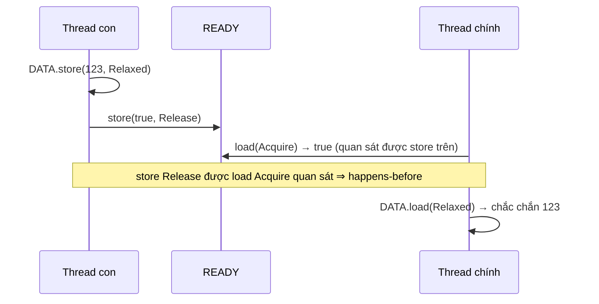

# P4 · Chương 06 — Memory model

## Bạn sẽ hiểu được gì

1. **Q1.** Vì sao thứ tự trong code không phải thứ tự thực thi: compiler hay CPU là thủ phạm? → mục 1
2. **Q2.** Cache coherence (MESI) đã giữ cache nhất quán, vậy vì sao vẫn cần memory ordering? → mục 2
3. **Q3.** Data race là gì, vì sao là UB, và vì sao memory model của Rust là mô hình *trừu tượng*? → mục 3
4. **Q4.** Happens-before là gì, và những tình huống nào tạo ra nó giữa hai thread? → mục 4
5. **Q5.** `Relaxed`, `Acquire`/`Release`, `AcqRel` bảo đảm chính xác điều gì, và điều kiện nào làm bảo đảm của `Acquire`/`Release` *không* xảy ra? → mục 5
6. **Q6.** Khi nào thật sự cần `SeqCst`? Fence dùng để làm gì? → mục 6
7. **Q7.** Một spin lock dùng Acquire/Release đúng nhờ chuỗi lập luận nào? → mục 7
8. **Q8.** x86-64 và ARM64 khác nhau ra sao về reordering, và vì sao "chạy đúng trên máy tôi" không là bằng chứng? → mục 8

## Kiến thức cần trước

- [Cache hierarchy và NUMA (P2 · Chương 06)](../02-cpu/06-cache-va-numa.md): cache line, MESI, false sharing. Chương này chỉ nhắc phần cần cho ordering.
- [Pipeline và speculation (P2 · Chương 05)](../02-cpu/05-pipeline-va-speculation.md): CPU chạy các lệnh chồng lên nhau.
- Race condition, critical section và mutex ở mức [chương Lock](03-lock.md).

Chương này là nền cho [lock-free (Chương 07)](07-lock-free.md) và [concurrency trong Rust (Chương 08)](08-rust-concurrency.md).

## 1. Vấn đề: thứ tự trong code không phải thứ tự thực thi (Q1)

> **Trả lời ngắn.** Cả hai. Compiler có thể đổi thứ tự thao tác, thậm chí làm một số sự kiện không bao giờ xảy ra[^nomicon-compiler-reorder]. Processor cũng có thể chạy các lệnh sai thứ tự nếu thấy nhanh hơn[^atomics-reorder-cpu]. Chương trình một thread không nhận ra điều đó, vì logic kiểm tra phép biến đổi của compiler không tính đến các thread khác[^atomics-nosingle]. Các tính năng của processor cũng không ảnh hưởng chương trình một thread, ngoài thời gian chạy[^atomics-single-thread-inv].

**Giải thích.**

*Với service của bạn.* Ta sẽ bám theo `orders`, một service Rust chạy một pool handler thread, suốt chương này (nhận xét của người soạn: đây là ví dụ giả định, không phải code trong repo). Các handler dùng chung ba thứ: bộ đếm `requests_total` mà thread nào cũng tăng; một `Config` do thread reloader nạp lại từ file rồi công bố cho các handler; và một cache tồn kho đặt sau lock. Mục này hỏi câu đầu tiên. Reloader ghi `Config` xong mới bật cờ `ready`, vậy handler thấy `ready = true` thì có chắc thấy `Config` mới không? Trực giác nói có, vì dòng ghi config đứng trước dòng bật cờ. Ta sẽ thấy trực giác đó không đứng vững.

### 1.1 Compiler

Compiler muốn giảm phụ thuộc dữ liệu và loại bỏ code chết, nên nó được phép đổi thứ tự thực tế của các sự kiện, thậm chí khiến có sự kiện không bao giờ xảy ra[^nomicon-compiler-reorder]. Ví dụ trong Nomicon: `x = 1; y = 3; x = 2;` có thể bị đổi thành `x = 2; y = 3;`. Một lệnh gán biến mất, và `y` được gán sớm hơn. Với một thread thì chẳng ai nhận ra. Với chương trình đa luồng thì khác: có thể bạn đã dựa vào việc `x` mang giá trị 1 trước khi `y` được gán.

Gốc của chuyện này là logic mà compiler dùng để kiểm tra một phép đảo thứ tự có giữ nguyên hành vi hay không: nó chỉ xét một thread, không tính đến các thread khác[^atomics-nosingle]. Nhiều người nghĩ tắt optimization là hết lo, nhưng không phải: tắt tối ưu không tắt mọi phép biến đổi của compiler, và cũng không tắt các tính năng processor gây ra reorder[^atomics-myth-opt].

### 1.2 CPU

Processor cũng đảo thứ tự. Nếu thấy hai lệnh liền nhau không ảnh hưởng đến nhau, nó có thể chạy chúng sai thứ tự khi làm vậy nhanh hơn[^atomics-reorder-cpu]. Nomicon giải thích từ phía bộ nhớ: mỗi CPU thích làm việc với cache cục bộ hơn là bộ nhớ chung, nên phần cứng không bảo đảm rằng các sự kiện xảy ra theo thứ tự nào ở thread này thì thread khác cũng thấy theo thứ tự đó[^nomicon-hw-reorder].

Nomicon có một ví dụ cụ thể. Ban đầu `x = 0, y = 1`; thread 1 chạy `y = 3; x = 1;`, thread 2 chạy `if x == 1 { y *= 2; }`. Lý tưởng thì `y` cuối cùng chỉ là 3 hoặc 6. Nomicon nói phần cứng còn cho phép `y = 2`: thread 2 thấy `x = 1` mà chưa thấy `y = 3`, nên nhân đôi giá trị cũ rồi ghi đè[^nomicon-y2]. (Nomicon nói trạng thái này là *khả dĩ*; chương này không khẳng định đã quan sát nó.)

Đặt vào `orders`, đó chính là rủi ro của câu hỏi ở đầu mục: handler có thể thấy `ready` đã bật mà `Config` vẫn là bản cũ (nhận xét của người soạn).

<details><summary>Đi sâu: ba tối ưu của processor (store buffer, invalidation queue, pipelining)</summary>

Ngoài caching nhất quán, vốn chỉ ảnh hưởng thời gian, processor hiện đại còn nhiều tối ưu khác, và khi có nhiều thread thì chúng ảnh hưởng đến tính đúng[^atomics-reorder-impact]. Chúng không làm chương trình một thread khác đi, ngoài thời gian, nhưng khiến tương tác với core khác trông như xảy ra theo thứ tự không nhất quán[^atomics-single-thread-inv]. Có ba ví dụ:

1. **Store buffer.** Ghi bộ nhớ chậm, nên core cất lệnh ghi vào store buffer (rất nhanh) rồi chạy tiếp ngay. Việc ghi thật vào cache L1 làm sau, nên core không phải chờ cache coherence protocol giành quyền truy cập độc quyền cache line[^atomics-storebuf]. Với các lệnh cùng thread trên cùng core thì điều này vô hình. Nhưng trong một khoảnh khắc lệnh ghi chưa hiện ra với core khác, nên các thread trên những core khác nhau thấy bộ nhớ không nhất quán[^atomics-storebuf-vis].
2. **Invalidation queue.** Cache nhận yêu cầu "bỏ cache line này vì sắp bị sửa" (invalidation). Để nhanh hơn, các yêu cầu này thường được xếp hàng chứ không xử lý ngay. Khi đó các cache không còn luôn nhất quán: một line có thể tạm cũ trước khi bị bỏ[^atomics-invq].
3. **Pipelining.** Processor chạy song song các lệnh liên tiếp nếu được[^atomics-pipe]. Khi một lệnh bộ nhớ xong trước lệnh đứng trước nó, tương tác với core khác có thể xảy ra "sai thứ tự" (nhận xét của người soạn).

</details>

**Quay lại Q1:** compiler và CPU đều được đảo thứ tự miễn chương trình một thread không thấy khác biệt; thread khác thì thấy. Với `orders`, "ghi config trước, bật cờ sau" trong code chưa phải điều thread khác nhìn thấy.

## 2. Cache coherence không thay thế ordering (Q2)

> **Trả lời ngắn.** Cache coherence nói chung chỉ ảnh hưởng thời gian chứ không ảnh hưởng tính đúng của chương trình[^atomics-consistent-caching]. Thứ ảnh hưởng tính đúng là các tối ưu khác của processor, ví dụ store buffer, invalidation queue, pipelining[^atomics-reorder-impact]. Kiến trúc cho phép reorder cũng có lệnh riêng để chặn nó, và khi bạn chọn một `Ordering`, compiler sinh các lệnh đó[^atomics-compiler-gen].

**Giải thích.**

*Với service `orders`.* Máy chạy `orders` có nhiều core, mỗi core một cache riêng. Vì cache coherence giữ các cache nhất quán, dễ nghĩ rằng reloader ghi xong thì core của handler tự thấy ngay. Mục này cho thấy coherence chỉ lo một nửa chuyện; nửa còn lại là việc của memory ordering.

### 2.1 Coherence làm gì

Chương [Cache và NUMA](../02-cpu/06-cache-va-numa.md) đã giải thích: cache coherence protocol quy định cách các cache trao đổi với nhau để giữ trạng thái nhất quán[^atomics-coherence]. MESI là một protocol như vậy, đặt tên theo bốn trạng thái của một cache line[^atomics-mesi].

Điểm then chốt là caching nhất quán nói chung *không* ảnh hưởng tính đúng của chương trình, kể cả khi có nhiều thread. Khác biệt duy nhất quan sát được là thời gian[^atomics-consistent-caching]. Thứ ảnh hưởng tính đúng là các tối ưu *khác* ở mục 1.

Từ đó suy ra (suy luận của người soạn; sách không viết nguyên câu này) rằng coherence không thay được memory ordering. Coherence giữ *từng* cache line nhất quán, còn ordering nói về thứ tự mà các thao tác lên *nhiều* vị trí nhớ trở nên thấy được với thread khác. Trong `orders`, `Config` và `ready` là hai vị trí nhớ, nên đây đúng là chỗ coherence không giúp được.

### 2.2 Phần cứng có công cụ để chặn reordering

Kiến trúc nào cho phép reorder thì cũng có lệnh đặc biệt để ngăn nó[^atomics-need-instr]. Ví dụ có lệnh buộc processor xả store buffer, hoặc hoàn tất các lệnh đang nằm trong pipeline, trước khi chạy tiếp[^atomics-flush]. Có lệnh chỉ chặn một loại reorder (chẳng hạn store-store mà vẫn cho load reorder), và loại reorder nào xảy ra, chặn thế nào, thì tùy kiến trúc (nhận xét của người soạn, tổng hợp từ hai nguồn trên).

Bạn không tự viết các lệnh đó. Khi chọn một `Ordering` cho thao tác atomic, compiler sinh đúng lệnh để processor không reorder theo cách phá luật[^atomics-compiler-gen].

<details><summary>Đi sâu: mức reorder được phép của từng loại thao tác</summary>

Mức reorder được phép phụ thuộc loại thao tác. Với thao tác non-atomic và atomic `Relaxed`, mọi kiểu reorder đều chấp nhận được[^atomics-allowed-reorder]. Ở cực kia, thao tác `SeqCst` không cho phép kiểu reorder nào[^atomics-seqcst-noreorder], nhưng xem mục 6: thứ tự toàn cục chỉ được bảo đảm giữa các thao tác `SeqCst` với nhau[^atomics-seqcst-only-seqcst]. Ở giữa, acquire không được reorder với các thao tác bộ nhớ *sau* nó, còn release không được reorder với các thao tác *trước* nó[^atomics-acq-rel-reorder].

Các ordering của Rust rất trừu tượng và không phản ánh trực tiếp cơ chế của compiler hay processor, nhờ vậy code viết ra không phụ thuộc kiến trúc[^atomics-orderings-abstract].

</details>

**Quay lại Q2:** coherence giữ từng cache line nhất quán nhưng không quyết định thứ tự thấy được giữa nhiều vị trí nhớ; việc đó là của memory ordering.

## 3. Data race, và vì sao cần một mô hình trừu tượng (Q3)

> **Trả lời ngắn.** Data race là các truy cập xung đột, không đồng bộ, trong đó ít nhất một truy cập là non-atomic; nó là undefined behavior[^std-datarace]. Để tách khỏi chi tiết từng kiến trúc, memory model của Rust (phần lớn sao từ C++) là một mô hình trừu tượng thay vì mô tả một CPU cụ thể[^atomics-mm-abstract]. Vì vậy bạn lập luận bằng mô hình, không bằng "CPU của tôi làm gì" (hệ quả theo người soạn).

**Giải thích.**

*Với service `orders`.* Giả sử reloader ghi vào một biến `Config` thường (non-atomic) trong lúc một handler đọc chính biến đó, và không có gì đồng bộ hai bên. Đó là data race, và hậu quả không chỉ là đọc ra giá trị hơi cũ. Mục này nói vì sao, rồi vì sao ta phải lập luận bằng một mô hình thay vì bằng con CPU đang chạy `orders`.

### 3.1 Hai loại truy cập

Nomicon chia truy cập bộ nhớ làm hai loại. **Data access** (truy cập thường) không đồng bộ: compiler tối ưu chúng với giả định chỉ có một thread, còn phần cứng lan truyền thay đổi sang thread khác một cách chậm và không nhất quán. Data race xảy ra qua loại truy cập này[^nomicon-data-access]. Chỉ với data access thì không thể viết code đồng bộ đúng[^nomicon-data-impossible]. **Atomic access** là cách ta báo cho phần cứng và compiler biết chương trình có nhiều thread[^nomicon-atomic-tell].

### 3.2 Data race là UB

Định nghĩa của `std`: data race là các truy cập xung đột, không đồng bộ, trong đó ít nhất một truy cập là non-atomic, và data race là undefined behavior (UB)[^std-datarace]. Nói cách khác, nhiều thread cùng store atomic vào một biến thì hợp lệ, còn nhiều thread cùng store non-atomic vào một biến là data race, tức UB[^atomics-mm-datarace]. Với `orders`: `requests_total` là atomic nên mọi handler cùng tăng nó được, còn `Config` thường thì không được vừa ghi vừa đọc mà thiếu đồng bộ.

### 3.3 Vì sao mô hình phải trừu tượng

Memory model của Rust không mô tả CPU nào. Nó là một bộ luật chặt, đủ chặt để đúng trên mọi kiến trúc, mà vẫn chừa cho compiler đủ tự do để tối ưu[^atomics-mm-abstract]. Hệ quả: **lập luận bằng mô hình, không bằng "CPU của tôi làm gì"**. Nếu `orders` chạy đúng trên máy bạn mà mô hình không hứa điều đó, thì đó chỉ là may mắn của một kiến trúc (mục 8 quay lại chuyện này).

<details><summary>Đi sâu: kế thừa C++20, "mẫu số chung lớn nhất", mixed-size và hai cách định nghĩa data race</summary>

**Kế thừa từ C++20.** Rust lấy memory model cho atomic từ C++20[^nomicon-atomics]. Sách mô tả nó là mô hình không khớp kiến trúc processor nào hiện có, mà đại diện cho "mẫu số chung lớn nhất" của mọi kiến trúc hiện tại và tương lai[^atomics-mm-abstract].

**Mixed-size.** Docs `std` nêu thêm một nguồn UB nữa: các truy cập atomic xung đột, không đồng bộ, mà chồng lấn *một phần* lên nhau[^std-mixed-size].

**Hai cách định nghĩa.** Nomicon định nghĩa data race bằng ba điều kiện: hai thread trở lên truy cập đồng thời cùng một vị trí nhớ, ít nhất một truy cập là ghi, ít nhất một truy cập không đồng bộ[^nomicon-race-def]. Định nghĩa này khác chữ với định nghĩa của `std` ở trên, và người soạn không khẳng định hai bên trùng nhau. Cả giáo trình dùng định nghĩa của `std` (có điều kiện "non-atomic"), ví dụ để nói `x.store(x.load(Relaxed) + 1, Relaxed)` là race condition chứ không phải data race ([chương 07, mục 1](07-lock-free.md)).

</details>

**Quay lại Q3:** data race là UB; vì mô hình là trừu tượng, hãy lập luận bằng luật của mô hình chứ không bằng hành vi quan sát được trên một máy.

## 4. Happens-before (Q4)

> **Trả lời ngắn.** Happens-before là quan hệ mà mô hình dùng để nói việc nào được bảo đảm xảy ra trước việc nào; ngoài các tình huống đó thì không có bảo đảm gì[^atomics-hb-model]. Nó có trong cùng một thread, giữa spawn/join, giữa unlock rồi lock mutex, và giữa các thao tác atomic dùng ordering không-relaxed[^atomics-hb-cases].

**Giải thích.**

*Với service `orders`.* "Handler có chắc thấy config mới không?" thực chất là câu hỏi: giữa việc ghi của reloader và việc đọc của handler có happens-before không? Nếu có thì chắc chắn. Nếu không thì mô hình không hứa gì, dù trên đồng hồ việc ghi xảy ra trước hàng giây.

### 4.1 Mô hình nói gì

Mô hình định nghĩa thứ tự các thao tác bằng quan hệ happens-before. Vì là mô hình trừu tượng, nó không nói về lệnh máy, cache, buffer, timing hay reorder. Nó chỉ liệt kê các tình huống mà một việc được bảo đảm xảy ra trước việc khác, và để ngỏ mọi thứ còn lại[^atomics-hb-model].

- Luật cơ bản: mọi thứ trong cùng một thread xảy ra theo đúng thứ tự[^atomics-hb-def].
- Giữa các thread, happens-before chỉ xuất hiện trong vài trường hợp cụ thể: spawn và join thread, unlock rồi lock mutex, và các thao tác atomic dùng ordering không-relaxed[^atomics-hb-cases].
- Spawn tạo happens-before giữa những gì xảy ra trước lời gọi `spawn()` và thread mới. Join tạo happens-before giữa thread bị join và những gì xảy ra sau lời gọi `join()`[^atomics-spawn-join].

### 4.2 Áp vào `orders`

Nếu `orders` nạp `Config` xong rồi mới `spawn` các handler thì mọi handler thấy `Config` đó: những gì xảy ra trước `spawn()` happens-before thread mới (suy ra từ quy tắc spawn; nhận xét của người soạn). Khó hơn là hot reload: reloader chạy song song với handler đang phục vụ request. Lúc đó không còn spawn hay join nào nối hai bên, và ta phải tự tạo happens-before bằng atomic non-relaxed, việc của mục 5.

<details><summary>Đi sâu: ví dụ không có happens-before thì "trước" mất nghĩa</summary>

Sách xét hai hàm chạy ở hai thread, mọi thao tác đều `Relaxed`:

```rust
static X: AtomicI32 = AtomicI32::new(0);
static Y: AtomicI32 = AtomicI32::new(0);

fn a() { X.store(10, Relaxed); /*1*/  Y.store(20, Relaxed); /*2*/ }
fn b() { let y = Y.load(Relaxed); /*3*/ let x = X.load(Relaxed); /*4*/ println!("{x} {y}"); }
```

Chỉ có hai quan hệ thứ tự: 1→2 và 3→4 (mỗi cặp cùng một thread). Kết quả `0 20` vẫn hợp lệ, dù không tồn tại thứ tự toàn cục nhất quán nào của bốn thao tác cho ra nó: khi (3) chạy, nó không có happens-before với (2) nên đọc được 0 hoặc 20; khi (4) chạy, nó không có happens-before với (1) nên đọc được 0 hoặc 10[^atomics-0-20]. Điều này phản trực giác: (3) đọc được 20 *không* tạo happens-before với (2), dù 20 chính là giá trị (2) ghi[^atomics-load-not-hb]. Hiểu thực dụng, kém hình thức hơn: với thread chạy `b`, thao tác 1 và 2 có thể trông như xảy ra theo thứ tự ngược[^atomics-appear-opposite].

</details>

**Quay lại Q4:** không có happens-before thì "trước" không có nghĩa; mô hình chỉ cho bạn vài cách tạo ra nó.

## 5. `Relaxed`, `Release`/`Acquire` và `AcqRel` (Q5)

> **Trả lời ngắn.** `Relaxed` chỉ bảo đảm thứ tự sửa đổi của từng biến riêng lẻ, không tạo happens-before[^atomics-relaxed]. Cặp `Release` (store) / `Acquire` (load) tạo happens-before khi acquire-load quan sát được kết quả của release-store[^atomics-acqrel]. Quan hệ này chỉ có khi hai thao tác nằm trên cùng một vị trí nhớ[^nomicon-acqrel-loc]. `AcqRel` dùng cho thao tác vừa load vừa store[^atomics-acqrel-rmw].

**Giải thích.**

*Với service `orders`.* `orders` có hai kiểu atomic và chúng cần hai mức bảo đảm khác nhau. `requests_total` chỉ cần đếm cho đúng, không ai dùng nó để suy ra điều gì về dữ liệu khác, nên `Relaxed` là đủ. Còn cờ "config mới đã sẵn sàng" phải kéo theo cả `Config` đi cùng, nên reloader dùng `Release` để bật cờ và handler dùng `Acquire` để đọc cờ.

### 5.1 `Relaxed`: bộ đếm `requests_total`

Thao tác `Relaxed` không tạo happens-before nào, nhưng bảo đảm một *total modification order* cho từng biến atomic riêng lẻ[^atomics-relaxed]. Nghĩa là mọi thay đổi của cùng một biến xảy ra theo một thứ tự mà thread nào cũng thấy giống nhau[^atomics-relaxed-order].

Ví dụ của sách: thread `a` chạy `X.fetch_add(5, Relaxed); X.fetch_add(10, Relaxed);`, nên X chỉ có thể đổi theo 0→5→15. Thread `b` đọc X bốn lần. Các dãy `0 0 5 15` hay `0 15 15 15` có thể xảy ra, còn `0 5 0 15` hoặc `0 0 10 15` thì không[^atomics-relaxed-example].

`Relaxed` vẫn là thao tác atomic: chúng không tính là data access, và mọi thao tác đọc-sửa-ghi trên chúng xảy ra atomically[^nomicon-relaxed-atomic]. Vì vậy ca dùng đúng chính là bộ đếm của ta: nhiều handler cùng `fetch_add(1, Relaxed)` vào `requests_total` là an toàn, miễn là không dùng bộ đếm đó để đồng bộ việc truy cập thứ khác[^nomicon-relaxed-counter].

### 5.2 `Release` và `Acquire`: công bố config

Một cặp release/acquire tạo happens-before giữa hai thread: `Release` áp cho store, `Acquire` áp cho load. Happens-before hình thành khi một acquire-load *quan sát được kết quả* của một release-store. Khi đó store và mọi thứ trước nó *happened before* load và mọi thứ sau nó[^atomics-acqrel]. Docs `std` nói cùng ý theo từng phía. Với `Acquire`, nếu giá trị đọc được do một store `Release` (hoặc mạnh hơn) ghi thì mọi thao tác sau đó được xếp sau store ấy[^std-acquire]. Với `Release`, mọi thao tác trước đó được xếp trước mọi load `Acquire` (hoặc mạnh hơn) của giá trị này[^std-release].

Áp vào `orders`: reloader ghi `Config`, rồi `ready.store(true, Release)`. Handler nào `ready.load(Acquire)` đọc ra `true` thì chắc chắn thấy `Config` mới (nhận xét của người soạn, áp quy tắc trên).

Chiều ngược lại cũng có một trực giác hữu ích. Acquire giữ mọi truy cập *sau* nó ở lại sau, nhưng các thao tác *trước* acquire vẫn được reorder xuống sau nó. Tương tự, release giữ mọi thứ trước nó ở lại trước, nhưng thao tác sau release có thể bị reorder lên trước[^nomicon-acq-stays]. Suy ra (suy luận của người soạn): thao tác nằm ngoài critical section giữa lock và unlock có thể "trôi vào" trong, còn thao tác bên trong thì không trôi ra ngoài.

### 5.3 Hai điều kiện thường bị quên

1. *Cùng vị trí nhớ.* Khi thread A release một vị trí nhớ rồi thread B acquire *đúng vị trí đó* thì quan hệ nhân quả được thiết lập. Nếu A và B truy cập các vị trí khác nhau thì không có quan hệ nào[^nomicon-acqrel-loc]. Khi đã có, mọi lần ghi trước release của A (kể cả non-atomic và relaxed) đều được B quan sát sau acquire[^nomicon-acqrel-visible]. Trong `orders`, cờ `ready` và cái handler acquire phải là *cùng một* biến, không thể reloader release một cờ còn handler acquire cờ khác.
2. *Load phải đọc được giá trị của store.* Handler đọc ra `false` cũ thì chưa có quan hệ nào. Ta chỉ kết luận được sau khi nó đọc ra `true` do reloader ghi.

### 5.4 Ví dụ: message passing (flag + data)

Ví dụ của sách: gửi một số 64-bit từ thread con sang thread chính, kèm một boolean atomic báo "đã sẵn sàng". Với `orders`, `DATA` đóng vai `Config` và `READY` là cờ reloader bật.

```rust
use std::sync::atomic::{AtomicBool, AtomicU64, Ordering::{Acquire, Relaxed, Release}};
use std::thread;

static DATA: AtomicU64 = AtomicU64::new(0);
static READY: AtomicBool = AtomicBool::new(false);

fn main() {
    let t = thread::spawn(|| {
        DATA.store(123, Relaxed);
        READY.store(true, Release); // mọi thứ trước store này ...
    });
    while !READY.load(Acquire) {    // ... thấy được sau khi load này đọc ra `true`
        std::hint::spin_loop();
    }
    println!("{}", DATA.load(Relaxed));
    t.join().unwrap();
}
```

Chạy thật (rustc 1.95.0 `-O`, macOS arm64) in `123`. Khi load `READY` quan sát được `true` thì happens-before được thiết lập: mọi thứ trước release-store (kể cả `DATA.store`) thấy được sau acquire-load, nên chỉ có thể in `123`[^atomics-mp-obs]. Sách nói thêm rằng nếu dùng `Relaxed` cho mọi thao tác, thread chính có thể thấy `READY` thành `true` mà vẫn đọc `0` từ `DATA`[^atomics-example-relaxed]. (Một lần in `123` không chứng minh gì về phiên bản Relaxed; chương này không thử bắt lỗi đó.)



<details><summary>Đi sâu: <code>AcqRel</code>, chuỗi read-modify-write, và ordering <code>consume</code></summary>

**`AcqRel` và thao tác đọc-sửa-ghi.** `AcqRel` là tổ hợp của Acquire và Release: phần load dùng acquire, phần store dùng release[^atomics-acqrel-rmw]. Vì vậy nó chỉ có nghĩa với thao tác vừa load vừa store (`fetch_add`, `swap`, `compare_exchange`…): docs `std` ghi `AcqRel` chỉ áp dụng cho thao tác kết hợp cả load và store[^std-acquire-only]. Ngược lại, khi truyền riêng `Acquire` cho một thao tác như thế thì nó chỉ áp cho phần load, và `Release` chỉ áp cho phần store[^atomics-rmw-half]. `compare_exchange` còn nhận hai ordering: một cho trường hợp so sánh thành công (có store), một cho trường hợp thất bại (không store)[^atomics-cas-two].

**"Quan sát được" nghĩa là gì.** Hiểu theo total modification order. Dù hai lần cùng ghi giá trị 7, mỗi lần ghi vẫn là một sự kiện riêng trong thứ tự sửa đổi của biến, và acquire-load đọc 7 chỉ đồng bộ với *đúng* lần ghi mà nó đọc[^atomics-which-seven]. Giá trị release-stored có thể bị sửa bởi bất kỳ số lần `fetch-and-modify` hay `compare-and-exchange` nào mà vẫn tạo happens-before với acquire-load đọc kết quả cuối[^atomics-rmw-chain]. Nhưng một store thường (không phải RMW) xen vào sẽ phá chuỗi: acquire-load đọc giá trị của store thường đó chỉ đồng bộ với chính nó, không với các thao tác trước[^atomics-chain-break].

**`consume`.** C++ còn một ordering nữa là `consume`; Rust cố tình bỏ nó[^atomics-orderings]. Theo sách, compiler thường nâng `consume` lên `acquire` cho an toàn[^atomics-consume].

</details>

**Quay lại Q5:** `Relaxed` không nối các thread với nhau; Release/Acquire nối chúng chỉ khi acquire-load đọc được kết quả của release-store trên cùng vị trí nhớ.

## 6. `SeqCst` và fence (Q6)

> **Trả lời ngắn.** `SeqCst` thêm vào bảo đảm của acquire/release một thứ tự toàn cục duy nhất của mọi thao tác `SeqCst`[^atomics-seqcst]. Mara Bos viết rằng gần như luôn acquire/release là đủ[^atomics-seqcst-rare]. Cách dùng thực tế điển hình là mẫu store-rồi-load[^atomics-seqcst-pattern]. Fence tách ordering khỏi thao tác atomic, hữu ích khi muốn áp một ordering cho nhiều thao tác[^atomics-fence].

**Giải thích.**

*Với service `orders`.* Phần lớn `orders` chỉ cần `Relaxed` (bộ đếm) và Release/Acquire (công bố config). Mục này trả lời khi nào còn phải trả giá cho `SeqCst`. Nó cũng giới thiệu fence, công cụ cho trường hợp một lần công bố phải áp lên nhiều biến cùng lúc.

### 6.1 `SeqCst`

`SeqCst` gồm mọi bảo đảm của acquire (cho load) và release (cho store), cộng thêm một thứ tự toàn cục nhất quán[^atomics-seqcst-acqrel]. Cụ thể, mọi thao tác `SeqCst` trong chương trình nằm trong một total order duy nhất mà mọi thread đồng ý[^atomics-seqcst]. Docs `std` diễn đạt gọn: `SeqCst` giống Acquire/Release/AcqRel (tương ứng cho load, store, load-with-store), với bảo đảm thêm là mọi thread thấy mọi thao tác `SeqCst` theo cùng một thứ tự[^std-seqcst].

Một load hay store `SeqCst` có thể thế chỗ acquire-load hay release-store trong một cặp release-acquire, nhưng không tạo được "acquire-store" hay "release-load"[^atomics-seqcst-nostore]. Phần thưởng, theo Nomicon: chương trình data-race-free chỉ dùng `SeqCst` và data access thường có một "thực thi toàn cục" mà mọi thread đồng ý, tức một sự đan xen (interleaving) của các thực thi từng thread. Với ordering yếu hơn thì điều đó không còn đúng[^nomicon-seqcst-reason]. Cái giá là Nomicon viết rằng ngay cả trên nền tảng strongly-ordered, sequential consistency vẫn kéo theo việc phát lệnh memory fence[^nomicon-seqcst-fence].

### 6.2 Khi nào thật sự cần `SeqCst`

Mara Bos: `SeqCst` có vẻ dễ lập luận nhất nhưng hầu như không cần trong thực tế, và gần như luôn acquire/release là đủ[^atomics-seqcst-rare]. Chỗ sách dùng nó là mẫu **store-rồi-load**: mỗi thread đặt cờ của mình rồi kiểm tra cờ của thread kia. Trong `orders`, hình dung hai thread cùng muốn làm một việc chỉ được một thread làm (ví dụ ghi snapshot cache ra đĩa), thread nào thấy bên kia chưa đặt cờ thì được làm (ví dụ giả định của người soạn):

```rust
// thread a                         // thread b
A.store(true, SeqCst);               B.store(true, SeqCst);
if !B.load(SeqCst) { /* truy cập S */ }   if !A.load(SeqCst) { /* truy cập S */ }
```

Có thể cả hai store xảy ra trước cả hai load, và khi đó không thread nào truy cập `S`. Nhưng *không thể* cả hai cùng truy cập (sẽ là UB), vì `SeqCst` bảo đảm chỉ một bên thắng: trong mọi total order, thao tác đầu tiên là một store, và store đó chặn thread kia[^atomics-seqcst-sb]. Sách nói gần như mọi cách dùng `SeqCst` ngoài đời thực đều theo mẫu này: một store phải được thấy toàn cục trước một load kế tiếp trên cùng thread[^atomics-seqcst-pattern]. Với acquire/release thôi, mẫu này không đủ. Suy luận của người soạn: acquire/release chỉ tạo quan hệ khi một load quan sát được store của thread kia, mà ở đây có thể cả hai load đều chạy trước khi thấy store của đối phương.

Cũng nên nhớ một điều kiện. Chỉ khi *cả hai phía* của một quan hệ happens-before dùng `SeqCst` thì quan hệ đó mới được bảo đảm nhất quán với total order ấy[^atomics-seqcst-both].

Với mẫu store-rồi-load, sách còn nêu một phương án có thể hiệu quả hơn: dùng các thao tác `Relaxed` kèm một fence `SeqCst`[^atomics-seqcst-alt]. Đây không phải phép tách cơ học. Chỉ riêng fence nằm trong total order, các atomic quanh nó thì không nhất thiết, nên một thao tác `SeqCst` không tách được thành relaxed + fence[^atomics-seqcst-fence-split].

Còn khi bạn chưa chắc về ordering? Nomicon khuyên theo cả hai chiều: sequential consistency hiếm khi cần cho tính đúng, nhưng là lựa chọn đúng khi bạn không tự tin về các ordering khác[^nomicon-seqcst-advice]. Hạ `SeqCst` xuống `Relaxed` thì dễ về cú pháp, còn chứng minh phép biến đổi đó đúng lại là chuyện khác[^nomicon-weaken]. Chiều ngược lại, sách cảnh báo rằng `SeqCst` không cứu được thuật toán vốn sai[^atomics-seqcst-myth]. Nên coi nó là dấu hiệu cần xem kỹ[^atomics-seqcst-warning]. (Nhận xét của người soạn: khi chưa chắc thì bắt đầu từ `SeqCst`, chỉ hạ xuống khi chứng minh được và đo thấy có lợi.)

### 6.3 Fence

Ordering còn áp dụng được cho *atomic fence*. `std::sync::atomic::fence` là release fence, acquire fence, hoặc cả hai (`AcqRel`/`SeqCst`), và fence `SeqCst` còn tham gia total order của các thao tác `SeqCst`[^atomics-fence-kinds]. Fence tách ordering khỏi thao tác atomic, nên hữu ích khi bạn muốn áp một ordering cho nhiều thao tác, hoặc áp có điều kiện[^atomics-fence].

Về bản chất (sách viết "in essence"), một release-store tách được thành release fence + store relaxed, và một acquire-load tách được thành load relaxed + acquire fence[^atomics-fence-split]:

```rust
a.store(1, Release);        ≈   fence(Release); a.store(1, Relaxed);
let v = a.load(Acquire);    ≈   let v = a.load(Relaxed); fence(Acquire);
```

Fence riêng có thể sinh thêm một lệnh processor nên hơi kém hiệu quả[^atomics-fence-extra]. Đổi lại, khác với release-store hay acquire-load, fence không gắn với một biến atomic nào, nên một fence phục vụ được nhiều biến[^atomics-fence-multi]. Trong `orders`, đó là lúc reloader cập nhật nhiều trường rồi công bố một lần (nhận xét của người soạn).

<details><summary>Đi sâu: điều kiện hình thức của fence và ví dụ đã chạy</summary>

Điều kiện chính xác: release fence thay được cho thao tác release trong một quan hệ happens-before nếu sau nó (cùng thread) có một thao tác atomic ghi giá trị mà thao tác acquire bên kia quan sát được[^atomics-fence-formal]. Vế acquire đối xứng: acquire fence thay được cho thao tác acquire nếu trước nó (cùng thread) có một thao tác atomic load một giá trị do thao tác release bên kia ghi[^atomics-fence-acq]. Sách tổng hợp lại: happens-before giữa release fence và acquire fence được tạo ra nếu bất kỳ store nào sau release fence được quan sát bởi bất kỳ load nào trước acquire fence[^atomics-fence-summary]. (Suy luận của người soạn: điều kiện luôn cần một atomic được quan sát ở giữa, nên fence đứng một mình chưa tạo quan hệ.)

Ví dụ của sách: thread 1 chạy `fence(Release)` rồi 3 store relaxed vào A, B, C; thread 2 chạy 3 load relaxed từ A, B, C rồi `fence(Acquire)`. Nếu *bất kỳ* load nào trong số đó đọc được giá trị của store tương ứng bên thread 1 thì release fence của thread 1 happens-before acquire fence của thread 2[^atomics-fence-3].

Ví dụ nhỏ đã chạy thật (macOS arm64, rustc 1.95.0 `-O`): thread con `A.store(1, Relaxed); B.store(2, Relaxed); fence(Release); GO.store(true, Relaxed);`; thread chính spin `while !GO.load(Relaxed) {}`, `fence(Acquire)`, rồi đọc A và B bằng `Relaxed`. Điều kiện của sách thoả (store `GO` sau release fence được load `GO` trước acquire fence quan sát), nên phải in `1 2`; chạy thật in đúng `1 2`.

</details>

**Quay lại Q6:** `SeqCst` chỉ cần khi một store phải được thấy toàn cục trước load kế tiếp; fence là cách tách ordering khỏi thao tác, nhưng luôn cần một atomic được quan sát ở giữa.

## 7. Ví dụ: spin lock bằng Acquire/Release (Q7)

> **Trả lời ngắn.** Trong mutex, unlock là release và lock là acquire, nên có happens-before giữa unlock và lock kế tiếp[^atomics-mutex-ex]. Happens-before đó cần thiết để tránh data race (tức UB)[^atomics-spin-race]. Spin lock dưới đây chỉ là mẫu ấy được viết ra bằng `swap(true, Acquire)` và `store(false, Release)`.

**Giải thích.**

*Với service `orders`.* Cache tồn kho của `orders` được nhiều handler sửa, nên nó nằm sau một lock. Handler A sửa xong rồi unlock; handler B lock rồi đọc. Làm sao B chắc chắn thấy mọi thứ A đã sửa, khi cả hai chỉ chạm vào một cờ `locked`? Câu trả lời là chính cặp release/acquire ở mục 5, chỉ khác là cờ giờ là cờ khóa. Mục này đi qua một spin lock tối giản để thấy điều đó.

### 7.1 Mutex là release/acquire

Mutex là ca dùng phổ biến nhất của acquire/release. Lock kiểm tra trạng thái unlocked bằng một thao tác atomic ordering acquire, đồng thời đổi thành locked. Unlock đặt về unlocked với release. Nhờ vậy có happens-before giữa unlock và lock kế tiếp[^atomics-mutex-ex]. Tên "release/acquire" cũng từ đây mà ra: unlock là release, lock là acquire[^atomics-names].

### 7.2 Spin lock

Sách (ch.4) dùng đúng vòng lặp `while self.locked.swap(true, Acquire) { spin_loop() }`[^atomics-spin-code]. Lý do chọn acquire/release là để mỗi lần `unlock()` thiết lập happens-before với các lần `lock()` theo sau[^atomics-spin-hb]. Happens-before giữa unlock và lock là cần thiết để tránh data race, tức UB[^atomics-spin-race].

<details><summary>Đi sâu: SpinLock đầy đủ bằng Rust và chuỗi happens-before của nó</summary>

Phiên bản người soạn viết (`SpinLock<T>` bọc dữ liệu qua `UnsafeCell`, guard nhả lock khi `Drop`), đã biên dịch và chạy thật. Dòng `unsafe impl … Sync for Guard` được thêm sau khi thử biên dịch: thiếu nó, `Guard<'_, Cell<u8>>` vẫn là `Sync` (auto trait suy từ `&SpinLock<T>`), nên hai thread có thể cùng giữ `&Cell`. Sách ch.4 cũng có impl này[^atomics-spin-guard-sync].

```rust
use std::cell::UnsafeCell;
use std::sync::atomic::{AtomicBool, Ordering::{Acquire, Release}};
use std::thread;

pub struct SpinLock<T> { locked: AtomicBool, value: UnsafeCell<T> }
unsafe impl<T: Send> Sync for SpinLock<T> {}
pub struct Guard<'a, T> { lock: &'a SpinLock<T> }
unsafe impl<T: Sync> Sync for Guard<'_, T> {}

impl<T> SpinLock<T> {
    pub const fn new(value: T) -> Self {
        Self { locked: AtomicBool::new(false), value: UnsafeCell::new(value) }
    }
    pub fn lock(&self) -> Guard<'_, T> {
        while self.locked.swap(true, Acquire) { std::hint::spin_loop(); }
        Guard { lock: self }
    }
}
impl<T> std::ops::Deref for Guard<'_, T> {
    type Target = T;
    fn deref(&self) -> &T { unsafe { &*self.lock.value.get() } }
}
impl<T> std::ops::DerefMut for Guard<'_, T> {
    fn deref_mut(&mut self) -> &mut T { unsafe { &mut *self.lock.value.get() } }
}
impl<T> Drop for Guard<'_, T> {
    fn drop(&mut self) { self.lock.locked.store(false, Release); }
}

static L: SpinLock<u64> = SpinLock::new(0);
fn main() {
    thread::scope(|s| {
        for _ in 0..4 {
            s.spawn(|| for _ in 0..100_000 { *L.lock() += 1; });
        }
    });
    println!("{}", *L.lock());
}
```

Chạy in `400000` (macOS arm64, `rustc -O`). Con số đúng không chứng minh ordering đúng; độ đúng đến từ chuỗi happens-before: truy cập `value` xảy ra-trước `store(false, Release)`, cái này xảy ra-trước `swap(true, Acquire)` kế tiếp quan sát được nó, cái này xảy ra-trước truy cập `value` tiếp theo[^atomics-lock-chain]. Phía lock của `std` cũng dùng `Acquire`: trong source 1.95.0, fast path của `Mutex` bản futex là `compare_exchange(UNLOCKED, LOCKED, Acquire, Relaxed)`. Đó là chi tiết cài đặt, có thể đổi (phía unlock không được trích ở đây)[^std-futex-fast]. Phần futex, spin rồi ngủ: chương [Lock](03-lock.md).

</details>

**Quay lại Q7:** độ đúng của spin lock đến từ chuỗi happens-before giữa các lần unlock/lock, không phải từ việc lần chạy in ra con số đúng.

## 8. x86-64 và ARM64: phần cứng thật (Q8)

> **Trả lời ngắn.** x86-64 có bảo đảm thứ tự mạnh, ARM thì yếu[^nomicon-weak]. Ordering đòi quá yếu trên phần cứng mạnh dễ "tình cờ chạy được" dù sai chặt chẽ, nên Nomicon khuyên thử thuật toán đồng thời trên phần cứng yếu[^nomicon-weak-test]. Suy ra (hệ quả theo người soạn): chạy đúng trên máy bạn không phải là bằng chứng.

**Giải thích.**

*Với service `orders`.* Giả sử `orders` được test trên CI chạy x86-64, rồi deploy lên node ARM64 trên cloud (hoặc ngược lại: dev trên MacBook Apple Silicon, CI trên x86). Nếu `orders` có một chỗ dùng `Relaxed` cho cờ `ready` thì bản test x86 có thể xanh suốt, còn bản chạy trên ARM mới lộ lỗi (nhận xét của người soạn, suy ra từ các nguồn dưới). Mục này giải thích vì sao.

Mục này chỉ nói những gì sách (ch.7) và Nomicon nói, và không thay nguyên tắc ở mục 3: lập luận bằng mô hình.

x86-64 có bảo đảm thứ tự mạnh, còn ARM thì yếu[^nomicon-weak]. Hệ quả có hai chiều. Đòi ordering mạnh trên phần cứng mạnh có thể rẻ hoặc thậm chí miễn phí, vì phần cứng vốn đã bảo đảm mạnh sẵn[^nomicon-weak-cons]. Ngược lại, đòi ordering quá yếu trên phần cứng mạnh thì dễ "tình cờ chạy được" dù chương trình sai chặt chẽ[^nomicon-weak-test]. Vì thế nên thử thuật toán đồng thời trên phần cứng yếu.

<details><summary>Đi sâu: chi tiết từng kiến trúc và vì sao store <code>SeqCst</code> trên x86-64 là <code>xchg</code></summary>

Sách chi tiết hơn như sau:

- ARM64 là weakly ordered: processor được reorder tự do mọi thao tác bộ nhớ[^atomics-weakly].
- x86-64 chỉ cho thấy một kiểu reorder: một store bị trì hoãn sau một load đứng sau nó[^atomics-x86-store-load]. (Suy luận của người soạn: đúng kiểu mà store buffer ở mục 1 gây ra.)
- Acquire/release trên x86-64 biên dịch ra lệnh giống hệt relaxed[^atomics-x86-free]. Trên ARM64 thì chúng không rẻ bằng relaxed[^atomics-x86-arm].
- Fence acquire/release thì x86-64 không cần thêm gì[^atomics-fence-x86].

Vì sao store `SeqCst` trên x86-64 không còn là `mov` thường: `mov` cho phép store bị reorder với load đứng sau, và điều đó phá thứ tự toàn cục nhất quán[^atomics-x86-seqcst-mov]. Đổi sang lệnh có cả phần load (`xchg`) thì lệnh không còn bị reorder với thao tác bộ nhớ sau nó[^atomics-x86-xchg]. Nhờ store đã được nâng lên `xchg`, load `SeqCst` vẫn có thể là một `mov` thường[^atomics-x86-seqcst-load]. Suy luận của người soạn: đó chính là reorder "store trễ sau load" của store buffer (mục 1), lộ ra ở mẫu store-rồi-load (mục 6).

</details>

**Quay lại Q8:** x86-64 chỉ cho thấy một kiểu reorder còn ARM64 reorder tự do, nên ordering sai có thể ẩn trên x86 và hỏng trên ARM; chỉ mô hình mới là chuẩn.

## 9. Liên hệ với Rust

- `std::sync::atomic::Ordering` có năm biến thể `Relaxed`, `Release`, `Acquire`, `AcqRel`, `SeqCst`, và Rust dùng cùng ordering với C++20[^std-ordering-cpp].
- Safe Rust bảo đảm không có data race[^nomicon-race-def]. Nó *không* chặn race condition tổng quát[^nomicon-race-cond]. Với `orders`: `Config` non-atomic bị ghi và đọc song song thì compiler bắt được, còn thứ tự logic sai giữa hai lần `store` atomic thì không.
- Kiểu atomic cài `Sync`, nhưng tự nó không cung cấp cơ chế chia sẻ giữa các thread (thường đặt vào `Arc`)[^std-atomic-sync]. Hệ thống kiểu cũng không hiểu happens-before: dữ liệu non-atomic công bố qua một cờ atomic cần `unsafe` để hứa với compiler rằng quan hệ đó có thật[^atomics-nonatomic-data].
- Quy tắc ngón tay cái (nhận xét của người soạn, dựa trên các nguồn trên). Mutex, channel và `Arc` đã chứa ordering đúng, nên chỉ tự viết ordering khi bạn đang viết một primitive đồng bộ. Bộ đếm thuần túy như `requests_total` dùng `Relaxed`; cờ công bố dữ liệu như `ready` dùng Release/Acquire; không chắc thì bắt đầu từ `SeqCst`, nhưng nhớ rằng nó không sửa được thuật toán sai.

## Tóm tắt

- Compiler và CPU đều được đảo thứ tự thao tác miễn chương trình một thread không thấy; tắt optimization không giải quyết.
- Store buffer, invalidation queue, pipelining làm core này thấy bộ nhớ không nhất quán với core kia; coherence/MESI chỉ ảnh hưởng thời gian.
- Data race là UB; memory model của Rust kế thừa C++20, là mô hình trừu tượng.
- Happens-before chỉ có ở vài trường hợp: cùng thread, spawn/join, unlock→lock, atomic non-relaxed.
- `Relaxed`: total modification order từng biến, vẫn atomic, không happens-before. `Release`/`Acquire`: happens-before khi acquire-load đọc được kết quả release-store, cùng vị trí nhớ. `AcqRel`: cho thao tác vừa load vừa store.
- `SeqCst` thêm một total order duy nhất, gần như luôn không cần, trừ mẫu "store phải thấy toàn cục trước load kế tiếp".
- Fence tách ordering khỏi thao tác (điều kiện: một atomic được quan sát ở giữa); x86-64 mạnh, ARM64 yếu; một lần chạy đúng không chứng minh ordering đúng.

## Câu hỏi tự kiểm tra

1. Hai nguồn đảo thứ tự thao tác bộ nhớ là gì, và vì sao chương trình một thread không thấy chúng?
<details><summary>Đáp án</summary>

Compiler đổi thứ tự hoặc xoá sự kiện[^nomicon-compiler-reorder]. Phần cứng không bảo đảm thứ tự ở thread này giữ nguyên ở thread khác[^nomicon-hw-reorder]. Logic kiểm tra tối ưu không tính đến thread khác[^atomics-nosingle]. Tính năng của processor không ảnh hưởng chương trình một thread ngoài thời gian[^atomics-single-thread-inv].

</details>

2. Vì sao "cache đã coherent nên không cần ordering" là sai?
<details><summary>Đáp án</summary>

Caching nhất quán nói chung chỉ ảnh hưởng thời gian[^atomics-consistent-caching]. Ảnh hưởng tính đúng là các tối ưu khác của processor như store buffer, invalidation queue, pipelining[^atomics-reorder-impact]. ("Coherence không thay thế ordering" là suy luận của người soạn.)

</details>

3. Trong ví dụ `a()`/`b()` toàn `Relaxed`, vì sao đầu ra `0 20` là hợp lệ?
<details><summary>Đáp án</summary>

Không có happens-before giữa (3) và (2) hay (4) và (1), nên (3) đọc 20 và (4) đọc 0 là được phép, dù không thứ tự toàn cục nào cho ra kết quả đó[^atomics-0-20].

</details>

4. Hai điều kiện để cặp Release/Acquire tạo happens-before?
<details><summary>Đáp án</summary>

Acquire-load phải quan sát được kết quả của release-store[^atomics-acqrel]. Hai thao tác phải trên cùng vị trí nhớ; nếu khác vị trí thì không có quan hệ nhân quả[^nomicon-acqrel-loc].

</details>

5. `Relaxed` bảo đảm gì và không bảo đảm gì? Cho một ca dùng đúng.
<details><summary>Đáp án</summary>

Bảo đảm total modification order của từng biến, không tạo happens-before[^atomics-relaxed]. Nó vẫn atomic[^nomicon-relaxed-atomic]. Ca đúng: bộ đếm không dùng để đồng bộ truy cập khác[^nomicon-relaxed-counter].

</details>

6. Mẫu nào thật sự cần `SeqCst`? Có phương án thay thế không?
<details><summary>Đáp án</summary>

Store phải được thấy toàn cục trước load kế tiếp cùng thread[^atomics-seqcst-pattern]. Ví dụ hai bên đặt cờ rồi kiểm tra cờ bên kia[^atomics-seqcst-sb]. Sách nêu phương án `Relaxed` + fence `SeqCst`[^atomics-seqcst-alt].

</details>

7. Vì sao code ordering sai có thể chạy đúng trên x86-64 nhưng hỏng trên ARM64?
<details><summary>Đáp án</summary>

Trên x86-64 mọi thao tác bộ nhớ đã có ngữ nghĩa acquire/release[^atomics-x86-arm]. Reorder duy nhất là store-sau-load[^atomics-x86-store-load]. Đòi quá yếu trên phần cứng mạnh dễ tình cờ chạy được[^nomicon-weak-test]. ARM64 thì reorder tự do[^atomics-weakly].

</details>

8. `AcqRel` dùng cho thao tác nào, và truyền riêng `Acquire` cho `fetch_add` thì sao?
<details><summary>Đáp án</summary>

Thao tác kết hợp load và store: load dùng acquire, store dùng release[^atomics-acqrel-rmw]. Docs `std` ghi `AcqRel` chỉ áp dụng cho thao tác kết hợp cả hai[^std-acquire-only]. `Acquire` riêng chỉ áp cho phần load, `Release` chỉ cho phần store[^atomics-rmw-half].

</details>

9. Điều kiện hình thức để release fence và acquire fence tạo happens-before?
<details><summary>Đáp án</summary>

Một atomic store sau release fence (cùng thread) phải được một atomic load trước acquire fence ở thread kia quan sát[^atomics-fence-formal]. Sách tổng hợp lại như vậy[^atomics-fence-summary]. "Fence một mình không đủ" là suy luận của người soạn.

</details>

## Đọc thêm

- *Rust Atomics and Locks*, ch.3 <https://marabos.nl/atomics/memory-ordering.html> và ch.7 <https://marabos.nl/atomics/hardware.html>: happens-before, "More Formally", và phần cứng thật.
- Rustonomicon, Atomics <https://doc.rust-lang.org/1.95.0/nomicon/atomics.html>: góc nhìn reordering ngắn gọn.
- [Cache và NUMA](../02-cpu/06-cache-va-numa.md) và [Lock-free](07-lock-free.md).

[^nomicon-compiler-reorder]: The Rustonomicon, Atomics — <https://doc.rust-lang.org/1.95.0/nomicon/atomics.html> — "they may radically change the actual order of events, or make events never occur!"
[^nomicon-hw-reorder]: The Rustonomicon, Atomics — <https://doc.rust-lang.org/1.95.0/nomicon/atomics.html> — "the hardware doesn’t guarantee that events that occur in some order on one thread, occur in the same order on another thread."
[^nomicon-y2]: The Rustonomicon, Atomics — <https://doc.rust-lang.org/1.95.0/nomicon/atomics.html> — "y = 2: (thread 2 saw x = 1, but not y = 3, and then overwrote y = 3)"
[^atomics-nosingle]: Rust Atomics and Locks, ch.3 Memory Ordering — <https://marabos.nl/atomics/memory-ordering.html> — "The logic for verifying that a specific reordering or other optimization won’t affect the behavior of your program does not take other threads into account."
[^atomics-myth-opt]: Rust Atomics and Locks, ch.3 Memory Ordering — <https://marabos.nl/atomics/memory-ordering.html> — "Disabling compiler optimization does not disable every possible transformation in the compiler, and does not disable the processor features that result in instruction reordering"
[^atomics-reorder-cpu]: Rust Atomics and Locks, ch.3 Memory Ordering — <https://marabos.nl/atomics/memory-ordering.html> — "A processor might determine that two particular consecutive instructions in your program will not affect each other, and execute them out of order if that is faster, for example."
[^atomics-reorder-impact]: Rust Atomics and Locks, ch.7 Understanding the Processor — <https://marabos.nl/atomics/hardware.html> — "However, modern processors implement many more optimizations that can have a big impact on correctness, at least when multiple threads are involved."
[^atomics-storebuf]: Rust Atomics and Locks, ch.7 Understanding the Processor — <https://marabos.nl/atomics/hardware.html> — "processor cores often include a store buffer. Write operations to memory can be stored in this store buffer, which is very quick, to allow the processor to immediately continue with the instructions that follow."
[^atomics-storebuf-vis]: Rust Atomics and Locks, ch.7 Understanding the Processor — <https://marabos.nl/atomics/hardware.html> — "However, for a brief moment, the write operation is not yet visible to the other cores, resulting in an inconsistent view of what the memory looks like from different threads running on different cores."
[^atomics-invq]: Rust Atomics and Locks, ch.7 Understanding the Processor — <https://marabos.nl/atomics/hardware.html> — "When such invalidation queues are in use, the caches are no longer always consistent, as cache lines might be briefly outdated before they are dropped."
[^atomics-pipe]: Rust Atomics and Locks, ch.7 Understanding the Processor — <https://marabos.nl/atomics/hardware.html> — "Another very common processor feature that significantly improves performance is pipelining: executing consecutive instructions in parallel, if possible."
[^atomics-single-thread-inv]: Rust Atomics and Locks, ch.7 Understanding the Processor — <https://marabos.nl/atomics/hardware.html> — "they do not affect single-threaded programs, other than timing, but can cause interaction with other cores to appear to happen in an inconsistent order."
[^atomics-coherence]: Rust Atomics and Locks, ch.7 Understanding the Processor — <https://marabos.nl/atomics/hardware.html> — "To solve this problem, a cache coherence protocol is used. Such a protocol defines how exactly the caches operate and communicate with each other to keep everything in a consistent state."
[^atomics-mesi]: Rust Atomics and Locks, ch.7 Understanding the Processor — <https://marabos.nl/atomics/hardware.html> — "The MESI cache coherence protocol is named after the four possible states it defines for a cache line: modified, exclusive, shared and invalid."
[^atomics-consistent-caching]: Rust Atomics and Locks, ch.7 Understanding the Processor — <https://marabos.nl/atomics/hardware.html> — "Consistent caching, for example through the MESI protocol we explored earlier in this chapter, generally does not affect correctness of a program, even when multiple threads are involved. The only observable differences caused by consistent caching come down to differences in timing."
[^atomics-flush]: Rust Atomics and Locks, ch.7 Understanding the Processor — <https://marabos.nl/atomics/hardware.html> — "These instructions might, for example, force the processor to flush its store buffer, or to finish any pipelined instructions, before continuing."
[^atomics-need-instr]: Rust Atomics and Locks, ch.7 Understanding the Processor — <https://marabos.nl/atomics/hardware.html> — "Processor architectures that allow for memory operations to be reordered also provide a way to prevent this through special instructions."
[^atomics-compiler-gen]: Rust Atomics and Locks, ch.7 Understanding the Processor — <https://marabos.nl/atomics/hardware.html> — "The compiler will generate the right instructions for the processor to prevent it from reordering instructions in ways that would break the rules."
[^atomics-allowed-reorder]: Rust Atomics and Locks, ch.7 Understanding the Processor — <https://marabos.nl/atomics/hardware.html> — "For non-atomic and relaxed atomic operations, any type of reordering is acceptable."
[^atomics-seqcst-noreorder]: Rust Atomics and Locks, ch.7 Understanding the Processor — <https://marabos.nl/atomics/hardware.html> — "At the other extreme, sequentially consistent atomic operations don’t allow for any type of reordering at all."
[^atomics-acq-rel-reorder]: Rust Atomics and Locks, ch.7 Understanding the Processor — <https://marabos.nl/atomics/hardware.html> — "An acquire operation may not get reordered with any memory operations that follow, while a release operation may not be reordered with any memory operations that precede it."
[^atomics-orderings-abstract]: Rust Atomics and Locks, ch.3 Memory Ordering — <https://marabos.nl/atomics/memory-ordering.html> — "The orderings are very abstract and do not directly reflect the actual compiler and processor mechanisms involved, such as instruction reordering."
[^nomicon-data-access]: The Rustonomicon, Atomics — <https://doc.rust-lang.org/1.95.0/nomicon/atomics.html> — "Most critically, data accesses are how data races happen."
[^nomicon-data-impossible]: The Rustonomicon, Atomics — <https://doc.rust-lang.org/1.95.0/nomicon/atomics.html> — "It is literally impossible to write correct synchronized code using only data accesses."
[^nomicon-atomic-tell]: The Rustonomicon, Atomics — <https://doc.rust-lang.org/1.95.0/nomicon/atomics.html> — "Atomic accesses are how we tell the hardware and compiler that our program is multi-threaded."
[^std-datarace]: Rust std 1.95.0, module `std::sync::atomic` — <https://doc.rust-lang.org/1.95.0/std/sync/atomic/index.html> — "The most important aspect of this model is that data races are undefined behavior. A data race is defined as conflicting non-synchronized accesses where at least one of the accesses is non-atomic."
[^atomics-mm-datarace]: Rust Atomics and Locks, ch.3 Memory Ordering — <https://marabos.nl/atomics/memory-ordering.html> — "Rust’s memory model allows for concurrent atomic stores, but considers concurrent non-atomic stores to the same variable to be a data race, resulting in undefined behavior."
[^std-mixed-size]: Rust std 1.95.0, module `std::sync::atomic` — <https://doc.rust-lang.org/1.95.0/std/sync/atomic/index.html> — "The other possible cause of undefined behavior in the memory model are mixed-size accesses: Rust inherits the C++ limitation that non-synchronized conflicting atomic accesses may not partially overlap."
[^nomicon-atomics]: The Rustonomicon, Atomics — <https://doc.rust-lang.org/1.95.0/nomicon/atomics.html> — "Rust pretty blatantly just inherits the memory model for atomics from C++20."
[^atomics-mm-abstract]: Rust Atomics and Locks, ch.3 Memory Ordering — <https://marabos.nl/atomics/memory-ordering.html> — "doesn’t match any existing processor architecture, but instead is an abstract model with a strict set of rules that attempt to represent the greatest common denominator of all current and future architectures"
[^atomics-hb-model]: Rust Atomics and Locks, ch.3 Memory Ordering — <https://marabos.nl/atomics/memory-ordering.html> — "The memory model defines the order in which operations happen in terms of happens-before relationships."
[^atomics-hb-def]: Rust Atomics and Locks, ch.3 Memory Ordering — <https://marabos.nl/atomics/memory-ordering.html> — "The basic happens-before rule is that everything that happens within the same thread happens in order."
[^atomics-hb-cases]: Rust Atomics and Locks, ch.3 Memory Ordering — <https://marabos.nl/atomics/memory-ordering.html> — "Between threads, however, happens-before relationships only occur in a few specific cases, such as when spawning and joining a thread, unlocking and locking a mutex, and through atomic operations that use non-relaxed memory ordering."
[^atomics-spawn-join]: Rust Atomics and Locks, ch.3 Memory Ordering — <https://marabos.nl/atomics/memory-ordering.html> — "Spawning a thread creates a happens-before relationship between what happened before the spawn() call, and the new thread. Similarly, joining a thread creates a happens-before relationship between the joined thread and what happens after the join() call."
[^atomics-0-20]: Rust Atomics and Locks, ch.3 Memory Ordering — <https://marabos.nl/atomics/memory-ordering.html> — "More interestingly, the output can also be 0 20, even though there is no possible globally consistent order of the four operations that would result in this outcome."
[^atomics-load-not-hb]: Rust Atomics and Locks, ch.3 Memory Ordering — <https://marabos.nl/atomics/memory-ordering.html> — "operation 3 loading the value 20 does not result in a happens-before relationship with 2, even though that value is the one stored by 2."
[^atomics-appear-opposite]: Rust Atomics and Locks, ch.3 Memory Ordering — <https://marabos.nl/atomics/memory-ordering.html> — "operations 1 and 2 might appear to happen in the opposite order."
[^atomics-orderings]: Rust Atomics and Locks, ch.3 Memory Ordering — <https://marabos.nl/atomics/memory-ordering.html> — "In C++, there is also something called consume ordering, which has been purposely omitted from Rust"
[^atomics-consume]: Rust Atomics and Locks, ch.3 Memory Ordering — <https://marabos.nl/atomics/memory-ordering.html> — "Because of this, compilers upgrade consume ordering to acquire ordering, just to be safe."
[^atomics-relaxed]: Rust Atomics and Locks, ch.3 Memory Ordering — <https://marabos.nl/atomics/memory-ordering.html> — "While atomic operations using relaxed memory ordering do not provide any happens-before relationship, they do guarantee a total modification order of each individual atomic variable."
[^atomics-relaxed-order]: Rust Atomics and Locks, ch.3 Memory Ordering — <https://marabos.nl/atomics/memory-ordering.html> — "This means that all modifications of the same atomic variable happen in an order that is the same from the perspective of every single thread."
[^atomics-relaxed-example]: Rust Atomics and Locks, ch.3 Memory Ordering — <https://marabos.nl/atomics/memory-ordering.html> — "This means that \"0 0 0 0\", \"0 0 5 15\", and \"0 15 15 15\" are some of the possible results from the print statement in the other thread, while an output of \"0 5 0 15\" or \"0 0 10 15\" is impossible."
[^nomicon-relaxed-atomic]: The Rustonomicon, Atomics — <https://doc.rust-lang.org/1.95.0/nomicon/atomics.html> — "Still, relaxed operations are still atomic. That is, they don’t count as data accesses and any read-modify-write operations done to them occur atomically."
[^nomicon-relaxed-counter]: The Rustonomicon, Atomics — <https://doc.rust-lang.org/1.95.0/nomicon/atomics.html> — "incrementing a counter can be safely done by multiple threads using a relaxed fetch_add if you’re not using the counter to synchronize any other accesses."
[^atomics-acqrel]: Rust Atomics and Locks, ch.3 Memory Ordering — <https://marabos.nl/atomics/memory-ordering.html> — "A happens-before relationship is formed when an acquire-load operation observes the result of a release-store operation. In this case, the store and everything before it happened before the load and everything after it."
[^std-acquire]: Rust std 1.95.0, `std::sync::atomic::Ordering` — <https://doc.rust-lang.org/1.95.0/std/sync/atomic/enum.Ordering.html> — "When coupled with a load, if the loaded value was written by a store operation with Release (or stronger) ordering, then all subsequent operations become ordered after that store."
[^std-release]: Rust std 1.95.0, `std::sync::atomic::Ordering` — <https://doc.rust-lang.org/1.95.0/std/sync/atomic/enum.Ordering.html> — "When coupled with a store, all previous operations become ordered before any load of this value with Acquire (or stronger) ordering."
[^nomicon-acqrel-loc]: The Rustonomicon, Atomics — <https://doc.rust-lang.org/1.95.0/nomicon/atomics.html> — "Similarly, no causality is established if A and B access different locations in memory."
[^nomicon-acqrel-visible]: The Rustonomicon, Atomics — <https://doc.rust-lang.org/1.95.0/nomicon/atomics.html> — "Every write (including non-atomic and relaxed atomic writes) that happened before A’s release will be observed by B after its acquisition."
[^atomics-which-seven]: Rust Atomics and Locks, ch.3 Memory Ordering — <https://marabos.nl/atomics/memory-ordering.html> — "Even if the same value is written to the same variable more than once, each of these operations represents a separate event in the total modification order of that variable."
[^atomics-rmw-chain]: Rust Atomics and Locks, ch.3 Memory Ordering — <https://marabos.nl/atomics/memory-ordering.html> — "a release-stored value may be modified by any number of fetch-and-modify and compare-and-exchange operations, while still resulting in a happens-before relationship with an acquire-load that reads the final result."
[^nomicon-acq-stays]: The Rustonomicon, Atomics — <https://doc.rust-lang.org/1.95.0/nomicon/atomics.html> — "Intuitively, an acquire access ensures that every access after it stays after it. However operations that occur before an acquire are free to be reordered to occur after it."
[^atomics-mp-obs]: Rust Atomics and Locks, ch.3 Memory Ordering — <https://marabos.nl/atomics/memory-ordering.html> — "At that point, we know for sure that everything that happened before the release-store to READY is visible to everything that happens after the acquire-load."
[^atomics-example-relaxed]: Rust Atomics and Locks, ch.3 Memory Ordering — <https://marabos.nl/atomics/memory-ordering.html> — "If we had used relaxed memory ordering for all operations in this example, the main thread could have seen READY flip to true, while still loading a zero from DATA afterwards."
[^atomics-nonatomic-data]: Rust Atomics and Locks, ch.3 Memory Ordering — <https://marabos.nl/atomics/memory-ordering.html> — "The type system does not magically understand the happens-before relationship we’ve created here."
[^atomics-acqrel-rmw]: Rust Atomics and Locks, ch.3 Memory Ordering — <https://marabos.nl/atomics/memory-ordering.html> — "AcqRel is used to represent the combination of Acquire and Release, which causes both the load to use acquire ordering and the store to use release ordering."
[^atomics-seqcst-acqrel]: Rust Atomics and Locks, ch.3 Memory Ordering — <https://marabos.nl/atomics/memory-ordering.html> — "It includes all the guarantees of acquire ordering (for loads) and release ordering (for stores), and also guarantees a globally consistent order of operations."
[^atomics-seqcst]: Rust Atomics and Locks, ch.3 Memory Ordering — <https://marabos.nl/atomics/memory-ordering.html> — "every single operation using SeqCst ordering within a program is part of a single total order that all threads agree on."
[^std-seqcst]: Rust std 1.95.0, `std::sync::atomic::Ordering` — <https://doc.rust-lang.org/1.95.0/std/sync/atomic/enum.Ordering.html> — "with the additional guarantee that all threads see all sequentially consistent operations in the same order."
[^atomics-seqcst-both]: Rust Atomics and Locks, ch.3 Memory Ordering — <https://marabos.nl/atomics/memory-ordering.html> — "Only when both sides of a happens-before relationship use SeqCst ordering is it guaranteed to be consistent with the single total order of SeqCst operations."
[^nomicon-seqcst-reason]: The Rustonomicon, Atomics — <https://doc.rust-lang.org/1.95.0/nomicon/atomics.html> — "A data-race-free program that uses only sequentially consistent atomics and data accesses has the very nice property that there is a single global execution of the program’s instructions that all threads agree on."
[^nomicon-seqcst-fence]: The Rustonomicon, Atomics — <https://doc.rust-lang.org/1.95.0/nomicon/atomics.html> — "Even on strongly-ordered platforms sequential consistency involves emitting memory fences."
[^atomics-seqcst-rare]: Rust Atomics and Locks, ch.3 Memory Ordering — <https://marabos.nl/atomics/memory-ordering.html> — "While it might seem like the easiest memory ordering to reason about, SeqCst ordering is almost never necessary in practice. In nearly all cases, regular acquire and release ordering suffice."
[^atomics-seqcst-sb]: Rust Atomics and Locks, ch.3 Memory Ordering — <https://marabos.nl/atomics/memory-ordering.html> — "However, it’s impossible for both threads to access S and cause undefined behavior, since the sequentially consistent ordering guarantees only one of them can win the race."
[^atomics-seqcst-pattern]: Rust Atomics and Locks, ch.3 Memory Ordering — <https://marabos.nl/atomics/memory-ordering.html> — "Virtually all real-world uses of SeqCst involve a similar pattern of a store that must be globally visible before a subsequent load on the same thread."
[^atomics-seqcst-alt]: Rust Atomics and Locks, ch.3 Memory Ordering — <https://marabos.nl/atomics/memory-ordering.html> — "For these situations, a potentially more efficient alternative is to instead use relaxed operations in combination with a SeqCst fence, which we’ll explore next."
[^nomicon-seqcst-advice]: The Rustonomicon, Atomics — <https://doc.rust-lang.org/1.95.0/nomicon/atomics.html> — "In practice, sequential consistency is rarely necessary for program correctness. However sequential consistency is definitely the right choice if you’re not confident about the other memory orders."
[^nomicon-weaken]: The Rustonomicon, Atomics — <https://doc.rust-lang.org/1.95.0/nomicon/atomics.html> — "Just change SeqCst to Relaxed and you’re done! Of course, proving that this transformation is correct is a whole other matter."
[^atomics-fence-kinds]: Rust Atomics and Locks, ch.3 Memory Ordering — <https://marabos.nl/atomics/memory-ordering.html> — "The std::sync::atomic::fence function represents an atomic fence and is either a release fence (Release), an acquire fence (Acquire), or both (AcqRel or SeqCst). A SeqCst fence additionally also takes part in the sequentially consistent total order."
[^atomics-fence]: Rust Atomics and Locks, ch.3 Memory Ordering — <https://marabos.nl/atomics/memory-ordering.html> — "An atomic fence allows you to separate the memory ordering from the atomic operation."
[^atomics-fence-split]: Rust Atomics and Locks, ch.3 Memory Ordering — <https://marabos.nl/atomics/memory-ordering.html> — "a release-store can be split into a release fence followed by a (relaxed) store, and an acquire-load can be split into a (relaxed) load followed by an acquire fence"
[^atomics-fence-extra]: Rust Atomics and Locks, ch.3 Memory Ordering — <https://marabos.nl/atomics/memory-ordering.html> — "Using a separate fence can result in an extra processor instruction, though, which can be slightly less efficient."
[^atomics-fence-multi]: Rust Atomics and Locks, ch.3 Memory Ordering — <https://marabos.nl/atomics/memory-ordering.html> — "More importantly, unlike a release-store or an acquire-load, a fence is not tied to any single atomic variable."
[^atomics-fence-formal]: Rust Atomics and Locks, ch.3 Memory Ordering — <https://marabos.nl/atomics/memory-ordering.html> — "Formally, a release fence can take the place of a release operation in a happens-before relationship if that release fence is followed (on the same thread) by any atomic operation that stores a value observed by the acquire operation we’re synchronizing with."
[^atomics-fence-3]: Rust Atomics and Locks, ch.3 Memory Ordering — <https://marabos.nl/atomics/memory-ordering.html> — "In this situation, if any of the load operations on thread 2 loads the value from the corresponding store operation of thread 1, the release fence on thread 1 happens-before the acquire fence on thread 2."
[^atomics-mutex-ex]: Rust Atomics and Locks, ch.3 Memory Ordering — <https://marabos.nl/atomics/memory-ordering.html> — "This means that there will be a happens-before relationship between unlocking a mutex and subsequently locking it."
[^atomics-names]: Rust Atomics and Locks, ch.3 Memory Ordering — <https://marabos.nl/atomics/memory-ordering.html> — "This is exactly what happens when we unlock (release) a mutex and subsequently lock (acquire) it on another thread."
[^atomics-lock-chain]: Rust Atomics and Locks, ch.3 Memory Ordering — <https://marabos.nl/atomics/memory-ordering.html> — "any previous access to DATA happened-before the subsequent release-store of false to LOCKED, which in turn happened-before the next acquire-compare-and-exchange (or acquire-swap) operation that changed that false to true, which happened-before the next access to DATA."
[^atomics-spin-code]: Rust Atomics and Locks, ch.4 Building Our Own Spin Lock — <https://marabos.nl/atomics/building-spinlock.html> — "while self.locked.swap(true, Acquire) { std::hint::spin_loop(); }"
[^atomics-spin-hb]: Rust Atomics and Locks, ch.4 Building Our Own Spin Lock — <https://marabos.nl/atomics/building-spinlock.html> — "We use acquire and release memory ordering to make sure that every unlock() call establishes a happens-before relationship with the lock() calls that follow."
[^atomics-spin-race]: Rust Atomics and Locks, ch.4 Building Our Own Spin Lock — <https://marabos.nl/atomics/building-spinlock.html> — "A happens-before relationship between unlock and lock operations is necessary to prevent a data race, which would result in undefined behavior."
[^std-futex-fast]: rust-lang/rust tag 1.95.0, library/std/src/sys/sync/mutex/futex.rs — <https://raw.githubusercontent.com/rust-lang/rust/1.95.0/library/std/src/sys/sync/mutex/futex.rs> — "if self.futex.compare_exchange(UNLOCKED, LOCKED, Acquire, Relaxed).is_err() { self.lock_contended(); }"
[^nomicon-weak]: The Rustonomicon, Atomics — <https://doc.rust-lang.org/1.95.0/nomicon/atomics.html> — "Most notably x86/64 provides strong ordering guarantees, while ARM provides weak ordering guarantees."
[^nomicon-weak-cons]: The Rustonomicon, Atomics — <https://doc.rust-lang.org/1.95.0/nomicon/atomics.html> — "Asking for stronger guarantees on strongly-ordered hardware may be cheap or even free because they already provide strong guarantees unconditionally."
[^nomicon-weak-test]: The Rustonomicon, Atomics — <https://doc.rust-lang.org/1.95.0/nomicon/atomics.html> — "Asking for guarantees that are too weak on strongly-ordered hardware is more likely to happen to work, even though your program is strictly incorrect."
[^atomics-weakly]: Rust Atomics and Locks, ch.7 Understanding the Processor — <https://marabos.nl/atomics/hardware.html> — "Some architectures, such as ARM64, are called weakly ordered, as they allow the processor to freely reorder any memory operation."
[^atomics-x86-store-load]: Rust Atomics and Locks, ch.7 Understanding the Processor — <https://marabos.nl/atomics/hardware.html> — "The only kind of reordering you might see on x86-64 is a store operation getting delayed until after a later load operation."
[^atomics-x86-free]: Rust Atomics and Locks, ch.7 Understanding the Processor — <https://marabos.nl/atomics/hardware.html> — "release and acquire operations are identical to relaxed operations."
[^atomics-x86-arm]: Rust Atomics and Locks, ch.7 Understanding the Processor — <https://marabos.nl/atomics/hardware.html> — "On x86-64, every memory operation has acquire and release semantics, making it exactly as cheap or expensive as a relaxed operation. Everything other than stores and fences also has sequentially consistent semantics at no extra cost. On ARM64, acquire and release semantics are not as cheap as relaxed operations, but do include sequentially consistent semantics at no extra cost."
[^atomics-fence-x86]: Rust Atomics and Locks, ch.7 Understanding the Processor — <https://marabos.nl/atomics/hardware.html> — "On x86-64, the basic memory ordering semantics already satisfy the needs of acquire and release fences."
[^atomics-x86-seqcst-mov]: Rust Atomics and Locks, ch.7 Understanding the Processor — <https://marabos.nl/atomics/hardware.html> — "A regular mov instruction like before wouldn’t suffice for a SeqCst store, because it would allow reordering it with a later load operation, breaking the globally consistent order."
[^std-ordering-cpp]: Rust std 1.95.0, `std::sync::atomic::Ordering` — <https://doc.rust-lang.org/1.95.0/std/sync/atomic/enum.Ordering.html> — "Rust’s memory orderings are the same as those of C++20."
[^std-acquire-only]: Rust std 1.95.0, `std::sync::atomic::Ordering` — <https://doc.rust-lang.org/1.95.0/std/sync/atomic/enum.Ordering.html> — "This ordering is only applicable for operations that combine both loads and stores."
[^std-atomic-sync]: Rust std 1.95.0, module `std::sync::atomic` — <https://doc.rust-lang.org/1.95.0/std/sync/atomic/index.html> — "Atomic variables are safe to share between threads (they implement Sync) but they do not themselves provide the mechanism for sharing and follow the threading model of Rust."
[^nomicon-race-def]: The Rustonomicon, Data Races and Race Conditions — <https://doc.rust-lang.org/1.95.0/nomicon/races.html> — "Safe Rust guarantees an absence of data races, which are defined as: two or more threads concurrently accessing a location of memory one or more of them is a write one or more of them is unsynchronized"
[^nomicon-race-cond]: The Rustonomicon, Data Races and Race Conditions — <https://doc.rust-lang.org/1.95.0/nomicon/races.html> — "However Rust does not prevent general race conditions."
[^atomics-seqcst-only-seqcst]: Rust Atomics and Locks, ch.7 Understanding the Processor — <https://marabos.nl/atomics/hardware.html> — "SeqCst operations guarantee a globally consistent order only with other SeqCst operations. The mov from a SeqCst load might still be reordered with the mov of an earlier non-SeqCst store operation, but that’s perfectly fine"
[^atomics-chain-break]: Rust Atomics and Locks, ch.3 Memory Ordering — <https://marabos.nl/atomics/memory-ordering.html> — "Because that was just a regular store operation (not a fetch-and-modify or compare-and-exchange operation), it breaks the chain: we don’t establish a happens-before relationship with any of the other operations."
[^atomics-rmw-half]: Rust Atomics and Locks, ch.3 Memory Ordering — <https://marabos.nl/atomics/memory-ordering.html> — "When using Acquire for a fetch-and-modify or compare-and-exchange operation, it applies only to the part of the operation that loads the value. Similarly, Release applies only to the store part of an operation."
[^atomics-cas-two]: Rust Atomics and Locks, ch.3 Memory Ordering — <https://marabos.nl/atomics/memory-ordering.html> — "compare-and-exchange operations take two memory ordering arguments: one for the case where the comparison succeeded and the store happened, and one for the case where the comparison failed and the store did not happen."
[^atomics-x86-seqcst-load]: Rust Atomics and Locks, ch.7 Understanding the Processor — <https://marabos.nl/atomics/hardware.html> — "A SeqCst load operation can still be a regular mov, exactly because SeqCst stores are upgraded to xchg."
[^atomics-x86-xchg]: Rust Atomics and Locks, ch.7 Understanding the Processor — <https://marabos.nl/atomics/hardware.html> — "By changing it to an operation that also performs a load, even though we don’t care about the value it loads, we get the additional guarantee of our instruction not getting reordered with later memory operations, solving the issue."
[^atomics-seqcst-nostore]: Rust Atomics and Locks, ch.3 Memory Ordering — <https://marabos.nl/atomics/memory-ordering.html> — "While SeqCst can stand in for Acquire or Release, it is not a way to somehow create an acquire-store or release-load. Those remain nonexistent."
[^atomics-seqcst-fence-split]: Rust Atomics and Locks, ch.3 Memory Ordering — <https://marabos.nl/atomics/memory-ordering.html> — "However, only the fence is part of the total order, but not necessarily the atomic operations before or after it. This means that unlike a release or acquire operation, a sequentially consistent operation cannot be split into a relaxed operation and a memory fence."
[^atomics-seqcst-myth]: Rust Atomics and Locks, ch.3 Memory Ordering — <https://marabos.nl/atomics/memory-ordering.html> — "However, it’s entirely possible that a concurrent algorithm is simply incorrect, regardless of memory ordering."
[^atomics-seqcst-warning]: Rust Atomics and Locks, ch.3 Memory Ordering — <https://marabos.nl/atomics/memory-ordering.html> — "It is advisable to see SeqCst as a warning sign."
[^atomics-fence-acq]: Rust Atomics and Locks, ch.3 Memory Ordering — <https://marabos.nl/atomics/memory-ordering.html> — "Similarly, an acquire fence can take the place of any acquire operation if that acquire fence is preceded (on the same thread) by any atomic operation that loads a value stored by the release operation."
[^atomics-fence-summary]: Rust Atomics and Locks, ch.3 Memory Ordering — <https://marabos.nl/atomics/memory-ordering.html> — "Putting this together, it means that a happens-before relationship is created between a release fence and an acquire fence if any store after the release fence is observed by any load before the acquire fence."
[^atomics-spin-guard-sync]: Rust Atomics and Locks, ch.4 Building Our Own Spin Lock — <https://marabos.nl/atomics/building-spinlock.html> — "unsafe impl\<T> Sync for Guard\<'_, T> where T: Sync {}"
