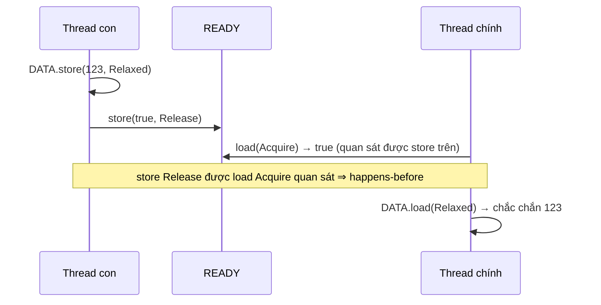

# P4 · Chương 06 — Memory model

## Bạn sẽ hiểu được gì

1. **Q1.** Vì sao thứ tự trong code không phải thứ tự thực thi: compiler hay CPU là thủ phạm? → mục 1
2. **Q2.** Cache coherence (MESI) đã giữ cache nhất quán, vậy vì sao vẫn cần memory ordering? → mục 2
3. **Q3.** Data race là gì, vì sao là UB, và vì sao memory model của Rust là mô hình *trừu tượng*? → mục 3
4. **Q4.** Happens-before là gì, và những tình huống nào tạo ra nó giữa hai thread? → mục 4
5. **Q5.** `Relaxed`, `Acquire`/`Release`, `AcqRel` bảo đảm chính xác điều gì — và điều kiện nào làm bảo đảm của `Acquire`/`Release` *không* xảy ra? → mục 5
6. **Q6.** Khi nào thật sự cần `SeqCst`? Fence dùng để làm gì? → mục 6
7. **Q7.** Một spin lock dùng Acquire/Release đúng nhờ chuỗi lập luận nào? → mục 7
8. **Q8.** x86-64 và ARM64 khác nhau ra sao về reordering, và vì sao "chạy đúng trên máy tôi" không là bằng chứng? → mục 8

## Kiến thức cần trước

- [Cache hierarchy và NUMA (P2 · Chương 06)](../02-cpu/06-cache-va-numa.md): cache line, MESI, false sharing — chương này chỉ nhắc phần cần cho ordering.
- [Pipeline và speculation (P2 · Chương 05)](../02-cpu/05-pipeline-va-speculation.md): CPU chạy lệnh chồng lên nhau.
- Race condition, critical section và mutex ở mức [chương Lock](03-lock.md).

Chương này là nền cho [lock-free (Chương 07)](07-lock-free.md) và [concurrency trong Rust (Chương 08)](08-rust-concurrency.md).

## 1. Vấn đề: thứ tự trong code không phải thứ tự thực thi (Q1)

> **Trả lời ngắn.** Cả hai. Compiler có thể đổi thứ tự thao tác, thậm chí làm một số sự kiện không bao giờ xảy ra[^nomicon-compiler-reorder]; processor cũng có thể chạy các lệnh sai thứ tự nếu nhanh hơn[^atomics-reorder-cpu]. Với chương trình một thread thì cả hai vô hình: logic kiểm tra phép biến đổi của compiler không tính đến các thread khác[^atomics-nosingle], còn các tính năng của processor không ảnh hưởng chương trình một thread ngoài thời gian[^atomics-single-thread-inv].

**Giải thích.**

Hình dung (nhận xét của người soạn): đầu bếp nhận phiếu "rán trứng rồi cắt hành" và đổi thứ tự cho nhanh — khách ăn một mình không phân biệt được, nhưng người đang chờ hành để làm việc khác thì có.


Đến giờ ta giả định mọi thao tác bộ nhớ diễn ra đúng thứ tự dòng code. Thực tế có hai lớp tối ưu phá giả định đó, và cả hai đều "vô hình" với chương trình một thread.

**Compiler.**

Nomicon: compiler muốn biến đổi để giảm phụ thuộc dữ liệu và loại code chết, nên có thể thay đổi triệt để thứ tự thực tế của các sự kiện, hoặc khiến có sự kiện không bao giờ xảy ra.[^nomicon-compiler-reorder] Ví dụ của Nomicon: `x = 1; y = 3; x = 2;` có thể bị đổi thành `x = 2; y = 3;` — đảo thứ tự và xoá hẳn một sự kiện. Với một thread thì không quan sát được; với chương trình đa luồng, bạn có thể đã dựa vào việc `x` được gán 1 trước khi `y` được gán.

Sách *Rust Atomics and Locks* chỉ ra gốc của vấn đề: logic kiểm tra một phép đảo thứ tự có giữ nguyên hành vi hay không *không tính đến các thread khác*.[^atomics-nosingle]

Hiểu lầm "tắt optimization thì khỏi lo": sách nói tắt tối ưu không tắt mọi biến đổi của compiler, và không tắt các tính năng processor gây reorder.[^atomics-myth-opt]

**CPU.**

Processor cũng đảo thứ tự: nó có thể thấy hai lệnh liên tiếp không ảnh hưởng nhau và chạy chúng sai thứ tự nếu nhanh hơn.[^atomics-reorder-cpu] Nomicon giải thích từ phía bộ nhớ: mỗi CPU thích làm việc với cache cục bộ hơn là bộ nhớ chung, nên phần cứng không bảo đảm thứ tự sự kiện ở thread này giữ nguyên ở thread khác.[^nomicon-hw-reorder]

Ví dụ của Nomicon: `x = 0, y = 1`; thread 1 chạy `y = 3; x = 1;`, thread 2 chạy `if x == 1 { y *= 2; }`. Lý tưởng chỉ có `y = 3` hoặc `y = 6`; Nomicon nói phần cứng cho phép thêm `y = 2` — thread 2 thấy `x = 1` mà không thấy `y = 3`, rồi ghi đè `y`.[^nomicon-y2] (Nomicon nói trạng thái này là *khả dĩ*; chương này không khẳng định đã quan sát nó.)

<details><summary>Đi sâu: ba ví dụ tối ưu của processor (store buffer, invalidation queue, pipelining)</summary>

Sách ch.7 nêu ba ví dụ về tối ưu của processor có thể ảnh hưởng đến tính đúng khi có nhiều thread — ngoài caching nhất quán, vốn chỉ ảnh hưởng thời gian.[^atomics-reorder-impact] Chúng không ảnh hưởng chương trình một thread (ngoài thời gian), nhưng khiến tương tác với core khác trông như xảy ra theo thứ tự không nhất quán:[^atomics-single-thread-inv]

1. **Store buffer.** Ghi bộ nhớ chậm, nên core cất lệnh ghi vào store buffer (rất nhanh) rồi chạy tiếp; việc ghi thật vào cache L1 làm sau, nên core không phải chờ cache coherence protocol giành quyền truy cập độc quyền cache line.[^atomics-storebuf] Với các lệnh cùng thread trên cùng core thì điều này vô hình; nhưng trong một khoảnh khắc lệnh ghi chưa hiện ra với core khác, nên các thread trên core khác nhau thấy bộ nhớ không nhất quán.[^atomics-storebuf-vis]
2. **Invalidation queue.** Cache nhận yêu cầu "bỏ cache line này vì sắp bị sửa" (invalidation). Để tăng tốc, thường các yêu cầu này không được xử lý ngay mà xếp hàng; khi đó các cache không còn luôn nhất quán — line có thể tạm cũ trước khi bị bỏ.[^atomics-invq]
3. **Pipelining.** Thực thi các lệnh liên tiếp song song nếu được.[^atomics-pipe] Khi một lệnh bộ nhớ xong trước lệnh đứng trước nó, tương tác với core khác có thể xảy ra "sai thứ tự".

</details>

**Quay lại Q1:** compiler và CPU đều được đảo thứ tự miễn chương trình một thread không thấy khác biệt; thread khác thì thấy.

## 2. Cache coherence không thay thế ordering (Q2)

> **Trả lời ngắn.** Cache coherence nói chung chỉ ảnh hưởng thời gian chứ không ảnh hưởng tính đúng của chương trình[^atomics-consistent-caching]. Thứ ảnh hưởng tính đúng là các tối ưu khác của processor, ví dụ store buffer, invalidation queue, pipelining[^atomics-reorder-impact]. Kiến trúc cho phép reorder cũng có lệnh riêng để chặn nó, và khi bạn chọn một `Ordering`, compiler sinh các lệnh đó[^atomics-compiler-gen].

**Giải thích.**

Hình dung (nhận xét của người soạn): hai người cùng nhìn một bảng trắng luôn đồng bộ vẫn có thể thấy hai dòng hiện lên bảng theo thứ tự khác nhau nếu người ghi có hàng đợi nháp (store buffer).


Chương [Cache và NUMA](../02-cpu/06-cache-va-numa.md) đã giải thích coherence: một cache coherence protocol định nghĩa cách các cache giao tiếp để giữ trạng thái nhất quán;[^atomics-coherence] MESI đặt tên theo bốn trạng thái của cache line.[^atomics-mesi]

Điểm then chốt: caching nhất quán nói chung *không* ảnh hưởng tính đúng của chương trình — khác biệt quan sát được chỉ là thời gian.[^atomics-consistent-caching] Thứ ảnh hưởng tính đúng là các tối ưu *khác* ở mục 1. Suy luận của người soạn (sách không viết nguyên câu này): coherence không thay được memory ordering — nó giữ *từng* cache line nhất quán, còn ordering nói về thứ tự mà thao tác lên *nhiều* vị trí nhớ trở nên thấy được với thread khác.

**Phần cứng cho bạn công cụ để chặn reordering.**

Kiến trúc cho phép reorder cũng có lệnh đặc biệt để ngăn nó — ví dụ buộc processor xả store buffer hoặc hoàn tất các lệnh đang pipeline.[^atomics-flush] Có lệnh chỉ chặn một loại reorder (ví dụ store-store, vẫn cho load reorder); loại nào xảy ra và chặn thế nào tuỳ kiến trúc.[^atomics-need-instr]

<details><summary>Đi sâu: mức reorder được phép của từng loại thao tác</summary>

Khi bạn chọn một `Ordering` cho thao tác atomic, compiler sẽ sinh đúng lệnh để processor không reorder theo cách phá luật.[^atomics-compiler-gen] Mức độ reorder được phép phụ thuộc loại thao tác: với thao tác non-atomic và atomic `Relaxed`, mọi kiểu reorder đều chấp nhận được; ở cực kia, sách viết rằng thao tác `SeqCst` không cho phép bất kỳ kiểu reorder nào (nhưng xem mục 6: thứ tự toàn cục chỉ bảo đảm giữa các thao tác `SeqCst`); acquire không được reorder với các thao tác bộ nhớ *sau* nó, release không được reorder với các thao tác *trước* nó.[^atomics-allowed-reorder][^atomics-seqcst-noreorder][^atomics-seqcst-only-seqcst][^atomics-acq-rel-reorder]

Các ordering của Rust rất trừu tượng, không phản ánh trực tiếp cơ chế compiler/processor, nên code độc lập kiến trúc.[^atomics-orderings-abstract]

</details>

**Quay lại Q2:** coherence giữ từng cache line nhất quán nhưng không quyết định thứ tự thấy được giữa nhiều vị trí nhớ — việc đó là của memory ordering.

## 3. Data race, và vì sao cần một mô hình trừu tượng (Q3)

> **Trả lời ngắn.** Data race là các truy cập xung đột, không đồng bộ, trong đó ít nhất một truy cập là non-atomic; nó là undefined behavior[^std-datarace]. Để tách khỏi chi tiết từng kiến trúc, memory model của Rust (phần lớn sao từ C++) là một mô hình trừu tượng thay vì mô tả một CPU cụ thể[^atomics-mm-abstract]; nên bạn lập luận bằng mô hình, không bằng "CPU của tôi làm gì" (hệ quả theo người soạn).

**Giải thích.**

Hình dung (nhận xét của người soạn): luật giao thông viết cho mọi loại xe, không phải cho chiếc xe của riêng bạn.


Nomicon chia truy cập bộ nhớ làm hai loại. **Data access** (truy cập thường) không đồng bộ: compiler tối ưu chúng với giả định một thread, phần cứng lan truyền thay đổi sang thread khác chậm và không nhất quán, và data race xảy ra qua loại này;[^nomicon-data-access] không thể viết code đồng bộ đúng chỉ với data access.[^nomicon-data-impossible] **Atomic access** là cách báo cho phần cứng và compiler biết chương trình đa luồng.[^nomicon-atomic-tell]

Định nghĩa của `std`: data race là các truy cập xung đột, không đồng bộ, trong đó ít nhất một truy cập là non-atomic — và data race là undefined behavior (UB).[^std-datarace] Sách diễn đạt tương tự: store atomic đồng thời được phép, còn store non-atomic đồng thời vào cùng biến là data race → UB.[^atomics-mm-datarace] Docs `std` nêu thêm một nguồn UB: truy cập atomic xung đột, không đồng bộ, chồng lấn *một phần* lên nhau (mixed-size).[^std-mixed-size]

Nomicon định nghĩa data race bằng ba điều kiện: hai thread trở lên truy cập đồng thời cùng một vị trí nhớ, ít nhất một là ghi, ít nhất một không đồng bộ.[^nomicon-race-def] Hai cách phát biểu khác chữ nhau và người soạn không khẳng định chúng trùng; cả khóa dùng định nghĩa của `std` (có điều kiện "non-atomic"), ví dụ để nói `x.store(x.load(Relaxed) + 1, Relaxed)` là race condition chứ không phải data race ([chương 07, mục 1](07-lock-free.md)).

<details><summary>Đi sâu: mô hình của Rust kế thừa C++20, "mẫu số chung lớn nhất"</summary>

Memory model của Rust kế thừa C++20.[^nomicon-atomics] Theo sách, nó không khớp kiến trúc processor nào; đó là mô hình trừu tượng với tập luật chặt, đại diện cho "mẫu số chung lớn nhất" của các kiến trúc hiện tại và tương lai, mà vẫn cho compiler đủ tự do để tối ưu.[^atomics-mm-abstract] Hệ quả: **lập luận bằng mô hình, không bằng "CPU của tôi làm gì"**.

</details>

**Quay lại Q3:** data race là UB; vì mô hình là trừu tượng, hãy lập luận bằng luật của mô hình chứ không bằng hành vi quan sát được trên một máy.

## 4. Happens-before (Q4)

> **Trả lời ngắn.** Happens-before là quan hệ mà mô hình dùng để nói việc nào được bảo đảm xảy ra trước việc nào; ngoài các tình huống đó thì không có bảo đảm gì[^atomics-hb-model]. Nó có trong cùng một thread, giữa spawn/join, unlock rồi lock mutex, và giữa các thao tác atomic dùng ordering không-relaxed[^atomics-hb-cases].

**Giải thích.**

Hình dung (nhận xét của người soạn): như "đã báo cho nhau" trong team — chỉ khi có email hoặc ticket nối hai người thì mới chắc người kia đã biết; không suy ra được từ chuyện "tôi làm lúc 9h, anh làm lúc 10h".


Mô hình định nghĩa thứ tự các thao tác bằng quan hệ happens-before. Là mô hình trừu tượng, nó không nói về lệnh máy, cache, buffer, timing hay reorder, mà chỉ định nghĩa các tình huống một việc được bảo đảm xảy ra trước việc khác — còn lại để ngỏ.[^atomics-hb-model]

- Luật cơ bản: mọi thứ trong cùng một thread xảy ra theo thứ tự.[^atomics-hb-def]
- Giữa các thread, happens-before chỉ xuất hiện trong vài trường hợp cụ thể: spawn và join thread, unlock rồi lock mutex, và các thao tác atomic dùng ordering không-relaxed.[^atomics-hb-cases]
- Spawn tạo happens-before giữa những gì xảy ra trước `spawn()` và thread mới; join tạo happens-before giữa thread được join và những gì sau `join()`.[^atomics-spawn-join]

<details><summary>Đi sâu: ví dụ không có happens-before thì "trước" mất nghĩa</summary>

Sách xét hai hàm ở hai thread, mọi thao tác `Relaxed`:

```rust
static X: AtomicI32 = AtomicI32::new(0);
static Y: AtomicI32 = AtomicI32::new(0);

fn a() { X.store(10, Relaxed); /*1*/  Y.store(20, Relaxed); /*2*/ }
fn b() { let y = Y.load(Relaxed); /*3*/ let x = X.load(Relaxed); /*4*/ println!("{x} {y}"); }
```

Chỉ có 1→2 và 3→4 (cùng thread). Kết quả `0 20` là hợp lệ, dù không tồn tại thứ tự toàn cục nhất quán nào của bốn thao tác cho ra nó: khi (3) chạy, không có happens-before với (2) nên đọc được 0 hoặc 20; khi (4) chạy, không có happens-before với (1) nên đọc được 0 hoặc 10.[^atomics-0-20] Phản trực giác: (3) đọc được 20 *không* tạo happens-before với (2), dù đó là giá trị (2) ghi.[^atomics-load-not-hb] Hiểu thực dụng (kém hình thức): với thread chạy `b`, thao tác 1 và 2 có thể trông như ngược thứ tự.[^atomics-appear-opposite]

</details>

**Quay lại Q4:** không có happens-before thì "trước" không có nghĩa; mô hình chỉ cho bạn vài cách tạo nó.

## 5. `Relaxed`, `Release`/`Acquire` và `AcqRel` (Q5)

> **Trả lời ngắn.** `Relaxed` chỉ bảo đảm thứ tự sửa đổi của từng biến riêng lẻ, không tạo happens-before[^atomics-relaxed]. Cặp `Release` (store) / `Acquire` (load) tạo happens-before khi acquire-load quan sát được kết quả của release-store[^atomics-acqrel], và chỉ khi hai thao tác nằm trên cùng một vị trí nhớ[^nomicon-acqrel-loc]. `AcqRel` dùng cho thao tác vừa load vừa store[^atomics-acqrel-rmw].

**Giải thích.**

Hình dung (nhận xét của người soạn): `Relaxed` là tờ ghi chú trên một tấm bảng riêng — mỗi bảng tự nhất quán nhưng không nối bảng này với bảng kia. `Release`/`Acquire` là một lá thư: chỉ khi người nhận *đọc được lá thư đó* thì mới chắc mọi việc trước khi gửi đã xảy ra.


Rust có `Relaxed`, `Release`, `Acquire`, `AcqRel`, `SeqCst`; ordering `consume` của C++ bị bỏ có chủ đích.[^atomics-orderings] Theo sách, compiler nâng nó lên acquire cho an toàn.[^atomics-consume]

**`Relaxed`.**

Thao tác `Relaxed` không tạo happens-before nào, nhưng bảo đảm một *total modification order* cho từng biến atomic riêng lẻ.[^atomics-relaxed] Nghĩa là mọi thay đổi của cùng một biến xảy ra theo thứ tự giống nhau từ góc nhìn của mọi thread.[^atomics-relaxed-order]

Ví dụ của sách: thread `a` làm `X.fetch_add(5, Relaxed); X.fetch_add(10, Relaxed);` — X chỉ có thể đổi theo 0→5→15. Thread `b` đọc X bốn lần: `0 0 5 15` hay `0 15 15 15` có thể xảy ra, `0 5 0 15` hoặc `0 0 10 15` thì không.[^atomics-relaxed-example] `Relaxed` vẫn là thao tác atomic: Nomicon: chúng không tính là data access và mọi thao tác đọc-sửa-ghi trên chúng xảy ra atomically.[^nomicon-relaxed-atomic] Ca dùng đúng: tăng bộ đếm bằng `fetch_add(…, Relaxed)` từ nhiều thread, nếu không dùng bộ đếm để đồng bộ truy cập khác.[^nomicon-relaxed-counter]

**`Release` và `Acquire`.**

Một cặp release/acquire tạo happens-before giữa các thread: `Release` áp cho store, `Acquire` áp cho load. Happens-before hình thành khi một acquire-load *quan sát được kết quả* của một release-store; khi đó store, cùng mọi thứ trước nó, *happened before* load và mọi thứ sau nó.[^atomics-acqrel] Docs `std` nói cùng ý: với `Acquire`, nếu giá trị đọc được do một store `Release` (hoặc mạnh hơn) ghi thì mọi thao tác sau đó được xếp sau store ấy;[^std-acquire] với `Release`, mọi thao tác trước đó được xếp trước mọi load `Acquire` (hoặc mạnh hơn) của giá trị này.[^std-release]

**Hai điều kiện thường bị quên.**

1. *Cùng vị trí nhớ.* Nomicon: khi thread A release một vị trí nhớ rồi thread B acquire *cùng vị trí* đó thì quan hệ nhân quả được thiết lập; không có với thread khác, và cũng không có nếu A và B truy cập các vị trí khác nhau.[^nomicon-acqrel-loc] Mọi write trước release của A (kể cả non-atomic và relaxed) sẽ được B quan sát sau acquire.[^nomicon-acqrel-visible]
2. *Load phải đọc được giá trị của store.* Đọc ra giá trị cũ thì không có quan hệ. "Quan sát được" hiểu theo total modification order: dù cùng ghi giá trị 7, mỗi lần ghi là một sự kiện riêng trong thứ tự sửa đổi của biến, và acquire-load 7 đồng bộ với *đúng* lần ghi mà nó đọc.[^atomics-which-seven] Thêm một chi tiết: giá trị release-stored có thể bị sửa bởi bất kỳ số `fetch-and-modify`/`compare-and-exchange` nào mà vẫn tạo happens-before với acquire-load đọc kết quả cuối;[^atomics-rmw-chain] một store thường (không phải RMW) xen vào sẽ phá chuỗi — acquire-load đọc giá trị của store thường đó chỉ đồng bộ với chính nó, không với các thao tác trước.[^atomics-chain-break]

Trực giác từ Nomicon: acquire giữ mọi truy cập *sau* nó ở lại sau, nhưng thao tác *trước* acquire vẫn được reorder xuống sau nó; tương tự, release giữ mọi thứ trước nó ở lại trước, nhưng thao tác sau release có thể bị reorder lên trước.[^nomicon-acq-stays] (Suy luận của người soạn từ hai chiều trên: thao tác nằm ngoài critical section giữa lock và unlock có thể "trôi vào" trong, còn thao tác bên trong không trôi ra ngoài.)

#### Ví dụ: message passing (flag + data)

Ví dụ của sách: gửi một số 64-bit từ thread con sang thread chính, kèm một boolean atomic báo "đã sẵn sàng".

```rust
use std::sync::atomic::{AtomicBool, AtomicU64, Ordering::{Acquire, Relaxed, Release}};
use std::thread;

static DATA: AtomicU64 = AtomicU64::new(0);
static READY: AtomicBool = AtomicBool::new(false);

fn main() {
    let t = thread::spawn(|| {
        DATA.store(123, Relaxed);
        READY.store(true, Release); // mọi thứ trước store này ...
    });
    while !READY.load(Acquire) {    // ... thấy được sau khi load này đọc ra `true`
        std::hint::spin_loop();
    }
    println!("{}", DATA.load(Relaxed));
    t.join().unwrap();
}
```

Chạy thật (rustc 1.95.0 `-O`, macOS arm64) in `123`. Theo sách, khi load `READY` quan sát được `true` thì happens-before được thiết lập: mọi thứ trước release-store (kể cả `DATA.store`) thấy được sau acquire-load, nên chỉ có thể in `123`.[^atomics-mp-obs] Sách nói thêm: nếu dùng `Relaxed` cho mọi thao tác, thread chính có thể thấy `READY` thành `true` mà vẫn đọc `0` từ `DATA`.[^atomics-example-relaxed] (Một lần in `123` không chứng minh gì về phiên bản Relaxed; chương này không thử bắt lỗi đó.)



<details><summary>Đi sâu: <code>AcqRel</code> và thao tác đọc-sửa-ghi</summary>

`AcqRel` là tổ hợp của Acquire và Release: phần load dùng acquire, phần store dùng release.[^atomics-acqrel-rmw] Vì vậy nó chỉ có nghĩa với thao tác vừa load vừa store (`fetch_add`, `swap`, `compare_exchange`…): docs `std` ghi `AcqRel` chỉ áp dụng cho thao tác kết hợp cả load và store.[^std-acquire-only] Ngược lại, khi truyền riêng `Acquire` cho một thao tác như thế thì nó chỉ áp cho phần load, và `Release` chỉ áp cho phần store.[^atomics-rmw-half] `compare_exchange` còn nhận hai ordering: một cho trường hợp so sánh thành công (có store), một cho trường hợp thất bại (không store).[^atomics-cas-two]

</details>

**Quay lại Q5:** `Relaxed` không nối các thread với nhau; Release/Acquire nối chúng chỉ khi acquire-load đọc được kết quả của release-store trên cùng vị trí nhớ.

## 6. `SeqCst` và fence (Q6)

> **Trả lời ngắn.** `SeqCst` thêm vào bảo đảm của acquire/release một thứ tự toàn cục duy nhất của mọi thao tác `SeqCst`[^atomics-seqcst]. Mara Bos viết rằng gần như luôn acquire/release là đủ[^atomics-seqcst-rare]; cách dùng thực tế điển hình là mẫu store-rồi-load[^atomics-seqcst-pattern]. Fence tách ordering khỏi thao tác atomic, hữu ích khi muốn áp một ordering cho nhiều thao tác[^atomics-fence].

**Giải thích.**

Hình dung (nhận xét của người soạn): `SeqCst` như một cuốn sổ cái chung mà mọi người cùng đọc theo một thứ tự; acquire/release chỉ là lá thư giữa hai người, và phần lớn công việc chỉ cần thư.

**`SeqCst`.**

`SeqCst` gồm mọi bảo đảm của acquire (cho load) và release (cho store), cộng một thứ tự toàn cục nhất quán.[^atomics-seqcst-acqrel] Mọi thao tác `SeqCst` nằm trong một total order duy nhất mà mọi thread đồng ý;[^atomics-seqcst] total order này nhất quán với total modification order của từng biến.[^atomics-seqcst-mod] Docs `std`: `SeqCst` giống Acquire/Release/AcqRel (tương ứng cho load, store, load-with-store) với bảo đảm thêm là mọi thread thấy mọi thao tác `SeqCst` theo cùng một thứ tự.[^std-seqcst]

Một load/store `SeqCst` có thể thế chỗ acquire-load hay release-store trong một cặp release-acquire (nhưng không tạo được "acquire-store" hay "release-load").[^atomics-seqcst-nostore] Nhưng *chỉ khi cả hai phía* của một quan hệ happens-before dùng `SeqCst` thì quan hệ đó mới được bảo đảm nhất quán với total order ấy.[^atomics-seqcst-both] Phần thưởng theo Nomicon: chương trình data-race-free chỉ dùng `SeqCst` và data access thường có một "thực thi toàn cục" mà mọi thread đồng ý — một sự đan xen (interleaving) của các thực thi từng thread; với ordering yếu hơn thì không còn đúng.[^nomicon-seqcst-reason] Cái giá: Nomicon viết rằng ngay cả trên nền tảng strongly-ordered, sequential consistency vẫn kéo theo việc phát lệnh memory fence;[^nomicon-seqcst-fence] cụ thể hơn, sách ch.7 cho biết trên x86-64 chỉ store `SeqCst` bị nâng từ `mov` lên `xchg`, còn load `SeqCst` vẫn là `mov` thường (mục 8).[^atomics-x86-seqcst-load]

**Khi nào thật sự cần `SeqCst`?**

Mara Bos: `SeqCst` có vẻ dễ lập luận nhất nhưng hầu như không cần trong thực tế; gần như luôn acquire/release là đủ.[^atomics-seqcst-rare] Chỗ sách dùng nó là mẫu **store-rồi-load**: mỗi thread đặt cờ của mình rồi kiểm tra cờ của thread kia —

```rust
// thread a                         // thread b
A.store(true, SeqCst);               B.store(true, SeqCst);
if !B.load(SeqCst) { /* truy cập S */ }   if !A.load(SeqCst) { /* truy cập S */ }
```

Nếu cả hai store xảy ra trước cả hai load thì có thể không thread nào truy cập `S`, nhưng *không thể* cả hai cùng truy cập (UB), vì `SeqCst` bảo đảm chỉ một bên thắng — trong mọi total order, thao tác đầu tiên là một store, chặn thread kia.[^atomics-seqcst-sb] Sách nói hầu như mọi cách dùng `SeqCst` ngoài đời thực theo mẫu "một store phải được thấy toàn cục trước một load kế tiếp trên cùng thread".[^atomics-seqcst-pattern] Với acquire/release thôi, mẫu này không đủ (suy luận của người soạn: vì acquire/release chỉ tạo quan hệ khi một load quan sát được store của thread kia, mà ở đây có thể cả hai load đều chạy trước khi thấy store đối phương).

Với mẫu này sách còn nêu phương án có thể hiệu quả hơn: dùng thao tác `Relaxed` kèm một fence `SeqCst`.[^atomics-seqcst-alt] Đây không phải phép tách cơ học: sách nói chỉ riêng fence nằm trong total order, không nhất thiết các atomic quanh nó, nên thao tác `SeqCst` không tách được thành relaxed + fence.[^atomics-seqcst-fence-split]

Nomicon khuyên hai chiều: sequential consistency hiếm khi cần cho tính đúng, nhưng là lựa chọn đúng khi bạn không tự tin về các ordering khác;[^nomicon-seqcst-advice] hạ `SeqCst` xuống `Relaxed` dễ về cú pháp, còn chứng minh phép biến đổi đúng là chuyện khác.[^nomicon-weaken] Sách cảnh báo chiều ngược lại: `SeqCst` không cứu được thuật toán vốn sai,[^atomics-seqcst-myth] và nên coi nó là dấu hiệu cần xem kỹ.[^atomics-seqcst-warning] (Nhận xét của người soạn: khi chưa chắc thì bắt đầu từ `SeqCst`, chỉ hạ xuống khi chứng minh được và đo thấy có lợi.)

**Fence.**

Ordering còn áp dụng được cho *atomic fence*: `std::sync::atomic::fence` là release fence, acquire fence, hoặc cả hai (`AcqRel`/`SeqCst`); fence `SeqCst` còn tham gia total order của các thao tác `SeqCst`.[^atomics-fence-kinds] Fence tách ordering khỏi thao tác atomic — hữu ích khi muốn áp một ordering cho nhiều thao tác, hoặc áp có điều kiện.[^atomics-fence]

Về bản chất (sách viết "in essence"), release-store tách được thành release fence + store relaxed, acquire-load thành load relaxed + acquire fence:[^atomics-fence-split]

```rust
a.store(1, Release);        ≈   fence(Release); a.store(1, Relaxed);
let v = a.load(Acquire);    ≈   let v = a.load(Relaxed); fence(Acquire);
```

Fence riêng có thể sinh thêm một lệnh processor nên hơi kém hiệu quả;[^atomics-fence-extra] nhưng khác release-store/acquire-load, fence không gắn với một biến atomic, nên một fence phục vụ được nhiều biến.[^atomics-fence-multi]

<details><summary>Đi sâu: điều kiện hình thức của fence và ví dụ đã chạy</summary>

Điều kiện chính xác: release fence thay được cho thao tác release trong một quan hệ happens-before nếu sau nó (cùng thread) có một thao tác atomic ghi giá trị mà thao tác acquire bên kia quan sát được.[^atomics-fence-formal] Vế acquire đối xứng: acquire fence thay được cho thao tác acquire nếu trước nó (cùng thread) có thao tác atomic load một giá trị do thao tác release bên kia ghi.[^atomics-fence-acq] Sách tổng hợp: happens-before giữa release fence và acquire fence được tạo ra nếu bất kỳ store nào sau release fence được quan sát bởi bất kỳ load nào trước acquire fence.[^atomics-fence-summary] (Suy luận của người soạn: điều kiện luôn cần một atomic được quan sát ở giữa, nên fence đứng một mình chưa tạo quan hệ.) Ví dụ của sách: thread 1 `fence(Release)` rồi 3 store relaxed vào A, B, C; thread 2 3 load relaxed từ A, B, C rồi `fence(Acquire)` — nếu *bất kỳ* load nào trong số đó đọc được giá trị của store tương ứng bên thread 1 thì release fence của thread 1 happens-before acquire fence của thread 2.[^atomics-fence-3]

Ví dụ nhỏ đã chạy thật (macOS arm64, rustc 1.95.0 `-O`): thread con `A.store(1, Relaxed); B.store(2, Relaxed); fence(Release); GO.store(true, Relaxed);`; thread chính spin `while !GO.load(Relaxed) {}`, `fence(Acquire)`, rồi đọc A và B bằng `Relaxed`. Điều kiện của sách thoả (store `GO` sau release fence được load `GO` trước acquire fence quan sát), nên phải in `1 2`; chạy thật in đúng `1 2`.

</details>

**Quay lại Q6:** `SeqCst` chỉ cần khi một store phải được thấy toàn cục trước load kế tiếp; fence là cách tách ordering khỏi thao tác, nhưng luôn cần một atomic được quan sát ở giữa.

## 7. Ví dụ: spin lock bằng Acquire/Release (Q7)

> **Trả lời ngắn.** Trong mutex, unlock là release và lock là acquire, nên có happens-before giữa unlock và lock kế tiếp[^atomics-mutex-ex]. Happens-before đó cần thiết để tránh data race (tức UB)[^atomics-spin-race]; spin lock dưới đây chỉ là mẫu ấy được viết ra bằng `swap(true, Acquire)` và `store(false, Release)`.

**Giải thích.**

Hình dung (nhận xét của người soạn): trả chìa phòng (release) và nhận chìa (acquire) là lúc thông tin "tôi đã sửa xong" được giao lại cho người kế tiếp.


Mutex là ca dùng phổ biến nhất của acquire/release: lock kiểm tra trạng thái unlocked bằng một thao tác atomic ordering acquire, đồng thời đổi thành locked; unlock đặt về unlocked với release. Vì thế có happens-before giữa unlock và lock kế tiếp.[^atomics-mutex-ex] Tên "release/acquire" từ đây: unlock = release, lock = acquire.[^atomics-names]

Sách (ch.4) dùng đúng vòng lặp `while self.locked.swap(true, Acquire) { spin_loop() }`[^atomics-spin-code] và giải thích: dùng acquire/release để mỗi `unlock()` thiết lập happens-before với các `lock()` theo sau,[^atomics-spin-hb] vì happens-before giữa unlock và lock là cần thiết để tránh data race (tức UB).[^atomics-spin-race]

<details><summary>Đi sâu: SpinLock đầy đủ bằng Rust và chuỗi happens-before của nó</summary>

Phiên bản người soạn viết (`SpinLock<T>` bọc dữ liệu qua `UnsafeCell`, guard nhả lock khi `Drop`), đã biên dịch và chạy thật. Dòng `unsafe impl … Sync for Guard` được thêm sau khi thử biên dịch: thiếu nó, `Guard<'_, Cell<u8>>` vẫn là `Sync` (auto trait suy từ `&SpinLock<T>`), nên hai thread có thể cùng giữ `&Cell`. Sách ch.4 cũng có impl này.[^atomics-spin-guard-sync]

```rust
use std::cell::UnsafeCell;
use std::sync::atomic::{AtomicBool, Ordering::{Acquire, Release}};
use std::thread;

pub struct SpinLock<T> { locked: AtomicBool, value: UnsafeCell<T> }
unsafe impl<T: Send> Sync for SpinLock<T> {}
pub struct Guard<'a, T> { lock: &'a SpinLock<T> }
unsafe impl<T: Sync> Sync for Guard<'_, T> {}

impl<T> SpinLock<T> {
    pub const fn new(value: T) -> Self {
        Self { locked: AtomicBool::new(false), value: UnsafeCell::new(value) }
    }
    pub fn lock(&self) -> Guard<'_, T> {
        while self.locked.swap(true, Acquire) { std::hint::spin_loop(); }
        Guard { lock: self }
    }
}
impl<T> std::ops::Deref for Guard<'_, T> {
    type Target = T;
    fn deref(&self) -> &T { unsafe { &*self.lock.value.get() } }
}
impl<T> std::ops::DerefMut for Guard<'_, T> {
    fn deref_mut(&mut self) -> &mut T { unsafe { &mut *self.lock.value.get() } }
}
impl<T> Drop for Guard<'_, T> {
    fn drop(&mut self) { self.lock.locked.store(false, Release); }
}

static L: SpinLock<u64> = SpinLock::new(0);
fn main() {
    thread::scope(|s| {
        for _ in 0..4 {
            s.spawn(|| for _ in 0..100_000 { *L.lock() += 1; });
        }
    });
    println!("{}", *L.lock());
}
```

Chạy in `400000` (macOS arm64, `rustc -O`). Con số đúng không chứng minh ordering đúng; độ đúng đến từ chuỗi happens-before: truy cập `value` xảy ra-trước `store(false, Release)`, cái này xảy ra-trước `swap(true, Acquire)` kế tiếp quan sát được nó, cái này xảy ra-trước truy cập `value` tiếp theo.[^atomics-lock-chain] Phía lock của `std` cũng dùng `Acquire`: trong source 1.95.0, fast path của `Mutex` bản futex là `compare_exchange(UNLOCKED, LOCKED, Acquire, Relaxed)` — chi tiết cài đặt, có thể đổi (phía unlock không được trích ở đây).[^std-futex-fast] Phần futex, spin rồi ngủ: chương [Lock](03-lock.md).

</details>

**Quay lại Q7:** độ đúng của spin lock đến từ chuỗi happens-before giữa các lần unlock/lock, không phải từ việc lần chạy in ra con số đúng.

## 8. x86-64 và ARM64: phần cứng thật (Q8)

> **Trả lời ngắn.** x86-64 có bảo đảm thứ tự mạnh, ARM thì yếu[^nomicon-weak]. Ordering đòi quá yếu trên phần cứng mạnh dễ "tình cờ chạy được" dù sai chặt chẽ, nên Nomicon khuyên thử thuật toán đồng thời trên phần cứng yếu[^nomicon-weak-test]. Suy ra (hệ quả theo người soạn): chạy đúng trên máy bạn không phải là bằng chứng.

**Giải thích.**

Hình dung (nhận xét của người soạn): máy dev Apple Silicon và instance ARM trên cloud là ARM64; ordering sai "chạy ổn" trên x86 có thể hỏng ở đó.


Mục này chỉ nói những gì sách (ch.7) và Nomicon nói, và không thay nguyên tắc ở mục 3: lập luận bằng mô hình.

Nomicon: x86/64 có bảo đảm thứ tự mạnh, ARM thì yếu.[^nomicon-weak] Hệ quả: đòi ordering mạnh trên phần cứng mạnh có thể rẻ hoặc miễn phí;[^nomicon-weak-cons] đòi quá yếu trên phần cứng mạnh thì dễ "tình cờ chạy được" dù sai chặt chẽ — nên Nomicon khuyên thử thuật toán đồng thời trên phần cứng yếu.[^nomicon-weak-test]

<details><summary>Đi sâu: chi tiết từng kiến trúc và vì sao store <code>SeqCst</code> trên x86-64 là <code>xchg</code></summary>

Sách chi tiết hơn:

- ARM64 là weakly ordered: processor được reorder tự do mọi thao tác bộ nhớ.[^atomics-weakly]
- x86-64 chỉ cho thấy một kiểu reorder: một store bị trì hoãn sau một load đứng sau nó.[^atomics-x86-store-load] (Suy luận của người soạn: đúng kiểu mà store buffer ở mục 1 gây ra.)
- Acquire/release trên x86-64 biên dịch ra lệnh giống hệt relaxed; trên ARM64 thì không rẻ bằng relaxed.[^atomics-x86-free][^atomics-x86-arm]
- Fence acquire/release: x86-64 không cần gì thêm.[^atomics-fence-x86]

Vì sao store `SeqCst` trên x86-64 không còn là `mov` thường: `mov` cho phép reorder với load đứng sau, phá thứ tự toàn cục nhất quán;[^atomics-x86-seqcst-mov] đổi sang lệnh có cả load (`xchg`) thì lệnh không bị reorder với thao tác bộ nhớ sau nó.[^atomics-x86-xchg] Suy luận của người soạn: đó chính là reorder "store trễ sau load" của store buffer (mục 1), lộ ra ở mẫu store-rồi-load (mục 6).

</details>

**Quay lại Q8:** x86-64 chỉ cho thấy một kiểu reorder còn ARM64 reorder tự do, nên ordering sai có thể ẩn trên x86 và hỏng trên ARM; chỉ mô hình mới là chuẩn.

## 9. Liên hệ với Rust

- `std::sync::atomic::Ordering` có năm biến thể `Relaxed`, `Release`, `Acquire`, `AcqRel`, `SeqCst`; Rust có cùng ordering với C++20.[^std-ordering-cpp]
- Safe Rust bảo đảm không có data race nhưng *không* chặn race condition tổng quát.[^nomicon-race-def][^nomicon-race-cond] Kiểu atomic cài `Sync` nhưng không tự cung cấp cơ chế chia sẻ (thường đặt vào `Arc`).[^std-atomic-sync] Hệ thống kiểu không hiểu happens-before: dữ liệu non-atomic công bố qua cờ atomic cần `unsafe` để hứa với compiler.[^atomics-nonatomic-data]
- Quy tắc ngón tay cái (nhận xét của người soạn, dựa trên các nguồn trên): mutex/channel/`Arc` đã chứa ordering đúng; chỉ tự viết ordering khi viết primitive đồng bộ. Bộ đếm thuần tuý dùng `Relaxed`; flag công bố dữ liệu dùng Release/Acquire; không chắc thì bắt đầu từ `SeqCst`, nhưng nó không sửa được thuật toán sai.

## Tóm tắt

- Compiler và CPU đều được đảo thứ tự thao tác miễn chương trình một thread không thấy; tắt optimization không giải quyết.
- Store buffer, invalidation queue, pipelining làm core này thấy bộ nhớ không nhất quán với core kia; coherence/MESI chỉ ảnh hưởng thời gian.
- Data race là UB; memory model của Rust kế thừa C++20, là mô hình trừu tượng.
- Happens-before chỉ có ở vài trường hợp: cùng thread, spawn/join, unlock→lock, atomic non-relaxed.
- `Relaxed`: total modification order từng biến, vẫn atomic, không happens-before. `Release`/`Acquire`: happens-before khi acquire-load đọc được kết quả release-store, cùng vị trí nhớ. `AcqRel`: cho thao tác vừa load vừa store.
- `SeqCst` thêm một total order duy nhất, gần như luôn không cần — trừ mẫu "store phải thấy toàn cục trước load kế tiếp".
- Fence tách ordering khỏi thao tác (điều kiện: một atomic được quan sát ở giữa); x86-64 mạnh, ARM64 yếu; một lần chạy đúng không chứng minh ordering đúng.

## Câu hỏi tự kiểm tra

1. Hai nguồn đảo thứ tự thao tác bộ nhớ là gì, và vì sao chương trình một thread không thấy chúng?
<details><summary>Đáp án</summary>

Compiler (đổi thứ tự hoặc xoá sự kiện)[^nomicon-compiler-reorder] và phần cứng (không bảo đảm thứ tự ở thread này giữ nguyên ở thread khác).[^nomicon-hw-reorder] Logic kiểm tra tối ưu không tính đến thread khác,[^atomics-nosingle] và tính năng của processor không ảnh hưởng chương trình một thread ngoài thời gian.[^atomics-single-thread-inv]

</details>

2. Vì sao "cache đã coherent nên không cần ordering" là sai?
<details><summary>Đáp án</summary>

Caching nhất quán nói chung chỉ ảnh hưởng thời gian;[^atomics-consistent-caching] ảnh hưởng tính đúng là các tối ưu khác của processor như store buffer, invalidation queue, pipelining.[^atomics-reorder-impact] ("Coherence không thay thế ordering" là suy luận của người soạn.)

</details>

3. Trong ví dụ `a()`/`b()` toàn `Relaxed`, vì sao đầu ra `0 20` là hợp lệ?
<details><summary>Đáp án</summary>

Không có happens-before giữa (3) và (2) hay (4) và (1), nên (3) đọc 20 và (4) đọc 0 là được phép, dù không thứ tự toàn cục nào cho ra kết quả đó.[^atomics-0-20]

</details>

4. Hai điều kiện để cặp Release/Acquire tạo happens-before?
<details><summary>Đáp án</summary>

Acquire-load phải quan sát được kết quả của release-store;[^atomics-acqrel] và hai thao tác phải trên cùng vị trí nhớ — nếu khác vị trí thì không có quan hệ nhân quả.[^nomicon-acqrel-loc]

</details>

5. `Relaxed` bảo đảm gì và không bảo đảm gì? Cho một ca dùng đúng.
<details><summary>Đáp án</summary>

Bảo đảm total modification order của từng biến, không tạo happens-before;[^atomics-relaxed] vẫn atomic;[^nomicon-relaxed-atomic] ca đúng: bộ đếm không dùng để đồng bộ truy cập khác.[^nomicon-relaxed-counter]

</details>

6. Mẫu nào thật sự cần `SeqCst`? Có phương án thay thế không?
<details><summary>Đáp án</summary>

Store phải được thấy toàn cục trước load kế tiếp cùng thread (hai bên đặt cờ rồi kiểm tra cờ bên kia);[^atomics-seqcst-pattern][^atomics-seqcst-sb] sách nêu phương án `Relaxed` + fence `SeqCst`.[^atomics-seqcst-alt]

</details>

7. Vì sao code ordering sai có thể chạy đúng trên x86-64 nhưng hỏng trên ARM64?
<details><summary>Đáp án</summary>

Trên x86-64 mọi thao tác bộ nhớ đã có ngữ nghĩa acquire/release và chỉ có reorder store-sau-load;[^atomics-x86-arm][^atomics-x86-store-load] đòi quá yếu trên phần cứng mạnh dễ tình cờ chạy được,[^nomicon-weak-test] còn ARM64 reorder tự do.[^atomics-weakly]

</details>

8. `AcqRel` dùng cho thao tác nào, và truyền riêng `Acquire` cho `fetch_add` thì sao?
<details><summary>Đáp án</summary>

Thao tác kết hợp load và store: load dùng acquire, store dùng release;[^atomics-acqrel-rmw][^std-acquire-only] `Acquire` riêng chỉ áp cho phần load, `Release` chỉ cho phần store.[^atomics-rmw-half]

</details>

9. Điều kiện hình thức để release fence và acquire fence tạo happens-before?
<details><summary>Đáp án</summary>

Một atomic store sau release fence (cùng thread) phải được một atomic load trước acquire fence ở thread kia quan sát;[^atomics-fence-formal][^atomics-fence-summary] "fence một mình không đủ" là suy luận của người soạn.

</details>

## Đọc thêm

- *Rust Atomics and Locks*, ch.3 <https://marabos.nl/atomics/memory-ordering.html> và ch.7 <https://marabos.nl/atomics/hardware.html> — happens-before, "More Formally", và phần cứng thật.
- Rustonomicon, Atomics <https://doc.rust-lang.org/1.95.0/nomicon/atomics.html> — góc nhìn reordering ngắn gọn.
- [Cache và NUMA](../02-cpu/06-cache-va-numa.md) và [Lock-free](07-lock-free.md).

[^nomicon-compiler-reorder]: The Rustonomicon, Atomics — <https://doc.rust-lang.org/1.95.0/nomicon/atomics.html> — "they may radically change the actual order of events, or make events never occur!"
[^nomicon-hw-reorder]: The Rustonomicon, Atomics — <https://doc.rust-lang.org/1.95.0/nomicon/atomics.html> — "the hardware doesn’t guarantee that events that occur in some order on one thread, occur in the same order on another thread."
[^nomicon-y2]: The Rustonomicon, Atomics — <https://doc.rust-lang.org/1.95.0/nomicon/atomics.html> — "y = 2: (thread 2 saw x = 1, but not y = 3, and then overwrote y = 3)"
[^atomics-nosingle]: Rust Atomics and Locks, ch.3 Memory Ordering — <https://marabos.nl/atomics/memory-ordering.html> — "The logic for verifying that a specific reordering or other optimization won’t affect the behavior of your program does not take other threads into account."
[^atomics-myth-opt]: Rust Atomics and Locks, ch.3 Memory Ordering — <https://marabos.nl/atomics/memory-ordering.html> — "Disabling compiler optimization does not disable every possible transformation in the compiler, and does not disable the processor features that result in instruction reordering"
[^atomics-reorder-cpu]: Rust Atomics and Locks, ch.3 Memory Ordering — <https://marabos.nl/atomics/memory-ordering.html> — "A processor might determine that two particular consecutive instructions in your program will not affect each other, and execute them out of order if that is faster, for example."
[^atomics-reorder-impact]: Rust Atomics and Locks, ch.7 Understanding the Processor — <https://marabos.nl/atomics/hardware.html> — "However, modern processors implement many more optimizations that can have a big impact on correctness, at least when multiple threads are involved."
[^atomics-storebuf]: Rust Atomics and Locks, ch.7 Understanding the Processor — <https://marabos.nl/atomics/hardware.html> — "processor cores often include a store buffer. Write operations to memory can be stored in this store buffer, which is very quick, to allow the processor to immediately continue with the instructions that follow."
[^atomics-storebuf-vis]: Rust Atomics and Locks, ch.7 Understanding the Processor — <https://marabos.nl/atomics/hardware.html> — "However, for a brief moment, the write operation is not yet visible to the other cores, resulting in an inconsistent view of what the memory looks like from different threads running on different cores."
[^atomics-invq]: Rust Atomics and Locks, ch.7 Understanding the Processor — <https://marabos.nl/atomics/hardware.html> — "When such invalidation queues are in use, the caches are no longer always consistent, as cache lines might be briefly outdated before they are dropped."
[^atomics-pipe]: Rust Atomics and Locks, ch.7 Understanding the Processor — <https://marabos.nl/atomics/hardware.html> — "Another very common processor feature that significantly improves performance is pipelining: executing consecutive instructions in parallel, if possible."
[^atomics-single-thread-inv]: Rust Atomics and Locks, ch.7 Understanding the Processor — <https://marabos.nl/atomics/hardware.html> — "they do not affect single-threaded programs, other than timing, but can cause interaction with other cores to appear to happen in an inconsistent order."
[^atomics-coherence]: Rust Atomics and Locks, ch.7 Understanding the Processor — <https://marabos.nl/atomics/hardware.html> — "To solve this problem, a cache coherence protocol is used. Such a protocol defines how exactly the caches operate and communicate with each other to keep everything in a consistent state."
[^atomics-mesi]: Rust Atomics and Locks, ch.7 Understanding the Processor — <https://marabos.nl/atomics/hardware.html> — "The MESI cache coherence protocol is named after the four possible states it defines for a cache line: modified, exclusive, shared and invalid."
[^atomics-consistent-caching]: Rust Atomics and Locks, ch.7 Understanding the Processor — <https://marabos.nl/atomics/hardware.html> — "Consistent caching, for example through the MESI protocol we explored earlier in this chapter, generally does not affect correctness of a program, even when multiple threads are involved. The only observable differences caused by consistent caching come down to differences in timing."
[^atomics-flush]: Rust Atomics and Locks, ch.7 Understanding the Processor — <https://marabos.nl/atomics/hardware.html> — "These instructions might, for example, force the processor to flush its store buffer, or to finish any pipelined instructions, before continuing."
[^atomics-need-instr]: Rust Atomics and Locks, ch.7 Understanding the Processor — <https://marabos.nl/atomics/hardware.html> — "Processor architectures that allow for memory operations to be reordered also provide a way to prevent this through special instructions."
[^atomics-compiler-gen]: Rust Atomics and Locks, ch.7 Understanding the Processor — <https://marabos.nl/atomics/hardware.html> — "The compiler will generate the right instructions for the processor to prevent it from reordering instructions in ways that would break the rules."
[^atomics-allowed-reorder]: Rust Atomics and Locks, ch.7 Understanding the Processor — <https://marabos.nl/atomics/hardware.html> — "For non-atomic and relaxed atomic operations, any type of reordering is acceptable."
[^atomics-seqcst-noreorder]: Rust Atomics and Locks, ch.7 Understanding the Processor — <https://marabos.nl/atomics/hardware.html> — "At the other extreme, sequentially consistent atomic operations don’t allow for any type of reordering at all."
[^atomics-acq-rel-reorder]: Rust Atomics and Locks, ch.7 Understanding the Processor — <https://marabos.nl/atomics/hardware.html> — "An acquire operation may not get reordered with any memory operations that follow, while a release operation may not be reordered with any memory operations that precede it."
[^atomics-orderings-abstract]: Rust Atomics and Locks, ch.3 Memory Ordering — <https://marabos.nl/atomics/memory-ordering.html> — "The orderings are very abstract and do not directly reflect the actual compiler and processor mechanisms involved, such as instruction reordering."
[^nomicon-data-access]: The Rustonomicon, Atomics — <https://doc.rust-lang.org/1.95.0/nomicon/atomics.html> — "Most critically, data accesses are how data races happen."
[^nomicon-data-impossible]: The Rustonomicon, Atomics — <https://doc.rust-lang.org/1.95.0/nomicon/atomics.html> — "It is literally impossible to write correct synchronized code using only data accesses."
[^nomicon-atomic-tell]: The Rustonomicon, Atomics — <https://doc.rust-lang.org/1.95.0/nomicon/atomics.html> — "Atomic accesses are how we tell the hardware and compiler that our program is multi-threaded."
[^std-datarace]: Rust std 1.95.0, module `std::sync::atomic` — <https://doc.rust-lang.org/1.95.0/std/sync/atomic/index.html> — "The most important aspect of this model is that data races are undefined behavior. A data race is defined as conflicting non-synchronized accesses where at least one of the accesses is non-atomic."
[^atomics-mm-datarace]: Rust Atomics and Locks, ch.3 Memory Ordering — <https://marabos.nl/atomics/memory-ordering.html> — "Rust’s memory model allows for concurrent atomic stores, but considers concurrent non-atomic stores to the same variable to be a data race, resulting in undefined behavior."
[^std-mixed-size]: Rust std 1.95.0, module `std::sync::atomic` — <https://doc.rust-lang.org/1.95.0/std/sync/atomic/index.html> — "The other possible cause of undefined behavior in the memory model are mixed-size accesses: Rust inherits the C++ limitation that non-synchronized conflicting atomic accesses may not partially overlap."
[^nomicon-atomics]: The Rustonomicon, Atomics — <https://doc.rust-lang.org/1.95.0/nomicon/atomics.html> — "Rust pretty blatantly just inherits the memory model for atomics from C++20."
[^atomics-mm-abstract]: Rust Atomics and Locks, ch.3 Memory Ordering — <https://marabos.nl/atomics/memory-ordering.html> — "doesn’t match any existing processor architecture, but instead is an abstract model with a strict set of rules that attempt to represent the greatest common denominator of all current and future architectures"
[^atomics-hb-model]: Rust Atomics and Locks, ch.3 Memory Ordering — <https://marabos.nl/atomics/memory-ordering.html> — "The memory model defines the order in which operations happen in terms of happens-before relationships."
[^atomics-hb-def]: Rust Atomics and Locks, ch.3 Memory Ordering — <https://marabos.nl/atomics/memory-ordering.html> — "The basic happens-before rule is that everything that happens within the same thread happens in order."
[^atomics-hb-cases]: Rust Atomics and Locks, ch.3 Memory Ordering — <https://marabos.nl/atomics/memory-ordering.html> — "Between threads, however, happens-before relationships only occur in a few specific cases, such as when spawning and joining a thread, unlocking and locking a mutex, and through atomic operations that use non-relaxed memory ordering."
[^atomics-spawn-join]: Rust Atomics and Locks, ch.3 Memory Ordering — <https://marabos.nl/atomics/memory-ordering.html> — "Spawning a thread creates a happens-before relationship between what happened before the spawn() call, and the new thread. Similarly, joining a thread creates a happens-before relationship between the joined thread and what happens after the join() call."
[^atomics-0-20]: Rust Atomics and Locks, ch.3 Memory Ordering — <https://marabos.nl/atomics/memory-ordering.html> — "More interestingly, the output can also be 0 20, even though there is no possible globally consistent order of the four operations that would result in this outcome."
[^atomics-load-not-hb]: Rust Atomics and Locks, ch.3 Memory Ordering — <https://marabos.nl/atomics/memory-ordering.html> — "operation 3 loading the value 20 does not result in a happens-before relationship with 2, even though that value is the one stored by 2."
[^atomics-appear-opposite]: Rust Atomics and Locks, ch.3 Memory Ordering — <https://marabos.nl/atomics/memory-ordering.html> — "operations 1 and 2 might appear to happen in the opposite order."
[^atomics-orderings]: Rust Atomics and Locks, ch.3 Memory Ordering — <https://marabos.nl/atomics/memory-ordering.html> — "In C++, there is also something called consume ordering, which has been purposely omitted from Rust"
[^atomics-consume]: Rust Atomics and Locks, ch.3 Memory Ordering — <https://marabos.nl/atomics/memory-ordering.html> — "Because of this, compilers upgrade consume ordering to acquire ordering, just to be safe."
[^atomics-relaxed]: Rust Atomics and Locks, ch.3 Memory Ordering — <https://marabos.nl/atomics/memory-ordering.html> — "While atomic operations using relaxed memory ordering do not provide any happens-before relationship, they do guarantee a total modification order of each individual atomic variable."
[^atomics-relaxed-order]: Rust Atomics and Locks, ch.3 Memory Ordering — <https://marabos.nl/atomics/memory-ordering.html> — "This means that all modifications of the same atomic variable happen in an order that is the same from the perspective of every single thread."
[^atomics-relaxed-example]: Rust Atomics and Locks, ch.3 Memory Ordering — <https://marabos.nl/atomics/memory-ordering.html> — "This means that \"0 0 0 0\", \"0 0 5 15\", and \"0 15 15 15\" are some of the possible results from the print statement in the other thread, while an output of \"0 5 0 15\" or \"0 0 10 15\" is impossible."
[^nomicon-relaxed-atomic]: The Rustonomicon, Atomics — <https://doc.rust-lang.org/1.95.0/nomicon/atomics.html> — "Still, relaxed operations are still atomic. That is, they don’t count as data accesses and any read-modify-write operations done to them occur atomically."
[^nomicon-relaxed-counter]: The Rustonomicon, Atomics — <https://doc.rust-lang.org/1.95.0/nomicon/atomics.html> — "incrementing a counter can be safely done by multiple threads using a relaxed fetch_add if you’re not using the counter to synchronize any other accesses."
[^atomics-acqrel]: Rust Atomics and Locks, ch.3 Memory Ordering — <https://marabos.nl/atomics/memory-ordering.html> — "A happens-before relationship is formed when an acquire-load operation observes the result of a release-store operation. In this case, the store and everything before it happened before the load and everything after it."
[^std-acquire]: Rust std 1.95.0, `std::sync::atomic::Ordering` — <https://doc.rust-lang.org/1.95.0/std/sync/atomic/enum.Ordering.html> — "When coupled with a load, if the loaded value was written by a store operation with Release (or stronger) ordering, then all subsequent operations become ordered after that store."
[^std-release]: Rust std 1.95.0, `std::sync::atomic::Ordering` — <https://doc.rust-lang.org/1.95.0/std/sync/atomic/enum.Ordering.html> — "When coupled with a store, all previous operations become ordered before any load of this value with Acquire (or stronger) ordering."
[^nomicon-acqrel-loc]: The Rustonomicon, Atomics — <https://doc.rust-lang.org/1.95.0/nomicon/atomics.html> — "Similarly, no causality is established if A and B access different locations in memory."
[^nomicon-acqrel-visible]: The Rustonomicon, Atomics — <https://doc.rust-lang.org/1.95.0/nomicon/atomics.html> — "Every write (including non-atomic and relaxed atomic writes) that happened before A’s release will be observed by B after its acquisition."
[^atomics-which-seven]: Rust Atomics and Locks, ch.3 Memory Ordering — <https://marabos.nl/atomics/memory-ordering.html> — "Even if the same value is written to the same variable more than once, each of these operations represents a separate event in the total modification order of that variable."
[^atomics-rmw-chain]: Rust Atomics and Locks, ch.3 Memory Ordering — <https://marabos.nl/atomics/memory-ordering.html> — "a release-stored value may be modified by any number of fetch-and-modify and compare-and-exchange operations, while still resulting in a happens-before relationship with an acquire-load that reads the final result."
[^nomicon-acq-stays]: The Rustonomicon, Atomics — <https://doc.rust-lang.org/1.95.0/nomicon/atomics.html> — "Intuitively, an acquire access ensures that every access after it stays after it. However operations that occur before an acquire are free to be reordered to occur after it."
[^atomics-mp-obs]: Rust Atomics and Locks, ch.3 Memory Ordering — <https://marabos.nl/atomics/memory-ordering.html> — "At that point, we know for sure that everything that happened before the release-store to READY is visible to everything that happens after the acquire-load."
[^atomics-example-relaxed]: Rust Atomics and Locks, ch.3 Memory Ordering — <https://marabos.nl/atomics/memory-ordering.html> — "If we had used relaxed memory ordering for all operations in this example, the main thread could have seen READY flip to true, while still loading a zero from DATA afterwards."
[^atomics-nonatomic-data]: Rust Atomics and Locks, ch.3 Memory Ordering — <https://marabos.nl/atomics/memory-ordering.html> — "The type system does not magically understand the happens-before relationship we’ve created here."
[^atomics-acqrel-rmw]: Rust Atomics and Locks, ch.3 Memory Ordering — <https://marabos.nl/atomics/memory-ordering.html> — "AcqRel is used to represent the combination of Acquire and Release, which causes both the load to use acquire ordering and the store to use release ordering."
[^atomics-seqcst-acqrel]: Rust Atomics and Locks, ch.3 Memory Ordering — <https://marabos.nl/atomics/memory-ordering.html> — "It includes all the guarantees of acquire ordering (for loads) and release ordering (for stores), and also guarantees a globally consistent order of operations."
[^atomics-seqcst]: Rust Atomics and Locks, ch.3 Memory Ordering — <https://marabos.nl/atomics/memory-ordering.html> — "every single operation using SeqCst ordering within a program is part of a single total order that all threads agree on."
[^atomics-seqcst-mod]: Rust Atomics and Locks, ch.3 Memory Ordering — <https://marabos.nl/atomics/memory-ordering.html> — "This total order is consistent with the total modification order of each individual variable."
[^std-seqcst]: Rust std 1.95.0, `std::sync::atomic::Ordering` — <https://doc.rust-lang.org/1.95.0/std/sync/atomic/enum.Ordering.html> — "with the additional guarantee that all threads see all sequentially consistent operations in the same order."
[^atomics-seqcst-both]: Rust Atomics and Locks, ch.3 Memory Ordering — <https://marabos.nl/atomics/memory-ordering.html> — "Only when both sides of a happens-before relationship use SeqCst ordering is it guaranteed to be consistent with the single total order of SeqCst operations."
[^nomicon-seqcst-reason]: The Rustonomicon, Atomics — <https://doc.rust-lang.org/1.95.0/nomicon/atomics.html> — "A data-race-free program that uses only sequentially consistent atomics and data accesses has the very nice property that there is a single global execution of the program’s instructions that all threads agree on."
[^nomicon-seqcst-fence]: The Rustonomicon, Atomics — <https://doc.rust-lang.org/1.95.0/nomicon/atomics.html> — "Even on strongly-ordered platforms sequential consistency involves emitting memory fences."
[^atomics-seqcst-rare]: Rust Atomics and Locks, ch.3 Memory Ordering — <https://marabos.nl/atomics/memory-ordering.html> — "While it might seem like the easiest memory ordering to reason about, SeqCst ordering is almost never necessary in practice. In nearly all cases, regular acquire and release ordering suffice."
[^atomics-seqcst-sb]: Rust Atomics and Locks, ch.3 Memory Ordering — <https://marabos.nl/atomics/memory-ordering.html> — "However, it’s impossible for both threads to access S and cause undefined behavior, since the sequentially consistent ordering guarantees only one of them can win the race."
[^atomics-seqcst-pattern]: Rust Atomics and Locks, ch.3 Memory Ordering — <https://marabos.nl/atomics/memory-ordering.html> — "Virtually all real-world uses of SeqCst involve a similar pattern of a store that must be globally visible before a subsequent load on the same thread."
[^atomics-seqcst-alt]: Rust Atomics and Locks, ch.3 Memory Ordering — <https://marabos.nl/atomics/memory-ordering.html> — "For these situations, a potentially more efficient alternative is to instead use relaxed operations in combination with a SeqCst fence, which we’ll explore next."
[^nomicon-seqcst-advice]: The Rustonomicon, Atomics — <https://doc.rust-lang.org/1.95.0/nomicon/atomics.html> — "In practice, sequential consistency is rarely necessary for program correctness. However sequential consistency is definitely the right choice if you’re not confident about the other memory orders."
[^nomicon-weaken]: The Rustonomicon, Atomics — <https://doc.rust-lang.org/1.95.0/nomicon/atomics.html> — "Just change SeqCst to Relaxed and you’re done! Of course, proving that this transformation is correct is a whole other matter."
[^atomics-fence-kinds]: Rust Atomics and Locks, ch.3 Memory Ordering — <https://marabos.nl/atomics/memory-ordering.html> — "The std::sync::atomic::fence function represents an atomic fence and is either a release fence (Release), an acquire fence (Acquire), or both (AcqRel or SeqCst). A SeqCst fence additionally also takes part in the sequentially consistent total order."
[^atomics-fence]: Rust Atomics and Locks, ch.3 Memory Ordering — <https://marabos.nl/atomics/memory-ordering.html> — "An atomic fence allows you to separate the memory ordering from the atomic operation."
[^atomics-fence-split]: Rust Atomics and Locks, ch.3 Memory Ordering — <https://marabos.nl/atomics/memory-ordering.html> — "a release-store can be split into a release fence followed by a (relaxed) store, and an acquire-load can be split into a (relaxed) load followed by an acquire fence"
[^atomics-fence-extra]: Rust Atomics and Locks, ch.3 Memory Ordering — <https://marabos.nl/atomics/memory-ordering.html> — "Using a separate fence can result in an extra processor instruction, though, which can be slightly less efficient."
[^atomics-fence-multi]: Rust Atomics and Locks, ch.3 Memory Ordering — <https://marabos.nl/atomics/memory-ordering.html> — "More importantly, unlike a release-store or an acquire-load, a fence is not tied to any single atomic variable."
[^atomics-fence-formal]: Rust Atomics and Locks, ch.3 Memory Ordering — <https://marabos.nl/atomics/memory-ordering.html> — "Formally, a release fence can take the place of a release operation in a happens-before relationship if that release fence is followed (on the same thread) by any atomic operation that stores a value observed by the acquire operation we’re synchronizing with."
[^atomics-fence-3]: Rust Atomics and Locks, ch.3 Memory Ordering — <https://marabos.nl/atomics/memory-ordering.html> — "In this situation, if any of the load operations on thread 2 loads the value from the corresponding store operation of thread 1, the release fence on thread 1 happens-before the acquire fence on thread 2."
[^atomics-mutex-ex]: Rust Atomics and Locks, ch.3 Memory Ordering — <https://marabos.nl/atomics/memory-ordering.html> — "This means that there will be a happens-before relationship between unlocking a mutex and subsequently locking it."
[^atomics-names]: Rust Atomics and Locks, ch.3 Memory Ordering — <https://marabos.nl/atomics/memory-ordering.html> — "This is exactly what happens when we unlock (release) a mutex and subsequently lock (acquire) it on another thread."
[^atomics-lock-chain]: Rust Atomics and Locks, ch.3 Memory Ordering — <https://marabos.nl/atomics/memory-ordering.html> — "any previous access to DATA happened-before the subsequent release-store of false to LOCKED, which in turn happened-before the next acquire-compare-and-exchange (or acquire-swap) operation that changed that false to true, which happened-before the next access to DATA."
[^atomics-spin-code]: Rust Atomics and Locks, ch.4 Building Our Own Spin Lock — <https://marabos.nl/atomics/building-spinlock.html> — "while self.locked.swap(true, Acquire) { std::hint::spin_loop(); }"
[^atomics-spin-hb]: Rust Atomics and Locks, ch.4 Building Our Own Spin Lock — <https://marabos.nl/atomics/building-spinlock.html> — "We use acquire and release memory ordering to make sure that every unlock() call establishes a happens-before relationship with the lock() calls that follow."
[^atomics-spin-race]: Rust Atomics and Locks, ch.4 Building Our Own Spin Lock — <https://marabos.nl/atomics/building-spinlock.html> — "A happens-before relationship between unlock and lock operations is necessary to prevent a data race, which would result in undefined behavior."
[^std-futex-fast]: rust-lang/rust tag 1.95.0, library/std/src/sys/sync/mutex/futex.rs — <https://raw.githubusercontent.com/rust-lang/rust/1.95.0/library/std/src/sys/sync/mutex/futex.rs> — "if self.futex.compare_exchange(UNLOCKED, LOCKED, Acquire, Relaxed).is_err() { self.lock_contended(); }"
[^nomicon-weak]: The Rustonomicon, Atomics — <https://doc.rust-lang.org/1.95.0/nomicon/atomics.html> — "Most notably x86/64 provides strong ordering guarantees, while ARM provides weak ordering guarantees."
[^nomicon-weak-cons]: The Rustonomicon, Atomics — <https://doc.rust-lang.org/1.95.0/nomicon/atomics.html> — "Asking for stronger guarantees on strongly-ordered hardware may be cheap or even free because they already provide strong guarantees unconditionally."
[^nomicon-weak-test]: The Rustonomicon, Atomics — <https://doc.rust-lang.org/1.95.0/nomicon/atomics.html> — "Asking for guarantees that are too weak on strongly-ordered hardware is more likely to happen to work, even though your program is strictly incorrect."
[^atomics-weakly]: Rust Atomics and Locks, ch.7 Understanding the Processor — <https://marabos.nl/atomics/hardware.html> — "Some architectures, such as ARM64, are called weakly ordered, as they allow the processor to freely reorder any memory operation."
[^atomics-x86-store-load]: Rust Atomics and Locks, ch.7 Understanding the Processor — <https://marabos.nl/atomics/hardware.html> — "The only kind of reordering you might see on x86-64 is a store operation getting delayed until after a later load operation."
[^atomics-x86-free]: Rust Atomics and Locks, ch.7 Understanding the Processor — <https://marabos.nl/atomics/hardware.html> — "release and acquire operations are identical to relaxed operations."
[^atomics-x86-arm]: Rust Atomics and Locks, ch.7 Understanding the Processor — <https://marabos.nl/atomics/hardware.html> — "On x86-64, every memory operation has acquire and release semantics, making it exactly as cheap or expensive as a relaxed operation. Everything other than stores and fences also has sequentially consistent semantics at no extra cost. On ARM64, acquire and release semantics are not as cheap as relaxed operations, but do include sequentially consistent semantics at no extra cost."
[^atomics-fence-x86]: Rust Atomics and Locks, ch.7 Understanding the Processor — <https://marabos.nl/atomics/hardware.html> — "On x86-64, the basic memory ordering semantics already satisfy the needs of acquire and release fences."
[^atomics-x86-seqcst-mov]: Rust Atomics and Locks, ch.7 Understanding the Processor — <https://marabos.nl/atomics/hardware.html> — "A regular mov instruction like before wouldn’t suffice for a SeqCst store, because it would allow reordering it with a later load operation, breaking the globally consistent order."
[^std-ordering-cpp]: Rust std 1.95.0, `std::sync::atomic::Ordering` — <https://doc.rust-lang.org/1.95.0/std/sync/atomic/enum.Ordering.html> — "Rust’s memory orderings are the same as those of C++20."
[^std-acquire-only]: Rust std 1.95.0, `std::sync::atomic::Ordering` — <https://doc.rust-lang.org/1.95.0/std/sync/atomic/enum.Ordering.html> — "This ordering is only applicable for operations that combine both loads and stores."
[^std-atomic-sync]: Rust std 1.95.0, module `std::sync::atomic` — <https://doc.rust-lang.org/1.95.0/std/sync/atomic/index.html> — "Atomic variables are safe to share between threads (they implement Sync) but they do not themselves provide the mechanism for sharing and follow the threading model of Rust."
[^nomicon-race-def]: The Rustonomicon, Data Races and Race Conditions — <https://doc.rust-lang.org/1.95.0/nomicon/races.html> — "Safe Rust guarantees an absence of data races, which are defined as: two or more threads concurrently accessing a location of memory one or more of them is a write one or more of them is unsynchronized"
[^nomicon-race-cond]: The Rustonomicon, Data Races and Race Conditions — <https://doc.rust-lang.org/1.95.0/nomicon/races.html> — "However Rust does not prevent general race conditions."
[^atomics-seqcst-only-seqcst]: Rust Atomics and Locks, ch.7 Understanding the Processor — <https://marabos.nl/atomics/hardware.html> — "SeqCst operations guarantee a globally consistent order only with other SeqCst operations. The mov from a SeqCst load might still be reordered with the mov of an earlier non-SeqCst store operation, but that’s perfectly fine"
[^atomics-chain-break]: Rust Atomics and Locks, ch.3 Memory Ordering — <https://marabos.nl/atomics/memory-ordering.html> — "Because that was just a regular store operation (not a fetch-and-modify or compare-and-exchange operation), it breaks the chain: we don’t establish a happens-before relationship with any of the other operations."
[^atomics-rmw-half]: Rust Atomics and Locks, ch.3 Memory Ordering — <https://marabos.nl/atomics/memory-ordering.html> — "When using Acquire for a fetch-and-modify or compare-and-exchange operation, it applies only to the part of the operation that loads the value. Similarly, Release applies only to the store part of an operation."
[^atomics-cas-two]: Rust Atomics and Locks, ch.3 Memory Ordering — <https://marabos.nl/atomics/memory-ordering.html> — "compare-and-exchange operations take two memory ordering arguments: one for the case where the comparison succeeded and the store happened, and one for the case where the comparison failed and the store did not happen."
[^atomics-x86-seqcst-load]: Rust Atomics and Locks, ch.7 Understanding the Processor — <https://marabos.nl/atomics/hardware.html> — "A SeqCst load operation can still be a regular mov, exactly because SeqCst stores are upgraded to xchg."
[^atomics-x86-xchg]: Rust Atomics and Locks, ch.7 Understanding the Processor — <https://marabos.nl/atomics/hardware.html> — "By changing it to an operation that also performs a load, even though we don’t care about the value it loads, we get the additional guarantee of our instruction not getting reordered with later memory operations, solving the issue."
[^atomics-seqcst-nostore]: Rust Atomics and Locks, ch.3 Memory Ordering — <https://marabos.nl/atomics/memory-ordering.html> — "While SeqCst can stand in for Acquire or Release, it is not a way to somehow create an acquire-store or release-load. Those remain nonexistent."
[^atomics-seqcst-fence-split]: Rust Atomics and Locks, ch.3 Memory Ordering — <https://marabos.nl/atomics/memory-ordering.html> — "However, only the fence is part of the total order, but not necessarily the atomic operations before or after it. This means that unlike a release or acquire operation, a sequentially consistent operation cannot be split into a relaxed operation and a memory fence."
[^atomics-seqcst-myth]: Rust Atomics and Locks, ch.3 Memory Ordering — <https://marabos.nl/atomics/memory-ordering.html> — "However, it’s entirely possible that a concurrent algorithm is simply incorrect, regardless of memory ordering."
[^atomics-seqcst-warning]: Rust Atomics and Locks, ch.3 Memory Ordering — <https://marabos.nl/atomics/memory-ordering.html> — "It is advisable to see SeqCst as a warning sign."
[^atomics-fence-acq]: Rust Atomics and Locks, ch.3 Memory Ordering — <https://marabos.nl/atomics/memory-ordering.html> — "Similarly, an acquire fence can take the place of any acquire operation if that acquire fence is preceded (on the same thread) by any atomic operation that loads a value stored by the release operation."
[^atomics-fence-summary]: Rust Atomics and Locks, ch.3 Memory Ordering — <https://marabos.nl/atomics/memory-ordering.html> — "Putting this together, it means that a happens-before relationship is created between a release fence and an acquire fence if any store after the release fence is observed by any load before the acquire fence."
[^atomics-spin-guard-sync]: Rust Atomics and Locks, ch.4 Building Our Own Spin Lock — <https://marabos.nl/atomics/building-spinlock.html> — "unsafe impl\<T> Sync for Guard\<'_, T> where T: Sync {}"
