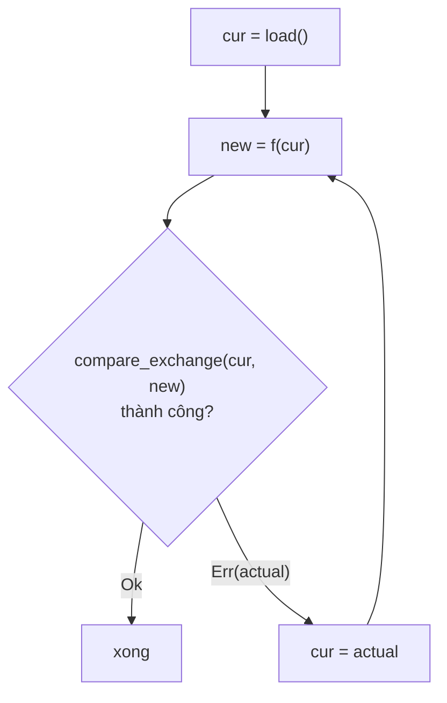
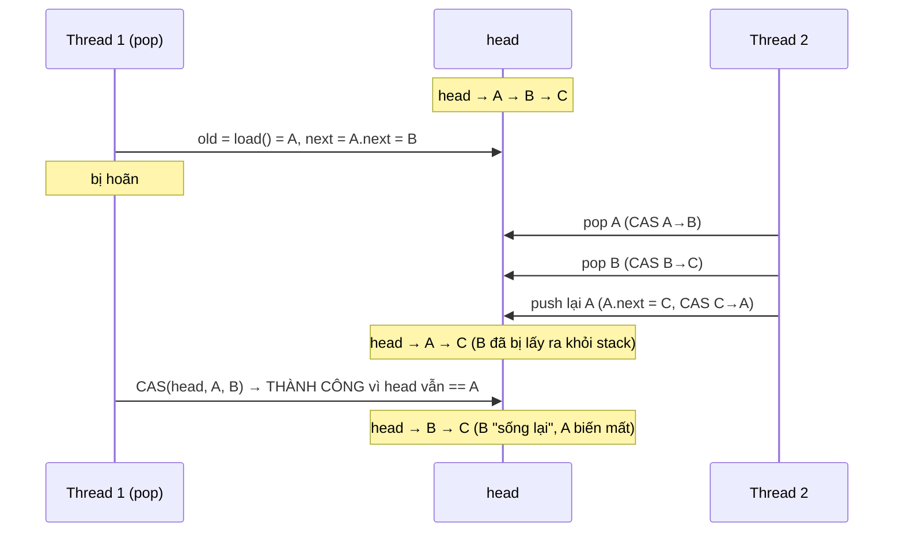

# P4 · Chương 07 — Atomic operation và lock-free

## Bạn sẽ hiểu được gì

1. **Q1.** Các phép `load`, `store`, `swap`, `fetch_add` và `compare_exchange` làm gì, và vì sao mọi primitive đồng bộ (mutex, condvar…) cuối cùng đều dựng trên chúng? → mục 1
2. **Q2.** `compare_exchange` khác `compare_exchange_weak` ở đâu, một vòng CAS (compare-and-swap loop) trông thế nào, và khi nào nên chọn bản nào? → mục 2
3. **Q3.** "Spurious failure" đến từ phần cứng nào, và rustc biến các phép atomic thành lệnh máy gì trên x86-64 và AArch64 (có và không có LSE)? → mục 3
4. **Q4.** "Lock-free", "wait-free", "obstruction-free" nghĩa là gì — nguồn nào định nghĩa, và `std` hứa gì (và không hứa gì)? → mục 4
5. **Q5.** ABA problem là gì, vì sao giải phóng node rồi cấp phát lại cùng địa chỉ làm nó nguy hiểm, và hazard pointer / epoch-based reclamation giải quyết phần "thu hồi bộ nhớ" ra sao? → mục 5
6. **Q6.** Futex cho "atomic wait/notify" thế nào, và vì sao fast path không cần syscall? → mục 6
7. **Q7.** Khi nào *không* nên dùng lock-free? → mục 7
8. **Q8.** Vì sao `Arc::clone` chỉ cần `Relaxed` còn `drop` cần `Release` + fence `Acquire`? → mục 8

## Kiến thức cần trước

- [Chương 03 — Lock](03-lock.md): test-and-set, CAS, spin lock, futex fast/slow path (chương này đào sâu phần "atomic" nằm dưới chúng).
- [Chương 06 — Memory model](06-memory-model.md): `Ordering`, happens-before, acquire/release. Chương này dùng các ordering đó mà không giải thích lại.
- [P2 · Chương 06 — Cache và NUMA](../02-cpu/06-cache-va-numa.md): cache line, MESI, false sharing.
- [P2 · Chương 03 — Assembly x86-64 và AArch64](../02-cpu/03-assembly-x86-64-va-aarch64.md): đọc được vài dòng assembly.

## 1. Atomic operation và các phép cơ bản (Q1)

> **Trả lời ngắn.** Atomic operation là thao tác "không chia cắt được": nó xảy ra hoàn toàn trước hoặc hoàn toàn sau thao tác khác, không bao giờ nửa chừng[^atomics-intro]. Các phép cơ bản là load/store, swap, fetch-and-modify (như `fetch_add`) và compare-and-exchange[^atomics-types]. Mutex, condition variable và các primitive khác đều được cài bằng chính các phép này[^atomics-building-block].

**Giải thích.**

Hình dung (nhận xét của người soạn): hai request cùng tăng một bộ đếm lượt xem; nếu mỗi bên đọc số cũ, cộng một rồi ghi lại thì một lượt có thể bị mất. Atomic là cách buộc "đọc-cộng-ghi" thành một bước liền.

**Vấn đề.** Nhiều thread đọc-sửa-ghi cùng một biến thông thường là data race, tức undefined behavior trong Rust[^std-datarace]; atomic operation cho phép nhiều thread đọc/sửa cùng một biến một cách an toàn vì mỗi thao tác "xảy ra hoàn toàn trước hoặc hoàn toàn sau" thao tác khác[^atomics-intro]. Mara Bos nhấn mạnh vai trò nền tảng: mọi primitive khác như mutex và condition variable đều được cài bằng atomic operation[^atomics-building-block]. Từ "atomic" là "không chia cắt được": thao tác hoặc đã xong hoàn toàn, hoặc chưa xảy ra[^atomics-intro].

Trong Rust, atomic là method của các kiểu `Atomic*` (`AtomicI32`, `AtomicUsize`…) trong `std::sync::atomic`, sửa được qua `&` nhờ interior mutability, với ba nhóm: load/store, fetch-and-modify, compare-and-exchange[^atomics-types]. Mỗi thao tác nhận một `Ordering` — chủ đề của [chương 06](06-memory-model.md); chương này chủ yếu dùng `Relaxed`.

**Bốn họ phép toán.**

| Họ | Phép | Ý nghĩa |
|---|---|---|
| Load/store | `load`, `store` | đọc / ghi nguyên giá trị |
| Swap | `swap` | ghi giá trị mới, trả giá trị cũ (sách gọi là "fetch_store" nhưng đặt tên `swap`)[^atomics-swap] |
| Fetch-and-modify | `fetch_add`, `fetch_sub`, `fetch_or`, `fetch_and`, `fetch_xor`, `fetch_max`, `fetch_min`… | sửa rồi trả giá trị **trước** khi sửa, tất cả là một thao tác atomic[^atomics-fetch] |
| Compare-and-exchange | `compare_exchange`, `compare_exchange_weak`, `fetch_update` | chỉ ghi nếu giá trị hiện tại bằng giá trị mong đợi[^atomics-cae] |

**Trả giá trị cũ.** Họ `fetch_*` trả giá trị **trước** khi sửa. Sách minh họa: `a = 100`, `a.fetch_add(23)` trả `100`, và lần `load` kế tiếp thấy `123`[^atomics-fetch-demo].

Một lỗi kinh điển: `x.store(x.load() + 1)` **không** phải thao tác atomic duy nhất, dù từng bước là atomic. Nó không phải data race theo định nghĩa của `std` (không có truy cập non-atomic; xem [chương 06, mục 3](06-memory-model.md))[^std-datarace] mà là race condition: giữa `load` và `store` có thread khác chen vào. `fetch_add` là một thao tác đọc-sửa-ghi duy nhất[^atomics-fetch].

<details><summary>Đi sâu: tràn số trong <code>fetch_*</code></summary>

- **Tràn số thì wrap, không panic**[^atomics-wrap][^std-fetchadd-wrap]. Sách trình bày ba cách xử lý; cách thứ ba — mà sách gọi là "arguably the only truly correct one" — là ngăn hẳn phép cộng tràn xảy ra, và nó cần compare-and-exchange[^atomics-overflow-cae]. `Arc::clone` chọn abort khi refcount vượt ngưỡng (§8)[^atomics-arc-abort].

</details>

**Quay lại Q1:** mỗi phép atomic là một thao tác không chia cắt; `fetch_add` là một lần đọc-sửa-ghi, còn `load` rồi `store` thì không, và mọi primitive đồng bộ khác đứng trên các phép này.

## 2. `compare_exchange`, CAS loop và bản weak (Q2)

> **Trả lời ngắn.** `compare_exchange` chỉ ghi giá trị mới nếu giá trị hiện tại đúng bằng giá trị ta mong đợi, tất cả là một thao tác[^atomics-cae]. Muốn cập nhật có điều kiện thì bọc nó trong vòng lặp: đọc, tính, thử ghi, thất bại thì thử lại với giá trị mới nhất. Bản `compare_exchange_weak` được phép trả lỗi ngay cả khi giá trị khớp[^atomics-weak]; dùng nó khi một lần lỗi giả không đáng kể (như trong vòng lặp), còn không lặp thì dùng bản strong[^atomics-strong-when].

**Giải thích.**

Hình dung (nhận xét của người soạn): giống `UPDATE … WHERE version = ?` trong DB với optimistic locking: chỉ ghi nếu không ai đổi dòng đó kể từ lúc ta đọc; nếu không thì đọc lại và làm lại.

`compare_exchange` kiểm tra giá trị atomic có bằng một giá trị cho trước không, và chỉ khi đúng mới thay bằng giá trị mới, tất cả là một thao tác[^atomics-cae]; OSTEP mô tả cùng ý[^ostep-cas]. Kết quả là `Result<T, T>`: `Ok(giá trị cũ)` khi thành công, `Err(giá trị thực đang có)` khi thất bại.

**Mẫu CAS loop:** `load` giá trị hiện tại, tính giá trị mới *không quan tâm đến thay đổi đồng thời*, rồi `compare_exchange`; thất bại nghĩa là thread khác đã đổi biến, ta thử lại với giá trị mà `Err` trả về. Sách nói khoảng giữa load và update ngắn đến mức hiếm khi lặp quá vài vòng[^atomics-cas-loop].



**Hai ordering và bản weak.** `compare_exchange` nhận hai ordering: `success` cho cả load-và-store khi so sánh đúng, `failure` chỉ cho load khi so sánh sai; failure chỉ có thể là `SeqCst`, `Acquire` hoặc `Relaxed`[^std-failure-order]. Ví dụ: fast path của `std::sync::Mutex` ghi `compare_exchange(UNLOCKED, LOCKED, Acquire, Relaxed)` ([Chương 03, mục 6](03-lock.md))[^std-futex-fast].

`compare_exchange_weak` được phép trả `Err` ngay cả khi giá trị khớp[^atomics-weak]; đổi lại có thể sinh code hiệu quả hơn trên một số nền tảng[^std-weak]. Sách: dùng weak khi hậu quả của một lần thất bại giả không đáng kể (như vòng tăng ở ví dụ dưới); dùng strong khi không lặp, ví dụ khởi tạo khóa lười `KEY.compare_exchange(0, new_key, …)`[^atomics-strong-when]. Vì sao có thất bại giả: xem §3.

<details><summary>Đi sâu: bộ cấp ID có trần và <code>fetch_update</code></summary>

Ví dụ đã chạy (rustc 1.95.0, tám thread, mỗi thread xin ID 500 lần, trần 1000): bộ cấp ID không bao giờ vượt trần — thứ `fetch_add` đơn thuần không làm được vì nó cộng trước khi kiểm tra.

```rust
static NEXT_ID: AtomicU32 = AtomicU32::new(0);

fn allocate_new_id() -> Option<u32> {
    let mut id = NEXT_ID.load(Relaxed);
    loop {
        if id >= 1000 { return None; }
        match NEXT_ID.compare_exchange_weak(id, id + 1, Relaxed, Relaxed) {
            Ok(_) => return Some(id),
            Err(actual) => id = actual,
        }
    }
}
```

Kết quả: `granted=1000 final=1000` (4000 lần xin, đúng 1000 được cấp). Cùng ý bằng `fetch_update` (sách gọi nó là tiện ích cho mẫu compare-and-exchange loop[^atomics-fetchupdate]): với `a` khởi đầu 998 và closure `|v| if v < 1000 { Some(v+1) } else { None }`, bốn lần gọi trả `Ok(998)`, `Ok(999)`, `Err(1000)`, `Err(1000)` (đã chạy). Docs std: nó "is not magic", không do phần cứng cung cấp, không phải critical section hay mutex, và chịu các nhược điểm thông thường của CAS, nhất là ABA[^std-fetchupdate-magic].

</details>

**Quay lại Q2:** `compare_exchange` là "ghi nếu chưa ai đổi"; vòng CAS lặp lại cho đến khi thắng, và `_weak` chấp nhận thất bại giả để rẻ hơn khi đã nằm trong vòng lặp.

## 3. Phần cứng thực hiện thế nào (Q3)

> **Trả lời ngắn.** Thất bại giả sinh ra từ phần cứng kiểu load-linked/store-conditional (LL/SC): lệnh store-conditional được phép thất bại dù vùng nhớ không đổi[^atomics-llsc-fn]. Trên x86-64 thì khác: `compare_exchange` và bản weak biên dịch ra cùng một lệnh `lock cmpxchg`[^atomics-x86-weak]. ARMv8.1 thêm lệnh atomic đơn như `ldadd` và `cas`; khi dùng `cas`, strong và weak không còn khác nhau[^atomics-lse].

**Giải thích.**

Hình dung (nhận xét của người soạn): x86-64 giống khóa cả quầy giao dịch trong lúc làm một việc; LL/SC giống "đánh dấu ô nhớ, làm việc, rồi nộp — nếu ô bị ai đụng vào thì bị từ chối", và hệ thống theo dõi thô đến mức đôi khi từ chối oan.

Mara Bos tóm vấn đề: lệnh `add` trên x86-64 bị bộ xử lý tách thành vi lệnh (load, cộng, store) nên *không* atomic khi nhiều core chạy song song, dù chỉ là một lệnh[^atomics-add-micro].

*x86-64: tiền tố `lock`.* Intel thêm tiền tố `lock` để biến các lệnh như `add` thành atomic. Ban đầu nó chặn mọi core khác truy cập bộ nhớ trong suốt lệnh; bộ xử lý mới cài tinh vi hơn[^atomics-lock-prefix]. Tiền tố chỉ dùng được với một số lệnh (`add`, `sub`, `and`, `or`, `xor`…), còn `xchg` (tương ứng `swap`) có `lock` ngầm định[^atomics-xchg]; khi cần giá trị cũ thì dùng `xadd`[^atomics-xadd]. Phép không có lệnh đơn (như `fetch_or` nhiều bit, `fetch_max`) được compiler chuyển thành CAS loop trên `lock cmpxchg`[^atomics-cmpxchg-loop]. Trên x86-64 `compare_exchange` và `compare_exchange_weak` giống hệt nhau[^atomics-x86-weak].

*AArch64: load-exclusive/store-exclusive (LL/SC).* RISC dùng **load-linked/store-conditional**: một cặp lệnh cùng địa chỉ, trong đó store-conditional từ chối ghi nếu có ai ghi đè vùng nhớ đó kể từ lần load-linked[^atomics-llsc-def]. Để cài hiệu quả, phần cứng cho phép store-conditional có "false negative": thất bại dù vùng nhớ không đổi[^atomics-llsc-fn], vì độ chính xác theo dõi có thể thô (chunk 64 byte, kilobyte, thậm chí toàn bộ bộ nhớ)[^atomics-llsc-coarse]. **Đây là nguồn gốc của spurious failure** mà `compare_exchange_weak` được phép phơi ra. Trên ARM64, ít nhất ở ARMv8 bản đầu, không phép fetch-and-modify hay compare-and-exchange nào là một lệnh đơn; cặp lệnh là `ldxr`/`stxr`[^atomics-llsc]. Sách cảnh báo: giữ số lệnh giữa `ldxr` và `stxr` càng ít càng tốt[^atomics-llsc-few].

*ARMv8.1 LSE.* ARMv8.1 thêm lệnh atomic kiểu CISC: `ldadd` tương đương `fetch_add` không cần vòng LL/SC, có cả lệnh cho `fetch_max`, và `cas` ứng với `compare_exchange`; khi dùng `cas`, strong và weak không còn khác nhau, giống x86-64[^atomics-lse]. Sách nói chúng có thể nhanh hơn vì dễ tối ưu bằng phần cứng chuyên dụng[^atomics-lse-faster].

Một `load` có thể rẻ hơn đáng kể so với `compare_exchange` thất bại, phần vì cái sau thường cần quyền truy cập độc quyền cache line[^atomics-cas-fail-cost] (MESI ở [P2 · Chương 06](../02-cpu/06-cache-va-numa.md)); vì vậy vòng spin của `std::sync::Mutex` chỉ dùng `load`[^std-futex-spin-load].

<details><summary>Đi sâu: assembly rustc 1.95.0 sinh ra cho x86-64 và AArch64 (không/có LSE)</summary>

Phần này đối chiếu sách ch.7 với assembly do rustc 1.95.0 sinh thật (`--emit asm -O`) cho `fetch_add`, `swap`, `compare_exchange`, `compare_exchange_weak` trên `AtomicU32` và `fetch_or(10)` trên `AtomicI32`, với ordering `AcqRel` (CAS: `AcqRel`/`Acquire`) và dùng giá trị trả về.

Assembly thật x86-64 (`x86_64-unknown-linux-gnu`, rút gọn):

```asm
fa:  lock xaddl %eax, (%rdi)      ; fetch_add dùng giá trị cũ
sw:  xchgl %eax, (%rdi)           ; swap (lock ngầm định)
cas: lock cmpxchgl %edx, (%rdi)   ; compare_exchange và _weak: cùng một lệnh
fo:  movl (%rdi), %eax            ; fetch_or(10): không có lệnh đơn → CAS loop
.L:  movl %eax, %ecx
     orl $10, %ecx
     lock cmpxchgl %ecx, (%rdi)
     jne .L
```

Ordering `AcqRel` và `Relaxed` cho cùng lệnh ở đây, phù hợp lời sách rằng trên x86-64 mọi thao tác bộ nhớ đã có ngữ nghĩa acquire/release[^atomics-x86-arm].

Tắt LSE (`-C target-feature=-lse`, target `aarch64-apple-darwin`) để thấy LL/SC thật:

```asm
_fa:   ldaxr w8,[x0] ; add w9,w8,#10 ; stlxr w10,w9,[x0] ; cbnz w10,_fa   ; vòng
_casw: ldaxr w1,[x0] ; cmp w1,#5 ; b.ne fail ; stlxr w9,w8,[x0]         ; MỘT lần thử, không vòng
_cas:  ldaxr w1,[x0] ; cmp w1,#5 ; b.ne fail ; stlxr w9,w8,[x0] ; cbnz w9,_cas  ; strong phải lặp
```

Bản `weak` chỉ có một `stlxr` và báo lỗi nếu nó thất bại; bản `strong` phải có `cbnz` để *che* thất bại giả. Đó là phần chi phí `weak` tiết kiệm khi đã nằm trong vòng lặp của người dùng (suy luận của người soạn từ asm trên; docs std nói gọn rằng weak cho phép compiler sinh assembly tốt hơn khi compare-and-swap được dùng trong vòng lặp[^std-weak-loop]). Hậu tố `a`/`l` trong `ldaxr`/`stlxr` xuất hiện khi dùng `AcqRel`; với `Relaxed` cùng mã sinh `ldxr`/`stxr` (đã chạy lại cả hai, quan sát trong asm).

Với `aarch64-apple-darwin` mặc định, `rustc --print cfg` báo `target_feature="lse"` bật sẵn, và cùng mã Rust với `AcqRel` sinh `ldaddal` (fetch_add), `swpal` (swap), `ldsetal` (fetch_or, không cần CAS loop), `casal` (cả strong lẫn weak); với `Relaxed` là `ldadd`, `swp`, `ldset`, `cas` — hậu tố `al` là acquire+release[^atomics-lse-al]. Các mnemonic này là output thật của rustc; sách chỉ nêu `ldadd` và `cas`. Cùng một dòng Rust cho mã khác hẳn tùy target feature (nhận xét của người soạn).

| Phép Rust | x86-64 | AArch64 không LSE | AArch64 có LSE |
|---|---|---|---|
| `fetch_add` | `lock xadd` | `ldaxr/add/stlxr` + `cbnz` | `ldaddal` |
| `swap` | `xchg` | `ldaxr/stlxr` + `cbnz` | `swpal` |
| `compare_exchange` | `lock cmpxchg` | `ldaxr/cmp/stlxr` + `cbnz` | `casal` |
| `compare_exchange_weak` | `lock cmpxchg` | `ldaxr/cmp/stlxr` (một lần) | `casal` |
| `fetch_or` nhiều bit | vòng `lock cmpxchg` | `ldaxr/orr/stlxr` + `cbnz` | `ldsetal` |

</details>

**Quay lại Q3:** thất bại giả đến từ store-conditional của LL/SC; x86-64 và AArch64 có LSE cho cùng một lệnh CAS cho cả hai bản, còn AArch64 không LSE thì bản strong phải bọc một vòng lặp.

## 4. Lock-free, wait-free, obstruction-free (Q4)

> **Trả lời ngắn.** Wait-free: mọi thread đều tiến triển dù thread khác bị trì hoãn hay hỏng[^hlm-waitfree]. Lock-free: chỉ đảm bảo *luôn có một thread nào đó* tiến triển[^hlm-lockfree]. Obstruction-free: chỉ đảm bảo cho thread chạy một mình, yếu hơn lock-free[^hlm-weaker]. `std` hứa các kiểu atomic là lock-free, nhưng không hứa wait-free[^std-lockfree][^std-not-waitfree].

**Giải thích.**

Hình dung (nhận xét của người soạn): một quầy thu ngân nhiều hàng. Wait-free: ai cũng được phục vụ trong thời gian hữu hạn. Lock-free: quầy luôn có ít nhất một khách được phục vụ, nhưng có thể có khách bị chen mãi. Obstruction-free: chỉ đảm bảo nếu những khách khác đứng yên thì bạn được phục vụ.

Ba thuật ngữ về *progress guarantee* của cấu trúc dữ liệu đồng thời. Các định nghĩa dưới đây lấy từ hai bài báo (không phải từ docs Rust):

| Thuật ngữ | Định nghĩa (theo nguồn) |
|---|---|
| **Wait-free** | đảm bảo mọi thread đều tiếp tục tiến triển dù các thread khác bị trì hoãn tùy ý (hoặc thậm chí hỏng)[^hlm-waitfree] |
| **Lock-free** | chỉ đảm bảo rằng luôn có một thread nào đó tiến triển[^hlm-lockfree]; cách phát biểu chặt hơn của Michael: nếu một thread thực hiện một số hữu hạn bước hướng tới một thao tác, thì *một thread nào đó* (có thể khác) phải đã tiến triển trong các bước đó[^michael-lockfree] |
| **Obstruction-free** | đảm bảo tiến triển cho mọi thread mà cuối cùng chạy "in isolation"[^hlm-of] — yếu hơn lock-free vì không đảm bảo tiến triển khi hai hay nhiều thread xung đột chạy đồng thời[^hlm-weaker] |

Quan hệ giữa ba mức: bài báo nói thẳng obstruction-free yếu hơn lock-free[^hlm-weaker]; còn wait-free ⟹ lock-free là suy ra trực tiếp từ hai định nghĩa trên (mọi thread tiến triển thì có một thread tiến triển; suy luận của người soạn), khớp với cách bài báo gọi wait-free là hành vi lý tưởng còn lock-free thường là đủ tốt cho mục đích thực tế[^hlm-lockfree-enough]. Vậy wait-free ⟹ lock-free ⟹ obstruction-free; lock-free cho phép *một* thread bị bỏ đói. Michael viết cùng ý ở dạng lợi ích: đối tượng lock-free miễn nhiễm với deadlock khi thread lỗi và giữ hiệu năng ổn định khi thread bị trì hoãn[^michael-benefit]; riêng obstruction-free, bài báo nói nó bảo đảm không thread nào bị chặn bởi sự chậm trễ hay hỏng của thread khác[^hlm-nonblocking].

**`std` hứa gì?** Docs `std::sync::atomic`: mọi kiểu atomic trong module "guaranteed to be lock-free if they're available", tức chúng không nội bộ lấy một global mutex[^std-lockfree]; nhưng *không* hứa wait-free — ví dụ `fetch_or` có thể cài bằng vòng compare-and-swap[^std-not-waitfree]. Khớp với asm ở §3: `fetch_or` nhiều bit trên x86-64 là vòng `cmpxchg`, còn khi có LSE là `ldsetal` (hoặc `ldset`) một lệnh. Chữ "lock-free" ở đây nói về cách cài *một thao tác atomic đơn*, khác với "cấu trúc lock-free" là thuộc tính của cả thuật toán (nhận xét của người soạn).

<details><summary>Đi sâu: nguồn không cho gì</summary>

Hai bài báo chỉ định nghĩa ở mức văn xuôi; không có định nghĩa hình thức (ví dụ qua linearizability) trong nguồn đã tải, nên chương này không đưa ra.

</details>

**Quay lại Q4:** wait-free ⟹ lock-free ⟹ obstruction-free về độ mạnh; `std` hứa lock-free cho từng thao tác atomic nhưng không hứa wait-free.

## 5. ABA problem và thu hồi bộ nhớ (Q5)

> **Trả lời ngắn.** CAS so sánh *giá trị*, không so sánh *lịch sử*: nếu biến đổi A→B→A giữa `load` và `compare_exchange`, thao tác vẫn thành công[^atomics-aba]. Cùng địa chỉ không có nghĩa là cùng một object[^std-aba], nên đặc biệt nguy hiểm khi node đã bị giải phóng rồi cấp phát lại cùng địa chỉ (suy luận của người soạn). Hazard pointer và epoch giải quyết phần thu hồi bộ nhớ: chỉ hủy node khi không thread nào còn tham chiếu được[^michael-hp-scan][^ce-mechanism].

**Giải thích.**

Hình dung (nhận xét của người soạn): bạn ghi lại biển số xe đỗ ở ô A để lát nữa đến lấy; trong lúc đi, xe đó bị dời đi và một xe khác cùng biển số... đúng hơn là một xe khác vào đỗ đúng ô đó. Nhìn ô thấy "vẫn là xe đó" nhưng trạng thái xung quanh đã khác hẳn.

**Vấn đề.** CAS so sánh *giá trị*, không so sánh *lịch sử*. Nếu biến đổi từ A sang B rồi quay lại A sau `load` nhưng trước `compare_exchange`, thao tác vẫn thành công[^atomics-aba]; với bộ đếm thường không sao, nhưng có thuật toán — thường dùng atomic pointer — thì đây là vấn đề (cùng đoạn). Docs std: cùng địa chỉ không có nghĩa là cùng một object[^std-aba]. Michael: ABA do IBM nêu lần đầu trong tài liệu CAS trên System/370[^michael-aba] và, theo ông, ảnh hưởng hầu hết thuật toán lock-free[^michael-aba-almost].

**Ví dụ cụ thể: pop trên lock-free stack.** Stack là danh sách liên kết, `head` là `AtomicPtr<Node>`. `pop` của thread 1: đọc `old = head`, đọc `next = old.next`, rồi `CAS(head, old, next)`. Kịch bản (đã chạy deterministic, một thread giả lập hai thread xen kẽ):



Mã giả lập dùng `AtomicPtr<Node>` và `compare_exchange` thật; in ra `CAS của thread 1: Ok(())` và `stack sau đó: B C`: CAS thành công nhưng B (đã bị thread 2 lấy ra) được gắn lại làm đỉnh và A biến mất. Trong hệ thống thật B có thể đã bị `free` và cấp phát lại — use-after-free. Docs std cảnh báo đúng chỗ này: load rồi `compare_exchange` thành công không bảo đảm rằng thread khác đã không đổi giá trị trong khoảng giữa hai bước[^std-aba].

**Cách xử lý (chỉ điều nguồn nói):**

- **Tag / update counter** (phương pháp "IBM tag"): gắn một bộ đếm vào con trỏ để A-rồi-lại-A khác nhau. Michael nhận xét phương pháp này cản trở việc thu hồi bộ nhớ tùy ý và đòi lệnh double-width không có trên các bộ xử lý 64-bit[^michael-tag].
- **Thu hồi bộ nhớ an toàn** (hazard pointer — phần "Thu hồi bộ nhớ" bên dưới): Michael viết rằng các lời giải cho thu hồi bộ nhớ, như GC và hazard pointer, thường ngăn ABA như một tác dụng phụ, với ít hoặc không tốn thêm chi phí[^michael-aba-side-effect].
- GC *không* tự động ngăn ABA trong mọi trường hợp: chương trình chuyển node qua lại giữa hai stack vẫn có ABA dù GC hoàn hảo[^michael-gc-misconception].

*Thu hồi bộ nhớ (memory reclamation).*

**Vấn đề.** Khi thread 1 `pop` một node, thread 2 có thể vừa đọc con trỏ tới node đó và sắp truy cập nội dung. Nếu thread 1 `free` ngay, thread 2 có thể làm hỏng object, trả kết quả sai, hoặc dereference con trỏ không hợp lệ; nếu bộ nhớ trả về OS (`munmap`), truy cập có thể thành lỗi nghiêm trọng[^michael-reclaim-problem]. Trong cấu trúc dùng lock thì dễ đảm bảo không ai truy cập node đã gỡ; với cấu trúc lock-free điển hình trong môi trường không có GC thì không, vì để giữ tiến triển lock-free mỗi thread phải được tự do thao tác bất cứ lúc nào[^michael-reclaim-problem].

Các cách trước đó dựa trên reference counter tổng hợp hoặc timestamp theo thread đều *blocking* nếu thiếu hỗ trợ scheduler: một thread hỏng hay chậm có thể ngăn counter về 0 hoặc timestamp tiến lên, nên bộ nhớ không giới hạn không được tái sử dụng[^michael-three-groups].

*Hazard pointer.*

Ý tưởng của Michael: mỗi thread có một vài (thường một hoặc hai) *hazard pointer*; chỉ chủ nhân ghi được, mọi thread đọc được. Mỗi cái hoặc null hoặc trỏ tới node mà thread có thể truy cập tiếp mà không validate lại[^michael-hp-core]. Thread gỡ node (retire) giữ nó trong danh sách riêng; đủ R node thì quét hazard pointer của các thread khác, node nào không bị ai chỉ tới thì thu hồi được[^michael-hp-scan]. Trên stack, `pop` cần hazard pointer (truy cập node ở dòng 10 nguy hiểm, CAS ở dòng 11 dễ dính ABA), `push` thì không[^michael-stack-hp]. Các thao tác lõi chỉ cần đọc/ghi single-word[^michael-hp-waitfree].

*Epoch-based reclamation (crossbeam-epoch).*

Docs `crossbeam-epoch` 0.9.18 mô tả cùng vấn đề: thread gỡ phần tử khỏi map lock-free trong khi thread khác đang đọc nó phải chờ rồi mới được hủy[^ce-problem]; ngôn ngữ có garbage collector giải quyết "trivially"[^ce-gc]. Cơ chế epoch: phần tử bị gỡ vào đống rác gắn epoch hiện tại; mỗi lần thread truy cập collection, nó kiểm tra epoch, cố tăng epoch, và hủy rác đã đủ cũ để không thread nào còn tham chiếu được[^ce-mechanism]. Trước khi load một `Atomic`, participant phải được *pin*: tuyên bố rằng object nào bị gỡ từ lúc này chưa được hủy ngay[^ce-pin].

**So sánh (nhận xét của người soạn, suy luận):** hazard pointer bảo vệ *từng node* thread đang giữ; epoch bảo vệ *theo thời kỳ* (pin một lần cho cả đoạn truy cập, nhưng thread pin lâu giữ lại rác của mọi người). Docs crossbeam-epoch đã tải không so sánh hai cách.

<details><summary>Đi sâu: stack, queue Michael–Scott và false sharing</summary>

**Stack (IBM freelist).**

Michael trình bày stack lock-free dựa trên thuật toán IBM freelist[^michael-stack]. Dạng đơn giản: `head: AtomicPtr<Node>`.

- **push**: tạo node, đặt `node.next = head.load()`, rồi `CAS(head, old, node)`; nếu thất bại thì cập nhật `node.next = head hiện tại` và thử lại.
- **pop**: `old = head.load()`, `next = old.next`, `CAS(head, old, next)`; thất bại thì lặp lại. Đây là chỗ ABA và use-after-free xuất hiện (§5).

Ví dụ đã chạy: bốn thread, mỗi thread push 10 000 phần tử bằng `compare_exchange_weak(h, n, Release, Relaxed)` trên `AtomicPtr`; sau khi mọi push xong, một thread `pop` hết. Kết quả `pushed=40000 popped=40000 sum=799980000`, đúng bằng tổng 0..39999. Bản `pop` **cố ý không `free`** và chỉ chạy sau khi mọi `push` xong, nên né ABA và reclamation — hai chỗ khó. Đây là minh họa `AtomicPtr`, không phải mã nên dùng (§7).

**Queue (Michael–Scott).**

Michael dùng queue FIFO lock-free của Michael–Scott làm case study: danh sách liên kết đơn có node giả ở đầu; enqueue gắn node vào cuối rồi cập nhật `Tail` (nếu `Tail` chưa trỏ đúng node cuối thì cập nhật nó trước); dequeue dịch `Head` sau khi đọc dữ liệu từ node thứ hai[^michael-queue]. Nếu một thread bị hoãn khi để đối tượng ở trạng thái chưa ổn định, thread khác đưa nó về ổn định rồi mới làm việc của mình[^michael-helping] ("helping"); cơ chế này là lý do một thread bị hoãn không chặn thread khác (suy luận của người soạn, nối với §4). Với queue, Michael chỉ ra các CAS ở dòng 7, 8, 9 của enqueue đều là "ABA hazard"[^michael-queue-hazards]; tức enqueue cần hazard pointer cùng bước validate, khác `push` của stack vốn không cần hazard pointer (nhận xét của người soạn).

**False sharing.**

Hai biến atomic không liên quan nằm chung cache line thì thao tác trên biến này làm chậm biến kia; tránh bằng cách đặt chúng xa nhau[^atomics-false-sharing], và tùy bộ xử lý có thể cần alignment 128 byte mới thấy hiệu ứng[^atomics-128]. Chi tiết ở [P2 · Chương 06](../02-cpu/06-cache-va-numa.md). Với queue, `Head` và `Tail` chung cache line sẽ làm enqueue và dequeue tranh nhau dù không tranh chấp logic (suy luận của người soạn).

</details>

**Quay lại Q5:** CAS không thấy lịch sử nên ABA lọt qua; muốn an toàn thì phải có cách thu hồi bộ nhớ (hazard pointer, epoch) hoặc tag để A-lần-hai khác A-lần-một.

## 6. Atomic wait/notify và futex (Q6)

> **Trả lời ngắn.** Chờ lâu thì thread phải ngủ; trên Linux việc đó là syscall futex, hoạt động trên một số nguyên atomic 32-bit với `FUTEX_WAIT` và `FUTEX_WAKE`[^atomics-futex-basic]. `FUTEX_WAIT` nhận giá trị mong đợi và từ chối chặn nếu không khớp, nên wake-up không bị mất[^atomics-futex-race]. Khi không tranh chấp thì chỉ cần lệnh atomic, không cần vào kernel[^futex-uncontended].

**Giải thích.**

Hình dung (nhận xét của người soạn): bạn dán mảnh giấy "tôi đang chờ tại ô này, chỉ gọi khi ô còn là 0" cho bảo vệ; nếu lúc bạn đến ô đã khác 0, bảo vệ bảo "khỏi chờ" ngay.

CAS loop hợp với tranh chấp ngắn (nhận xét của người soạn); chờ lâu thì thread cần ngủ. Trên Linux các primitive pthread đều cài bằng syscall futex[^atomics-futex-linux]. Cơ chế `FUTEX_WAIT`/`FUTEX_WAKE`, phép so sánh-rồi-chặn nguyên tử trả `EAGAIN` để không mất wake-up, và state machine futex 0/1/2 của `std::sync::Mutex` (fast path `compare_exchange(UNLOCKED, LOCKED, Acquire, Relaxed)`, unlock `swap(UNLOCKED, Release)`) đã giải thích ở [Chương 03, mục 5 và 6](03-lock.md); phần dưới chỉ ghi các điểm riêng của góc nhìn atomic. Kernel nhớ thread nào chờ ở địa chỉ nào, còn giá trị trong biến do người dùng tự quản[^atomics-futex-kernel]. Futex wait có thể thức dậy giả nên thường nằm trong vòng lặp[^atomics-futex-spurious]. Nếu tự quản trạng thái trong biến atomic, bên báo hiệu bỏ qua `FUTEX_WAKE` khi không ai chờ — kernel chỉ bị gọi khi cần chặn, đó là lý do primitive dựa trên futex nhanh[^atomics-futex-fast].

<details><summary>Đi sâu: chuẩn hóa và futex trong <code>std</code></summary>

C++ năm 2020 thêm `atomic_wait` và `atomic_notify`[^atomics-cxx-wait]. Trong trang `AtomicUsize` docs 1.95.0 đã tải, danh sách method không có `wait`/`notify` (quan sát của người soạn; biên dịch `AtomicU32::new(0).wait(0)` bằng rustc 1.95.0 báo `no method named wait`); `std` dùng futex bên trong — lớp syscall (`SYS_futex` với `FUTEX_WAIT_BITSET | FUTEX_PRIVATE_FLAG`) nằm ở phần Đi sâu của [Chương 03, mục 6](03-lock.md).

</details>

**Quay lại Q6:** futex là "so sánh rồi chặn" nguyên tử trên một biến atomic, nên không mất wake-up và bên báo hiệu bỏ qua syscall khi không ai chờ.

## 7. Khi nào *không* nên dùng lock-free (Q7)

> **Trả lời ngắn.** Thường là không nên (nhận xét của người soạn): lock-free khó viết đúng, không tự động nhanh hơn lock — CAS thất bại tốn kém[^atomics-cas-fail-cost], còn fast path của mutex futex chỉ là một CAS[^std-futex-fast] — và vẫn không hứa wait-free[^std-not-waitfree].

**Giải thích.**

Hình dung (nhận xét của người soạn): giống tự viết connection pool thay vì dùng thư viện có sẵn — làm được, nhưng chỉ đáng khi đo thấy cần.

Nhận xét của người soạn; nguồn chỉ được dẫn ở chỗ có.

1. **Khó đúng.** Bài báo obstruction-free viết rằng CAS và LL/SC "an awkward match" với đồng bộ lock-free[^hlm-rare]; ta vừa thấy lý do cụ thể: ABA, thu hồi bộ nhớ và nhiều con trỏ phải nhất quán (§5).
2. **Không tự động nhanh hơn.** CAS thất bại tốn kém[^atomics-cas-fail-cost]; dưới tranh chấp cao, nhiều thread cùng CAS một `head` có thể lãng phí chu kỳ (suy luận của người soạn). Dưới tranh chấp thấp, mutex futex đã rẻ: fast path chỉ là một CAS, không syscall[^std-futex-fast].
3. **Lock-free ≠ không chờ.** Một thread vẫn có thể quay mãi trong CAS loop (§4); `std` không hứa wait-free[^std-not-waitfree].
4. **Chi phí bảo trì.** Review, kiểm chứng và giải thích khó hơn `Mutex<T>` nhiều.
5. **Thực tế cho backend:** hầu hết dịch vụ nên dùng `Mutex`, `RwLock`, channel hoặc bộ đếm `fetch_add`. Khi thật sự cần cấu trúc lock-free, dùng crate đã kiểm chứng như `crossbeam-epoch` (§5) thay vì tự viết thu hồi bộ nhớ, và đo trước khi chọn.

<details><summary>Đi sâu: số đo của Michael</summary>

Michael đo lock-free dùng hazard pointer ngang lock khi không tranh chấp[^michael-perf] — kết quả trên máy IBM năm 2004, không phải bảo đảm cho phần cứng hiện nay.

</details>

**Quay lại Q7:** lock-free là công cụ chuyên dụng — khó đúng, không mặc định nhanh hơn; chọn nó sau khi đo.


## 8. `Arc`: refcount atomic với ordering cụ thể (Q8)

> **Trả lời ngắn.** `Arc::clone` chỉ cần `Relaxed` vì tham chiếu mới chỉ sinh ra từ một tham chiếu đã có[^arc-clone-relaxed]. `drop` trừ refcount bằng `Release`; tham chiếu cuối thêm fence `Acquire` để việc dùng dữ liệu không bị sắp xếp lại ra sau việc xóa[^arc-drop-sub][^arc-drop-fence].

**Giải thích.**

Hình dung (nhận xét của người soạn): đếm số người đang cầm chìa khóa phòng; thêm người mới chỉ cần ghi số, nhưng người cuối cùng trả chìa phải chắc chắn đã thấy hết mọi thứ người trước để lại trong phòng trước khi dọn phòng.

Docs: `Arc` dùng phép atomic cho refcount nên thread-safe, khác `Rc`[^std-arc]. Source `library/alloc/src/sync.rs` Rust 1.95.0 cho thấy ordering cụ thể (chi tiết cài đặt, có thể đổi giữa các phiên bản).

**`clone` = `fetch_add(1, Relaxed)`**[^arc-clone-fetchadd]. Comment trong source: tham chiếu mới chỉ sinh từ tham chiếu đã có, và việc chuyển tham chiếu giữa thread đã phải tự mang đồng bộ cần thiết, nên tăng refcount dùng relaxed được[^arc-clone-relaxed]. Sau đó source kiểm tra `if old_size > MAX_REFCOUNT { abort(); }` (`MAX_REFCOUNT = isize::MAX`) phòng người `mem::forget` Arc liên tục[^arc-clone-abort] — chính là cách "abort khi tràn" trong sách (§1)[^atomics-arc-abort].

**`drop` = `fetch_sub(1, Release)`, rồi fence `Acquire` nếu là tham chiếu cuối.**

```rust
if self.inner().strong.fetch_sub(1, Release) != 1 { return; }
acquire!(self.inner().strong);   // atomic::fence(Acquire)
// ... drop dữ liệu, giải phóng bộ nhớ
```

Chưa phải tham chiếu cuối thì return ngay[^arc-drop-sub]. Với tham chiếu cuối, comment giải thích: fence `Acquire` ngăn sắp xếp lại giữa *dùng* và *xóa* dữ liệu; giảm refcount là `Release` nên đồng bộ với fence này — dùng dữ liệu xảy ra trước giảm refcount, trước fence, trước việc xóa[^arc-drop-fence]. Đây là mô hình Release/Acquire của [chương 06](06-memory-model.md).

<details><summary>Đi sâu: macro <code>acquire!</code>, lý do với <code>Mutex&lt;T&gt;</code>, và CAS loop của <code>Weak</code></summary>

`acquire!` là `atomic::fence(Acquire)`, hoặc `load(Acquire)` khi build với ThreadSanitizer vì TSan không hỗ trợ fence[^arc-acquire-macro]. Cần đến mức này vì nội dung `Arc` có thể có ghi nội bộ (như `Mutex<T>`), và mutex không được lock lúc bị drop nên không thể dựa vào đồng bộ của nó[^arc-drop-mutex].

**`Weak::upgrade` và `Arc::downgrade` dùng CAS loop.** `upgrade` dùng `try_update(Acquire, Relaxed, checked_increment)` thay vì `fetch_add` vì không bao giờ được đưa refcount từ 0 lên 1[^arc-upgrade-cas]. `downgrade` lặp `compare_exchange_weak(cur, cur + 1, Acquire, Relaxed)` và coi `usize::MAX` ở weak count như một "khóa" tạm[^arc-downgrade-cas]. Đây là mẫu §2 trong std, với ràng buộc ("không đếm lên từ 0") mà `fetch_add` không diễn đạt được. ABA không đáng lo ở đây vì giá trị so sánh là bộ đếm, không phải identity của object (nhận xét của người soạn; sách cũng nói với bộ đếm thường không sao[^atomics-aba]).

</details>

**Quay lại Q8:** tạo thêm tham chiếu chỉ cần `Relaxed` vì đã có sẵn một tham chiếu; trả tham chiếu cuối phải `Release` + fence `Acquire` để mọi truy cập dữ liệu xảy ra trước khi xóa.

## Liên hệ với Rust

- `AtomicUsize` cùng kích thước và bit validity với `usize`, nhưng alignment luôn bằng kích thước, kể cả khi `usize` có alignment nhỏ hơn trên target đó[^std-au-align].
- `AtomicPtr<T>` có cùng kích thước và bit validity với `*mut T`[^std-ap]; nó là viên gạch của stack/queue ở §5. Nó giữ **con trỏ**, không quản lý vòng đời: vấn đề ở §5 thuộc về bạn, và docs std cảnh báo trực tiếp về ABA[^std-aba].
- Kiểu atomic là `Sync` nhưng không tự cung cấp cơ chế chia sẻ; thường đặt vào `Arc` hoặc `static`[^std-atomic-sync].

## Tóm tắt

- Atomic operation là viên gạch dưới mọi primitive đồng bộ[^atomics-building-block]; `fetch_add`/`swap` là một thao tác đọc-sửa-ghi, còn `load` rồi `store` thì không. `fetch_add` wrap khi tràn[^std-fetchadd-wrap].
- `compare_exchange_weak` được phép thất bại giả vì LL/SC có false negative[^atomics-llsc-fn]; asm AArch64 không LSE cho thấy weak chỉ một lần `stlxr`, strong có vòng.
- x86-64: `lock xadd`, `xchg`, `lock cmpxchg`; AArch64: `ldxr/stxr` hoặc từ ARMv8.1 `ldadd/cas`[^atomics-lse].
- Wait-free > lock-free > obstruction-free về độ mạnh; `std` hứa lock-free, không hứa wait-free[^std-lockfree][^std-not-waitfree]. Nguồn đã tải không có định nghĩa hình thức.
- ABA: CAS thấy cùng giá trị nhưng lịch sử đã đổi[^atomics-aba]; thu hồi bộ nhớ (hazard pointer, epoch) là phần khó; theo Michael, hazard pointer và GC thường ngăn ABA như tác dụng phụ[^michael-aba-side-effect].
- `Arc`: `clone` = `fetch_add(1, Relaxed)`, `drop` = `fetch_sub(1, Release)` + fence `Acquire` ở tham chiếu cuối[^arc-drop-sub][^arc-clone-fetchadd].
- Futex = atomic compare-and-block; fast path không syscall là lý do các primitive dựa trên futex nhanh[^futex-cab][^atomics-futex-fast]. Lock-free không mặc định nhanh hơn lock.

## Câu hỏi tự kiểm tra

1. Vì sao `x.store(x.load(Relaxed) + 1, Relaxed)` có thể mất cập nhật? Đó có phải data race không?
<details><summary>Đáp án</summary>

Không phải data race (không có truy cập non-atomic)[^std-datarace]; là race condition vì giữa load và store có thể có thread khác chen vào. `fetch_add` là một thao tác đọc-sửa-ghi duy nhất[^atomics-fetch].

</details>

2. `fetch_add(1, Relaxed)` trên `u32::MAX` làm gì? Cách nào ngăn hẳn việc tràn?
<details><summary>Đáp án</summary>

Wrap[^atomics-wrap][^std-fetchadd-wrap]; ngăn hẳn bằng compare-and-exchange[^atomics-overflow-cae].

</details>

3. Vì sao `compare_exchange_weak` có thể thất bại dù giá trị khớp? Trên x86-64 có khác strong không?
<details><summary>Đáp án</summary>

LL/SC cho phép store-conditional thất bại giả[^atomics-llsc-fn]; docs std cho phép để sinh code tốt hơn[^std-weak]. Trên x86-64 cả hai là `lock cmpxchg`[^atomics-x86-weak].

</details>

4. Khi nào chọn `compare_exchange` strong?
<details><summary>Đáp án</summary>

Khi không nằm trong vòng lặp và không muốn một thất bại giả bị hiểu nhầm — ví dụ khởi tạo khóa lười[^atomics-strong-when].

</details>

5. `fetch_add` trên `aarch64-apple-darwin` mặc định biên dịch thành gì, và khi tắt LSE?
<details><summary>Đáp án</summary>

`ldadd` khi có LSE[^atomics-lse]; vòng `ldaxr/add/stlxr/cbnz` (`AcqRel`; `ldxr/stxr` với `Relaxed`) khi tắt (asm ở §3), vì ARMv8 bản đầu không có lệnh đơn[^atomics-llsc].

</details>

6. Lock-free khác wait-free thế nào? `std` hứa gì?
<details><summary>Đáp án</summary>

Wait-free: mọi thread tiến triển[^hlm-waitfree]; lock-free: luôn có thread tiến triển[^hlm-lockfree]. `std` hứa lock-free, không hứa wait-free[^std-lockfree][^std-not-waitfree].

</details>

7. Mô tả ABA trên `pop` của stack và hai hướng xử lý.
<details><summary>Đáp án</summary>

Thread 1 đọc head=A, next=B; thread khác pop A, pop B, push A; CAS của thread 1 vẫn thành công[^atomics-aba][^std-aba]. Xử lý: tag/update counter (cần lệnh double-width)[^michael-tag]; thu hồi bộ nhớ an toàn như hazard pointer[^michael-aba-side-effect].

</details>

8. Hazard pointer khác epoch ở mức ý tưởng?
<details><summary>Đáp án</summary>

Hazard pointer: thread công bố con trỏ đang dùng, thread retire quét trước khi thu hồi[^michael-hp-core][^michael-hp-scan]. Epoch: pin participant, rác gắn epoch, chỉ hủy khi đủ cũ[^ce-pin][^ce-mechanism].

</details>

9. Vì sao `Arc::clone` dùng `Relaxed` còn `drop` dùng `Release` + fence `Acquire`?
<details><summary>Đáp án</summary>

Clone chỉ từ tham chiếu đã có[^arc-clone-relaxed]; drop phải bảo đảm mọi truy cập dữ liệu happens-before việc xóa ở thread khác[^arc-drop-fence].

</details>

10. `FUTEX_WAIT` nhận giá trị mong đợi để làm gì?
<details><summary>Đáp án</summary>

Tránh lost wake-up: giá trị đã đổi thì thất bại ngay với `EAGAIN`[^futex-eagain]; đó là compare-and-block atomic[^futex-cab].

</details>

## Đọc thêm

- [Rust Atomics and Locks, ch.2](https://marabos.nl/atomics/atomics.html): compare-and-exchange, ví dụ ID allocation và lazy init.
- [Rust Atomics and Locks, ch.7](https://marabos.nl/atomics/hardware.html): assembly x86-64/ARM64 đầy đủ, LL/SC, cache coherence.
- [Rust Atomics and Locks, ch.8](https://marabos.nl/atomics/os-primitives.html): futex và các thao tác futex khác.
- [Michael, Hazard Pointers (2004)](https://www.cs.otago.ac.nz/cosc440/readings/hazard-pointers.pdf): thuật toán đầy đủ, queue, stack, benchmark.
- [Herlihy–Luchangco–Moir, Obstruction-Free Synchronization](https://www.cs.brown.edu/~mph/HerlihyLM03/main.pdf): vì sao đề xuất điều kiện yếu hơn lock-free.
- [crossbeam-epoch 0.9.18](https://docs.rs/crossbeam-epoch/0.9.18/crossbeam_epoch/): API `pin`, `Atomic`, `Shared`, `Guard`.
- [`library/alloc/src/sync.rs` (1.95.0)](https://raw.githubusercontent.com/rust-lang/rust/1.95.0/library/alloc/src/sync.rs): mã `Arc` với ordering thật.
- [Chương 06](06-memory-model.md), [Chương 08](08-rust-concurrency.md): ordering và cách Rust ghép các mảnh vào type system.

[^atomics-intro]: Rust Atomics and Locks, ch.2 Atomics — <https://marabos.nl/atomics/atomics.html> — "However, atomic operations do allow for different threads to safely read and modify the same variable."
[^atomics-building-block]: Rust Atomics and Locks, ch.2 Atomics — <https://marabos.nl/atomics/atomics.html> — "All the other concurrency primitives, such as mutexes and condition variables, are implemented using atomic operations."
[^atomics-types]: Rust Atomics and Locks, ch.2 Atomics — <https://marabos.nl/atomics/atomics.html> — "Each of the available atomic types has the same interface with methods for storing and loading, methods for atomic"
[^atomics-swap]: Rust Atomics and Locks, ch.2 Atomics — <https://marabos.nl/atomics/atomics.html> — "Instead of fetch_store, it has been called swap."
[^atomics-fetch]: Rust Atomics and Locks, ch.2 Atomics — <https://marabos.nl/atomics/atomics.html> — "also load (fetch) the original value, as a single atomic operation. The most commonly used ones are fetch_add and fetch_sub"
[^atomics-fetch-demo]: Rust Atomics and Locks, ch.2 Atomics — <https://marabos.nl/atomics/atomics.html> — "The fetch_add operation incremented a from 100 to 123, but returned to us the old value of 100."
[^atomics-wrap]: Rust Atomics and Locks, ch.2 Atomics — <https://marabos.nl/atomics/atomics.html> — "An important thing to keep in mind is that fetch_add and fetch_sub implement wrapping behavior for overflows."
[^std-fetchadd-wrap]: Rust std 1.95.0, `AtomicUsize::fetch_add` — <https://doc.rust-lang.org/1.95.0/std/sync/atomic/struct.AtomicUsize.html> — "This operation wraps around on overflow."
[^atomics-overflow-cae]: Rust Atomics and Locks, ch.2 Atomics — <https://marabos.nl/atomics/atomics.html> — "The third way of handling overflows is arguably the only truly correct one, as it prevents the addition from happening at all if it would overflow."
[^atomics-arc-abort]: Rust Atomics and Locks, ch.2 Atomics — <https://marabos.nl/atomics/atomics.html> — "This is, in fact, how the overflow check in Arc::clone() in the standard library is implemented,"
[^std-datarace]: Rust std 1.95.0, module `std::sync::atomic` — <https://doc.rust-lang.org/1.95.0/std/sync/atomic/index.html> — "The most important aspect of this model is that data races are undefined behavior. A data race is defined as conflicting non-synchronized accesses where at least one of the accesses is non-atomic."
[^atomics-cae]: Rust Atomics and Locks, ch.2 Atomics — <https://marabos.nl/atomics/atomics.html> — "This operation checks if the atomic value is equal to a given value, and only if that is the case does it replace it with a new value, all atomically as a single operation."
[^ostep-cas]: OSTEP, ch.28 Locks — <https://pages.cs.wisc.edu/~remzi/OSTEP/threads-locks.pdf> — "The basic idea is for compare-and-swap to test whether the value at the address specified by ptr is equal to expected; if so, update the memory location pointed to by ptr with the new value."
[^atomics-cas-loop]: Rust Atomics and Locks, ch.2 Atomics — <https://marabos.nl/atomics/atomics.html> — "The brief moment between loading and updating is so short"
[^atomics-fetchupdate]: Rust Atomics and Locks, ch.2 Atomics — <https://marabos.nl/atomics/atomics.html> — "The atomic types have a convenience method called fetch_update for the compare-and-exchange loop pattern."
[^std-fetchupdate-magic]: Rust std 1.95.0, `AtomicUsize::fetch_update` — <https://doc.rust-lang.org/1.95.0/std/sync/atomic/struct.AtomicUsize.html> — "This method is not magic; it is not provided by the hardware, and does not act like a critical section or mutex."
[^std-failure-order]: Rust std 1.95.0, `AtomicUsize::compare_exchange` — <https://doc.rust-lang.org/1.95.0/std/sync/atomic/struct.AtomicUsize.html> — "The failure ordering can only be SeqCst, Acquire or Relaxed."
[^atomics-weak]: Rust Atomics and Locks, ch.2 Atomics — <https://marabos.nl/atomics/atomics.html> — "the weak version may still sometimes leave the value untouched and return an Err, even though the atomic value matched the expected value."
[^std-weak]: Rust std 1.95.0, `AtomicUsize::compare_exchange_weak` — <https://doc.rust-lang.org/1.95.0/std/sync/atomic/struct.AtomicUsize.html> — "this function is allowed to spuriously fail even when the comparison succeeds, which can result in more efficient code on some platforms."
[^std-weak-loop]: Rust std 1.95.0, `AtomicUsize::compare_and_swap` (deprecated) — <https://doc.rust-lang.org/1.95.0/std/sync/atomic/struct.AtomicUsize.html> — "which allows the compiler to generate better assembly code when the compare and swap is used in a loop."
[^atomics-strong-when]: Rust Atomics and Locks, ch.2 Atomics — <https://marabos.nl/atomics/atomics.html> — "We don’t run our compare-and-exchange operation in a loop, and we don’t want to return zero if the operation spuriously fails."
[^atomics-add-micro]: Rust Atomics and Locks, ch.7 Understanding the Processor — <https://marabos.nl/atomics/hardware.html> — "The add instruction will be split by the processor into several microinstructions behind the scenes, with separate steps for loading the value and storing the result."
[^atomics-lock-prefix]: Rust Atomics and Locks, ch.7 Understanding the Processor — <https://marabos.nl/atomics/hardware.html> — "The lock prefix originally caused the processor to temporarily block all other cores from accessing memory for the duration of the instruction."
[^atomics-xchg]: Rust Atomics and Locks, ch.7 Understanding the Processor — <https://marabos.nl/atomics/hardware.html> — "has an implicit lock prefix: it behaves like lock xchg regardless of the lock prefix."
[^atomics-xadd]: Rust Atomics and Locks, ch.7 Understanding the Processor — <https://marabos.nl/atomics/hardware.html> — "Instead, another instruction can be used: xadd (\"exchange and add\"), which puts the originally loaded value into a register."
[^atomics-cmpxchg-loop]: Rust Atomics and Locks, ch.7 Understanding the Processor — <https://marabos.nl/atomics/hardware.html> — "since this architecture does include a (lock-prefixable) cmpxchg (compare and exchange) instruction."
[^atomics-x86-weak]: Rust Atomics and Locks, ch.7 Understanding the Processor — <https://marabos.nl/atomics/hardware.html> — "On x86-64, there is no difference between compare_exchange and compare_exchange_weak. Both compile down to a lock cmpxchg instruction."
[^atomics-x86-arm]: Rust Atomics and Locks, ch.7 Understanding the Processor — <https://marabos.nl/atomics/hardware.html> — "On x86-64, every memory operation has acquire and release semantics, making it exactly as cheap or expensive as a relaxed operation."
[^atomics-llsc-def]: Rust Atomics and Locks, ch.7 Understanding the Processor — <https://marabos.nl/atomics/hardware.html> — "it refuses to store to memory if any other thread has overwritten that memory since the load-linked instruction."
[^atomics-futex-basic]: Rust Atomics and Locks, ch.8 Operating System Primitives — <https://marabos.nl/atomics/os-primitives.html> — "On Linux, SYS_futex is a syscall that implements various operations that all operate on a 32-bit atomic integer. The main two operations are FUTEX_WAIT and FUTEX_WAKE."
[^atomics-llsc-fn]: Rust Atomics and Locks, ch.7 Understanding the Processor — <https://marabos.nl/atomics/hardware.html> — "(2) the store-conditional is allowed to have false negatives, meaning that it may fail to store even though nothing has changed that particular piece of memory."
[^atomics-futex-kernel]: Rust Atomics and Locks, ch.8 Operating System Primitives — <https://marabos.nl/atomics/os-primitives.html> — "Instead, the kernel remembers which threads are waiting on which memory address to allow a wake operation to wake up the right threads."
[^michael-aba-almost]: Michael, Hazard Pointers: Safe Memory Reclamation for Lock-Free Objects, §2.3 — <https://www.cs.otago.ac.nz/cosc440/readings/hazard-pointers.pdf> — "It affects almost all lock-free algorithms."
[^atomics-llsc-coarse]: Rust Atomics and Locks, ch.7 Understanding the Processor — <https://marabos.nl/atomics/hardware.html> — "Access to memory could be tracked not per byte, but per chunk of 64 bytes, or per kilobyte, or even the entire memory as a whole."
[^atomics-llsc]: Rust Atomics and Locks, ch.7 Understanding the Processor — <https://marabos.nl/atomics/hardware.html> — "On ARM64, or at least in the first version of ARMv8, no atomic fetch-and-modify or compare-and-exchange operation can be represented by a single instruction."
[^atomics-llsc-few]: Rust Atomics and Locks, ch.7 Understanding the Processor — <https://marabos.nl/atomics/hardware.html> — "Generally, the compiler will attempt to keep the number of instructions in an LL/SC pattern as small as possible,"
[^atomics-lse]: Rust Atomics and Locks, ch.7 Understanding the Processor — <https://marabos.nl/atomics/hardware.html> — "When this instruction is used, there's no difference between compare_exchange and compare_exchange_weak, just like on x86-64."
[^atomics-lse-faster]: Rust Atomics and Locks, ch.7 Understanding the Processor — <https://marabos.nl/atomics/hardware.html> — "these new instructions can be more performant, as they can be easier to optimize for with specialized hardware."
[^atomics-cas-fail-cost]: Rust Atomics and Locks, ch.7 Understanding the Processor — <https://marabos.nl/atomics/hardware.html> — "A load operation can be significantly cheaper than a failed compare-and-exchange operation, in part because the latter often demands exclusive access to a cache line."
[^std-futex-spin-load]: rust-lang/rust tag 1.95.0, library/std/src/sys/sync/mutex/futex.rs — <https://raw.githubusercontent.com/rust-lang/rust/1.95.0/library/std/src/sys/sync/mutex/futex.rs> — "// We only use `load` (and not `swap` or `compare_exchange`) while spinning, to be easier on the caches."
[^hlm-waitfree]: Luchangco, Moir, Herlihy, Obstruction-Free Synchronization: Double-Ended Queues as an Example, §1 — <https://www.cs.brown.edu/~mph/HerlihyLM03/main.pdf> — "A synchronization technique is wait-free if it ensures that every thread will continue to make progress in the face"
[^hlm-lockfree]: Luchangco, Moir, Herlihy, Obstruction-Free Synchronization: Double-Ended Queues as an Example, Abstract — <https://www.cs.brown.edu/~mph/HerlihyLM03/main.pdf> — "lock-free if it ensures only that some thread always makes progress."
[^michael-lockfree]: Michael, Hazard Pointers: Safe Memory Reclamation for Lock-Free Objects, §1 — <https://www.cs.otago.ac.nz/cosc440/readings/hazard-pointers.pdf> — "shared object is lock-free (also called nonblocking) if it guarantees that whenever a thread executes some finite number of steps toward an operation on the object,"
[^hlm-of]: Luchangco, Moir, Herlihy, Obstruction-Free Synchronization: Double-Ended Queues as an Example, §1 — <https://www.cs.brown.edu/~mph/HerlihyLM03/main.pdf> — "A synchronization technique is obstruction-free if it guarantees progress for any thread that eventually executes in isolation."
[^hlm-weaker]: Luchangco, Moir, Herlihy, Obstruction-Free Synchronization: Double-Ended Queues as an Example, §1 — <https://www.cs.brown.edu/~mph/HerlihyLM03/main.pdf> — "This property is weaker than lock-free synchronization, because it does not guarantee progress when"
[^michael-benefit]: Michael, Hazard Pointers: Safe Memory Reclamation for Lock-Free Objects, §1 — <https://www.cs.otago.ac.nz/cosc440/readings/hazard-pointers.pdf> — "Thus, unlike conventional lock-based objects, lock-free objects are immune to deadlock when faced with thread failures, and offer robust performance, even when faced with arbitrary thread delays."
[^hlm-nonblocking]: Luchangco, Moir, Herlihy, Obstruction-Free Synchronization: Double-Ended Queues as an Example, §1 — <https://www.cs.brown.edu/~mph/HerlihyLM03/main.pdf> — "obstruction-free synchronization ensures that no thread can be blocked by delays or failures of"
[^std-lockfree]: Rust std 1.95.0, module `std::sync::atomic` — <https://doc.rust-lang.org/1.95.0/std/sync/atomic/index.html> — "All atomic types in this module are guaranteed to be lock-free if they’re available. This means they don’t internally acquire a global mutex."
[^std-not-waitfree]: Rust std 1.95.0, module `std::sync::atomic` — <https://doc.rust-lang.org/1.95.0/std/sync/atomic/index.html> — "Atomic types and operations are not guaranteed to be wait-free. This means that operations like fetch_or may be implemented with a compare-and-swap loop."
[^atomics-aba]: Rust Atomics and Locks, ch.2 Atomics — <https://marabos.nl/atomics/atomics.html> — "If the atomic variable changes from some value A to B and then back to A after the load operation, but before the compare_exchange operation, it would still succeed, even though the atomic variable was changed (and changed back) in the meantime."
[^std-aba]: Rust std 1.95.0, `AtomicUsize::compare_exchange`, Considerations — <https://doc.rust-lang.org/1.95.0/std/sync/atomic/struct.AtomicUsize.html> — "a pointer holding the same address does not imply that the same object exists at that address! In this case, compare_exchange can lead to the ABA problem."
[^michael-aba]: Michael, Hazard Pointers: Safe Memory Reclamation for Lock-Free Objects, §2.3 — <https://www.cs.otago.ac.nz/cosc440/readings/hazard-pointers.pdf> — "It was first reported in the documentation of CAS on the IBM System 370"
[^michael-tag]: Michael, Hazard Pointers: Safe Memory Reclamation for Lock-Free Objects, §1 — <https://www.cs.otago.ac.nz/cosc440/readings/hazard-pointers.pdf> — "The IBM tag (update counter) method [11], which hinders memory reclamation for arbitrary reuse and requires double-width instructions that are not available on 64-bit processors."
[^michael-aba-side-effect]: Michael, Hazard Pointers: Safe Memory Reclamation for Lock-Free Objects, §2.3 — <https://www.cs.otago.ac.nz/cosc440/readings/hazard-pointers.pdf> — "the new methodology, often prevent the ABA problem as a side-effect with little or no additional overhead."
[^michael-gc-misconception]: Michael, Hazard Pointers: Safe Memory Reclamation for Lock-Free Objects, §2.3 — <https://www.cs.otago.ac.nz/cosc440/readings/hazard-pointers.pdf> — "a common misconception is that GC inherently prevents the ABA problem in all cases."
[^michael-reclaim-problem]: Michael, Hazard Pointers: Safe Memory Reclamation for Lock-Free Objects, §1 — <https://www.cs.otago.ac.nz/cosc440/readings/hazard-pointers.pdf> — "the contending thread might corrupt the object or some other object that happens to occupy the space of the freed node, return the wrong result, or suffer an access error by dereferencing an invalid pointer value."
[^michael-three-groups]: Michael, Hazard Pointers: Safe Memory Reclamation for Lock-Free Objects, §1 — <https://www.cs.otago.ac.nz/cosc440/readings/hazard-pointers.pdf> — "Without special scheduler support, these methods are blocking."
[^michael-hp-core]: Michael, Hazard Pointers: Safe Memory Reclamation for Lock-Free Objects, §1 — <https://www.cs.otago.ac.nz/cosc440/readings/hazard-pointers.pdf> — "Each hazard pointer can be written only by its owner thread, but can be read by other threads."
[^michael-hp-scan]: Michael, Hazard Pointers: Safe Memory Reclamation for Lock-Free Objects, §1 — <https://www.cs.otago.ac.nz/cosc440/readings/hazard-pointers.pdf> — "After accumulating some number R of retired nodes, the thread scans the hazard pointers of other threads for matches for the addresses of the accumulated nodes."
[^michael-hp-waitfree]: Michael, Hazard Pointers: Safe Memory Reclamation for Lock-Free Objects, §1 — <https://www.cs.otago.ac.nz/cosc440/readings/hazard-pointers.pdf> — "It uses only singleword reads and writes for memory access in its core operations."
[^michael-stack-hp]: Michael, Hazard Pointers: Safe Memory Reclamation for Lock-Free Objects, §4.2 — <https://www.cs.otago.ac.nz/cosc440/readings/hazard-pointers.pdf> — "In the pop routine, the node access in line 10 is hazardous and the CAS in line 11 is ABA-prone."
[^michael-stack]: Michael, Hazard Pointers: Safe Memory Reclamation for Lock-Free Objects, §4.2 — <https://www.cs.otago.ac.nz/cosc440/readings/hazard-pointers.pdf> — "Fig. 8 shows a lock-free stack based on the IBM freelist algorithm [11] augmented with hazard pointers."
[^michael-queue]: Michael, Hazard Pointers: Safe Memory Reclamation for Lock-Free Objects, §4.1 — <https://www.cs.otago.ac.nz/cosc440/readings/hazard-pointers.pdf> — "the algorithm represents the queue as a singly linked list with a dummy node at its head."
[^michael-helping]: Michael, Hazard Pointers: Safe Memory Reclamation for Lock-Free Objects, §4.1 — <https://www.cs.otago.ac.nz/cosc440/readings/hazard-pointers.pdf> — "any other thread can take the object to a stable state and then proceed with its own operation."
[^michael-queue-hazards]: Michael, Hazard Pointers: Safe Memory Reclamation for Lock-Free Objects, §4.1 — <https://www.cs.otago.ac.nz/cosc440/readings/hazard-pointers.pdf> — "The CAS in line 8 is both an access hazard and an ABA hazard."
[^atomics-false-sharing]: Rust Atomics and Locks, ch.7 Understanding the Processor — <https://marabos.nl/atomics/hardware.html> — "This effect is called false sharing. We can avoid this by spacing the atomic variables further apart, so they each get their own cache line."
[^atomics-128]: Rust Atomics and Locks, ch.7 Understanding the Processor — <https://marabos.nl/atomics/hardware.html> — "Depending on the type of processor you're trying this on, you might need to use 128-byte alignment to see the same effect."
[^ce-problem]: crossbeam-epoch 0.9.18, crate docs — <https://docs.rs/crossbeam-epoch/0.9.18/crossbeam_epoch/> — "The first thread must wait until the second thread stops reading the element. Only then it is safe to destruct it."
[^ce-gc]: crossbeam-epoch 0.9.18, crate docs — <https://docs.rs/crossbeam-epoch/0.9.18/crossbeam_epoch/> — "Programming languages that come with garbage collectors solve this problem trivially."
[^ce-mechanism]: crossbeam-epoch 0.9.18, crate docs — <https://docs.rs/crossbeam-epoch/0.9.18/crossbeam_epoch/> — "Every time a thread accesses a collection, it checks the current epoch, attempts to increment it, and destructs some garbage that became so old that no thread can be referencing it anymore."
[^ce-pin]: crossbeam-epoch 0.9.18, crate docs, Pinning — <https://docs.rs/crossbeam-epoch/0.9.18/crossbeam_epoch/> — "By pinning a participant we declare that any object that gets removed from now on must not be destructed just yet."
[^atomics-futex-linux]: Rust Atomics and Locks, ch.8 Operating System Primitives — <https://marabos.nl/atomics/os-primitives.html> — "On Linux systems, the pthread synchronization primitives are all implemented using the futex syscall."
[^atomics-futex-race]: Rust Atomics and Locks, ch.8 Operating System Primitives — <https://marabos.nl/atomics/os-primitives.html> — "meaning that no wake signal can get lost between the check of the expected value and the moment it actually goes to sleep."
[^futex-eagain]: futex(2), Linux man-pages (Debian bookworm) — <https://manpages.debian.org/bookworm/manpages-dev/futex.2.en.html> — "If the futex value does not match val, then the call fails immediately with the error EAGAIN. The purpose of the comparison with the expected value is to prevent lost wake-ups."
[^futex-cab]: futex(2), Linux man-pages (Debian bookworm) — <https://manpages.debian.org/bookworm/manpages-dev/futex.2.en.html> — "blocking via a futex is an atomic compare-and-block operation."
[^atomics-futex-spurious]: Rust Atomics and Locks, ch.8 Operating System Primitives — <https://marabos.nl/atomics/os-primitives.html> — "a futex wait operation can spuriously wake up, even when nothing happened."
[^atomics-futex-fast]: Rust Atomics and Locks, ch.8 Operating System Primitives — <https://marabos.nl/atomics/os-primitives.html> — "This is what makes futex-based synchronization primitives so fast:"
[^futex-uncontended]: futex(2), Linux man-pages (Debian bookworm) — <https://manpages.debian.org/bookworm/manpages-dev/futex.2.en.html> — "In the uncontended case, a thread can access or modify the lock state with atomic instructions, for example atomically changing it from not acquired to acquired using an atomic compare-and-exchange instruction."
[^std-futex-fast]: rust-lang/rust tag 1.95.0, library/std/src/sys/sync/mutex/futex.rs — <https://raw.githubusercontent.com/rust-lang/rust/1.95.0/library/std/src/sys/sync/mutex/futex.rs> — "if self.futex.compare_exchange(UNLOCKED, LOCKED, Acquire, Relaxed).is_err() { self.lock_contended(); }"
[^atomics-cxx-wait]: Rust Atomics and Locks, ch.8 Operating System Primitives — <https://marabos.nl/atomics/os-primitives.html> — "In 2020, the C++ language even added support for basic futex-like operations to its standard library, with the addition of the atomic_wait and atomic_notify functions."
[^hlm-rare]: Luchangco, Moir, Herlihy, Obstruction-Free Synchronization: Double-Ended Queues as an Example, §1 — <https://www.cs.brown.edu/~mph/HerlihyLM03/main.pdf> — "The underlying problem is that conventional synchronization primitives such as CAS and LL/SC are an awkward match for lock-free synchronization."
[^michael-perf]: Michael, Hazard Pointers: Safe Memory Reclamation for Lock-Free Objects, Abstract — <https://www.cs.otago.ac.nz/cosc440/readings/hazard-pointers.pdf> — "offer comparable performance to that of efficient lock-based implementations under no contention and no multiprogramming,"
[^std-au-align]: Rust std 1.95.0, `AtomicUsize` — <https://doc.rust-lang.org/1.95.0/std/sync/atomic/struct.AtomicUsize.html> — "However, the alignment of this type is always equal to its size, even on targets where usize has a lesser alignment."
[^std-ap]: Rust std 1.95.0, `AtomicPtr` — <https://doc.rust-lang.org/1.95.0/std/sync/atomic/struct.AtomicPtr.html> — "This type has the same size and bit validity as a *mut T."
[^std-atomic-sync]: Rust std 1.95.0, module `std::sync::atomic` — <https://doc.rust-lang.org/1.95.0/std/sync/atomic/index.html> — "Atomic variables are safe to share between threads (they implement Sync) but they do not themselves provide the mechanism for sharing and follow the threading model of Rust."
[^std-arc]: Rust std 1.95.0, `std::sync::Arc` — <https://doc.rust-lang.org/1.95.0/std/sync/struct.Arc.html> — "Unlike Rc\<T>, Arc\<T> uses atomic operations for its reference counting. This means that it is thread-safe."
[^arc-clone-relaxed]: rust-lang/rust tag 1.95.0, library/alloc/src/sync.rs, `Arc::clone` — <https://raw.githubusercontent.com/rust-lang/rust/1.95.0/library/alloc/src/sync.rs> — "// Using a relaxed ordering is alright here, as knowledge of the // original reference prevents other threads from erroneously deleting // the object."
[^arc-clone-fetchadd]: rust-lang/rust tag 1.95.0, library/alloc/src/sync.rs, `Arc::clone` — <https://raw.githubusercontent.com/rust-lang/rust/1.95.0/library/alloc/src/sync.rs> — "let old_size = self.inner().strong.fetch_add(1, Relaxed);"
[^arc-clone-abort]: rust-lang/rust tag 1.95.0, library/alloc/src/sync.rs, `Arc::clone` — <https://raw.githubusercontent.com/rust-lang/rust/1.95.0/library/alloc/src/sync.rs> — "// However we need to guard against massive refcounts in case someone is `mem::forget`ing"
[^arc-drop-sub]: rust-lang/rust tag 1.95.0, library/alloc/src/sync.rs, `Arc::drop` — <https://raw.githubusercontent.com/rust-lang/rust/1.95.0/library/alloc/src/sync.rs> — "if self.inner().strong.fetch_sub(1, Release) != 1 {"
[^arc-drop-fence]: rust-lang/rust tag 1.95.0, library/alloc/src/sync.rs, `Arc::drop` — <https://raw.githubusercontent.com/rust-lang/rust/1.95.0/library/alloc/src/sync.rs> — "// This fence is needed to prevent reordering of use of the data and // deletion of the data."
[^arc-acquire-macro]: rust-lang/rust tag 1.95.0, library/alloc/src/sync.rs — <https://raw.githubusercontent.com/rust-lang/rust/1.95.0/library/alloc/src/sync.rs> — "// ThreadSanitizer does not support memory fences. To avoid false positive // reports in Arc / Weak implementation use atomic loads for synchronization // instead."
[^arc-drop-mutex]: rust-lang/rust tag 1.95.0, library/alloc/src/sync.rs, `Arc::drop` — <https://raw.githubusercontent.com/rust-lang/rust/1.95.0/library/alloc/src/sync.rs> — "// possible to have interior writes to something like a Mutex\<T>. Since a // Mutex is not acquired when it is deleted, we can't rely on its"
[^arc-upgrade-cas]: rust-lang/rust tag 1.95.0, library/alloc/src/sync.rs, `Weak::upgrade` — <https://raw.githubusercontent.com/rust-lang/rust/1.95.0/library/alloc/src/sync.rs> — "// We use a CAS loop to increment the strong count instead of a // fetch_add as this function should never take the reference count // from zero to one."
[^arc-downgrade-cas]: rust-lang/rust tag 1.95.0, library/alloc/src/sync.rs, `Arc::downgrade` — <https://raw.githubusercontent.com/rust-lang/rust/1.95.0/library/alloc/src/sync.rs> — "match this.inner().weak.compare_exchange_weak(cur, cur + 1, Acquire, Relaxed) {"
[^hlm-lockfree-enough]: Luchangco, Moir, Herlihy, Obstruction-Free Synchronization: Double-Ended Queues as an Example, Abstract — <https://www.cs.brown.edu/~mph/HerlihyLM03/main.pdf> — "While wait-free synchronization is the ideal behavior (thread starvation is unacceptable), lock-free synchronization is often good enough for practical purposes"
[^atomics-lse-al]: Rust Atomics and Locks, ch.7 Understanding the Processor — <https://marabos.nl/atomics/hardware.html> — "one for combined release and acquire (-al) semantics."
