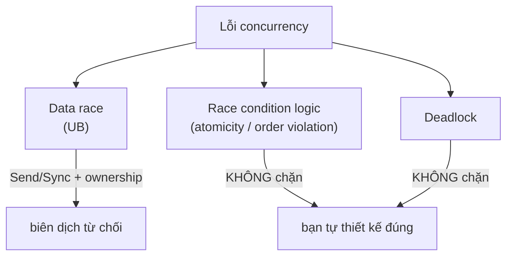

# P4 · Chương 08 — Concurrency trong Rust

## Bạn sẽ hiểu được gì

1. **Q1.** Vì sao `std::thread::spawn` đòi `F: Send + 'static`, mỗi vế của ràng buộc chặn loại lỗi nào, và `thread::scope` nới ràng buộc nào? → mục 2
2. **Q2.** `Send` và `Sync` định nghĩa chính xác là gì, vì sao `T: Sync` ⇔ `&T: Send`, và vì sao `impl` thủ công là `unsafe`? → mục 3
3. **Q3.** Vì sao `Rc` không qua được thread, và `Arc<T>` chỉ qua được khi nào? → mục 4
4. **Q4.** `Cell`, `RefCell`, `UnsafeCell` khác `Mutex` ở đâu, vì sao `Cell` là `!Sync`, và vì sao `Arc<Cell<i32>>` vẫn bị từ chối? → mục 5
5. **Q5.** `Mutex<T>` cần `T: Send` chứ không cần `T: Sync` là sao; poisoning là gì, vì sao `RwLock` chỉ bị poisoned khi panic ở chế độ ghi? → mục 6
6. **Q6.** `OnceLock`/`LazyLock` giải bài toán gì? → mục 7
7. **Q7.** `mpsc` (`channel`, `sync_channel`) khác nhau thế nào và bên trong là gì? → mục 9
8. **Q8.** Safe Rust chặn được gì (data race) và không chặn được gì (race condition, deadlock)? → mục 10

## Kiến thức cần trước

- [Chương 01 — Thread](./01-thread.md): thread là đơn vị mà kernel lên lịch, chia sẻ address space.
- [Chương 03 — Lock](./03-lock.md) và [Chương 04 — Condition variable và semaphore](./04-condition-variable-va-semaphore.md): mutex, condvar, predicate trong vòng lặp.
- [Chương 05 — Concurrency bug và deadlock](./05-concurrency-bug-va-deadlock.md): data race, atomicity violation, deadlock.
- [Chương 06 — Memory model](./06-memory-model.md) và [Chương 07 — Lock-free](./07-lock-free.md): `happens-before`, `Ordering`, CAS. Chương này chỉ *dùng* các khái niệm đó, không dạy lại.
- Ownership và borrowing của Rust (xem thêm [P3 chương 08 — Rust và bộ nhớ](../03-memory/08-rust-va-bo-nho.md)).

Ghi chú: API theo Rust 1.95.0; mọi lỗi biên dịch trong chương được `rustc 1.95.0` (edition 2021) in ra thật, rút gọn đường dẫn nhưng giữ nguyên mã lỗi và dòng chính.

## 1. Ý tưởng chung: để type system trả lời "giá trị này đi qua thread được không?"

Xuyên suốt chương ta bám theo `orders`, một service HTTP viết bằng Rust (ví dụ giả định của người soạn, không phải code trong repo). Một thread nhận kết nối rồi giao cho vài worker thread. Các worker cùng đụng vào một bộ đếm request, một cache đơn hàng và một config nạp lúc khởi động; ngoài ra chúng gửi audit event về một thread chuyên ghi log. Mỗi thứ dùng chung đó là một chỗ data race có thể xảy ra.

Nhắc lại: data race là khi hai thread cùng truy cập một vị trí nhớ, ít nhất một bên ghi, và không bên nào đồng bộ với bên kia[^nomicon-race-def]. (Đây là cách Nomicon phát biểu; định nghĩa của `std`, có thêm điều kiện "non-atomic", nằm ở [chương 06, mục 3](./06-memory-model.md).)

Rust không dặn lập trình viên "nhớ cẩn thận" mà để hệ thống kiểu trả lời hai câu hỏi. Giá trị kiểu `T` có được chuyển sang thread khác không (`Send`)? Nhiều thread có được cùng giữ `&T` không (`Sync`)? Thread, mutex, channel đều là kiểu của thư viện chuẩn, nên các ràng buộc này được kiểm lúc biên dịch như mọi ràng buộc kiểu khác (nhận xét của người soạn).

Nền của cơ chế là ownership: không thể alias một `&mut`, nên không thể có data race qua tham chiếu. Chỉ có *interior mutability* (đổi dữ liệu qua `&T`) làm bài toán phức tạp hơn, và phần lớn đó là lý do `Send`/`Sync` tồn tại[^nomicon-race-ownership].

## 2. `spawn`, `move` và `scope`: vì sao `F: Send + 'static` (Q1)

> **Trả lời ngắn.** `'static` chặn thread giữ tham chiếu tới dữ liệu cục bộ, vì thread có thể sống lâu hơn nơi tạo ra nó[^std-spawn-static]. `Send` chặn việc chuyển sang thread khác những giá trị không an toàn để chuyển, vì closure và kết quả đều đi qua ranh giới thread[^std-spawn-send]. `thread::scope` đổi `'static` thành `'scope`, vì scope bảo đảm mọi thread được join trước khi nó kết thúc[^std-scope].

**Giải thích.**

*Với `orders`.* Thread nhận kết nối giao mỗi kết nối cho một worker bằng cách gọi `thread::spawn` với một closure xử lý kết nối đó. Nhưng hàm đang chạy vòng lặp nhận kết nối có thể quay đi nhận kết nối khác, thậm chí kết thúc, trong lúc worker còn chạy. Nếu closure của worker trỏ vào biến cục bộ của hàm ấy thì con trỏ sẽ treo. Mục này xem compiler chặn chuyện đó bằng gì, và `scope` cho phép nới ở đâu.

### 2.1 Hai vế của chữ ký `spawn`

`std::thread::spawn` tạo một OS thread; thư viện chuẩn dùng mô hình 1:1, mỗi thread của ngôn ngữ ứng với một thread của hệ điều hành[^book-11] (khớp với [chương 01](./01-thread.md)). Chữ ký của nó là `F: FnOnce() -> T + Send + 'static, T: Send + 'static`[^std-spawn-sig]. Hai ràng buộc chặn hai loại lỗi khác nhau:

- **`'static`** nói rằng closure và giá trị trả về phải sống suốt thời gian chạy của chương trình, vì thread có thể sống lâu hơn nơi đã tạo ra nó[^std-spawn-static]. Chương trình không biết khi nào thread kết thúc, nên không thể để nó giữ tham chiếu tới biến cục bộ của hàm gọi.
- **`Send`** nói rằng closure được chuyển *theo giá trị* từ thread gọi sang thread mới, còn giá trị trả về đi ngược từ thread mới về thread gọi `join`[^std-spawn-send].

Thử vế `'static` với một closure chỉ mượn `v` (đã chạy):

```rust
use std::thread;
fn main() {
    let v = vec![1, 2, 3];
    let h = thread::spawn(|| println!("{:?}", v));
    h.join().unwrap();
}
```

```text
error[E0373]: closure may outlive the current function, but it borrows `v`, which is owned by the current function
 --> borrow.rs:4:27
  |
4 |     let h = thread::spawn(|| println!("{:?}", v));
  |                           ^^                  - `v` is borrowed here
  |                           |
  |                           may outlive borrowed value `v`
note: function requires argument type to outlive `'static`
help: to force the closure to take ownership of `v` (and any other referenced variables), use the `move` keyword
```

Lỗi này là `E0373`, không phải `E0277`, vì nó thuộc vế `'static`/lifetime chứ không phải vế `Send`. Cách sửa compiler gợi ý là `move`: closure lấy ownership các giá trị nó dùng, tức chuyển ownership từ thread này sang thread kia[^book-move]. Sau `move`, `v` thuộc về thread con nên không còn tham chiếu nào có thể treo.

### 2.2 `thread::scope`: mượn biến cục bộ cho đúng

Ràng buộc `'static` tồn tại vì `spawn` không biết khi nào thread kết thúc. `thread::scope` cho Rust biết điều đó. Thread trong scope được mượn dữ liệu không-`'static`, vì scope bảo đảm mọi thread được join ở cuối scope[^std-scope]. Thread nào chưa join thủ công thì được join tự động trước khi `scope` trả về[^std-scope-auto]. Vì vậy ràng buộc của `Scope::spawn` là `F: FnOnce() -> T + Send + 'scope`: vẫn `Send`, nhưng `'scope` thay cho `'static`[^std-scope-spawn].

Với `orders`, nghĩa là một hàm có thể chia dữ liệu nằm ngay trên stack của nó cho vài thread phụ chạy song song mà không cần `Arc`, miễn là các thread đó xong trước khi hàm trả về (nhận xét của người soạn).

```rust
let mut v = vec![1, 2, 3];
let mut total = 0;
thread::scope(|s| {
    s.spawn(|| println!("len = {}", v.len()));
    s.spawn(|| total = v.iter().sum());
});
v.push(4);
println!("total = {total}, v = {v:?}");
```

Kết quả chạy thật: `len = 3` rồi `total = 6, v = [1, 2, 3, 4]`. Nếu một thread trong scope panic mà chưa được join thủ công, `scope` sẽ panic; muốn tự xử lý panic thì join trước khi hết scope[^std-scope-panic].

<details><summary>Đi sâu: <code>JoinHandle</code>, detach và panic trong thread</summary>

`spawn` trả về `JoinHandle<T>`, một giá trị owned mà khi gọi `join` sẽ chờ thread kết thúc[^book-spawn-join]. Hai điểm hay bị bỏ qua:

- **Drop handle = detach.** Nếu `JoinHandle` bị drop, thread tự động bị *detach*[^std-spawn-detach]. Chương trình tự chịu trách nhiệm join hoặc detach thread, nếu không sẽ rò rỉ tài nguyên.
- **Panic không làm sập process mặc định.** Nếu thread con panic, `join` trả `Err` chứa tham số của `panic!`[^std-spawn-panic].

Quan sát (chạy thật):

```rust
let h = thread::spawn(|| { if true { panic!("boom"); } 7 });
let r = h.join();
println!("join is_err = {}", r.is_err());
println!("payload = {:?}", r.unwrap_err().downcast_ref::<&str>());
```

```text
thread '<unnamed>' (...) panicked at panic.rs:4:42:
boom
join is_err = true
payload = Some("boom")
```

Thread con in thông báo panic ra stderr; thread cha nhận `Err(Box<dyn Any + Send>)` và có thể `downcast_ref` payload.

</details>

**Quay lại Q1:** `'static` chặn tham chiếu treo tới biến cục bộ, `Send` chặn chuyển giá trị không an toàn qua thread, và `scope` thay `'static` bằng `'scope` nhờ bảo đảm join cuối scope.

## 3. `Send` và `Sync` (Q2)

> **Trả lời ngắn.** `Send` nghĩa là giá trị của kiểu đó chuyển được sang thread khác[^book-send]. `Sync` được định nghĩa qua `Send`: `T: Sync` khi và chỉ khi `&T: Send`[^std-sync]. Cả hai là `unsafe auto trait`[^std-send-auto]: compiler tự suy từ các thành phần của kiểu[^nomicon-auto], còn `unsafe impl` thủ công là lời hứa mà compiler không kiểm, cài sai có thể gây Undefined Behavior[^nomicon-send-ub].

**Giải thích.**

*Với `orders`.* Hai câu hỏi của mục 2 đã quay về: closure giao cho worker có `Send` không, và bộ đếm request mà mọi worker cùng đọc ghi thì sao? Nhưng compiler không đi hỏi lập trình viên. Nó tự trả lời bằng hai trait `Send` và `Sync`. Mục này giải thích hai trait đó nghĩa là gì và cái gì quyết định một kiểu có hay không có chúng.

### 3.1 Hai trait, một cách định nghĩa

`Send` hỏi: chuyển ownership của giá trị này sang thread khác có an toàn không[^book-send]? Nomicon phát biểu cùng ý theo kiểu "an toàn khi gửi sang thread khác", và đặt `Sync` cạnh nó: kiểu `T` là `Sync` nếu an toàn khi chia sẻ giữa các thread[^nomicon-send-def].

Chữ "chia sẻ" ở đây được docs quy về `Send` luôn: `T: Sync` khi và chỉ khi `&T: Send`[^std-sync]. Nói với `orders`: nếu mọi worker cùng đọc một bộ đếm thì mỗi worker giữ một `&Counter`, nên câu hỏi "bộ đếm có `Sync` không" chính là câu hỏi "gửi `&Counter` sang thread khác có an toàn không". Docs còn tóm tắt quan hệ với tham chiếu như sau: `&T` là `Send` ⇔ `T` là `Sync`; `&mut T` là `Send` ⇔ `T` là `Send`; `&T` và `&mut T` là `Sync` ⇔ `T` là `Sync`[^std-sync-ref]. Dòng giữa dễ hiểu theo cách này (cách diễn giải của người soạn): `&mut T` là quyền truy cập độc quyền, nên gửi nó đi chẳng khác gì gửi quyền sở hữu tạm thời.

### 3.2 Auto trait và `unsafe trait`

`Send` và `Sync` khai báo là `pub unsafe auto trait`[^std-send-auto]. Hai chữ đó mang hai ý khác nhau.

**auto.** Khác hầu hết trait, nếu một kiểu gồm toàn thành phần `Send`/`Sync` thì nó tự động là `Send`/`Sync`[^nomicon-auto]. Cả hai là marker trait không có method nào, nên cũng chẳng có gì để "cài"[^book-sendsync-manual]. Vì vậy một `struct` của `orders` chứa toàn `String`, `u64`, `Vec` thì tự qua được thread, bạn không phải viết gì.

**unsafe.** Muốn `impl` thủ công thì phải viết `unsafe impl`, vì đây là unsafe trait: code unsafe khác được quyền *giả định* chúng đã được cài đúng[^nomicon-unsafe]. Cài sai thì có thể gây Undefined Behavior[^nomicon-send-ub]. Đây chính là chỗ thư viện như `Mutex` đặt lời hứa của mình vào hệ thống kiểu: compiler tin lời hứa đó chứ không tự kiểm.

Auto-derivation có vài ngoại lệ chính, theo Nomicon: raw pointer không `Send`/`Sync`, còn `UnsafeCell` không `Sync` nên `Cell` và `RefCell` cũng không[^nomicon-exceptions]. `Rc` thì không `Send` lẫn `Sync`[^nomicon-rc]. Kiểu nào chứa một thành phần thuộc nhóm này sẽ mất tính chất theo, và mục 4–5 đi vào hai trường hợp thường gặp nhất.

<details><summary>Đi sâu: thử <code>MyBox</code> chứa raw pointer và <code>MutexGuard</code> không <code>Send</code></summary>

**Raw pointer: lint hơn là rào chắn.** Nomicon giải thích rằng raw pointer bị đánh dấu thread-unsafe "nhiều hơn như một lint": dereference raw pointer vốn đã phải `unsafe`, nhưng đánh dấu như vậy để kiểu chứa nó không tự động bị coi là thread-safe, vì tác giả kiểu đó nhiều khả năng chưa nghĩ kỹ về thread safety[^nomicon-rawptr-lint].

Thử với một kiểu chứa raw pointer:

```rust
struct MyBox(*mut u8);
// ... thread::spawn(move || { let _b = b; }) với b: MyBox
```

```text
error[E0277]: `*mut u8` cannot be sent between threads safely
  = help: within `{closure@mybox.rs:6:27: 6:34}`, the trait `Send` is not implemented for `*mut u8`
note: required because it appears within the type `MyBox`
```

Thêm `unsafe impl Send for MyBox {}` (đúng dạng Nomicon minh họa cho "kiểu không tự derive thì tự cài"[^nomicon-mybox]) thì chương trình biên dịch được: đã chạy thật, 0 lỗi. Compiler *không* kiểm lời hứa đó; người viết `unsafe impl` chịu trách nhiệm toàn bộ.

**Ví dụ ngược: `MutexGuard` không `Send`.**

`MutexGuard` cố ý không `Send`. Nomicon lấy nó làm ví dụ đẹp cho một kiểu không `Send`[^nomicon-mutexguard]. Lý do: implementation của lock đòi không giải phóng lock từ thread khác với thread đã lấy nó, mà gửi guard sang thread khác thì destructor (nhả lock) sẽ chạy ở thread nhận[^nomicon-mutexguard-why]. Thử gửi guard:

```text
error[E0277]: `std::sync::MutexGuard<'_, i32>` cannot be sent between threads safely
  = help: within `{closure@guard.rs:6:19: 6:26}`, the trait `Send` is not implemented for `std::sync::MutexGuard<'_, i32>`
```

</details>

**Quay lại Q2:** `Sync` được định nghĩa qua `Send` của `&T`; cả hai tự suy từ thành phần, và chỉ `unsafe impl` mới ép được chúng, bằng lời hứa của người viết.

## 4. `Rc` và `Arc` (Q3)

> **Trả lời ngắn.** `Rc` đếm tham chiếu bằng phép cộng/trừ thường, nên hai thread cùng clone có thể cập nhật bộ đếm cùng lúc, và đó là UB; vì vậy `Rc` không `Send` hay `Sync`[^nomicon-rc]. `Arc` dùng phép atomic cho refcount nên thread-safe[^std-arc]. Nhưng `Arc<T>` chỉ là `Send + Sync` khi `T` cũng vậy[^std-arc-bound].

**Giải thích.**

*Với `orders`.* Config của `orders` là một giá trị nhiều worker cùng đọc. Cách quen để nhiều chủ cùng giữ một giá trị là con trỏ đếm tham chiếu: mỗi worker giữ một bản clone, bản cuối cùng bị drop thì giá trị được giải phóng. Rust có hai con trỏ như vậy, `Rc` và `Arc`, và chỉ một trong hai qua được `thread::spawn`. Mục này giải thích vì sao.

### 4.1 `Rc`: bộ đếm không atomic

`Rc` đếm tham chiếu bằng phép cộng/trừ thường. Hãy xem chuyện gì xảy ra nếu hai worker của `orders` cùng clone một `Rc` trỏ tới config: cả hai có thể cập nhật bộ đếm cùng lúc, và vì `Rc` không dùng atomic nên đó là UB[^std-send-rc]. Đó là lý do `Rc` không `Send`. Nó cũng không `Sync`: từ một `&Rc<T>` bất kỳ bạn đã có thể clone ra `Rc<T>` mới, tức sửa bộ đếm theo kiểu không atomic[^std-sync-rc]. Nên hai worker chỉ cần *chia sẻ* một `&Rc` là đã đủ gây hại, không cần gửi chính `Rc` đi.

### 4.2 `Arc`: bộ đếm atomic

`Arc` là phiên bản dùng atomic cho refcount, nên thread-safe[^std-arc]. Cái giá là chi phí của phép atomic (docs `Send` nói `Arc` dùng atomic "incurring some overhead")[^std-send-rc].

Có một hiểu lầm hay gặp: `Arc` *không* tự làm nội dung thread-safe. Atomic chỉ bảo vệ con số đếm, không bảo vệ giá trị `T` nằm sau nó. Vì thế `Arc<T>` chỉ là `Send + Sync` khi `T` cũng `Send + Sync`[^std-arc-bound]. Nếu `orders` đặt một kiểu `!Sync` vào `Arc` thì cả `Arc` đó bị từ chối; mục 5 cho thấy đúng chuyện này với `Cell`.

<details><summary>Đi sâu: lỗi biên dịch khi gửi <code>Rc</code> vào <code>thread::spawn</code></summary>

Chạy thật:

```rust
let r = Rc::new(5);
let h = thread::spawn(move || println!("{}", r));
```

```text
error[E0277]: `Rc<i32>` cannot be sent between threads safely
  --> rc.rs:5:27
   |
 5 |     let h = thread::spawn(move || println!("{}", r));
   |             ------------- -------^^^^^^^^^^^^^^^^^^
   |             |             |
   |             |             `Rc<i32>` cannot be sent between threads safely
   |             |             within this `{closure@rc.rs:5:27: 5:34}`
   |             required by a bound introduced by this call
   = help: within `{closure@rc.rs:5:27: 5:34}`, the trait `Send` is not implemented for `Rc<i32>`
note: required by a bound in `spawn`
128 |     F: Send + 'static,
    |        ^^^^ required by this bound in `spawn`
```

Chuỗi nhân quả đọc từ lỗi: closure chứa `Rc<i32>` ⇒ closure không `Send` (auto trait suy từ thành phần) ⇒ vi phạm ràng buộc `F: Send` của `spawn`. Đây là cơ chế mục 3 hoạt động.

</details>

**Quay lại Q3:** `Rc` đếm bằng phép không atomic nên không qua thread; `Arc` đếm atomic, nhưng chỉ `Send + Sync` khi nội dung `T` cũng vậy.

## 5. Interior mutability: `UnsafeCell`, `Cell`, `RefCell` (Q4)

> **Trả lời ngắn.** `UnsafeCell<T>` là nền của interior mutability, tức cho đổi dữ liệu qua `&T`[^std-unsafecell-core]. `Cell` là `!Sync` vì `set` chỉ cần `&self` mà không đồng bộ gì[^std-sync-cell]; vì thế `Arc<Cell<i32>>` bị từ chối, do `Arc<T>` chỉ `Send` khi `T` cũng `Sync`[^std-arc-bound]. `Mutex<T>` thêm khóa nên `Sync` khi `T: Send`[^std-mutex-sync].

**Giải thích.**

*Với `orders`.* Muốn đếm số request đã phục vụ, mỗi worker phải tăng một bộ đếm dùng chung, mà họ chỉ có `&Counter` chứ không có `&mut`. Cách thẳng nhất là bọc con số trong `Cell<u64>` rồi gọi `set`. Ở một thread thì ổn; qua nhiều worker thì Rust từ chối. Mục này lần theo vì sao, và vì sao `Mutex` thì được.

### 5.1 Đổi dữ liệu qua `&T`

Quy tắc nền của Rust: với một object, hoặc có nhiều tham chiếu bất biến, hoặc có một tham chiếu khả biến, không có cả hai[^std-cell-rule]. Interior mutability là cách lách có kiểm soát: cho đổi giá trị qua `&T`, trái với kiểu thường chỉ đổi được qua `&mut T`[^std-cell-interior].

Gốc của mọi kiểu như vậy là `UnsafeCell<T>`, primitive lõi của interior mutability[^std-unsafecell-core]. Nó bỏ đảm bảo bất biến của `&T`: một `&UnsafeCell<T>` có thể trỏ tới dữ liệu đang bị đổi, và `Cell`, `RefCell` đều dùng nó bên trong[^std-unsafecell]. Docs `Sync` nhấn mạnh thêm: kiểu nào có interior mutability *phải* bọc giá trị bằng `UnsafeCell`, vì không làm vậy là UB (ví dụ `transmute` từ `&T` sang `&mut T` là không hợp lệ)[^std-sync-unsafecell].

### 5.2 Bốn kiểu, bốn cách đổi qua `&T`

| Kiểu | Cơ chế | Qua thread? |
|---|---|---|
| `Cell<T>` | đổi bằng cách chuyển giá trị vào/ra, không bao giờ lấy được `&T` bên trong[^std-cell-cell] | `!Sync`: `set` chỉ cần `&self` mà không đồng bộ gì[^std-sync-cell] |
| `RefCell<T>` | kiểm tra luật mượn **lúc chạy** thay vì lúc biên dịch[^std-refcell] | `!Sync` (Nomicon liệt kê)[^nomicon-exceptions] |
| `Mutex<T>` | kiểm tra bằng lock; Book: `Mutex<T>` cung cấp interior mutability như họ `Cell`[^book-interior] | `Sync` khi `T: Send`[^std-mutex-sync] |
| `Atomic*` | phép atomic; chương [06](./06-memory-model.md)–[07](./07-lock-free.md) | `Sync`[^std-atomic-sync] |

### 5.3 Vì sao `Cell` là `!Sync`

`Cell::set(&self, v)` chỉ cần `&Cell<T>`. Giả sử `Cell<T>: Sync`. Theo định nghĩa ở mục 3, `&Cell<T>` khi đó là `Send`, nên hai worker của `orders` có thể cùng cầm `&Cell<u64>` và cùng gọi `set`. Đó là hai lần ghi không đồng bộ vào một vị trí nhớ, đúng định nghĩa data race. Docs `Sync` nói gọn: method này không thực hiện đồng bộ nào, nên `Cell` không thể `Sync`[^std-sync-cell].

Còn `Send` thì `Cell<T>` có, miễn `T: Send`: docs `Cell` liệt kê `impl<T> Send for Cell<T> where T: Send + ?Sized`[^std-cell-send]. Lý do (suy luận của người soạn): chuyển *quyền sở hữu* nguyên cả cell sang thread khác thì không còn ai alias nó. Mục 6 cho thấy `Mutex<Cell<i32>>` chạy được, khớp với hệ quả này; ví dụ `move` một `Cell<i32>` thẳng vào `thread::spawn` cũng biên dịch và chạy (quan sát của người soạn, in `2`).

Đó cũng là lý do thực hành `Arc<Mutex<T>>` thay cho `Rc<RefCell<T>>` khi qua thread: Book so sánh đúng hai cặp này[^book-interior]. Với bộ đếm của `orders`, chọn `Arc<Mutex<u64>>`, hoặc một atomic (mục 8).

<details><summary>Đi sâu: lỗi biên dịch với <code>Arc&lt;Cell&lt;i32&gt;&gt;</code> và <code>&amp;Rc&lt;i32&gt;</code> trong <code>thread::scope</code></summary>

Thử `Arc<Cell<i32>>` (đã chạy):

```rust
let a = Arc::new(Cell::new(1));
let b = Arc::clone(&a);
thread::spawn(move || b.set(2)).join().unwrap();
```

```text
error[E0277]: `Cell<i32>` cannot be shared between threads safely
 --> cell.rs:7:19
  |
7 |     thread::spawn(move || b.set(2)).join().unwrap();
  |     ------------- ^^^^^^^^^^^^^^^^ `Cell<i32>` cannot be shared between threads safely
  = help: the trait `Sync` is not implemented for `Cell<i32>`
  = note: if you want to do aliasing and mutation between multiple threads, use `std::sync::RwLock` or `std::sync::atomic::AtomicI32` instead
  = note: required for `Arc<Cell<i32>>` to implement `Send`
note: required by a bound in `spawn`
```

Dòng `required for Arc<Cell<i32>> to implement Send` cho thấy `Arc<T>: Send` đòi `T: Send + Sync` (mục 4) mà `Cell<i32>: !Sync`.

Một phép thử thú vị cho định nghĩa `Sync ⇔ &T: Send`: `thread::scope` đòi `Send` trên closure, mà closure *mượn* `Rc` chỉ giữ `&Rc<i32>`. Chạy thật:

```text
error[E0277]: `Rc<i32>` cannot be shared between threads safely
  = help: the trait `Sync` is not implemented for `Rc<i32>`
  = note: required for `&Rc<i32>` to implement `Send`
```

Compiler tự chuyển "`&Rc<i32>` phải `Send`" thành "`Rc<i32>` phải `Sync`", đúng theo định nghĩa.

</details>

**Quay lại Q4:** interior mutability đổi dữ liệu qua `&T`; `Cell`/`RefCell` không đồng bộ nên `!Sync`, còn `Mutex` thêm khóa nên dùng được qua thread.

## 6. `Mutex`, `RwLock`, `Condvar` và poisoning (Q5)

> **Trả lời ngắn.** `Mutex<T>` bọc dữ liệu và chỉ cho truy cập qua guard, nên dữ liệu chỉ bị chạm khi mutex đang khóa[^std-mutex-guard]. `T` chỉ cần `Send` vì `&T` chỉ được đưa cho *một* thread tại một thời điểm[^std-mutex-notsync]. `RwLock` cho nhiều reader đồng thời nên cần `T: Send + Sync`[^std-rwlock-bounds]. Mutex bị poisoned khi thread đang giữ nó panic[^std-poison], còn `RwLock` chỉ bị poisoned khi panic ở chế độ ghi[^std-rwlock-poison].

**Giải thích.**

*Với `orders`.* Cache đơn hàng là dữ liệu ghi nhiều và đọc nhiều: worker nào tra không thấy thì nạp rồi ghi vào. Việc giữ cache cho đúng khi nhiều worker đụng vào chính là việc của lock. Ngoài ra còn hai câu hỏi riêng của Rust. Nếu một worker panic giữa lúc đang sửa cache thì các worker khác nhìn thấy gì? Và vì sao `Mutex<Cell<i32>>` qua được thread trong khi `Cell<i32>` trần thì không? Mục này trả lời cả hai.

### 6.1 `Mutex<T>`: dữ liệu nằm *trong* lock

Khác mutex ở [chương 03](./03-lock.md), `Mutex<T>` của Rust bọc luôn dữ liệu, và dữ liệu chỉ truy cập được qua RAII guard. Nhờ vậy dữ liệu chỉ bao giờ bị chạm khi mutex đang khóa[^std-mutex-guard]. `MutexGuard` cài `Deref` để trỏ tới dữ liệu và `Drop` để nhả lock khi ra khỏi scope[^book-guard]. Muốn nhả sớm thì tạo scope con hoặc `drop` guard thủ công[^std-mutex-drop]. Vì không có đường nào tới dữ liệu mà không qua guard, "quên lock" trở thành lỗi biên dịch (suy luận từ hai nguồn trên). Cuối cùng, `unlock` rồi `lock` tạo quan hệ happens-before giữa các thread, một trong số ít trường hợp có sẵn theo Mara Bos[^atomics-hb-cases] ([chương 06](./06-memory-model.md)).

### 6.2 Vì sao `T: Send` mà không cần `T: Sync`

Docs nói `Mutex<T>` là `Sync` khi `T: Send`, và điều đó bảo đảm dữ liệu được bảo vệ truy cập an toàn từ nhiều thread[^std-mutex-sync]. Docs cũng nói rõ `T` không cần `Sync`, vì khi `T` không `Sync` thì `&T` chỉ được đưa cho một thread tại một thời điểm[^std-mutex-notsync]. Ngoài ra `Mutex<T>` là `Send` khi `T: Send`[^std-mutex-send].

Lập luận (của người soạn): `T: Sync` nghĩa là nhiều thread cùng giữ `&T` đồng thời mà vẫn an toàn. Mutex không bao giờ đưa `&T` cho hai thread cùng lúc, nên thứ nó cần chỉ là khả năng *chuyển* `T` giữa các thread, lần lượt. Đó đúng là nghĩa của `Send`. Hệ quả kiểm chứng được ở phần Đi sâu: `Arc<Mutex<Cell<i32>>>` chạy được dù `Cell: !Sync`.

### 6.3 Poisoning

Mutex bị *poisoned* khi nó nhận ra thread đang giữ nó đã panic[^std-poison]. Từ đó mọi thread khác mặc định không truy cập được dữ liệu, vì nhiều khả năng dữ liệu đã bị "nhiễm" (một invariant không còn được giữ)[^std-poison-tainted]. Với cache của `orders`: worker panic giữa lúc sửa dở thì các worker còn lại không đọc phải cache nửa cũ nửa mới. Hệ quả ở API là `lock`/`try_lock` trả `Result`, và phần lớn code chỉ `unwrap()` để panic lan giữa các thread, không ai nhìn thấy invariant có thể đã hỏng[^std-poison-unwrap].

Tuy vậy poisoning chỉ mang tính tư vấn: `PoisonError::into_inner` vẫn trả về guard như thể lock thành công[^std-poison-advisory]. `RwLock` có quy tắc riêng: nó chỉ bị poisoned khi panic xảy ra lúc khóa ở chế độ ghi; panic trong reader thì không[^std-rwlock-poison]. `Condvar::wait` cũng trả lỗi nếu mutex bị poisoned lúc thread giành lại lock[^std-condvar-poison].

### 6.4 `RwLock<T>`

Cache của `orders` đọc nhiều hơn ghi, nên `RwLock` hợp lý: nó cho nhiều reader cùng giữ lock miễn là không có writer[^std-rwlock]. Ràng buộc kiểu vì vậy khác `Mutex`. `T` cần `Send` để chia sẻ qua thread, và cần cả `Sync` để nhiều reader truy cập đồng thời[^std-rwlock-bounds]. Cụ thể là `impl<T: Send + Sync> Sync for RwLock<T>`[^std-rwlock-sync]. Đây cũng là lý do `Arc<RwLock<Cell<i32>>>` bị từ chối trong khi `Arc<Mutex<Cell<i32>>>` thì được: nhiều reader song song có thể cùng gọi `Cell::set`.

### 6.5 `Condvar`

Worker rảnh của `orders` không nên quay vòng hỏi "có việc chưa?". `Condvar` cho thread chờ mà không tốn CPU[^std-condvar-cpu]. Hàm `wait(guard)` nhả mutex và chặn thread trong một thao tác atomic[^std-condvar-atomic]. Vì spurious wakeup, thread phải kiểm tra lại predicate mỗi lần `wait` trả về[^std-condvar-spurious], đúng như [chương 04](./04-condition-variable-va-semaphore.md). Rust đóng gói vòng lặp đó trong `wait_while`, nhận sẵn điều kiện để chờ[^std-condvar-waitwhile]. Dùng nhiều mutex khác nhau cho cùng một condvar có thể gây panic lúc chạy[^std-condvar-mutex].

<details><summary>Đi sâu: kiểm chứng ràng buộc kiểu và poisoning (chạy thật), lock đệ quy và chính sách RwLock</summary>

**Kiểm chứng ràng buộc kiểu và poisoning.**

- `Arc<Mutex<Cell<i32>>>` qua thread: **biên dịch và chạy** (in `2`), dù `Cell: !Sync`.
- `Arc<Mutex<Rc<i32>>>` qua thread: bị từ chối vì `Rc: !Send`:

```text
error[E0277]: `Rc<i32>` cannot be sent between threads safely
  = help: the trait `Send` is not implemented for `Rc<i32>`
  = note: required for `std::sync::Mutex<Rc<i32>>` to implement `Sync`
  = note: required for `Arc<std::sync::Mutex<Rc<i32>>>` to implement `Send`
```

- `Arc<RwLock<Cell<i32>>>` bị từ chối (`Cell<i32>` không `Sync`), ngược với `Mutex<Cell<i32>>`.
- Poisoning:

```text
mutex poisoned = true
into_inner = 0
rwlock poisoned after reader panic = false
rwlock poisoned after writer panic = true
```

**Việc phát hiện panic không hoàn hảo.** Docs nhắc rằng ngay cả mutex chưa poisoned cũng cần cẩn thận, vì có thể có panic bị bỏ sót[^std-poison-detect].

**Lock đệ quy.** Nếu thread đã giữ lock mà gọi `lock` lần nữa, hành vi chính xác "không được chỉ định", nhưng hàm chắc chắn không trả về ở lần gọi thứ hai (có thể panic hoặc deadlock)[^std-mutex-twice].

**Chính sách ưu tiên của `RwLock`.** Docs không bảo đảm chính sách nào, vì nó phụ thuộc OS; writer đang chờ có thể chặn hoặc không chặn `read` mới[^std-rwlock-policy]. Docs đưa ví dụ cùng thread gọi `read` hai lần trong lúc có writer chờ, và lần `read` thứ hai có thể deadlock[^std-rwlock-deadlock].

</details>

**Quay lại Q5:** `Mutex` chỉ cần `T: Send` vì `&T` chỉ được đưa cho một thread tại một thời điểm, `RwLock` cần thêm `Sync` vì có nhiều reader đồng thời, và poisoning đánh dấu dữ liệu có thể hỏng sau panic.

## 7. `OnceLock` và `LazyLock`: khởi tạo một lần, an toàn qua thread (Q6)

> **Trả lời ngắn.** `OnceLock<T>` là ô chỉ ghi được một lần[^std-oncelock]; `LazyLock<T>` khởi tạo giá trị ở lần truy cập đầu tiên[^std-lazylock]. Chúng giải bài toán giá trị global khởi tạo lười đúng một lần, an toàn khi nhiều thread chạm vào lần đầu cùng lúc: `get_or_init` bảo đảm chỉ một hàm khởi tạo được thực thi[^std-oncelock-once].

**Giải thích.**

*Với `orders`.* Config của `orders` (đọc từ file, hoặc một bảng tra đã compile sẵn) chỉ cần nạp một lần, và nạp lười ở request đầu tiên thì tiện hơn nạp lúc khởi động. Vấn đề: request đầu tiên có thể đến cùng lúc ở nhiều worker. Ai nạp? Nạp mấy lần? Ai chờ ai?

### 7.1 Vì sao không dùng `static mut` hay `Mutex<Option<T>>`

Bài toán tổng quát (nhận xét của người soạn): một giá trị global cần khởi tạo lười, đúng một lần, và an toàn khi nhiều thread chạm vào lần đầu cùng lúc. `static mut` cần `unsafe` để truy cập, còn `Mutex<Option<T>>` bắt mọi lần đọc đều trả phí lock. Std 1.95.0 có hai kiểu giải bài này.

### 7.2 `OnceLock<T>`

Docs mô tả `OnceLock<T>` là primitive đồng bộ mà "nominally" chỉ ghi được một lần[^std-oncelock]. `get` trả `None` nếu chưa khởi tạo. `set` trả `Ok(())` nếu cell chưa khởi tạo và `Err(value)` nếu đã có[^std-oncelock-set]. Còn `get_or_init` là chỗ giải bài toán của `orders`: nhiều thread có thể gọi đồng thời, thậm chí với các hàm khởi tạo khác nhau, nhưng chỉ một hàm được thực thi (miễn hàm đó không panic)[^std-oncelock-once].

### 7.3 `LazyLock<T>`

`LazyLock<T>` gói sẵn hàm khởi tạo vào kiểu, và giá trị được khởi tạo ở lần truy cập đầu tiên[^std-lazylock]. Vì lần đầu có thể đến từ nhiều thread, mọi lời gọi dereference sẽ block nếu một routine khởi tạo khác đang chạy[^std-lazylock-block]. Nếu closure khởi tạo panic thì lock bị poisoned[^std-lazylock-poison]. Khác với `Mutex`, poisoning ở đây không phục hồi được: mọi lần truy cập sau đều panic[^std-lazylock-unrecoverable].

<details><summary>Đi sâu: kết quả chạy thật</summary>

Chạy thật:

```text
get before = None
first
first            <- get_or_init lần hai KHÔNG chạy closure "second"
set again = Err("third")
before use
init table       <- LazyLock chỉ chạy closure ở lần deref đầu
[1, 2, 3] 3
```

</details>

**Quay lại Q6:** `OnceLock` ghi một lần, `LazyLock` lười ở lần deref đầu; cả hai đều bảo đảm khởi tạo an toàn khi nhiều thread chạm vào lần đầu (nhận xét của người soạn: nhờ vậy không cần `static mut` hay lock ở mọi lần đọc).

## 8. Atomics trong Rust (nhắc ngắn)

Bộ đếm request của `orders` còn một cách làm nhẹ hơn `Arc<Mutex<u64>>`: dùng kiểu atomic. Kiểu atomic an toàn để chia sẻ giữa thread (cài `Sync`), nhưng tự nó không cung cấp cơ chế chia sẻ, nên thường được đặt trong `Arc` hoặc `static`[^std-atomic-sync]. Docs định nghĩa data race là truy cập xung đột không đồng bộ mà ít nhất một bên là non-atomic, và nói data race là UB[^std-datarace]; do đó truy cập atomic không thuộc định nghĩa này (suy luận từ định nghĩa).

Cách chọn `Ordering`, `happens-before`, `compare_exchange` nằm ở [chương 06](./06-memory-model.md) và [chương 07](./07-lock-free.md). Điều cần mang theo từ chương này: `Mutex` cho bạn đồng bộ "tặng kèm" (unlock→lock tạo happens-before[^atomics-hb-cases]), còn atomic thì bạn phải tự chọn ordering.

<details><summary>Đi sâu: nguồn UB thứ hai của memory model</summary>

Ngoài data race, docs còn nêu một nguồn UB khác của memory model: các truy cập atomic xung đột, không đồng bộ, mà chồng lấn một phần nhau (mixed-size)[^std-mixed-size].

</details>

## 9. Channel `std::sync::mpsc` (Q7)

> **Trả lời ngắn.** `mpsc` là hàng đợi FIFO nhiều producer, một consumer[^std-mpsc]. `channel()` không giới hạn nên `send` không bao giờ block[^std-mpsc-async]. `sync_channel(n)` có bộ đệm cố định và `send` block đến khi có chỗ[^std-mpsc-sync]; riêng `n = 0` là rendezvous[^std-mpsc-rendezvous]. Bên trong là kênh MPMC port từ crossbeam-channel[^std-mpsc-wrap].

**Giải thích.**

*Với `orders`.* Mỗi worker cần ghi audit event ("đã phục vụ đơn 42"), nhưng ta muốn đúng một thread chuyên ghi file để các dòng không xen lẫn nhau. Đó là hình dạng nhiều producer, một consumer, và `mpsc` được làm ra cho nó. Thay vì để các worker tranh nhau một lock quanh file, chúng chỉ việc gửi thông điệp.

### 9.1 Hai dạng channel

Book gói triết lý này thành một khẩu hiệu: đừng giao tiếp bằng cách chia sẻ bộ nhớ, hãy chia sẻ bộ nhớ bằng cách giao tiếp[^book-msg]. `mpsc` là hàng đợi FIFO multi-producer, single-consumer[^std-mpsc]. Cả hai loại sender đều clone được, nên nhiều worker gửi đồng thời tới một receiver[^std-mpsc-clone]. Hai dạng khác nhau ở chỗ bộ đệm:

| | `channel()` | `sync_channel(n)` |
|---|---|---|
| Bộ đệm | không giới hạn, `send` không bao giờ block[^std-mpsc-async] | cố định; `send` block đến khi có chỗ[^std-mpsc-sync] |
| `n = 0` | — | rendezvous: `send` không trả về cho đến khi có `recv` ghép cặp[^std-mpsc-rendezvous] |

Khi một thao tác gửi hay nhận thất bại, thường là nửa còn lại của channel đã "hung up" do bị drop[^std-mpsc-hungup]. Chẳng hạn thread ghi log của `orders` thoát thì mọi `send` sau đó trả lỗi.

Chọn dạng nào thì tùy `orders` sợ gì. Với `sync_channel`, bộ đệm có giới hạn chính là bounded buffer của bài producer/consumer ([chương 04](./04-condition-variable-va-semaphore.md)). Trong backend, nó là cơ chế *backpressure* tự nhiên: producer nhanh hơn consumer thì bị chặn thay vì phình bộ nhớ (nhận xét của người soạn). `channel()` không giới hạn thì không có tính chất đó: nếu thread ghi log chậm hơn các worker, hàng đợi cứ lớn dần.

### 9.2 Kiểu phản ánh "single-consumer"

Source 1.95.0 khai báo `impl<T> !Sync for Receiver<T>`[^std-mpsc-recv-nosync] và `unsafe impl<T: Send> Sync for Sender<T>`[^std-mpsc-sender-sync]. Suy luận của người soạn, từ định nghĩa `Sync ⇔ &T: Send` (mục 3): vì `Receiver` là `!Sync` nên không gửi được `&Receiver` sang thread khác, tức không thể cho nhiều thread cùng nhận qua một tham chiếu chung. Nói với `orders`: có nhiều worker thì có nhiều `Sender` clone, nhưng chỉ một thread giữ `Receiver`.

<details><summary>Đi sâu: kết quả chạy thật và cài đặt bên trong</summary>

Kết quả chạy thật:

```text
[0, 10, 20]                                  # 3 sender clone, drop(tx) gốc, rx.iter() tự kết thúc
try_send 1: Ok(())                           # sync_channel(1)
try_send 2: Err(TrySendError::Full(..))      # đầy
send after rx drop: Err(SendError { .. })    # receiver đã drop
rendezvous try_send without receiver: Err(TrySendError::Full(..))
recv after all senders dropped: Err(RecvError)
```

**Bên trong (chi tiết cài đặt, có thể đổi giữa các phiên bản).** Source 1.95.0: `mpsc` là lớp bọc của kênh MPMC được port từ crossbeam-channel[^std-mpsc-wrap], và `mpsc::sync_channel` gọi `mpmc::sync_channel(bound)`[^std-mpsc-calls-mpmc]. Hàm tạo MPMC chọn một trong ba "flavor":

- `channel()` dùng `list::Channel`[^std-mpmc-pick-list], một danh sách liên kết không giới hạn[^std-mpmc-list].
- `sync_channel(n>0)` dùng `array::Channel`[^std-mpmc-pick-array], một mảng cấp phát sẵn[^std-mpmc-array] dựa trên hàng đợi MPMC có giới hạn của Dmitry Vyukov[^std-mpmc-vyukov].
- `sync_channel(0)` dùng `zero::Channel`[^std-mpmc-pick-zero], kênh rendezvous[^std-mpmc-zero].

Tức là ba cài đặt riêng biệt, không phải một khuôn "mutex + condvar + buffer" chung (suy luận từ ba flavor).

</details>

**Quay lại Q7:** `channel()` không giới hạn, `sync_channel(n)` có giới hạn và `n = 0` là rendezvous; `Receiver` là `!Sync` theo source (suy luận của người soạn: không chia sẻ `&Receiver` được giữa các thread).

## 10. Rust chặn gì và không chặn gì (Q8)

> **Trả lời ngắn.** Safe Rust bảo đảm không có data race[^nomicon-race-def]. Nhưng nó không chặn race condition tổng quát[^nomicon-race-cond], và deadlock vẫn được xem là "safe"[^nomicon-race-deadlock]; muốn tránh chúng thì bạn phải tự thiết kế đúng.

**Giải thích.**

*Với `orders`.* Giả sử `orders` đã qua mọi kiểm tra của các mục trước: mọi thứ dùng chung đều nằm trong `Arc<Mutex<…>>`, compiler không phàn nàn gì. Vậy có thể yên tâm chưa? Chưa. Hãy lấy ví dụ tồn kho một mặt hàng, và hai kiểu lỗi mà compiler không thấy.

### 10.1 Cái Rust bảo đảm

Safe Rust bảo đảm không có data race[^nomicon-race-def]. Nomicon nói data race phần lớn bị chặn chỉ bằng ownership[^nomicon-race-ownership]; phần còn lại là việc của `Send`/`Sync` như các mục trước. Với `orders`, nghĩa là mọi truy cập vào bộ đếm hay cache từ nhiều worker mà không có lock đều không biên dịch được.

### 10.2 Cái Rust không bảo đảm

Rust **không** chặn race condition tổng quát[^nomicon-race-cond]. Nomicon giải thích rằng việc đó bất khả về mặt toán học khi bạn không kiểm soát scheduler, như trong môi trường OS thông thường[^nomicon-race-impossible]. Nếu kiểm soát được preemption thì có thể chặn (framework như RTIC làm vậy), nhưng đó là trường hợp rất hiếm[^nomicon-race-rtic].

Vì thế deadlock, hay hành vi vô nghĩa do đồng bộ sai, vẫn được xem là "safe"[^nomicon-race-deadlock]. Book nói thẳng rằng `Mutex<T>` đi kèm rủi ro deadlock[^book-deadlock]. Điểm đáng nhớ: một race condition tự nó không phá memory safety; chỉ khi kết hợp với code `unsafe` khác thì nó mới phá được[^nomicon-race-safe].

Sơ đồ dưới tóm tắt (nhận xét của người soạn):



<details><summary>Đi sâu: hai ví dụ chạy thật trong safe Rust</summary>

Hai ví dụ chạy thật, hoàn toàn safe Rust:

**Check-then-act (atomicity violation, [chương 05](./05-concurrency-bug-va-deadlock.md)).** Bốn thread chạy `if *m.lock().unwrap() > 0 { *m.lock().unwrap() -= 1; }` trên `Mutex` khởi tạo bằng `1`, hai lần `lock` tách rời (có `yield_now` giữa hai lần để dễ lộ bug). Trong `orders`, hãy coi `m` là tồn kho còn một món và bốn request cùng đặt mua. Biên dịch không cảnh báo; trong lần chạy của người soạn kết quả cuối là `final = -1`, tức bán lố hai món. Mỗi thao tác riêng lẻ đều được lock bảo vệ, không có data race, nhưng khoảng giữa hai lần lock là khe hở logic. (Đây là một lần quan sát, kết quả phụ thuộc scheduler; cách sửa là giữ một guard cho cả check và act.)

**Deadlock thứ tự lock ([chương 05](./05-concurrency-bug-va-deadlock.md)).** Thread A giữ `a` rồi xin `b`; thread chính giữ `b` rồi xin `a`, mỗi bên ngủ 100 ms giữa hai lần lock. Biên dịch được; chạy thật bị treo cho tới khi `timeout 3` kill (exit 124). Type system không thấy lỗi này; phòng bằng quy ước thứ tự lock, hoặc giữ lock ngắn, hoặc dùng `try_lock` có chiến lược lùi (nhận xét của người soạn).

</details>

**Quay lại Q8:** Rust loại data race ở thời điểm biên dịch nhờ ownership và `Send`/`Sync`, còn atomicity violation và deadlock vẫn là trách nhiệm thiết kế của bạn.

## Tóm tắt

- `spawn` đòi `F: Send + 'static`: `'static` vì thread có thể sống lâu hơn nơi tạo ra nó; `Send` vì closure và kết quả đi qua ranh giới thread. `thread::scope` thay `'static` bằng `'scope` nhờ bảo đảm join cuối scope.
- Drop `JoinHandle` là detach; panic của thread con hiện ra ở `join()` dưới dạng `Err`.
- `T: Sync` ⇔ `&T: Send`. Cả hai là `unsafe auto trait`: tự suy từ thành phần; `unsafe impl` là lời hứa mà compiler không kiểm.
- `Rc` không `Send`/`Sync` (refcount không atomic); `Arc<T>` chỉ `Send + Sync` khi `T` cũng vậy, nên `Arc<Cell<i32>>` bị từ chối với `E0277`.
- `Cell`/`RefCell` là `!Sync` vì mutate qua `&self` không đồng bộ; `Mutex<T>` cần `T: Send` chứ không cần `Sync` vì `&T` chỉ được đưa cho một thread tại một thời điểm; `RwLock<T>` cần cả hai.
- `MutexGuard` là RAII và `!Send`; poisoning lan truyền panic, chỉ mang tính tư vấn; `RwLock` chỉ poisoned khi panic ở chế độ ghi.
- `OnceLock` (ghi một lần, `set`/`get_or_init`) và `LazyLock` (lười ở lần deref đầu) khởi tạo global an toàn qua thread.
- `mpsc`: `channel` không giới hạn, `sync_channel(n)` có giới hạn, `n = 0` là rendezvous; `Receiver` là `!Sync`; bên trong là MPMC port từ crossbeam.
- Safe Rust chặn data race, không chặn race condition logic và deadlock.

## Câu hỏi tự kiểm tra

1. Hai vế `Send` và `'static` của `spawn` mỗi vế chặn loại lỗi nào, và mã lỗi biên dịch tương ứng?
<details><summary>Đáp án</summary>

`'static`: thread có thể sống lâu hơn nơi tạo ra nó nên không được giữ tham chiếu tới dữ liệu cục bộ[^std-spawn-static] (chạy thật: `E0373`). `Send`: closure và giá trị trả về đi qua ranh giới thread[^std-spawn-send] (chạy thật: `E0277`, ví dụ với `Rc`).

</details>

2. Định nghĩa `Sync` qua `Send` thế nào? Dùng nó giải thích dòng `required for &Rc<i32> to implement Send` khi mượn `Rc` trong `thread::scope`.
<details><summary>Đáp án</summary>

`T: Sync` ⇔ `&T: Send`[^std-sync]. Closure mượn `Rc` chứa `&Rc<i32>`, đòi `&Rc<i32>: Send` ⇔ `Rc<i32>: Sync`; `Rc` không `Sync` vì từ `&Rc` vẫn clone được và sửa bộ đếm không atomic[^std-sync-rc].

</details>

3. Vì sao `impl Send`/`impl Sync` thủ công phải là `unsafe`?
<details><summary>Đáp án</summary>

Code unsafe khác được quyền giả định chúng đúng[^nomicon-unsafe]. Cài sai có thể gây UB[^nomicon-send-ub]; compiler không kiểm lời hứa của `unsafe impl`.

</details>

4. Vì sao `Arc<Cell<i32>>` không qua được `thread::spawn` dù `Arc` là thread-safe?
<details><summary>Đáp án</summary>

`Arc<T>` chỉ `Send + Sync` khi `T` cũng vậy[^std-arc-bound]; `Cell: !Sync` vì `set(&self)` không đồng bộ[^std-sync-cell]. Chạy thật: `E0277` "`Cell<i32>` cannot be shared between threads safely".

</details>

5. Vì sao `Mutex<T>` chỉ cần `T: Send` còn `RwLock<T>` cần `T: Send + Sync`?
<details><summary>Đáp án</summary>

Mutex đưa `&T` cho một thread tại một thời điểm[^std-mutex-notsync]; `RwLock` cho nhiều reader đồng thời nên cần `Sync`[^std-rwlock-bounds]. Chạy thật: `Arc<Mutex<Cell<i32>>>` được, `Arc<RwLock<Cell<i32>>>` bị từ chối.

</details>

6. `MutexGuard` có `Send` không? Vì sao?
<details><summary>Đáp án</summary>

Không[^nomicon-mutexguard]; gửi guard sang thread khác thì destructor (nhả lock) chạy ở thread nhận, vi phạm yêu cầu của implementation[^nomicon-mutexguard-why].

</details>

7. Khi nào `Mutex` bị poisoned, khi nào `RwLock`? Lấy lại dữ liệu được không?
<details><summary>Đáp án</summary>

Mutex: khi thread đang giữ nó panic[^std-poison]. RwLock: chỉ khi panic lúc khóa chế độ ghi[^std-rwlock-poison]. Lấy lại được bằng `PoisonError::into_inner`[^std-poison-advisory].

</details>

8. `sync_channel(0)` khác `channel()` thế nào, và vì sao `Receiver` là `!Sync`?
<details><summary>Đáp án</summary>

`channel()` không giới hạn, `send` không block[^std-mpsc-async]; `sync_channel(0)` là rendezvous, `send` chờ `recv` ghép cặp[^std-mpsc-rendezvous]. `Receiver` là `!Sync` theo source[^std-mpsc-recv-nosync]; theo định nghĩa `Sync ⇔ &T: Send`, không thể gửi `&Receiver` sang thread khác (suy luận của người soạn).

</details>

9. Safe Rust có thể có deadlock hay atomicity violation không? Vì sao compiler không bắt?
<details><summary>Đáp án</summary>

Có. Rust chỉ bảo đảm không data race[^nomicon-race-def]; race condition tổng quát không thể chặn khi không kiểm soát scheduler[^nomicon-race-impossible]; deadlock vẫn được xem là "safe"[^nomicon-race-deadlock]. Chạy thật: check-then-act cho `final = -1`, deadlock thứ tự lock bị treo.

</details>

## Đọc thêm

- [Nomicon — Send and Sync](https://doc.rust-lang.org/1.95.0/nomicon/send-and-sync.html): ví dụ `Carton<T>` cho thấy khi nào `unsafe impl` đúng.
- [Nomicon — Data Races and Race Conditions](https://doc.rust-lang.org/1.95.0/nomicon/races.html): ranh giới chính xác giữa cái Rust bảo đảm và không bảo đảm.
- [Book ch.16](https://doc.rust-lang.org/1.95.0/book/ch16-00-concurrency.html): thread, message passing, shared state, `Send`/`Sync` ở mức giới thiệu.
- [docs `std::sync::Mutex`](https://doc.rust-lang.org/1.95.0/std/sync/struct.Mutex.html): mục Poisoning và các ví dụ giữ/nhả guard.
- [Rust Atomics and Locks, ch.1](https://marabos.nl/atomics/basics.html): `Rc`/`Arc`, `scope`, interior mutability, `Send`/`Sync` từ góc nhìn tác giả thư viện.
- [Chương 06 — Memory model](./06-memory-model.md) và [Chương 07 — Lock-free](./07-lock-free.md): `Ordering`, happens-before, CAS.

[^nomicon-race-def]: The Rustonomicon, Data Races and Race Conditions — <https://doc.rust-lang.org/1.95.0/nomicon/races.html> — "Safe Rust guarantees an absence of data races, which are defined as: two or more threads concurrently accessing a location of memory one or more of them is a write one or more of them is unsynchronized"
[^nomicon-race-ownership]: The Rustonomicon, Data Races and Race Conditions — <https://doc.rust-lang.org/1.95.0/nomicon/races.html> — "Data races are prevented mostly through Rust’s ownership system alone: it’s impossible to alias a mutable reference, so it’s impossible to perform a data race. Interior mutability makes this more complicated, which is largely why we have the Send and Sync traits"
[^book-11]: The Rust Programming Language, 16.1 Using Threads — <https://doc.rust-lang.org/1.95.0/book/ch16-01-threads.html> — "The Rust standard library uses a 1:1 model of thread implementation, whereby a program uses one operating system thread per one language thread."
[^std-spawn-sig]: Rust std 1.95.0, `std::thread::spawn` — <https://doc.rust-lang.org/1.95.0/std/thread/fn.spawn.html> — "F: FnOnce() -> T + Send + 'static, T: Send + 'static,"
[^std-spawn-static]: Rust std 1.95.0, `std::thread::spawn` — <https://doc.rust-lang.org/1.95.0/std/thread/fn.spawn.html> — "The 'static constraint means that the closure and its return value must have a lifetime of the whole program execution. The reason for this is that threads can outlive the lifetime they have been created in."
[^std-spawn-send]: Rust std 1.95.0, `std::thread::spawn` — <https://doc.rust-lang.org/1.95.0/std/thread/fn.spawn.html> — "The Send constraint is because the closure will need to be passed by value from the thread where it is spawned to the new thread. Its return value will need to be passed from the new thread to the thread where it is joined."
[^book-move]: The Rust Programming Language, 16.1 Using Threads — <https://doc.rust-lang.org/1.95.0/book/ch16-01-threads.html> — "the closure will then take ownership of the values it uses from the environment, thus transferring ownership of those values from one thread to another."
[^book-spawn-join]: The Rust Programming Language, 16.1 Using Threads — <https://doc.rust-lang.org/1.95.0/book/ch16-01-threads.html> — "A JoinHandle\<T> is an owned value that, when we call the join method on it, will wait for its thread to finish."
[^std-spawn-detach]: Rust std 1.95.0, `std::thread::spawn` — <https://doc.rust-lang.org/1.95.0/std/thread/fn.spawn.html> — "If the join handle is dropped, the spawned thread will implicitly be detached."
[^std-spawn-panic]: Rust std 1.95.0, `std::thread::spawn` — <https://doc.rust-lang.org/1.95.0/std/thread/fn.spawn.html> — "If the spawned thread panics, join will return an Err containing the argument given to panic!."
[^std-scope]: Rust std 1.95.0, `std::thread::scope` — <https://doc.rust-lang.org/1.95.0/std/thread/fn.scope.html> — "Unlike non-scoped threads, scoped threads can borrow non-'static data, as the scope guarantees all threads will be joined at the end of the scope."
[^std-scope-auto]: Rust std 1.95.0, `std::thread::scope` — <https://doc.rust-lang.org/1.95.0/std/thread/fn.scope.html> — "All threads spawned within the scope that haven’t been manually joined will be automatically joined before this function returns."
[^std-scope-spawn]: Rust std 1.95.0, `std::thread::Scope` — <https://doc.rust-lang.org/1.95.0/std/thread/struct.Scope.html> — "F: FnOnce() -> T + Send + 'scope,"
[^std-scope-panic]: Rust std 1.95.0, `std::thread::scope` — <https://doc.rust-lang.org/1.95.0/std/thread/fn.scope.html> — "If any of the automatically joined threads panicked, this function will panic."
[^book-send]: The Rust Programming Language, 16.4 Extensible Concurrency with Sync and Send — <https://doc.rust-lang.org/1.95.0/book/ch16-04-extensible-concurrency-sync-and-send.html> — "The Send marker trait indicates that ownership of values of the type implementing Send can be transferred between threads."
[^nomicon-send-def]: The Rustonomicon, Send and Sync — <https://doc.rust-lang.org/1.95.0/nomicon/send-and-sync.html> — "A type is Send if it is safe to send it to another thread. A type is Sync if it is safe to share between threads (T is Sync if and only if &T is Send)."
[^std-sync]: Rust std 1.95.0, `std::marker::Sync` — <https://doc.rust-lang.org/1.95.0/std/marker/trait.Sync.html> — "The precise definition is: a type T is Sync if and only if &T is Send."
[^std-sync-ref]: Rust std 1.95.0, `std::marker::Sync` — <https://doc.rust-lang.org/1.95.0/std/marker/trait.Sync.html> — "&T is Send if and only if T is Sync &mut T is Send if and only if T is Send &T and &mut T are Sync if and only if T is Sync"
[^std-send-auto]: Rust std 1.95.0, `std::marker::Send` — <https://doc.rust-lang.org/1.95.0/std/marker/trait.Send.html> — "pub unsafe auto trait Send { }"
[^nomicon-auto]: The Rustonomicon, Send and Sync — <https://doc.rust-lang.org/1.95.0/nomicon/send-and-sync.html> — "if a type is composed entirely of Send or Sync types, then it is Send or Sync."
[^book-sendsync-manual]: The Rust Programming Language, 16.4 Extensible Concurrency with Sync and Send — <https://doc.rust-lang.org/1.95.0/book/ch16-04-extensible-concurrency-sync-and-send.html> — "As marker traits, they don’t even have any methods to implement."
[^nomicon-unsafe]: The Rustonomicon, Send and Sync — <https://doc.rust-lang.org/1.95.0/nomicon/send-and-sync.html> — "they're unsafe traits. This means that they are unsafe to implement, and other unsafe code can assume that they are correctly implemented."
[^nomicon-send-ub]: The Rustonomicon, Send and Sync — <https://doc.rust-lang.org/1.95.0/nomicon/send-and-sync.html> — "Incorrectly implementing Send or Sync can cause Undefined Behavior."
[^nomicon-exceptions]: The Rustonomicon, Send and Sync — <https://doc.rust-lang.org/1.95.0/nomicon/send-and-sync.html> — "raw pointers are neither Send nor Sync (because they have no safety guards). UnsafeCell isn't Sync (and therefore Cell and RefCell aren't)."
[^nomicon-rawptr-lint]: The Rustonomicon, Send and Sync — <https://doc.rust-lang.org/1.95.0/nomicon/send-and-sync.html> — "However raw pointers are, strictly speaking, marked as thread-unsafe as more of a lint."
[^nomicon-mybox]: The Rustonomicon, Send and Sync — <https://doc.rust-lang.org/1.95.0/nomicon/send-and-sync.html> — "Types that aren’t automatically derived can simply implement them if desired:"
[^nomicon-mutexguard]: The Rustonomicon, Send and Sync — <https://doc.rust-lang.org/1.95.0/nomicon/send-and-sync.html> — "A nice example where this does not happen is with a MutexGuard: notice how it is not Send."
[^nomicon-mutexguard-why]: The Rustonomicon, Send and Sync — <https://doc.rust-lang.org/1.95.0/nomicon/send-and-sync.html> — "don’t try to free a lock that you acquired in a different thread. If you were able to Send a MutexGuard to another thread the destructor would run in the thread you sent it to, violating the requirement."
[^std-send-rc]: Rust std 1.95.0, `std::marker::Send` — <https://doc.rust-lang.org/1.95.0/std/marker/trait.Send.html> — "An example of a non-Send type is the reference-counting pointer rc::Rc. If two threads attempt to clone Rcs that point to the same reference-counted value, they might try to update the reference count at the same time"
[^nomicon-rc]: The Rustonomicon, Send and Sync — <https://doc.rust-lang.org/1.95.0/nomicon/send-and-sync.html> — "Rc isn't Send or Sync (because the refcount is shared and unsynchronized)."
[^std-sync-rc]: Rust std 1.95.0, `std::marker::Sync` — <https://doc.rust-lang.org/1.95.0/std/marker/trait.Sync.html> — "Given any reference &Rc\<T>, you can clone a new Rc\<T>, modifying the reference counts in a non-atomic way."
[^std-arc]: Rust std 1.95.0, `std::sync::Arc` — <https://doc.rust-lang.org/1.95.0/std/sync/struct.Arc.html> — "Unlike Rc\<T>, Arc\<T> uses atomic operations for its reference counting. This means that it is thread-safe."
[^std-arc-bound]: Rust std 1.95.0, `std::sync::Arc` — <https://doc.rust-lang.org/1.95.0/std/sync/struct.Arc.html> — "Arc\<T> will implement Send and Sync as long as the T implements Send and Sync."
[^std-cell-rule]: Rust std 1.95.0, module `std::cell` — <https://doc.rust-lang.org/1.95.0/std/cell/index.html> — "Rust memory safety is based on this rule: Given an object T, it is only possible to have one of the following: Several immutable references (&T) to the object (also known as aliasing). One mutable reference (&mut T) to the object (also known as mutability)."
[^std-cell-interior]: Rust std 1.95.0, module `std::cell` — <https://doc.rust-lang.org/1.95.0/std/cell/index.html> — "We say these cell types provide ‘interior mutability’ (mutable via &T), in contrast with typical Rust types that exhibit ‘inherited mutability’ (mutable only via &mut T)."
[^std-unsafecell-core]: Rust std 1.95.0, `std::cell::UnsafeCell` — <https://doc.rust-lang.org/1.95.0/std/cell/struct.UnsafeCell.html> — "The core primitive for interior mutability in Rust."
[^std-unsafecell]: Rust std 1.95.0, `std::cell::UnsafeCell` — <https://doc.rust-lang.org/1.95.0/std/cell/struct.UnsafeCell.html> — "UnsafeCell\<T> opts-out of the immutability guarantee for &T: a shared reference &UnsafeCell\<T> may point to data that is being mutated. This is called “interior mutability”. All other types that allow internal mutability, such as Cell\<T> and RefCell\<T>, internally use UnsafeCell to wrap their data."
[^std-sync-unsafecell]: Rust std 1.95.0, `std::marker::Sync` — <https://doc.rust-lang.org/1.95.0/std/marker/trait.Sync.html> — "Any types with interior mutability must also use the cell::UnsafeCell wrapper around the value(s) which can be mutated through a shared reference. Failing to doing this is undefined behavior."
[^std-cell-cell]: Rust std 1.95.0, module `std::cell` — <https://doc.rust-lang.org/1.95.0/std/cell/index.html> — "Cell\<T> implements interior mutability by moving values in and out of the cell. That is, a &T to the inner value can never be obtained"
[^std-sync-cell]: Rust std 1.95.0, `std::marker::Sync` — <https://doc.rust-lang.org/1.95.0/std/marker/trait.Sync.html> — "The method performs no synchronization, thus Cell cannot be Sync."
[^std-refcell]: Rust std 1.95.0, module `std::cell` — <https://doc.rust-lang.org/1.95.0/std/cell/index.html> — "RefCell\<T> uses Rust’s lifetimes to implement “dynamic borrowing”, a process whereby one can claim temporary, exclusive, mutable access to the inner value. Borrows for RefCell\<T>s are tracked at runtime, unlike Rust’s native reference types which are entirely tracked statically, at compile time."
[^book-interior]: The Rust Programming Language, 16.3 Shared-State Concurrency — <https://doc.rust-lang.org/1.95.0/book/ch16-03-shared-state.html> — "this means Mutex\<T> provides interior mutability, as the Cell family does."
[^std-mutex-sync]: Rust std 1.95.0, `std::sync::Mutex` — <https://doc.rust-lang.org/1.95.0/std/sync/struct.Mutex.html> — "T must be Send for Mutex to be Sync. This ensures that the protected data can be accessed safely from multiple threads without causing data races or other unsafe behavior."
[^std-atomic-sync]: Rust std 1.95.0, module `std::sync::atomic` — <https://doc.rust-lang.org/1.95.0/std/sync/atomic/index.html> — "Atomic variables are safe to share between threads (they implement Sync) but they do not themselves provide the mechanism for sharing and follow the threading model of Rust."
[^std-mutex-guard]: Rust std 1.95.0, `std::sync::Mutex` — <https://doc.rust-lang.org/1.95.0/std/sync/struct.Mutex.html> — "The data can only be accessed through the RAII guards returned from lock and try_lock, which guarantees that the data is only ever accessed when the mutex is locked."
[^book-guard]: The Rust Programming Language, 16.3 Shared-State Concurrency — <https://doc.rust-lang.org/1.95.0/book/ch16-03-shared-state.html> — "The MutexGuard type implements Deref to point at our inner data; the type also has a Drop implementation that releases the lock automatically when a MutexGuard goes out of scope"
[^std-mutex-drop]: Rust std 1.95.0, `std::sync::Mutex` — <https://doc.rust-lang.org/1.95.0/std/sync/struct.Mutex.html> — "To unlock a mutex guard sooner than the end of the enclosing scope, either create an inner scope or drop the guard manually."
[^atomics-hb-cases]: Rust Atomics and Locks, ch.3 Memory Ordering — <https://marabos.nl/atomics/memory-ordering.html> — "Between threads, however, happens-before relationships only occur in a few specific cases, such as when spawning and joining a thread, unlocking and locking a mutex, and through atomic operations that use non-relaxed memory ordering."
[^std-mutex-twice]: Rust std 1.95.0, `std::sync::Mutex::lock` — <https://doc.rust-lang.org/1.95.0/std/sync/struct.Mutex.html> — "The exact behavior on locking a mutex in the thread which already holds the lock is left unspecified. However, this function will not return on the second call (it might panic or deadlock, for example)."
[^std-mutex-notsync]: Rust std 1.95.0, `std::sync::Mutex` — <https://doc.rust-lang.org/1.95.0/std/sync/struct.Mutex.html> — "Also note that it is not necessary for T to be Sync as &T is only made available to one thread at a time if T is not Sync."
[^std-mutex-send]: Rust std 1.95.0, `std::sync::Mutex` — <https://doc.rust-lang.org/1.95.0/std/sync/struct.Mutex.html> — "impl\<T: ?Sized + Send> Send for Mutex\<T>"
[^std-poison]: Rust std 1.95.0, `std::sync::Mutex` — <https://doc.rust-lang.org/1.95.0/std/sync/struct.Mutex.html> — "a mutex becomes poisoned if it recognizes that the thread holding it has panicked."
[^std-poison-tainted]: Rust std 1.95.0, `std::sync::Mutex` — <https://doc.rust-lang.org/1.95.0/std/sync/struct.Mutex.html> — "Once a mutex is poisoned, all other threads are unable to access the data by default as it is likely tainted (some invariant is not being upheld)."
[^std-poison-unwrap]: Rust std 1.95.0, `std::sync::Mutex` — <https://doc.rust-lang.org/1.95.0/std/sync/struct.Mutex.html> — "Most usage of a mutex will simply unwrap() these results, propagating panics among threads to ensure that a possibly invalid invariant is not witnessed."
[^std-poison-advisory]: Rust std 1.95.0, `std::sync::Mutex` — <https://doc.rust-lang.org/1.95.0/std/sync/struct.Mutex.html> — "Poisoning is only advisory: the PoisonError type has an into_inner method which will return the guard that would have otherwise been returned on a successful lock."
[^std-poison-detect]: Rust std 1.95.0, `std::sync::Mutex` — <https://doc.rust-lang.org/1.95.0/std/sync/struct.Mutex.html> — "In addition, the panic detection is not ideal, so even unpoisoned mutexes need to be handled with care, since certain panics may have been skipped."
[^std-rwlock-poison]: Rust std 1.95.0, `std::sync::RwLock` — <https://doc.rust-lang.org/1.95.0/std/sync/struct.RwLock.html> — "an RwLock may only be poisoned if a panic occurs while it is locked exclusively (write mode). If a panic occurs in any reader, then the lock will not be poisoned."
[^std-condvar-poison]: Rust std 1.95.0, `std::sync::Condvar::wait` — <https://doc.rust-lang.org/1.95.0/std/sync/struct.Condvar.html> — "This function will return an error if the mutex being waited on is poisoned when this thread re-acquires the lock."
[^std-rwlock]: Rust std 1.95.0, `std::sync::RwLock` — <https://doc.rust-lang.org/1.95.0/std/sync/struct.RwLock.html> — "An RwLock will allow any number of readers to acquire the lock as long as a writer is not holding the lock."
[^std-rwlock-policy]: Rust std 1.95.0, `std::sync::RwLock` — <https://doc.rust-lang.org/1.95.0/std/sync/struct.RwLock.html> — "The priority policy of the lock is dependent on the underlying operating system’s implementation, and this type does not guarantee that any particular policy will be used. In particular, a writer which is waiting to acquire the lock in write might or might not block concurrent calls to read"
[^std-rwlock-deadlock]: Rust std 1.95.0, `std::sync::RwLock` — <https://doc.rust-lang.org/1.95.0/std/sync/struct.RwLock.html> — "let _rg1 = lock.read(); | | // will block | let _wg = lock.write(); // may deadlock | let _rg2 = lock.read();"
[^std-rwlock-bounds]: Rust std 1.95.0, `std::sync::RwLock` — <https://doc.rust-lang.org/1.95.0/std/sync/struct.RwLock.html> — "It is required that T satisfies Send to be shared across threads and Sync to allow concurrent access through readers."
[^std-rwlock-sync]: Rust std 1.95.0, `std::sync::RwLock` — <https://doc.rust-lang.org/1.95.0/std/sync/struct.RwLock.html> — "impl\<T: ?Sized + Send + Sync> Sync for RwLock\<T>"
[^std-condvar-cpu]: Rust std 1.95.0, `std::sync::Condvar` — <https://doc.rust-lang.org/1.95.0/std/sync/struct.Condvar.html> — "Condition variables represent the ability to block a thread such that it consumes no CPU time while waiting for an event to occur."
[^std-condvar-atomic]: Rust std 1.95.0, `std::sync::Condvar::wait` — <https://doc.rust-lang.org/1.95.0/std/sync/struct.Condvar.html> — "This function will atomically unlock the mutex specified (represented by guard) and block the current thread."
[^std-condvar-spurious]: Rust std 1.95.0, `std::sync::Condvar` — <https://doc.rust-lang.org/1.95.0/std/sync/struct.Condvar.html> — "Note that this function is susceptible to spurious wakeups. Condition variables normally have a boolean predicate associated with them, and the predicate must always be checked each time this function returns to protect against spurious wakeups."
[^std-condvar-waitwhile]: Rust std 1.95.0, `std::sync::Condvar::wait_while` — <https://doc.rust-lang.org/1.95.0/std/sync/struct.Condvar.html> — "Blocks the current thread until the provided condition becomes false."
[^std-condvar-mutex]: Rust std 1.95.0, `std::sync::Condvar` — <https://doc.rust-lang.org/1.95.0/std/sync/struct.Condvar.html> — "any attempt to use multiple mutexes on the same condition variable may result in a runtime panic."
[^std-oncelock]: Rust std 1.95.0, `std::sync::OnceLock` — <https://doc.rust-lang.org/1.95.0/std/sync/struct.OnceLock.html> — "A synchronization primitive which can nominally be written to only once."
[^std-oncelock-set]: Rust std 1.95.0, `std::sync::OnceLock::set` — <https://doc.rust-lang.org/1.95.0/std/sync/struct.OnceLock.html> — "Returns Ok(()) if the cell was uninitialized and Err(value) if the cell was already initialized."
[^std-oncelock-once]: Rust std 1.95.0, `std::sync::OnceLock::get_or_init` — <https://doc.rust-lang.org/1.95.0/std/sync/struct.OnceLock.html> — "Many threads may call get_or_init concurrently with different initializing functions, but it is guaranteed that only one function will be executed if the function doesn’t panic."
[^std-lazylock]: Rust std 1.95.0, `std::sync::LazyLock` — <https://doc.rust-lang.org/1.95.0/std/sync/struct.LazyLock.html> — "A value which is initialized on the first access."
[^std-lazylock-block]: Rust std 1.95.0, `std::sync::LazyLock` — <https://doc.rust-lang.org/1.95.0/std/sync/struct.LazyLock.html> — "Since initialization may be called from multiple threads, any dereferencing call will block the calling thread if another initialization routine is currently running."
[^std-lazylock-poison]: Rust std 1.95.0, `std::sync::LazyLock` — <https://doc.rust-lang.org/1.95.0/std/sync/struct.LazyLock.html> — "If the initialization closure passed to LazyLock::new panics, the lock will be poisoned."
[^std-lazylock-unrecoverable]: Rust std 1.95.0, `std::sync::LazyLock` — <https://doc.rust-lang.org/1.95.0/std/sync/struct.LazyLock.html> — "A key difference, however, is that poisoning in LazyLock is unrecoverable."
[^std-datarace]: Rust std 1.95.0, module `std::sync::atomic` — <https://doc.rust-lang.org/1.95.0/std/sync/atomic/index.html> — "The most important aspect of this model is that data races are undefined behavior. A data race is defined as conflicting non-synchronized accesses where at least one of the accesses is non-atomic."
[^std-mixed-size]: Rust std 1.95.0, module `std::sync::atomic` — <https://doc.rust-lang.org/1.95.0/std/sync/atomic/index.html> — "The other possible cause of undefined behavior in the memory model are mixed-size accesses: Rust inherits the C++ limitation that non-synchronized conflicting atomic accesses may not partially overlap."
[^book-msg]: The Rust Programming Language, 16.2 Using Message Passing — <https://doc.rust-lang.org/1.95.0/book/ch16-02-message-passing.html> — "Do not communicate by sharing memory; instead, share memory by communicating."
[^std-mpsc]: Rust std 1.95.0, module `std::sync::mpsc` — <https://doc.rust-lang.org/1.95.0/std/sync/mpsc/index.html> — "Multi-producer, single-consumer FIFO queue communication primitives."
[^std-mpsc-clone]: Rust std 1.95.0, module `std::sync::mpsc` — <https://doc.rust-lang.org/1.95.0/std/sync/mpsc/index.html> — "Both senders are clone-able (multi-producer) such that many threads can send simultaneously to one receiver (single-consumer)."
[^std-mpsc-async]: Rust std 1.95.0, module `std::sync::mpsc` — <https://doc.rust-lang.org/1.95.0/std/sync/mpsc/index.html> — "An asynchronous, infinitely buffered channel. The channel function will return a (Sender, Receiver) tuple where all sends will be asynchronous (they never block)."
[^std-mpsc-sync]: Rust std 1.95.0, module `std::sync::mpsc` — <https://doc.rust-lang.org/1.95.0/std/sync/mpsc/index.html> — "All sends will be synchronous by blocking until there is buffer space available."
[^std-mpsc-rendezvous]: Rust std 1.95.0, `std::sync::mpsc::sync_channel` — <https://doc.rust-lang.org/1.95.0/std/sync/mpsc/fn.sync_channel.html> — "Note that a buffer size of 0 is valid, in which case this becomes “rendezvous channel” where each send will not return until a recv is paired with it."
[^std-mpsc-hungup]: Rust std 1.95.0, module `std::sync::mpsc` — <https://doc.rust-lang.org/1.95.0/std/sync/mpsc/index.html> — "An unsuccessful operation is normally indicative of the other half of a channel having “hung up” by being dropped in its corresponding thread."
[^std-mpsc-recv-nosync]: rust-lang/rust tag 1.95.0, library/std/src/sync/mpsc.rs — <https://raw.githubusercontent.com/rust-lang/rust/1.95.0/library/std/src/sync/mpsc.rs> — "impl\<T> !Sync for Receiver\<T> {}"
[^std-mpsc-sender-sync]: rust-lang/rust tag 1.95.0, library/std/src/sync/mpsc.rs — <https://raw.githubusercontent.com/rust-lang/rust/1.95.0/library/std/src/sync/mpsc.rs> — "unsafe impl\<T: Send> Sync for Sender\<T> {}"
[^std-mpsc-wrap]: rust-lang/rust tag 1.95.0, library/std/src/sync/mpsc.rs — <https://raw.githubusercontent.com/rust-lang/rust/1.95.0/library/std/src/sync/mpsc.rs> — "MPSC channels are built as a wrapper around MPMC channels, which"
[^std-mpmc-list]: rust-lang/rust tag 1.95.0, library/std/src/sync/mpmc/list.rs — <https://raw.githubusercontent.com/rust-lang/rust/1.95.0/library/std/src/sync/mpmc/list.rs> — "Unbounded channel implemented as a linked list."
[^std-mpmc-array]: rust-lang/rust tag 1.95.0, library/std/src/sync/mpmc/array.rs — <https://raw.githubusercontent.com/rust-lang/rust/1.95.0/library/std/src/sync/mpmc/array.rs> — "Bounded channel based on a preallocated array."
[^std-mpmc-zero]: rust-lang/rust tag 1.95.0, library/std/src/sync/mpmc/zero.rs — <https://raw.githubusercontent.com/rust-lang/rust/1.95.0/library/std/src/sync/mpmc/zero.rs> — "This kind of channel is also known as *rendezvous* channel."
[^nomicon-race-cond]: The Rustonomicon, Data Races and Race Conditions — <https://doc.rust-lang.org/1.95.0/nomicon/races.html> — "However Rust does not prevent general race conditions."
[^nomicon-race-impossible]: The Rustonomicon, Data Races and Race Conditions — <https://doc.rust-lang.org/1.95.0/nomicon/races.html> — "This is mathematically impossible in situations where you do not control the scheduler, which is true for the normal OS environment."
[^nomicon-race-rtic]: The Rustonomicon, Data Races and Race Conditions — <https://doc.rust-lang.org/1.95.0/nomicon/races.html> — "If you do control preemption, it can be possible to prevent general races - this technique is used by frameworks such as RTIC. However, actually having control over scheduling is a very uncommon case."
[^nomicon-race-deadlock]: The Rustonomicon, Data Races and Race Conditions — <https://doc.rust-lang.org/1.95.0/nomicon/races.html> — "it is considered “safe” for Rust to get deadlocked or do something nonsensical with incorrect synchronization"
[^book-deadlock]: The Rust Programming Language, 16.3 Shared-State Concurrency — <https://doc.rust-lang.org/1.95.0/book/ch16-03-shared-state.html> — "Similarly, Mutex\<T> comes with the risk of creating deadlocks."
[^nomicon-race-safe]: The Rustonomicon, Data Races and Race Conditions — <https://doc.rust-lang.org/1.95.0/nomicon/races.html> — "a race condition cannot violate memory safety in a Rust program on its own. Only in conjunction with some other unsafe code can a race condition actually violate memory safety."
[^std-cell-send]: Rust std 1.95.0, `std::cell::Cell` — <https://doc.rust-lang.org/1.95.0/std/cell/struct.Cell.html> — "impl\<T> Send for Cell\<T> where T: Send + ?Sized"
[^std-mpmc-pick-list]: rust-lang/rust tag 1.95.0, library/std/src/sync/mpmc/mod.rs — <https://raw.githubusercontent.com/rust-lang/rust/1.95.0/library/std/src/sync/mpmc/mod.rs> — "let (s, r) = counter::new(list::Channel::new());"
[^std-mpmc-pick-array]: rust-lang/rust tag 1.95.0, library/std/src/sync/mpmc/mod.rs — <https://raw.githubusercontent.com/rust-lang/rust/1.95.0/library/std/src/sync/mpmc/mod.rs> — "let (s, r) = counter::new(array::Channel::with_capacity(cap));"
[^std-mpmc-pick-zero]: rust-lang/rust tag 1.95.0, library/std/src/sync/mpmc/mod.rs — <https://raw.githubusercontent.com/rust-lang/rust/1.95.0/library/std/src/sync/mpmc/mod.rs> — "let (s, r) = counter::new(zero::Channel::new());"
[^std-mpmc-vyukov]: rust-lang/rust tag 1.95.0, library/std/src/sync/mpmc/array.rs — <https://raw.githubusercontent.com/rust-lang/rust/1.95.0/library/std/src/sync/mpmc/array.rs> — "The implementation is based on Dmitry Vyukov's bounded MPMC queue."
[^std-mpsc-calls-mpmc]: rust-lang/rust tag 1.95.0, library/std/src/sync/mpsc.rs — <https://raw.githubusercontent.com/rust-lang/rust/1.95.0/library/std/src/sync/mpsc.rs> — "let (tx, rx) = mpmc::sync_channel(bound);"
