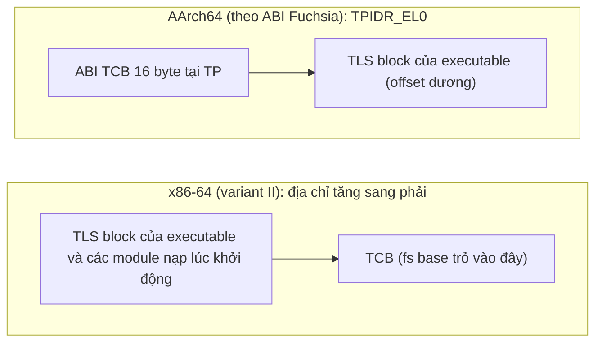
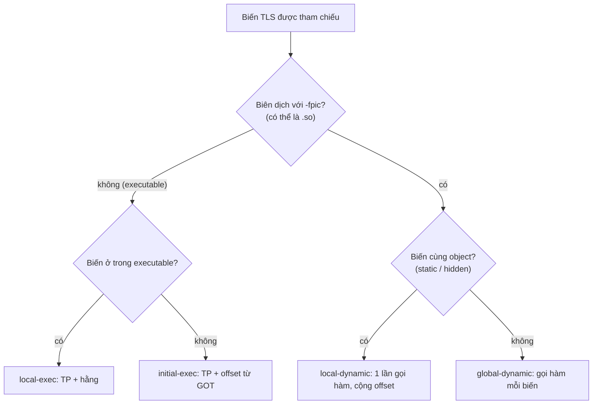
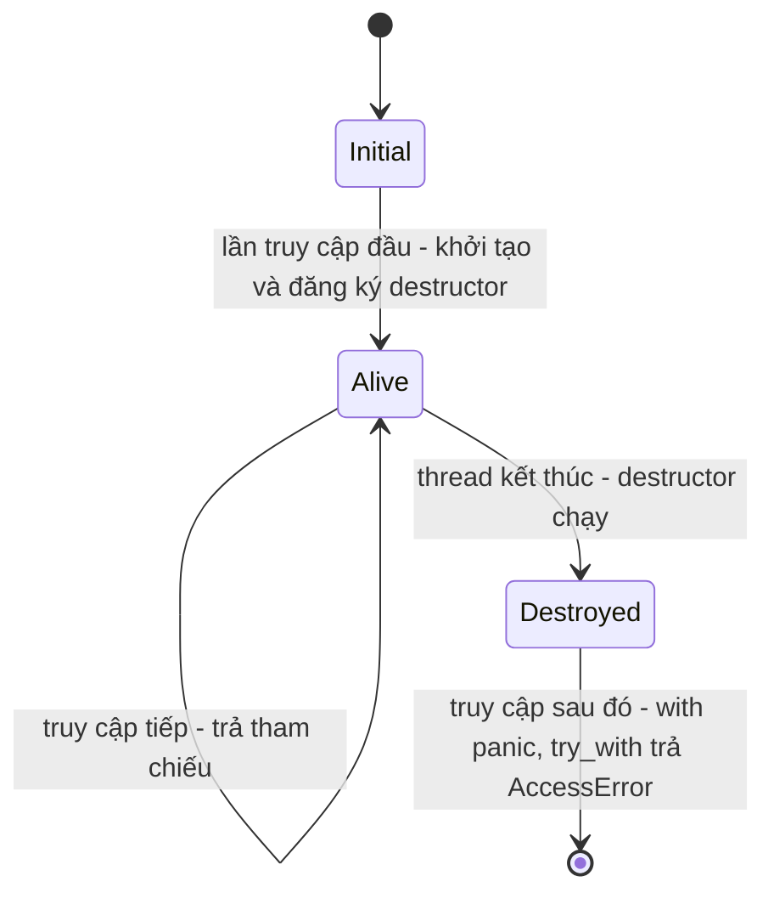

# P4 · Chương 09 — Thread-local storage

> Phạm vi: Linux (glibc), x86-64 và AArch64, Rust 1.95.0. Chương này **không có thí nghiệm**: mọi khẳng định lấy từ tài liệu/mã nguồn đã đọc (ghim phiên bản). Các đoạn code chỉ để minh họa cơ chế, không kèm kết quả chạy. Chi tiết cài đặt trong std (tên module, struct) là *chi tiết cài đặt* của bản 1.95.0 và có thể đổi; hợp đồng thật là phần docs của `LocalKey`/`thread_local!`.

## Bạn sẽ hiểu được gì

1. **Q1.** Vì sao cần "biến toàn cục nhưng mỗi thread một bản" (ví dụ `errno`), và nó khác biến trên stack ở đâu? → mục 1
2. **Q2.** `__thread`/`_Thread_local` khác `pthread_key_create` thế nào, và vì sao ELF TLS ra đời? → mục 2
3. **Q3.** Compiler, linker, loader và kernel dựng vùng TLS ra sao: `.tdata`/`.tbss`, thread pointer (`%fs` trên x86-64, `TPIDR_EL0` trên AArch64)? → mục 3
4. **Q4.** Bốn TLS model (global-dynamic, local-dynamic, initial-exec, local-exec) khác nhau gì, và truy cập một biến TLS tốn bao nhiêu việc? → mục 4
5. **Q5.** `thread_local!` của Rust: `LocalKey::with`/`set`/`take`, `const { }`, và std chọn cài đặt nào bên dưới? → mục 5
6. **Q6.** Điều gì xảy ra với TLS khi thread kết thúc: destructor chạy lúc nào, thứ tự nào, và truy cập sau khi bị hủy thì sao (`AccessError`)? → mục 6
7. **Q7.** Vì sao không dùng TLS cho trạng thái của một task async, và `tokio::task_local!` giải quyết gì? → mục 7

## Kiến thức cần trước

- [Chương 01 — Thread](01-thread.md): thread chung address space, riêng stack/thanh ghi; mục 6 của chương đó giới thiệu TLS ở mức ngắn, chương này đi sâu.
- [Chương 08 — Concurrency trong Rust](08-rust-concurrency.md): `Send`/`Sync`, `Cell`/`RefCell` (mục 5 của chương đó), vì sao `thread_local!` chỉ phát `&T`.
- [Chương 08 (Phase 7) — Tokio](../07-io-async/08-tokio.md): multi-thread scheduler, task có thể chạy ở thread khác nhau (cần cho mục 7).

## 1. Vì sao cần biến riêng mỗi thread (Q1)

> **Trả lời ngắn.** Các thread trong một process dùng chung một address space, nên một biến global thông thường chỉ có *một* bản cho mọi thread; muốn mỗi thread một giá trị riêng thì phải có cơ chế đặc biệt[^pkc-need]. `errno` là ví dụ kinh điển: nó là thread-local để một thread đặt `errno` không ảnh hưởng thread khác[^errno-tl]. TLS là cách khai báo "biến toàn cục theo thread" đó, có đúng một bản cho mỗi thread đang tồn tại[^gcc-tls].

**Giải thích.**

Hình dung (nhận xét của người soạn): một văn phòng dùng chung một bảng trắng ghi "số điện thoại vừa gọi". Nếu hai nhân viên cùng viết lên đó, người này ghi đè người kia. TLS là phát cho mỗi nhân viên một tờ giấy riêng *cùng tên* "số điện thoại vừa gọi": mã nguồn viết như thể có một biến duy nhất, nhưng mỗi người nhìn thấy tờ của mình.

*Vì sao biến thường không làm được.* Thread chia sẻ một vùng nhớ, nên biến global/static thông thường không thể có giá trị khác nhau ở các thread khác nhau[^pkc-need]. Giải pháp thủ công: tự truyền một con trỏ "ngữ cảnh" qua mọi hàm — đúng nhưng làm đổi chữ ký của mọi hàm trung gian (nhận xét của người soạn).

*Ví dụ `errno`.* `errno` là một lvalue (biểu thức đọc/gán được như một biến) kiểu `int` theo chuẩn ISO C; man page ghi rõ nó là thread-local[^errno-tl]. Nếu nó là biến global thật sự chung, hai thread cùng gọi một syscall lỗi sẽ ghi đè mã lỗi của nhau (suy luận của người soạn; xem thêm [chương 01, mục 6](01-thread.md)). Tài liệu ELF TLS của Drepper cũng nêu `errno` làm ví dụ cho việc "run-time environment" cần TLS, và nói rằng việc thêm TLS không chỉ dành cho chương trình người dùng[^drepper-errno].

*Khác biến cục bộ trên stack ở đâu?* Biến cục bộ (automatic) vốn đã riêng cho thread, và tài liệu của Drepper nói đặt `__thread` lên biến automatic là vô nghĩa vì biến automatic luôn là thread-local[^drepper-auto]. Khác biệt của TLS là **tuổi thọ**: chuẩn C nói object `_Thread_local` sống suốt thời gian chạy của thread chứ không theo một lần gọi hàm[^c11-thread-local], và với `__thread` của GCC, nó được khai báo ở mức global/static chứ không phải biến automatic trong khối[^gcc-where].

*Vài ứng dụng backend* (nhận xét của người soạn): bộ đệm tạm tái sử dụng để tránh cấp phát lặp lại trong mỗi request, bộ sinh số ngẫu nhiên/ID theo thread, bộ đếm metric theo thread rồi gộp sau, ngữ cảnh log (request id) trong server thread-per-request. Docs của Rust còn nói rõ: trên nền tảng mà việc khởi tạo cần cấp phát bộ nhớ, std cấp phát thẳng qua `System` (không qua global allocator), nhờ đó global allocator có thể dùng chính TLS[^rs-alloc].

<details><summary>Đi sâu: hai nghĩa của "thread-local" và vì sao con trỏ tới TLS không được mang đi</summary>

- "Thread-local" có hai nghĩa dễ lẫn: (1) biến cục bộ trên stack của thread; (2) biến có *thời gian sống theo thread*, khai báo như global. Chương này nói nghĩa (2), như chương 01 mục 6.
- Chuẩn hóa trong C: storage class `_Thread_local` được đề xuất ở N1364 của WG14 (2008) với nội dung: có một object riêng cho mỗi thread, và tên biến trong biểu thức chỉ object gắn với thread đang đánh giá biểu thức[^c-thread-local]. Đoạn văn cùng nội dung (mục 6.2.4 đoạn 4) có trong committee draft C11 N1570 (2011)[^c11-thread-local]. Trong đề xuất đó, kết quả của việc truy cập gián tiếp một object thread-storage từ thread khác chủ nhân là *implementation-defined*[^c-indirect]. (Đây là văn bản đề xuất/dự thảo, không phải văn bản ISO chính thức.)
- GCC nói rõ về hệ quả thực tế: toán tử `&` trên biến thread-local được tính lúc chạy và trả về địa chỉ của bản thuộc thread hiện tại; địa chỉ đó có thể được thread khác dùng, nhưng khi thread chủ nhân kết thúc thì mọi con trỏ tới biến thread-local của nó thành không hợp lệ[^gcc-addr][^gcc-ptr-invalid].
- Trong Rust, ràng buộc tương tự được đẩy xuống type system (nhận xét của người soạn): `LocalKey::with` đưa tham chiếu không được sống lâu hơn thread hiện tại và không được thoát khỏi closure[^rs-with-ref] (mục 5).

</details>

**Quay lại Q1:** thread dùng chung bộ nhớ nên biến global thường không thể riêng theo thread; TLS cho mỗi thread một bản của cùng một biến, sống suốt đời thread, và `errno` là ví dụ không thể thiếu.

## 2. `__thread`/`_Thread_local` và pthread keys (Q2)

> **Trả lời ngắn.** Có hai cách. Cách cũ của POSIX là *thread-specific data* (TSD): bạn tự xin một "key" bằng `pthread_key_create`, rồi mỗi thread gắn một con trỏ `void *` vào key đó bằng `pthread_setspecific` và đọc bằng `pthread_getspecific`[^pkc-tsd]. Cách mới là ngôn ngữ/compiler nhận việc: viết `__thread` (GCC) hoặc `_Thread_local` (C11)[^c11-thread-local] trước khai báo biến, còn compiler, linker và dynamic loader lo phần còn lại[^drepper-thread-kw]. Cách mới ít việc thủ công hơn nhưng cần hỗ trợ từ linker, dynamic linker và libc, nên "không có sẵn ở mọi nơi"[^gcc-needs-support].

**Giải thích.**

Hình dung (nhận xét của người soạn): pthread key giống một *tủ có nhiều ngăn đánh số*: số ngăn (key) giống nhau cho mọi người, nhưng mỗi người có một tủ riêng và tự bỏ vào ngăn đó một tờ giấy ghi địa chỉ. `__thread` giống việc khu nhà tự chia sẵn phòng riêng ngay khi bạn vào làm: bạn chỉ cần nói "biến này theo thread".

*Cách 1 — pthread key (TSD).* Man page mô tả: mỗi thread có một vùng nhớ riêng gọi là TSD area, được đánh chỉ mục bằng các TSD key; vùng này gắn mỗi key với một giá trị kiểu `void *`[^pkc-tsd]. Key dùng chung cho mọi thread, nhưng giá trị gắn với key thì mỗi thread một khác[^pkc-keys-common]. Có thể hình dung như mảng con trỏ, key là chỉ số mảng[^pkc-array]. Thread vừa tạo có giá trị `NULL` ở mọi key[^pkc-null]. Số key tối đa tại một thời điểm bị giới hạn bởi `PTHREAD_KEYS_MAX`[^pkc-max]. `pthread_getspecific` trả `NULL` nếu lỗi[^pkc-get-null], và `pthread_key_delete` **không** chạy destructor của key[^pkc-delete].

```c
// minh họa (không có output để khẳng định)
static pthread_key_t key;
static void free_buf(void *p) { free(p); }   // destructor khi thread kết thúc

void init(void)        { pthread_key_create(&key, free_buf); }
char *buf(void) {
    char *p = pthread_getspecific(key);
    if (!p) { p = malloc(4096); pthread_setspecific(key, p); }  // tự cấp phát lần đầu
    return p;
}
```

Điểm cần thấy (nhận xét của người soạn): *bạn* phải tạo key một lần (và chỉ một lần) trước khi thread nào dùng, tự cấp phát giá trị ở lần truy cập đầu (vì thread mới có `NULL` ở mọi key[^pkc-null]), tự ép kiểu `void *`, và tự xóa key khi không dùng nữa. Drepper mô tả đúng nỗi đau này: key phải được cấp phát động lúc chạy, phải giải phóng khi không dùng, và việc đó thành vấn đề thật sự khi kết hợp với code được nạp động[^drepper-motivation].

*Cách 2 — `__thread` / `_Thread_local`.* Chỉ cần một từ khóa:

```c
// minh họa
__thread int counter;               // GCC
static _Thread_local char *cur;     // C11
```

Drepper: compiler được kỳ vọng hỗ trợ từ khóa này để triển khai ABI mới, biến khai báo như vậy "tự động được cấp phát cục bộ cho mỗi thread"[^drepper-thread-kw]. GCC giới hạn nơi dùng: `__thread` áp dụng cho biến global, static cấp file, static trong hàm hoặc static data member của class; không áp dụng cho biến automatic trong khối hay data member không-static[^gcc-where]. Ở C++, nếu có initializer thì phải là constant-expression[^gcc-cpp-init]; Drepper cũng nêu giới hạn lớn nhất là biến thread-local trong C++ không được cần static constructor[^drepper-cpp]. Không initializer tĩnh nào được tham chiếu địa chỉ của biến thread-local[^gcc-no-static-addr].

*Vì sao đọc nhanh hơn* (suy luận của người soạn từ mục 3–4): `pthread_getspecific` là một lời gọi hàm tra bảng theo key lúc chạy; còn biến `__thread` có vị trí cố định so với thanh ghi thread pointer nên thường truy cập bằng vài lệnh. Mục 4 trình bày các mã máy thực tế do Drepper liệt kê.

<details><summary>Đi sâu: vòng đời giá trị TSD và vì sao pthread key vẫn còn dùng</summary>

- Destructor của key: nếu `destr_function` khác `NULL`, nó được gọi với giá trị của key trong thread đó khi thread kết thúc qua `pthread_exit` hoặc bị cancel; không gọi nếu giá trị là `NULL`[^pkc-destr]. Thread kết thúc bằng cách `return` khỏi hàm khởi động tương đương với gọi `pthread_exit`[^pc-return]. Chi tiết destructor ở mục 6.
- Pthread key là API runtime thuần C: man page chỉ mô tả hàm và vùng TSD, không đòi hỏi linker/loader hỗ trợ ELF TLS (suy luận của người soạn), nên dùng được cả khi không có TLS native. Rust std đi hướng đó: ở các target mà OS chỉ cung cấp thư viện TLS, dữ liệu được cấp phát heap và tham chiếu qua một TLS key[^rs-impl-os]. (Chi tiết ở mục 5.)
- Phía kernel chỉ lo giá trị thanh ghi TLS theo từng thread: gán cho thread mới và nạp lại khi đổi thread (mục 3)[^clone-settls]. Man page `clone` nói cờ này thường chỉ thư viện thread dùng[^clone-settls-note]; cấp phát vùng TLS và truy cập qua thread pointer là việc của thread library và toolchain (suy luận của người soạn từ câu đó và từ Drepper, mục 3).

</details>

**Quay lại Q2:** pthread key là TSD tự quản lý bằng `void *`, `__thread`/`_Thread_local` đẩy việc cho toolchain bằng ELF TLS; cả hai cùng mục đích, nhưng cách sau gọn hơn và cần hỗ trợ từ linker/loader.

## 3. Vùng TLS được dựng thế nào: `.tdata`, `.tbss`, thread pointer (Q3)

> **Trả lời ngắn.** Biến thread-local được compiler đặt vào section `.tdata` (có giá trị khởi tạo) hoặc `.tbss` (không); đây là một *ảnh khởi tạo* mà mỗi thread được sao ra một bản riêng khi tạo[^drepper-tdata][^drepper-image]. Mỗi thread có một **thread pointer** nằm trong thanh ghi cố định, và biến TLS được định vị bằng *offset so với thread pointer*[^fuchsia-tp]. Trên x86-64 thanh ghi đó là base của `%fs`[^drepper-x64]; trên AArch64 là `TPIDR_EL0`[^fuchsia-tp][^arm64-switch-write].

**Giải thích.**

Hình dung (nhận xét của người soạn): `.tdata`/`.tbss` giống *mẫu đơn trắng*. Khi một nhân viên mới (thread) vào, hệ thống photo một bản từ mẫu, đặt lên bàn của họ, và ghi số bàn vào một thẻ luôn đeo trên người (thread pointer). Muốn tìm "ô điền tên" thì chỉ cần: số bàn + vị trí ô trong mẫu.

**Bước 1 — compiler/linker: tách dữ liệu thread-local khỏi dữ liệu thường.** Thay vì `.data` và `.bss`, biến thread-local nằm trong `.tdata` và `.tbss`, về cơ bản là các section giống bản thường nhưng thêm cờ `SHF_TLS`[^drepper-tdata]. Linker nhận diện theo kiểu và cờ chứ không theo tên section[^drepper-by-flag]. Symbol dùng kiểu mới `STT_TLS`, vì một biến TLS không có *một* địa chỉ nào[^drepper-sttls].

**Bước 2 — loader: sao ảnh khởi tạo cho từng thread.** Chương trình đang chạy không dùng trực tiếp `.tdata`; sau khi dynamic linker áp relocation, section được giữ làm *initialization image*, không sửa nữa. Mỗi thread, kể cả thread đầu tiên, được cấp bộ nhớ mới rồi nội dung ảnh được sao vào đó, để mọi thread bắt đầu với cùng điều kiện đầu[^drepper-image].

**Bước 3 — thread pointer.** Vùng riêng của mỗi thread có một *Thread Control Block* (TCB) và *dynamic thread vector* (dtv): trong variant I, TCB chứa ở offset 0 một con trỏ tới dtv, còn dtv chứa con trỏ tới các TLS block của từng module (module = executable hoặc một `.so`)[^drepper-tcb-dtv]; variant II cũng có dtv nhưng không quy định con trỏ tới nó nằm ở đâu trong TCB[^drepper-var2]. Địa chỉ của vùng này nằm trong **thread pointer** (thanh ghi riêng mỗi thread). Drepper định nghĩa hai cách bố trí:

- *Variant I* (phát triển cùng ABI IA-64[^drepper-var1-ia64]): thread pointer trỏ vào TCB; TLS block của các module nạp lúc khởi động nằm ngay sau TCB, nên offset từ thread pointer là hằng sau khi chương trình khởi động[^drepper-var1].
- *Variant II*: thread pointer trỏ tới TCB có kích thước/nội dung không cố định; các TLS block của executable và module nạp lúc khởi động nằm ngay **dưới** (địa chỉ thấp hơn) chỗ thread pointer trỏ tới[^drepper-var2]. Tài liệu chú thích rằng một lý do dùng variant II là: vì lý do lịch sử, bố cục bộ nhớ mà thanh ghi thread trỏ vào không tương thích với variant I[^drepper-var2-reason].

**x86-64 dùng variant II với `%fs`.** Drepper: ABI x86-64 dùng thanh ghi segment `%fs` (IA-32 dùng `%gs`) và các TLS block của module lúc khởi động theo variant II[^drepper-x64]. Mã máy đọc thread pointer: nạp `%fs:0` — truy cập offset 0 qua segment này cho ra địa chỉ TCB[^drepper-x64-ie]. Tài liệu Fuchsia cũng nói trên x86-64 base của `fs` là thread pointer, đọc bằng `%fs:`, `%fs:0` hoặc lệnh `rdfsbase`[^fuchsia-tp].

**AArch64 dùng `TPIDR_EL0`.** Trên AArch64 thread pointer là thanh ghi hệ thống `TPIDR_EL0`, đọc bằng `mrs <reg>, TPIDR_EL0`[^fuchsia-tp]. Tài liệu Fuchsia mô tả offset local-exec khác nhau giữa hai kiến trúc: AArch64 có `TPOFF = max(16, p_align) + <offset trong segment>` (cộng dương, TLS nằm sau TP, chừa 16 byte "ABI TCB"), x86_64 có `TPOFF = -<offset tính từ cuối segment>` (số âm)[^fuchsia-tpoff]. Đó là ABI của Fuchsia; với Linux/glibc, header `sysdeps/aarch64/nptl/tls.h` (glibc 2.36) nói thread pointer trỏ tới đầu các thread block[^glibc-aarch64-layout], còn header x86-64 để TCB ở vùng nhớ ngay sau địa chỉ thread pointer trỏ tới[^glibc-x64-layout]; hai header chọn hai bố cục khác nhau đúng như hai sơ đồ dưới đây (suy luận của người soạn). Tài liệu Drepper v0.21 **không** có phần AArch64/ARM: mục "Architecture Specific Definitions" của nó chỉ liệt kê IA-64, IA-32, SPARC, SH, Alpha, x86-64, s390 và s390x (nhận xét của người soạn sau khi đọc và tìm chuỗi "ARM" trong văn bản đã tải), nên tên "variant I/II" của Drepper không được dùng chính thức cho AArch64 trong chương này.



(Sơ đồ rút gọn: x86-64 theo Drepper — các block của executable và module nạp lúc khởi động nằm *dưới* chỗ thread pointer trỏ tới[^drepper-var2], không vẽ thứ tự giữa các block; AArch64 theo Fuchsia — TP trỏ vào 16 byte đầu rồi TLS block của executable ở offset dương[^fuchsia-tpoff]. Không vẽ dtv.)

**Bước 4 — kernel gán thread pointer cho từng thread.** Khi tạo thread bằng `clone(2)`, cờ `CLONE_SETTLS` đặt "TLS descriptor"; trên x86-64 giá trị truyền vào là giá trị mới của base `%fs` (như `ARCH_SET_FS` của `arch_prctl(2)`), còn trên kiến trúc có thanh ghi TLS riêng thì là giá trị mới của thanh ghi đó[^clone-settls]. Man page `clone` cảnh báo cờ này cần hiểu sâu và thường chỉ thư viện thread dùng[^clone-settls-note]. Thread pointer là *trạng thái riêng của từng thread* nên kernel phải nạp lại khi đổi thread: bản mã arm64 v6.8 lưu `tpidr_el0` của thread đang chạy rồi ghi `tpidr_el0` của thread kế tiếp trong `tls_thread_switch`[^arm64-switch-save][^arm64-switch-write].

<details><summary>Đi sâu: <code>arch_prctl</code>, đừng tự đặt <code>%fs</code>, và TLS cho thư viện nạp động</summary>

- `arch_prctl(ARCH_SET_FS, addr)` đặt base 64-bit của `FS` thành `addr`[^arch-set-fs]; man page cảnh báo `FS` có thể đã được thư viện thread dùng, nên chương trình tự dùng `ARCH_SET_FS` "rất có thể sẽ crash"[^arch-fs-warn]. Nói cách khác: đừng tự đụng vào `%fs` trong chương trình thường.
- Tài liệu Fuchsia gọi "Static TLS set" là các module mà dynamic linker biết lúc khởi động, gồm executable chính và mọi thư viện được đề cập qua `DT_NEEDED`[^fuchsia-static-set]. Theo Drepper, TLS block của các module nạp lúc khởi động nằm ở offset cố định so với thread pointer[^drepper-var1]; còn module nạp sau bằng `dlopen` thì block có thể cấp phát lười, truy cập qua hàm (mục 4)[^drepper-dyn-defer].
- Việc cấp phát TLS block có thể hoãn: Drepper nêu rằng với model dynamic, tính địa chỉ biến được dời cho một hàm runtime (`__tls_get_addr`), hàm này cũng có thể cấp phát và khởi tạo vùng nhớ nếu chưa có[^drepper-dyn-defer].
- Thread chính cũng có: lúc khởi động process, TCB cùng dtv được tạo cho main thread[^drepper-main-tcb].

</details>

**Quay lại Q3:** `.tdata`/`.tbss` là ảnh khởi tạo được sao cho mỗi thread; thread pointer (`%fs` base trên x86-64, `TPIDR_EL0` trên AArch64) trỏ vào vùng TLS của thread; kernel gán/nạp lại nó theo thread (`CLONE_SETTLS`, context switch), còn biến TLS được tìm bằng offset từ thread pointer.

## 4. Bốn TLS model và chi phí truy cập (Q4)

> **Trả lời ngắn.** Bốn model — global-dynamic, local-dynamic, initial-exec, local-exec — đánh đổi giữa *tổng quát* và *nhanh*: Drepper nêu bốn model là một phần của ABI và chia chúng theo hai nhóm dynamic/static[^drepper-four-cat]. Global-dynamic là tổng quát nhất, gọi hàm runtime để tìm địa chỉ[^drepper-gd]; local-exec nhanh nhất[^fuchsia-le], offset là hằng số biết lúc link[^drepper-le-imm]. Compiler chọn model theo ngữ cảnh và cờ như `-fpic`/`-ftls-model`[^gcc-model-opt].

**Giải thích.**

Hình dung (nhận xét của người soạn): bạn cần tìm bàn của "đồng nghiệp ở công ty khác". Global-dynamic: gọi tổng đài hỏi mỗi lần (hỏi được mọi nơi, chậm). Local-dynamic: gọi tổng đài *một* lần để biết tầng của công ty mình, rồi tự đi từng bàn. Initial-exec: đã có sẵn địa chỉ trong sổ (GOT) từ lúc khai trương, chỉ cần lật sổ. Local-exec: địa chỉ in sẵn trong mã lệnh, không cần tra.

Mọi model chung một việc: dynamic linker (chương trình nạp executable và các `.so` lúc khởi động) phải xử lý các relocation liên quan TLS ngay, không thể hoãn như relocation hàm; *relocation* là bước điền giá trị thật vào chỗ còn để trống lúc link (nhận xét của người soạn). Kết quả của relocation cho một symbol TLS là module ID và offset trong TLS block, được cất vào GOT (Global Offset Table: bảng dynamic linker điền lúc chạy; segment code không sửa được nên code chỉ đọc giá trị ra từ đó)[^drepper-reloc-got]. Với initial-exec chỉ cần offset (xem dưới).

**1. Global-dynamic (GD).** Model tổng quát nhất: code dùng được ở mọi nơi và truy cập được biến định nghĩa ở bất kỳ đâu[^drepper-gd]. Compiler dùng nó mặc định, chỉ chuyển sang model hạn chế hơn khi được yêu cầu hoặc khi an toàn[^drepper-gd-default]. Module ID và offset do dynamic linker xác định lúc chạy rồi truyền cho `__tls_get_addr`, hàm trả về địa chỉ biến cho thread hiện tại[^drepper-gd-values]. Drepper nói rõ kích thước code và thời gian chạy của model này khiến phải tránh nó bất cứ khi nào có thể[^drepper-gd-cost]. Đổi lại nó cho phép hoãn cấp phát TLS block đến lần dùng đầu[^drepper-gd-defer]. Mã x86-64:

```asm
; x86-64 general dynamic (Drepper): 16 byte, prefix chỉ để đệm cho đủ 16 byte
.byte 0x66
leaq  x@tlsgd(%rip),%rdi
.word 0x6666
rex64
call  __tls_get_addr@plt
```

Hàm trên x86-64 chỉ nhận một tham số, là địa chỉ cấu trúc `tls_index` (module ID, offset) nằm ở hai ô liên tiếp trong GOT[^drepper-x64-gd]. (`@plt` là cách gọi một hàm nằm ở thư viện khác qua bảng PLT của dynamic linker — nhận xét của người soạn, không phải điều chương này đào sâu.) Phần đệm trong chuỗi lệnh trên dành chỗ để linker có thể thay nó bằng chuỗi initial-exec dài hơn 4 byte[^drepper-x64-pad].

**2. Local-dynamic (LD).** Tối ưu của GD: compiler dùng được khi nó nhận ra biến thread-local được định nghĩa ngay trong cùng object với chỗ tham chiếu (ví dụ biến `static` cấp file)[^drepper-ld]. Khi đó offset biết lúc link, chỉ còn module ID chưa biết, nên vẫn phải gọi `__tls_get_addr` để lấy module ID và cấp phát TLS block nếu cần[^drepper-ld-call]; truyền offset 0 thì hàm trả địa chỉ đầu TLS block của module, rồi cộng offset từng biến. Drepper: nếu chỉ có một biến thì không lợi hơn GD, nhưng với nhiều biến thì chỉ còn một lần gọi hàm và mỗi biến chỉ thêm một phép cộng[^drepper-ld-gain]. Tối ưu GD → LD phải do compiler làm vì code khác hẳn, linker không làm hộ được[^drepper-ld-compiler].

```asm
; x86-64 local dynamic: một lần gọi, nhiều biến cộng offset
leaq  x1@tlsld(%rip),%rdi
call  __tls_get_addr@plt
...
leaq  x1@dtpoff(%rax),%rcx
leaq  x2@dtpoff(%rax),%r9
```

Mã x86-64 trên theo Drepper, mục x86-64 Local Dynamic; mục đó cũng nói riêng với x86-64 rằng model này không có lợi nếu chỉ truy cập một biến[^drepper-x64-ld].

**3. Initial-exec (IE).** Dùng khi biến nằm trong một module có sẵn lúc chương trình khởi động và lập trình viên chọn model *static*. Khi đó code không gọi `__tls_get_addr`, nên không hoãn cấp phát được cho block kiểu này[^drepper-ie-nocall]. Lý do chạy được: sau khi dynamic linker nạp mọi module ban đầu, TLS block của chúng nằm liên tiếp nên mỗi biến có offset cố định so với TCB[^drepper-ie-fixed]. Mỗi biến chỉ cần một relocation cho ô GOT (không cần module ID), nên số relocation lúc chạy giảm một nửa so với GD[^drepper-ie-reloc]. Mã x86-64 dưới đây đọc thread pointer từ `%fs:0` rồi cộng offset nạp từ GOT[^drepper-x64-ie].

```asm
; x86-64 initial exec
movq  %fs:0,%rax
addq  x@gottpoff(%rip),%rax      ; offset (R_X86_64_TPOFF64) do dynamic linker điền vào GOT
```

**4. Local-exec (LE).** Hạn chế nhất: chỉ dùng cho code trong executable và biến trong executable[^drepper-le-restrict]. Vì chỉ dùng TLS block đầu tiên (của executable), linker biết offset so với TCB lúc tạo executable; kết quả là số hằng nhúng vào lệnh[^drepper-le-imm]. Mã x86-64 dưới đây đọc thread pointer rồi cộng offset là immediate[^drepper-x64-le].

```asm
; x86-64 local exec
movq  %fs:0,%rax
leaq  x@tpoff(%rax),%rax         ; offset (R_X86_64_TPOFF32) biết lúc link
```

Tài liệu Fuchsia gọi đây là model nhanh nhất, và nói rằng linker có thể nới (relax) từ initial-exec xuống local-exec, còn compiler thì không tự làm được vì không biết đang biên dịch cho executable hay shared library, trừ khi được chỉ định bằng `-ftls-model` hoặc `__attribute__((tls_model(...)))`[^fuchsia-le].

| Model | Dùng khi biến ở đâu | Cách tìm địa chỉ | Hoãn cấp phát block? |
|---|---|---|---|
| global-dynamic | bất kỳ module nào | gọi `__tls_get_addr` ở chỗ truy cập[^drepper-gd-values] | có[^drepper-gd-defer] |
| local-dynamic | cùng object với chỗ tham chiếu | 1 lần gọi `__tls_get_addr`, cộng offset mỗi biến[^drepper-ld-gain] | có[^drepper-ld-call] |
| initial-exec | module có sẵn lúc khởi động | thread pointer + offset đọc từ GOT[^drepper-ie-reloc] | không[^drepper-ie-nocall] |
| local-exec | chỉ executable | thread pointer + hằng số[^drepper-le-imm] | không (không gọi hàm) |

(Cột cuối: GD, LD và IE có nguồn trực tiếp; LE "không" là suy luận của người soạn vì không dùng hàm nào.)

**Compiler chọn model nào?** GCC: `-ftls-model=` chọn một trong bốn; lựa chọn còn chịu tối ưu — compiler có thể dùng model hiệu quả hơn cho symbol không nhìn thấy ngoài translation unit, hoặc khi không có `-fpic`[^gcc-model-opt]. Thư viện nạp động (`-fpic`) mặc định global-dynamic, executable (không `-fpic`) mặc định initial-exec[^gcc-model-default].



(Sơ đồ rút gọn, tổng hợp của người soạn theo mô tả GCC/Drepper ở trên; thực tế còn bị chi phối bởi `-ftls-model`, ELF visibility và việc linker nới model[^fuchsia-le][^gcc-model-opt].)

**Chi phí truy cập, tóm lại** (suy luận của người soạn từ các mã máy trên; không có số đo trong nguồn nên không đưa nanosecond): GD tốn một lời gọi hàm mỗi lần truy cập (có thể nhiều lần cho nhiều biến); IE tốn đọc thread pointer + một lần load từ GOT + cộng; LE chỉ đọc thread pointer + cộng hằng số. Biến TLS thường nhanh vì vậy, nhưng "thường" phụ thuộc model, nên code trong `.so`/`dlopen` có thể chậm hơn code trong executable.

<details><summary>Đi sâu: <code>-ftls-model=initial-exec</code> trong <code>.so</code>, và hạn chế khi <code>dlopen</code></summary>

- Drepper nêu rằng model static (IE) không dùng `__tls_get_addr` nên không hoãn cấp phát được cho các block truy cập kiểu này; nhưng vẫn có thể hoãn cấp phát cho module nạp động[^drepper-ie-defer-dyn]. Hệ quả thực tế (suy luận của người soạn): một `.so` biên dịch với IE phải chắc chắn được nạp lúc khởi động, nên không phải thư viện nào cũng nên chọn model này.
- Các bảng mã máy trên là x86-64 do Drepper liệt kê (phiên bản 0.21, 2013); tài liệu đó không có phần AArch64. Đặc tả ELF cho AArch64 của Arm có bảng relocation riêng cho TLS, chia các mục General Dynamic, Local Dynamic, Initial Exec và Local Exec[^aarch64-models], và có thêm biến thể TLS descriptor mà linker có thể nới sang initial-exec/local-exec[^aarch64-tlsdesc]. AArch64 đọc thread pointer từ `TPIDR_EL0` bằng `mrs`[^fuchsia-tp]; chương này không liệt kê chuỗi lệnh AArch64 vì chưa đọc nguồn có chuỗi đó.

</details>

**Quay lại Q4:** bốn model là một dải từ tổng quát/chậm (GD: gọi `__tls_get_addr`) đến hẹp/nhanh (LE: thread pointer + hằng); compiler chọn theo `-fpic`, visibility và `-ftls-model`, nên cùng một biến TLS có thể rẻ trong executable và đắt hơn trong shared library.

## 5. `thread_local!` của Rust: API và cài đặt (Q5)

> **Trả lời ngắn.** `thread_local!` khai báo một `LocalKey<T>`, là "khóa TLS sở hữu giá trị bên trong" và dùng cài đặt nhanh nhất có sẵn trên target[^rs-localkey-owns]. Giá trị khởi tạo lười ở lần truy cập đầu của mỗi thread[^rs-init]; chỉ lấy được `&T` qua `with`, nên muốn sửa thì bọc `Cell`/`RefCell`[^rs-only-shared]. Nếu khởi tạo là hằng, viết `const { ... }` để std dùng cài đặt hiệu quả hơn, bỏ được khởi tạo lười[^rs-const].

**Giải thích.**

Hình dung (nhận xét của người soạn): `LocalKey` là *chìa khóa tủ cá nhân*. Mọi thread cầm cùng một chìa nhưng mở ra tủ riêng; tủ chỉ cho bạn nhìn vào qua cửa sổ (`with`), không cho mang tờ giấy ra ngoài khỏi thread.

```rust
use std::cell::{Cell, RefCell};

thread_local! {
    // const { }: khởi tạo hằng, không cần khởi tạo lười
    static DEPTH: Cell<u32> = const { Cell::new(0) };
    // khởi tạo lười, chạy ở lần truy cập đầu của mỗi thread
    static SCRATCH: RefCell<Vec<u8>> = RefCell::new(Vec::with_capacity(4096));
}

fn handle() {
    DEPTH.set(DEPTH.get() + 1);                 // LocalKey<Cell<T>>: get / set
    SCRATCH.with_borrow_mut(|b| b.clear());     // LocalKey<RefCell<T>>: with_borrow_mut
}
```

*Các phương thức.* `with(|v| ...)` đưa `&T` cho closure và khởi tạo lười nếu thread chưa từng chạm key[^rs-with-lazy]; `try_with` giống `with` nhưng trả `Result<R, AccessError>` thay vì panic khi key đã bị hủy[^rs-try-with]. Với `LocalKey<Cell<T>>` có thêm `set`, `get` (cần `T: Copy`), `take` (cần `T: Default`, để lại `Default::default()`)[^rs-take], `replace`; với `LocalKey<RefCell<T>>` có `with_borrow`, `with_borrow_mut`[^rs-with-borrow-mut], `set`, `take`, `replace`. `RefCell` vẫn bị kiểm tra mượn lúc chạy: `with_borrow` panic nếu giá trị đang bị mượn mutable[^rs-borrow-panic].

*`set` không chạy initializer.* Khác các phương thức còn lại, `set` không chạy initializer lười mà khởi tạo thẳng bằng giá trị đưa vào nếu chưa khởi tạo[^rs-set-skip]. Docs lấy ví dụ `static X: Cell<i32> = panic!("!")`: `X.get()` sẽ panic nhưng `X.set(123)` thì ổn[^rs-set-example].

*Reentrancy.* Initializer của `LocalKey` không được đệ quy phụ thuộc vào chính nó; làm vậy có thể gây panic, abort hoặc đệ quy vô hạn ở lần gọi `with` đầu tiên[^rs-recursive].

*Vì sao chỉ phát `&T`.* Dù không có race với thread khác, vẫn có thể lấy nhiều tham chiếu tới dữ liệu thread-local ở nhiều chỗ trên call stack, nên chỉ phát tham chiếu chia sẻ; muốn `&mut T` thì dùng `Cell`/`RefCell`[^rs-only-shared]. Đây chính là chủ đề interior mutability của [chương 08, mục 5](08-rust-concurrency.md).

*`const { }` nghĩa là gì ở tầng dưới.* Docs: cú pháp `const {}` dùng khi biểu thức khởi tạo tính được như hằng, có thể bật cài đặt TLS hiệu quả hơn tránh được khởi tạo lười; với kiểu không cần drop thì còn hiệu quả hơn nữa vì không cần theo dõi thêm trạng thái nào[^rs-const]. Mã nguồn 1.95.0 cho thấy bốn trường hợp (chi tiết ở đoạn "Đi sâu").

<details><summary>Đi sâu: ba cài đặt, bảng bốn kiểu lưu trữ và state machine (std 1.95.0, chi tiết cài đặt)</summary>

**Ba cài đặt.** `sys/thread_local` liệt kê ba cách: target không có thread thì dữ liệu để trong `static` thường; target hỗ trợ TLS native qua dynamic linker và C runtime; target mà OS chỉ cung cấp thư viện TLS thì dữ liệu cấp phát heap và tham chiếu qua TLS key[^rs-impl-three]. Chọn lúc biên dịch bằng `cfg_select!`: nhánh `target_thread_local` dùng module `native` (đứng sau một nhánh `no_threads` cho target không có thread), nhánh còn lại dùng `os`[^rs-impl-select]. Cài đặt `os` (dùng key) cấp phát giá trị bằng `System`, để tránh ảnh hưởng một global allocator dùng thread-local[^rs-os-system]. Với `x86_64-unknown-linux-gnu`: spec target dựng trên `base::linux`, nơi `has_thread_local` là `true`[^rs-linux-spec], và rustc bật `cfg(target_thread_local)` khi cờ đó đúng[^rs-cfg-tl]; nối hai mã nguồn lại thì Linux dùng nhánh `native` (suy luận của người soạn từ chuỗi kế thừa spec `x86_64_unknown_linux_gnu` → `linux_gnu` → `linux`).

**Bốn kiểu lưu trữ native.** Mã nguồn chọn một trong bốn kiểu tùy khởi tạo `const` hay lười và kiểu có `Drop` hay không, như bảng sau[^rs-native-table].

| | `Drop` | `!Drop` |
|---|---|---|
| `const` | `EagerStorage<T>` | `T` |
| lazy | `LazyStorage<T, ()>` | `LazyStorage<T, !>` |

Với `const` + `!Drop`, std dùng thẳng `T`; các trường hợp khác dùng một state machine để quản lý khởi tạo, destructor và hủy[^rs-native-sm]. Mỗi lần truy cập, trạng thái được so sánh: `Initial` thì khởi tạo, chuyển sang `Alive` và (nếu cần) đăng ký destructor; `Alive` thì trả tham chiếu; `Destroyed` thì destructor đã chạy, trả `None`[^rs-native-states]. Đây là nguồn của `AccessError` ở mục 6.



(Sơ đồ theo mô tả trong `native/mod.rs`[^rs-native-states]; kiểu `!Drop` không có trạng thái `Destroyed`[^rs-native-never].)

**Khớp với bảng.** Macro nội bộ: nhánh `const` kiểm `needs_drop::<T>()` rồi dùng `EagerStorage` nếu có, `#[thread_local] static` thuần nếu không[^rs-native-macro]. Với static mang attribute `#[thread_local]`, backend LLVM của rustc gọi `set_thread_local_mode` theo `tls_model` của session[^rs-codegen-tl]. (Suy luận của người soạn: nghĩa là biến được đặt vào vùng TLS của ELF như ở mục 3, truy cập theo một trong bốn model ở mục 4; chương này không đọc phần rustc chọn `tls_model` nên không khẳng định model nào được chọn.)

**Hệ quả suy luận được** (suy luận của người soạn, chi tiết cài đặt): với `const { }` và kiểu không `Drop`, không có trạng thái `Destroyed`, nên không có "sau khi hủy" để lỗi; còn kiểu có `Drop` (kể cả `const`) thì có. Vì vậy `const { Cell::new(0) }` rẻ nhất cho bộ đếm, còn `RefCell<Vec<_>>` có `Drop` luôn có state machine và destructor.

</details>

**Quay lại Q5:** `thread_local!` cho `LocalKey<T>` phát `&T` (thêm `Cell`/`RefCell` để sửa); khởi tạo lười ở lần truy cập đầu mỗi thread, `const { }` bỏ khởi tạo lười, và dưới đáy std dùng TLS native (`#[thread_local]`) hoặc TLS key tùy target.

## 6. Destructor khi thread kết thúc, thứ tự hủy và truy cập sau khi hủy (Q6)

> **Trả lời ngắn.** TLS của C (pthread key) và của Rust đều có destructor chạy khi thread thoát; nhưng *thứ tự* hủy giữa các biến không được hứa (man page pthread: không xác định[^pkc-order]), và destructor có thể truy cập biến TLS khác đã bị hủy. Rust xử lý bằng cách đánh dấu trạng thái `Destroyed` *trước* khi chạy destructor, nên `with` sau đó panic còn `try_with` trả `AccessError`[^rs-with-panics][^rs-try-with]. Docs Rust cũng cảnh báo "best effort": một số tình huống (như main thread thoát với TLS dựa trên pthread) destructor không chạy[^rs-main-thread].

**Giải thích.**

Hình dung (nhận xét của người soạn): thread kết thúc giống một nhân viên nghỉ việc: trước khi trả bàn, công ty đi dọn từng ngăn kéo (chạy destructor từng biến TLS). Nhưng thứ tự dọn không cố định, nên nếu ngăn kéo A cần xem giấy trong ngăn B mà B đã dọn rồi, A phải đoán trước tình huống đó.

**C / pthread key.** Nếu `destr_function` khác `NULL`, nó được gọi với giá trị gắn với key trong thread đó khi thread kết thúc qua `pthread_exit` hoặc bị cancel; không gọi nếu giá trị là `NULL`[^pkc-destr]. Thứ tự gọi destructor giữa các key là không xác định[^pkc-order]. Trước khi gọi destructor, giá trị của key trong thread hiện tại được đặt về `NULL`; destructor có thể gán lại giá trị khác `NULL` cho key đó hoặc key khác, nên nếu sau một vòng vẫn còn giá trị khác `NULL` có destructor thì vòng được lặp lại. glibc dừng sau `PTHREAD_DESTRUCTOR_ITERATIONS` vòng dù còn giá trị; implementation khác có thể lặp vô hạn[^pkc-iter]. (Suy luận của người soạn: một destructor "hồi sinh" biến TLS khác có thể bị bỏ sót hoặc lặp lâu tùy implementation.)

**Rust: thread kết thúc thì sao.** `LocalKey` khởi tạo lười ở lần dùng đầu và giá trị có `Drop` được hủy khi thread thoát[^rs-init]. Nếu destructor panic thì cả process bị abort[^rs-dtor-panic]. Mã std bọc destructor trong một hàm "không được unwind": nếu callback vẫn unwind thì gọi `rtabort` với thông báo về panic trong thread-local drop[^rs-abort-on-unwind].

**Ai gọi destructor của Rust trên Linux?** Với `native`, ở lần truy cập đầu biến khởi tạo, chuyển sang `Alive` và đăng ký destructor[^rs-native-initial]. Trên Linux và vài hệ giống Linux, std ưu tiên dùng `__cxa_thread_atexit_impl` của glibc, cùng symbol mà GCC và clang dùng để chạy destructor của `thread_local` C++[^rs-cxa], vì nó đúng thứ std cần: lên lịch một callback chạy lúc thread thoát với đối số cho trước[^rs-linux-like]. Std chỉ liên kết symbol này ở dạng *weak* (có thể vắng mặt) và dùng danh sách tự quản làm dự phòng khi thiếu[^rs-linux-weak]. Ở các nền tảng không có cơ chế đăng ký từng destructor, std tự giữ danh sách và chỉ đăng ký một callback chạy toàn bộ danh sách[^rs-dtor-list]. Thứ tự hủy trong danh sách tự quản này là *pop từ Vec* (cuối vào trước ra)[^rs-list-lifo]; đó là chi tiết cài đặt, không phải hợp đồng (docs `LocalKey` không nêu thứ tự — nhận xét của người soạn). Với nhánh `__cxa_thread_atexit_impl`, thứ tự do glibc quyết; chương này không đọc nguồn glibc phần đó nên không khẳng định.

**Truy cập sau khi hủy.** Bản `native` đặt trạng thái `Destroyed` *trước* khi chạy destructor, vì destructor có thể cố truy cập chính biến đó[^rs-eager-set-first]. Hệ quả cho người dùng API:

- `with` / `set` / `get` / `take`... panic nếu key đang chạy destructor và *có thể* panic nếu destructor đã chạy rồi trong thread này[^rs-with-panics].
- `try_with` trả `Err(AccessError)` khi key đã bị hủy (có thể xảy ra khi gọi trong destructor)[^rs-try-with]; `AccessError` là kiểu lỗi trả về của `try_with`[^rs-access-error].
- `try_with` vẫn panic nếu key chưa khởi tạo và initializer của nó panic[^rs-try-with-panic].

```rust
use std::cell::RefCell;

thread_local! {
    static LOG: RefCell<Vec<String>> = RefCell::new(Vec::new());
    static FLUSHER: Flusher = Flusher;
}

struct Flusher;
impl Drop for Flusher {
    fn drop(&mut self) {
        // Khi chạy ở thread exit, LOG có thể đã bị hủy (thứ tự hủy không hứa).
        // `with` sẽ panic -> trong destructor là abort; `try_with` thì lịch sự bỏ qua.
        let _ = LOG.try_with(|l| println!("flush {} dòng", l.borrow().len()));
    }
}
```

(Minh họa; không khẳng định ai bị hủy trước, vì đó chính là điều không được hứa.)

<details><summary>Đi sâu: các trường hợp destructor không chạy hoặc tái khởi tạo</summary>

- Docs `LocalKey` liệt kê các caveat đã biết: trên Unix khi dùng TLS dựa pthread, destructor không chạy cho TLS của main thread khi nó thoát (và application thoát ngay sau đó)[^rs-main-thread]; trên mọi nền tảng, TLS có thể khởi tạo lại các slot TLS khác trong lúc hủy — một số nền tảng chặn vô hạn bằng cách cấm tái khởi tạo slot đã hủy, nền tảng không chặn thì thường có giới hạn nhân tạo, sau đó không chạy destructor nữa[^rs-reinit]; trên Windows lúc process thoát, destructor chỉ có thể chạy trên thread gây ra việc thoát, vì thread khác có thể bị kết thúc cưỡng bức[^rs-windows-exit]. Nhìn chung std chỉ "cố gắng hết sức" chạy destructor, không phải nền tảng nào cũng bảo đảm cho mọi kiểu[^rs-best-effort].
- Trên Windows, đồng bộ trong destructor TLS (như `JoinHandle::join`) dễ deadlock vì loader lock đang được giữ[^rs-windows-sync]. (Không áp dụng cho Linux, nêu để không lẫn.)
- `pthread_key_delete` không gọi destructor của key; key đã xóa thì giá trị còn lại bị bỏ[^pkc-delete].
- Caveat "main thread không chạy destructor" ở trên áp dụng cho TLS *dựa trên pthread*[^rs-main-thread]; theo mục 5, `x86_64-unknown-linux-gnu` dùng nhánh `native` chứ không phải nhánh pthread-key, nên caveat đó không áp dụng trực tiếp cho Linux x86-64 (suy luận của người soạn từ mục 5; docs không nêu riêng cho Linux). Quy tắc vận hành ngay dưới đây vẫn nên giữ.
- Hệ quả vận hành (nhận xét của người soạn): đừng để việc quan trọng (flush log, trả connection về pool, commit) chỉ nằm trong `Drop` của TLS; hãy làm tường minh trước khi thread thoát. Docs đã nói rõ chỉ có "best effort".
- Đoạn mã nguồn `run` của danh sách tự quản: vòng lặp lấy phần tử cuối bằng `pop`; khi hết thì giải phóng bộ nhớ của danh sách[^rs-list-lifo]. Vì phần tử mới đăng ký được thêm vào cuối, mà lấy ra từ cuối, thứ tự hủy ngược với thứ tự đăng ký (suy luận của người soạn từ đoạn mã đó).

</details>

**Quay lại Q6:** destructor TLS chạy khi thread kết thúc nhưng thứ tự không được hứa và destructor có thể đụng biến TLS đã bị hủy; Rust đánh dấu `Destroyed` trước, nên `with` panic còn `try_with` trả `AccessError`, và docs chỉ cam kết "best effort" chạy destructor.

## 7. TLS trong async: task di chuyển giữa thread (Q7)

> **Trả lời ngắn.** TLS gắn với *thread*, còn một task async có thể chạy ở thread này rồi tiếp tục ở thread khác sau một `.await`: tài liệu Tokio nói runtime có thể di chuyển task giữa các thread khi task đang treo ở `.await`[^tokio-move-await]. Vì vậy một giá trị đặt vào `thread_local!` trước `.await` không bảo đảm còn "của task" sau `.await` (suy luận của người soạn từ hai sự thật trên). Muốn dữ liệu đi theo *task*, dùng `tokio::task_local!`: macro này tạo biến "cục bộ theo task hiện tại"[^tokio-tl-macro] và đặt giá trị bằng `scope`.

**Giải thích.**

Hình dung (nhận xét của người soạn): TLS là *ngăn tủ gắn với bàn làm việc*. Task là *hồ sơ khách hàng* được các nhân viên chuyền tay nhau. Nếu bạn dán ghi chú của hồ sơ vào ngăn tủ của nhân viên A, khi nhân viên B nhận tiếp hồ sơ B sẽ không thấy ghi chú, và có khi thấy ghi chú của hồ sơ *khác* mà A xử lý trước đó. Ghi chú phải kẹp *vào hồ sơ*: đó là task-local.

**Vì sao TLS và task không đi chung.**

1. Multi-thread scheduler của Tokio chạy future trên thread pool theo chiến lược work-stealing[^tokio-multi]. Task đang treo ở `.await` có thể được runtime chạy tiếp trên thread khác[^tokio-move-await]; ngay từ lúc `spawn`, task cũng có thể chạy ở thread hiện tại hoặc bị gửi sang thread khác[^tokio-spawn-thread].
2. `LocalKey` của std gắn với thread: mỗi thread một bản; giá trị khởi tạo lười *theo thread*[^rs-init].
3. Vậy một biến `thread_local!` chỉ ổn định trong khoảng giữa hai `.await`, nơi thread không đổi (suy luận của người soạn). Chính `with` cũng ép điều đó: tham chiếu không được sống lâu hơn closure[^rs-with-ref], và closure của `with` không phải async, nên không giữ tham chiếu TLS qua `.await` được (suy luận của người soạn từ chữ ký `with`).

```rust
use std::cell::Cell;
thread_local! { static REQ_ID: Cell<u64> = const { Cell::new(0) }; }

async fn handle(id: u64) {
    REQ_ID.set(id);
    do_io().await;                // task có thể tiếp tục trên thread khác
    log(REQ_ID.get());            // đọc REQ_ID của thread hiện tại, không nhất thiết là `id`
}
```

Đoạn trên minh họa lỗi (suy luận của người soạn): sau `.await`, `REQ_ID.get()` đọc slot của thread đang chạy, mà thread đó có thể không phải thread đã `set`; ngay cả runtime một thread (current-thread) cũng có thể xen task khác chạy giữa hai điểm và ghi đè slot. Docs Tokio mô tả current-thread scheduler chạy mọi task trên thread hiện tại[^tokio-current] nên trường hợp xen kẽ vẫn xảy ra dù thread không đổi.

**`tokio::task_local!`.** Macro khai báo một key kiểu `tokio::task::LocalKey` và "làm cho các static cục bộ theo task hiện tại"[^tokio-tl-macro]. Khác `std::thread::LocalKey`, nó **không** khởi tạo lười ở lần truy cập đầu; giá trị được đặt khi future chứa task-local được poll lần đầu bởi executor như Tokio[^tokio-lk-lazy]. Bạn đặt giá trị cho một future bằng `scope`: nó "đặt giá trị `T` làm task-local cho future `F`", và hết `scope` thì giá trị bị drop[^tokio-scope]. Truy cập bằng `with` (panic nếu chưa có giá trị)[^tokio-with-panic] hoặc `try_with` (trả `AccessError` nếu key không có)[^tokio-try-with]; `get` trả bản copy nếu `T: Clone`[^tokio-get].

```rust
tokio::task_local! { static REQ_ID: u64; }

async fn handle(id: u64) {
    REQ_ID.scope(id, async {
        do_io().await;
        log(REQ_ID.get());        // luôn là `id` của task này (theo docs scope)
    }).await;
}
```

Docs cũng cảnh báo cách dùng sai: poll future do `scope` trả về *bên trong* một lời gọi `with`/`try_with` của cùng `LocalKey` thì lần `poll` đó panic[^tokio-scope-panic]. `sync_scope` là bản cho closure đồng bộ, cũng panic nếu gọi bên trong `with`/`try_with` cùng key[^tokio-sync-scope].

**Lưu ý với `spawn`.** Docs `LocalKey` mô tả giá trị gắn với *future bọc bởi `scope`*; chúng không nói giá trị tự truyền sang task do `tokio::spawn` tạo từ bên trong. Từ mã nguồn 1.53.2: giá trị nằm trong `TaskLocalFuture` và chỉ được hoán vào thread-local trong lúc `TaskLocalFuture::poll` chạy (xem "Đi sâu"), còn docs `spawn` bảo đảm `spawn` không poll task mới ngay lập tức[^tokio-spawn-nopoll] — tức future truyền cho `spawn` là một future khác, được runtime poll riêng, ngoài lần `poll` của future cha. Vì vậy (suy luận của người soạn từ mã nguồn và docs, không phải một câu trong docs) task con không thấy giá trị của task cha: `with` sẽ panic và `try_with` trả `AccessError`[^tokio-with-panic][^tokio-try-with]. Muốn task con thấy giá trị, hãy `scope` lại cho future của nó hoặc truyền giá trị bằng tham số.

<details><summary>Đi sâu: khi nào TLS vẫn đúng trong async, và <code>!Send</code> qua <code>.await</code></summary>

- Cơ chế bên dưới `task_local!` (mã nguồn tokio 1.53.2, chi tiết cài đặt có thể đổi): macro khai báo một `std::thread_local!` chứa `RefCell<Option<T>>`[^tokio-tl-impl]. `scope` trả về `TaskLocalFuture` giữ giá trị trong một field; mỗi lần future đó bị poll, `poll` gọi `scope_inner`, hoán đổi (`mem::swap`) giá trị vào thread-local của thread đang poll rồi mới poll future bên trong[^tokio-tl-poll][^tokio-tl-swap]. Nên "giá trị đi theo task" thực chất là *giá trị đi theo future* và chỉ hiện ra trong TLS của thread nào đang poll future đó (suy luận của người soạn từ ba đoạn mã đã trích).
- Dữ liệu chỉ sống *giữa hai điểm `.await`* (không giữ qua `.await`) vẫn dùng TLS an toàn được, vì thread không đổi trong khoảng đó (suy luận của người soạn). Ví dụ bộ đệm tạm dùng trong một lần xử lý đồng bộ.
- Tokio nêu một quy tắc liên quan: task đưa vào `spawn` phải `Send`, nhưng vẫn dùng được giá trị `!Send` miễn là nó chỉ tồn tại *giữa các lần gọi `.await`*[^tokio-spawn-nosend]. TLS không giúp ở đây: tham chiếu lấy từ `with` không được thoát khỏi closure[^rs-with-ref].
- Với runtime `current_thread`, nhiều task vẫn dùng chung *một* thread nên chung các slot TLS[^tokio-current] — vấn đề xen kẽ ở trên không biến mất (suy luận của người soạn).
- Backend (nhận xét của người soạn): thông tin theo request như request id, trace id, user id trong server async nên đi theo task (`task_local!`, hoặc tham số tường minh, hoặc span của thư viện tracing). Dùng `thread_local!` cho cache *tái sử dụng* (không mang ý nghĩa theo request) thì ổn.
- Chi tiết scheduler: xem [Tokio — mục 2](../07-io-async/08-tokio.md).

</details>

**Quay lại Q7:** TLS gắn với thread còn task có thể đổi thread sau `.await` (và các task chia sẻ thread), nên đừng đặt trạng thái của task vào `thread_local!`; dùng `tokio::task_local!` + `scope` để dữ liệu đi theo task.

## Tóm tắt

- TLS cho "biến toàn cục theo thread": thread chung bộ nhớ nên biến thường không riêng theo thread được; `errno` là thread-local[^pkc-need][^errno-tl].
- Hai cách: pthread key (TSD: key chung, `void *` riêng mỗi thread, tự quản lý)[^pkc-tsd][^pkc-keys-common] và `__thread`/`_Thread_local` (compiler + linker + loader lo)[^drepper-thread-kw].
- ELF: biến TLS ở `.tdata`/`.tbss`; ảnh khởi tạo được sao cho từng thread[^drepper-tdata][^drepper-image].
- Thread pointer: `%fs` base (x86-64)[^drepper-x64] hoặc `TPIDR_EL0` (AArch64)[^fuchsia-tp]; kernel đặt qua `CLONE_SETTLS`[^clone-settls] và nạp lại khi đổi thread (arm64 v6.8)[^arm64-switch-write].
- Bốn model: global-dynamic (gọi `__tls_get_addr`, tổng quát nhất, Drepper khuyên tránh khi có thể)[^drepper-gd][^drepper-gd-cost], local-dynamic (một lần gọi cho nhiều biến cùng module)[^drepper-ld-gain], initial-exec (offset từ GOT)[^drepper-ie-reloc], local-exec (hằng số, chỉ executable)[^drepper-le-imm].
- Rust: `thread_local!` → `LocalKey<T>`; khởi tạo lười; phát `&T`; `Cell`/`RefCell` để sửa; `const { }` cho khởi tạo hằng[^rs-localkey-owns][^rs-only-shared][^rs-const].
- Destructor TLS chạy khi thread thoát nhưng thứ tự không được hứa; Rust: `with` panic, `try_with` → `AccessError` sau khi hủy; chỉ "best effort", main thread có thể không chạy[^pkc-order][^rs-with-panics][^rs-try-with][^rs-main-thread].
- Async: task đổi thread được[^tokio-move-await], nên trạng thái của task đặt ở `tokio::task_local!`, không ở `thread_local!`[^tokio-tl-macro].

## Câu hỏi tự kiểm tra

1. Vì sao một biến global thông thường không thể có giá trị riêng mỗi thread, và `errno` giải quyết điều đó ra sao?
2. `pthread_key_create` và `__thread` khác nhau ở những việc *bạn* phải tự làm nào?
3. `.tdata` và `.tbss` khác nhau chỗ nào, và vì sao chương trình không dùng trực tiếp `.tdata` mà phải sao ra?
4. Thanh ghi nào giữ thread pointer trên x86-64 và trên AArch64? Kernel đảm bảo nó đúng theo thread bằng cách nào (kể ít nhất hai cơ chế)?
5. Mô tả ngắn bốn TLS model và nêu model nào mặc định cho executable, model nào cho code `-fpic`.
6. Vì sao local-dynamic chỉ có lợi khi truy cập từ hai biến trở lên trong cùng module?
7. `const { }` trong `thread_local!` thay đổi gì, và khác gì giữa kiểu có `Drop` và không có `Drop` (theo mã nguồn std 1.95.0)?
8. `LocalKey::set` khác `with`/`get` thế nào khi initializer của key sẽ panic?
9. Trong destructor của TLS A bạn cần đọc TLS B. Nên dùng `with` hay `try_with`? Vì sao?
10. Vì sao `thread_local!` không phù hợp để lưu request id trong một server async chạy trên multi-thread scheduler, và thay bằng gì?
11. Destructor TLS có chắc chắn chạy mọi lúc không? Nêu ít nhất một tình huống docs liệt kê là không.

<details><summary>Đáp án</summary>

1. Thread chung một vùng nhớ nên biến global thường chỉ có một bản[^pkc-need]; `errno` là thread-local, đặt ở thread này không ảnh hưởng thread khác[^errno-tl]. (mục 1)
2. Với pthread key: tạo key một lần, cấp phát giá trị ở lần dùng đầu từng thread, ép kiểu `void *`, xóa key khi hết dùng[^pkc-tsd][^drepper-motivation]. Với `__thread`: chỉ khai báo, toolchain lo[^drepper-thread-kw]. (mục 2)
3. `.tdata` chứa biến thread-local có giá trị khởi tạo, `.tbss` biến không có; cả hai là ảnh khởi tạo, không dùng trực tiếp; mỗi thread được cấp bộ nhớ mới và sao nội dung ảnh vào để mọi thread bắt đầu giống nhau[^drepper-tdata][^drepper-image]. (mục 3)
4. x86-64: base của `%fs`[^drepper-x64]; AArch64: `TPIDR_EL0`[^fuchsia-tp]. Kernel: `clone(CLONE_SETTLS)` đặt cho thread mới[^clone-settls]; khi đổi thread, bản arm64 v6.8 lưu và ghi lại `tpidr_el0`[^arm64-switch-write]. (mục 3)
5. GD gọi hàm mỗi biến, tổng quát nhất[^drepper-gd]; LD một lần gọi cho nhiều biến cùng object[^drepper-ld-gain]; IE offset đọc từ GOT, cho module có sẵn lúc khởi động[^drepper-ie-reloc]; LE offset là hằng, chỉ executable[^drepper-le-imm]. GCC: executable (không `-fpic`) mặc định initial-exec, `-fpic` mặc định global-dynamic[^gcc-model-default]. (mục 4)
6. Vì LD vẫn gọi `__tls_get_addr` một lần (cộng thêm một phép cộng), nên với một biến nó tệ hơn hoặc ngang GD; với nhiều biến chỉ còn một lần gọi và mỗi biến thêm một phép cộng[^drepper-ld-gain]. (mục 4)
7. `const { }` cho phép cài đặt hiệu quả hơn, bỏ khởi tạo lười; với kiểu không cần drop, còn không cần theo dõi trạng thái[^rs-const]. Mã nguồn: `const` + `!Drop` dùng thẳng `T`; `const` + `Drop` dùng `EagerStorage<T>`; lười dùng `LazyStorage`[^rs-native-table]. (mục 5)
8. `set` không chạy initializer mà khởi tạo thẳng bằng giá trị đưa vào, nên với `Cell<i32> = panic!("!")` thì `set` vẫn ổn còn `get` panic[^rs-set-skip][^rs-set-example]. (mục 5)
9. `try_with`: `with` sẽ panic nếu key đang bị hủy hoặc đã bị hủy[^rs-with-panics]; `try_with` trả `AccessError` mà ta xử lý được, và panic trong destructor thì abort cả process[^rs-dtor-panic][^rs-try-with]. (mục 6)
10. Task có thể chạy tiếp trên thread khác sau `.await`[^tokio-move-await] nên giá trị theo thread không đi theo task; dùng `tokio::task_local!` + `scope`[^tokio-tl-macro][^tokio-scope]. (mục 7)
11. Không. Docs chỉ "best effort"; ví dụ: với TLS dựa pthread trên Unix, destructor không chạy cho TLS của main thread khi nó thoát[^rs-main-thread][^rs-best-effort]. (mục 6)

</details>

## Đọc thêm

- [Chương 01 — Thread, mục 6](01-thread.md): tóm tắt ngắn về TLS và `CLONE_SETTLS`, đọc lại sau chương này để thấy nó khớp ở đâu.
- [Chương 08 — Concurrency trong Rust, mục 5](08-rust-concurrency.md): interior mutability (`Cell`/`RefCell`) vì sao cần với `thread_local!`.
- [Tokio — mục 2 và 3](../07-io-async/08-tokio.md): scheduler multi-thread/work-stealing và `spawn`, nền tảng của mục 7.
- Drepper, [ELF Handling For Thread-Local Storage](https://www.akkadia.org/drepper/tls.pdf): đọc mục 2–4 (section TLS, dtv, bốn access model) và phần x86-64 để thấy mã máy thật.
- [pthread_key_create(3)](https://manpages.debian.org/bookworm/manpages-dev/pthread_key_create.3.en.html): TSD, destructor, `PTHREAD_DESTRUCTOR_ITERATIONS`.
- [`std::thread::LocalKey`](https://doc.rust-lang.org/1.95.0/std/thread/struct.LocalKey.html) và [`thread_local!`](https://doc.rust-lang.org/1.95.0/std/macro.thread_local.html): hợp đồng chính thức, đọc kỹ phần "Platform-specific behavior".
- [Mã nguồn `sys/thread_local` 1.95.0](https://raw.githubusercontent.com/rust-lang/rust/1.95.0/library/std/src/sys/thread_local/native/mod.rs): bảng bốn kiểu lưu trữ và state machine.
- [`tokio::task::LocalKey`](https://docs.rs/tokio/1.53.2/tokio/task/struct.LocalKey.html): `scope`, `sync_scope`, `try_with`.

[^pkc-need]: pthread_key_create(3), DESCRIPTION — <https://manpages.debian.org/bookworm/manpages-dev/pthread_key_create.3.en.html> — "Programs often need global or static variables that have different values in different threads. Since threads share one memory space, this cannot be achieved with regular variables."
[^errno-tl]: errno(3), DESCRIPTION — <https://manpages.debian.org/bookworm/manpages-dev/errno.3.en.html> — "errno is thread-local; setting it in one thread does not affect its value in any other thread."
[^gcc-tls]: GCC 13.2 manual, Thread-Local Storage — <https://gcc.gnu.org/onlinedocs/gcc-13.2.0/gcc/Thread-Local.html> — "Thread-local storage (TLS) is a mechanism by which variables are allocated such that there is one instance of the variable per extant thread."
[^drepper-errno]: Drepper, ELF Handling For Thread-Local Storage v0.21, Motivation — <https://www.akkadia.org/drepper/tls.pdf> — "The usefulness of this is not limited to user-programs. The run-time environment can also take advantage of it (e.g., the global variable errno must be thread-local)"
[^drepper-auto]: Drepper, ELF Handling For Thread-Local Storage v0.21, Motivation — <https://www.akkadia.org/drepper/tls.pdf> — "adding thread to the definition of an automatic variable makes no sense and is not allowed since automatic variables are always thread-local."
[^rs-alloc]: Rust std 1.95.0, struct LocalKey — <https://doc.rust-lang.org/1.95.0/std/thread/struct.LocalKey.html> — "On platforms where initialization requires memory allocation, this is performed directly through System, allowing the global allocator to make use of thread local storage."
[^c-thread-local]: WG14 N1364 (Clark Nelson, 2008-11-11), Thread-local storage, 6.2.4 — <http://isocpp.open-std.org/JTC1/SC22/WG14/www/docs/n1364.htm> — "There is a distinct object per thread, and use of the declared name in an expression refers to the object associated with the thread evaluating the expression."
[^c-indirect]: WG14 N1364 (Clark Nelson, 2008-11-11), Thread-local storage, 6.2.4 — <http://isocpp.open-std.org/JTC1/SC22/WG14/www/docs/n1364.htm> — "The result of attempting to indirectly access an object with thread storage duration from a thread other than the one with which the object is associated is implementation-defined."
[^gcc-addr]: GCC 13.2 manual, Thread-Local Storage — <https://gcc.gnu.org/onlinedocs/gcc-13.2.0/gcc/Thread-Local.html> — "When the address-of operator is applied to a thread-local variable, it is evaluated at run time"
[^gcc-ptr-invalid]: GCC 13.2 manual, Thread-Local Storage — <https://gcc.gnu.org/onlinedocs/gcc-13.2.0/gcc/Thread-Local.html> — "When a thread terminates, any pointers to thread-local variables in that thread become invalid."
[^rs-with-ref]: Rust std 1.95.0, struct LocalKey — <https://doc.rust-lang.org/1.95.0/std/thread/struct.LocalKey.html> — "The with method yields a reference to the contained value which cannot outlive the current thread or escape the given closure."
[^pkc-tsd]: pthread_key_create(3), DESCRIPTION — <https://manpages.debian.org/bookworm/manpages-dev/pthread_key_create.3.en.html> — "Each thread possesses a private memory block, the thread-specific data area, or TSD area for short. This area is indexed by TSD keys. The TSD area associates values of type void * to TSD keys."
[^drepper-thread-kw]: Drepper, ELF Handling For Thread-Local Storage v0.21, Motivation — <https://www.akkadia.org/drepper/tls.pdf> — "Variables defined and declared this way would automatically be allocated local to each thread:"
[^gcc-needs-support]: GCC 13.2 manual, Thread-Local Storage — <https://gcc.gnu.org/onlinedocs/gcc-13.2.0/gcc/Thread-Local.html> — "It requires significant support from the linker (ld), dynamic linker (ld.so), and system libraries (libc.so and libpthread.so), so it is not available everywhere."
[^pkc-keys-common]: pthread_key_create(3), DESCRIPTION — <https://manpages.debian.org/bookworm/manpages-dev/pthread_key_create.3.en.html> — "TSD keys are common to all threads, but the value associated with a given TSD key can be different in each thread."
[^pkc-array]: pthread_key_create(3), DESCRIPTION — <https://manpages.debian.org/bookworm/manpages-dev/pthread_key_create.3.en.html> — "For concreteness, the TSD areas can be viewed as arrays of void * pointers, TSD keys as integer indices into these arrays, and the value of a TSD key as the value of the corresponding array element in the calling thread."
[^pkc-null]: pthread_key_create(3), DESCRIPTION — <https://manpages.debian.org/bookworm/manpages-dev/pthread_key_create.3.en.html> — "When a thread is created, its TSD area initially associates NULL with all keys."
[^pkc-max]: pthread_key_create(3), DESCRIPTION — <https://manpages.debian.org/bookworm/manpages-dev/pthread_key_create.3.en.html> — "There is a limit of PTHREAD_KEYS_MAX on the number of keys allocated at a given time."
[^pkc-get-null]: pthread_key_create(3), RETURN VALUE — <https://manpages.debian.org/bookworm/manpages-dev/pthread_key_create.3.en.html> — "pthread_getspecific returns the value associated with key on success, and NULL on error."
[^pkc-delete]: pthread_key_create(3), DESCRIPTION — <https://manpages.debian.org/bookworm/manpages-dev/pthread_key_create.3.en.html> — "pthread_key_delete deallocates a TSD key. It does not check whether non-NULL values are associated with that key in the currently executing threads, nor call the destructor function associated with the key."
[^drepper-motivation]: Drepper, ELF Handling For Thread-Local Storage v0.21, Motivation — <https://www.akkadia.org/drepper/tls.pdf> — "A key for the object has to be allocated dynamically at run-time. If the key isn’t used anymore it must be freed."
[^gcc-where]: GCC 13.2 manual, Thread-Local Storage — <https://gcc.gnu.org/onlinedocs/gcc-13.2.0/gcc/Thread-Local.html> — "The __thread specifier may be applied to any global, file-scoped static, function-scoped static, or static data member of a class."
[^gcc-cpp-init]: GCC 13.2 manual, Thread-Local Storage — <https://gcc.gnu.org/onlinedocs/gcc-13.2.0/gcc/Thread-Local.html> — "In C++, if an initializer is present for a thread-local variable, it must be a constant-expression"
[^drepper-cpp]: Drepper, ELF Handling For Thread-Local Storage v0.21, Motivation — <https://www.akkadia.org/drepper/tls.pdf> — "The only real limitation is that in C++ programs thread-local variables must not require a static constructor."
[^gcc-no-static-addr]: GCC 13.2 manual, Thread-Local Storage — <https://gcc.gnu.org/onlinedocs/gcc-13.2.0/gcc/Thread-Local.html> — "No static initialization may refer to the address of a thread-local variable."
[^pkc-destr]: pthread_key_create(3), DESCRIPTION — <https://manpages.debian.org/bookworm/manpages-dev/pthread_key_create.3.en.html> — "When a thread terminates via pthread_exit or by cancelation, destr_function is called with arguments the value associated with the key in that thread. The destr_function is not called if that value is NULL."
[^pc-return]: pthread_create(3), DESCRIPTION — <https://manpages.debian.org/bookworm/manpages-dev/pthread_create.3.en.html> — "It returns from start_routine(). This is equivalent to calling pthread_exit(3) with the value supplied in the return statement."
[^rs-impl-os]: rust-lang/rust tag 1.95.0, library/std/src/sys/thread_local/mod.rs — <https://raw.githubusercontent.com/rust-lang/rust/1.95.0/library/std/src/sys/thread_local/mod.rs> — "On some targets, the OS provides a library-based TLS implementation. The TLS data is heap-allocated and referenced using a TLS key."
[^drepper-tdata]: Drepper, ELF Handling For Thread-Local Storage v0.21, Data Definitions — <https://www.akkadia.org/drepper/tls.pdf> — "Instead of putting variables in sections .data and .bss for initialized and uninitialized data respectively, thread-local variables are found in .tdata and .tbss."
[^drepper-image]: Drepper, ELF Handling For Thread-Local Storage v0.21, Data Definitions — <https://www.akkadia.org/drepper/tls.pdf> — "For each thread, including the initial one, new memory is allocated into which then the content of the initialization image is copied. This ensures that all threads get the same starting conditions."
[^fuchsia-tp]: Fuchsia docs, Thread Local Storage (ABI) — <https://fuchsia.dev/fuchsia-src/development/kernel/threads/tls> — "On AArch64 $tp is given by a special register named TPIDR_EL0 that can be accessed using mrs \<reg>, TPIDR_EL0."
[^drepper-x64]: Drepper, ELF Handling For Thread-Local Storage v0.21, x86-64 specific — <https://www.akkadia.org/drepper/tls.pdf> — "Instead of segment register %gs it uses the %fs segment register."
[^drepper-by-flag]: Drepper, ELF Handling For Thread-Local Storage v0.21, Data Definitions — <https://www.akkadia.org/drepper/tls.pdf> — "Instead the linker will treat all sections of type SHT PROGBITS with the SHF TLS flags set as .tdata sections, and all sections of type SHT NOBITS with SHF TLS set as .tbss sections."
[^drepper-sttls]: Drepper, ELF Handling For Thread-Local Storage v0.21, Data Definitions — <https://www.akkadia.org/drepper/tls.pdf> — "Since there is no one address associated with any symbol for a thread-local variable the normally used symbol table entries cannot be used."
[^drepper-var1]: Drepper, ELF Handling For Thread-Local Storage v0.21, Run-time handling of TLS — <https://www.akkadia.org/drepper/tls.pdf> — "The TLS blocks for the modules loaded at startup time are located directly following the TCB and therefore have an architecture-specific, fixed offset from the address of the thread pointer."
[^drepper-var2]: Drepper, ELF Handling For Thread-Local Storage v0.21, Run-time handling of TLS — <https://www.akkadia.org/drepper/tls.pdf> — "The TLS blocks for the executable itself and all the modules loaded at startup are located just below the address the thread pointer points to."
[^drepper-var2-reason]: Drepper, ELF Handling For Thread-Local Storage v0.21, Figure 1 footnote — <https://www.akkadia.org/drepper/tls.pdf> — "One reason to use variant II is that for historic reasons the layout of the memory pointed to by the thread register is incompatible with variant I."
[^drepper-x64-ie]: Drepper, ELF Handling For Thread-Local Storage v0.21, x86-64 Initial Exec TLS Model — <https://www.akkadia.org/drepper/tls.pdf> — "The x86-64 initial exec model code uses the %fs segment register to locate the TCB. Accessing memory at offset 0 with this segment register enables loading the TCB address."
[^fuchsia-tpoff]: Fuchsia docs, Thread Local Storage (ABI), Local Exec — <https://fuchsia.dev/fuchsia-src/development/kernel/threads/tls> — "On x86_64 TPOFF_a == -\<a> where \<a> is the offset of the a from the end of the main executable's TLS segment."
[^clone-settls]: clone(2), CLONE_SETTLS — <https://manpages.debian.org/bookworm/manpages-dev/clone.2.en.html> — "On x86-64 it is the new value to be set for the %fs base register (see the ARCH_SET_FS argument to arch_prctl(2)). On architectures with a dedicated TLS register, it is the new value of that register."
[^clone-settls-note]: clone(2), CLONE_SETTLS — <https://manpages.debian.org/bookworm/manpages-dev/clone.2.en.html> — "Use of this flag requires detailed knowledge and generally it should not be used except in libraries implementing threading."
[^arm64-switch-save]: Linux v6.8, arch/arm64/kernel/process.c, tls_preserve_current_state — <https://raw.githubusercontent.com/torvalds/linux/v6.8/arch/arm64/kernel/process.c> — "*task_user_tls(current) = read_sysreg(tpidr_el0); if (system_supports_tpidr2() && !is_compat_task())"
[^arm64-switch-write]: Linux v6.8, arch/arm64/kernel/process.c, tls_thread_switch — <https://raw.githubusercontent.com/torvalds/linux/v6.8/arch/arm64/kernel/process.c> — "write_sysreg(*task_user_tls(next), tpidr_el0); if (system_supports_tpidr2())"
[^arch-set-fs]: arch_prctl(2), DESCRIPTION — <https://manpages.debian.org/bookworm/manpages-dev/arch_prctl.2.en.html> — "Set the 64-bit base for the FS register to addr."
[^arch-fs-warn]: arch_prctl(2), NOTES — <https://manpages.debian.org/bookworm/manpages-dev/arch_prctl.2.en.html> — "FS may be already used by the threading library. Programs that use ARCH_SET_FS directly are very likely to crash."
[^fuchsia-static-set]: Fuchsia docs, Thread Local Storage (ABI), Terms — <https://fuchsia.dev/fuchsia-src/development/kernel/threads/tls> — "Static TLS set: This is the sum total of modules that are known to the dynamic linker at program start up time. It consists of the main executable and every library transitively mentioned by DT_NEEDED."
[^drepper-dyn-defer]: Drepper, ELF Handling For Thread-Local Storage v0.21, Startup and Later — <https://www.akkadia.org/drepper/tls.pdf> — "In the dynamic model finding the address of a variable is deferred to a function named tls get addr which is provided by the run-time environment. This function is also able to allocate and initialize the necessary memory if this has not happened yet."
[^drepper-main-tcb]: Drepper, ELF Handling For Thread-Local Storage v0.21, Run-time handling of TLS — <https://www.akkadia.org/drepper/tls.pdf> — "At program start time the TCB along with the dynamic thread vector is created for the main thread."
[^drepper-four-cat]: Drepper, ELF Handling For Thread-Local Storage v0.21, TLS Access Models — <https://www.akkadia.org/drepper/tls.pdf> — "Different models, falling in one of these two categories, are used to provide as much performance as possible. The ABIs covered in this document define four different access models."
[^drepper-gd]: Drepper, ELF Handling For Thread-Local Storage v0.21, General Dynamic TLS Model — <https://www.akkadia.org/drepper/tls.pdf> — "The general dynamic TLS model is the most generic. Code compiled with it can be used everywhere and it can access variables defined anywhere else."
[^drepper-le-imm]: Drepper, ELF Handling For Thread-Local Storage v0.21, Local Exec TLS Model — <https://www.akkadia.org/drepper/tls.pdf> — "The result is known at link-time and is made available in the code as an immediate value."
[^gcc-model-opt]: GCC 13.2 manual, Code Gen Options, -ftls-model — <https://gcc.gnu.org/onlinedocs/gcc-13.2.0/gcc/Code-Gen-Options.html> — "Note that the choice is subject to optimization: the compiler may use a more efficient model for symbols not visible outside of the translation unit, or if -fpic is not given on the command line."
[^drepper-reloc-got]: Drepper, ELF Handling For Thread-Local Storage v0.21, TLS Access Models — <https://www.akkadia.org/drepper/tls.pdf> — "When performing a relocation for STT TLS symbol the result is a module ID and a TLS block offset."
[^drepper-gd-default]: Drepper, ELF Handling For Thread-Local Storage v0.21, General Dynamic TLS Model — <https://www.akkadia.org/drepper/tls.pdf> — "Compilers will by default generate code with this model and only use a more restrictive model when explicitly told to do so"
[^drepper-gd-values]: Drepper, ELF Handling For Thread-Local Storage v0.21, General Dynamic TLS Model — <https://www.akkadia.org/drepper/tls.pdf> — "The tls get addr function upon return has computed the address of the variable for the current thread."
[^drepper-gd-cost]: Drepper, ELF Handling For Thread-Local Storage v0.21, General Dynamic TLS Model — <https://www.akkadia.org/drepper/tls.pdf> — "The size of the code to implement this model and the time needed at run-time for relocation and in the code to compute the address makes it necessary to avoid this model whenever possible."
[^drepper-gd-defer]: Drepper, ELF Handling For Thread-Local Storage v0.21, General Dynamic TLS Model — <https://www.akkadia.org/drepper/tls.pdf> — "Since in this model the tls get addr function is called to calculate the variable address it is possible to defer allocating the TLS block"
[^drepper-x64-gd]: Drepper, ELF Handling For Thread-Local Storage v0.21, x86-64 General Dynamic TLS Model — <https://www.akkadia.org/drepper/tls.pdf> — "The tls get addr function of the x86-64 ABI only takes one parameter which is the address of the tls index structure containing the information."
[^drepper-ld]: Drepper, ELF Handling For Thread-Local Storage v0.21, Local Dynamic TLS Model — <https://www.akkadia.org/drepper/tls.pdf> — "The local dynamic TLS model is an optimization of the general dynamic TLS model."
[^drepper-ld-gain]: Drepper, ELF Handling For Thread-Local Storage v0.21, Local Dynamic TLS Model — <https://www.akkadia.org/drepper/tls.pdf> — "But the equation changes if more than one variable is treated this way. We still have only one function call and every variable adds an addition."
[^drepper-ld-compiler]: Drepper, ELF Handling For Thread-Local Storage v0.21, Local Dynamic TLS Model — <https://www.akkadia.org/drepper/tls.pdf> — "the optimization from the general to the local dynamic model cannot be performed by the linker. The compiler has to do it, perhaps with help from the programmer."
[^drepper-ie-nocall]: Drepper, ELF Handling For Thread-Local Storage v0.21, Initial Exec TLS Model — <https://www.akkadia.org/drepper/tls.pdf> — "The last condition means that the generated code will not use the tls get addr function"
[^drepper-ie-fixed]: Drepper, ELF Handling For Thread-Local Storage v0.21, Initial Exec TLS Model — <https://www.akkadia.org/drepper/tls.pdf> — "each variable in the TLS block of any of those modules has a fixed offset from the TCB since all the memory for the initially loaded modules is required to be allocated consecutively."
[^drepper-ie-reloc]: Drepper, ELF Handling For Thread-Local Storage v0.21, Initial Exec TLS Model — <https://www.akkadia.org/drepper/tls.pdf> — "There is no need to compute the module ID. Therefore, coming from the general dynamic model, the number of run-time relocations is cut by half."
[^drepper-ie-defer-dyn]: Drepper, ELF Handling For Thread-Local Storage v0.21, Initial Exec TLS Model — <https://www.akkadia.org/drepper/tls.pdf> — "It would still be possible to defer allocation for dynamically loaded modules."
[^drepper-le-restrict]: Drepper, ELF Handling For Thread-Local Storage v0.21, Local Exec TLS Model — <https://www.akkadia.org/drepper/tls.pdf> — "It can only be used for code in the executable itself and to access variables in the executable itself."
[^drepper-x64-le]: Drepper, ELF Handling For Thread-Local Storage v0.21, x86-64 Local Exec TLS Model — <https://www.akkadia.org/drepper/tls.pdf> — "It is only an addition of the offset which is available as an immediate value to the thread pointer. The thread pointer is loaded from offset 0 of the %fs segment."
[^fuchsia-le]: Fuchsia docs, Thread Local Storage (ABI), Local Exec — <https://fuchsia.dev/fuchsia-src/development/kernel/threads/tls> — "The linker will relax initial-exec to local-exec."
[^gcc-model-default]: GCC 13.2 manual, Code Gen Options, -ftls-model — <https://gcc.gnu.org/onlinedocs/gcc-13.2.0/gcc/Code-Gen-Options.html> — "The default without -fpic is ‘initial-exec’; with -fpic the default is ‘global-dynamic’."
[^drepper-tcb-dtv]: Drepper, ELF Handling For Thread-Local Storage v0.21, Run-time handling of TLS — <https://www.akkadia.org/drepper/tls.pdf> — "It points to a Thread Control Block (TCB) which contains at offset zero a pointer to the dynamic thread vector"
[^drepper-var1-ia64]: Drepper, ELF Handling For Thread-Local Storage v0.21, Run-time handling of TLS — <https://www.akkadia.org/drepper/tls.pdf> — "Variant I (see figure 1) for the thread-local storage data structures were developed as part of the IA-64 ABI."
[^rs-localkey-owns]: Rust std 1.95.0, struct LocalKey — <https://doc.rust-lang.org/1.95.0/std/thread/struct.LocalKey.html> — "A thread local storage (TLS) key which owns its contents."
[^rs-init]: Rust std 1.95.0, struct LocalKey — <https://doc.rust-lang.org/1.95.0/std/thread/struct.LocalKey.html> — "Initialization is dynamically performed on the first call to a setter (e.g. with) within a thread, and values that implement Drop get destructed when a thread exits."
[^rs-only-shared]: Rust std 1.95.0, struct LocalKey, Single-thread Synchronization — <https://doc.rust-lang.org/1.95.0/std/thread/struct.LocalKey.html> — "For this reason, only shared (&T) references may be obtained."
[^rs-const]: Rust std 1.95.0, macro thread_local — <https://doc.rust-lang.org/1.95.0/std/macro.thread_local.html> — "This can enable a more efficient thread local implementation that can avoid lazy initialization. For types that do not need to be dropped, this can enable an even more efficient implementation that does not need to track any additional state."
[^rs-with-lazy]: Rust std 1.95.0, LocalKey::with — <https://doc.rust-lang.org/1.95.0/std/thread/struct.LocalKey.html> — "This will lazily initialize the value if this thread has not referenced this key yet."
[^rs-try-with]: Rust std 1.95.0, LocalKey::try_with — <https://doc.rust-lang.org/1.95.0/std/thread/struct.LocalKey.html> — "If the key has been destroyed (which may happen if this is called in a destructor), this function will return an AccessError."
[^rs-take]: Rust std 1.95.0, LocalKey\<Cell\<T>>::take — <https://doc.rust-lang.org/1.95.0/std/thread/struct.LocalKey.html> — "Takes the contained value, leaving Default::default() in its place."
[^rs-borrow-panic]: Rust std 1.95.0, LocalKey\<RefCell\<T>>::with_borrow — <https://doc.rust-lang.org/1.95.0/std/thread/struct.LocalKey.html> — "Panics if the value is currently mutably borrowed."
[^rs-set-skip]: Rust std 1.95.0, LocalKey\<Cell\<T>>::set — <https://doc.rust-lang.org/1.95.0/std/thread/struct.LocalKey.html> — "Unlike the other methods, this will not run the lazy initializer of the thread local."
[^rs-set-example]: Rust std 1.95.0, LocalKey\<Cell\<T>>::set — <https://doc.rust-lang.org/1.95.0/std/thread/struct.LocalKey.html> — "X.set(123); // But X.set() is fine, as it skips the initializer above."
[^rs-recursive]: Rust std 1.95.0, struct LocalKey — <https://doc.rust-lang.org/1.95.0/std/thread/struct.LocalKey.html> — "Using a LocalKey in this way may cause panics, aborts, or infinite recursion on the first call to with."
[^rs-impl-three]: rust-lang/rust tag 1.95.0, library/std/src/sys/thread_local/mod.rs — <https://raw.githubusercontent.com/rust-lang/rust/1.95.0/library/std/src/sys/thread_local/mod.rs> — "Some targets support TLS natively via the dynamic linker and C runtime."
[^rs-impl-select]: rust-lang/rust tag 1.95.0, library/std/src/sys/thread_local/mod.rs — <https://raw.githubusercontent.com/rust-lang/rust/1.95.0/library/std/src/sys/thread_local/mod.rs> — "target_thread_local => { mod native;"
[^rs-os-system]: rust-lang/rust tag 1.95.0, library/std/src/sys/thread_local/os.rs — <https://raw.githubusercontent.com/rust-lang/rust/1.95.0/library/std/src/sys/thread_local/os.rs> — "We use the System allocator here to avoid interfering with a potential Global allocator using thread-local storage."
[^rs-native-table]: rust-lang/rust tag 1.95.0, library/std/src/sys/thread_local/native/mod.rs — <https://raw.githubusercontent.com/rust-lang/rust/1.95.0/library/std/src/sys/thread_local/native/mod.rs> — "To achieve the best performance, we choose from four different types for the TLS variable, depending on the method of initialization used (`const` or lazy) and the drop requirements of the stored type:"
[^rs-native-sm]: rust-lang/rust tag 1.95.0, library/std/src/sys/thread_local/native/mod.rs — <https://raw.githubusercontent.com/rust-lang/rust/1.95.0/library/std/src/sys/thread_local/native/mod.rs> — "For `const` initialization and `!Drop` types, we simply use `T` directly, but for other situations, we implement a state machine to handle initialization of the variable and its destructor and destruction."
[^rs-native-states]: rust-lang/rust tag 1.95.0, library/std/src/sys/thread_local/native/mod.rs — <https://raw.githubusercontent.com/rust-lang/rust/1.95.0/library/std/src/sys/thread_local/native/mod.rs> — "If the state is `Destroyed`, the destructor has been run already, so return [`None`]."
[^rs-native-never]: rust-lang/rust tag 1.95.0, library/std/src/sys/thread_local/native/mod.rs — <https://raw.githubusercontent.com/rust-lang/rust/1.95.0/library/std/src/sys/thread_local/native/mod.rs> — "This eliminates the `Destroyed` state for these values, which can allow more niche optimizations to occur for the `State` enum."
[^rs-native-macro]: rust-lang/rust tag 1.95.0, library/std/src/sys/thread_local/native/mod.rs — <https://raw.githubusercontent.com/rust-lang/rust/1.95.0/library/std/src/sys/thread_local/native/mod.rs> — "if $crate::mem::needs_drop::<$t>() { |_| { #[thread_local]"
[^rs-native-initial]: rust-lang/rust tag 1.95.0, library/std/src/sys/thread_local/native/mod.rs — <https://raw.githubusercontent.com/rust-lang/rust/1.95.0/library/std/src/sys/thread_local/native/mod.rs> — "If the state is `Initial`, initialize the storage, transition the state to `Alive` and (if applicable) register the destructor, and return a reference to the value."
[^rs-cxa]: rust-lang/rust tag 1.95.0, library/std/src/sys/thread_local/destructors/linux_like.rs — <https://raw.githubusercontent.com/rust-lang/rust/1.95.0/library/std/src/sys/thread_local/destructors/linux_like.rs> — "glibc has shipped the `__cxa_thread_atexit_impl` symbol which GCC and clang both use to invoke destructors in C++ thread_local globals."
[^pkc-order]: pthread_key_create(3), DESCRIPTION — <https://manpages.debian.org/bookworm/manpages-dev/pthread_key_create.3.en.html> — "The order in which destructor functions are called at thread termination time is unspecified."
[^rs-with-panics]: Rust std 1.95.0, LocalKey::with — <https://doc.rust-lang.org/1.95.0/std/thread/struct.LocalKey.html> — "This function will panic!() if the key currently has its destructor running, and it may panic if the destructor has previously been run for this thread."
[^rs-main-thread]: Rust std 1.95.0, struct LocalKey, Platform-specific behavior — <https://doc.rust-lang.org/1.95.0/std/thread/struct.LocalKey.html> — "On Unix systems when pthread-based TLS is being used, destructors will not be run for TLS values on the main thread when it exits."
[^pkc-iter]: pthread_key_create(3), DESCRIPTION — <https://manpages.debian.org/bookworm/manpages-dev/pthread_key_create.3.en.html> — "The glibc implementation stops the process after PTHREAD_DESTRUCTOR_ITERATIONS iterations, even if some non-NULL values with associated descriptors remain. Other implementations may loop indefinitely."
[^rs-dtor-panic]: Rust std 1.95.0, struct LocalKey — <https://doc.rust-lang.org/1.95.0/std/thread/struct.LocalKey.html> — "Note that, should the destructor panic, the whole process will be aborted."
[^rs-abort-on-unwind]: rust-lang/rust tag 1.95.0, library/std/src/sys/thread_local/mod.rs — <https://raw.githubusercontent.com/rust-lang/rust/1.95.0/library/std/src/sys/thread_local/mod.rs> — "If the callback unwinds anyway, then `rtabort` with a message about thread local panicking on drop."
[^rs-linux-like]: rust-lang/rust tag 1.95.0, library/std/src/sys/thread_local/destructors/linux_like.rs — <https://raw.githubusercontent.com/rust-lang/rust/1.95.0/library/std/src/sys/thread_local/destructors/linux_like.rs> — "This function does exactly what we want: it schedules a callback which will be run at thread exit with the provided argument."
[^rs-dtor-list]: rust-lang/rust tag 1.95.0, library/std/src/sys/thread_local/mod.rs — <https://raw.githubusercontent.com/rust-lang/rust/1.95.0/library/std/src/sys/thread_local/mod.rs> — "On these platforms, we keep track of the destructors ourselves and register (through the [`guard`] module) only a single callback that runs all of the destructors in the list."
[^rs-list-lifo]: rust-lang/rust tag 1.95.0, library/std/src/sys/thread_local/destructors/list.rs — <https://raw.githubusercontent.com/rust-lang/rust/1.95.0/library/std/src/sys/thread_local/destructors/list.rs> — "let mut dtors = DTORS.borrow_mut(); match dtors.pop() {"
[^rs-eager-set-first]: rust-lang/rust tag 1.95.0, library/std/src/sys/thread_local/native/eager.rs — <https://raw.githubusercontent.com/rust-lang/rust/1.95.0/library/std/src/sys/thread_local/native/eager.rs> — "Update the state before running the destructor as it may attempt to access the variable."
[^rs-access-error]: Rust std 1.95.0, struct AccessError — <https://doc.rust-lang.org/1.95.0/std/thread/struct.AccessError.html> — "An error returned by LocalKey::try_with."
[^rs-try-with-panic]: Rust std 1.95.0, LocalKey::try_with — <https://doc.rust-lang.org/1.95.0/std/thread/struct.LocalKey.html> — "This function will still panic!() if the key is uninitialized and the key’s initializer panics."
[^rs-reinit]: Rust std 1.95.0, struct LocalKey, Platform-specific behavior — <https://doc.rust-lang.org/1.95.0/std/thread/struct.LocalKey.html> — "Those platforms that do not guard typically have a synthetic limit after which point no more destructors are run."
[^rs-windows-exit]: Rust std 1.95.0, struct LocalKey, Platform-specific behavior — <https://doc.rust-lang.org/1.95.0/std/thread/struct.LocalKey.html> — "When the process exits on Windows systems, TLS destructors may only be run on the thread that causes the process to exit."
[^rs-best-effort]: Rust std 1.95.0, struct LocalKey, Platform-specific behavior — <https://doc.rust-lang.org/1.95.0/std/thread/struct.LocalKey.html> — "but not all platforms can guarantee that destructors will be run for all types in thread local storage."
[^rs-windows-sync]: Rust std 1.95.0, struct LocalKey, Synchronization in thread-local destructors — <https://doc.rust-lang.org/1.95.0/std/thread/struct.LocalKey.html> — "On Windows, synchronization operations (such as JoinHandle::join) in thread local destructors are prone to deadlocks and so should be avoided."
[^tokio-spawn-thread]: Tokio 1.53.2, fn task::spawn — <https://docs.rs/tokio/1.53.2/tokio/task/fn.spawn.html> — "The spawned task may execute on the current thread, or it may be sent to a different thread to be executed."
[^tokio-tl-macro]: Tokio 1.53.2, macro task_local — <https://docs.rs/tokio/1.53.2/tokio/macro.task_local.html> — "The macro wraps any number of static declarations and makes them local to the current task."
[^tokio-multi]: Tokio 1.53.2, module tokio::runtime, mục Multi-Thread Scheduler — <https://docs.rs/tokio/1.53.2/tokio/runtime/index.html> — "The multi-thread scheduler executes futures on a thread pool, using a work-stealing strategy. By default, it will start a worker thread for each CPU core available on the system."
[^tokio-current]: Tokio 1.53.2, module tokio::runtime, mục Current-Thread Scheduler — <https://docs.rs/tokio/1.53.2/tokio/runtime/index.html> — "The current-thread scheduler provides a single-threaded future executor. All tasks will be created and executed on the current thread."
[^tokio-lk-lazy]: Tokio 1.53.2, struct task::LocalKey — <https://docs.rs/tokio/1.53.2/tokio/task/struct.LocalKey.html> — "Unlike std::thread::LocalKey, tokio::task::LocalKey will not lazily initialize the value on first access. Instead, the value is first initialized when the future containing the task-local is first polled by a futures executor, like Tokio."
[^tokio-scope]: Tokio 1.53.2, LocalKey::scope — <https://docs.rs/tokio/1.53.2/tokio/task/struct.LocalKey.html> — "Sets a value T as the task-local value for the future F."
[^tokio-try-with]: Tokio 1.53.2, LocalKey::try_with — <https://docs.rs/tokio/1.53.2/tokio/task/struct.LocalKey.html> — "If the task-local with the associated key is not present, this method will return an AccessError."
[^tokio-get]: Tokio 1.53.2, LocalKey::get — <https://docs.rs/tokio/1.53.2/tokio/task/struct.LocalKey.html> — "Returns a copy of the task-local value if the task-local value implements Clone."
[^tokio-scope-panic]: Tokio 1.53.2, LocalKey::scope — <https://docs.rs/tokio/1.53.2/tokio/task/struct.LocalKey.html> — "If you poll the returned future inside a call to with or try_with on the same LocalKey, then the call to poll will panic."
[^tokio-sync-scope]: Tokio 1.53.2, LocalKey::sync_scope — <https://docs.rs/tokio/1.53.2/tokio/task/struct.LocalKey.html> — "This method panics if called inside a call to with or try_with on the same LocalKey."
[^tokio-spawn-nosend]: Tokio 1.53.2, fn task::spawn, mục Using !Send values from a task — <https://docs.rs/tokio/1.53.2/tokio/task/fn.spawn.html> — "The task supplied to spawn must implement Send. However, it is possible to use !Send values from the task as long as they only exist between calls to .await."
[^c11-thread-local]: ISO/IEC 9899:201x committee draft N1570 (2011-04-12), 6.2.4 đoạn 4 — <https://www.open-std.org/jtc1/sc22/wg14/www/docs/n1570.pdf> — "An object whose identifier is declared with the storage-class specifier _Thread_local has thread storage duration. Its lifetime is the entire execution of the thread for which it is created"
[^drepper-x64-pad]: Drepper, ELF Handling For Thread-Local Storage v0.21, x86-64 Linker Optimizations — <https://www.akkadia.org/drepper/tls.pdf> — "This code transition should explain the 4 byte padding in the general dynamic code sequence on x86-64."
[^drepper-ld-call]: Drepper, ELF Handling For Thread-Local Storage v0.21, Local Dynamic TLS Model — <https://www.akkadia.org/drepper/tls.pdf> — "It is therefore still necessary to call tls get addr to get the module ID and eventually allocate the TLS block."
[^drepper-x64-ld]: Drepper, ELF Handling For Thread-Local Storage v0.21, x86-64 Local Dynamic TLS Model — <https://www.akkadia.org/drepper/tls.pdf> — "Similarly to IA-32 and SPARC this access model has no advantage over global dynamic model if there is just one local variable accessed this way."
[^glibc-aarch64-layout]: glibc 2.36, sysdeps/aarch64/nptl/tls.h — <https://raw.githubusercontent.com/bminor/glibc/glibc-2.36/sysdeps/aarch64/nptl/tls.h> — "The TP points to the start of the thread blocks."
[^glibc-x64-layout]: glibc 2.36, sysdeps/x86_64/nptl/tls.h — <https://raw.githubusercontent.com/bminor/glibc/glibc-2.36/sysdeps/x86_64/nptl/tls.h> — "The TCB can have any size and the memory following the address the thread pointer points to is unspecified. Allocate the TCB there."
[^aarch64-models]: Arm, ELF for the Arm 64-bit Architecture (aaelf64, tag 2024Q3), Thread-local storage relocations — <https://raw.githubusercontent.com/ARM-software/abi-aa/2024Q3/aaelf64/aaelf64.rst> — "The static relocations needed to support thread-local storage in a SysV-type environment are listed in tables in the following subsections"
[^aarch64-tlsdesc]: Arm, ELF for the Arm 64-bit Architecture (aaelf64, tag 2024Q3), TLS descriptors — <https://raw.githubusercontent.com/ARM-software/abi-aa/2024Q3/aaelf64/aaelf64.rst> — "are needed to permit linker optimization of TLS descriptor code sequences to use Initial-exec or Local-exec TLS sequences"
[^rs-with-borrow-mut]: Rust std 1.95.0, LocalKey\<RefCell\<T>>::with_borrow_mut — <https://doc.rust-lang.org/1.95.0/std/thread/struct.LocalKey.html> — "Acquires a mutable reference to the contained value."
[^rs-linux-spec]: rust-lang/rust tag 1.95.0, compiler/rustc_target/src/spec/base/linux.rs — <https://raw.githubusercontent.com/rust-lang/rust/1.95.0/compiler/rustc_target/src/spec/base/linux.rs> — "relro_level: RelroLevel::Full, has_thread_local: true, crt_static_respected: true,"
[^rs-cfg-tl]: rust-lang/rust tag 1.95.0, compiler/rustc_session/src/config/cfg.rs — <https://raw.githubusercontent.com/rust-lang/rust/1.95.0/compiler/rustc_session/src/config/cfg.rs> — "if sess.opts.unstable_opts.has_thread_local.unwrap_or(sess.target.has_thread_local) { ins_none!(sym::target_thread_local);"
[^rs-linux-weak]: rust-lang/rust tag 1.95.0, library/std/src/sys/thread_local/destructors/linux_like.rs — <https://raw.githubusercontent.com/rust-lang/rust/1.95.0/library/std/src/sys/thread_local/destructors/linux_like.rs> — "Unfortunately, our minimum supported glibc version (at the time of writing) is 2.17, so we can only link this symbol weakly"
[^tokio-move-await]: Tokio tutorial, Spawning, mục Send bound — <https://tokio.rs/tokio/tutorial/spawning> — "Tasks spawned by tokio::spawn must implement Send. This allows the Tokio runtime to move the tasks between threads while they are suspended at an .await."
[^tokio-with-panic]: Tokio 1.53.2, LocalKey::with, mục Panics — <https://docs.rs/tokio/1.53.2/tokio/task/struct.LocalKey.html> — "This function will panic if the task local doesn’t have a value set."
[^tokio-spawn-nopoll]: Tokio 1.53.2, fn task::spawn — <https://docs.rs/tokio/1.53.2/tokio/task/fn.spawn.html> — "It is guaranteed that spawn will not synchronously poll the task being spawned."
[^tokio-tl-impl]: Tokio 1.53.2 source, tokio/src/task/task_local.rs — <https://raw.githubusercontent.com/tokio-rs/tokio/tokio-1.53.2/tokio/src/task/task_local.rs> — "pub inner: thread::LocalKey\<RefCell\<Option\<T>>>,"
[^tokio-tl-poll]: Tokio 1.53.2 source, tokio/src/task/task_local.rs, impl Future for TaskLocalFuture — <https://raw.githubusercontent.com/tokio-rs/tokio/tokio-1.53.2/tokio/src/task/task_local.rs> — "let res = this .local .scope_inner(this.slot, || match future_opt.as_mut().as_pin_mut() { Some(fut) => { let res = fut.poll(cx);"
[^tokio-tl-swap]: Tokio 1.53.2 source, tokio/src/task/task_local.rs, LocalKey::scope_inner — <https://raw.githubusercontent.com/tokio-rs/tokio/tokio-1.53.2/tokio/src/task/task_local.rs> — "inner .try_borrow_mut() .map(|mut ref_mut| mem::swap(slot, &mut *ref_mut))"
[^rs-codegen-tl]: rust-lang/rust tag 1.95.0, compiler/rustc_codegen_llvm/src/consts.rs — <https://raw.githubusercontent.com/rust-lang/rust/1.95.0/compiler/rustc_codegen_llvm/src/consts.rs> — "if fn_attrs.flags.contains(CodegenFnAttrFlags::THREAD_LOCAL) { llvm::set_thread_local_mode(g, self.tls_model);"
