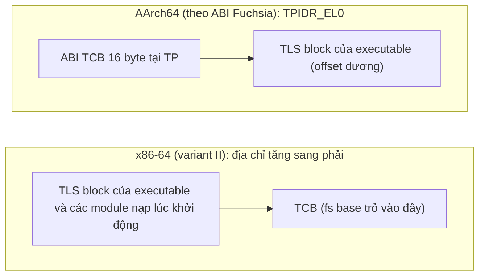
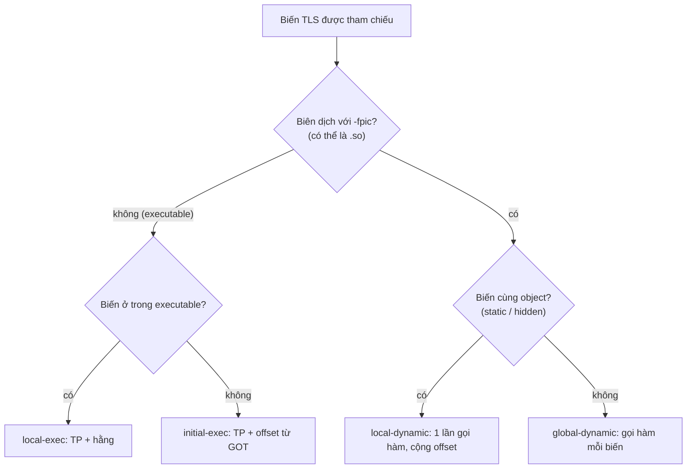
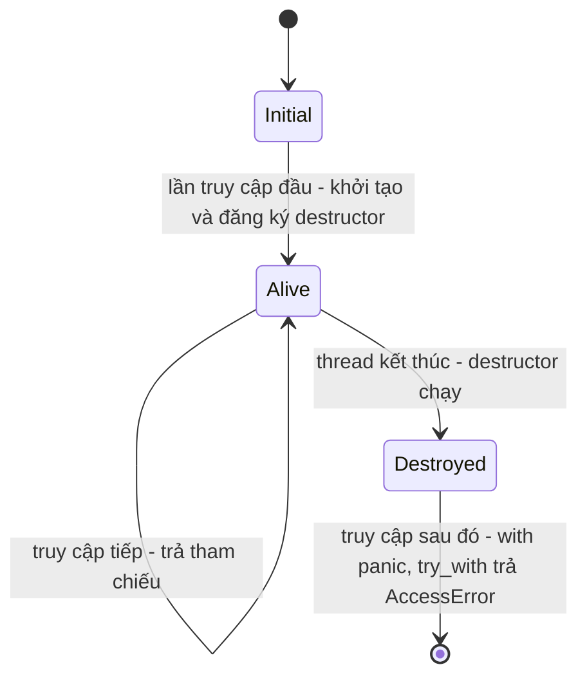

# P4 · Chương 09 — Thread-local storage

> Phạm vi: Linux (glibc), x86-64 và AArch64, Rust 1.95.0. Chương này **không có thí nghiệm**: mọi khẳng định lấy từ tài liệu và mã nguồn đã đọc (ghim phiên bản). Các đoạn code chỉ để minh họa cơ chế, không kèm kết quả chạy. Chi tiết cài đặt trong std (tên module, struct) là *chi tiết cài đặt* của bản 1.95.0 và có thể đổi; hợp đồng thật là phần docs của `LocalKey`/`thread_local!`.

## Bạn sẽ hiểu được gì

1. **Q1.** Vì sao cần "biến toàn cục nhưng mỗi thread một bản" (ví dụ `errno`), và nó khác biến trên stack ở đâu? → mục 1
2. **Q2.** `__thread`/`_Thread_local` khác `pthread_key_create` thế nào, và vì sao ELF TLS ra đời? → mục 2
3. **Q3.** Compiler, linker, loader và kernel dựng vùng TLS ra sao: `.tdata`/`.tbss`, thread pointer (`%fs` trên x86-64, `TPIDR_EL0` trên AArch64)? → mục 3
4. **Q4.** Bốn TLS model (global-dynamic, local-dynamic, initial-exec, local-exec) khác nhau gì, và truy cập một biến TLS tốn bao nhiêu việc? → mục 4
5. **Q5.** `thread_local!` của Rust: `LocalKey::with`/`set`/`take`, `const { }`, và std chọn cài đặt nào bên dưới? → mục 5
6. **Q6.** Điều gì xảy ra với TLS khi thread kết thúc: destructor chạy lúc nào, thứ tự nào, và truy cập sau khi bị hủy thì sao (`AccessError`)? → mục 6
7. **Q7.** Vì sao không dùng TLS cho trạng thái của một task async, và `tokio::task_local!` giải quyết gì? → mục 7

## Kiến thức cần trước

- [Chương 01 — Thread](01-thread.md): thread chung address space, riêng stack/thanh ghi; mục 6 của chương đó giới thiệu TLS ở mức ngắn, chương này đi sâu.
- [Chương 08 — Concurrency trong Rust](08-rust-concurrency.md): `Send`/`Sync`, `Cell`/`RefCell` (mục 5 của chương đó), vì sao `thread_local!` chỉ phát `&T`.
- [Chương 08 (Phase 7) — Tokio](../07-io-async/08-tokio.md): multi-thread scheduler, task có thể chạy ở thread khác nhau (cần cho mục 7).

## 1. Vì sao cần biến riêng mỗi thread (Q1)

> **Trả lời ngắn.** Các thread trong một process dùng chung một vùng nhớ, nên biến global bình thường không thể có giá trị khác nhau ở từng thread; muốn vậy phải có cơ chế riêng[^pkc-need]. `errno` là ví dụ quen nhất: nó là thread-local để thread này đặt `errno` không đè lên thread khác[^errno-tl]. TLS (thread-local storage) là cách khai báo loại "biến global theo thread" đó, mỗi thread đang tồn tại có đúng một bản[^gcc-tls].

**Giải thích.**

*Với service của bạn.* Hãy hình dung `orders`, một HTTP service viết bằng Rust, chạy trên Linux, với một pool vài chục handler thread; mỗi request do một thread xử lý từ đầu đến cuối (ví dụ giả định của người soạn, không phải code trong repo). Mỗi handler cần vài thứ chỉ của riêng nó: mã lỗi của syscall vừa gọi, một buffer tạm để dựng response, request id để ghi log. Ta không muốn truyền chúng qua mọi hàm, và càng không muốn thread này ghi đè lên thread kia. Cả chương bám theo ba thứ đó để hỏi: các thread của `orders` chung một vùng nhớ, vậy "mỗi thread một bản" được dựng ra bằng cách nào?

### 1.1 Vì sao biến thường không làm được

Hai handler thread của `orders` chạy cùng một hàm và cùng thấy một biến `static`, nghĩa là cùng thấy một ô nhớ. Vì thread chung vùng nhớ nên biến global hay static thông thường không thể mang giá trị riêng cho từng thread[^pkc-need]. Cách làm thủ công là truyền một con trỏ "ngữ cảnh" qua mọi hàm. Cách đó đúng, nhưng chữ ký của mọi hàm trung gian phải đổi theo (nhận xét của người soạn).

### 1.2 Ví dụ `errno`

Ví dụ kinh điển là `errno`. Trong code nó trông như một biến global, nhưng man page ghi rõ nó là thread-local: đặt ở thread này không ảnh hưởng giá trị ở thread khác[^errno-tl]. Nếu nó là biến chung thật sự, hai handler của `orders` cùng gặp lỗi syscall sẽ ghi đè mã lỗi của nhau (suy luận của người soạn; xem thêm [chương 01, mục 6](01-thread.md)). Drepper cũng lấy chính `errno` làm ví dụ: TLS không chỉ có ích cho chương trình người dùng, bản thân môi trường chạy (run-time environment) cũng cần nó[^drepper-errno].

### 1.3 TLS khác biến trên stack ở đâu

Biến cục bộ trên stack vốn đã riêng cho từng thread; Drepper còn nói gắn `__thread` lên biến automatic là vô nghĩa, vì biến automatic luôn là thread-local[^drepper-auto]. Cái TLS thêm vào là *tuổi thọ*. Một object `_Thread_local` sống suốt thời gian chạy của thread[^c11-thread-local], chứ không chết khi hàm trả về. Về cú pháp, GCC chỉ cho `__thread` đứng ở mức global hoặc static, không cho dùng với biến automatic trong một khối[^gcc-where].

Với `orders`, khác biệt đó nghĩa là: buffer dựng response nếu là biến cục bộ thì mỗi request phải cấp phát lại, còn nếu là TLS thì handler thread giữ nó và tái dùng qua mọi request của mình (nhận xét của người soạn). Những chỗ tương tự trong backend: bộ sinh số ngẫu nhiên hoặc ID theo thread, bộ đếm metric theo thread rồi gộp sau, request id cho log trong server thread-per-request (nhận xét của người soạn).

<details><summary>Đi sâu: hai nghĩa của "thread-local" và vì sao con trỏ tới TLS không được mang đi</summary>

- "Thread-local" có hai nghĩa dễ lẫn: (1) biến cục bộ trên stack của thread; (2) biến có *thời gian sống theo thread*, khai báo như global. Chương này nói nghĩa (2), như chương 01 mục 6.
- Trong C, storage class `_Thread_local` được đề xuất ở N1364 của WG14 (2008): mỗi thread có một object riêng, và tên biến trong biểu thức chỉ object gắn với thread đang đánh giá biểu thức đó[^c-thread-local]. (Đây là văn bản đề xuất, không phải văn bản ISO chính thức; đoạn tương ứng của C11 là mục 6.2.4 đoạn 4 trong draft N1570[^c11-thread-local].)
- GCC nói rõ hệ quả thực tế: toán tử `&` trên biến thread-local được tính lúc chạy và trả địa chỉ của bản thuộc thread hiện tại[^gcc-addr]. Thread khác có thể dùng địa chỉ đó, nhưng khi thread chủ nhân kết thúc thì mọi con trỏ tới biến thread-local của nó thành không hợp lệ[^gcc-ptr-invalid].
- Rust đẩy ràng buộc tương tự xuống type system (nhận xét của người soạn): `LocalKey::with` đưa ra một tham chiếu không được sống lâu hơn thread hiện tại và không được thoát khỏi closure[^rs-with-ref] (mục 5).

</details>

**Quay lại Q1:** thread dùng chung bộ nhớ nên biến global thường không thể riêng theo thread; TLS cho mỗi thread một bản của cùng một biến, sống suốt đời thread, và `errno` là ví dụ không thể thiếu. Trong `orders`, đó là chỗ để buffer, bộ đếm và request id của từng handler.

## 2. `__thread`/`_Thread_local` và pthread keys (Q2)

> **Trả lời ngắn.** Có hai cách. Cách cũ của POSIX là *thread-specific data* (TSD): bạn xin một "key" bằng `pthread_key_create`, mỗi thread gắn một con trỏ `void *` vào key đó bằng `pthread_setspecific` rồi đọc lại bằng `pthread_getspecific`[^pkc-tsd]. Cách mới giao việc cho toolchain: bạn viết `__thread` (GCC) hoặc `_Thread_local` (C11) trước khai báo biến, còn compiler, linker và dynamic loader lo phần còn lại[^drepper-thread-kw]. Cách mới đỡ việc thủ công hơn nhưng cần linker, dynamic linker và libc hỗ trợ, nên không có sẵn ở mọi nơi[^gcc-needs-support].

**Giải thích.**

*Với service của bạn.* Giả sử một thư viện C trong `orders` cần buffer riêng cho mỗi handler thread, như ở mục 1. Hệ thống có hai cách đáp ứng, và chúng khác nhau ở chỗ ai gánh việc quản lý: bạn hay toolchain. Mục này so hai cách; mục 3 và 4 cho thấy toolchain làm gì khi nó gánh.

### 2.1 Cách 1: pthread key

Với pthread key, mỗi handler thread có một vùng nhớ riêng gọi là TSD area. Hình dung đơn giản: vùng đó là một mảng con trỏ `void *`, còn key là chỉ số mảng[^pkc-array]. Key dùng chung cho mọi thread, nhưng giá trị gắn với key thì mỗi thread một khác[^pkc-keys-common]. Thread mới tạo có `NULL` ở mọi key[^pkc-null].

```c
// minh họa (không có output để khẳng định)
static pthread_key_t key;
static void free_buf(void *p) { free(p); }   // destructor khi thread kết thúc

void init(void)        { pthread_key_create(&key, free_buf); }
char *buf(void) {
    char *p = pthread_getspecific(key);
    if (!p) { p = malloc(4096); pthread_setspecific(key, p); }  // tự cấp phát lần đầu
    return p;
}
```

Đọc đoạn code trên sẽ thấy bạn phải tự làm khá nhiều việc: tạo key đúng một lần trước khi thread nào dùng nó, tự cấp phát giá trị ở lần truy cập đầu của từng thread (vì thread mới chỉ có `NULL`), tự ép kiểu `void *`, và tự xóa key khi hết dùng (nhận xét của người soạn). Drepper mô tả đúng nỗi đau này: key phải được cấp phát động lúc chạy, và phải được giải phóng khi không dùng nữa[^drepper-motivation].

### 2.2 Cách 2: `__thread` và `_Thread_local`

Cách thứ hai chỉ cần một từ khóa trước khai báo:

```c
// minh họa
__thread int counter;               // GCC
static _Thread_local char *cur;     // C11
```

Biến khai báo như vậy tự động được cấp phát cục bộ cho từng thread[^drepper-thread-kw]. Không có key để tạo hay xóa, không có `void *` để ép kiểu, và giá trị khởi đầu do toolchain lo. Cái giá là phải có hỗ trợ ở nhiều tầng, như đã nói ở câu trả lời ngắn; các mục sau cho thấy hỗ trợ đó cụ thể là gì.

Đọc cũng nhanh hơn, nhưng đây là suy luận của người soạn từ mục 3–4: `pthread_getspecific` là một lời gọi hàm tra bảng theo key lúc chạy, còn biến `__thread` có vị trí cố định so với thanh ghi thread pointer nên thường truy cập bằng vài lệnh. Mục 4 trình bày các mã máy thật do Drepper liệt kê.

<details><summary>Đi sâu: vòng đời giá trị TSD, giới hạn của hai cách và vì sao pthread key vẫn còn dùng</summary>

- Nếu `destr_function` của key khác `NULL`, nó được gọi với giá trị của key trong thread đó khi thread kết thúc qua `pthread_exit` hoặc bị cancel, và không được gọi nếu giá trị là `NULL`[^pkc-destr]. Thread kết thúc bằng cách `return` khỏi hàm khởi động thì tương đương gọi `pthread_exit`[^pc-return]. Chi tiết destructor nằm ở mục 6.
- Số key tối đa tại một thời điểm bị giới hạn bởi `PTHREAD_KEYS_MAX`[^pkc-max]. `pthread_getspecific` trả `NULL` khi lỗi[^pkc-get-null]. `pthread_key_delete` **không** gọi destructor của key[^pkc-delete].
- `__thread` ở C++ có giới hạn: nếu biến có initializer thì phải là constant-expression[^gcc-cpp-init]. Drepper cũng nêu giới hạn lớn nhất là biến thread-local trong C++ không được cần static constructor[^drepper-cpp]. Ngoài ra không initializer tĩnh nào được tham chiếu địa chỉ của một biến thread-local[^gcc-no-static-addr].
- Pthread key là API runtime thuần C: man page chỉ mô tả hàm và vùng TSD, không đòi linker hay loader hỗ trợ ELF TLS (suy luận của người soạn), nên nó dùng được cả khi không có TLS native. Rust std đi hướng đó ở các target mà OS chỉ có thư viện TLS: dữ liệu được cấp phát heap và tham chiếu qua một TLS key[^rs-impl-os] (mục 5).

</details>

**Quay lại Q2:** pthread key là TSD tự quản lý bằng `void *`, còn `__thread`/`_Thread_local` đẩy việc cho toolchain bằng ELF TLS; cả hai cùng mục đích, nhưng cách sau gọn hơn và cần linker/loader hỗ trợ.

## 3. Vùng TLS được dựng thế nào: `.tdata`, `.tbss`, thread pointer (Q3)

> **Trả lời ngắn.** Compiler đặt biến thread-local vào section `.tdata` (biến có giá trị khởi tạo) hoặc `.tbss` (biến không có)[^drepper-tdata]. Hai section này chỉ là một *ảnh khởi tạo*: mỗi thread khi được tạo sẽ nhận một bản sao riêng[^drepper-image]. Để tìm bản của thread đang chạy, mỗi thread có một **thread pointer** nằm trong một thanh ghi cố định, và biến TLS được định vị bằng offset so với nó[^drepper-var1]. Trên x86-64 thanh ghi đó là base của `%fs`[^drepper-x64]. Trên AArch64 nó là `TPIDR_EL0`[^fuchsia-tp].

**Giải thích.**

*Với service của bạn.* Mỗi lần pool của `orders` tạo thêm một handler thread, thread đó phải có ngay buffer và bộ đếm riêng ở giá trị khởi đầu, và code của nó phải tìm được chúng mà không tốn công. Bốn việc làm nên điều đó: toolchain gom biến TLS vào section riêng; loader sao ảnh khởi tạo cho từng thread; CPU giữ một thanh ghi trỏ vào vùng của thread đang chạy; và kernel nạp thanh ghi ấy cho đúng thread. Mục này đi qua từng việc. Đây là cơ chế ELF mà C/C++ dùng; mục 5 mới nói Rust đứng ở đâu trên nó.

### 3.1 Toolchain: tách biến TLS khỏi dữ liệu thường

Thay vì `.data` và `.bss`, biến thread-local nằm trong `.tdata` và `.tbss`[^drepper-tdata]. Linker nhận ra chúng theo kiểu section và cờ `SHF_TLS` chứ không theo tên[^drepper-by-flag]. Symbol của biến TLS dùng một kiểu riêng, `STT_TLS`, vì biến TLS không có *một* địa chỉ duy nhất để ghi vào bảng symbol[^drepper-sttls].

### 3.2 Loader: sao ảnh khởi tạo cho từng thread

Chương trình đang chạy không đọc ghi trực tiếp `.tdata`: nội dung của nó chỉ là mẫu. Với mỗi thread, kể cả thread đầu tiên, hệ thống cấp một vùng nhớ mới rồi sao ảnh khởi tạo vào đó, nên mọi handler thread của `orders` bắt đầu với cùng điều kiện đầu[^drepper-image].

### 3.3 Thread pointer: tìm vùng của thread đang chạy

Mỗi thread có một thanh ghi *thread pointer* riêng. Chỗ nó trỏ tới là *Thread Control Block* (TCB), cấu trúc điều khiển của thread; còn TLS block của executable và các module nạp lúc khởi động (module là executable hoặc một `.so`) nằm ở vị trí cố định so với chỗ đó. Drepper định nghĩa hai cách bố trí. Ở *variant I*, TLS block nằm ngay sau TCB, nên offset từ thread pointer là hằng sau khi chương trình khởi động[^drepper-var1]. Ở *variant II*, thread pointer trỏ tới một TCB có kích thước không cố định, còn TLS block của executable và các module nạp lúc khởi động nằm ngay **dưới** (địa chỉ thấp hơn) chỗ thread pointer trỏ tới[^drepper-var2].

**x86-64** dùng thanh ghi segment `%fs` làm thread pointer (IA-32 dùng `%gs`)[^drepper-x64]. TLS block của các module lúc khởi động bố trí theo variant II[^s2-drepper-x64-var2]. Mã máy đọc thread pointer là nạp `%fs:0`: truy cập offset 0 qua segment này cho ra địa chỉ TCB[^drepper-x64-ie].

**AArch64** dùng thanh ghi hệ thống `TPIDR_EL0` làm thread pointer, đọc bằng `mrs <reg>, TPIDR_EL0`[^fuchsia-tp]. Bố cục vùng TLS trên AArch64 khác x86-64; so sánh hai bên nằm trong phần Đi sâu cuối mục.

### 3.4 Kernel: nạp thread pointer cho đúng thread

Khi tạo thread bằng `clone(2)`, cờ `CLONE_SETTLS` đặt "TLS descriptor". Trên x86-64 giá trị truyền vào là giá trị mới của base `%fs` (như `ARCH_SET_FS` của `arch_prctl(2)`); trên kiến trúc có thanh ghi TLS riêng thì là giá trị mới của thanh ghi đó[^clone-settls]. Man page `clone` cảnh báo cờ này đòi hiểu biết sâu và thường chỉ thư viện thread dùng[^clone-settls-note].

Thread pointer là trạng thái riêng của từng thread, nên kernel còn phải nạp lại nó mỗi khi đổi thread. Trong bản mã arm64 v6.8, kernel lưu `tpidr_el0` của thread đang chạy[^arm64-switch-save]. Rồi trong `tls_thread_switch` nó ghi `tpidr_el0` của thread kế tiếp vào thanh ghi[^arm64-switch-write].

<details><summary>Đi sâu: bố cục AArch64 so với x86-64, <code>arch_prctl</code>, và TLS cho thư viện nạp động</summary>

**TCB và dtv.** Ở variant I, TCB chứa ở offset 0 một con trỏ tới *dynamic thread vector* (dtv), và dtv chứa con trỏ tới TLS block của từng module[^drepper-tcb-dtv]. Variant I phát triển cùng ABI IA-64[^drepper-var1-ia64]. Lúc khởi động process, TCB cùng dtv được tạo cho main thread[^drepper-main-tcb].

**AArch64 so với x86-64.** Tài liệu Fuchsia mô tả offset local-exec khác nhau giữa hai kiến trúc. AArch64 có `TPOFF = max(16, p_align) + <offset trong segment>` (cộng dương: TLS nằm sau thread pointer, chừa 16 byte "ABI TCB"). x86_64 có `TPOFF = -<offset tính từ cuối segment>`, một số âm[^fuchsia-tpoff]. Đó là ABI của Fuchsia. Với Linux/glibc, header `sysdeps/aarch64/nptl/tls.h` (glibc 2.36) nói thread pointer trỏ tới đầu các thread block[^glibc-aarch64-layout]. Header x86-64 thì để TCB ở vùng nhớ ngay sau địa chỉ thread pointer trỏ tới[^glibc-x64-layout]. Hai header chọn hai bố cục khác nhau, đúng như hai sơ đồ dưới đây (suy luận của người soạn).

Tài liệu Drepper v0.21 **không** có phần AArch64/ARM: mục "Architecture Specific Definitions" của nó chỉ liệt kê IA-64, IA-32, SPARC, SH, Alpha, x86-64, s390 và s390x (nhận xét của người soạn sau khi đọc và tìm chuỗi "ARM" trong văn bản đã tải). Vì vậy chương này không dùng tên "variant I/II" của Drepper cho AArch64.



(Sơ đồ rút gọn: x86-64 theo Drepper, các block của executable và module nạp lúc khởi động nằm *dưới* chỗ thread pointer trỏ tới[^drepper-var2]; không vẽ thứ tự giữa các block. AArch64 theo Fuchsia, thread pointer trỏ vào 16 byte đầu rồi TLS block của executable nằm ở offset dương[^fuchsia-tpoff]. Không vẽ dtv.)

**`arch_prctl`.** `arch_prctl(ARCH_SET_FS, addr)` đặt base 64-bit của `FS` thành `addr`[^arch-set-fs]. Man page cảnh báo `FS` có thể đã được thư viện thread dùng, nên chương trình tự dùng `ARCH_SET_FS` "rất có thể sẽ crash"[^arch-fs-warn]. Nói cách khác, đừng tự đụng vào `%fs` trong chương trình thường.

**Thư viện nạp động.** Tài liệu Fuchsia gọi "Static TLS set" là các module mà dynamic linker biết lúc khởi động, gồm executable chính và mọi thư viện được đề cập qua `DT_NEEDED`[^fuchsia-static-set]. Module nạp sau bằng `dlopen` thì khác: với model dynamic, việc tính địa chỉ biến được dời cho hàm runtime `__tls_get_addr` (mục 4), và hàm này cũng có thể cấp phát, khởi tạo vùng nhớ nếu chưa có[^drepper-dyn-defer].

</details>

**Quay lại Q3:** `.tdata`/`.tbss` là ảnh khởi tạo được sao cho mỗi thread; thread pointer (`%fs` base trên x86-64, `TPIDR_EL0` trên AArch64) trỏ vào vùng TLS của thread; kernel gán và nạp lại nó theo thread (`CLONE_SETTLS`, context switch), còn biến TLS được tìm bằng offset từ thread pointer.

## 4. Bốn TLS model và chi phí truy cập (Q4)

> **Trả lời ngắn.** Bốn model — global-dynamic, local-dynamic, initial-exec, local-exec — là một dải đánh đổi giữa *tổng quát* và *nhanh*. Drepper coi chúng là một phần của ABI và xếp vào hai nhóm dynamic và static[^drepper-four-cat]. Global-dynamic tổng quát nhất, và nó gọi một hàm runtime để tìm địa chỉ[^drepper-gd]. Local-exec nhanh nhất[^s2-fuchsia-le-fastest]. Offset của nó là hằng số biết ngay lúc link[^drepper-le-imm]. Compiler chọn model theo ngữ cảnh và các cờ như `-fpic`, `-ftls-model`[^gcc-model-opt].

**Giải thích.**

*Với service của bạn.* Mỗi request, handler của `orders` đọc buffer TLS của mình vài lần. Một lần đọc tốn bao nhiêu việc? Câu trả lời phụ thuộc vào chỗ đoạn code đọc nằm ở đâu: trong chính executable `orders`, hay trong một thư viện `.so` mà `orders` nạp (libc, một driver…; ví dụ giả định của người soạn). Mục này giải thích vì sao vị trí đó đổi chi phí.

Có một cách nhìn gọn (cách tóm tắt của người soạn). Để tìm biến TLS của thread hiện tại, code cần hai thông tin: biến nằm trong module nào (module ID), và nằm ở offset nào trong TLS block của module đó. Bốn model khác nhau ở chỗ thông tin nào đã biết sẵn lúc link, thông tin nào đến lúc chạy mới có.

Phần lớn thông tin đó do dynamic linker (chương trình nạp executable và các `.so` lúc khởi động) điền vào bằng *relocation*, tức bước điền giá trị thật vào những chỗ còn để trống lúc link. Với một symbol TLS, kết quả relocation là một module ID và một offset trong TLS block[^drepper-reloc-got]. Chúng nằm trong các ô của GOT (Global Offset Table), bảng mà dynamic linker điền lúc chạy để code chỉ việc đọc ra (giải thích của người soạn).

### 4.1 Global-dynamic (GD)

Đây là model tổng quát nhất: code dùng được ở mọi nơi và truy cập được biến định nghĩa ở bất kỳ đâu[^drepper-gd]. Compiler dùng nó theo mặc định, chỉ chuyển sang model hạn chế hơn khi được yêu cầu hoặc khi làm vậy an toàn[^drepper-gd-default]. Module ID và offset do dynamic linker xác định lúc chạy rồi truyền cho `__tls_get_addr`; hàm này tính xong sẽ trả địa chỉ biến cho thread hiện tại[^drepper-gd-values]. Cái giá là kích thước code và thời gian chạy, đủ lớn để Drepper viết rằng nên tránh model này bất cứ khi nào có thể[^drepper-gd-cost]. Đổi lại, vì mỗi lần truy cập đều đi qua hàm nên runtime hoãn được việc cấp phát TLS block đến lần dùng đầu[^drepper-gd-defer]. Mã x86-64:

```asm
; x86-64 general dynamic (Drepper): 16 byte, prefix chỉ để đệm cho đủ 16 byte
.byte 0x66
leaq  x@tlsgd(%rip),%rdi
.word 0x6666
rex64
call  __tls_get_addr@plt
```

Hàm này trên x86-64 chỉ nhận một tham số, là địa chỉ cấu trúc `tls_index` (module ID, offset) nằm ở hai ô liên tiếp trong GOT[^drepper-x64-gd]. (`@plt` là cách gọi một hàm nằm ở thư viện khác qua bảng PLT của dynamic linker; chương này không đào sâu — nhận xét của người soạn.) Phần đệm trong chuỗi lệnh dành chỗ để linker có thể thay nó bằng chuỗi initial-exec dài hơn 4 byte[^drepper-x64-pad].

### 4.2 Local-dynamic (LD)

LD là một tối ưu của GD. Compiler dùng được nó khi nhận ra biến thread-local được định nghĩa ngay trong cùng object với chỗ tham chiếu, ví dụ biến `static` cấp file[^drepper-ld]. Khi đó offset đã biết lúc link, chỉ còn module ID chưa biết, nên code vẫn phải gọi `__tls_get_addr` để lấy module ID và cấp phát TLS block nếu cần[^drepper-ld-call]. Truyền offset 0 thì hàm trả địa chỉ đầu TLS block của module, rồi code cộng offset của từng biến.

Lợi ích chỉ xuất hiện khi có nhiều biến. Trên x86-64, nếu chỉ truy cập một biến theo cách này thì LD không hơn GD[^drepper-x64-ld]. Với nhiều biến, ta vẫn chỉ có một lần gọi hàm và mỗi biến chỉ thêm một phép cộng[^drepper-ld-gain]. Tối ưu từ GD xuống LD phải do compiler làm vì code khác hẳn, linker không làm hộ được[^drepper-ld-compiler].

```asm
; x86-64 local dynamic: một lần gọi, nhiều biến cộng offset
leaq  x1@tlsld(%rip),%rdi
call  __tls_get_addr@plt
...
leaq  x1@dtpoff(%rax),%rcx
leaq  x2@dtpoff(%rax),%r9
```

### 4.3 Initial-exec (IE)

IE dùng khi biến nằm trong một module có sẵn lúc chương trình khởi động và lập trình viên chọn model *static*. Code kiểu này không gọi `__tls_get_addr`, nên không hoãn cấp phát được cho các block đó[^drepper-ie-nocall]. Nó chạy được vì sau khi dynamic linker nạp mọi module ban đầu, TLS block của chúng nằm liên tiếp nhau, nên mỗi biến có offset cố định so với TCB[^drepper-ie-fixed]. Mỗi biến chỉ cần một relocation cho ô GOT, không cần module ID, nên số relocation lúc chạy giảm một nửa so với GD[^drepper-ie-reloc]. Mã x86-64 dưới đây đọc thread pointer từ `%fs:0` rồi cộng offset nạp từ GOT[^drepper-x64-ie].

```asm
; x86-64 initial exec
movq  %fs:0,%rax
addq  x@gottpoff(%rip),%rax      ; offset (R_X86_64_TPOFF64) do dynamic linker điền vào GOT
```

### 4.4 Local-exec (LE)

LE hạn chế nhất: chỉ dùng cho code trong executable và biến trong executable[^drepper-le-restrict]. Vì chỉ dùng TLS block đầu tiên (của executable), linker biết offset so với TCB ngay lúc tạo executable, và kết quả là số hằng nhúng thẳng vào lệnh[^drepper-le-imm]. Mã x86-64 dưới đây đọc thread pointer rồi cộng offset là immediate[^drepper-x64-le].

```asm
; x86-64 local exec
movq  %fs:0,%rax
leaq  x@tpoff(%rax),%rax         ; offset (R_X86_64_TPOFF32) biết lúc link
```

Tài liệu Fuchsia nói thêm rằng linker có thể nới (relax) từ initial-exec xuống local-exec, còn compiler thì không tự làm được vì không biết đang biên dịch cho executable hay shared library, trừ khi được chỉ định bằng `-ftls-model` hoặc `__attribute__((tls_model(...)))`[^fuchsia-le].

### 4.5 Tóm lại: so sánh và cách compiler chọn

| Model | Dùng khi biến ở đâu | Cách tìm địa chỉ | Hoãn cấp phát block? |
|---|---|---|---|
| global-dynamic | bất kỳ module nào | gọi `__tls_get_addr` ở chỗ truy cập[^drepper-gd-values] | có |
| local-dynamic | cùng object với chỗ tham chiếu | 1 lần gọi `__tls_get_addr`, cộng offset mỗi biến[^drepper-ld-gain] | có |
| initial-exec | module có sẵn lúc khởi động | thread pointer + offset đọc từ GOT[^drepper-ie-reloc] | không |
| local-exec | chỉ executable | thread pointer + hằng số[^drepper-le-imm] | không (không gọi hàm) |

(Cột cuối tóm tắt các mục 4.1–4.4: việc hoãn cấp phát của GD, LD và IE có nguồn ở đó; LE "không" là suy luận của người soạn vì model này không dùng hàm nào.)

Với GCC, `-ftls-model=` chọn một trong bốn model, nhưng lựa chọn còn chịu tối ưu: compiler có thể dùng model hiệu quả hơn cho symbol không nhìn thấy ngoài translation unit, hoặc khi không có `-fpic`[^gcc-model-opt]. Mặc định, thư viện nạp động (`-fpic`) dùng global-dynamic còn executable (không `-fpic`) dùng initial-exec[^gcc-model-default].



(Sơ đồ rút gọn, tổng hợp của người soạn theo mô tả của GCC và Drepper ở trên; thực tế còn bị chi phối bởi `-ftls-model`, ELF visibility và việc linker nới model[^fuchsia-le].)

Về chi phí, ta chỉ rút được kết luận định tính từ các mã máy trên (suy luận của người soạn; nguồn không có số đo nên chương này không đưa nanosecond). GD tốn một lời gọi hàm mỗi lần truy cập, có thể nhiều lần nếu nhiều biến. IE tốn đọc thread pointer, một lần load từ GOT và một phép cộng. LE chỉ đọc thread pointer rồi cộng hằng số. Biến TLS thường nhanh vì vậy, nhưng "thường" phụ thuộc model: code trong `.so` hoặc nạp bằng `dlopen` có thể chậm hơn code nằm trong executable.

<details><summary>Đi sâu: <code>-ftls-model=initial-exec</code> trong <code>.so</code>, và AArch64</summary>

- Drepper nêu rằng model static (IE) không dùng `__tls_get_addr` nên không hoãn cấp phát được cho các block truy cập kiểu này, nhưng vẫn có thể hoãn cấp phát cho module nạp động[^drepper-ie-defer-dyn]. Hệ quả thực tế (suy luận của người soạn): một `.so` biên dịch với IE phải chắc chắn được nạp lúc khởi động, nên không phải thư viện nào cũng nên chọn model này.
- Các bảng mã máy ở trên là x86-64 do Drepper liệt kê (phiên bản 0.21, 2013), và tài liệu đó không có phần AArch64. Đặc tả ELF cho AArch64 của Arm có bảng relocation riêng cho TLS, chia các mục General Dynamic, Local Dynamic, Initial Exec và Local Exec[^aarch64-models]. Nó còn có thêm biến thể TLS descriptor mà linker có thể nới sang initial-exec hoặc local-exec[^aarch64-tlsdesc]. AArch64 đọc thread pointer từ `TPIDR_EL0` bằng `mrs`[^fuchsia-tp]; chương này không liệt kê chuỗi lệnh AArch64 vì chưa đọc nguồn có chuỗi đó.

</details>

**Quay lại Q4:** bốn model là một dải từ tổng quát/chậm (GD: gọi `__tls_get_addr`) đến hẹp/nhanh (LE: thread pointer + hằng); compiler chọn theo `-fpic`, visibility và `-ftls-model`, nên cùng một biến TLS có thể rẻ trong executable `orders` và đắt hơn trong một shared library.

## 5. `thread_local!` của Rust: API và cài đặt (Q5)

> **Trả lời ngắn.** `thread_local!` khai báo một `LocalKey<T>`, tức một khóa TLS sở hữu giá trị bên trong[^rs-localkey-owns]. Giá trị được khởi tạo lười ở lần truy cập đầu của mỗi thread[^rs-init]. Bạn chỉ lấy được `&T` qua `with`, nên muốn sửa thì bọc giá trị trong `Cell` hoặc `RefCell`[^rs-only-shared]. Nếu khởi tạo là hằng, hãy viết `const { ... }` để std dùng cài đặt hiệu quả hơn và bỏ được khởi tạo lười[^rs-const].

**Giải thích.**

*Với service của bạn.* Trong `orders` viết bằng Rust, hai trong ba thứ ở mục 1 thành hai khai báo `thread_local!`: một bộ đếm số request mỗi handler đã xử lý, và một buffer dựng response.

```rust
use std::cell::{Cell, RefCell};

thread_local! {
    // số request thread này đã xử lý; const { }: khởi tạo hằng, không cần khởi tạo lười
    static HANDLED: Cell<u64> = const { Cell::new(0) };
    // buffer dựng response; khởi tạo lười, chạy ở lần truy cập đầu của mỗi thread
    static SCRATCH: RefCell<Vec<u8>> = RefCell::new(Vec::with_capacity(4096));
}

fn handle() {
    HANDLED.set(HANDLED.get() + 1);             // LocalKey<Cell<T>>: get / set
    SCRATCH.with_borrow_mut(|b| b.clear());     // LocalKey<RefCell<T>>: with_borrow_mut
}
```

### 5.1 API của `LocalKey`

`with(|v| ...)` đưa `&T` cho closure, và khởi tạo lười nếu thread chưa từng chạm vào key[^rs-with-lazy]. `try_with` giống `with` nhưng trả `Result<R, AccessError>` thay vì panic khi key đã bị hủy[^rs-try-with]. Bình thường bạn ít gọi hai hàm này trực tiếp, vì `LocalKey` có sẵn các phương thức tiện cho hai kiểu bọc hay dùng.

Với `LocalKey<Cell<T>>` có thêm `set`, `get` (cần `T: Copy`), `replace`, và `take` (cần `T: Default`, để lại `Default::default()` tại chỗ)[^rs-take]. Với `LocalKey<RefCell<T>>` có `with_borrow` và `with_borrow_mut`[^rs-with-borrow-mut], cùng `set`, `take`, `replace`. `RefCell` vẫn kiểm tra mượn lúc chạy: `with_borrow` panic nếu giá trị đang bị mượn mutable[^rs-borrow-panic].

### 5.2 Hai chỗ dễ vấp

Chỗ thứ nhất là `set`. Khác các phương thức còn lại, `set` không chạy initializer lười: nếu key chưa khởi tạo, nó khởi tạo thẳng bằng giá trị bạn đưa vào[^rs-set-skip]. Docs lấy ví dụ `static X: Cell<i32> = panic!("!")`: `X.get()` sẽ panic nhưng `X.set(123)` thì ổn[^rs-set-example].

Chỗ thứ hai là initializer đệ quy. Initializer của một `LocalKey` không được phụ thuộc đệ quy vào chính nó; làm vậy có thể gây panic, abort hoặc đệ quy vô hạn ở lần gọi `with` đầu tiên[^rs-recursive].

### 5.3 Vì sao chỉ phát `&T`

Dữ liệu thread-local không có race với thread khác, nhưng vẫn có thể có nhiều tham chiếu tới nó ở nhiều chỗ trên call stack của chính thread đó. Vì vậy `LocalKey` chỉ phát tham chiếu chia sẻ; muốn `&mut T` thì dùng `Cell` hoặc `RefCell`[^rs-only-shared]. Đây chính là chủ đề interior mutability của [chương 08, mục 5](08-rust-concurrency.md). Trong `orders`, đó là lý do `SCRATCH` bọc `RefCell` và `HANDLED` bọc `Cell`.

### 5.4 `const { }` thay đổi gì

Cú pháp `const {}` dùng khi biểu thức khởi tạo tính được như hằng. Nó có thể bật một cài đặt TLS hiệu quả hơn, tránh được khởi tạo lười; với kiểu không cần drop thì còn hiệu quả hơn nữa vì không phải theo dõi thêm trạng thái nào[^rs-const]. Vì vậy `HANDLED` ở trên dùng `const { Cell::new(0) }`, còn `SCRATCH` không dùng được (nó cấp phát `Vec`). Mã nguồn 1.95.0 cho thấy bốn trường hợp cụ thể, ở phần Đi sâu.

<details><summary>Đi sâu: ba cài đặt, bảng bốn kiểu lưu trữ và state machine (std 1.95.0, chi tiết cài đặt)</summary>

**Ba cài đặt.** `sys/thread_local` liệt kê ba cách: target không có thread thì dữ liệu để trong `static` thường; target hỗ trợ TLS native qua dynamic linker và C runtime; target mà OS chỉ cung cấp thư viện TLS thì dữ liệu cấp phát heap và tham chiếu qua TLS key[^rs-impl-three]. Chọn lúc biên dịch bằng `cfg_select!`: nhánh `target_thread_local` dùng module `native` (đứng sau một nhánh `no_threads` cho target không có thread), nhánh còn lại dùng `os`[^rs-impl-select]. Cài đặt `os` (dùng key) cấp phát giá trị bằng `System`, để tránh ảnh hưởng một global allocator dùng thread-local[^rs-os-system]. Docs của `LocalKey` nói tương tự: trên nền tảng mà khởi tạo cần cấp phát bộ nhớ, std cấp phát thẳng qua `System`, nhờ đó global allocator có thể dùng chính TLS[^rs-alloc].

Với `x86_64-unknown-linux-gnu`: spec target dựng trên `base::linux`, nơi `has_thread_local` là `true`[^rs-linux-spec]. Rustc bật `cfg(target_thread_local)` khi cờ đó đúng[^rs-cfg-tl]. Nối hai mã nguồn lại thì Linux dùng nhánh `native` (suy luận của người soạn từ chuỗi kế thừa spec `x86_64_unknown_linux_gnu` → `linux_gnu` → `linux`).

**Bốn kiểu lưu trữ native.** Mã nguồn chọn một trong bốn kiểu tùy khởi tạo `const` hay lười và kiểu có `Drop` hay không, như bảng sau[^rs-native-table].

| | `Drop` | `!Drop` |
|---|---|---|
| `const` | `EagerStorage<T>` | `T` |
| lazy | `LazyStorage<T, ()>` | `LazyStorage<T, !>` |

Với `const` + `!Drop`, std dùng thẳng `T`; các trường hợp khác dùng một state machine để quản lý khởi tạo, destructor và hủy[^rs-native-sm]. Mỗi lần truy cập, trạng thái được so sánh: `Initial` thì khởi tạo, chuyển sang `Alive` và (nếu cần) đăng ký destructor; `Alive` thì trả tham chiếu; `Destroyed` thì destructor đã chạy, trả `None`[^rs-native-states]. Đây là nguồn của `AccessError` ở mục 6.



(Sơ đồ theo mô tả trong `native/mod.rs`[^rs-native-states]. Kiểu `!Drop` không có trạng thái `Destroyed`[^rs-native-never].)

**Khớp với bảng.** Macro nội bộ: nhánh `const` kiểm `needs_drop::<T>()` rồi dùng `EagerStorage` nếu có, `#[thread_local] static` thuần nếu không[^rs-native-macro]. Với static mang attribute `#[thread_local]`, backend LLVM của rustc gọi `set_thread_local_mode` theo `tls_model` của session[^rs-codegen-tl]. (Suy luận của người soạn: nghĩa là biến được đặt vào vùng TLS của ELF như ở mục 3 và truy cập theo một trong bốn model ở mục 4; chương này không đọc phần rustc chọn `tls_model` nên không khẳng định model nào được chọn.)

**Hệ quả suy luận được** (suy luận của người soạn, chi tiết cài đặt): với `const { }` và kiểu không `Drop` thì không có trạng thái `Destroyed`, nên không có "sau khi hủy" để lỗi; còn kiểu có `Drop` (kể cả `const`) thì có. Vì vậy `const { Cell::new(0) }` rẻ nhất cho một bộ đếm, còn `RefCell<Vec<_>>` có `Drop` luôn có state machine và destructor.

</details>

**Quay lại Q5:** `thread_local!` cho `LocalKey<T>` phát `&T` (thêm `Cell`/`RefCell` để sửa); khởi tạo lười ở lần truy cập đầu mỗi thread, `const { }` bỏ khởi tạo lười, và dưới đáy std dùng TLS native (`#[thread_local]`) hoặc TLS key tùy target.

## 6. Destructor khi thread kết thúc, thứ tự hủy và truy cập sau khi hủy (Q6)

> **Trả lời ngắn.** Cả TLS của C (pthread key) lẫn của Rust đều chạy destructor khi thread thoát, nhưng *thứ tự* hủy giữa các biến không được hứa: man page pthread ghi là không xác định[^pkc-order]. Hệ quả là destructor của biến này có thể đụng phải biến TLS khác đã bị hủy. Bản `native` của Rust xử lý bằng cách đặt trạng thái `Destroyed` *trước* khi chạy destructor[^rs-eager-set-first]. Vì thế `with` gọi sau đó sẽ panic[^rs-with-panics]. Còn `try_with` trả `AccessError`[^rs-try-with]. Docs Rust còn cảnh báo chỉ "best effort": có tình huống destructor không chạy, chẳng hạn main thread thoát khi TLS dựa trên pthread[^rs-main-thread].

**Giải thích.**

*Với service của bạn.* Khi pool của `orders` co lại, hoặc service tắt, handler thread thoát và TLS của thread đó phải được dọn: buffer, bộ đếm, có thể cả một bộ đệm log chưa flush. Ba điều cần biết là dọn lúc nào, theo thứ tự nào, và chuyện gì xảy ra nếu code dọn biến này lại đọc biến khác đã bị dọn.

### 6.1 Phía C: pthread key

Nếu `destr_function` của key khác `NULL`, nó được gọi với giá trị gắn với key trong thread đó khi thread kết thúc qua `pthread_exit` hoặc bị cancel; nó không được gọi nếu giá trị là `NULL`[^pkc-destr]. Thứ tự gọi destructor giữa các key là không xác định[^pkc-order].

Có thêm một chi tiết dễ bị bỏ qua. Trước khi gọi destructor, giá trị của key trong thread hiện tại được đặt về `NULL`; nhưng destructor lại có thể gán giá trị khác `NULL` cho chính key đó hoặc cho key khác. Nếu sau một vòng vẫn còn giá trị khác `NULL` có destructor thì vòng được lặp lại[^s2-pkc-null-before]. glibc dừng sau `PTHREAD_DESTRUCTOR_ITERATIONS` vòng dù còn giá trị; implementation khác có thể lặp vô hạn[^pkc-iter]. Suy ra (suy luận của người soạn): một destructor "hồi sinh" biến TLS khác có thể bị bỏ sót hoặc lặp lâu, tùy implementation.

### 6.2 Phía Rust: thread thoát thì sao

`LocalKey` khởi tạo lười ở lần dùng đầu, và giá trị có `Drop` được hủy khi thread thoát[^rs-init]. Nếu destructor panic thì cả process bị abort[^rs-dtor-panic]. Ai gọi destructor và theo thứ tự nào trên Linux nằm ở phần Đi sâu cuối mục.

### 6.3 Truy cập sau khi hủy

Bản `native` đặt trạng thái `Destroyed` *trước* khi chạy destructor, vì destructor có thể cố truy cập chính biến đó[^rs-eager-set-first]. Hệ quả cho người dùng API:

- `with`, `set`, `get`, `take`… panic nếu key đang chạy destructor, và *có thể* panic nếu destructor đã chạy rồi trong thread này[^rs-with-panics].
- `try_with` trả `Err(AccessError)` khi key đã bị hủy (có thể xảy ra khi gọi trong destructor)[^rs-try-with]. `AccessError` là kiểu lỗi trả về của `try_with`[^rs-access-error].
- `try_with` vẫn panic nếu key chưa khởi tạo và initializer của nó panic[^rs-try-with-panic].

Thử dựng lại tình huống đó trong `orders`: một handler giữ `LOG` (các dòng log chưa flush) và `FLUSHER`, một giá trị chỉ có việc flush khi bị drop.

```rust
use std::cell::RefCell;

thread_local! {
    static LOG: RefCell<Vec<String>> = RefCell::new(Vec::new());
    static FLUSHER: Flusher = Flusher;
}

struct Flusher;
impl Drop for Flusher {
    fn drop(&mut self) {
        // Khi chạy ở thread exit, LOG có thể đã bị hủy (thứ tự hủy không hứa).
        // `with` sẽ panic -> trong destructor là abort; `try_with` thì lịch sự bỏ qua.
        let _ = LOG.try_with(|l| println!("flush {} dòng", l.borrow().len()));
    }
}
```

(Minh họa; không khẳng định ai bị hủy trước, vì đó chính là điều không được hứa.)

Rút ra quy tắc vận hành (nhận xét của người soạn): đừng để việc quan trọng như flush log, trả connection về pool hay commit chỉ nằm trong `Drop` của TLS; hãy làm tường minh trước khi thread thoát. Docs đã nói rõ std chỉ chạy destructor theo kiểu "cố gắng hết sức", không phải nền tảng nào cũng bảo đảm cho mọi kiểu[^rs-best-effort].

<details><summary>Đi sâu: ai gọi destructor trên Linux, và các trường hợp destructor không chạy hoặc tái khởi tạo</summary>

**Ai gọi destructor của Rust trên Linux.** Với `native`, ở lần truy cập đầu biến khởi tạo, chuyển sang `Alive` và đăng ký destructor[^rs-native-initial]. Trên Linux và vài hệ giống Linux, std ưu tiên dùng `__cxa_thread_atexit_impl` của glibc, cùng symbol mà GCC và clang dùng để chạy destructor của `thread_local` C++[^rs-cxa]. Lý do là nó đúng thứ std cần: lên lịch một callback chạy lúc thread thoát với đối số cho trước[^rs-linux-like]. Std chỉ liên kết symbol này ở dạng *weak* (có thể vắng mặt) và dùng danh sách tự quản làm dự phòng khi thiếu[^rs-linux-weak]. Ở các nền tảng không có cơ chế đăng ký từng destructor, std tự giữ danh sách và chỉ đăng ký một callback chạy toàn bộ danh sách[^rs-dtor-list].

Trong danh sách tự quản đó, vòng lặp lấy phần tử cuối bằng `pop`, và khi hết thì giải phóng bộ nhớ của danh sách[^rs-list-lifo]. Phần tử mới đăng ký được thêm vào cuối mà lấy ra cũng từ cuối, nên thứ tự hủy ngược với thứ tự đăng ký (suy luận của người soạn từ đoạn mã đó). Đó là chi tiết cài đặt chứ không phải hợp đồng; docs `LocalKey` không nêu thứ tự (nhận xét của người soạn). Với nhánh `__cxa_thread_atexit_impl`, thứ tự do glibc quyết; chương này không đọc nguồn glibc phần đó nên không khẳng định.

Mã std còn bọc destructor trong một hàm "không được unwind": nếu callback vẫn unwind thì gọi `rtabort` với thông báo về panic trong thread-local drop[^rs-abort-on-unwind].

**Các caveat docs đã liệt kê.**

- Trên Unix khi dùng TLS dựa pthread, destructor không chạy cho TLS của main thread khi nó thoát (và application thoát ngay sau đó)[^rs-main-thread].
- Trên mọi nền tảng, destructor có thể khởi tạo lại các slot TLS khác trong lúc hủy. Nền tảng nào không chặn việc này thì thường có giới hạn nhân tạo, sau đó không chạy destructor nữa[^rs-reinit].
- Trên Windows lúc process thoát, destructor chỉ có thể chạy trên thread gây ra việc thoát, vì thread khác có thể bị kết thúc cưỡng bức[^rs-windows-exit].
- Cũng trên Windows, đồng bộ trong destructor TLS (như `JoinHandle::join`) dễ deadlock[^rs-windows-sync]. (Không áp dụng cho Linux, nêu để không lẫn.)

**Hai ghi chú cho Linux.** Caveat "main thread không chạy destructor" ở trên áp dụng cho TLS *dựa trên pthread*[^rs-main-thread]. Theo mục 5, `x86_64-unknown-linux-gnu` dùng nhánh `native` chứ không phải nhánh pthread-key, nên caveat đó không áp dụng trực tiếp cho Linux x86-64 (suy luận của người soạn từ mục 5; docs không nêu riêng cho Linux). Quy tắc vận hành ở trên vẫn nên giữ. Ngoài ra `pthread_key_delete` không gọi destructor của key; key đã xóa thì giá trị còn lại bị bỏ[^pkc-delete].

</details>

**Quay lại Q6:** destructor TLS chạy khi thread kết thúc nhưng thứ tự không được hứa và destructor có thể đụng biến TLS đã bị hủy; Rust đánh dấu `Destroyed` trước, nên `with` panic còn `try_with` trả `AccessError`, và docs chỉ cam kết "best effort" chạy destructor. Với `orders`, việc quan trọng phải làm tường minh trước khi handler thread thoát.

## 7. TLS trong async: task di chuyển giữa thread (Q7)

> **Trả lời ngắn.** TLS gắn với *thread*, còn một task async có thể chạy ở thread này rồi tiếp tục ở thread khác sau một `.await`: runtime của Tokio được phép di chuyển task giữa các thread khi task đang treo ở `.await`[^tokio-move-await]. Vì vậy giá trị đặt vào `thread_local!` trước `.await` không bảo đảm còn là của task sau `.await` (suy luận của người soạn từ hai sự thật trên). Muốn dữ liệu đi theo *task*, dùng `tokio::task_local!`: macro này làm cho các static thành cục bộ theo task hiện tại[^tokio-tl-macro], và bạn đặt giá trị bằng `scope`.

**Giải thích.**

*Với service của bạn.* Giả sử `orders` chuyển sang Tokio: mỗi request thành một task async chứ không còn một thread riêng, và handler vẫn ghi request id vào TLS để log, giống như ở mục 1. Code đó chạy được trong thread-per-request nhưng sai ngầm trong async. Mục này giải thích vì sao, rồi cho thấy `task_local!` thay thế ra sao.

### 7.1 Vì sao TLS và task không đi chung

Có ba mảnh ghép:

1. Multi-thread scheduler của Tokio chạy future trên một thread pool theo chiến lược work-stealing[^tokio-multi]. Task đang treo ở `.await` có thể được runtime chạy tiếp trên thread khác[^tokio-move-await]. Ngay từ lúc `spawn`, task cũng có thể chạy ở thread hiện tại hoặc bị gửi sang thread khác[^tokio-spawn-thread].
2. `LocalKey` của std gắn với thread: mỗi thread một bản, và giá trị khởi tạo lười *theo thread*[^rs-init].
3. Ghép hai điều trên, một biến `thread_local!` chỉ ổn định trong khoảng giữa hai `.await`, nơi thread không đổi (suy luận của người soạn). Chính `with` cũng ép điều đó: tham chiếu không được sống lâu hơn closure[^rs-with-ref], và closure của `with` không phải async, nên không giữ được tham chiếu TLS qua `.await` (suy luận của người soạn từ chữ ký `with`).

### 7.2 Lỗi trông như thế nào

```rust
use std::cell::Cell;
thread_local! { static REQ_ID: Cell<u64> = const { Cell::new(0) }; }

async fn handle(id: u64) {
    REQ_ID.set(id);
    do_io().await;                // task có thể tiếp tục trên thread khác
    log(REQ_ID.get());            // đọc REQ_ID của thread hiện tại, không nhất thiết là `id`
}
```

Đây là minh họa lỗi (suy luận của người soạn). Sau `.await`, `REQ_ID.get()` đọc slot của thread đang chạy, mà thread đó có thể không phải thread đã `set`. Ngay cả runtime một thread (current-thread) cũng có thể xen task khác chạy giữa hai điểm và ghi đè slot. Docs Tokio mô tả current-thread scheduler chạy mọi task trên thread hiện tại[^tokio-current], nên trường hợp xen kẽ vẫn xảy ra dù thread không đổi.

Hậu quả với `orders`: dòng log của request A có thể mang request id của request B (nhận xét của người soạn).

### 7.3 `tokio::task_local!`

Macro khai báo một key kiểu `tokio::task::LocalKey` và làm cho các static cục bộ theo task hiện tại[^tokio-tl-macro]. Khác `std::thread::LocalKey`, nó **không** khởi tạo lười ở lần truy cập đầu: giá trị được đặt khi future chứa task-local được poll lần đầu bởi executor như Tokio[^tokio-lk-lazy]. Bạn đặt giá trị cho một future bằng `scope`: nó đặt giá trị `T` làm task-local cho future `F`, và hết `scope` thì giá trị bị drop[^tokio-scope]. Truy cập bằng `with`, panic nếu chưa có giá trị[^tokio-with-panic]. `try_with` thì trả `AccessError` nếu key không có[^tokio-try-with]. `get` trả bản copy nếu `T: Clone`[^tokio-get].

```rust
tokio::task_local! { static REQ_ID: u64; }

async fn handle(id: u64) {
    REQ_ID.scope(id, async {
        do_io().await;
        log(REQ_ID.get());        // luôn là `id` của task này (theo docs scope)
    }).await;
}
```

Docs cũng cảnh báo cách dùng sai: poll future do `scope` trả về *bên trong* một lời gọi `with`/`try_with` của cùng `LocalKey` thì lần `poll` đó panic[^tokio-scope-panic]. `sync_scope` là bản cho closure đồng bộ, và cũng panic nếu gọi bên trong `with`/`try_with` cùng key[^tokio-sync-scope].

### 7.4 Lưu ý với `spawn`

Docs của `LocalKey` mô tả giá trị gắn với *future bọc bởi `scope`*, và không nói giá trị tự truyền sang task do `tokio::spawn` tạo từ bên trong. Mã nguồn 1.53.2 cho thấy giá trị nằm trong `TaskLocalFuture` và chỉ được hoán vào thread-local trong lúc `poll` của nó chạy (xem phần Đi sâu)[^tokio-tl-poll]. Còn `spawn` được bảo đảm không poll task mới ngay lập tức[^tokio-spawn-nopoll], nên future truyền cho `spawn` được runtime poll riêng, ngoài lần `poll` của future cha.

Từ đó suy ra (suy luận của người soạn từ mã nguồn và docs, không phải một câu trong docs) rằng task con không thấy giá trị của task cha. `with` sẽ panic vì chưa có giá trị[^tokio-with-panic]. Còn `try_with` trả `AccessError`[^tokio-try-with]. Muốn task con thấy giá trị, hãy `scope` lại cho future của nó hoặc truyền giá trị bằng tham số.

<details><summary>Đi sâu: cách <code>task_local!</code> chạy bên dưới, khi nào TLS vẫn đúng trong async, và <code>!Send</code> qua <code>.await</code></summary>

- Cơ chế bên dưới `task_local!` (mã nguồn tokio 1.53.2, chi tiết cài đặt có thể đổi): macro khai báo một `std::thread_local!` chứa `RefCell<Option<T>>`[^tokio-tl-impl]. `scope` trả về `TaskLocalFuture` giữ giá trị trong một field. Mỗi lần future đó bị poll, `poll` gọi `scope_inner`, hoán đổi (`mem::swap`) giá trị vào thread-local của thread đang poll rồi mới poll future bên trong[^tokio-tl-swap]. Nên "giá trị đi theo task" thực chất là *giá trị đi theo future*, và chỉ hiện ra trong TLS của thread nào đang poll future đó (suy luận của người soạn từ các đoạn mã đã trích).
- Dữ liệu chỉ sống *giữa hai điểm `.await`* (không giữ qua `.await`) vẫn dùng TLS an toàn được, vì thread không đổi trong khoảng đó (suy luận của người soạn). Ví dụ: bộ đệm tạm dùng trong một lần xử lý đồng bộ.
- Tokio nêu một quy tắc liên quan: task đưa vào `spawn` phải `Send`, nhưng vẫn dùng được giá trị `!Send` miễn là nó chỉ tồn tại *giữa các lần gọi `.await`*[^tokio-spawn-nosend]. TLS không giúp ở đây, vì tham chiếu lấy từ `with` không được thoát khỏi closure[^rs-with-ref].
- Với runtime `current_thread`, nhiều task vẫn dùng chung *một* thread nên chung các slot TLS[^tokio-current]; vấn đề xen kẽ ở trên không biến mất (suy luận của người soạn).
- Backend (nhận xét của người soạn): thông tin theo request như request id, trace id, user id trong server async nên đi theo task (`task_local!`, tham số tường minh, hoặc span của thư viện tracing). Dùng `thread_local!` cho cache *tái sử dụng*, không mang ý nghĩa theo request, thì ổn.
- Chi tiết scheduler: xem [Tokio — mục 2](../07-io-async/08-tokio.md).

</details>

**Quay lại Q7:** TLS gắn với thread còn task có thể đổi thread sau `.await` (và các task chia sẻ thread), nên đừng đặt trạng thái của task, như request id của `orders`, vào `thread_local!`; dùng `tokio::task_local!` + `scope` để dữ liệu đi theo task.

## Tóm tắt

- TLS cho "biến toàn cục theo thread": thread chung bộ nhớ nên biến thường không riêng theo thread được, và `errno` là ví dụ kinh điển[^pkc-need].
- Hai cách khai báo: pthread key (TSD: key chung, `void *` riêng mỗi thread, tự quản lý) và `__thread`/`_Thread_local` (compiler, linker, loader lo)[^drepper-thread-kw].
- ELF: biến TLS ở `.tdata`/`.tbss`, và ảnh khởi tạo được sao cho từng thread[^drepper-image].
- Thread pointer là `%fs` base trên x86-64 và `TPIDR_EL0` trên AArch64[^fuchsia-tp].
- Kernel đặt thread pointer qua `CLONE_SETTLS`[^clone-settls] và nạp lại khi đổi thread (arm64 v6.8).
- Bốn model đi từ tổng quát đến nhanh: global-dynamic (Drepper khuyên tránh khi có thể)[^drepper-gd-cost], local-dynamic, initial-exec, local-exec (offset là hằng số, chỉ dùng cho executable).
- Rust: `thread_local!` cho `LocalKey<T>`, khởi tạo lười, phát `&T`, dùng `Cell`/`RefCell` để sửa, `const { }` cho khởi tạo hằng[^rs-const].
- Destructor TLS chạy khi thread thoát nhưng thứ tự không được hứa[^pkc-order].
- Trong Rust, `with` panic còn `try_with` trả `AccessError` sau khi key bị hủy; docs chỉ cam kết "best effort" chạy destructor[^rs-best-effort].
- Async: task đổi thread được, nên trạng thái của task đặt ở `tokio::task_local!`, không ở `thread_local!`[^tokio-tl-macro].

## Câu hỏi tự kiểm tra

1. Vì sao một biến global thông thường không thể có giá trị riêng mỗi thread, và `errno` giải quyết điều đó ra sao?
2. `pthread_key_create` và `__thread` khác nhau ở những việc *bạn* phải tự làm nào?
3. `.tdata` và `.tbss` khác nhau chỗ nào, và vì sao chương trình không dùng trực tiếp `.tdata` mà phải sao ra?
4. Thanh ghi nào giữ thread pointer trên x86-64 và trên AArch64? Kernel đảm bảo nó đúng theo thread bằng cách nào (kể ít nhất hai cơ chế)?
5. Mô tả ngắn bốn TLS model và nêu model nào mặc định cho executable, model nào cho code `-fpic`.
6. Vì sao local-dynamic chỉ có lợi khi truy cập từ hai biến trở lên trong cùng module?
7. `const { }` trong `thread_local!` thay đổi gì, và khác gì giữa kiểu có `Drop` và không có `Drop` (theo mã nguồn std 1.95.0)?
8. `LocalKey::set` khác `with`/`get` thế nào khi initializer của key sẽ panic?
9. Trong destructor của TLS A bạn cần đọc TLS B. Nên dùng `with` hay `try_with`? Vì sao?
10. Vì sao `thread_local!` không phù hợp để lưu request id trong một server async chạy trên multi-thread scheduler, và thay bằng gì?
11. Destructor TLS có chắc chắn chạy mọi lúc không? Nêu ít nhất một tình huống docs liệt kê là không.

<details><summary>Đáp án</summary>

1. Thread chung một vùng nhớ nên biến global thường chỉ có một bản[^pkc-need]. `errno` là thread-local: đặt ở thread này không ảnh hưởng thread khác[^errno-tl]. (mục 1)
2. Với pthread key, bạn phải tạo key một lần, cấp phát giá trị ở lần dùng đầu của từng thread, ép kiểu `void *`, và xóa key khi hết dùng[^drepper-motivation]. Với `__thread`, bạn chỉ khai báo và toolchain lo phần còn lại[^drepper-thread-kw]. (mục 2)
3. `.tdata` chứa biến thread-local có giá trị khởi tạo, `.tbss` chứa biến không có[^drepper-tdata]. Cả hai chỉ là ảnh khởi tạo; mỗi thread được cấp bộ nhớ mới và sao nội dung ảnh vào để mọi thread bắt đầu giống nhau[^drepper-image]. (mục 3)
4. x86-64: base của `%fs`[^drepper-x64]. AArch64: `TPIDR_EL0`[^fuchsia-tp]. Về kernel: `clone(CLONE_SETTLS)` đặt nó cho thread mới[^clone-settls]. Khi đổi thread, bản arm64 v6.8 ghi lại `tpidr_el0` của thread kế tiếp[^arm64-switch-write]. (mục 3)
5. GD gọi hàm mỗi biến, tổng quát nhất[^drepper-gd]. LD một lần gọi cho nhiều biến cùng object[^drepper-ld-gain]. IE đọc offset từ GOT, cho module có sẵn lúc khởi động[^drepper-ie-reloc]. LE offset là hằng, chỉ executable[^drepper-le-imm]. Theo GCC, executable (không `-fpic`) mặc định initial-exec và `-fpic` mặc định global-dynamic[^gcc-model-default]. (mục 4)
6. LD vẫn gọi `__tls_get_addr` một lần, cộng thêm một phép cộng, nên với một biến nó không hơn GD[^drepper-x64-ld]. Với nhiều biến thì chỉ còn một lần gọi và mỗi biến thêm một phép cộng[^drepper-ld-gain]. (mục 4)
7. `const { }` cho phép cài đặt hiệu quả hơn, bỏ khởi tạo lười; với kiểu không cần drop thì còn không cần theo dõi trạng thái[^rs-const]. Theo mã nguồn: `const` + `!Drop` dùng thẳng `T`, `const` + `Drop` dùng `EagerStorage<T>`, còn lười dùng `LazyStorage`[^rs-native-table]. (mục 5)
8. `set` không chạy initializer mà khởi tạo thẳng bằng giá trị đưa vào[^rs-set-skip]. Với `Cell<i32> = panic!("!")` thì `set` vẫn ổn còn `get` panic[^rs-set-example]. (mục 5)
9. Dùng `try_with`. `with` sẽ panic nếu key đang bị hủy hoặc đã bị hủy[^rs-with-panics]. Panic trong destructor thì abort cả process[^rs-dtor-panic]. `try_with` trả `AccessError` để ta xử lý được[^rs-try-with]. (mục 6)
10. Task có thể chạy tiếp trên thread khác sau `.await`[^tokio-move-await], nên giá trị theo thread không đi theo task. Dùng `tokio::task_local!` và `scope` để thay[^tokio-scope]. (mục 7)
11. Không. Docs chỉ cam kết "best effort"[^rs-best-effort]. Ví dụ: với TLS dựa pthread trên Unix, destructor không chạy cho TLS của main thread khi nó thoát[^rs-main-thread]. (mục 6)

</details>

## Đọc thêm

- [Chương 01 — Thread, mục 6](01-thread.md): tóm tắt ngắn về TLS và `CLONE_SETTLS`, đọc lại sau chương này để thấy nó khớp ở đâu.
- [Chương 08 — Concurrency trong Rust, mục 5](08-rust-concurrency.md): interior mutability (`Cell`/`RefCell`) vì sao cần với `thread_local!`.
- [Tokio — mục 2 và 3](../07-io-async/08-tokio.md): scheduler multi-thread/work-stealing và `spawn`, nền tảng của mục 7.
- Drepper, [ELF Handling For Thread-Local Storage](https://www.akkadia.org/drepper/tls.pdf): đọc mục 2–4 (section TLS, dtv, bốn access model) và phần x86-64 để thấy mã máy thật.
- [pthread_key_create(3)](https://manpages.debian.org/bookworm/manpages-dev/pthread_key_create.3.en.html): TSD, destructor, `PTHREAD_DESTRUCTOR_ITERATIONS`.
- [`std::thread::LocalKey`](https://doc.rust-lang.org/1.95.0/std/thread/struct.LocalKey.html) và [`thread_local!`](https://doc.rust-lang.org/1.95.0/std/macro.thread_local.html): hợp đồng chính thức, đọc kỹ phần "Platform-specific behavior".
- [Mã nguồn `sys/thread_local` 1.95.0](https://raw.githubusercontent.com/rust-lang/rust/1.95.0/library/std/src/sys/thread_local/native/mod.rs): bảng bốn kiểu lưu trữ và state machine.
- [`tokio::task::LocalKey`](https://docs.rs/tokio/1.53.2/tokio/task/struct.LocalKey.html): `scope`, `sync_scope`, `try_with`.

[^pkc-need]: pthread_key_create(3), DESCRIPTION — <https://manpages.debian.org/bookworm/manpages-dev/pthread_key_create.3.en.html> — "Programs often need global or static variables that have different values in different threads. Since threads share one memory space, this cannot be achieved with regular variables."
[^errno-tl]: errno(3), DESCRIPTION — <https://manpages.debian.org/bookworm/manpages-dev/errno.3.en.html> — "errno is thread-local; setting it in one thread does not affect its value in any other thread."
[^gcc-tls]: GCC 13.2 manual, Thread-Local Storage — <https://gcc.gnu.org/onlinedocs/gcc-13.2.0/gcc/Thread-Local.html> — "Thread-local storage (TLS) is a mechanism by which variables are allocated such that there is one instance of the variable per extant thread."
[^drepper-errno]: Drepper, ELF Handling For Thread-Local Storage v0.21, Motivation — <https://www.akkadia.org/drepper/tls.pdf> — "The usefulness of this is not limited to user-programs. The run-time environment can also take advantage of it (e.g., the global variable errno must be thread-local)"
[^drepper-auto]: Drepper, ELF Handling For Thread-Local Storage v0.21, Motivation — <https://www.akkadia.org/drepper/tls.pdf> — "adding thread to the definition of an automatic variable makes no sense and is not allowed since automatic variables are always thread-local."
[^c11-thread-local]: ISO/IEC 9899:201x committee draft N1570 (2011-04-12), 6.2.4 đoạn 4 — <https://www.open-std.org/jtc1/sc22/wg14/www/docs/n1570.pdf> — "An object whose identifier is declared with the storage-class specifier _Thread_local has thread storage duration. Its lifetime is the entire execution of the thread for which it is created"
[^gcc-where]: GCC 13.2 manual, Thread-Local Storage — <https://gcc.gnu.org/onlinedocs/gcc-13.2.0/gcc/Thread-Local.html> — "The __thread specifier may be applied to any global, file-scoped static, function-scoped static, or static data member of a class."
[^c-thread-local]: WG14 N1364 (Clark Nelson, 2008-11-11), Thread-local storage, 6.2.4 — <http://isocpp.open-std.org/JTC1/SC22/WG14/www/docs/n1364.htm> — "There is a distinct object per thread, and use of the declared name in an expression refers to the object associated with the thread evaluating the expression."
[^gcc-addr]: GCC 13.2 manual, Thread-Local Storage — <https://gcc.gnu.org/onlinedocs/gcc-13.2.0/gcc/Thread-Local.html> — "When the address-of operator is applied to a thread-local variable, it is evaluated at run time"
[^gcc-ptr-invalid]: GCC 13.2 manual, Thread-Local Storage — <https://gcc.gnu.org/onlinedocs/gcc-13.2.0/gcc/Thread-Local.html> — "When a thread terminates, any pointers to thread-local variables in that thread become invalid."
[^rs-with-ref]: Rust std 1.95.0, struct LocalKey — <https://doc.rust-lang.org/1.95.0/std/thread/struct.LocalKey.html> — "The with method yields a reference to the contained value which cannot outlive the current thread or escape the given closure."
[^pkc-tsd]: pthread_key_create(3), DESCRIPTION — <https://manpages.debian.org/bookworm/manpages-dev/pthread_key_create.3.en.html> — "Each thread possesses a private memory block, the thread-specific data area, or TSD area for short. This area is indexed by TSD keys. The TSD area associates values of type void * to TSD keys."
[^drepper-thread-kw]: Drepper, ELF Handling For Thread-Local Storage v0.21, Motivation — <https://www.akkadia.org/drepper/tls.pdf> — "Variables defined and declared this way would automatically be allocated local to each thread:"
[^gcc-needs-support]: GCC 13.2 manual, Thread-Local Storage — <https://gcc.gnu.org/onlinedocs/gcc-13.2.0/gcc/Thread-Local.html> — "It requires significant support from the linker (ld), dynamic linker (ld.so), and system libraries (libc.so and libpthread.so), so it is not available everywhere."
[^pkc-array]: pthread_key_create(3), DESCRIPTION — <https://manpages.debian.org/bookworm/manpages-dev/pthread_key_create.3.en.html> — "For concreteness, the TSD areas can be viewed as arrays of void * pointers, TSD keys as integer indices into these arrays, and the value of a TSD key as the value of the corresponding array element in the calling thread."
[^pkc-keys-common]: pthread_key_create(3), DESCRIPTION — <https://manpages.debian.org/bookworm/manpages-dev/pthread_key_create.3.en.html> — "TSD keys are common to all threads, but the value associated with a given TSD key can be different in each thread."
[^pkc-null]: pthread_key_create(3), DESCRIPTION — <https://manpages.debian.org/bookworm/manpages-dev/pthread_key_create.3.en.html> — "When a thread is created, its TSD area initially associates NULL with all keys."
[^drepper-motivation]: Drepper, ELF Handling For Thread-Local Storage v0.21, Motivation — <https://www.akkadia.org/drepper/tls.pdf> — "A key for the object has to be allocated dynamically at run-time. If the key isn’t used anymore it must be freed."
[^pkc-destr]: pthread_key_create(3), DESCRIPTION — <https://manpages.debian.org/bookworm/manpages-dev/pthread_key_create.3.en.html> — "When a thread terminates via pthread_exit or by cancelation, destr_function is called with arguments the value associated with the key in that thread. The destr_function is not called if that value is NULL."
[^pc-return]: pthread_create(3), DESCRIPTION — <https://manpages.debian.org/bookworm/manpages-dev/pthread_create.3.en.html> — "It returns from start_routine(). This is equivalent to calling pthread_exit(3) with the value supplied in the return statement."
[^pkc-max]: pthread_key_create(3), DESCRIPTION — <https://manpages.debian.org/bookworm/manpages-dev/pthread_key_create.3.en.html> — "There is a limit of PTHREAD_KEYS_MAX on the number of keys allocated at a given time."
[^pkc-get-null]: pthread_key_create(3), RETURN VALUE — <https://manpages.debian.org/bookworm/manpages-dev/pthread_key_create.3.en.html> — "pthread_getspecific returns the value associated with key on success, and NULL on error."
[^pkc-delete]: pthread_key_create(3), DESCRIPTION — <https://manpages.debian.org/bookworm/manpages-dev/pthread_key_create.3.en.html> — "pthread_key_delete deallocates a TSD key. It does not check whether non-NULL values are associated with that key in the currently executing threads, nor call the destructor function associated with the key."
[^gcc-cpp-init]: GCC 13.2 manual, Thread-Local Storage — <https://gcc.gnu.org/onlinedocs/gcc-13.2.0/gcc/Thread-Local.html> — "In C++, if an initializer is present for a thread-local variable, it must be a constant-expression"
[^drepper-cpp]: Drepper, ELF Handling For Thread-Local Storage v0.21, Motivation — <https://www.akkadia.org/drepper/tls.pdf> — "The only real limitation is that in C++ programs thread-local variables must not require a static constructor."
[^gcc-no-static-addr]: GCC 13.2 manual, Thread-Local Storage — <https://gcc.gnu.org/onlinedocs/gcc-13.2.0/gcc/Thread-Local.html> — "No static initialization may refer to the address of a thread-local variable."
[^rs-impl-os]: rust-lang/rust tag 1.95.0, library/std/src/sys/thread_local/mod.rs — <https://raw.githubusercontent.com/rust-lang/rust/1.95.0/library/std/src/sys/thread_local/mod.rs> — "On some targets, the OS provides a library-based TLS implementation. The TLS data is heap-allocated and referenced using a TLS key."
[^drepper-tdata]: Drepper, ELF Handling For Thread-Local Storage v0.21, Data Definitions — <https://www.akkadia.org/drepper/tls.pdf> — "Instead of putting variables in sections .data and .bss for initialized and uninitialized data respectively, thread-local variables are found in .tdata and .tbss."
[^drepper-image]: Drepper, ELF Handling For Thread-Local Storage v0.21, Data Definitions — <https://www.akkadia.org/drepper/tls.pdf> — "For each thread, including the initial one, new memory is allocated into which then the content of the initialization image is copied. This ensures that all threads get the same starting conditions."
[^drepper-var1]: Drepper, ELF Handling For Thread-Local Storage v0.21, Run-time handling of TLS — <https://www.akkadia.org/drepper/tls.pdf> — "The TLS blocks for the modules loaded at startup time are located directly following the TCB and therefore have an architecture-specific, fixed offset from the address of the thread pointer."
[^drepper-x64]: Drepper, ELF Handling For Thread-Local Storage v0.21, x86-64 specific — <https://www.akkadia.org/drepper/tls.pdf> — "Instead of segment register %gs it uses the %fs segment register."
[^fuchsia-tp]: Fuchsia docs, Thread Local Storage (ABI) — <https://fuchsia.dev/fuchsia-src/development/kernel/threads/tls> — "On AArch64 $tp is given by a special register named TPIDR_EL0 that can be accessed using mrs \<reg>, TPIDR_EL0."
[^drepper-by-flag]: Drepper, ELF Handling For Thread-Local Storage v0.21, Data Definitions — <https://www.akkadia.org/drepper/tls.pdf> — "Instead the linker will treat all sections of type SHT PROGBITS with the SHF TLS flags set as .tdata sections, and all sections of type SHT NOBITS with SHF TLS set as .tbss sections."
[^drepper-sttls]: Drepper, ELF Handling For Thread-Local Storage v0.21, Data Definitions — <https://www.akkadia.org/drepper/tls.pdf> — "Since there is no one address associated with any symbol for a thread-local variable the normally used symbol table entries cannot be used."
[^drepper-var2]: Drepper, ELF Handling For Thread-Local Storage v0.21, Run-time handling of TLS — <https://www.akkadia.org/drepper/tls.pdf> — "The TLS blocks for the executable itself and all the modules loaded at startup are located just below the address the thread pointer points to."
[^s2-drepper-x64-var2]: Drepper, ELF Handling For Thread-Local Storage v0.21, x86-64 specific — <https://www.akkadia.org/drepper/tls.pdf> — "The TLS blocks of the modules present at startup time are allocated according to variant II of the data structure layout and the offsets are computed with the same formulas."
[^drepper-x64-ie]: Drepper, ELF Handling For Thread-Local Storage v0.21, x86-64 Initial Exec TLS Model — <https://www.akkadia.org/drepper/tls.pdf> — "The x86-64 initial exec model code uses the %fs segment register to locate the TCB. Accessing memory at offset 0 with this segment register enables loading the TCB address."
[^clone-settls]: clone(2), CLONE_SETTLS — <https://manpages.debian.org/bookworm/manpages-dev/clone.2.en.html> — "On x86-64 it is the new value to be set for the %fs base register (see the ARCH_SET_FS argument to arch_prctl(2)). On architectures with a dedicated TLS register, it is the new value of that register."
[^clone-settls-note]: clone(2), CLONE_SETTLS — <https://manpages.debian.org/bookworm/manpages-dev/clone.2.en.html> — "Use of this flag requires detailed knowledge and generally it should not be used except in libraries implementing threading."
[^arm64-switch-save]: Linux v6.8, arch/arm64/kernel/process.c, tls_preserve_current_state — <https://raw.githubusercontent.com/torvalds/linux/v6.8/arch/arm64/kernel/process.c> — "*task_user_tls(current) = read_sysreg(tpidr_el0); if (system_supports_tpidr2() && !is_compat_task())"
[^arm64-switch-write]: Linux v6.8, arch/arm64/kernel/process.c, tls_thread_switch — <https://raw.githubusercontent.com/torvalds/linux/v6.8/arch/arm64/kernel/process.c> — "write_sysreg(*task_user_tls(next), tpidr_el0); if (system_supports_tpidr2())"
[^drepper-tcb-dtv]: Drepper, ELF Handling For Thread-Local Storage v0.21, Run-time handling of TLS — <https://www.akkadia.org/drepper/tls.pdf> — "It points to a Thread Control Block (TCB) which contains at offset zero a pointer to the dynamic thread vector"
[^drepper-var1-ia64]: Drepper, ELF Handling For Thread-Local Storage v0.21, Run-time handling of TLS — <https://www.akkadia.org/drepper/tls.pdf> — "Variant I (see figure 1) for the thread-local storage data structures were developed as part of the IA-64 ABI."
[^drepper-main-tcb]: Drepper, ELF Handling For Thread-Local Storage v0.21, Run-time handling of TLS — <https://www.akkadia.org/drepper/tls.pdf> — "At program start time the TCB along with the dynamic thread vector is created for the main thread."
[^fuchsia-tpoff]: Fuchsia docs, Thread Local Storage (ABI), Local Exec — <https://fuchsia.dev/fuchsia-src/development/kernel/threads/tls> — "On x86_64 TPOFF_a == -\<a> where \<a> is the offset of the a from the end of the main executable's TLS segment."
[^glibc-aarch64-layout]: glibc 2.36, sysdeps/aarch64/nptl/tls.h — <https://raw.githubusercontent.com/bminor/glibc/glibc-2.36/sysdeps/aarch64/nptl/tls.h> — "The TP points to the start of the thread blocks."
[^glibc-x64-layout]: glibc 2.36, sysdeps/x86_64/nptl/tls.h — <https://raw.githubusercontent.com/bminor/glibc/glibc-2.36/sysdeps/x86_64/nptl/tls.h> — "The TCB can have any size and the memory following the address the thread pointer points to is unspecified. Allocate the TCB there."
[^arch-set-fs]: arch_prctl(2), DESCRIPTION — <https://manpages.debian.org/bookworm/manpages-dev/arch_prctl.2.en.html> — "Set the 64-bit base for the FS register to addr."
[^arch-fs-warn]: arch_prctl(2), NOTES — <https://manpages.debian.org/bookworm/manpages-dev/arch_prctl.2.en.html> — "FS may be already used by the threading library. Programs that use ARCH_SET_FS directly are very likely to crash."
[^fuchsia-static-set]: Fuchsia docs, Thread Local Storage (ABI), Terms — <https://fuchsia.dev/fuchsia-src/development/kernel/threads/tls> — "Static TLS set: This is the sum total of modules that are known to the dynamic linker at program start up time. It consists of the main executable and every library transitively mentioned by DT_NEEDED."
[^drepper-dyn-defer]: Drepper, ELF Handling For Thread-Local Storage v0.21, Startup and Later — <https://www.akkadia.org/drepper/tls.pdf> — "In the dynamic model finding the address of a variable is deferred to a function named tls get addr which is provided by the run-time environment. This function is also able to allocate and initialize the necessary memory if this has not happened yet."
[^drepper-four-cat]: Drepper, ELF Handling For Thread-Local Storage v0.21, TLS Access Models — <https://www.akkadia.org/drepper/tls.pdf> — "Different models, falling in one of these two categories, are used to provide as much performance as possible. The ABIs covered in this document define four different access models."
[^drepper-gd]: Drepper, ELF Handling For Thread-Local Storage v0.21, General Dynamic TLS Model — <https://www.akkadia.org/drepper/tls.pdf> — "The general dynamic TLS model is the most generic. Code compiled with it can be used everywhere and it can access variables defined anywhere else."
[^s2-fuchsia-le-fastest]: Fuchsia docs, Thread Local Storage (ABI), Local Exec — <https://fuchsia.dev/fuchsia-src/development/kernel/threads/tls> — "This is the fastest access model and can only be used if the symbol is in the first TLS block, which is the TLS block of the main executable."
[^drepper-le-imm]: Drepper, ELF Handling For Thread-Local Storage v0.21, Local Exec TLS Model — <https://www.akkadia.org/drepper/tls.pdf> — "The result is known at link-time and is made available in the code as an immediate value."
[^gcc-model-opt]: GCC 13.2 manual, Code Gen Options, -ftls-model — <https://gcc.gnu.org/onlinedocs/gcc-13.2.0/gcc/Code-Gen-Options.html> — "Note that the choice is subject to optimization: the compiler may use a more efficient model for symbols not visible outside of the translation unit, or if -fpic is not given on the command line."
[^drepper-reloc-got]: Drepper, ELF Handling For Thread-Local Storage v0.21, TLS Access Models — <https://www.akkadia.org/drepper/tls.pdf> — "When performing a relocation for STT TLS symbol the result is a module ID and a TLS block offset."
[^drepper-gd-default]: Drepper, ELF Handling For Thread-Local Storage v0.21, General Dynamic TLS Model — <https://www.akkadia.org/drepper/tls.pdf> — "Compilers will by default generate code with this model and only use a more restrictive model when explicitly told to do so"
[^drepper-gd-values]: Drepper, ELF Handling For Thread-Local Storage v0.21, General Dynamic TLS Model — <https://www.akkadia.org/drepper/tls.pdf> — "The tls get addr function upon return has computed the address of the variable for the current thread."
[^drepper-gd-cost]: Drepper, ELF Handling For Thread-Local Storage v0.21, General Dynamic TLS Model — <https://www.akkadia.org/drepper/tls.pdf> — "The size of the code to implement this model and the time needed at run-time for relocation and in the code to compute the address makes it necessary to avoid this model whenever possible."
[^drepper-gd-defer]: Drepper, ELF Handling For Thread-Local Storage v0.21, General Dynamic TLS Model — <https://www.akkadia.org/drepper/tls.pdf> — "Since in this model the tls get addr function is called to calculate the variable address it is possible to defer allocating the TLS block"
[^drepper-x64-gd]: Drepper, ELF Handling For Thread-Local Storage v0.21, x86-64 General Dynamic TLS Model — <https://www.akkadia.org/drepper/tls.pdf> — "The tls get addr function of the x86-64 ABI only takes one parameter which is the address of the tls index structure containing the information."
[^drepper-x64-pad]: Drepper, ELF Handling For Thread-Local Storage v0.21, x86-64 Linker Optimizations — <https://www.akkadia.org/drepper/tls.pdf> — "This code transition should explain the 4 byte padding in the general dynamic code sequence on x86-64."
[^drepper-ld]: Drepper, ELF Handling For Thread-Local Storage v0.21, Local Dynamic TLS Model — <https://www.akkadia.org/drepper/tls.pdf> — "The local dynamic TLS model is an optimization of the general dynamic TLS model."
[^drepper-ld-call]: Drepper, ELF Handling For Thread-Local Storage v0.21, Local Dynamic TLS Model — <https://www.akkadia.org/drepper/tls.pdf> — "It is therefore still necessary to call tls get addr to get the module ID and eventually allocate the TLS block."
[^drepper-x64-ld]: Drepper, ELF Handling For Thread-Local Storage v0.21, x86-64 Local Dynamic TLS Model — <https://www.akkadia.org/drepper/tls.pdf> — "Similarly to IA-32 and SPARC this access model has no advantage over global dynamic model if there is just one local variable accessed this way."
[^drepper-ld-gain]: Drepper, ELF Handling For Thread-Local Storage v0.21, Local Dynamic TLS Model — <https://www.akkadia.org/drepper/tls.pdf> — "But the equation changes if more than one variable is treated this way. We still have only one function call and every variable adds an addition."
[^drepper-ld-compiler]: Drepper, ELF Handling For Thread-Local Storage v0.21, Local Dynamic TLS Model — <https://www.akkadia.org/drepper/tls.pdf> — "the optimization from the general to the local dynamic model cannot be performed by the linker. The compiler has to do it, perhaps with help from the programmer."
[^drepper-ie-nocall]: Drepper, ELF Handling For Thread-Local Storage v0.21, Initial Exec TLS Model — <https://www.akkadia.org/drepper/tls.pdf> — "The last condition means that the generated code will not use the tls get addr function"
[^drepper-ie-fixed]: Drepper, ELF Handling For Thread-Local Storage v0.21, Initial Exec TLS Model — <https://www.akkadia.org/drepper/tls.pdf> — "each variable in the TLS block of any of those modules has a fixed offset from the TCB since all the memory for the initially loaded modules is required to be allocated consecutively."
[^drepper-ie-reloc]: Drepper, ELF Handling For Thread-Local Storage v0.21, Initial Exec TLS Model — <https://www.akkadia.org/drepper/tls.pdf> — "There is no need to compute the module ID. Therefore, coming from the general dynamic model, the number of run-time relocations is cut by half."
[^drepper-le-restrict]: Drepper, ELF Handling For Thread-Local Storage v0.21, Local Exec TLS Model — <https://www.akkadia.org/drepper/tls.pdf> — "It can only be used for code in the executable itself and to access variables in the executable itself."
[^drepper-x64-le]: Drepper, ELF Handling For Thread-Local Storage v0.21, x86-64 Local Exec TLS Model — <https://www.akkadia.org/drepper/tls.pdf> — "It is only an addition of the offset which is available as an immediate value to the thread pointer. The thread pointer is loaded from offset 0 of the %fs segment."
[^fuchsia-le]: Fuchsia docs, Thread Local Storage (ABI), Local Exec — <https://fuchsia.dev/fuchsia-src/development/kernel/threads/tls> — "The linker will relax initial-exec to local-exec."
[^gcc-model-default]: GCC 13.2 manual, Code Gen Options, -ftls-model — <https://gcc.gnu.org/onlinedocs/gcc-13.2.0/gcc/Code-Gen-Options.html> — "The default without -fpic is ‘initial-exec’; with -fpic the default is ‘global-dynamic’."
[^drepper-ie-defer-dyn]: Drepper, ELF Handling For Thread-Local Storage v0.21, Initial Exec TLS Model — <https://www.akkadia.org/drepper/tls.pdf> — "It would still be possible to defer allocation for dynamically loaded modules."
[^aarch64-models]: Arm, ELF for the Arm 64-bit Architecture (aaelf64, tag 2024Q3), Thread-local storage relocations — <https://raw.githubusercontent.com/ARM-software/abi-aa/2024Q3/aaelf64/aaelf64.rst> — "The static relocations needed to support thread-local storage in a SysV-type environment are listed in tables in the following subsections"
[^aarch64-tlsdesc]: Arm, ELF for the Arm 64-bit Architecture (aaelf64, tag 2024Q3), TLS descriptors — <https://raw.githubusercontent.com/ARM-software/abi-aa/2024Q3/aaelf64/aaelf64.rst> — "are needed to permit linker optimization of TLS descriptor code sequences to use Initial-exec or Local-exec TLS sequences"
[^rs-localkey-owns]: Rust std 1.95.0, struct LocalKey — <https://doc.rust-lang.org/1.95.0/std/thread/struct.LocalKey.html> — "A thread local storage (TLS) key which owns its contents."
[^rs-init]: Rust std 1.95.0, struct LocalKey — <https://doc.rust-lang.org/1.95.0/std/thread/struct.LocalKey.html> — "Initialization is dynamically performed on the first call to a setter (e.g. with) within a thread, and values that implement Drop get destructed when a thread exits."
[^rs-only-shared]: Rust std 1.95.0, struct LocalKey, Single-thread Synchronization — <https://doc.rust-lang.org/1.95.0/std/thread/struct.LocalKey.html> — "For this reason, only shared (&T) references may be obtained."
[^rs-const]: Rust std 1.95.0, macro thread_local — <https://doc.rust-lang.org/1.95.0/std/macro.thread_local.html> — "This can enable a more efficient thread local implementation that can avoid lazy initialization. For types that do not need to be dropped, this can enable an even more efficient implementation that does not need to track any additional state."
[^rs-with-lazy]: Rust std 1.95.0, LocalKey::with — <https://doc.rust-lang.org/1.95.0/std/thread/struct.LocalKey.html> — "This will lazily initialize the value if this thread has not referenced this key yet."
[^rs-try-with]: Rust std 1.95.0, LocalKey::try_with — <https://doc.rust-lang.org/1.95.0/std/thread/struct.LocalKey.html> — "If the key has been destroyed (which may happen if this is called in a destructor), this function will return an AccessError."
[^rs-take]: Rust std 1.95.0, LocalKey\<Cell\<T>>::take — <https://doc.rust-lang.org/1.95.0/std/thread/struct.LocalKey.html> — "Takes the contained value, leaving Default::default() in its place."
[^rs-with-borrow-mut]: Rust std 1.95.0, LocalKey\<RefCell\<T>>::with_borrow_mut — <https://doc.rust-lang.org/1.95.0/std/thread/struct.LocalKey.html> — "Acquires a mutable reference to the contained value."
[^rs-borrow-panic]: Rust std 1.95.0, LocalKey\<RefCell\<T>>::with_borrow — <https://doc.rust-lang.org/1.95.0/std/thread/struct.LocalKey.html> — "Panics if the value is currently mutably borrowed."
[^rs-set-skip]: Rust std 1.95.0, LocalKey\<Cell\<T>>::set — <https://doc.rust-lang.org/1.95.0/std/thread/struct.LocalKey.html> — "Unlike the other methods, this will not run the lazy initializer of the thread local."
[^rs-set-example]: Rust std 1.95.0, LocalKey\<Cell\<T>>::set — <https://doc.rust-lang.org/1.95.0/std/thread/struct.LocalKey.html> — "X.set(123); // But X.set() is fine, as it skips the initializer above."
[^rs-recursive]: Rust std 1.95.0, struct LocalKey — <https://doc.rust-lang.org/1.95.0/std/thread/struct.LocalKey.html> — "Using a LocalKey in this way may cause panics, aborts, or infinite recursion on the first call to with."
[^rs-impl-three]: rust-lang/rust tag 1.95.0, library/std/src/sys/thread_local/mod.rs — <https://raw.githubusercontent.com/rust-lang/rust/1.95.0/library/std/src/sys/thread_local/mod.rs> — "Some targets support TLS natively via the dynamic linker and C runtime."
[^rs-impl-select]: rust-lang/rust tag 1.95.0, library/std/src/sys/thread_local/mod.rs — <https://raw.githubusercontent.com/rust-lang/rust/1.95.0/library/std/src/sys/thread_local/mod.rs> — "target_thread_local => { mod native;"
[^rs-os-system]: rust-lang/rust tag 1.95.0, library/std/src/sys/thread_local/os.rs — <https://raw.githubusercontent.com/rust-lang/rust/1.95.0/library/std/src/sys/thread_local/os.rs> — "We use the System allocator here to avoid interfering with a potential Global allocator using thread-local storage."
[^rs-alloc]: Rust std 1.95.0, struct LocalKey — <https://doc.rust-lang.org/1.95.0/std/thread/struct.LocalKey.html> — "On platforms where initialization requires memory allocation, this is performed directly through System, allowing the global allocator to make use of thread local storage."
[^rs-linux-spec]: rust-lang/rust tag 1.95.0, compiler/rustc_target/src/spec/base/linux.rs — <https://raw.githubusercontent.com/rust-lang/rust/1.95.0/compiler/rustc_target/src/spec/base/linux.rs> — "relro_level: RelroLevel::Full, has_thread_local: true, crt_static_respected: true,"
[^rs-cfg-tl]: rust-lang/rust tag 1.95.0, compiler/rustc_session/src/config/cfg.rs — <https://raw.githubusercontent.com/rust-lang/rust/1.95.0/compiler/rustc_session/src/config/cfg.rs> — "if sess.opts.unstable_opts.has_thread_local.unwrap_or(sess.target.has_thread_local) { ins_none!(sym::target_thread_local);"
[^rs-native-table]: rust-lang/rust tag 1.95.0, library/std/src/sys/thread_local/native/mod.rs — <https://raw.githubusercontent.com/rust-lang/rust/1.95.0/library/std/src/sys/thread_local/native/mod.rs> — "To achieve the best performance, we choose from four different types for the TLS variable, depending on the method of initialization used (`const` or lazy) and the drop requirements of the stored type:"
[^rs-native-sm]: rust-lang/rust tag 1.95.0, library/std/src/sys/thread_local/native/mod.rs — <https://raw.githubusercontent.com/rust-lang/rust/1.95.0/library/std/src/sys/thread_local/native/mod.rs> — "For `const` initialization and `!Drop` types, we simply use `T` directly, but for other situations, we implement a state machine to handle initialization of the variable and its destructor and destruction."
[^rs-native-states]: rust-lang/rust tag 1.95.0, library/std/src/sys/thread_local/native/mod.rs — <https://raw.githubusercontent.com/rust-lang/rust/1.95.0/library/std/src/sys/thread_local/native/mod.rs> — "If the state is `Destroyed`, the destructor has been run already, so return [`None`]."
[^rs-native-never]: rust-lang/rust tag 1.95.0, library/std/src/sys/thread_local/native/mod.rs — <https://raw.githubusercontent.com/rust-lang/rust/1.95.0/library/std/src/sys/thread_local/native/mod.rs> — "This eliminates the `Destroyed` state for these values, which can allow more niche optimizations to occur for the `State` enum."
[^rs-native-macro]: rust-lang/rust tag 1.95.0, library/std/src/sys/thread_local/native/mod.rs — <https://raw.githubusercontent.com/rust-lang/rust/1.95.0/library/std/src/sys/thread_local/native/mod.rs> — "if $crate::mem::needs_drop::<$t>() { |_| { #[thread_local]"
[^rs-codegen-tl]: rust-lang/rust tag 1.95.0, compiler/rustc_codegen_llvm/src/consts.rs — <https://raw.githubusercontent.com/rust-lang/rust/1.95.0/compiler/rustc_codegen_llvm/src/consts.rs> — "if fn_attrs.flags.contains(CodegenFnAttrFlags::THREAD_LOCAL) { llvm::set_thread_local_mode(g, self.tls_model);"
[^pkc-order]: pthread_key_create(3), DESCRIPTION — <https://manpages.debian.org/bookworm/manpages-dev/pthread_key_create.3.en.html> — "The order in which destructor functions are called at thread termination time is unspecified."
[^rs-eager-set-first]: rust-lang/rust tag 1.95.0, library/std/src/sys/thread_local/native/eager.rs — <https://raw.githubusercontent.com/rust-lang/rust/1.95.0/library/std/src/sys/thread_local/native/eager.rs> — "Update the state before running the destructor as it may attempt to access the variable."
[^rs-with-panics]: Rust std 1.95.0, LocalKey::with — <https://doc.rust-lang.org/1.95.0/std/thread/struct.LocalKey.html> — "This function will panic!() if the key currently has its destructor running, and it may panic if the destructor has previously been run for this thread."
[^rs-main-thread]: Rust std 1.95.0, struct LocalKey, Platform-specific behavior — <https://doc.rust-lang.org/1.95.0/std/thread/struct.LocalKey.html> — "On Unix systems when pthread-based TLS is being used, destructors will not be run for TLS values on the main thread when it exits."
[^s2-pkc-null-before]: pthread_key_create(3), DESCRIPTION — <https://manpages.debian.org/bookworm/manpages-dev/pthread_key_create.3.en.html> — "Before the destructor function is called, the NULL value is associated with the key in the current thread. A destructor function might, however, re-associate non-NULL values to that key or some other key. To deal with this, if after all the destructors have been called for all non-NULL values, there are still some non-NULL values with associated destructors, then the process is repeated."
[^pkc-iter]: pthread_key_create(3), DESCRIPTION — <https://manpages.debian.org/bookworm/manpages-dev/pthread_key_create.3.en.html> — "The glibc implementation stops the process after PTHREAD_DESTRUCTOR_ITERATIONS iterations, even if some non-NULL values with associated descriptors remain. Other implementations may loop indefinitely."
[^rs-dtor-panic]: Rust std 1.95.0, struct LocalKey — <https://doc.rust-lang.org/1.95.0/std/thread/struct.LocalKey.html> — "Note that, should the destructor panic, the whole process will be aborted."
[^rs-access-error]: Rust std 1.95.0, struct AccessError — <https://doc.rust-lang.org/1.95.0/std/thread/struct.AccessError.html> — "An error returned by LocalKey::try_with."
[^rs-try-with-panic]: Rust std 1.95.0, LocalKey::try_with — <https://doc.rust-lang.org/1.95.0/std/thread/struct.LocalKey.html> — "This function will still panic!() if the key is uninitialized and the key’s initializer panics."
[^rs-best-effort]: Rust std 1.95.0, struct LocalKey, Platform-specific behavior — <https://doc.rust-lang.org/1.95.0/std/thread/struct.LocalKey.html> — "but not all platforms can guarantee that destructors will be run for all types in thread local storage."
[^rs-native-initial]: rust-lang/rust tag 1.95.0, library/std/src/sys/thread_local/native/mod.rs — <https://raw.githubusercontent.com/rust-lang/rust/1.95.0/library/std/src/sys/thread_local/native/mod.rs> — "If the state is `Initial`, initialize the storage, transition the state to `Alive` and (if applicable) register the destructor, and return a reference to the value."
[^rs-cxa]: rust-lang/rust tag 1.95.0, library/std/src/sys/thread_local/destructors/linux_like.rs — <https://raw.githubusercontent.com/rust-lang/rust/1.95.0/library/std/src/sys/thread_local/destructors/linux_like.rs> — "glibc has shipped the `__cxa_thread_atexit_impl` symbol which GCC and clang both use to invoke destructors in C++ thread_local globals."
[^rs-linux-like]: rust-lang/rust tag 1.95.0, library/std/src/sys/thread_local/destructors/linux_like.rs — <https://raw.githubusercontent.com/rust-lang/rust/1.95.0/library/std/src/sys/thread_local/destructors/linux_like.rs> — "This function does exactly what we want: it schedules a callback which will be run at thread exit with the provided argument."
[^rs-linux-weak]: rust-lang/rust tag 1.95.0, library/std/src/sys/thread_local/destructors/linux_like.rs — <https://raw.githubusercontent.com/rust-lang/rust/1.95.0/library/std/src/sys/thread_local/destructors/linux_like.rs> — "Unfortunately, our minimum supported glibc version (at the time of writing) is 2.17, so we can only link this symbol weakly"
[^rs-dtor-list]: rust-lang/rust tag 1.95.0, library/std/src/sys/thread_local/mod.rs — <https://raw.githubusercontent.com/rust-lang/rust/1.95.0/library/std/src/sys/thread_local/mod.rs> — "On these platforms, we keep track of the destructors ourselves and register (through the [`guard`] module) only a single callback that runs all of the destructors in the list."
[^rs-list-lifo]: rust-lang/rust tag 1.95.0, library/std/src/sys/thread_local/destructors/list.rs — <https://raw.githubusercontent.com/rust-lang/rust/1.95.0/library/std/src/sys/thread_local/destructors/list.rs> — "let mut dtors = DTORS.borrow_mut(); match dtors.pop() {"
[^rs-abort-on-unwind]: rust-lang/rust tag 1.95.0, library/std/src/sys/thread_local/mod.rs — <https://raw.githubusercontent.com/rust-lang/rust/1.95.0/library/std/src/sys/thread_local/mod.rs> — "If the callback unwinds anyway, then `rtabort` with a message about thread local panicking on drop."
[^rs-reinit]: Rust std 1.95.0, struct LocalKey, Platform-specific behavior — <https://doc.rust-lang.org/1.95.0/std/thread/struct.LocalKey.html> — "Those platforms that do not guard typically have a synthetic limit after which point no more destructors are run."
[^rs-windows-exit]: Rust std 1.95.0, struct LocalKey, Platform-specific behavior — <https://doc.rust-lang.org/1.95.0/std/thread/struct.LocalKey.html> — "When the process exits on Windows systems, TLS destructors may only be run on the thread that causes the process to exit."
[^rs-windows-sync]: Rust std 1.95.0, struct LocalKey, Synchronization in thread-local destructors — <https://doc.rust-lang.org/1.95.0/std/thread/struct.LocalKey.html> — "On Windows, synchronization operations (such as JoinHandle::join) in thread local destructors are prone to deadlocks and so should be avoided."
[^tokio-move-await]: Tokio tutorial, Spawning, mục Send bound — <https://tokio.rs/tokio/tutorial/spawning> — "Tasks spawned by tokio::spawn must implement Send. This allows the Tokio runtime to move the tasks between threads while they are suspended at an .await."
[^tokio-tl-macro]: Tokio 1.53.2, macro task_local — <https://docs.rs/tokio/1.53.2/tokio/macro.task_local.html> — "The macro wraps any number of static declarations and makes them local to the current task."
[^tokio-multi]: Tokio 1.53.2, module tokio::runtime, mục Multi-Thread Scheduler — <https://docs.rs/tokio/1.53.2/tokio/runtime/index.html> — "The multi-thread scheduler executes futures on a thread pool, using a work-stealing strategy. By default, it will start a worker thread for each CPU core available on the system."
[^tokio-spawn-thread]: Tokio 1.53.2, fn task::spawn — <https://docs.rs/tokio/1.53.2/tokio/task/fn.spawn.html> — "The spawned task may execute on the current thread, or it may be sent to a different thread to be executed."
[^tokio-current]: Tokio 1.53.2, module tokio::runtime, mục Current-Thread Scheduler — <https://docs.rs/tokio/1.53.2/tokio/runtime/index.html> — "The current-thread scheduler provides a single-threaded future executor. All tasks will be created and executed on the current thread."
[^tokio-lk-lazy]: Tokio 1.53.2, struct task::LocalKey — <https://docs.rs/tokio/1.53.2/tokio/task/struct.LocalKey.html> — "Unlike std::thread::LocalKey, tokio::task::LocalKey will not lazily initialize the value on first access. Instead, the value is first initialized when the future containing the task-local is first polled by a futures executor, like Tokio."
[^tokio-scope]: Tokio 1.53.2, LocalKey::scope — <https://docs.rs/tokio/1.53.2/tokio/task/struct.LocalKey.html> — "Sets a value T as the task-local value for the future F."
[^tokio-with-panic]: Tokio 1.53.2, LocalKey::with, mục Panics — <https://docs.rs/tokio/1.53.2/tokio/task/struct.LocalKey.html> — "This function will panic if the task local doesn’t have a value set."
[^tokio-try-with]: Tokio 1.53.2, LocalKey::try_with — <https://docs.rs/tokio/1.53.2/tokio/task/struct.LocalKey.html> — "If the task-local with the associated key is not present, this method will return an AccessError."
[^tokio-get]: Tokio 1.53.2, LocalKey::get — <https://docs.rs/tokio/1.53.2/tokio/task/struct.LocalKey.html> — "Returns a copy of the task-local value if the task-local value implements Clone."
[^tokio-scope-panic]: Tokio 1.53.2, LocalKey::scope — <https://docs.rs/tokio/1.53.2/tokio/task/struct.LocalKey.html> — "If you poll the returned future inside a call to with or try_with on the same LocalKey, then the call to poll will panic."
[^tokio-sync-scope]: Tokio 1.53.2, LocalKey::sync_scope — <https://docs.rs/tokio/1.53.2/tokio/task/struct.LocalKey.html> — "This method panics if called inside a call to with or try_with on the same LocalKey."
[^tokio-tl-poll]: Tokio 1.53.2 source, tokio/src/task/task_local.rs, impl Future for TaskLocalFuture — <https://raw.githubusercontent.com/tokio-rs/tokio/tokio-1.53.2/tokio/src/task/task_local.rs> — "let res = this .local .scope_inner(this.slot, || match future_opt.as_mut().as_pin_mut() { Some(fut) => { let res = fut.poll(cx);"
[^tokio-spawn-nopoll]: Tokio 1.53.2, fn task::spawn — <https://docs.rs/tokio/1.53.2/tokio/task/fn.spawn.html> — "It is guaranteed that spawn will not synchronously poll the task being spawned."
[^tokio-tl-impl]: Tokio 1.53.2 source, tokio/src/task/task_local.rs — <https://raw.githubusercontent.com/tokio-rs/tokio/tokio-1.53.2/tokio/src/task/task_local.rs> — "pub inner: thread::LocalKey\<RefCell\<Option\<T>>>,"
[^tokio-tl-swap]: Tokio 1.53.2 source, tokio/src/task/task_local.rs, LocalKey::scope_inner — <https://raw.githubusercontent.com/tokio-rs/tokio/tokio-1.53.2/tokio/src/task/task_local.rs> — "inner .try_borrow_mut() .map(|mut ref_mut| mem::swap(slot, &mut *ref_mut))"
[^tokio-spawn-nosend]: Tokio 1.53.2, fn task::spawn, mục Using !Send values from a task — <https://docs.rs/tokio/1.53.2/tokio/task/fn.spawn.html> — "The task supplied to spawn must implement Send. However, it is possible to use !Send values from the task as long as they only exist between calls to .await."
