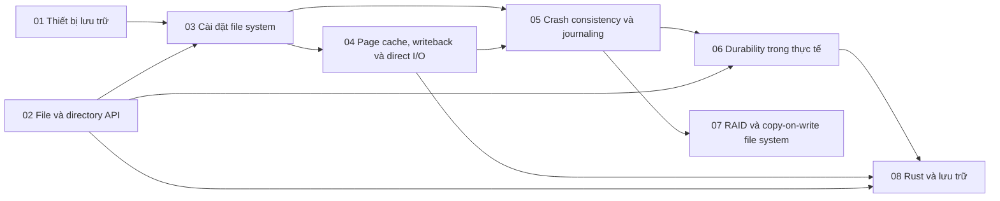

# P5 · Tổng quan — Lưu trữ và file system

> Trang này chỉ điều hướng: mục tiêu, bản đồ chương, thứ tự đọc, sách gốc và câu hỏi tổng hợp. Mọi khẳng định kỹ thuật có chú thích nằm trong từng chương; các lời khuyên về thứ tự đọc là của người soạn.

## Mục tiêu của phase

Phase này đi từ thiết bị lưu trữ (HDD, SSD, block layer) lên file API, cài đặt file system, page cache, crash consistency và durability. Mục tiêu là hiểu `write` thành công nghĩa là gì, `fsync` bảo đảm gì, và vì sao mẫu ghi file tạm rồi `rename` tồn tại. Backend engineer làm database, queue hay log sẽ dùng phase này nhiều nhất.

## Bản đồ chương

Mũi tên nghĩa là chương đích dùng khái niệm của chương nguồn (nhận xét của người soạn về thứ tự học).

## Các chương

| Chương | Nội dung chính |
|---|---|
| [01 — Thiết bị lưu trữ](01-thiet-bi-luu-tru.md) | Kernel nói chuyện với thiết bị I/O (thanh ghi, polling, interrupt, DMA, driver); chi phí HDD; SSTF/SCAN/SPTF; flash, FTL, GC, write amplification, TRIM; blk-mq và scheduler I/O; NVMe; kích thước sector. |
| [02 — File và directory API](02-file-va-directory-api.md) | File vs directory, inode; offset, `lseek`/`pread`/`pwrite`; `unlink`, hard/symbolic link; `rename` và ghi file tạm; phân giải path, mount; sparse file; khóa file; `std::fs` và syscall. |
| [03 — Cài đặt file system](03-cai-dat-file-system.md) | Bố cục vsfs; từ inode number tới vị trí trên đĩa; từ offset tới block, chỉ mục nhiều tầng, extent; thư mục trên đĩa; số I/O của `open`/`read`/`write`; FFS, block group, ext4; `ENOSPC` khi còn dung lượng (`df -i`). |
| [04 — Page cache, writeback và direct I/O](04-page-cache-va-direct-io.md) | Page cache và `/proc/meminfo`; readahead, `posix_fadvise`; `write` chưa xuống đĩa và ai đẩy xuống; `dirty_*` và write stall; `O_SYNC`/`O_DSYNC` vs `fsync`; container "hết RAM" vì cache; `O_DIRECT` và cái giá. |
| [05 — Crash consistency và journaling](05-crash-consistency-va-journaling.md) | Kịch bản crash khi append; `fsck`; journal transaction và recovery; ordered vs data journaling, ext4 `data=`; revoke record; barrier/flush/FUA; soft updates, COW, LFS; checksum, scrubbing; WAL vs journal. |
| [06 — Durability trong thực tế](06-durability-trong-thuc-te.md) | Vì sao `write` thành công vẫn mất dữ liệu; `fsync` vs `fdatasync` và chi phí; fsync thư mục cha; mẫu tmp → fsync → rename → fsync thư mục; fsync thất bại, fsyncgate; `sync_file_range`; write cache của đĩa, `F_FULLFSYNC`; `sync_all`/`sync_data`. |
| [07 — RAID và copy-on-write file system](07-raid-va-copy-on-write-fs.md) | RAID giải quyết gì, mô hình fail-stop; RAID-0/1/4 và parity XOR; small-write problem, RAID-5; write hole và Linux md; vì sao cần checksum; copy-on-write, snapshot không phải backup; Btrfs, ZFS, cái giá của COW. |
| [08 — Rust và lưu trữ](08-rust-va-luu-tru.md) | `OpenOptions` và cờ `open(2)`, `create_new`; `write` vs `write_all`, `BufWriter` và lỗi flush khi `drop`; `sync_all`/`sync_data`; mẫu atomic replace trong Rust; `read_at`/`write_at`, `O_APPEND`; `File::lock`; `Mmap::map` là `unsafe`; `tokio::fs`. |

## Thứ tự đọc

Đọc 01 → 08 theo số. Nếu bạn chủ yếu quan tâm "dữ liệu có mất không", đi đường tắt 02 → 04 → 05 → 06 → 08 và quay lại 01, 03, 07 sau (nhận xét của người soạn).

## Lộ trình đọc sách gốc

Các nguồn dưới đây đều là nguồn mà chương của phase đã dùng; mở đọc song song với chương tương ứng. Không bắt buộc: chương đã tự chứa phần cần thiết.

- [OSTEP — I/O Devices](https://pages.cs.wisc.edu/~remzi/OSTEP/file-devices.pdf) — chương 01.
- [OSTEP — Hard Disk Drives](https://pages.cs.wisc.edu/~remzi/OSTEP/file-disks.pdf) — chương 01.
- [OSTEP — Flash-based SSDs](https://pages.cs.wisc.edu/~remzi/OSTEP/file-ssd.pdf) — chương 01.
- [OSTEP — Files and Directories](https://pages.cs.wisc.edu/~remzi/OSTEP/file-intro.pdf) — chương 02.
- [OSTEP — File System Implementation](https://pages.cs.wisc.edu/~remzi/OSTEP/file-implementation.pdf) — chương 03.
- [OSTEP — Locality and The Fast File System](https://pages.cs.wisc.edu/~remzi/OSTEP/file-ffs.pdf) — chương 03.
- [OSTEP — Crash Consistency: FSCK and Journaling](https://pages.cs.wisc.edu/~remzi/OSTEP/file-journaling.pdf) — chương 05.
- [OSTEP — Log-structured File Systems](https://pages.cs.wisc.edu/~remzi/OSTEP/file-lfs.pdf) — chương 05, 07.
- [OSTEP — Data Integrity and Protection](https://pages.cs.wisc.edu/~remzi/OSTEP/file-integrity.pdf) — chương 05.
- [OSTEP — Redundant Arrays of Inexpensive Disks (RAIDs)](https://pages.cs.wisc.edu/~remzi/OSTEP/file-raid.pdf) — chương 07.
- [Rust docs — `std::os::unix::fs::FileExt`](https://doc.rust-lang.org/1.95.0/std/os/unix/fs/trait.FileExt.html) — chương 08.

## Câu hỏi tổng hợp xuyên chương

Không có đáp án ở đây; mỗi câu trỏ về chương cần đọc lại.

1. `write()` trả về thành công, rồi mất điện: dữ liệu đang nằm ở đâu, và `fsync` đẩy nó qua những tầng nào? ([chương 04](04-page-cache-va-direct-io.md), [chương 06](06-durability-trong-thuc-te.md), [chương 01](01-thiet-bi-luu-tru.md)).
2. Viết lại một file cấu hình sao cho không bao giờ thấy nửa cũ nửa mới: mỗi bước của mẫu tmp → fsync → rename → fsync thư mục chặn lỗi nào? ([chương 02](02-file-va-directory-api.md), [chương 05](05-crash-consistency-va-journaling.md), [chương 06](06-durability-trong-thuc-te.md), [chương 08](08-rust-va-luu-tru.md)).
3. Volume còn nhiều dung lượng mà `open(O_CREAT)` báo `ENOSPC`: cấu trúc inode nào giải thích? ([chương 03](03-cai-dat-file-system.md)).
4. WAL của database và journal của file system giống và khác nhau ở điểm nào? ([chương 05](05-crash-consistency-va-journaling.md), [chương 06](06-durability-trong-thuc-te.md)).
5. Container "hết RAM" khi chỉ đọc/ghi file: page cache, dirty page và memory cgroup liên quan nhau thế nào? ([chương 04](04-page-cache-va-direct-io.md); phase P8 [chương 03](../08-containers/03-cgroups-v2.md)).
6. Vì sao ghi ngẫu nhiên nhỏ lên SSD và RAID-5 đều đắt hơn ta nghĩ? ([chương 01](01-thiet-bi-luu-tru.md), [chương 07](07-raid-va-copy-on-write-fs.md)).
7. `BufWriter` bị `drop` mà không `flush`/`sync`: dữ liệu và lỗi đi đâu? ([chương 08](08-rust-va-luu-tru.md), [chương 06](06-durability-trong-thuc-te.md)).

## Lab

Làm sau khi đã đọc lý thuyết:

- [Lab 05 — Lưu trữ](../labs/05-storage-lab.md)
