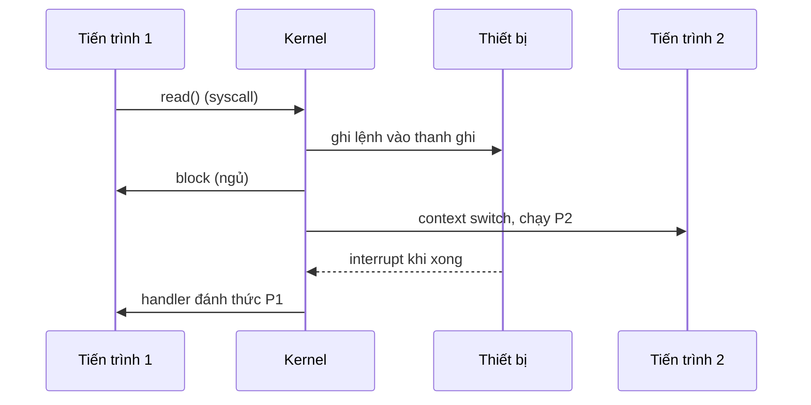
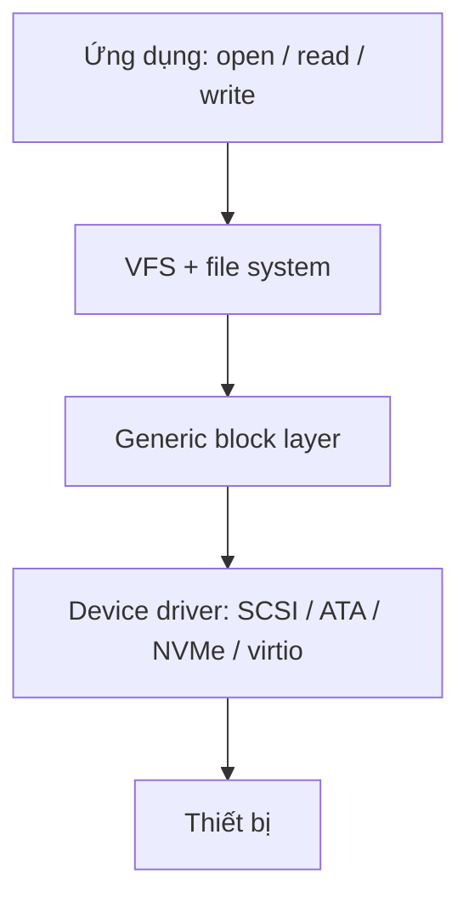
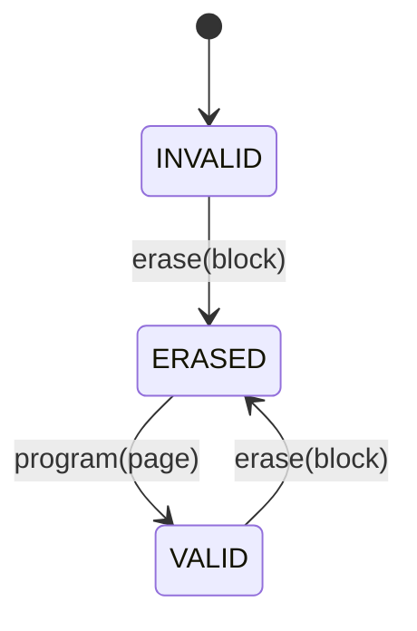
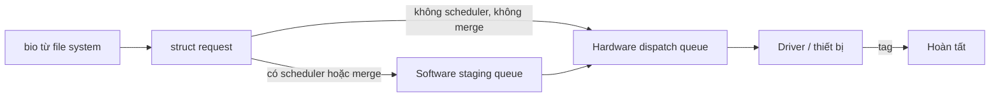

# P5 · Chương 01 — Thiết bị lưu trữ

## Bạn sẽ hiểu được gì

1. **Q1.** Kernel nói chuyện với một thiết bị I/O thế nào: thanh ghi, polling, interrupt, DMA, và vì sao cần device driver? → mục 1
2. **Q2.** Một lần đọc 4 KB trên ổ cứng quay (HDD) tốn thời gian ở đâu, và vì sao I/O tuần tự nhanh hơn ngẫu nhiên hàng trăm lần? Bạn tự tính được `T_I/O` và `R_I/O`. → mục 2
3. **Q3.** SSTF, elevator (SCAN), SPTF khác nhau thế nào, và vì sao SPTF nằm trong ổ chứ không nằm trong OS? → mục 3
4. **Q4.** Vì sao flash phải "erase trước, program sau", và FTL, garbage collection, wear leveling, write amplification, TRIM sinh ra từ ràng buộc đó ra sao? → mục 4
5. **Q5.** Block layer multi-queue (blk-mq) của Linux hoạt động thế nào; `none`, `mq-deadline`, `bfq` khác nhau gì; NVMe khớp vào đâu? → mục 5
6. **Q6.** Kernel báo những con số nào về kích thước sector (512 vs 4 KB), và chúng bảo đảm gì? → mục 6

## Kiến thức cần trước

- [Chương 02 — System call](../01-linux/02-system-call.md): ranh giới user/kernel.
- [Chương 04 — File descriptor và VFS](../01-linux/04-file-descriptor-va-vfs.md): lớp trên của stack mà chương này đi xuống.

Đây là tầng thấp nhất của phase P5. Các tầng trên: API file ([chương 02](02-file-va-directory-api.md)), cách file system dàn dữ liệu lên block ([chương 03](03-cai-dat-file-system.md)), page cache và `O_DIRECT` ([chương 04](04-page-cache-va-direct-io.md)), crash consistency ([chương 05](05-crash-consistency-va-journaling.md)), `fsync` và độ bền ([chương 06](06-durability-trong-thuc-te.md)), RAID ([chương 07](07-raid-va-copy-on-write-fs.md)).

## 1. Từ CPU đến thiết bị (Q1)

> **Trả lời ngắn.** CPU điều khiển thiết bị qua một giao diện thanh ghi: OS ghi lệnh và dữ liệu, rồi chờ thiết bị xong bằng polling (hỏi liên tục) hoặc interrupt (ngủ và được đánh thức)[^dev-protocol][^dev-irq]. Với khối dữ liệu lớn, DMA giao việc chép cho một engine riêng[^dev-dma]. Device driver giấu chi tiết từng thiết bị khỏi file system[^dev-driver].

**Giải thích.**

Hình dung (nhận xét của người soạn): giống backend gọi một dịch vụ chậm — đứng chờ kết quả (polling), nhờ callback khi xong (interrupt), hoặc nhờ người khác bê cả kiện hàng (DMA).

### 1.1 Giao thức chuẩn: thanh ghi và polling

OSTEP dùng một "thiết bị chuẩn" (không có thật) để dạy cơ chế. Giao diện gồm ba thanh ghi: *status* (đọc trạng thái), *command* (ghi lệnh), *data* (chuyển dữ liệu).[^dev-regs] OS làm bốn bước: chờ thiết bị hết bận; ghi dữ liệu vào data; ghi lệnh vào command; chờ thiết bị làm xong.[^dev-protocol] Việc OS liên tục đọc status để chờ gọi là **polling**.[^dev-poll] Khi chính CPU chép dữ liệu vào/ra thiết bị thì gọi là **programmed I/O (PIO)**.[^dev-pio] Cách này đơn giản và chạy được, nhưng polling đốt CPU để chờ một thiết bị có thể rất chậm.[^dev-pollcost]

### 1.2 Interrupt: ngủ thay vì hỏi

Cách giải: OS gửi yêu cầu, cho tiến trình gọi đi ngủ rồi chuyển sang việc khác.[^dev-irq] Khi xong, thiết bị phát hardware interrupt để CPU nhảy vào interrupt handler của OS, handler hoàn tất yêu cầu và đánh thức tiến trình. Nhờ vậy CPU và đĩa chạy chồng lên nhau.[^dev-irq2]



**Interrupt không luôn tốt hơn polling.** Với thiết bị rất nhanh, interrupt kéo theo chuyển tiến trình và xử lý interrupt, đắt hơn việc poll.[^dev-notalways] OSTEP gợi ý cách lai: poll một lúc rồi mới chuyển sang interrupt.[^dev-hybrid] Dòng interrupt dồn dập (mỗi gói tin một interrupt) còn có thể làm OS livelock.[^dev-livelock] **Interrupt coalescing** gom nhiều hoàn tất vào một interrupt, đổi lấy độ trễ cao hơn.[^dev-coalesce] Mục 5 cho thấy Linux NVMe có cả hai kiểu queue: interrupt và polled.

### 1.3 DMA

PIO với khối lớn vẫn làm CPU bận chép từng từ. **Direct Memory Access (DMA)** giao việc cho một engine chuyên dụng: OS lập trình nó bằng địa chỉ dữ liệu trong RAM, số byte và thiết bị đích; engine chép xong thì phát interrupt.[^dev-dma]

### 1.4 Device driver và block layer

Mỗi thiết bị một giao diện, nhưng file system muốn không biết điều đó. Lời giải là trừu tượng hóa: một đoạn phần mềm biết chi tiết thiết bị — **device driver**.[^dev-driver] Trên Linux (hình "gần đúng" của OSTEP), file system gửi yêu cầu đọc/ghi block cho generic block layer, lớp này định tuyến tới driver phù hợp.[^dev-stack]



Cái giá: tính năng đặc biệt của thiết bị bị mất. SCSI báo lỗi rất phong phú, nhưng vì các block device khác báo lỗi đơn giản, tầng trên chỉ nhận một mã `EIO` chung.[^dev-eio]

<details><summary>Đi sâu: CPU tìm thanh ghi thiết bị bằng cách nào</summary>

Hoặc dùng lệnh I/O riêng (x86: `in` và `out`, lệnh đặc quyền),[^dev-inout] hoặc **memory-mapped I/O**: thanh ghi thiết bị hiện ra như ô nhớ, load/store được phần cứng định tuyến tới thiết bị thay vì RAM.[^dev-mmio] OSTEP nói không bên nào hơn hẳn.[^dev-mmio2]

</details>

**Quay lại Q1:** thiết bị được điều khiển qua thanh ghi; polling/interrupt quyết định cách chờ, DMA lo chép dữ liệu, và driver giấu khác biệt giữa các thiết bị.

## 2. Ổ cứng quay (HDD) (Q2)

> **Trả lời ngắn.** Một I/O trên HDD gồm seek (dời arm), rotational delay (chờ sector quay tới dưới head) rồi transfer[^hdd-time]; với khối 4 KB thì gần như toàn bộ thời gian là định vị chứ không phải truyền. Công thức: `T_I/O = T_seek + T_rotation + T_transfer`, `R_I/O = Size_transfer / T_I/O`[^hdd-formula]. Sách gọi chênh lệch giữa ngẫu nhiên và tuần tự là "gần 200 lần" tới "hơn 300 lần" tùy ổ[^hdd-gap].

**Giải thích.**

Hình dung (nhận xét của người soạn): đọc tài liệu ở kho lưu trữ — đi tới đúng kệ (seek), đợi cuốn cần lấy quay tới tay (rotation), rồi mới đọc (transfer); lấy nhiều cuốn rải rác thì thời gian chủ yếu là đi bộ, không phải đọc.

### 2.1 Giao diện: một mảng sector

Với OS, ổ là mảng sector 512 byte đánh số từ 0 đến n−1.[^hdd-iface] Chỉ có một bảo đảm từ nhà sản xuất: ghi **một sector 512 byte là atomic**; mất điện giữa một lần ghi lớn hơn thì chỉ một phần hoàn tất (*torn write*).[^hdd-atomic] Điều này quay lại ở [chương 05](05-crash-consistency-va-journaling.md). Client còn giả định "bất thành văn" rằng truy cập liên tục (tuần tự) là chế độ nhanh nhất.[^hdd-contract]

### 2.2 Hình học và ba thành phần của một I/O

Dữ liệu nằm trên các **platter** quay quanh **spindle** (thường 7.200–15.000 RPM).[^hdd-rpm0] Mỗi surface chia thành các vòng tròn đồng tâm gọi là **track**.[^hdd-geo] Mỗi surface có một **head** gắn vào **arm** để đặt lên đúng track.[^hdd-head] Một vòng quay của đĩa 10.000 RPM mất khoảng 6 ms (60.000 ms/phút ÷ 10.000).[^hdd-rpm]

Một I/O gồm: **seek** (dời arm tới track), **rotational delay** (chờ sector quay tới dưới head), rồi **transfer**.[^hdd-time] Seek có tăng tốc, chạy đều, giảm tốc, và *settling* thường khá lớn, ví dụ 0,5–2 ms.[^hdd-seek]


Ổ còn có cache nhỏ (thường khoảng 8 hoặc 16 MB).[^hdd-cache] Khi ghi, ổ có thể báo xong ngay khi dữ liệu vào bộ nhớ ổ (*write back*) hoặc chỉ sau khi ghi lên đĩa (*write through*);[^hdd-wb2] write back làm ổ trông nhanh hơn nhưng nguy hiểm nếu file system cần dữ liệu ghi theo thứ tự.[^hdd-wb] Đây là gốc của lệnh flush ở [chương 06](06-durability-trong-thuc-te.md).

### 2.3 Tính I/O time và rate

```
T_I/O = T_seek + T_rotation + T_transfer
R_I/O = Size_transfer / T_I/O
```
[^hdd-formula]

Hai ổ trong OSTEP (datasheet Seagate, khoảng 2009): Cheetah 15K.5 (SCSI, 15.000 RPM, seek trung bình 4 ms, 125 MB/s) và Barracuda (SATA, 7.200 RPM, seek 9 ms, 105 MB/s).[^hdd-specs]

**Random 4 KB trên Cheetah.** 15.000 RPM = 250 vòng/giây nên một vòng 4 ms; trung bình chờ nửa vòng = 2 ms.[^hdd-cheetah] Transfer = 4 KB / 125 MB/s ≈ 30 µs. Tổng ≈ 6 ms, rate ≈ 0,66 MB/s.[^hdd-6ms]

**Random 4 KB trên Barracuda.** Một vòng 8,33 ms → nửa vòng ≈ 4,17 ms; seek 9 ms; transfer ≈ 0,04 ms. Tổng ≈ 13,2 ms, rate ≈ 0,31 MB/s.[^hdd-barra]

**Sequential 100 MB** (một seek + quay rồi truyền liền): Cheetah ≈ 800 ms, Barracuda ≈ 950 ms, rate gần bằng tốc độ truyền tối đa.[^hdd-seq]

| | Cheetah (15K) | Barracuda (7,2K) |
|---|---|---|
| Random 4 KB, T_I/O | ≈ 6 ms | ≈ 13,2 ms |
| Random 4 KB, R_I/O | ≈ 0,66 MB/s | ≈ 0,31 MB/s |
| Sequential, R_I/O | ≈ 125 MB/s | ≈ 105 MB/s |

<details><summary>Đi sâu: kiểm lại tỉ lệ và các số suy ra thêm</summary>

Sách gọi chênh lệch là "gần 200 lần" (Cheetah) và "hơn 300 lần" (Barracuda).[^hdd-gap] Kiểm lại bằng phép chia các số đã làm tròn trong bảng: 125 / 0,66 ≈ 189 và 105 / 0,31 ≈ 339 (tính của người soạn). Số thập phân phụ thuộc cách làm tròn 4 KB (4.000 hay 4.096 byte) và thời gian truyền nên chỉ nên tin bậc độ lớn, không tin chữ số cuối.

**Suy ra thêm (tính của người soạn, không phải số đo):**

- IOPS ngẫu nhiên ≈ 1 / T_I/O: Cheetah ≈ 166, Barracuda ≈ 76.
- Với 4 KB, thời gian truyền chỉ ≈ 0,5% của 6 ms; 99,5% là định vị. Muốn hiệu suất 50% thì thời gian truyền phải bằng thời gian định vị, tức khối cỡ 125 MB/s × 6 ms ≈ 750 KB (Cheetah) hoặc 105 MB/s × 13,2 ms ≈ 1,4 MB (Barracuda). Đây là lý do định lượng cho lời khuyên của sách: truyền tuần tự, và nếu không thể thì theo khối lớn.[^hdd-tip]

</details>

**Quay lại Q2:** ngẫu nhiên 4 KB tốn cỡ 6–13 ms vì định vị, còn tuần tự gần tốc độ truyền tối đa — nên truyền tuần tự, hoặc theo khối lớn.

## 3. Disk scheduling (Q3)

> **Trả lời ngắn.** SSTF chọn yêu cầu ở track gần nhất nên có thể làm các track khác bị bỏ đói[^sched-starv]; elevator (SCAN) quét qua lại theo thứ tự track nên không bị như vậy[^sched-scan]. SPTF tính cả thời gian quay[^sched-sptf], nhưng OS không biết ranh giới track và vị trí quay của head nên SPTF thường chạy bên trong ổ[^sched-inside].

**Giải thích.**

Hình dung (nhận xét của người soạn): thang máy phục vụ tầng gần nhất mãi thì khách ở tầng xa chờ vô hạn; thang máy chạy lên rồi xuống (elevator) thì ai cũng tới lượt.

Khác với job scheduling, ở đây đoán được thời gian phục vụ, nên scheduler áp dụng ý tưởng SJF.[^sched-sjf]

**SSTF** chọn yêu cầu ở track gần nhất trước.[^sched-sstf] Vấn đề: OS không thấy hình học ổ nên dùng nearest-block-first theo địa chỉ block;[^sched-nbf] và **starvation** — dòng yêu cầu ở track hiện tại làm các track khác bị bỏ đói.[^sched-starv] **Elevator (SCAN)** quét qua lại, phục vụ theo thứ tự track; yêu cầu tới sau khi track đã qua phải đợi sweep sau.[^sched-scan] **C-SCAN** chỉ quét một chiều rồi quay về đầu.[^sched-cscan]

**SPTF** (còn gọi SATF): SSTF/SCAN bỏ qua *quay*.[^sched-sptf] Nếu seek rẻ hơn quay thì nên seek xa hơn để tới sector sắp quay ngang head; trên ổ hiện đại seek và quay cỡ ngang nhau nên SPTF có ích.[^sched-sptf2] Nhưng OS không biết ranh giới track và vị trí quay của head, nên SPTF thường chạy *bên trong ổ*.[^sched-inside] Vì thế OS chọn vài yêu cầu tốt nhất (ví dụ 16) và gửi hết, ổ tự sắp xếp.[^sched-16] OS còn làm **I/O merging** — gộp yêu cầu block 33 và 34 thành một yêu cầu hai block[^sched-merge] — và quyết định có để ổ rảnh chờ yêu cầu tốt hơn hay không (*work-conserving* vs non-work-conserving).[^sched-wc] Mục 5 cho thấy các ý này sống tiếp trong scheduler của Linux.

<details><summary>Đi sâu: ví dụ tính lại FIFO, SSTF, elevator</summary>

**Ví dụ tính lại (số của người soạn, đơn vị = track).** Đầu ở track 50; hàng đợi theo thứ tự đến: 10, 55, 12, 60, 11.

| Thuật toán | Thứ tự | Tổng seek |
|---|---|---|
| FIFO | 10, 55, 12, 60, 11 | 40+45+43+48+49 = 225 |
| SSTF | 55, 60, 12, 11, 10 | 5+5+48+1+1 = 60 |
| Elevator, lên trước | 55, 60, rồi 12, 11, 10 | 5+5+48+1+1 = 60 |
| Elevator, xuống trước | 12, 11, 10, rồi 55, 60 | 38+1+1+45+5 = 90 |

Bảng tính elevator theo kiểu "đi tới yêu cầu xa nhất rồi đảo chiều" (không chạy tới mép đĩa như SCAN nguyên thủy). SSTF và elevator-lên-trước cùng 60, tốt hơn FIFO nhiều. Khác biệt chỉ lộ khi yêu cầu mới liên tục đến gần track 50: SSTF thuần túy không bao giờ tới 10–12, elevator thì chắc chắn tới trong một sweep.

</details>

**Quay lại Q3:** SSTF nhanh nhưng bỏ đói, elevator công bằng hơn, SPTF chính xác nhất nhưng chỉ ổ mới có đủ thông tin để chạy nó.

## 4. SSD và flash (Q4)

> **Trả lời ngắn.** Flash chỉ ghi vào page đã erase, mà erase phải làm trên cả block lớn hơn, và ghi quá nhiều vào một chỗ thì nó mòn[^ssd-erase]. FTL che ràng buộc đó: nó nhận đọc/ghi trên khối logic và biến thành read/erase/program trên block/page vật lý[^ssd-ftl], thường theo kiểu log-structured (append rồi cập nhật bảng ánh xạ)[^ssd-log]. Cái giá là garbage collection, wear leveling và write amplification[^ssd-wa]; TRIM cho thiết bị biết khối nào đã bỏ[^ssd-trim].

**Giải thích.**

Hình dung (nhận xét của người soạn): như ghi chép vào sổ giấy không tẩy được — muốn sửa một dòng thì viết dòng mới ở chỗ trống và ghi vào mục lục (bảng ánh xạ) rằng dòng cũ không còn dùng; thỉnh thoảng phải chép các trang còn dùng sang sổ mới để dọn (garbage collection).


### 4.1 Ràng buộc của NAND flash

Để ghi vào một **page**, trước hết phải **erase** cả một **block** lớn hơn (đắt); và ghi quá nhiều vào một chỗ thì nó mòn.[^ssd-erase] "Block" và "page" ở flash không phải block của đĩa hay page của bộ nhớ ảo.[^ssd-term] Block (erase block) thường 128 KB hoặc 256 KB, page vài KB (ví dụ 4 KB).[^ssd-sizes]

Ba thao tác: **read** một page; **erase** + **program** cùng nhau để ghi.[^ssd-ops] Erase phá nội dung cả block (đặt mọi bit về 1) nên dữ liệu cần giữ phải chép đi trước.[^ssd-erase2] Page đã program thì cách duy nhất đổi nội dung là erase cả block chứa nó.[^ssd-program]



### 4.2 Hiệu năng và độ bền (có năm)

OSTEP Hình 44.2 tóm tắt độ trễ thô của chip, lấy từ "báo chí chuyên ngành" mà sách dẫn là tài liệu [V12];[^ssd-fig442][^ssd-fig442b] mục tham khảo ghi [V12] là bài của Kristian Vatto đăng trên AnandTech tháng 9/2012.[^ssd-v12] Vậy "2012" là ngày của bài báo mà sách trích số liệu, không phải ngày đo của sách:

| Loại | Read | Program | Erase |
|---|---|---|---|
| SLC | 25 µs | 200–300 µs | 1500–2000 µs |
| MLC | 50 µs | 600–900 µs | ≈ 3000 µs |
| TLC | ≈ 75 µs | ≈ 900–1350 µs | ≈ 4500 µs |

Sách tóm lại: erase "vài ms".[^ssd-lat] Đây là số của chip đời 2012, **không** phải độ trễ một SSD hôm nay. Người soạn không tìm được nguồn ổn định trong phạm vi chương cho độ trễ NVMe hiện đại, nên không nêu; hãy đo trên máy đích.

Về độ bền: nhà sản xuất định mức MLC khoảng 10.000 chu kỳ P/E, và nghiên cứu cho thấy tuổi thọ thực dài hơn kỳ vọng.[^ssd-wear] Ngoài ra còn *disturbance*: truy cập một page có thể làm lật bit ở page lân cận.[^ssd-disturb]

### 4.3 FTL: biến flash thành "ổ đĩa"

**Flash Translation Layer (FTL)** nhận đọc/ghi trên khối logic và biến thành read/erase/program trên block/page vật lý.[^ssd-ftl] Hai mục tiêu: giảm **write amplification** — tổng byte FTL ghi vào chip chia cho tổng byte client ghi —[^ssd-wa] và **wear leveling**, rải việc ghi đều để mọi block mòn cùng lúc.[^ssd-wl]

**FTL ánh xạ trực tiếp (xấu).** Ghi một logical page phải đọc cả block, erase, program lại tất cả: write amplification tỉ lệ với số page trong block và ghi chậm hơn cả HDD.[^ssd-direct] Với block 256 KB, page 4 KB, mỗi lần ghi đè 4 KB program 64 page, WA ≈ 64 (tính của người soạn).

**FTL log-structured (phổ biến).** Mỗi lần ghi, thiết bị append vào chỗ trống kế tiếp và cập nhật **bảng ánh xạ** logical → physical, giữ trong bộ nhớ và được lưu bền trên thiết bị.[^ssd-log] Cách này tránh read-modify-write và rải ghi đều.[^ssd-log2]

### 4.4 Garbage collection, TRIM, over-provisioning

Ghi đè sinh *garbage* (bản cũ vẫn chiếm page); thiết bị phải định kỳ **garbage collect (GC)**, và GC quá nhiều đẩy write amplification lên.[^ssd-oob2] GC: chọn block có page rác; đọc các page sống; ghi chúng vào cuối log; erase cả block.[^ssd-gc] Block toàn page chết là lý tưởng vì erase ngay không cần di chuyển.[^ssd-gc2]

Ví dụ của sách: ghi logical 100, 101, 2000, 2001 vào block 0; ghi đè 100, 101 vào block 1. Block 0 giờ có 2 page rác, 2 page sống; GC chép 2 page sống ra cuối log rồi erase block 0.[^ssd-gcex] Write amplification của kịch bản (tính của người soạn): client ghi 6 page, flash program 6 + 2 = 8 page → WA ≈ 1,33. Tổng quát hơn (tính của người soạn): với block 4 page mà 3 page còn sống, GC phải chép 3 page để thu về đúng 1 page trống, nên GC càng đắt khi block càng nhiều page sống.

**TRIM**: báo cho thiết bị rằng các block đã bị xóa, nên nó không phải giữ thông tin về chúng nữa.[^ssd-trim] Phía Linux gọi khả năng tương ứng là *discard*; thuộc tính sysfs `queue/discard_granularity` bằng 0 nghĩa là thiết bị không hỗ trợ discard (tài liệu kernel không dùng từ "TRIM" ở mục này, việc coi discard là cách Linux diễn đạt TRIM là suy luận của người soạn).[^sys-discard] **Over-provisioning** (thêm dung lượng flash ẩn) giúp trì hoãn GC.[^ssd-op]

<details><summary>Đi sâu: bảng ánh xạ, wear leveling và so sánh với HDD</summary>

**Bảng ánh xạ và wear leveling.**

Với SSD 1 TB, bảng ánh xạ cấp page cần một mục 4 byte cho mỗi page 4 KB, tức 1 GB bộ nhớ chỉ cho bảng.[^ssd-map] (2⁴⁰/2¹² = 2²⁸ mục × 4 B = 1 GiB.) Ánh xạ theo block rẻ hơn nhưng ghi nhỏ buộc chép nhiều dữ liệu sống nên WA tăng mạnh.[^ssd-blockmap] OSTEP nêu hai cách giảm bộ nhớ: *hybrid mapping* (giữ ít block log ánh xạ theo page, phần còn lại ánh xạ theo block)[^ssd-hybrid] và cache chỉ phần bảng đang dùng.[^ssd-cache]

**Wear leveling**: block chứa dữ liệu sống lâu, không bị ghi đè, thì GC không bao giờ thu hồi nên nó không nhận phần mòn của mình;[^ssd-wl3] FTL phải định kỳ chuyển dữ liệu đó đi, làm tăng write amplification.[^ssd-wl2]

**So sánh với HDD.**

OSTEP Bảng 44.4 (MB/s; số liệu bên dưới khớp nguyên văn bảng gốc).[^ssd-fig444] Sách ghi số liệu "lấy từ vài nguồn trực tuyến" [S13, T15],[^ssd-src] trong mục tham khảo là bài AnandTech ngày 7/5/2013[^ssd-s13] và biểu đồ Tom's Hardware tháng 1/2015:[^ssd-t15]

| Thiết bị | Rand read | Rand write | Seq read | Seq write |
|---|---|---|---|---|
| Samsung 840 Pro SSD | 103 | 287 | 421 | 384 |
| Seagate 600 SSD | 84 | 252 | 424 | 374 |
| Intel SSD 335 SSD | 39 | 222 | 344 | 354 |
| Seagate Savvio 15K.3 HDD | 2 | 2 | 223 | 223 |

Khác biệt lớn nhất ở I/O ngẫu nhiên; ở tuần tự HDD vẫn là lựa chọn tốt nếu chỉ cần tuần tự.[^ssd-cmp] Ghi ngẫu nhiên nhanh hơn đọc ngẫu nhiên vì thiết kế log-structured biến ghi ngẫu nhiên thành tuần tự.[^ssd-rw] Đây là số của các thiết bị đời 2013–2015, không phải số NVMe hôm nay.

</details>

**Quay lại Q4:** flash không ghi đè tại chỗ nên FTL phải ánh xạ lại và dọn rác, kéo theo write amplification và wear leveling.

## 5. NVMe và block layer multi-queue của Linux (Q5)

> **Trả lời ngắn.** NVMe thường gắn trên PCIe[^dev-pcie]. blk-mq có nhiều hàng đợi, mỗi cái có điểm vào cục bộ theo CPU nên bỏ nhu cầu lock chung[^mq-intro]; request đi đường ngắn nhất tới hardware queue và chỉ qua software queue khi có scheduler hoặc cần merge[^mq-short]. Scheduler chọn được lúc chạy: `none` không sắp xếp lại[^mq-none], `mq-deadline` gom batch theo sector kèm deadline[^dl-batch], `bfq` chia băng thông tỉ lệ[^bfq-prop].

**Giải thích.**

Hình dung (nhận xét của người soạn): một cổng thu phí duy nhất thì nghẽn khi xe nhiều; blk-mq mở nhiều làn, mỗi CPU có làn riêng, nên không phải xếp hàng chung.

**NVMe và PCIe.**

OSTEP nói thiết bị lưu trữ hiệu năng cao như NVMe thường gắn trên PCIe.[^dev-pcie] Trong driver Linux (`drivers/nvme/host/pci.c`, tag v6.8 — chi tiết cài đặt, có thể đổi), hàm `nvme_write_sq_db` ghi `sq_tail` vào thanh ghi doorbell `q_db` của queue (một ví dụ của MMIO ở mục 1, phần Đi sâu); lệnh `writel` đó nằm sau điều kiện `nvme_dbbuf_update_and_check_event`, tức khi thiết bị dùng shadow doorbell buffer thì không phải lần cập nhật nào cũng chạm thanh ghi thật.[^nvme-doorbell] Việc lệnh nằm trong *submission queue* ở RAM là cách NVMe hoạt động nói chung (suy luận của người soạn, chương không trích đặc tả NVMe). Comment trong file: "mỗi thiết bị có ít nhất hai queue: một cho lệnh admin, một cho lệnh I/O".[^nvme-q] Số queue I/O tối đa là `num_possible_cpus() + nr_write_queues + nr_poll_queues`: tức driver *yêu cầu* tối đa khoảng một queue mỗi CPU; số queue thực tế còn phụ thuộc số queue thiết bị cấp phát (`nvme_set_queue_count`) và số vector interrupt, và một quirk Apple ép về 1 (người review đọc `nvme_max_io_queues` và `nvme_setup_io_queues` ở v6.8).[^nvme-max] Driver cần interrupt cho queue admin và mỗi queue I/O không polled,[^nvme-irq] và có tham số module `poll_queues` cho queue polled;[^nvme-poll] block layer có loại hardware queue tương ứng `HCTX_TYPE_POLL`.[^mq-poll] Đặc tả NVMe gốc không được trích ở đây vì người soạn không tải được bản đặc tả.

**Block layer multi-queue của Linux.**

### 5.1 Vì sao cần multi-queue

Block layer cũ tối ưu cho HDD, nơi cơ khí là nút cổ chai.[^mq-bg] Với SSD/NVM, nút cổ chai chuyển sang OS: một hàng đợi với một lock không scale trên SMP.[^mq-bg2] **blk-mq** có nhiều hàng đợi, mỗi cái có điểm vào cục bộ theo CPU, bỏ nhu cầu lock chung.[^mq-intro]

### 5.2 Hai tầng queue

blk-mq có **software staging queue** và **hardware dispatch queue**.[^mq-two] Request đi đường ngắn nhất tới hardware queue; chỉ khi có I/O scheduler hoặc cần merge mới qua software queue.[^mq-short]



- Software queue (per-CPU/node, lock riêng) có thể gộp request sector kề nhau, ví dụ 3–6, 6–7, 7–9 thành 3–9.[^mq-sw]
- Hardware queue ánh xạ tới submission queue của thiết bị; số lượng không vượt số core.[^mq-hw]
- Mỗi request có một **tag**; driver trả tag khi xong nên không phải tìm tuyến tính.[^mq-tag]
- Block layer lẫn thiết bị **không bảo đảm thứ tự hoàn tất**; tầng trên (file system) phải tự xử lý.[^mq-order] Vì vậy file system cần cơ chế riêng để ép thứ tự, như barrier/flush (suy luận của người soạn; xem [chương 05](05-crash-consistency-va-journaling.md)).

<details><summary>Đi sâu: I/O scheduler none, mq-deadline, bfq</summary>

Các trích dẫn từ docs.kernel.org dưới đây là bản tài liệu đang phát hành (không ghim phiên bản); người review đã đối chiếu từng câu trích nguyên văn với `Documentation/block/*.rst` ở tag v6.8 và chúng có mặt ở đó. Scheduler cắm được, chọn lúc chạy; việc sắp xếp chỉ xảy ra giữa các request trong cùng một queue.[^mq-sched] Đổi bằng `echo TÊN > /sys/block/DEV/queue/scheduler`; đọc file thì scheduler đang chạy nằm trong ngoặc vuông.[^sw-sched] Docs liệt kê `mq-deadline`, `none`, `bfq`, `kyber`.[^sw-list]

**`none`**: đặt request vào software queue của CPU đang chạy, không sắp xếp lại.[^mq-none] Lưu ý về nguồn: các trang `blk-mq`, `switching-sched`, `deadline-iosched`, `bfq-iosched` (và bản .rst v6.8) không có câu nào nói `none` hợp với NVMe; lý do "hợp với NVMe" dưới đây là suy luận. Điều có nguồn là *mặc định* của kernel v6.8: thiết bị một hardware queue được gán `mq-deadline`, thiết bị nhiều queue (hoặc không có `mq-deadline`) mặc định `none`.[^elv-default] Suy luận của người soạn: `none` hợp với thiết bị nhiều queue song song như NVMe vì thiết bị tự sắp xếp lại bên trong (như SPTF ở mục 3), còn sắp xếp ở host phải qua lock chung mà blk-mq cố tránh (xem overhead mỗi request ở `bfq` bên dưới).

**`mq-deadline`**: cố gắng bảo đảm thời điểm *bắt đầu phục vụ*; mỗi request vào scheduler nhận deadline = hiện tại + `read_expire`.[^dl-goal] Request gom thành batch cùng hướng, phục vụ theo sector tăng dần — gần với elevator mục 3 — và deadline chỉ kiểm tra giữa các batch (`fifo_batch` = 1 thì thành FIFO).[^dl-batch] Read được ưu tiên, `writes_starved` giới hạn để write không bị bỏ đói vô hạn.[^dl-pref]

**`bfq`**: proportional-share với khả năng độ trễ thấp.[^bfq-prop] Mặc định ưu tiên độ trễ hơn throughput.[^bfq-lat] Chi phí theo tài liệu: mq-deadline 0,7 µs mỗi request, BFQ 1,9 µs, đo trên Core i7-2760QM cũ.[^bfq-over] Scheduler phức tạp hơn có overhead lớn hơn mỗi request (nhận xét của người soạn).

</details>

**Quay lại Q5:** NVMe có queue riêng ở RAM và doorbell qua MMIO; blk-mq nhân hàng đợi theo CPU, và scheduler (`none`, `mq-deadline`, `bfq`) chỉ sắp xếp giữa các request trong cùng một queue.

## 6. Sector 512 vs 4 KB; atomic write unit (Q6)

> **Trả lời ngắn.** Kernel báo hai kích thước: `logical_block_size` là đơn vị nhỏ nhất thiết bị địa chỉ hóa được, thường 512 byte[^sys-lbs]; `physical_block_size` là đơn vị nhỏ nhất thiết bị vật lý ghi atomic, thường bằng logical nhưng có thể lớn hơn, ví dụ SATA sector 4 KB hiển thị logical 512[^sys-pbs]. "Atomic" ở đây chỉ nói về đơn vị vật lý, không phải bảo đảm cho cả lần `write()` của ứng dụng (suy luận của người soạn).

**Giải thích.**

Hình dung (nhận xét của người soạn): bản vẽ ghi "ô 512" nhưng thợ chỉ cắt được theo tấm 4 KB — ghi lẻ nhỏ hơn tấm thì thợ phải lấy cả tấm ra sửa rồi đặt lại.


| sysfs | Ý nghĩa theo tài liệu kernel |
|---|---|
| `queue/logical_block_size` | đơn vị nhỏ nhất thiết bị địa chỉ hóa được, thường 512 byte[^sys-lbs] |
| `queue/physical_block_size` | đơn vị nhỏ nhất thiết bị vật lý ghi *atomic*; thường bằng logical nhưng có thể lớn hơn, ví dụ SATA sector 4 KB hiển thị logical 512[^sys-pbs] |
| `queue/rotational` | cờ rotational / non-rotational[^sys-rot] |

Suy luận của người soạn: ổ báo logical 512 / physical 4096 có thể phải đọc-sửa-ghi cả sector vật lý khi ghi nhỏ hơn hoặc lệch 4096, nên file system và partition nên căn theo `physical_block_size`. Ghi lớn hơn một đơn vị atomic thì có thể dở dang (*torn write*, mục 2.1); hệ quả cho file system ở [chương 05](05-crash-consistency-va-journaling.md).

<details><summary>Đi sâu: atomic write không có trên kernel 6.8 của máy lab</summary>

**Atomic write không có trên kernel 6.8 của máy lab.** Thuộc tính sysfs `atomic_write_unit_max_bytes` (cùng `atomic_write_unit_min_bytes`, `atomic_write_max_bytes`) không có trong `Documentation/ABI/stable/sysfs-block` ở tag v6.8, v6.9, v6.10; mục này xuất hiện ở v6.11 (người review kiểm tra bằng grep trên từng tag; `February 2024` là trường `Date:` của mục ABI, không phải ngày phát hành kernel). Theo mô tả ở v6.11, `atomic_write_unit_max_bytes` là khối lớn nhất có thể ghi atomic bằng thao tác atomic write.[^sys-atomic] Đã kiểm trên VM: kernel 6.8.0-117-generic, `/sys/block/vda/` và `/sys/block/vda/queue/` không có thuộc tính nào tên `atomic_write*`. Chương không khẳng định ổ nào hỗ trợ.


</details>

**Quay lại Q6:** `logical_block_size` là đơn vị địa chỉ, `physical_block_size` là đơn vị ghi atomic của thiết bị — căn dữ liệu theo cái sau.

## 7. Quan sát trên một VM

Máy người soạn là macOS; Linux ở đây là **VM Colima** (kernel 6.8.0-117-generic) qua `./labs/linux.sh`. Vòng lặp trong shell đọc `/sys/block/*/queue/{scheduler,rotational,logical_block_size,physical_block_size}`, kèm `lsblk`:

```text
loop0 sched=[none] mq-deadline  rot=1 lbs=512 pbs=512
vda   sched=none [mq-deadline]  rot=1 lbs=512 pbs=512
vdb   sched=none [mq-deadline]  rot=1 lbs=512 pbs=512
vdc   sched=none [mq-deadline]  rot=1 lbs=512 pbs=512
vda 20G disk; vdb 40G disk (mount /usr/local/cargo/registry); vdc 18.9M RO
```

Quan sát (một lần chạy trên VM này, không suy rộng):

- Đĩa ảo `vda`–`vdc` dùng `mq-deadline`; `loop*` dùng `none`. Danh sách chỉ có `none` và `mq-deadline`, không thấy `bfq`, `kyber` (có lẽ không được build/nạp vào kernel này — suy luận).
- `rotational = 1` trên đĩa ảo. Giá trị này do thiết bị ảo khai báo, không chứng minh có đĩa quay; người soạn không kiểm tra phần cứng phía host.[^sys-rot]
- Logical và physical đều 512 byte.

Cùng thông tin đọc bằng Rust (chạy trong container, `rustc 1.95.0`): `std::fs::read_dir("/sys/block")` rồi `std::fs::read_to_string`, hàm đọc "toàn bộ nội dung file thành chuỗi",[^rust-rts] in đúng `vda: scheduler=none [mq-deadline] logical=512 physical=512` (và tương tự `vdb`, `vdc`). Thông tin thiết bị khối không có API riêng trong `std`; nó là file văn bản dưới `/sys`. `std::fs` và `File::sync_all` nằm ở [chương 08](08-rust-va-luu-tru.md).

Kết nối backend (nhận xét của người soạn): "disk" của dịch vụ thường là thiết bị ảo, nên cờ `rotational` và scheduler có thể không phản ánh phần cứng; đo trên đúng môi trường production. Cache trong ổ (mục 2) là một nguồn của "đã báo xong nhưng chưa bền" — xem [chương 06](06-durability-trong-thuc-te.md).

## Tóm tắt

- Thiết bị nói chuyện qua thanh ghi (lệnh I/O hoặc MMIO); polling tốn CPU, interrupt cho phép overlap nhưng không luôn tốt hơn với thiết bị nhanh; DMA bỏ việc CPU chép dữ liệu; driver che chi tiết dưới block layer.
- HDD: `T_I/O = T_seek + T_rotation + T_transfer`; random 4 KB ≈ 6 ms (0,66 MB/s) trên Cheetah, ≈ 13,2 ms (0,31 MB/s) trên Barracuda; sequential ≈ tốc độ truyền tối đa.
- SSTF gây starvation; elevator tránh được; SPTF tính cả quay và nằm trong ổ; OS vẫn merge và gửi nhiều yêu cầu cùng lúc.
- Flash: chỉ ghi vào page đã erase, erase theo block, block có tuổi thọ P/E hữu hạn.
- FTL log-structured + bảng ánh xạ tạo block device bình thường, với cái giá là GC, wear leveling, write amplification, bảng ánh xạ lớn; TRIM cho biết khối nào đã chết.
- blk-mq: software staging queue + hardware dispatch queue, request gắn tag, không bảo đảm thứ tự hoàn tất.
- `none` không sắp xếp; `mq-deadline` batch theo sector + deadline; `bfq` proportional-share, thiên về latency. Kích thước sector kernel báo qua `logical_block_size`, `physical_block_size`.

## Câu hỏi tự kiểm tra

1. Vì sao polling có thể tốt hơn interrupt với thiết bị rất nhanh? Một lý do khác để dùng polling?
<details><summary>Đáp án</summary>

Lần poll đầu thường đã thấy xong, còn interrupt kéo theo chuyển tiến trình đắt hơn.[^dev-notalways] Lý do khác: tránh livelock khi interrupt dồn dập.[^dev-livelock] Linux NVMe có queue polled riêng.[^nvme-poll]

</details>

2. DMA khác PIO ở điểm nào, và ai báo OS khi DMA xong?
<details><summary>Đáp án</summary>

PIO: CPU chép dữ liệu.[^dev-pio] DMA: engine chép giữa RAM và thiết bị, xong thì phát interrupt.[^dev-dma]

</details>

3. Tính T_I/O và R_I/O cho đọc ngẫu nhiên 4 KB trên ổ 7.200 RPM, seek 9 ms, 105 MB/s.
<details><summary>Đáp án</summary>

Quay trung bình ≈ 4,17 ms; seek 9 ms; transfer ≈ 0,04 ms; tổng ≈ 13,2 ms; rate ≈ 0,31 MB/s.[^hdd-barra]

</details>

4. Cùng ổ đó, đọc tuần tự 100 MB mất bao lâu?
<details><summary>Đáp án</summary>

Khoảng 950 ms, rate gần 105 MB/s.[^hdd-seq]

</details>

5. Vì sao SSTF có thể bỏ đói yêu cầu còn elevator thì không?
<details><summary>Đáp án</summary>

SSTF luôn chọn track gần nhất nên dòng yêu cầu ở track hiện tại chặn mọi yêu cầu xa.[^sched-starv] Elevator quét theo sweep; yêu cầu bị lỡ chờ sweep kế.[^sched-scan]

</details>

6. Vì sao SPTF thường chạy trong ổ?
<details><summary>Đáp án</summary>

OS không biết ranh giới track và vị trí quay của head.[^sched-inside]

</details>

7. Vì sao không ghi đè page flash tại chỗ, và FTL log-structured giải quyết thế nào?
<details><summary>Đáp án</summary>

Page đã program chỉ đổi được bằng erase cả block.[^ssd-program] FTL append vào chỗ trống kế tiếp và cập nhật bảng ánh xạ; bản cũ thành garbage chờ GC.[^ssd-log][^ssd-oob2]

</details>

8. Write amplification là gì và cơ chế nào làm nó tăng?
<details><summary>Đáp án</summary>

Tổng byte FTL ghi vào flash chia tổng byte client ghi.[^ssd-wa] GC và wear leveling đều thêm ghi.[^ssd-oob2][^ssd-wl2]

</details>

9. Khi nào request đi qua software staging queue trong blk-mq?
<details><summary>Đáp án</summary>

Chỉ khi có I/O scheduler hoặc muốn merge; còn lại đi thẳng tới hardware queue.[^mq-short]

</details>

10. `none`, `mq-deadline`, `bfq` khác nhau thế nào?
<details><summary>Đáp án</summary>

`none` không sắp xếp.[^mq-none] `mq-deadline` batch theo sector, có deadline, ưu tiên read.[^dl-batch][^dl-pref] `bfq` chia băng thông tỉ lệ, ưu tiên latency.[^bfq-prop][^bfq-lat]

</details>

## Đọc thêm

- OSTEP, chương 36 *I/O Devices* — <https://pages.cs.wisc.edu/~remzi/OSTEP/file-devices.pdf> — mục 36.8 có driver IDE của xv6 để thấy polling/interrupt/PIO bằng code thật.
- OSTEP, chương 37 *Hard Disk Drives* — <https://pages.cs.wisc.edu/~remzi/OSTEP/file-disks.pdf> — bài tập mô phỏng `disk.py` để tự thử seek, rotation, SSTF, SATF.
- OSTEP, chương 44 *Flash-based SSDs* — <https://pages.cs.wisc.edu/~remzi/OSTEP/file-ssd.pdf> — mục 44.7–44.9 về FTL, GC, hybrid mapping.
- Kernel docs, *blk-mq* — <https://docs.kernel.org/block/blk-mq.html> — API driver và cấu trúc hàng đợi.
- Kernel docs, *Deadline IO scheduler tunables* — <https://docs.kernel.org/block/deadline-iosched.html> — `read_expire`, `fifo_batch`, `writes_starved`.
- Chương tiếp theo: [Chương 02 — File và directory API](02-file-va-directory-api.md).

[^dev-protocol]: OSTEP, chương 36, mục 36.3 — <https://pages.cs.wisc.edu/~remzi/OSTEP/file-devices.pdf> — "The protocol has four steps."
[^dev-poll]: OSTEP, chương 36, mục 36.3 — <https://pages.cs.wisc.edu/~remzi/OSTEP/file-devices.pdf> — "the OS waits until the device is ready to receive a command by repeatedly reading the status register; we call this polling the device"
[^dev-pio]: OSTEP, chương 36, mục 36.3 — <https://pages.cs.wisc.edu/~remzi/OSTEP/file-devices.pdf> — "When the main CPU is involved with the data movement (as in this example protocol), we refer to it as programmed I/O (PIO)."
[^dev-irq]: OSTEP, chương 36, mục 36.4 — <https://pages.cs.wisc.edu/~remzi/OSTEP/file-devices.pdf> — "the OS can issue a request, put the calling process to sleep, and context switch to another task."
[^dev-irq2]: OSTEP, chương 36, mục 36.4 — <https://pages.cs.wisc.edu/~remzi/OSTEP/file-devices.pdf> — "Interrupts thus allow for overlap of computation and I/O, which is key for improved utilization."
[^dev-notalways]: OSTEP, chương 36, mục 36.4 — <https://pages.cs.wisc.edu/~remzi/OSTEP/file-devices.pdf> — "the first poll usually finds the device to be done with task. Using an interrupt in this case will actually slow down the system: switching to another process, handling the interrupt, and switching back to the issuing process is expensive."
[^dev-hybrid]: OSTEP, chương 36, mục 36.4 — <https://pages.cs.wisc.edu/~remzi/OSTEP/file-devices.pdf> — "it may be best to use a hybrid that polls for a little while and then"
[^dev-livelock]: OSTEP, chương 36, mục 36.4 — <https://pages.cs.wisc.edu/~remzi/OSTEP/file-devices.pdf> — "When a huge stream of incoming packets each generate an interrupt, it is possible for the OS to livelock"
[^dev-coalesce]: OSTEP, chương 36, mục 36.4 — <https://pages.cs.wisc.edu/~remzi/OSTEP/file-devices.pdf> — "While waiting, other requests may soon complete, and thus multiple interrupts can be coalesced into a single interrupt delivery"
[^dev-dma]: OSTEP, chương 36, mục 36.5 — <https://pages.cs.wisc.edu/~remzi/OSTEP/file-devices.pdf> — "the OS would program the DMA engine by telling it where the data lives in memory, how much data to copy, and which device to send it to."
[^dev-inout]: OSTEP, chương 36, mục 36.6 — <https://pages.cs.wisc.edu/~remzi/OSTEP/file-devices.pdf> — "on x86, the in and out instructions can be used to communicate with devices."
[^dev-mmio]: OSTEP, chương 36, mục 36.6 — <https://pages.cs.wisc.edu/~remzi/OSTEP/file-devices.pdf> — "To access a particular register, the OS issues a load (to read) or store (to write) the address; the hardware then routes the load/store to the device instead of main memory."
[^dev-mmio2]: OSTEP, chương 36, mục 36.6 — <https://pages.cs.wisc.edu/~remzi/OSTEP/file-devices.pdf> — "There is not some great advantage to one approach or the other."
[^dev-driver]: OSTEP, chương 36, mục 36.7 — <https://pages.cs.wisc.edu/~remzi/OSTEP/file-devices.pdf> — "At the lowest level, a piece of software in the OS must know in detail how a device works. We call this piece of software a device driver"
[^dev-stack]: OSTEP, chương 36, mục 36.7 — <https://pages.cs.wisc.edu/~remzi/OSTEP/file-devices.pdf> — "it simply issues block read and write requests to the generic block layer, which routes them to the appropriate device driver"
[^dev-eio]: OSTEP, chương 36, mục 36.7 — <https://pages.cs.wisc.edu/~remzi/OSTEP/file-devices.pdf> — "in Linux with SCSI devices, which have very rich error reporting; because other block devices (e.g., ATA/IDE) have much simpler error handling, all that higher levels of software ever receive is a generic EIO (generic IO error) error code"
[^hdd-iface]: OSTEP, chương 37 Hard Disk Drives, mục 37.1 — <https://pages.cs.wisc.edu/~remzi/OSTEP/file-disks.pdf> — "The drive consists of a large number of sectors (512-byte blocks), each of which can be read or written."
[^hdd-atomic]: OSTEP, chương 37, mục 37.1 — <https://pages.cs.wisc.edu/~remzi/OSTEP/file-disks.pdf> — "the only guarantee drive manufacturers make is that a single 512-byte write is atomic"
[^hdd-contract]: OSTEP, chương 37, mục 37.1 — <https://pages.cs.wisc.edu/~remzi/OSTEP/file-disks.pdf> — "One can also usually assume that accessing blocks in a contiguous chunk (i.e., a sequential read or write) is the fastest access mode"
[^hdd-rpm0]: OSTEP, chương 37, mục 37.2 — <https://pages.cs.wisc.edu/~remzi/OSTEP/file-disks.pdf> — "The platters are all bound together around the spindle, which is connected to a motor that spins the platters around (while the drive is powered on) at a constant (fixed) rate. The rate of rotation is often measured in rotations per minute (RPM), and typical modern values are in the 7,200 RPM to 15,000 RPM range."
[^hdd-geo]: OSTEP, chương 37, mục 37.2 — <https://pages.cs.wisc.edu/~remzi/OSTEP/file-disks.pdf> — "Data is encoded on each surface in concentric circles of sectors; we call one such concentric circle a track."
[^hdd-head]: OSTEP, chương 37, mục 37.2 — <https://pages.cs.wisc.edu/~remzi/OSTEP/file-disks.pdf> — "there is one such head per surface of the drive. The disk head is attached to a single disk arm, which moves across the surface to position the head over the desired track."
[^hdd-rpm]: OSTEP, chương 37, mục 37.2 — <https://pages.cs.wisc.edu/~remzi/OSTEP/file-disks.pdf> — "a drive that rotates at 10,000 RPM means that a single rotation takes about 6 milliseconds (6 ms)."
[^hdd-time]: OSTEP, chương 37, mục 37.3 — <https://pages.cs.wisc.edu/~remzi/OSTEP/file-disks.pdf> — "first a seek, then waiting for the rotational delay, and finally the transfer."
[^hdd-seek]: OSTEP, chương 37, mục 37.3 — <https://pages.cs.wisc.edu/~remzi/OSTEP/file-disks.pdf> — "The settling time is often quite significant, e.g., 0.5 to 2 ms, as the drive must be certain to find the right track"
[^hdd-wb]: OSTEP, chương 37, mục 37.3 — <https://pages.cs.wisc.edu/~remzi/OSTEP/file-disks.pdf> — "if the file system or applications require that data be written to disk in a certain order for correctness, write-back caching can lead to problems"
[^hdd-formula]: OSTEP, chương 37, mục 37.4 — <https://pages.cs.wisc.edu/~remzi/OSTEP/file-disks.pdf> — "Simply divide the size of the transfer by the time it took"
[^hdd-specs]: OSTEP, chương 37, mục 37.4 — <https://pages.cs.wisc.edu/~remzi/OSTEP/file-disks.pdf> — "The first, known as the Cheetah 15K.5 [S09b], is a high-performance SCSI drive. The second, the Barracuda [S09a], is a drive built for capacity."
[^hdd-cheetah]: OSTEP, chương 37, mục 37.4 — <https://pages.cs.wisc.edu/~remzi/OSTEP/file-disks.pdf> — "15000 RPM is equal to 250 RPS (rotations per second); thus, each rotation takes 4 ms. On average, the disk will encounter a half rotation and thus 2 ms is the average time."
[^hdd-6ms]: OSTEP, chương 37, mục 37.4 — <https://pages.cs.wisc.edu/~remzi/OSTEP/file-disks.pdf> — "Thus, from our equation above, TI/O for the Cheetah roughly equals 6 ms."
[^hdd-barra]: OSTEP, chương 37, mục 37.4 — <https://pages.cs.wisc.edu/~remzi/OSTEP/file-disks.pdf> — "The same calculation for the Barracuda yields a TI/O of about 13.2 ms, more than twice as slow, and thus a rate of about 0.31 MB/s."
[^hdd-seq]: OSTEP, chương 37, mục 37.4 — <https://pages.cs.wisc.edu/~remzi/OSTEP/file-disks.pdf> — "Thus, TI/O for the Cheetah and Barracuda is about 800 ms and 950 ms, respectively."
[^hdd-gap]: OSTEP, chương 37, mục 37.4 — <https://pages.cs.wisc.edu/~remzi/OSTEP/file-disks.pdf> — "there is a huge gap in drive performance between random and sequential workloads, almost a factor of 200 or so for the Cheetah and more than a factor 300 difference for the Barracuda."
[^hdd-tip]: OSTEP, chương 37, mục 37.4 — <https://pages.cs.wisc.edu/~remzi/OSTEP/file-disks.pdf> — "When at all possible, transfer data to and from disks in a sequential manner. If sequential is not possible, at least think about transferring data in large chunks: the bigger, the better."
[^sched-sjf]: OSTEP, chương 37, mục 37.5 — <https://pages.cs.wisc.edu/~remzi/OSTEP/file-disks.pdf> — "Unlike job scheduling, where the length of each job is usually unknown, with disk scheduling, we can make a good guess at how long a “job” (i.e., disk request) will take."
[^sched-sstf]: OSTEP, chương 37, mục 37.5 — <https://pages.cs.wisc.edu/~remzi/OSTEP/file-disks.pdf> — "SSTF orders the queue of I/O requests by track, picking requests on the nearest track to complete first."
[^sched-nbf]: OSTEP, chương 37, mục 37.5 — <https://pages.cs.wisc.edu/~remzi/OSTEP/file-disks.pdf> — "an OS can simply implement nearest-block-first (NBF), which schedules the request with the nearest block address next."
[^sched-starv]: OSTEP, chương 37, mục 37.5 — <https://pages.cs.wisc.edu/~remzi/OSTEP/file-disks.pdf> — "Requests to any other tracks would then be ignored completely by a pure SSTF approach."
[^sched-scan]: OSTEP, chương 37, mục 37.5 — <https://pages.cs.wisc.edu/~remzi/OSTEP/file-disks.pdf> — "The algorithm, originally called SCAN, simply moves back and forth across the disk servicing requests in order across the tracks."
[^sched-cscan]: OSTEP, chương 37, mục 37.5 — <https://pages.cs.wisc.edu/~remzi/OSTEP/file-disks.pdf> — "C-SCAN is another common variant, short for Circular SCAN. Instead of sweeping in both directions across the disk, the algorithm only sweeps from outer-to-inner, and then resets at the outer track to begin again."
[^sched-sptf]: OSTEP, chương 37, mục 37.5 — <https://pages.cs.wisc.edu/~remzi/OSTEP/file-disks.pdf> — "In particular, SCAN (or SSTF even) does not actually adhere as closely to the principle of SJF as they could. In particular, they ignore rotation."
[^sched-sptf2]: OSTEP, chương 37, mục 37.5 — <https://pages.cs.wisc.edu/~remzi/OSTEP/file-disks.pdf> — "On modern drives, as we saw above, both seek and rotation are roughly equivalent (depending, of course, on the exact requests), and thus SPTF is useful and improves performance."
[^sched-inside]: OSTEP, chương 37, mục 37.5 — <https://pages.cs.wisc.edu/~remzi/OSTEP/file-disks.pdf> — "Thus, SPTF is usually performed inside a drive, described below."
[^sched-16]: OSTEP, chương 37, mục 37.5 — <https://pages.cs.wisc.edu/~remzi/OSTEP/file-disks.pdf> — "the OS scheduler usually picks what it thinks the best few requests are (say 16) and issues them all to disk"
[^sched-merge]: OSTEP, chương 37, mục 37.5 — <https://pages.cs.wisc.edu/~remzi/OSTEP/file-disks.pdf> — "the scheduler should merge the requests for blocks 33 and 34 into a single two-block request"
[^sched-wc]: OSTEP, chương 37, mục 37.5 — <https://pages.cs.wisc.edu/~remzi/OSTEP/file-disks.pdf> — "this approach is called work-conserving, as the disk will never be idle if there are requests to serve."
[^ssd-erase]: OSTEP, chương 44 Flash-based SSDs, phần mở đầu — <https://pages.cs.wisc.edu/~remzi/OSTEP/file-ssd.pdf> — "to write to a given chunk of it (i.e., a flash page), you first have to erase a bigger chunk (i.e., a flash block), which can be quite expensive."
[^ssd-term]: OSTEP, chương 44, tip về thuật ngữ — <https://pages.cs.wisc.edu/~remzi/OSTEP/file-ssd.pdf> — "What is a block to you may be a page to someone else, and vice versa, depending on the context."
[^ssd-sizes]: OSTEP, chương 44, mục 44.2 — <https://pages.cs.wisc.edu/~remzi/OSTEP/file-ssd.pdf> — "blocks (sometimes called erase blocks), which are typically of size 128 KB or 256 KB, and pages, which are a few KB in size (e.g., 4KB)."
[^ssd-ops]: OSTEP, chương 44, mục 44.3 — <https://pages.cs.wisc.edu/~remzi/OSTEP/file-ssd.pdf> — "The read command is used to read a page from the flash; erase and program are used in tandem to write."
[^ssd-erase2]: OSTEP, chương 44, mục 44.3 — <https://pages.cs.wisc.edu/~remzi/OSTEP/file-ssd.pdf> — "Erase, importantly, destroys the contents of the block (by setting each bit to the value 1)"
[^ssd-program]: OSTEP, chương 44, mục 44.3 — <https://pages.cs.wisc.edu/~remzi/OSTEP/file-ssd.pdf> — "Once a page has been programmed, the only way to change its contents is to erase the entire block within which the page resides."
[^ssd-fig442]: OSTEP, chương 44, mục 44.4 — <https://pages.cs.wisc.edu/~remzi/OSTEP/file-ssd.pdf> — "Figure 44.2 presents a rough summary of some numbers found in the popular press [V12]."
[^ssd-lat]: OSTEP, chương 44, mục 44.4 — <https://pages.cs.wisc.edu/~remzi/OSTEP/file-ssd.pdf> — "Finally, erases are quite expensive, taking a few milliseconds typically."
[^ssd-wear]: OSTEP, chương 44, mục 44.4 — <https://pages.cs.wisc.edu/~remzi/OSTEP/file-ssd.pdf> — "Manufacturers rate MLC-based blocks as having a 10,000 P/E (Program/Erase) cycle lifetime"
[^ssd-disturb]: OSTEP, chương 44, mục 44.4 — <https://pages.cs.wisc.edu/~remzi/OSTEP/file-ssd.pdf> — "it is possible that some bits get flipped in neighboring pages; such bit flips are known as read disturbs or program disturbs"
[^ssd-ftl]: OSTEP, chương 44, mục 44.5 — <https://pages.cs.wisc.edu/~remzi/OSTEP/file-ssd.pdf> — "The FTL takes read and write requests on logical blocks (that comprise the device interface) and turns them into low-level read, erase, and program commands on the underlying physical blocks and physical pages"
[^ssd-wa]: OSTEP, chương 44, mục 44.5 — <https://pages.cs.wisc.edu/~remzi/OSTEP/file-ssd.pdf> — "Another performance goal will be to reduce write amplification, which is defined as the total write traffic (in bytes) issued to the flash chips by the FTL divided by the total write traffic (in bytes)"
[^ssd-wl]: OSTEP, chương 44, mục 44.5 — <https://pages.cs.wisc.edu/~remzi/OSTEP/file-ssd.pdf> — "ensuring that all of the blocks of the device wear out at roughly the same time; doing so is called wear leveling"
[^ssd-direct]: OSTEP, chương 44, mục 44.6 — <https://pages.cs.wisc.edu/~remzi/OSTEP/file-ssd.pdf> — "The end result is severe write amplification (proportional to the number of pages in a block) and as a result, terrible write performance, even slower than typical hard drives"
[^ssd-log]: OSTEP, chương 44, mục 44.7 — <https://pages.cs.wisc.edu/~remzi/OSTEP/file-ssd.pdf> — "the device keeps a mapping table (in its memory, and persistent, in some form, on the device); this table stores the physical address of each logical block in the system."
[^ssd-log2]: OSTEP, chương 44, mục 44.7 — <https://pages.cs.wisc.edu/~remzi/OSTEP/file-ssd.pdf> — "The log-based approach by its nature improves performance (erases only being required once in a while, and the costly read-modify-write of the direct-mapped approach avoided altogether), and greatly enhances reliability."
[^ssd-oob2]: OSTEP, chương 44, mục 44.7 — <https://pages.cs.wisc.edu/~remzi/OSTEP/file-ssd.pdf> — "The device has to periodically perform garbage collection (GC) to find said blocks and free space for future writes; excessive garbage collection drives up write amplification and lowers performance."
[^ssd-gc]: OSTEP, chương 44, mục 44.8 — <https://pages.cs.wisc.edu/~remzi/OSTEP/file-ssd.pdf> — "find a block that contains one or more garbage pages, read in the live (non-garbage) pages from that block, write out those live pages to the log, and (finally) reclaim the entire block for use in writing."
[^ssd-gc2]: OSTEP, chương 44, mục 44.8 — <https://pages.cs.wisc.edu/~remzi/OSTEP/file-ssd.pdf> — "The ideal candidate for reclamation is a block that consists of only dead pages; in this case, the block can immediately be erased and used for new data, without expensive data migration."
[^ssd-gcex]: OSTEP, chương 44, mục 44.8 — <https://pages.cs.wisc.edu/~remzi/OSTEP/file-ssd.pdf> — "Block 0 has two dead blocks (pages 0 and 1) and two live blocks (pages 2 and 3, which contain blocks 2000 and 2001, respectively)."
[^ssd-trim]: OSTEP, chương 44, aside về TRIM — <https://pages.cs.wisc.edu/~remzi/OSTEP/file-ssd.pdf> — "informs the device that the block(s) specified by the address (and length) have been deleted; the device thus no longer has to track any information about the given address range."
[^sys-discard]: Linux v6.8, Documentation/ABI/stable/sysfs-block, queue/discard_granularity — <https://raw.githubusercontent.com/torvalds/linux/v6.8/Documentation/ABI/stable/sysfs-block> — "A discard_granularity of 0 means that the device does not support discard functionality."
[^ssd-op]: OSTEP, chương 44, mục 44.8 — <https://pages.cs.wisc.edu/~remzi/OSTEP/file-ssd.pdf> — "To reduce GC costs, some SSDs overprovision the device [A+08]; by adding extra flash capacity, cleaning can be delayed and pushed to the background"
[^ssd-map]: OSTEP, chương 44, mục 44.9 — <https://pages.cs.wisc.edu/~remzi/OSTEP/file-ssd.pdf> — "With a large 1-TB SSD, for example, a single 4-byte entry per 4-KB page results in 1 GB of memory needed by the device, just for these mappings!"
[^ssd-blockmap]: OSTEP, chương 44, mục 44.9 — <https://pages.cs.wisc.edu/~remzi/OSTEP/file-ssd.pdf> — "while block level mappings greatly reduce the amount of memory needed for translations, they cause significant performance problems when writes are smaller than the physical block size of the device"
[^ssd-wl2]: OSTEP, chương 44, mục 44.10 — <https://pages.cs.wisc.edu/~remzi/OSTEP/file-ssd.pdf> — "This process of wear leveling increases the write amplification of the SSD, and thus decreases performance as extra I/O is required to ensure that all blocks wear at roughly the same rate."
[^ssd-fig444]: OSTEP, chương 44, mục 44.11 — <https://pages.cs.wisc.edu/~remzi/OSTEP/file-ssd.pdf> — "Samsung 840 Pro SSD 103 287 421 384 Seagate 600 SSD 84 252 424 374 Intel SSD 335 SSD 39 222 344 354 Seagate Savvio 15K.3 HDD 2 2 223 223"
[^ssd-cmp]: OSTEP, chương 44, mục 44.11 — <https://pages.cs.wisc.edu/~remzi/OSTEP/file-ssd.pdf> — "in terms of sequential performance, there is much less of a difference; while the SSDs perform better, a hard drive is still a good choice if sequential performance is all you need."
[^ssd-rw]: OSTEP, chương 44, mục 44.11 — <https://pages.cs.wisc.edu/~remzi/OSTEP/file-ssd.pdf> — "The reason for such unexpectedly good random-write performance is due to the log-structured design of many SSDs, which transforms random writes into sequential ones and improves performance."
[^dev-pcie]: OSTEP, chương 36, mục 36.1 — <https://pages.cs.wisc.edu/~remzi/OSTEP/file-devices.pdf> — "higher performance storage devices (such as NVMe persistent storage devices) are often connected here."
[^nvme-doorbell]: Linux v6.8, drivers/nvme/host/pci.c, hàm nvme_write_sq_db — <https://raw.githubusercontent.com/torvalds/linux/v6.8/drivers/nvme/host/pci.c> — "writel(nvmeq->sq_tail, nvmeq->q_db);"
[^nvme-q]: Linux v6.8, drivers/nvme/host/pci.c, comment trên struct nvme_queue — <https://raw.githubusercontent.com/torvalds/linux/v6.8/drivers/nvme/host/pci.c> — "An NVM Express queue. Each device has at least two (one for admin commands and one for I/O commands)."
[^nvme-max]: Linux v6.8, drivers/nvme/host/pci.c, hàm nvme_max_io_queues — <https://raw.githubusercontent.com/torvalds/linux/v6.8/drivers/nvme/host/pci.c> — "return num_possible_cpus() + dev->nr_write_queues + dev->nr_poll_queues;"
[^nvme-irq]: Linux v6.8, drivers/nvme/host/pci.c, hàm nvme_setup_irqs — <https://raw.githubusercontent.com/torvalds/linux/v6.8/drivers/nvme/host/pci.c> — "We need interrupts for the admin queue and each non-polled I/O queue"
[^nvme-poll]: Linux v6.8, drivers/nvme/host/pci.c, tham số module poll_queues — <https://raw.githubusercontent.com/torvalds/linux/v6.8/drivers/nvme/host/pci.c> — "Number of queues to use for polled IO."
[^mq-poll]: Kernel docs, blk-mq, enum hctx_type — <https://docs.kernel.org/block/blk-mq.html> — "HCTX_TYPE_POLL Polled I/O of any kind."
[^mq-bg]: Kernel docs, blk-mq, Background — <https://docs.kernel.org/block/blk-mq.html> — "The Block IO subsystem aimed to achieve the best performance possible for those devices with a high penalty when doing random access, and the bottleneck was the mechanical moving parts"
[^mq-bg2]: Kernel docs, blk-mq, Background — <https://docs.kernel.org/block/blk-mq.html> — "The former design had a single queue to store block IO requests with a single lock. That did not scale well in SMP systems"
[^mq-intro]: Kernel docs, blk-mq, Background — <https://docs.kernel.org/block/blk-mq.html> — "the blk-mq API spawns multiple queues with individual entry points local to the CPU, removing the need for a lock."
[^mq-two]: Kernel docs, blk-mq, Operation — <https://docs.kernel.org/block/blk-mq.html> — "blk-mq has two group of queues: software staging queues and hardware dispatch queues."
[^mq-short]: Kernel docs, blk-mq, Operation — <https://docs.kernel.org/block/blk-mq.html> — "it will try the shortest path possible: send it directly to the hardware queue. However, there are two cases that it might not do that: if there’s an IO scheduler attached at the layer or if we want to try to merge requests."
[^mq-sw]: Kernel docs, blk-mq, Software staging queues — <https://docs.kernel.org/block/blk-mq.html> — "The staging queue can be used to merge requests for adjacent sectors. For instance, requests for sector 3-6, 6-7, 7-9 can become one request for 3-9."
[^mq-hw]: Kernel docs, blk-mq, Hardware dispatch queues — <https://docs.kernel.org/block/blk-mq.html> — "The number of hardware queues depends on the number of hardware contexts supported by the hardware and its device driver, but it will not be more than the number of cores of the system."
[^mq-tag]: Kernel docs, blk-mq, Tag-based completion — <https://docs.kernel.org/block/blk-mq.html> — "every request is identified by an integer, ranging from 0 to the dispatch queue size."
[^mq-order]: Kernel docs, blk-mq, Hardware dispatch queues (Note) — <https://docs.kernel.org/block/blk-mq.html> — "Neither the block layer nor the device protocols guarantee the order of completion of requests. This must be handled by higher layers, like the filesystem."
[^mq-sched]: Kernel docs, blk-mq, IO Schedulers — <https://docs.kernel.org/block/blk-mq.html> — "The scheduling happens only between requests in the same queue, so it is not possible to merge requests from different queues"
[^sw-sched]: Kernel docs, Switching Scheduler — <https://docs.kernel.org/block/switching-sched.html> — "the list of valid names will be displayed, with the currently selected scheduler in brackets"
[^sw-list]: Kernel docs, Switching Scheduler — <https://docs.kernel.org/block/switching-sched.html> — "It is possible to change the IO scheduler for a given block device on the fly to select one of mq-deadline, none, bfq, or kyber schedulers"
[^mq-none]: Kernel docs, blk-mq, IO Schedulers — <https://docs.kernel.org/block/blk-mq.html> — "It will just place requests on whatever software queue the process is running on, without any reordering."
[^dl-goal]: Kernel docs, Deadline IO scheduler tunables — <https://docs.kernel.org/block/deadline-iosched.html> — "The goal of the deadline io scheduler is to attempt to guarantee a start service time for a request."
[^dl-batch]: Kernel docs, Deadline IO scheduler tunables, fifo_batch — <https://docs.kernel.org/block/deadline-iosched.html> — "Requests are grouped into batches of a particular data direction (read or write) which are serviced in increasing sector order."
[^dl-pref]: Kernel docs, Deadline IO scheduler tunables, writes_starved — <https://docs.kernel.org/block/deadline-iosched.html> — "we always give a preference to reads. However, we don’t want to starve writes indefinitely either."
[^bfq-prop]: Kernel docs, BFQ — <https://docs.kernel.org/block/bfq-iosched.html> — "BFQ is a proportional-share I/O scheduler, with some extra low-latency capabilities."
[^bfq-lat]: Kernel docs, BFQ — <https://docs.kernel.org/block/bfq-iosched.html> — "In its default configuration, BFQ privileges latency over throughput."
[^bfq-over]: Kernel docs, BFQ — <https://docs.kernel.org/block/bfq-iosched.html> — "the total, single-lock-protected, per-request execution time of the lightest I/O scheduler available in blk-mq, mq-deadline, is 0.7 us"
[^sys-lbs]: Linux v6.8, Documentation/ABI/stable/sysfs-block, queue/logical_block_size — <https://raw.githubusercontent.com/torvalds/linux/v6.8/Documentation/ABI/stable/sysfs-block> — "This is the smallest unit the storage device can address. It is typically 512 bytes."
[^sys-pbs]: Linux v6.8, Documentation/ABI/stable/sysfs-block, queue/physical_block_size — <https://raw.githubusercontent.com/torvalds/linux/v6.8/Documentation/ABI/stable/sysfs-block> — "This is the smallest unit a physical storage device can write atomically. It is usually the same as the logical block size but may be bigger."
[^sys-rot]: Linux v6.8, Documentation/ABI/stable/sysfs-block, queue/rotational — <https://raw.githubusercontent.com/torvalds/linux/v6.8/Documentation/ABI/stable/sysfs-block> — "This file is used to stat if the device is of rotational type or non-rotational type."
[^sys-atomic]: Linux v6.11, Documentation/ABI/stable/sysfs-block, atomic_write_unit_max_bytes — <https://raw.githubusercontent.com/torvalds/linux/v6.11/Documentation/ABI/stable/sysfs-block> — "This parameter defines the largest block which can be written atomically with an atomic write operation."
[^rust-rts]: Rust std 1.95.0, std::fs::read_to_string — <https://doc.rust-lang.org/1.95.0/std/fs/fn.read_to_string.html> — "Reads the entire contents of a file into a string."
[^hdd-cache]: OSTEP, chương 37, mục 37.3 — <https://pages.cs.wisc.edu/~remzi/OSTEP/file-disks.pdf> — "This cache is just some small amount of memory (usually around 8 or 16 MB) which the drive can use to hold data read from or written to the disk."
[^ssd-v12]: OSTEP, chương 44, phần tham khảo [V12] — <https://pages.cs.wisc.edu/~remzi/OSTEP/file-ssd.pdf> — "by Kristian Vatto. AnandTech, September, 2012."
[^ssd-hybrid]: OSTEP, chương 44, mục 44.9 — <https://pages.cs.wisc.edu/~remzi/OSTEP/file-ssd.pdf> — "To enable flexible writing but also reduce mapping costs, many modern FTLs employ a hybrid mapping technique."
[^ssd-cache]: OSTEP, chương 44, mục 44.9 — <https://pages.cs.wisc.edu/~remzi/OSTEP/file-ssd.pdf> — "Probably the simplest is just to cache only the active parts of the FTL in memory, thus reducing the amount of memory needed"
[^ssd-src]: OSTEP, chương 44, mục 44.11 — <https://pages.cs.wisc.edu/~remzi/OSTEP/file-ssd.pdf> — "the data was taken from a few different online sources [S13, T15]."
[^ssd-s13]: OSTEP, chương 44, phần tham khảo [S13] — <https://pages.cs.wisc.edu/~remzi/OSTEP/file-ssd.pdf> — "by Anand Lal Shimpi. AnandTech, May 7, 2013."
[^ssd-t15]: OSTEP, chương 44, phần tham khảo [T15] — <https://pages.cs.wisc.edu/~remzi/OSTEP/file-ssd.pdf> — "Hard Drives” by Tom’s Hardware. January 2015."
[^elv-default]: Linux v6.8, block/elevator.c, comment trên elevator_get_default — <https://raw.githubusercontent.com/torvalds/linux/v6.8/block/elevator.c> — "For single queue devices, default to using mq-deadline. If we have multiple queues or mq-deadline is not available, default to"
[^dev-regs]: OSTEP, chương 36, mục 36.3 — <https://pages.cs.wisc.edu/~remzi/OSTEP/file-devices.pdf> — "a status register, which can be read to see the current status of the device; a command register, to tell the device to perform a certain task; and a data register to pass data to the device, or get data from the device."
[^dev-pollcost]: OSTEP, chương 36, mục 36.3 — <https://pages.cs.wisc.edu/~remzi/OSTEP/file-devices.pdf> — "This basic protocol has the positive aspect of being simple and working. However, there are some inefficiencies and inconveniences involved."
[^hdd-wb2]: OSTEP, chương 37, mục 37.3 — <https://pages.cs.wisc.edu/~remzi/OSTEP/file-disks.pdf> — "The former is called write back caching (or sometimes immediate reporting), and the latter write through."
[^ssd-fig442b]: OSTEP, chương 44, Hình 44.2 — <https://pages.cs.wisc.edu/~remzi/OSTEP/file-ssd.pdf> — "SLC 25 200-300 1500-2000 MLC 50 600-900 ˜3000 TLC ˜75 ˜900-1350 ˜4500"
[^ssd-wl3]: OSTEP, chương 44, mục 44.10 — <https://pages.cs.wisc.edu/~remzi/OSTEP/file-ssd.pdf> — "a block will be filled with long-lived data that does not get over-written; in this case, garbage collection will never reclaim the block, and thus it does not receive its fair share of the write load."
