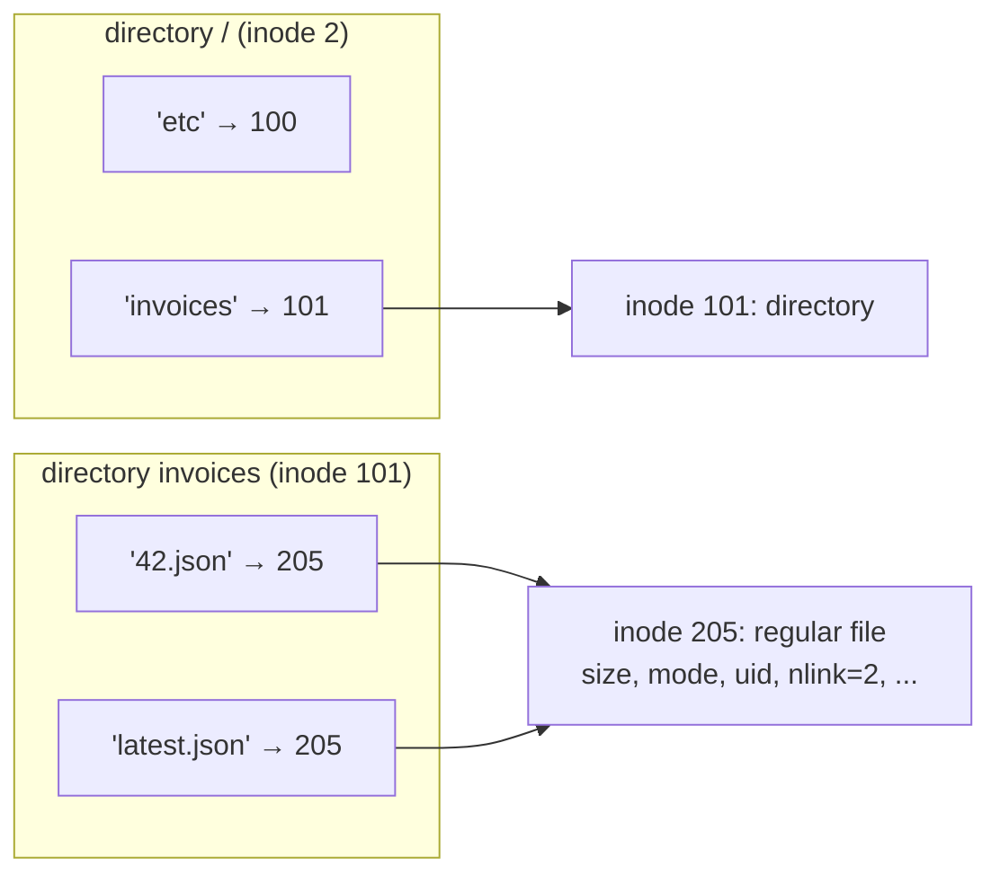
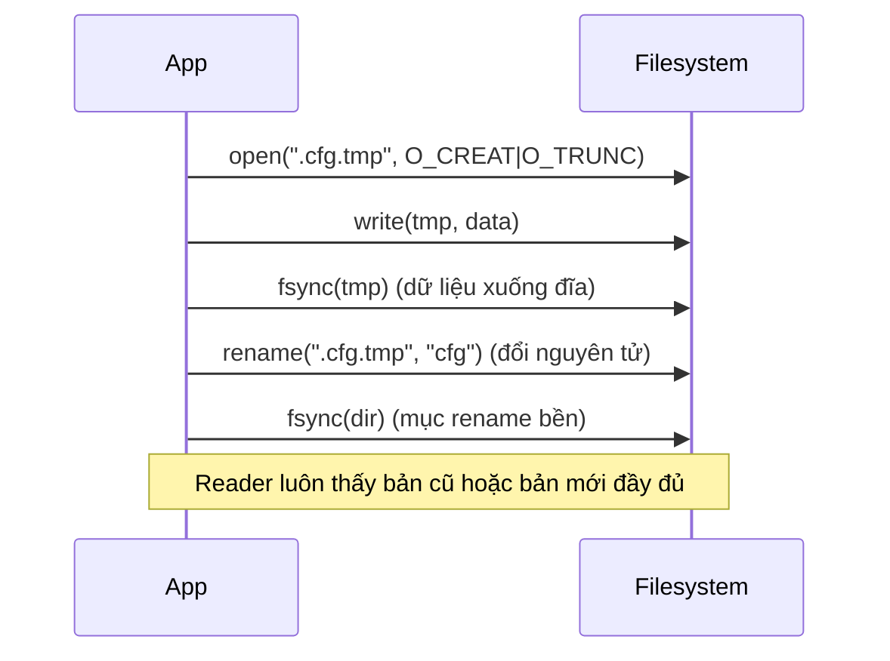

# P5 · Chương 02 — File và directory API

> Khẳng định về syscall là về **Linux** (man page Debian bookworm, man-pages 6.03). Các thí nghiệm chạy trong container lab (`./labs/linux.sh`, kernel 6.8.0, `rustc 1.95.0`); kết quả là *quan sát* một lần chạy, không phải bảo đảm. Số liệu ghi rõ filesystem nào: `/tmp` trong container là `overlay`, `/dev/shm` là `tmpfs`, `/work` là `virtiofs` (đọc từ `/proc/mounts` và `df -T` của máy lab).

## Bạn sẽ hiểu được gì

1. **Q1.** File và directory khác nhau thế nào ở mức "đối tượng"; inode number là gì và directory thực chất lưu gì? → mục 1
2. **Q2.** `offset` nằm ở đâu, `lseek`/`pread`/`pwrite` khác `read`/`write` chỗ nào, và vì sao `write` thành công chưa có nghĩa là dữ liệu đã ở trên đĩa? → mục 2
3. **Q3.** Vì sao xóa file trong Unix gọi là `unlink`; hard link, symbolic link và reference count liên quan gì tới nhau? → mục 3
4. **Q4.** `rename(2)` bảo đảm gì, và mẫu "ghi file tạm rồi rename" thay file một cách an toàn như thế nào (cùng những gì nó *chưa* bảo đảm)? → mục 4
5. **Q5.** Path được phân giải từng bước ra sao; mount làm "cây thư mục" ghép từ nhiều filesystem như thế nào; vì sao `rename`/`link` không đi qua ranh giới mount? → mục 5
6. **Q6.** Sparse file là gì; vì sao `st_size` có thể lớn hơn nhiều so với dung lượng thật chiếm trên đĩa? → mục 6
7. **Q7.** Khóa file (`flock`, `fcntl`) khóa cái gì và có thật sự ngăn người khác ghi không? → mục 7
8. **Q8.** Các API tương ứng trong `std::fs` của Rust 1.95.0 là gì, và chúng map sang syscall nào? → mục 8

## Kiến thức cần trước

- [P1 · Chương 04 — File descriptor và VFS](../01-linux/04-file-descriptor-va-vfs.md): fd, open file description (OFD), inode, VFS. Chương này dùng lại các khái niệm đó và tập trung vào *API thao tác file/directory*.
- [P1 · Chương 06 — User, quyền và /proc, /sys](../01-linux/06-user-quyen-proc-sys.md): mô hình quyền rwx, uid/gid (chỉ nhắc ngắn ở đây).
- [P5 · Chương 01 — Thiết bị lưu trữ](01-thiet-bi-luu-tru.md). Các chương sau: [03](03-cai-dat-file-system.md) (inode/block trên đĩa), [04](04-page-cache-va-direct-io.md) (page cache), [05](05-crash-consistency-va-journaling.md) (crash consistency), [06](06-durability-trong-thuc-te.md) (`fsync` thực tế), [08](08-rust-va-luu-tru.md) (Rust).

## 1. Hai trừu tượng: file và directory (Q1)

> **Trả lời ngắn.** File là một mảng byte tuyến tính[^ostep-file]. Mỗi file có một tên cấp thấp gọi là inode number[^ostep-inum]. Directory cũng có inode number, nhưng nội dung của nó là danh sách các cặp (tên đọc được, tên cấp thấp)[^ostep-dir]. Vì vậy directory là bảng ánh xạ tên → inode, còn tên không nằm trong inode.

**Giải thích.**

*Với service của bạn.* Xuyên suốt chương này ta dùng một service giả định tên `billing` (nhận xét của người soạn: đây là ví dụ do người soạn nghĩ ra, không phải code trong repo). `billing` viết bằng Rust, chạy trên Linux, nhận request tạo hóa đơn và lưu mỗi hóa đơn thành một file `invoices/<id>.json`. Nó đọc cấu hình từ `billing.toml`, ghi log ra `billing.log`, và mỗi đêm một job export đọc lại toàn bộ thư mục `invoices/`. Mỗi mục sẽ lấy một việc cụ thể của `billing` làm câu hỏi dẫn. Câu hỏi của mục này: khi `billing` mở `invoices/42.json`, cái tên đó thực sự trỏ tới cái gì?

Một ứng dụng cần dữ liệu còn nguyên sau lần chạy kế tiếp, nhưng nó không cần biết đĩa chia khối thế nào. Hệ điều hành che chuyện đó bằng hai trừu tượng. Trừu tượng thứ nhất là file: với `billing`, `42.json` chỉ là một dãy byte, đọc ghi theo vị trí. Mỗi file mang một tên cấp thấp, thường gọi là **inode number** (i-number).

Trừu tượng thứ hai là **directory**, ví dụ `invoices/`. Directory cũng có inode number, nhưng nội dung của nó rất đặc thù: một danh sách cặp (tên người đọc được, inode number). Nói cách khác, **directory là bảng ánh xạ tên → inode**. File không "có" tên; tên chỉ là một mục (entry) trong directory trỏ tới file. Hệ quả: hai mục khác tên hoàn toàn có thể trỏ cùng một inode, như `42.json` và `latest.json` trong hình dưới (đây chính là hard link, mục 3).



*(Số inode minh họa của người soạn.)*

Còn inode thì chứa gì? Mỗi file có một inode giữ metadata của file[^inode-meta]. Số inode chỉ được bảo đảm duy nhất trong phạm vi một filesystem[^inode-unique], và chi tiết này sẽ giải thích vì sao hard link không vượt được filesystem. Metadata gồm loại file, quyền, uid/gid, kích thước, số hard link, timestamp… (bảng ở phần Đi sâu bên dưới). Điều cần nhớ là **tên không nằm trong inode**.

Cuối cùng, `billing` không có cách nào "ghi thẳng vào directory". Bạn không bao giờ ghi trực tiếp vào directory được[^ostep-nodirwrite]. Filesystem coi định dạng directory là metadata của nó và tự chịu trách nhiệm toàn vẹn, nên directory chỉ đổi gián tiếp khi bạn tạo file, directory hoặc link bên trong. Mỗi directory luôn có hai mục đặc biệt: `.` trỏ về chính nó và `..` trỏ về cha[^ostep-dotdot].

<details><summary>Đi sâu: <code>stat</code> và các trường metadata; <code>rmdir</code>, đọc directory</summary>

**`stat(2)` và metadata.**

`stat()` trả thông tin file trong `struct stat`. Nó không đòi quyền gì trên chính file, nhưng với `stat`/`lstat` thì cần quyền *execute (search)* trên mọi directory dọc đường dẫn[^stat-perm]. `lstat()` giống `stat()`, chỉ khác là nếu pathname là symbolic link thì nó trả thông tin về chính symlink[^lstat]. `fstat` thì lấy theo fd.

Một số trường quan trọng của inode theo `inode(7)`:

| Trường | Ý nghĩa |
|---|---|
| `st_ino` | inode number, duy nhất trong một filesystem[^inode-unique] |
| `st_nlink` | số hard link của file[^inode-nlink] |
| `st_size` | kích thước theo byte (file thường hoặc symlink)[^inode-size] |
| `st_blocks` | số block đã cấp phát, đơn vị 512 byte; có thể nhỏ hơn `st_size/512` khi file có hole[^inode-blocks] |
| `st_mode`, `st_uid`, `st_gid` | loại file + quyền, chủ sở hữu |

Trong Rust, `fs::metadata` ứng với `stat` (đi theo symlink)[^rust-stat], còn `fs::symlink_metadata` ứng với `lstat` (không đi theo)[^rust-metadata]. Trên Unix, `MetadataExt` cho thêm `ino()`, `nlink()` và `blocks()` (đơn vị 512 byte)[^rust-metadataext]. Metadata chỉ là ảnh chụp tại thời điểm gọi; phần Đi sâu của mục 2 sẽ nói vì sao điều này gây ra TOCTTOU.

**Thao tác trên directory.**

- `rmdir()` xóa directory, và directory đó phải rỗng[^rmdir]. Lý do là xóa directory nguy hiểm hơn xóa file, vì một lệnh có thể xóa rất nhiều dữ liệu, nên `rmdir()` chỉ chạy được trên directory rỗng[^ostep-rmdir]. (Errno `ENOTEMPTY`/`EISDIR` đã thấy ở thí nghiệm trong phần Đi sâu của mục 3.)
- Đọc directory: kernel có `getdents`, đọc nhiều `linux_dirent` từ fd của directory vào buffer. Man page nói đó là giao diện kernel trần[^getdents], và ứng dụng nên dùng `readdir(3)` thay vì gọi thẳng[^getdents-readdir]. OSTEP minh họa vòng lặp `opendir`/`readdir`/`closedir`, mỗi mục là một `struct dirent` có tên và inode number[^ostep-readdir].

Trong Rust, `fs::read_dir` trả iterator `io::Result<DirEntry>` và bỏ qua `.` với `..`. **Thứ tự các mục có thể thay đổi giữa các lần gọi**, nên cần sắp xếp nếu muốn kết quả tái lập; trên Unix hàm này ứng với `opendir`/`readdir`[^rust-readdir]. Trong thí nghiệm, `read_dir(".")` ra `y`, `s.txt`, `dir`, không theo thứ tự tên.

</details>

**Quay lại Q1:** directory là bảng (tên → inode number); file chỉ là mảng byte có inode number, và tên không nằm trong inode. Với `billing`, `invoices/42.json` là một mục trong directory `invoices` trỏ tới một inode.

## 2. Offset, `pread`/`pwrite` và vì sao `write` chưa bền (Q2)

> **Trả lời ngắn.** Offset là vị trí cho lần `read`/`write` kế tiếp và nằm ở open file description, không nằm ở file[^lseek-whence]. `lseek` đổi offset đó, còn `pread`/`pwrite` nhận offset làm tham số và không đổi offset chung[^pread-nooff]. `write` thành công chỉ nghĩa là filesystem đã nhận dữ liệu và sẽ ghi xuống thiết bị vào một lúc nào đó[^ostep-buffer]. Muốn ép xuống ngay thì phải gọi `fsync`[^fsync-def].

**Giải thích.**

*Với service `billing`.* Hai chuyện cụ thể. Thứ nhất, vài handler thread của `billing` cùng đọc một file index qua một fd chung (giả định của người soạn); làm sao mỗi thread đọc đúng chỗ mình cần mà không giẫm lên thread kia? Thứ hai, handler ghi xong hóa đơn rồi trả `201 Created`; nếu máy mất điện ngay sau đó, hóa đơn còn không? Câu trả lời cho cả hai nằm ở chỗ offset sống ở đâu và `write` thực sự làm gì.

### 2.1 Từ đường dẫn tới fd

`open(2)` trả về một fd, là tham chiếu tới một *open file description*. Tham chiếu này không bị ảnh hưởng nếu pathname sau đó bị xóa hoặc bị sửa để trỏ sang file khác[^open-fd-ref]. Mỗi lần `open()` tạo một OFD mới, nên có thể có nhiều OFD cho cùng một inode[^open-ofd-new]. `dup` và `fork` thì chỉ sao chép *fd*, còn OFD vẫn dùng chung, tức chung cả **offset** lẫn status flag[^open-ofd-share]. (Ba tầng fd → OFD → inode nằm ở [P1 · Chương 04](../01-linux/04-file-descriptor-va-vfs.md).)

Với `billing`, các thread dùng chung một fd tức là dùng chung một OFD, và vì vậy dùng chung một offset. Offset là vị trí cho lần `read`/`write` kế. `lseek(2)` đặt lại offset của OFD theo `SEEK_SET`, `SEEK_CUR` hoặc `SEEK_END`[^lseek-whence]. Bản thân lệnh này hoàn toàn không gây I/O đĩa nào; nó chỉ ảnh hưởng tới lần `read` hoặc `write` sắp tới[^ostep-lseek-noio].

`lseek` còn cho đặt offset **vượt cuối file** mà không đổi kích thước. Nếu sau đó ghi vào chỗ đó, vùng trống ở giữa (một "hole") đọc ra toàn byte `\0`[^lseek-hole].

### 2.2 `pread`/`pwrite`: offset truyền vào, không đụng offset chung

Giả sử thread A của `billing` gọi `lseek` tới offset 4096 rồi `read`, và thread B xen vào giữa hai lời gọi đó để `lseek` sang chỗ khác. A sẽ đọc nhầm chỗ, vì `lseek` rồi `read` là **hai** syscall trên một offset *dùng chung*.

`pread()` giải quyết đúng chỗ này: nó đọc `count` byte tại `offset` truyền vào và offset của file không đổi; `pwrite` tương tự[^pread-nooff]. Man page nói chúng đặc biệt hữu ích cho ứng dụng đa luồng, vì nhiều thread dùng chung một fd mà không bị ảnh hưởng bởi thay đổi offset của thread khác[^pread-mt]. Một syscall duy nhất vừa chỉ vị trí vừa đọc, nên không còn khoảng hở cho thread khác chen vào.

Có một cạm bẫy riêng của Linux. POSIX yêu cầu `O_APPEND` không ảnh hưởng vị trí `pwrite` ghi, nhưng trên Linux, nếu file mở với `O_APPEND` thì `pwrite()` luôn ghi nối vào cuối file, bất kể giá trị offset[^pwrite-append].

Còn một điều nữa: cả `pread`/`pwrite` lẫn `read`/`write` đều có thể trả về **ít byte hơn yêu cầu** mà không phải lỗi[^pread-short]. Code đúng phải lặp cho tới khi đủ.

### 2.3 Ghi xuống đĩa: `write` chưa phải bền vững

Quay lại câu hỏi mất điện sau khi `billing` trả `201`. Phần lớn lần gọi `write()` chỉ bảo filesystem ghi dữ liệu xuống nơi lưu trữ bền vào một lúc nào đó trong tương lai; filesystem buffer trong bộ nhớ một lúc (ví dụ 5 hay 30 giây) rồi mới đẩy xuống thiết bị[^ostep-buffer]. Nếu `billing` chỉ `write` rồi trả `201` thì hóa đơn có thể vẫn nằm trong bộ nhớ khi máy mất điện.

Với DBMS, giao thức recovery đúng cần ép dữ liệu xuống đĩa vào thời điểm xác định, và Unix cung cấp `fsync(fd)` cho việc đó[^ostep-fsync]. `fsync(2)` chuyển ("flush") mọi dữ liệu in-core đã sửa của file mà fd tham chiếu xuống thiết bị đĩa (hoặc thiết bị lưu trữ bền khác), để mọi thay đổi vẫn đọc lại được kể cả khi hệ thống crash hoặc khởi động lại. Nó gồm cả việc flush cache của đĩa nếu có, và gọi chặn tới khi thiết bị báo xong[^fsync-def]. `fsync` flush cả metadata của file, nhưng **không** đảm bảo mục directory chứa file đã xuống đĩa; muốn vậy cần `fsync` lên fd của chính directory[^fsync-dir]. Nói thẳng ra: `billing` có thể đã `fsync` đúng `42.json` mà tên `42.json` vẫn mất sau crash.

`fdatasync()` giống `fsync()` nhưng không flush metadata, trừ khi metadata đó cần để đọc lại dữ liệu cho đúng. Đổi `st_mtime` thì không cần flush, còn đổi kích thước file thì cần[^fdatasync].

Trong Rust 1.95.0, `File::sync_all` cố gắng đồng bộ xuống đĩa mọi nội dung file và metadata do hệ điều hành giữ trong nội bộ[^rust-sync-all]. `sync_data` có thể không đồng bộ metadata của file, và có nền tảng cài nó bằng `sync_all`[^rust-sync]. Quan sát bằng `strace` trên Linux: `sync_all()` thành `fsync(3)`.

Còn một chuyện nhỏ về lỗi. Drop `File` bỏ qua mọi lỗi, nên lỗi chỉ phát hiện lúc đóng sẽ bị nuốt; `sync_all` cho phép bắt chúng, và thường đắt hơn đóng file vì drop không chặn chờ dữ liệu xuống[^rust-sync-drop].

> Giữa `fsync` và vật lý còn write cache, barrier, lỗi writeback…: [chương 06](06-durability-trong-thuc-te.md). Nhớ: *`write` ≠ bền; `fsync` file ≠ bền tên file*.

<details><summary>Đi sâu: thí nghiệm offset, <code>O_APPEND</code>/<code>O_EXCL</code> và TOCTTOU</summary>

**Thí nghiệm: offset chung và offset riêng.**

Chương trình Rust (container Linux) dùng `OpenOptions`, `try_clone` (dup), `read_at`/`write_at`; kết quả quan sát được (Linux 6.8, overlayfs):

```
pos after write = 11
read_at(6) = "world" n=5, pos still = 11
pos after write_at = 11
clone pos = 2                      <- dup chung offset
second open pos = 0                <- open lần 2: offset riêng
second open pos after read = 1, first = 2
size after write at 20 = 21        <- seek tới 20 rồi ghi 1 byte
bytes = [... 68, 0,0,0,0,0,0,0,0,0, 88]   <- 9 byte \0 lấp khoảng trống
```

**`O_APPEND` và `O_EXCL`: hai cờ nguyên tử đáng biết.** Cả hai đều áp dụng được cho `billing`: một cờ cho log, một cờ cho việc tạo hóa đơn mới.

- `O_APPEND`: trước mỗi `write`, offset được đặt về cuối file, và việc sửa offset cùng thao tác ghi được thực hiện như một bước nguyên tử duy nhất[^append-atomic]. Man page cảnh báo trên NFS, nhiều process cùng append có thể làm hỏng file, vì NFS không hỗ trợ append và kernel phải mô phỏng, nên có race[^append-nfs]. Rust nói tương tự: `append(true)` đảm bảo ghi ở cuối file kể cả khi process/thread khác cũng đang append, khác với `seek(End(0))` rồi `write` vốn có race[^rust-append]. Tuy vậy nó không đảm bảo dữ liệu của các writer không xen kẽ nhau[^rust-append-interleave].
- `O_CREAT|O_EXCL`: nếu file đã tồn tại thì `open` thất bại với `EEXIST`[^excl]. Trong Rust đó là `OpenOptions::create_new(true)`, hữu ích vì nó nguyên tử: kiểm tra rồi tạo bằng hai bước sẽ để hở một khoảng cho process khác chen vào[^rust-create-new]. Với `billing`, đó là cách tạo `invoices/42.json` mà không đè nhầm hóa đơn đã có.

Hai cờ này tồn tại vì **TOCTTOU** (Time Of Check To Time Of Use): giữa lúc kiểm tra và lúc sử dụng, trạng thái có thể đã bị đổi. OSTEP kể ví dụ một dịch vụ mail chạy root gọi `lstat()` kiểm tra inbox rồi mới ghi; kẻ tấn công `rename()` hoán inbox thành file nhạy cảm đúng giữa hai bước[^ostep-tocttou]. Bài học (nhận xét của người soạn): thay "kiểm tra rồi làm" bằng một thao tác nguyên tử (`create_new`, `O_APPEND`, `rename`).

</details>

**Quay lại Q2:** offset nằm ở open file description (`pread`/`pwrite` không đụng tới nó), và `write` chỉ đưa dữ liệu vào bộ đệm của kernel nên `billing` cần `fsync` trước khi báo cho client rằng hóa đơn đã lưu.

## 3. `unlink`, hard link, symlink và reference count (Q3)

> **Trả lời ngắn.** Tên trong directory chỉ là một liên kết tới inode, nên "xóa file" thực chất là `unlink`: gỡ một liên kết và giảm link count. Chỉ khi count về 0 filesystem mới giải phóng inode và block[^ostep-unlink]. Hard link là thêm một tên nữa cho cùng một file[^link-def]. Symbolic link là một file riêng chứa đường dẫn tới tên khác[^symlink-def]. Nếu còn process giữ fd mở thì file chỉ bị xóa thật sau khi fd cuối đóng[^unlink-open].

**Giải thích.**

*Với service `billing`.* Ops thấy `billing.log` đã lên 10 GB, bèn `rm billing.log` nhưng `df` vẫn không giảm chút nào, vì `billing` còn giữ fd mở trên file đó. Cùng một chuyện nhỏ này kéo theo cả loạt câu hỏi của mục: `rm` thực sự làm gì, hai tên cho một file nghĩa là gì, và `billing.toml` là symlink thì khác hard link ở đâu?

### 3.1 Vì sao xóa file gọi là `unlink`

Sao không là `remove` hay `delete`? Vì tên trong directory chỉ là một *liên kết* (link) tới inode. Tạo file thực ra làm hai việc: tạo cấu trúc inode, rồi gắn một tên người đọc được vào đó bằng một mục trong directory[^ostep-twothings]. Xóa thì đảo ngược lại. `unlink()` gỡ liên kết giữa tên và inode và giảm **reference count** (link count); chỉ khi count về 0 filesystem mới giải phóng inode và các data block[^ostep-unlink].

Man page `unlink(2)` nói sát hơn: nó xóa một tên khỏi filesystem, và nếu tên đó là link cuối cùng của file mà không process nào đang mở file thì file bị xóa và không gian nó dùng được giải phóng để tái sử dụng[^unlink-def]. Nếu vẫn còn process giữ fd mở, file tồn tại cho đến khi fd cuối cùng tham chiếu tới nó được đóng[^unlink-open]. Đó chính là chuyện của `billing.log`: tên đã mất nhưng inode và 10 GB vẫn còn cho tới khi `billing` đóng fd (hoặc restart).

Rust cũng cảnh báo tương tự: docs của `remove_file` nói không có bảo đảm file bị xóa ngay, vì tùy nền tảng, fd khác đang mở có thể cản[^rust-remove].

### 3.2 Hard link: `link(2)`

`link()` tạo hard link. Tên mới dùng được y hệt tên cũ: hai tên cùng tham chiếu một file, cùng quyền, cùng chủ, và không thể biết tên nào là tên "gốc"[^link-def]. Với `billing`, đó là cách để `latest.json` và `42.json` trỏ cùng một hóa đơn mà không tốn thêm byte dữ liệu nào (ví dụ minh họa của người soạn).

Hard link không vượt filesystem vì số inode chỉ duy nhất trong một filesystem, và không được trỏ vào directory để tránh vòng lặp trong cây[^symlink-hard]. Trong Rust, hàm là `std::fs::hard_link(original, link)`; docs ghi rằng trên hầu hết Unix nó ứng với `linkat` không cờ[^rust-hardlink].

### 3.3 Symbolic link: `symlink(7)`

Symlink khác hẳn: nó là một file *loại đặc biệt* mà nội dung là một chuỗi đường dẫn tới file khác (đọc bằng `readlink(2)`). Nó là con trỏ tới một *tên* khác chứ không phải tới đối tượng bên dưới, nên có thể trỏ vào directory, vượt filesystem, và có thể **dangling** (trỏ tới nơi không tồn tại)[^symlink-def]. Nếu `billing.toml` là symlink tới `config/prod.toml` thì xóa `config/prod.toml` sẽ để lại một `billing.toml` dangling (ví dụ minh họa của người soạn).

Vài chi tiết cần biết. Một số syscall *không* đi theo symlink ở thành phần cuối mà tác động lên chính symlink (`lstat`, `readlink`, `rename`, `rmdir`, `unlink`…); số khác (`open`, `linkat`…) đi theo tùy cờ[^symlink-follow]. Còn quyền của symlink thì trên Linux thường luôn là `0777` và không dùng trong kiểm tra quyền[^symlink-perm].

Trong Rust, `std::os::unix::fs::symlink(original, link)` tạo một symbolic link mới trên filesystem; đường dẫn `link` sẽ là symlink trỏ tới đường dẫn `original`[^rust-symlink].

<details><summary>Đi sâu: thí nghiệm nlink, symlink, unlink khi file còn mở</summary>

```
a.txt ino=1338438 nlink=1
b.txt ino=1338438 nlink=2                 <- hard_link("a.txt","b.txt"): cùng inode
s.txt (lstat) ino=1338449 nlink=1 type_is_symlink=true len=5   <- inode riêng, len = len("a.txt")
s.txt (stat)  ino=1338438                 <- stat đi theo symlink tới a.txt
after rm a.txt: b.txt nlink=1 ; s.txt exists? Err(NotFound)    <- symlink thành dangling
after unlink, nlink via fd = 0, read 21 bytes                  <- vẫn đọc được qua fd mở
exists by name: Err(NotFound)
hard_link dir: Err((PermissionDenied, Some(1)))                <- EPERM
remove_file(dir): Err(Some(21))                                <- EISDIR
remove_dir(dir) khi còn con: Err(Some(39))                     <- ENOTEMPTY
```

(overlayfs trên Linux 6.8; số inode thay đổi mỗi lần chạy.) `len=5` của symlink đúng bằng độ dài chuỗi `"a.txt"`, khớp `inode(7)`: kích thước symlink là độ dài đường dẫn nó chứa[^inode-size]. Hard link tới directory bị từ chối với `EPERM`, đúng như ERRORS của `link(2)` (`oldpath is a directory`)[^link-eperm].

</details>

**Quay lại Q3:** `unlink` gỡ một tên và giảm link count; hard link là thêm tên cho cùng inode, symlink là file riêng chứa đường dẫn, và file chỉ mất khi count về 0 và không còn fd mở. Vì thế `rm billing.log` chưa trả được dung lượng khi `billing` còn giữ fd.

## 4. `rename(2)`: nguyên tử và mẫu ghi file tạm (Q4)

> **Trả lời ngắn.** `rename` thay `newpath` một cách nguyên tử: không có thời điểm nào process khác thấy `newpath` biến mất[^rename-atomic]. Mẫu thay file an toàn là ghi file tạm, `fsync` nó, rồi `rename` đè lên đích[^ostep-tmp-rename]. Có hai thứ `rename` *chưa* bảo đảm. Thứ nhất, `fsync` file không bảo đảm mục trong directory đã xuống đĩa[^fsync-dir]. Thứ hai, `rename` không đi qua ranh giới mount[^exdev].

**Giải thích.**

*Với service `billing`.* Giả sử `billing` cập nhật `invoices/42.json` bằng cách mở file lên, truncate rồi ghi nội dung mới vào. Nếu crash giữa chừng, file chỉ còn nửa vời, và job export ban đêm sẽ đọc phải một JSON cụt. Ta muốn: reader luôn thấy hoặc bản cũ đầy đủ, hoặc bản mới đầy đủ. `rename` là công cụ cho việc đó.

### 4.1 Bảo đảm của `rename`

`rename()` đổi tên hoặc di chuyển file; các hard link khác và fd đang mở của `oldpath` không bị ảnh hưởng[^rename-def]. Điều quan trọng nhất là: nếu `newpath` đã tồn tại thì nó bị thay thế **nguyên tử**, để không có thời điểm nào process khác truy cập `newpath` thấy nó biến mất. Có thể có một khoảng rất ngắn cả hai tên cùng trỏ vào file[^rename-atomic]. Nếu thao tác thất bại, `rename` bảo đảm vẫn còn một bản `newpath`[^rename-fail].

Chữ "nguyên tử" ở đây có hai nghĩa khác nhau:

1. **Với process khác đang chạy**: man page bảo đảm điều vừa nói ở trên. Job export của `billing` không bao giờ thấy `42.json` biến mất giữa chừng.
2. **Với crash**: OSTEP nói rename (thường) được cài đặt như một lời gọi nguyên tử đối với crash hệ thống, nghĩa là sau crash, tên là tên cũ hoặc tên mới, không có trạng thái lơ lửng[^ostep-rename-crash]. Lưu ý OSTEP chỉ nói "usually", còn man page bookworm của `rename` không hứa điều này. Cái được hứa cho crash tùy filesystem và journaling; xem [chương 05](05-crash-consistency-va-journaling.md).

Còn một giới hạn nữa. `rename` và `link` trả `EXDEV` khi `oldpath` và `newpath` không nằm trên cùng một mounted filesystem. Man page nói thêm rằng kể cả khi cùng một filesystem được mount ở nhiều nơi, `rename()` vẫn không đi qua các mount point khác nhau[^exdev]. `link()` cũng vậy[^link-exdev]. Rust docs ghi tương tự: hàm sẽ không hoạt động nếu tên mới nằm ở mount point khác[^rust-rename]. Thử trong lab: `fs::rename("/tmp/…", "/dev/shm/…")` trả `CrossesDevices` (errno 18), còn `ln /tmp/f /dev/shm/f` báo "Invalid cross-device link". Với `billing`, hệ quả thực tế là file tạm phải nằm **cùng mount (tốt nhất cùng directory)** với file đích. Đừng ghi bản tạm vào `/tmp` rồi `rename` sang volume dữ liệu.

### 4.2 Mẫu "tmp + rename"

OSTEP mô tả một trình soạn thảo cập nhật `foo.txt` như sau: ghi bản mới ra `foo.txt.tmp`, `fsync()` nó, rồi `rename("foo.txt.tmp", "foo.txt")`. Bước cuối hoán đổi nguyên tử file mới vào chỗ và đồng thời xóa phiên bản cũ[^ostep-tmp-rename]. `billing` làm đúng như vậy với `invoices/42.json`:



Code Rust đầy đủ (đã chạy; `strace` xác nhận chuỗi `openat(O_WRONLY|O_CREAT|O_TRUNC)` → `write` → `fsync` → `renameat` → `openat(dir)` → `fsync`):

```rust
fn atomic_write(path: &Path, data: &[u8]) -> io::Result<()> {
    let dir = path.parent().unwrap();
    let tmp = dir.join(format!(".{}.tmp", path.file_name().unwrap().to_string_lossy()));
    let mut f = OpenOptions::new().write(true).create(true).truncate(true).open(&tmp)?;
    f.write_all(data)?;
    f.sync_all()?;                 // fsync(file tạm)
    drop(f);
    fs::rename(&tmp, path)?;       // renameat
    File::open(dir)?.sync_all()?;  // fsync(thư mục)
    Ok(())
}
```

Gọi hai lần với `"v1"` rồi `"version-2"` đọc lại ra `"version-2"` và thư mục chỉ còn `config.toml` (không sót file tạm). Điều kiện là `tmp` cùng thư mục với `path` để tránh `EXDEV`.

Hàm này *chưa xử lý* ba việc (nhận xét của người soạn): file tạm sót lại khi crash, tên tạm trùng nhau giữa hai writer, và giữ quyền/owner của file cũ. Về độ bền của mẫu này (`fsync` file và thư mục), xem [chương 06](06-durability-trong-thuc-te.md) mục 3–4; ba điểm vừa nêu không được bàn thêm ở đó.

<details><summary>Đi sâu: ext4 và "ứng dụng quên fsync"</summary>

Tài liệu mount option của ext4 nói rằng nhiều ứng dụng hỏng không dùng `fsync()` khi thay file có sẵn theo các mẫu như ... rename. Nếu bật `auto_da_alloc` (mặc định), ext4 phát hiện mẫu replace-via-rename/truncate và ép các block cấp phát trễ được cấp phát, để ở lần journal commit kế (chế độ `data=ordered` mặc định) dữ liệu file mới xuống đĩa **trước** khi rename được commit, tránh lỗi file "zero-length"[^ext4-autodalloc]. Đó là hành vi của ext4, không phải bảo đảm của POSIX hay của `rename(2)`. Vì thế mẫu có `fsync` tường minh (như trên) vẫn là cách đúng (nhận xét của người soạn).

</details>

**Quay lại Q4:** `rename` đè đích nguyên tử (với process khác), nên `billing` ghi file tạm cùng mount, `fsync`, `rename`, rồi `fsync` thư mục để thay hóa đơn an toàn.

## 5. Mount và phân giải đường dẫn (Q5)

> **Trả lời ngắn.** Path được duyệt từng thành phần, bắt đầu từ root directory hoặc thư mục làm việc hiện tại, và mỗi thành phần được tra trong directory trước đó[^pathres-start]. `mount` gắn một filesystem vào một directory có sẵn, nên người dùng thấy một cây duy nhất dù có nhiều filesystem[^ostep-mount]. `rename` và `link` trả `EXDEV` khi hai đường dẫn không nằm trên cùng một mounted filesystem[^exdev].

**Giải thích.**

*Với service `billing`.* Trên server thật, `/var/lib/billing` thường là một volume riêng, còn `/tmp` thì thuộc filesystem khác (giả định của người soạn). Với `billing`, cái tên `/var/lib/billing/invoices/42.json` vì thế đi qua một ranh giới mount mà code không hề thấy. Mục này trả lời hai câu: kernel đi từng bước thế nào từ chuỗi path đó tới inode, và ranh giới mount ảnh hưởng gì tới `rename`/`link` đã nói ở mục 3–4.

### 5.1 Mount

Một máy có thể có nhiều filesystem (đĩa, USB, tmpfs, mạng…) mà người dùng chỉ thấy **một cây**. Cách làm: `mkfs` ghi một filesystem rỗng (bắt đầu từ root directory) lên một thiết bị hoặc partition, rồi `mount` lấy một directory có sẵn làm **mount point** và dán filesystem mới vào cây thư mục tại điểm đó[^ostep-mount]. Ở mức syscall, `mount()` gắn filesystem do `source` chỉ định vào vị trí mà pathname `target` chỉ tới[^mount-attach]. Gọi nó cần quyền `CAP_SYS_ADMIN`[^mount-def].

Sau `mount dev path`, `path` trỏ tới gốc filesystem trên `dev`; nhưng `path/..` vẫn là cha của `path` bên ngoài filesystem đó[^pathres-mount].

### 5.2 Path resolution

Thuật toán phân giải path mô tả trong `path_resolution(7)`. Ta đi qua với path `/var/lib/billing/invoices/42.json`:

1. **Điểm bắt đầu.** Path bắt đầu bằng `/` nên kernel đi từ root directory của process (kế thừa từ cha, đổi bằng `chroot`). Nếu không có `/` đầu thì đi từ thư mục làm việc hiện tại, hoặc từ `dfd` với họ syscall `*at`[^pathres-start].
2. **Duyệt từng thành phần không phải cuối** (`var`, `lib`, `billing`, `invoices`). Mỗi thành phần được tra trong thư mục hiện tại. Không có quyền search thì trả `EACCES`; không thấy thì `ENOENT`; thấy nhưng không phải directory hay symlink thì `ENOTDIR`[^pathres-errors]. Nếu là directory, kernel đi tiếp vào đó; nếu là symlink, nó phân giải symlink rồi tiếp tục[^pathres-walk].
3. **Giới hạn symlink.** Linux hiện theo tối đa 40 symlink cho cả đường dẫn; vượt thì `ELOOP`[^pathres-eloop].
4. **Thành phần cuối** (`42.json`) được tra tương tự, nhưng không nhất thiết phải tồn tại, vì có thể ta đang tạo mới; hành vi cụ thể tùy syscall[^pathres-final].
5. `.` và `..` được coi theo nghĩa quy ước dù có thật trong filesystem hay không, và `/..` vẫn là `/`[^pathres-dots].

Khi bước 2 đi qua `/var/lib/billing` (mount point của volume), kernel chuyển sang filesystem của volume rồi tra `invoices` ở đó. Đó cũng là lý do `rename` từ `/tmp` sang đây trả `EXDEV`: hai bên không cùng một mounted filesystem (mục 4.1).

<details><summary>Đi sâu: quyền khi duyệt path; vì sao <code>rename</code>/<code>link</code> không qua mount</summary>

Quyền xuất hiện ở hai chỗ: quyền *search* (x) trên mọi directory dọc đường, và quyền của thao tác trên thành phần cuối. Ví dụ `unlink` đòi quyền ghi trên *directory chứa* tên, không phải trên chính file[^unlink-eacces]. Mô hình rwx/uid/gid ở [P1 · Chương 06](../01-linux/06-user-quyen-proc-sys.md).

- Hard link không vượt filesystem vì số inode chỉ duy nhất trong một filesystem[^symlink-hard]. Việc `rename`/`link` dừng ở ranh giới mount: xem mục 4.1.

</details>

**Quay lại Q5:** path được duyệt từng thành phần từ root hoặc thư mục hiện tại; mount ghép nhiều filesystem thành một cây, và `rename`/`link` dừng lại ở ranh giới mount với `EXDEV`, nên file tạm của `billing` phải nằm cùng mount với file đích.

## 6. Sparse file và `st_size` so với dung lượng thật (Q6)

> **Trả lời ngắn.** Sparse file là file có hole: vùng ở giữa đọc ra toàn byte `\0`[^lseek-hole] mà không cần chiếm block trên đĩa. `st_size` là kích thước logic, còn `st_blocks` đếm block đã cấp phát và có thể nhỏ hơn `st_size/512` khi file có hole[^inode-blocks]. Có thể dò vùng có dữ liệu bằng `lseek` với `SEEK_DATA`/`SEEK_HOLE`[^seek-holedata].

**Giải thích.**

*Với service `billing`.* Giả sử `billing` tạo một file index bằng `set_len(1 << 30)`, rồi chỉ ghi vài byte ở đầu và ở cuối (giả định của người soạn). `ls -l` báo 1 GiB, nhưng `df` hầu như không nhúc nhích. Mục này giải thích hai con số đó lệch nhau thế nào và vì sao điều ấy quan trọng khi bạn backup file.

Cơ chế nằm ở hole đã gặp ở §2.1. Sparse file là file có hole: vùng không được cấp phát trên thiết bị nhưng đọc ra toàn `\0`. `lseek` có hai giá trị để dò: `SEEK_DATA` dịch offset tới vị trí kế (≥ offset) có dữ liệu, còn `SEEK_HOLE` dịch tới hole kế, hoặc tới cuối file nếu không có hole nào nữa (cuối file coi là một "implicit hole")[^seek-holedata]. Các phép dò này cho phép công cụ backup bỏ qua hole[^seek-backup].

Đừng dựa hoàn toàn vào chúng, vì filesystem không bắt buộc báo hole[^seek-optional]. Cài đặt đơn giản nhất cho `SEEK_HOLE` là luôn trả về cuối file[^seek-simplest].

Với backend (nhận xét của người soạn): image VM và file DB thường là sparse. Copy bằng công cụ không biết hole sẽ làm file "phình" ra đủ `st_size`, còn `billing` có thể hết đĩa ở nơi backup dù file nguồn nhỏ.

<details><summary>Đi sâu: điều kiện hỗ trợ của <code>SEEK_DATA</code>/<code>SEEK_HOLE</code>, và thí nghiệm file 1 GiB trên overlay, tmpfs, virtiofs</summary>

**Điều kiện hỗ trợ.**

- Hai giá trị này không thuộc POSIX. Linux có chúng từ 3.1[^seek-since31], và Solaris, FreeBSD, DragonFly BSD cũng có[^seek-nonstd].
- Muốn dùng trong C phải định nghĩa `_GNU_SOURCE`[^seek-gnu].
- ext4, XFS, Btrfs, tmpfs… nằm trong danh sách hỗ trợ của man page 6.03[^seek-fs]. overlayfs và virtiofs không có trong danh sách đó, nên kết quả dưới đây chỉ là quan sát.

**Thí nghiệm.** Tạo file 1 GiB bằng `set_len(1 << 30)`, ghi 4 byte `head` ở offset 0 và 4 byte `tail` ở `1 GiB − 12 288`, rồi `lseek(SEEK_DATA/SEEK_HOLE)` (khai báo `extern "C"` cho `lseek` vì thư viện chuẩn Rust không có `SEEK_DATA`):

```
[/tmp/w05sp] st_size=1073741824 st_blocks=16 (=> 8192 bytes allocated)
  data  [0, 4096)  len=4096
  data  [1073729536, 1073733632)  len=4096
[/dev/shm] st_blocks=16 (như trên)
[/work, virtiofs, chạy lại] st_blocks=16, cùng hai vùng 4096 byte
```

(Linux 6.8; overlay, tmpfs và virtiofs.) Đọc kết quả:

- `st_size` là 1 GiB nhưng chỉ ~8 KiB được cấp phát: hai "trang" 4096 byte chứa 4 byte ghi vào. Khớp `inode(7)`: `st_blocks` đếm theo 512-byte và có thể nhỏ hơn `st_size/512` khi có hole[^inode-blocks].
- Mức hạt (granularity) của vùng cấp phát **do filesystem quyết định** và có thể đổi theo môi trường: một lần chạy trước đó trên `/work` (virtiofs) từng báo `st_blocks=64` với mỗi vùng 16 KiB, nhưng ba lần chạy lại sau đó đều ra 4 KiB như overlay/tmpfs. Đừng giả định kích thước hole/extent, và đừng coi con số của một lần chạy là thuộc tính của một loại filesystem.

</details>

**Quay lại Q6:** `st_size` đếm kích thước logic, `st_blocks` đếm phần thật sự được cấp phát, nên file index sparse của `billing` có `st_size` lớn hơn nhiều dung lượng chiếm trên đĩa.

## 7. Khóa file: `flock` và `fcntl` (Q7)

> **Trả lời ngắn.** `flock` khóa cả file, `fcntl` khóa theo dải byte, nhưng cả hai mặc định chỉ là advisory: process không kiểm tra khóa vẫn đọc ghi file bình thường[^flock-advisory]. Điểm dễ nhầm là khóa gắn với process hay với open file description[^flock-ofd].

**Giải thích.**

*Với service `billing`.* Khi rolling deploy, bản `billing` cũ và bản mới có thể chạy chồng nhau một lúc, và cả hai cùng mở file `billing.state` để ghi (giả định của người soạn). Muốn chỉ một bên ghi tại một thời điểm, `billing` xin một khóa trên file. Hai chuyện cần biết: khóa đó có thật sự chặn được bên kia không, và nó thuộc về ai khi process có nhiều fd.

Linux có hai họ khóa, khác nhau ở phạm vi và ở chủ sở hữu khóa.

**`flock(2)`** đặt hoặc gỡ một advisory lock trên file đang mở do fd chỉ định. Có `LOCK_SH` (nhiều reader), `LOCK_EX` (một writer), `LOCK_UN`, và `LOCK_NB` để không chặn[^flock-def]. Tên reader/writer chỉ là quy ước, vì khóa nào cũng đặt được bất kể file mở ở mode nào[^flock-anymode]. Khóa gắn với **open file description**. Fd nhân bản bằng `dup`/`fork` dùng chung khóa; còn hai lần `open` cùng file được coi là độc lập và có thể chặn nhau, kể cả trong cùng một process[^flock-ofd]. Khóa được nhả khi `LOCK_UN` hoặc khi mọi fd nhân bản của OFD đã đóng. Chuyển đổi khóa (shared↔exclusive) *không* đảm bảo nguyên tử[^flock-convert].

**`fcntl(2)` record lock** khóa theo dải byte. Loại "process-associated" truyền thống gắn với *process*. Nếu process đóng *bất kỳ* fd nào của file, **mọi** khóa của nó trên file đó bị nhả. Man page gọi hành vi này là "bad", vì một hàm thư viện mở-đọc-đóng file như `/etc/passwd` cũng làm mất khóa của bạn[^fcntl-posix]. Khóa này không được thừa kế qua `fork` (nhưng giữ qua `execve`)[^fcntl-nofork]. Các thread trong process chia sẻ khóa, nên không dùng nó để loại trừ lẫn nhau giữa thread[^fcntl-threads]. Từ Linux 3.15[^fcntl-since] có thêm **open file description lock** (`F_OFD_SETLK`…), gắn với OFD như `flock`, được thừa kế qua `fork` và chỉ nhả ở lần `close` cuối của OFD[^fcntl-ofd].

| | `flock` | `fcntl` truyền thống | `fcntl` OFD |
|---|---|---|---|
| gắn với | OFD | process | OFD |
| sau `fork` | con dùng chung khóa | con không có khóa | con thừa kế |
| khi `close` | nhả ở close cuối của OFD | đóng bất kỳ fd nào của file là nhả hết | nhả ở close cuối của OFD |
| phạm vi | cả file | dải byte | dải byte |

**Còn câu hỏi "có chặn được không".** `flock` chỉ là advisory: một process được tự do bỏ qua `flock()` và thực hiện I/O trên file[^flock-advisory]. Mặc định cả hai loại khóa `fcntl` cũng advisory, nên chỉ hữu ích giữa các process hợp tác[^fcntl-adv]. Với `billing`, điều đó có nghĩa khóa chỉ bảo vệ được khi *mọi* bản `billing` đều xin khóa trước khi ghi; một công cụ ngoài mở file ra ghi thì khóa không ngăn được.

<details><summary>Đi sâu: mandatory locking, NFS và thí nghiệm <code>File::lock</code> trên Linux</summary>

**Mandatory locking và NFS.** Linux từng có mandatory locking, nhưng man page cảnh báo cài đặt không đáng tin; từ Linux 4.5 nó chỉ là tùy chọn cấu hình (`CONFIG_MANDATORY_FILE_LOCKING`), và từ Linux 5.15 không còn được hỗ trợ[^fcntl-mand]. Trên NFS/CIFS có khác biệt, ví dụ `flock` được mô phỏng bằng byte-range lock trên toàn file[^flock-nfs].

**Thí nghiệm.** Bằng Rust 1.95.0 (`File::lock`/`try_lock` ứng với `flock` trên Unix[^rust-lock]):

```
b.try_lock while a holds: Err(WouldBlock)         <- hai open() riêng: xung đột
dup of a try_lock (same OFD): Ok                   <- try_clone chung OFD: không xung đột
after drop(a) b.try_lock (a2 still open): WouldBlock   <- OFD chưa đóng hết → khóa còn
after drop(a2): Ok
```

Khớp mô tả OFD trong man page. Rust docs nói khóa được nhả khi file này (cùng mọi file descriptor/handle nhân bản hoặc thừa kế từ nó) bị đóng, hoặc khi gọi hàm unlock. Gọi khóa lại trên handle đã giữ khóa (hoặc bản clone của nó) thì hành vi không xác định, kể cả deadlock[^rust-lock]. Vì vậy dòng `dup … Ok` ở trên chỉ là quan sát trên Linux (không phải bảo đảm của `std`). Docs còn nói khóa có thể là advisory hoặc mandatory[^rust-lock-advisory], tức `std` không hứa advisory.

</details>

**Quay lại Q7:** `flock`/`fcntl` chỉ là advisory, nên không ngăn process không hợp tác ghi; cần phân biệt khóa gắn process với khóa gắn open file description. Với `billing`, mọi bản của service phải cùng xin khóa thì khóa mới có tác dụng.

## 8. Liên hệ với Rust: `std::fs` và syscall (Q8)

> **Trả lời ngắn.** `std::fs` phơi bày gần như một-một các thao tác trên: `OpenOptions` cho cờ mở[^rust-create-new], `FileExt` cho đọc/ghi theo offset[^rust-readat], `sync_all`/`sync_data` cho `fsync`/`fdatasync`[^rust-sync], và `File::lock` cho `flock`[^rust-lock]. Các cạm bẫy ở trên là của hệ điều hành, std không tự sửa giúp bạn (suy luận của người soạn).

**Giải thích.**

*Với service `billing`.* `billing` viết bằng Rust nên mọi việc ở các mục trên đều đi qua `std::fs`. Mỗi hàm gần như ứng một-một với một syscall, nên bảo đảm lẫn cạm bẫy của syscall hiện nguyên ra ở mức Rust. Bảng dưới là ánh xạ `std::fs` (Rust 1.95.0) → syscall Linux, theo đúng những việc `billing` cần làm:

| Việc cần làm | API Rust | Ghi chú |
|---|---|---|
| mở/tạo, append, tạo-độc-quyền | `OpenOptions` (`read/write/append/create/create_new/truncate`) | `create_new` nguyên tử[^rust-create-new]; `append` ghi cuối an toàn[^rust-append] |
| đọc/ghi theo offset | `std::os::unix::fs::FileExt::{read_at, write_at, read_exact_at, write_all_at}` | offset truyền vào, con trỏ file không đổi; `read_at` có thể đọc ngắn[^rust-readat] |
| đặt offset | `io::Seek::seek(SeekFrom::…)` | seek quá cuối được phép nhưng hành vi do cài đặt định nghĩa; offset âm là lỗi[^rust-seek] |
| xuống đĩa | `File::sync_all`, `File::sync_data` | `sync_all`→`fsync` (quan sát)[^rust-sync] |
| metadata (stat/lstat) | `fs::metadata`, `fs::symlink_metadata` | `metadata` ứng với `stat`[^rust-stat]; `symlink_metadata` ứng với `lstat`[^rust-metadata] |
| inode, nlink, blocks | `MetadataExt::{ino,nlink,blocks}` | `blocks` đơn vị 512 byte[^rust-metadataext] |
| khóa | `File::lock/try_lock/lock_shared/unlock` | ↔ `flock`[^rust-lock] |

Có một điều bảng không nói: `std` không tự `fsync` thư mục hay tạo file tạm cho bạn, nên `billing` phải tự viết `atomic_write` như ở mục 4.2 (suy luận của người soạn).

<details><summary>Đi sâu: các hàm <code>std::fs</code> đã gặp ở các mục trước</summary>

- `fs::rename`: docs ghi hàm không hoạt động nếu tên mới ở mount point khác[^rust-rename].
- `fs::hard_link`: trên hầu hết Unix ứng với `linkat` không cờ[^rust-hardlink].
- `std::os::unix::fs::symlink`: tạo symbolic link[^rust-symlink].
- `fs::remove_file`: không có bảo đảm file bị xóa ngay[^rust-remove].
- `fs::read_dir`: thứ tự có thể thay đổi giữa các lần gọi; trên Unix ứng với `opendir`/`readdir`[^rust-readdir].

</details>

**Quay lại Q8:** `std::fs` là lớp mỏng gần một-một với syscall, nên `fsync` thư mục, file tạm và xử lý `EXDEV` vẫn là việc của `billing`.

## Tóm tắt

- Directory là bảng tên → inode; tên không nằm trong inode.
- Offset nằm ở open file description: `dup`/`fork` chung, `open` hai lần riêng; `pread`/`pwrite` không đụng offset chung; `read`/`write` có thể ngắn.
- `write` chưa bền: `billing` cần `fsync` file **và** `fsync` thư mục (chi tiết chương 06).
- Xóa là `unlink`: gỡ một tên, giảm link count; file chỉ mất khi count = 0 và không còn fd mở.
- Hard link: cùng inode, cùng filesystem, không cho directory; symlink: file chứa đường dẫn, có thể dangling.
- `rename` thay đích nguyên tử với process khác, không qua mount (`EXDEV`); tmp → `fsync` → `rename` → `fsync` thư mục là mẫu thay file an toàn.
- Sparse file: `st_size` ≠ `st_blocks`×512; `SEEK_DATA`/`SEEK_HOLE` dò hole nhưng filesystem không bắt buộc báo.
- `flock`/`fcntl` lock chỉ là advisory; phân biệt khóa gắn process với gắn OFD.

## Câu hỏi tự kiểm tra

1. Directory lưu gì? Tên file nằm trong inode hay ở đâu?
<details><summary>Đáp án</summary>

Directory chứa danh sách cặp (tên đọc được, inode number)[^ostep-dir]. Inode chứa metadata (loại, quyền, uid/gid, kích thước, link count…) và không chứa tên[^inode-meta].

</details>

2. Hai thread dùng chung một fd; vì sao `lseek` + `read` nguy hiểm còn `pread` thì không?
<details><summary>Đáp án</summary>

Offset nằm ở OFD dùng chung[^open-ofd-share], và hai syscall liên tiếp có thể bị thread khác chen vào giữa. `pread` truyền offset vào và không đổi offset chung[^pread-nooff]. Nhờ vậy nhiều thread dùng chung một fd mà không ảnh hưởng nhau[^pread-mt].

</details>

3. Bạn `unlink` file log 10 GB mà `df` vẫn không giảm. Vì sao, và xem ở đâu?
<details><summary>Đáp án</summary>

Process vẫn giữ fd mở nên file tồn tại tới khi fd cuối đóng[^unlink-open]. (Có thể thấy qua `/proc/<pid>/fd` — xem P1·06; nhận xét của người soạn.)

</details>

4. Vì sao hard link không vượt filesystem và không trỏ directory?
<details><summary>Đáp án</summary>

Số inode chỉ duy nhất trong một filesystem[^inode-unique]. Còn link tới directory có thể tạo vòng trong cây[^symlink-hard].

</details>

5. Liệt kê các bước của mẫu thay file nguyên tử và vì sao file tạm phải cùng filesystem.
<details><summary>Đáp án</summary>

Ghi file tạm, `fsync`, `rename` đè lên đích[^ostep-tmp-rename], rồi `fsync` thư mục chứa nó[^fsync-dir]. File tạm phải cùng mount vì `rename` không vượt mount: nếu khác mount, nó trả `EXDEV`[^exdev].

</details>

6. `rename` nguyên tử "với process khác" và "với crash" khác nhau thế nào?
<details><summary>Đáp án</summary>

Man page chỉ hứa reader không thấy đích biến mất[^rename-atomic]. OSTEP nói rename "usually" nguyên tử với crash[^ostep-rename-crash]. Cụ thể còn tùy filesystem: ext4 có `auto_da_alloc` ép dữ liệu file mới được cấp phát trước khi rename commit, cho mẫu replace-via-rename[^ext4-autodalloc].

</details>

7. File `st_size`=1 GiB mà `st_blocks`×512 = 8 KiB. Giải thích và nêu cách dò vùng có dữ liệu.
<details><summary>Đáp án</summary>

Đó là sparse file: hole không được cấp phát[^inode-blocks]. Dò vùng có dữ liệu bằng `lseek` với `SEEK_DATA`/`SEEK_HOLE`[^seek-holedata], nhớ rằng filesystem không bắt buộc báo hole[^seek-optional].

</details>

8. `flock` có ngăn process khác ghi file không?
<details><summary>Đáp án</summary>

Không; chỉ advisory, giữa các process hợp tác[^flock-advisory].

</details>

## Đọc thêm

- OSTEP, chương 39 — Interlude: Files and Directories, <https://pages.cs.wisc.edu/~remzi/OSTEP/file-intro.pdf>: toàn bộ giao diện ở mức dễ đọc, gồm `strace` các lệnh `rm`, `mv`, `ln`.
- `path_resolution(7)`, <https://manpages.debian.org/bookworm/manpages/path_resolution.7.en.html>: thuật toán duyệt path đầy đủ, `chroot`, namespace.
- `std::fs`, <https://doc.rust-lang.org/1.95.0/std/fs/index.html>: toàn bộ hàm và `Platform-specific behavior`.

[^ostep-file]: OSTEP, Chương 39 Interlude: Files and Directories — <https://pages.cs.wisc.edu/~remzi/OSTEP/file-intro.pdf> — "A file is simply a linear array of bytes"
[^ostep-inum]: OSTEP, Chương 39 — <https://pages.cs.wisc.edu/~remzi/OSTEP/file-intro.pdf> — "the low-level name of a file is often referred to as its inode number (i-number)"
[^ostep-dir]: OSTEP, Chương 39 — <https://pages.cs.wisc.edu/~remzi/OSTEP/file-intro.pdf> — "it contains a list of (user-readable name, low-level name) pairs"
[^ostep-nodirwrite]: OSTEP, Chương 39, mục 39.11 Making Directories — <https://pages.cs.wisc.edu/~remzi/OSTEP/file-intro.pdf> — "Note you can never write to a directory directly."
[^ostep-dotdot]: OSTEP, Chương 39, Summary — <https://pages.cs.wisc.edu/~remzi/OSTEP/file-intro.pdf> — "A directory always has two special entries: the . entry, which refers to itself, and the .. entry, which refers to its parent."
[^inode-meta]: inode(7), Debian bookworm — <https://manpages.debian.org/bookworm/manpages/inode.7.en.html> — "Each file has an inode containing metadata about the file."
[^inode-unique]: inode(7), Debian bookworm — <https://manpages.debian.org/bookworm/manpages/inode.7.en.html> — "Inode numbers are guaranteed to be unique only within a filesystem"
[^inode-nlink]: inode(7), Debian bookworm — <https://manpages.debian.org/bookworm/manpages/inode.7.en.html> — "This field contains the number of hard links to the file."
[^inode-size]: inode(7), Debian bookworm — <https://manpages.debian.org/bookworm/manpages/inode.7.en.html> — "The size of a symbolic link is the length of the pathname it contains, without a terminating null byte."
[^inode-blocks]: inode(7), Debian bookworm — <https://manpages.debian.org/bookworm/manpages/inode.7.en.html> — "(This may be smaller than st_size/512 when the file has holes.)"
[^open-fd-ref]: open(2), Debian bookworm — <https://manpages.debian.org/bookworm/manpages-dev/open.2.en.html> — "this reference is unaffected if pathname is subsequently removed or modified to refer to a different file."
[^open-ofd-new]: open(2), mục Open file descriptions — <https://manpages.debian.org/bookworm/manpages-dev/open.2.en.html> — "Each open() of a file creates a new open file description; thus, there may be multiple open file descriptions corresponding to a file inode."
[^open-ofd-share]: open(2), mục Open file descriptions — <https://manpages.debian.org/bookworm/manpages-dev/open.2.en.html> — "the duplicate refers to the same open file description as the original file descriptor, and the two file descriptors consequently share the file offset and file status flags."
[^lseek-whence]: lseek(2), Debian bookworm — <https://manpages.debian.org/bookworm/manpages-dev/lseek.2.en.html> — "lseek() repositions the file offset of the open file description associated with the file descriptor fd to the argument offset according to the directive whence as follows:"
[^ostep-lseek-noio]: OSTEP, Chương 39, mục lseek — <https://pages.cs.wisc.edu/~remzi/OSTEP/file-intro.pdf> — "calling lseek() can lead to a seek in an upcoming read or write, but absolutely does not cause any disk I/O to occur itself."
[^lseek-hole]: lseek(2), Debian bookworm — <https://manpages.debian.org/bookworm/manpages-dev/lseek.2.en.html> — "If data is later written at this point, subsequent reads of the data in the gap (a "hole") return null bytes ('\0') until data is actually written into the gap."
[^pread-nooff]: pread(2), Debian bookworm — <https://manpages.debian.org/bookworm/manpages-dev/pread.2.en.html> — "pread() reads up to count bytes from file descriptor fd at offset offset (from the start of the file) into the buffer starting at buf. The file offset is not changed."
[^pread-mt]: pread(2), mục NOTES — <https://manpages.debian.org/bookworm/manpages-dev/pread.2.en.html> — "They allow multiple threads to perform I/O on the same file descriptor without being affected by changes to the file offset by other threads."
[^pwrite-append]: pread(2), mục BUGS — <https://manpages.debian.org/bookworm/manpages-dev/pread.2.en.html> — "on Linux, if a file is opened with O_APPEND, pwrite() appends data to the end of the file, regardless of the value of offset."
[^pread-short]: pread(2), mục RETURN VALUE — <https://manpages.debian.org/bookworm/manpages-dev/pread.2.en.html> — "Note that it is not an error for a successful call to transfer fewer bytes than requested"
[^append-atomic]: open(2), O_APPEND — <https://manpages.debian.org/bookworm/manpages-dev/open.2.en.html> — "The modification of the file offset and the write operation are performed as a single atomic step."
[^append-nfs]: open(2), O_APPEND — <https://manpages.debian.org/bookworm/manpages-dev/open.2.en.html> — "O_APPEND may lead to corrupted files on NFS filesystems if more than one process appends data to a file at once."
[^rust-append]: Rust 1.95.0, OpenOptions::append — <https://doc.rust-lang.org/1.95.0/std/fs/struct.OpenOptions.html> — "Append mode guarantees that writes will be positioned at the current end of file, even when there are other processes or threads appending to the same file."
[^excl]: open(2), O_EXCL — <https://manpages.debian.org/bookworm/manpages-dev/open.2.en.html> — "if this flag is specified in conjunction with O_CREAT, and pathname already exists, then open() fails with the error EEXIST."
[^rust-create-new]: Rust 1.95.0, OpenOptions::create_new — <https://doc.rust-lang.org/1.95.0/std/fs/struct.OpenOptions.html> — "This option is useful because it is atomic."
[^ostep-buffer]: OSTEP, Chương 39, mục 39.7 Writing Immediately With fsync() — <https://pages.cs.wisc.edu/~remzi/OSTEP/file-intro.pdf> — "please write this data to persistent storage, at some point in the future."
[^ostep-fsync]: OSTEP, Chương 39, mục 39.7 — <https://pages.cs.wisc.edu/~remzi/OSTEP/file-intro.pdf> — "the file system responds by forcing all dirty (i.e., not yet written) data to disk, for the file referred to by the specified file descriptor."
[^fsync-def]: fsync(2), Debian bookworm — <https://manpages.debian.org/bookworm/manpages-dev/fsync.2.en.html> — "so that all changed information can be retrieved even if the system crashes or is rebooted."
[^fsync-dir]: fsync(2), Debian bookworm — <https://manpages.debian.org/bookworm/manpages-dev/fsync.2.en.html> — "Calling fsync() does not necessarily ensure that the entry in the directory containing the file has also reached disk. For that an explicit fsync() on a file descriptor for the directory is also needed."
[^fdatasync]: fsync(2), Debian bookworm — <https://manpages.debian.org/bookworm/manpages-dev/fsync.2.en.html> — "fdatasync() is similar to fsync(), but does not flush modified metadata unless that metadata is needed in order to allow a subsequent data retrieval to be correctly handled."
[^rust-sync]: Rust 1.95.0, std::fs::File — <https://doc.rust-lang.org/1.95.0/std/fs/struct.File.html> — "Note that some platforms may simply implement this in terms of sync_all."
[^rust-sync-drop]: Rust 1.95.0, File::sync_all — <https://doc.rust-lang.org/1.95.0/std/fs/struct.File.html> — "This can be used to handle errors that would otherwise only be caught when the File is closed, as dropping a File will ignore all errors."
[^stat-perm]: stat(2), Debian bookworm — <https://manpages.debian.org/bookworm/manpages-dev/stat.2.en.html> — "No permissions are required on the file itself, but—in the case of stat(), fstatat(), and lstat()—execute (search) permission is required on all of the directories in pathname that lead to the file."
[^lstat]: stat(2), Debian bookworm — <https://manpages.debian.org/bookworm/manpages-dev/stat.2.en.html> — "lstat() is identical to stat(), except that if pathname is a symbolic link, then it returns information about the link itself, not the file that the link refers to."
[^rust-metadata]: Rust 1.95.0, fs::symlink_metadata — <https://doc.rust-lang.org/1.95.0/std/fs/fn.symlink_metadata.html> — "This function currently corresponds to the lstat function on Unix"
[^rust-metadataext]: Rust 1.95.0, std::os::unix::fs::MetadataExt — <https://doc.rust-lang.org/1.95.0/std/os/unix/fs/trait.MetadataExt.html> — "Returns the number of blocks allocated to the file, in 512-byte units."
[^ostep-twothings]: OSTEP, Chương 39, mục 39.14 — <https://pages.cs.wisc.edu/~remzi/OSTEP/file-intro.pdf> — "When you create a file, you are really doing two things."
[^ostep-unlink]: OSTEP, Chương 39, mục 39.14 Hard Links — <https://pages.cs.wisc.edu/~remzi/OSTEP/file-intro.pdf> — "only when the reference count reaches zero does the file system also free the inode and related data blocks"
[^unlink-def]: unlink(2), Debian bookworm — <https://manpages.debian.org/bookworm/manpages-dev/unlink.2.en.html> — "If that name was the last link to a file and no processes have the file open, the file is deleted and the space it was using is made available for reuse."
[^unlink-open]: unlink(2), Debian bookworm — <https://manpages.debian.org/bookworm/manpages-dev/unlink.2.en.html> — "the file will remain in existence until the last file descriptor referring to it is closed."
[^unlink-eacces]: unlink(2), mục ERRORS — <https://manpages.debian.org/bookworm/manpages-dev/unlink.2.en.html> — "Write access to the directory containing pathname is not allowed for the process's effective UID"
[^rust-remove]: Rust 1.95.0, fs::remove_file — <https://doc.rust-lang.org/1.95.0/std/fs/fn.remove_file.html> — "there is no guarantee that the file is immediately deleted"
[^link-def]: link(2), Debian bookworm — <https://manpages.debian.org/bookworm/manpages-dev/link.2.en.html> — "both names refer to the same file (and so have the same permissions and ownership) and it is impossible to tell which name was the "original"."
[^link-eperm]: link(2), mục ERRORS — <https://manpages.debian.org/bookworm/manpages-dev/link.2.en.html> — "EPERM oldpath is a directory."
[^symlink-hard]: symlink(7), Debian bookworm — <https://manpages.debian.org/bookworm/manpages/symlink.7.en.html> — "Hard links may not refer to directories (to prevent the possibility of loops within the filesystem tree, which would confuse many programs) and may not refer to files on different filesystems (because inode numbers are not unique across filesystems)."
[^rust-hardlink]: Rust 1.95.0, fs::hard_link — <https://doc.rust-lang.org/1.95.0/std/fs/fn.hard_link.html> — "On most Unix systems, it corresponds to the linkat function with no flags."
[^symlink-def]: symlink(7), Debian bookworm — <https://manpages.debian.org/bookworm/manpages/symlink.7.en.html> — "a symbolic link is a pointer to another name, and not to an underlying object. For this reason, symbolic links may refer to directories and may cross filesystem boundaries."
[^symlink-perm]: symlink(7), Debian bookworm — <https://manpages.debian.org/bookworm/manpages/symlink.7.en.html> — "On Linux, the permissions of an ordinary symbolic link are not used in any operations; the permissions are always 0777"
[^symlink-follow]: symlink(7), Debian bookworm — <https://manpages.debian.org/bookworm/manpages/symlink.7.en.html> — "Various system calls do not follow links in the basename component of a pathname, and operate on the symbolic link itself."
[^rust-symlink]: Rust 1.95.0, std::os::unix::fs::symlink — <https://doc.rust-lang.org/1.95.0/std/os/unix/fs/fn.symlink.html> — "The link path will be a symbolic link pointing to the original path."
[^rename-def]: rename(2), Debian bookworm — <https://manpages.debian.org/bookworm/manpages-dev/rename.2.en.html> — "Any other hard links to the file (as created using link(2)) are unaffected. Open file descriptors for oldpath are also unaffected."
[^rename-atomic]: rename(2), Debian bookworm — <https://manpages.debian.org/bookworm/manpages-dev/rename.2.en.html> — "If newpath already exists, it will be atomically replaced, so that there is no point at which another process attempting to access newpath will find it missing."
[^rename-fail]: rename(2), Debian bookworm — <https://manpages.debian.org/bookworm/manpages-dev/rename.2.en.html> — "If newpath exists but the operation fails for some reason, rename() guarantees to leave an instance of newpath in place."
[^ostep-rename-crash]: OSTEP, Chương 39, mục 39.8 — <https://pages.cs.wisc.edu/~remzi/OSTEP/file-intro.pdf> — "One interesting guarantee provided by the rename() call is that it is (usually) implemented as an atomic call with respect to system crashes"
[^exdev]: rename(2), mục ERRORS — <https://manpages.debian.org/bookworm/manpages-dev/rename.2.en.html> — "oldpath and newpath are not on the same mounted filesystem. (Linux permits a filesystem to be mounted at multiple points, but rename() does not work across different mount points, even if the same filesystem is mounted on both.)"
[^link-exdev]: link(2), mục ERRORS — <https://manpages.debian.org/bookworm/manpages-dev/link.2.en.html> — "link() does not work across different mounts, even if the same filesystem is mounted on both."
[^rust-rename]: Rust 1.95.0, fs::rename — <https://doc.rust-lang.org/1.95.0/std/fs/fn.rename.html> — "This will not work if the new name is on a different mount point."
[^ostep-tmp-rename]: OSTEP, Chương 39, mục 39.8 — <https://pages.cs.wisc.edu/~remzi/OSTEP/file-intro.pdf> — "This last step atomically swaps the new file into place, while concurrently deleting the old version of the file, and thus an atomic file update is achieved."
[^ext4-autodalloc]: Linux kernel docs, ext4 General Information (mount options) — <https://docs.kernel.org/admin-guide/ext4.html> — "If auto_da_alloc is enabled, ext4 will detect the replace-via-rename and replace-via-truncate patterns and force that any delayed allocation blocks are allocated such that at the next journal commit"
[^rmdir]: rmdir(2), Debian bookworm — <https://manpages.debian.org/bookworm/manpages-dev/rmdir.2.en.html> — "rmdir() deletes a directory, which must be empty."
[^ostep-rmdir]: OSTEP, Chương 39, mục 39.13 Deleting Directories — <https://pages.cs.wisc.edu/~remzi/OSTEP/file-intro.pdf> — "removing directories is more dangerous, as you could potentially delete a large amount of data with a single command."
[^getdents]: getdents(2), Debian bookworm — <https://manpages.debian.org/bookworm/manpages-dev/getdents.2.en.html> — "This page documents the bare kernel system call interfaces."
[^ostep-readdir]: OSTEP, Chương 39, mục 39.12 — <https://pages.cs.wisc.edu/~remzi/OSTEP/file-intro.pdf> — "print out the name and inode number of each file in the directory."
[^rust-readdir]: Rust 1.95.0, fs::read_dir — <https://doc.rust-lang.org/1.95.0/std/fs/fn.read_dir.html> — "The order in which read_dir returns entries can change between calls."
[^ostep-mount]: OSTEP, Chương 39, mục 39.17 Making And Mounting A File System — <https://pages.cs.wisc.edu/~remzi/OSTEP/file-intro.pdf> — "take an existing directory as a target mount point and essentially paste a new file system onto the directory tree at that point."
[^mount-def]: mount(2), Debian bookworm — <https://manpages.debian.org/bookworm/manpages-dev/mount.2.en.html> — "Appropriate privilege (Linux: the CAP_SYS_ADMIN capability) is required to mount filesystems."
[^pathres-mount]: path_resolution(7), mục Mount points — <https://manpages.debian.org/bookworm/manpages/path_resolution.7.en.html> — "One can walk out of a mounted filesystem: "path/.." refers to the parent directory of "path", outside of the filesystem hierarchy on "dev"."
[^pathres-start]: path_resolution(7), Step 1 — <https://manpages.debian.org/bookworm/manpages/path_resolution.7.en.html> — "If the pathname starts with the '/' character, the starting lookup directory is the root directory of the calling process."
[^pathres-walk]: path_resolution(7), Step 2 — <https://manpages.debian.org/bookworm/manpages/path_resolution.7.en.html> — "If the component is found and is a symbolic link, we first resolve this symbolic link (with the current lookup directory as starting lookup directory)."
[^pathres-eloop]: path_resolution(7), Step 2 — <https://manpages.debian.org/bookworm/manpages/path_resolution.7.en.html> — "the only limit that remains is the maximum of 40 resolutions for the entire pathname."
[^pathres-final]: path_resolution(7), Step 3 — <https://manpages.debian.org/bookworm/manpages/path_resolution.7.en.html> — "it is not necessarily an error if the component is not found—maybe we are just creating it."
[^pathres-dots]: path_resolution(7), mục . and .. — <https://manpages.debian.org/bookworm/manpages/path_resolution.7.en.html> — "One cannot walk up past the root: "/.." is the same as "/"."
[^seek-holedata]: lseek(2), Debian bookworm — <https://manpages.debian.org/bookworm/manpages-dev/lseek.2.en.html> — "If there is no hole past offset, then the file offset is adjusted to the end of the file (i.e., there is an implicit hole at the end of any file)."
[^seek-backup]: lseek(2), Debian bookworm — <https://manpages.debian.org/bookworm/manpages-dev/lseek.2.en.html> — "This can be useful for applications such as file backup tools, which can save space when creating backups and preserve holes"
[^seek-optional]: lseek(2), Debian bookworm — <https://manpages.debian.org/bookworm/manpages-dev/lseek.2.en.html> — "However, a filesystem is not obliged to report holes, so these operations are not a guaranteed mechanism for mapping the storage space actually allocated to a file."
[^seek-fs]: lseek(2), Debian bookworm — <https://manpages.debian.org/bookworm/manpages-dev/lseek.2.en.html> — "The SEEK_HOLE and SEEK_DATA operations are supported for the following filesystems:"
[^ostep-tocttou]: OSTEP, Chương 39, TIP: Be Wary of TOCTTOU — <https://pages.cs.wisc.edu/~remzi/OSTEP/file-intro.pdf> — "We today call this the Time Of Check To Time Of Use (TOCTTOU) problem, and alas, it still can occur."
[^flock-def]: flock(2), Debian bookworm — <https://manpages.debian.org/bookworm/manpages-dev/flock.2.en.html> — "Apply or remove an advisory lock on the open file specified by fd."
[^flock-ofd]: flock(2), Debian bookworm — <https://manpages.debian.org/bookworm/manpages-dev/flock.2.en.html> — "Locks created by flock() are associated with an open file description (see open(2)). This means that duplicate file descriptors (created by, for example, fork(2) or dup(2)) refer to the same lock"
[^flock-convert]: flock(2), mục NOTES — <https://manpages.debian.org/bookworm/manpages-dev/flock.2.en.html> — "Converting a lock (shared to exclusive, or vice versa) is not guaranteed to be atomic"
[^flock-advisory]: flock(2), mục NOTES — <https://manpages.debian.org/bookworm/manpages-dev/flock.2.en.html> — "a process is free to ignore the use of flock() and perform I/O on the file."
[^flock-nfs]: flock(2), mục NFS details — <https://manpages.debian.org/bookworm/manpages-dev/flock.2.en.html> — "Since Linux 2.6.12, NFS clients support flock() locks by emulating them as fcntl(2) byte-range locks on the entire file."
[^fcntl-posix]: fcntl(2), mục Advisory record locking — <https://manpages.debian.org/bookworm/manpages-dev/fcntl.2.en.html> — "If a process closes any file descriptor referring to a file, then all of the process's locks on that file are released, regardless of the file descriptor(s) on which the locks were obtained."
[^fcntl-ofd]: fcntl(2), mục Open file description locks — <https://manpages.debian.org/bookworm/manpages-dev/fcntl.2.en.html> — "open file description locks are inherited across fork(2) (and clone(2) with CLONE_FILES), and are only automatically released on the last close of the open file description"
[^fcntl-adv]: fcntl(2), mục Mandatory locking — <https://manpages.debian.org/bookworm/manpages-dev/fcntl.2.en.html> — "Advisory locks are not enforced and are useful only between cooperating processes."
[^fcntl-mand]: fcntl(2), mục Mandatory locking — <https://manpages.debian.org/bookworm/manpages-dev/fcntl.2.en.html> — "since Linux 4.5, mandatory locking has been made an optional feature, governed by a configuration option (CONFIG_MANDATORY_FILE_LOCKING). This feature is no longer supported at all in Linux 5.15 and above."
[^rust-lock]: Rust 1.95.0, File::lock — <https://doc.rust-lang.org/1.95.0/std/fs/struct.File.html> — "This function currently corresponds to the flock function on Unix with the LOCK_EX flag"
[^rust-readat]: Rust 1.95.0, FileExt::read_at — <https://doc.rust-lang.org/1.95.0/std/os/unix/fs/trait.FileExt.html> — "Note that similar to File::read, it is not an error to return with a short read."
[^rust-seek]: Rust 1.95.0, io::Seek — <https://doc.rust-lang.org/1.95.0/std/io/trait.Seek.html> — "A seek beyond the end of a stream is allowed, but behavior is defined by the implementation."
[^seek-nonstd]: lseek(2), mục STANDARDS — <https://manpages.debian.org/bookworm/manpages-dev/lseek.2.en.html> — "SEEK_DATA and SEEK_HOLE are nonstandard extensions also present in Solaris, FreeBSD, and DragonFly BSD"
[^rust-append-interleave]: Rust 1.95.0, OpenOptions::append — <https://doc.rust-lang.org/1.95.0/std/fs/struct.OpenOptions.html> — "this does not necessarily guarantee that data appended by different processes or threads does not interleave."
[^rust-stat]: Rust 1.95.0, fs::metadata — <https://doc.rust-lang.org/1.95.0/std/fs/fn.metadata.html> — "This function currently corresponds to the stat function on Unix"
[^flock-anymode]: flock(2), Debian bookworm — <https://manpages.debian.org/bookworm/manpages-dev/flock.2.en.html> — "A shared or exclusive lock can be placed on a file regardless of the mode in which the file was opened."
[^fcntl-nofork]: fcntl(2), mục Advisory record locking — <https://manpages.debian.org/bookworm/manpages-dev/fcntl.2.en.html> — "Record locks are not inherited by a child created via fork(2), but are preserved across an execve(2)."
[^fcntl-threads]: fcntl(2), mục Advisory record locking — <https://manpages.debian.org/bookworm/manpages-dev/fcntl.2.en.html> — "The threads in a process share locks."
[^rust-lock-advisory]: Rust 1.95.0, File::lock — <https://doc.rust-lang.org/1.95.0/std/fs/struct.File.html> — "This lock may be advisory or mandatory."
[^getdents-readdir]: getdents(2), Debian bookworm — <https://manpages.debian.org/bookworm/manpages-dev/getdents.2.en.html> — "Probably, you want to use readdir(3) instead of these system calls."
[^rust-sync-all]: Rust 1.95.0, File::sync_all — <https://doc.rust-lang.org/1.95.0/std/fs/struct.File.html> — "Attempts to sync all OS-internal file content and metadata to disk."
[^mount-attach]: mount(2), Debian bookworm — <https://manpages.debian.org/bookworm/manpages-dev/mount.2.en.html> — "mount() attaches the filesystem specified by source"
[^pathres-errors]: path_resolution(7), Step 2 — <https://manpages.debian.org/bookworm/manpages/path_resolution.7.en.html> — "If the process does not have search permission on the current lookup directory, an EACCES error is returned"
[^seek-since31]: lseek(2), Debian bookworm — <https://manpages.debian.org/bookworm/manpages-dev/lseek.2.en.html> — "Since Linux 3.1, Linux supports the following additional values"
[^seek-gnu]: lseek(2), Debian bookworm — <https://manpages.debian.org/bookworm/manpages-dev/lseek.2.en.html> — "The _GNU_SOURCE feature test macro must be defined in order to obtain the definitions of SEEK_DATA and SEEK_HOLE"
[^seek-simplest]: lseek(2), Debian bookworm — <https://manpages.debian.org/bookworm/manpages-dev/lseek.2.en.html> — "In the simplest implementation, a filesystem can support the operations by making SEEK_HOLE always return the offset of the end of the file"
[^fcntl-since]: fcntl(2), mục Open file description locks — <https://manpages.debian.org/bookworm/manpages-dev/fcntl.2.en.html> — "This lock type is Linux-specific, and available since Linux 3.15."
