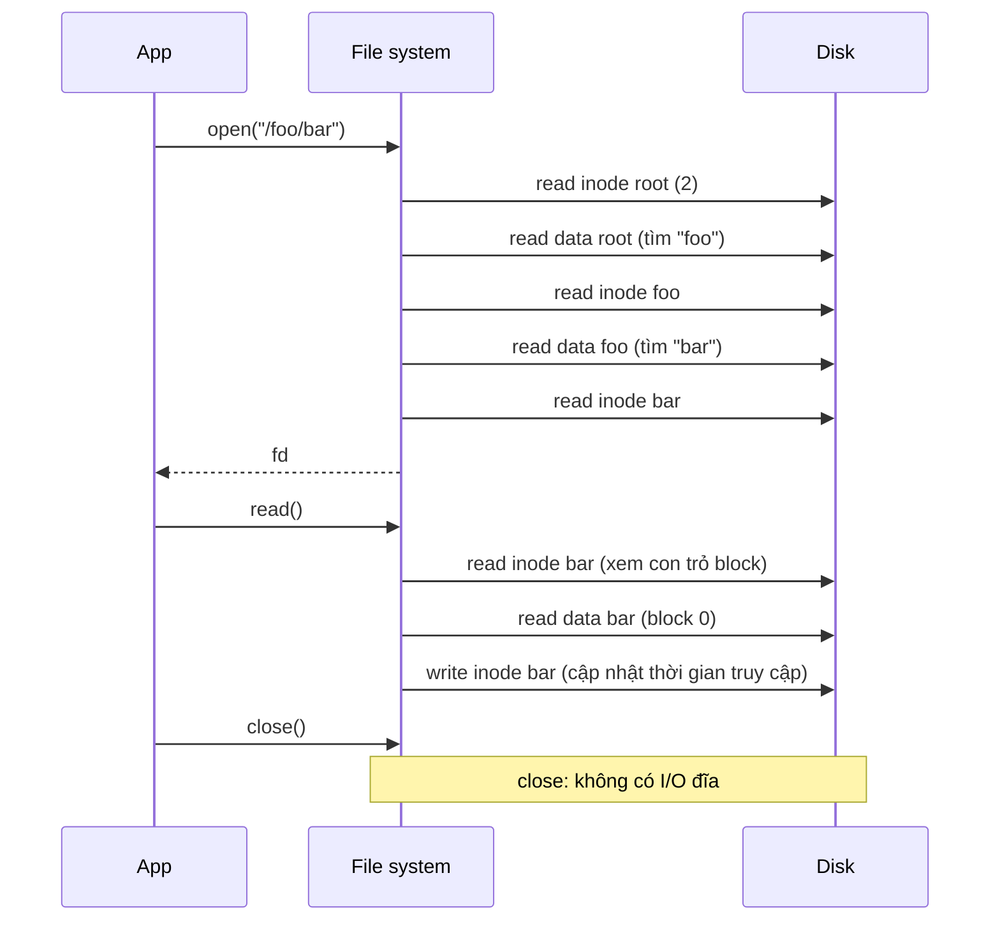

# P5 · Chương 03 — Cài đặt file system

## Bạn sẽ hiểu được gì

1. **Q1.** Một file system "đơn giản nhất có thể" (vsfs của OSTEP) gồm những vùng nào trên đĩa, và mỗi vùng giữ thông tin gì? → mục 1
2. **Q2.** Từ một inode number, file system tìm ra inode nằm ở byte nào? → mục 2
3. **Q3.** Từ một offset trong file, tìm ra block nào; vì sao inode dùng chỉ mục nhiều tầng (direct / indirect / double indirect), và extent giải quyết điều gì mà con trỏ từng block không giải quyết được? → mục 3
4. **Q4.** Thư mục được lưu trên đĩa thế nào, và tra tên trong thư mục rất lớn ra sao? → mục 4
5. **Q5.** `open("/foo/bar")` rồi `read()`, hoặc `write()` một file mới, tạo ra bao nhiêu I/O đĩa và theo thứ tự nào? Bitmap có được đọc khi chỉ đọc file không? → mục 5
6. **Q6.** FFS đưa ra ý tưởng "block group" và các chính sách đặt chỗ nào; ext4 thừa hưởng gì (flex_bg, extent tree, htree directory)? → mục 6
7. **Q7.** Tại sao một volume còn nhiều dung lượng trống vẫn có thể báo `ENOSPC` khi tạo file (`df -i`)? → mục 7

## Kiến thức cần trước

- File descriptor, open file description, inode, VFS ở tầng kernel: [../01-linux/04-file-descriptor-va-vfs.md](../01-linux/04-file-descriptor-va-vfs.md).
- Thiết bị lưu trữ (HDD seek, SSD, đơn vị block/sector): [./01-thiet-bi-luu-tru.md](./01-thiet-bi-luu-tru.md).
- API file và directory ở mức người dùng (`open`, `unlink`, `rename`, link): [./02-file-va-directory-api.md](./02-file-va-directory-api.md).

Page cache và `O_DIRECT` thuộc [chương 04](./04-page-cache-va-direct-io.md); crash consistency và journaling thuộc [chương 05](./05-crash-consistency-va-journaling.md); `fsync` và độ bền thuộc [chương 06](./06-durability-trong-thuc-te.md).

## 1. Vấn đề: biến một mảng block thành cây thư mục (Q1)

> **Trả lời ngắn.** vsfs chia đĩa thành các block bằng nhau[^ost-4kb] và dành các vùng: superblock, inode bitmap, data bitmap, inode table, data region. Data region giữ dữ liệu người dùng[^ost-dr]; inode table là mảng inode trên đĩa[^ost-itable]; hai bitmap đánh dấu inode/block đang rảnh hay đang dùng[^ost-bitmap]; superblock giữ thông tin về chính file system[^ost-super] và được đọc đầu tiên khi mount[^ost-mount].

**Giải thích.**

Hình dung (nhận xét của người soạn): đĩa như một kho có các ô đánh số; file system là sổ kho cho biết ô nào còn trống, món hàng nào nằm ô nào, và tên món hàng ghi ở đâu.

Đĩa chỉ biết đọc/ghi các block đánh số. File system phải trả lời hai việc: *cấu trúc dữ liệu trên đĩa* và *phương thức truy cập* (open/read/write ánh xạ lên cấu trúc đó như thế nào). OSTEP dạy cả hai qua một thiết kế đồ chơi tên **vsfs** (very simple file system).

### 1.1. Bố cục vsfs

OSTEP chia đĩa thành các block bằng nhau (4 KiB)[^ost-4kb] và chia thành các vùng; bố cục dưới đây theo thứ tự các vùng trong sách.


Mỗi vùng làm một việc:

| Vùng | Giữ gì | Ghi chú theo OSTEP |
|---|---|---|
| Data region | nội dung file (và nội dung thư mục) | phần lớn đĩa |
| Inode table | mảng inode, mỗi inode là metadata của một file | inode thường nhỏ, 128 hoặc 256 byte; với 256 byte thì một block 4 KiB chứa 16 inode[^ost-inode16] |
| Inode bitmap, data bitmap | mỗi bit cho biết inode/block tương ứng đang rảnh (0) hay đang dùng (1)[^ost-bitmap] | OSTEP dùng nguyên một block 4 KiB cho mỗi bitmap cho đơn giản dù chỉ có 80 inode[^ost-bitmapblk] |
| Superblock | thông tin về chính file system: số inode, số data block, inode table bắt đầu ở đâu, và có thể có magic number nhận diện loại file system[^ost-super] | đọc đầu tiên khi mount[^ost-mount] |

<details><summary>Đi sâu: ví dụ phân vùng 64 block của OSTEP</summary>

Ví dụ trong sách là phân vùng 64 block: superblock, hai bitmap, 5 block inode table (80 inode), 56 block data region[^ost-inode16][^ost-super]. Các con số chỉ là của ví dụ.

</details>

**Quay lại Q1:** vsfs gồm superblock, hai bitmap, inode table và data region; mỗi vùng giữ đúng một loại thông tin.

## 2. Inode: nơi chứa mọi thứ trừ tên (Q2)

> **Trả lời ngắn.** Mỗi inode có một số gọi là i-number, dùng làm chỉ số vào mảng inode trên đĩa[^ost-inumidx]. Trong vsfs và các file system đơn giản khác, từ i-number tính thẳng ra được vị trí inode trên đĩa[^ost-inum]. ext4 cũng tính từ i-number nhưng theo từng block group[^e4-find].

**Giải thích.**

Hình dung (nhận xét của người soạn): i-number như số thứ tự trong sổ đăng ký; biết số và độ dày mỗi bản ghi thì mở thẳng tới trang cần tìm, không phải lật từ đầu.

### 2.1. Từ i-number đến byte trên đĩa

Inode (index node) là cấu trúc giữ metadata của một file: các data block của file, độ dài, chủ sở hữu và quyền truy cập, thời gian truy cập/sửa[^ost-meta]. Mỗi inode được gọi bằng một số — i-number — dùng làm chỉ số vào mảng inode trên đĩa[^ost-inumidx]. Trong vsfs và các file system đơn giản khác, từ i-number tính thẳng ra được vị trí inode trên đĩa[^ost-inum]. Tính lại ví dụ của OSTEP (inode 256 byte, inode table bắt đầu ở 12 KiB): offset trong vùng inode là 32 × 256 = 8192 byte[^ost-ino8192], cộng 12 KiB được 20 KiB[^ost-ino32] — block inode có chỉ số 32 / 16 = 2, sector 20480 / 512 = 40 (phép tính của người soạn). Vì inode nhỏ nằm trong block lớn hơn[^ost-inblock], đọc *một* inode là đọc *cả block* chứa nó (suy luận của người soạn).

<details><summary>Đi sâu: công thức của ext4, kích thước inode, quan sát <code>debugfs</code></summary>

ext4 dùng cùng ý tưởng nhưng inode table được chia theo block group. Tài liệu kernel ghi: mỗi block group có `s_inodes_per_group` inode; vì inode 0 không tồn tại, công thức tìm group là `bg = (inode_num - 1) / s_inodes_per_group`[^e4-find], và địa chỉ byte trong inode table của group là `offset = index * s_inode_size`[^e4-off], với `index = (inode_num - 1) % s_inodes_per_group`.

Trong ext4 mặc định, một bản ghi inode dài 256 byte (ext2/ext3 cố định 128 byte)[^e4-isize][^e4-isize128]. Trường `i_block` của inode có 60 byte và, tùy loại file, được dùng theo nhiều cách khác nhau[^e4-ibl].

**Quan sát (chạy thật).** Trên một image ext4 16 MiB tạo bằng `mkfs.ext4` trong container (e2fsprogs 1.47.0), `dumpe2fs -h` báo block size 1024, 4096 inode, 2048 inode mỗi group, inode size 256. Sau khi ghi một file bằng `debugfs write`, file đó nhận inode số 12 (file tiếp theo là 13). Khớp bảng inode đặc biệt của docs: inode 11 là inode không-dành-riêng đầu tiên, thường là `lost+found`[^e4-special]. Lệnh `debugfs -R "imap <13>"` trả lời "Inode 13 is part of block group 0, located at block 137, offset 0x0000". Kiểm tra bằng công thức: inode table của group 0 bắt đầu ở block 134 (`dumpe2fs`), index = 12, offset = 12 × 256 = 3072 byte = 3 block 1 KiB, nên block 134 + 3 = 137 — khớp.

</details>

**Quay lại Q2:** i-number là chỉ số vào mảng inode, nên vị trí inode tính trực tiếp từ i-number; ext4 làm thế theo block group.

## 3. Inode trỏ tới block: multi-level index và extent (Q3)

> **Trả lời ngắn.** Inode giữ vài con trỏ trỏ thẳng tới block dữ liệu; file lớn hơn thì thêm indirect pointer, double indirect pointer — gọi là multi-level index[^ost-mlindex]. Extent gọn hơn: một extent là con trỏ đĩa cộng độ dài[^ost-extent], nên file liền khối chỉ cần một mục thay vì một con trỏ mỗi block[^e4-extent].

**Giải thích.**

Hình dung (nhận xét của người soạn): con trỏ từng block giống ghi từng trang số bao nhiêu cho cuốn sách dày; extent chỉ ghi "từ trang 100, dài 1.000 trang".

### 3.1. Inode chỉ ra các block của file: multi-level index

Inode giữ vài con số trỏ thẳng tới block dữ liệu (direct pointer), nhưng file lớn cần nhiều hơn chỗ inode có. OSTEP giải quyết bằng cây mất cân bằng: thêm một **indirect pointer** trỏ tới một block chỉ chứa các con số khác; thêm **double indirect** trỏ tới block chứa các indirect block; có thể thêm triple indirect. Cách này gọi là *multi-level index*[^ost-mlindex]. Với 12 direct pointer, một indirect và một double indirect, block 4 KiB và con trỏ 4 byte, OSTEP tính file tối đa "just over 4 GB"[^ost-4gb], tức `(12 + 1024 + 1024²) × 4 KiB`. Tính lại: 1.049.612 block × 4096 byte = 4.299.210.752 byte ≈ 4,004 GiB (phép tính của người soạn).

### 3.2. Vì sao imbalanced tree? Và vì sao extent

Lý do hình cây lệch: OSTEP dẫn các nghiên cứu về file system, trong đó có phát hiện hầu hết file là nhỏ[^ost-small]; với 12 direct pointer, inode trỏ trực tiếp được 48 KB dữ liệu, file lớn hơn mới cần indirect block[^ost-48k].

Tuy vậy, tài liệu ext4 nêu nhược điểm: ngay cả với một file *liền khối*, vẫn phải điền rất nhiều dữ liệu ánh xạ[^e4-ind-bad]. **Extent** là lời giải: một extent là *con trỏ đĩa cộng độ dài (số block)*[^ost-extent]. Tài liệu ext4 minh họa: cấp phát liên tục 1.000 block theo sơ đồ cũ cần indirect block ánh xạ 1.000 mục, còn với extent chỉ cần một `struct ext4_extent` với `ee_len = 1000`[^e4-extent].

Đánh đổi theo OSTEP: pointer linh hoạt nhất nhưng tốn nhiều metadata[^ost-extcmp]; extent gọn hơn nhưng kém linh hoạt, hiệu quả khi còn đủ chỗ trống để file nằm liền khối[^ost-extless]. Vì có thể khó tìm một vùng trống liền nhau, file system dựa trên extent thường cho phép nhiều extent[^ost-extmore]. OSTEP xếp ext2/ext3 vào nhóm multi-level index và ext4/XFS vào nhóm extent[^ost-who].

<details><summary>Đi sâu: ext2/ext3, quan sát block map, cây extent của ext4</summary>

Cách ext2/ext3 làm đúng như vậy: `i_block[0..11]` là direct, `i_block[12]` indirect, `[13]` double indirect, `[14]` triple indirect. Với block 4 KiB, các tầng phủ file block 0–11, 12–1035, 1036–1049611, và 1049612–1074791436 (docs ghi các biên này)[^e4-ind-ranges][^e4-ind-triple]. Phép tính của người soạn: 12 + 1024 + 1024² + 1024³ = 1.074.791.436 block (theo quy ước đánh số từ 0 của các tầng trên, chỉ số cuối phải là ...435; docs lệch 1), × 4 KiB ≈ 4,004 TiB, tức khoảng 4 TiB.

**Quan sát (chạy thật).** Tạo ext2 block 1 KiB (256 con trỏ mỗi indirect block), ghi file 300 KiB bằng `debugfs write`, rồi `debugfs stat` in:

```text
BLOCKS:
(0-11):562-573, (IND):574, (12-267):575-830, (DIND):831, (IND):832, (268-299):833-864
TOTAL: 303
```

Đọc: 12 block direct, indirect 574 quản 256 block tiếp theo, double indirect 831 trỏ tới indirect 832 quản block 268–299; 300 block dữ liệu + 3 block metadata = `TOTAL: 303`.

Extent trong ext4 được tổ chức thành **cây**: nút gốc nằm ngay trong `inode.i_block`, nên bốn extent đầu không cần block metadata thêm[^e4-root]; cây sâu tối đa 5 tầng[^e4-depth]. Inode phải đặt cờ extents (0x80000) để dùng tính năng này[^e4-flag]. Mỗi extent ghi độ dài trong `ee_len`; độ dài tối đa của extent đã khởi tạo là 32768 block[^e4-eelen] (với block 4 KiB là 32768 × 4096 byte = 128 MiB; với block 1 KiB chỉ 32 MiB — phép tính của người soạn).

**Quan sát (chạy thật).** Trong image ext4 (block 1 KiB), `debugfs stat` trên file 3 MiB ghi vào image còn trống cho:

```text
Flags: 0x80000
EXTENTS:
(0-3071):1173-4244
```

Một extent duy nhất phủ 3072 block, không cần block metadata nào, và cờ `0x80000` đúng giá trị docs nêu. Image mới tạo nên liền khối; đĩa phân mảnh sẽ có nhiều extent hơn.

</details>

**Quay lại Q3:** con trỏ nhiều tầng tối ưu cho file nhỏ; extent (con trỏ + độ dài) gọn hơn cho file liền khối.

## 4. Thư mục: danh sách (tên, inode number) (Q4)

> **Trả lời ngắn.** Thư mục là một loại file đặc biệt: có inode, kiểu "directory", và data block chứa danh sách cặp (tên, inode number)[^ost-dir][^ost-dirfile]. ext4 lưu thư mục dạng gần như tuyến tính[^e4-linear], hoặc dạng htree (btree băm) khi inode có cờ `EXT4_INDEX_FL`[^e4-htree].

**Giải thích.**

Hình dung (nhận xét của người soạn): thư mục như cuốn danh bạ; tra một cái tên trong danh bạ vài chục dòng thì lật hết cũng nhanh, danh bạ cả triệu dòng cần có chỉ mục.

Bài toán: inode không chứa tên file. Tên nằm ở thư mục. OSTEP: thư mục chỉ là một danh sách các cặp (tên, inode number)[^ost-dir], và file system coi thư mục là một loại file đặc biệt: có inode, kiểu "directory", có data block trong data region[^ost-dirfile]. Vì tên có độ dài thay đổi, mỗi mục mang theo thêm `reclen` (tổng byte của mục, gồm cả chỗ thừa) và `strlen` (độ dài tên thật)[^ost-dirent]. Ví dụ của OSTEP, thư mục `dir` (inode 5):

| inum | reclen | strlen | name |
|---|---|---|---|
| 5 | 12 | 2 | `.` |
| 2 | 12 | 3 | `..` |
| 12 | 12 | 4 | `foo` |
| 13 | 12 | 4 | `bar` |
| 24 | 36 | 28 | `foobar_is_a_pretty_longname` |

Lưu ý: sách ghi `strlen` = 28 nhưng tên này đếm được 27 ký tự; sách không giải thích (suy luận của người soạn: có thể tính cả byte NUL).

Danh sách tuyến tính tốt cho thư mục nhỏ, tệ cho thư mục triệu file vì tạo file phải quét hết để kiểm tra tên chưa tồn tại. OSTEP nêu XFS dùng B-tree cho thư mục, làm thao tác tạo file nhanh hơn so với danh sách phải quét toàn bộ[^ost-xfsdir]. ext4 dùng **htree**: nếu inode có cờ `EXT4_INDEX_FL` (0x1000) thì thư mục là một btree băm[^e4-htree]. Gốc cây luôn nằm ở block dữ liệu đầu tiên của thư mục[^e4-htree-root]. Tra tên: tính hash của tên, tìm leaf node chứa dải hash đó, tương tự tra B-tree khóa theo hash[^e4-htree2].

<details><summary>Đi sâu: mục thư mục bị xóa, loại file trong mục, quan sát <code>htree</code></summary>

Xóa file (`unlink()`) có thể để lại lỗ giữa thư mục[^ost-unlink]; ext4 đánh dấu mục không dùng bằng `inode = 0`[^e4-unused]. ext4 lưu thư mục ở dạng "gần như tuyến tính": mỗi block chứa một mảng mục[^e4-linear], và mục không bị cắt ngang ranh giới block[^e4-nosplit]. Một chi tiết hay: ext4 chép *loại file* vào mục thư mục (bình thường nằm trong inode) vì lý do hiệu năng[^e4-ftype]; hệ quả (suy luận của người soạn): `readdir` có thể biết đó là file hay thư mục mà không cần đọc inode.

**Quan sát (chạy thật).** Thư mục `d` tạo bằng `debugfs` với 300 file tên dài có `Flags: 0x80000` (chỉ extents). Sau `e2fsck -fD` cùng thư mục có `Flags: 0x81000`, tức đã thêm `EXT4_INDEX_FL`, và `debugfs htree_dump d` in ra nút gốc htree ("Indirect levels: 0"; số entry tùy độ dài tên). Ở đây chính `e2fsck -D` dựng index; ngưỡng kernel tự bật index thì chương không khẳng định.

</details>

**Quay lại Q4:** thư mục là file chứa các cặp (tên, inode number); thư mục nhỏ dùng danh sách, thư mục lớn của ext4 dùng htree.

## 5. Đường đi truy cập: đọc và ghi một file (Q5)

> **Trả lời ngắn.** `open("/foo/bar")` phải đọc inode và dữ liệu thư mục của từng cấp dọc đường dẫn, nên I/O tỷ lệ với độ dài đường dẫn[^ost-pathcost]. `read` không đụng bitmap, vì bitmap chỉ được truy cập khi cần cấp phát[^ost-readnobitmap]. Một lần `write` có cấp phát tốn 5 I/O logic[^ost-write5], và tạo file tốn nhiều hơn[^ost-create].

**Giải thích.**

Hình dung (nhận xét của người soạn): tìm một tài liệu trong tủ hồ sơ lồng nhau phải mở từng ngăn theo thứ tự; muốn cất tài liệu mới còn phải tìm ô trống và ghi vào sổ kho.

**Tìm chỗ trống.**

File system phải biết inode và block nào còn rảnh[^ost-free]. vsfs dùng hai bitmap: tạo file thì tìm bit 0 trong inode bitmap, đặt thành 1 và rồi ghi bitmap lên đĩa; block dữ liệu tương tự[^ost-free-use]. Lựa chọn khác là **free list** (superblock trỏ tới block rảnh đầu tiên, mỗi block rảnh trỏ tới block kế) của một số file system cũ; hệ thống hiện đại dùng cấu trúc tinh vi hơn như B-tree của XFS[^ost-freelist]. FFS chỉ ra ưu điểm của bitmap: dễ tìm một vùng trống lớn để cấp cho file[^ffs-bitmaps].

Giả sử file system đã mount, superblock đã nằm trong bộ nhớ; mọi thứ khác còn trên đĩa.

### 5.1. `open("/foo/bar")` rồi `read()`

Mọi duyệt đường dẫn bắt đầu từ root `/`. Inode của root phải có số "well known"; trên hầu hết UNIX file system đó là **2**[^ost-root2] (ext4 cũng ghi inode 2 là root directory[^e4-root2]). FS đọc block chứa inode 2, dùng con trỏ trong đó đọc data block của root, tìm mục `foo` để lấy inode number (ví dụ 44), rồi lặp lại: đọc inode của `foo`, đọc data của `foo`, tìm `bar`. Bước cuối của `open()` là đọc inode của `bar`; FS kiểm tra quyền lần cuối, cấp một file descriptor trong bảng open-file của tiến trình rồi trả về[^ost-openend].



OSTEP cho biết: lượng I/O của `open` tỷ lệ với độ dài đường dẫn[^ost-pathcost], mỗi lần `read` một block phải xem inode, đọc block, rồi ghi lại inode để cập nhật thời gian truy cập[^ost-read], còn `close()` không gây I/O đĩa[^ost-close]. Đây là mô hình của sách; trên Linux, từ 2.6.30 kernel mặc định dùng `relatime`[^mount-relatime], chỉ cập nhật thời gian truy cập khi lần truy cập trước sớm hơn thời gian sửa/đổi[^mount-relatime2] hoặc đã quá 1 ngày[^mount-relatime3], nên nhiều `read` thực tế không kèm lần ghi inode đó (suy luận của người soạn).

Hiểu lầm hay gặp: nghĩ rằng đọc file cũng đọc bitmap. OSTEP nói rõ: các cấu trúc cấp phát như bitmap chỉ được truy cập khi cần cấp phát; inode, thư mục và indirect block đã đủ thông tin cho thao tác đọc[^ost-readnobitmap].

### 5.2. Tạo file và `write()`

Ghi vào file khác đọc ở chỗ có thể phải cấp phát block (trừ khi ghi đè). Mỗi lần ghi có cấp phát, về logic, gồm 5 I/O: đọc data bitmap, ghi data bitmap, đọc inode, ghi inode, và ghi chính block dữ liệu[^ost-write5]. Tạo file đắt hơn nữa: đọc inode bitmap để tìm inode rảnh, ghi inode bitmap, ghi inode mới, ghi dữ liệu thư mục để gắn tên với inode number, và đọc rồi ghi inode của thư mục[^ost-create]; nếu thư mục phải lớn thêm thì còn thêm data bitmap và block thư mục mới. Với ví dụ tạo `/foo/bar` rồi ghi ba block 4 KiB, OSTEP đếm: 10 I/O cho việc duyệt đường dẫn và tạo file[^ost-create10], và mỗi write có cấp phát tốn 5 I/O[^ost-allocwrite].
<details><summary>Đi sâu: bảng timeline I/O, caching và write buffering</summary>

Bảng timeline rút gọn theo hình của OSTEP (thứ tự thời gian từ trên xuống; "R" đọc, "W" ghi):

| Bước | inode bitmap | data bitmap | root inode | foo inode | bar inode | root data | foo data | bar data |
|---|---|---|---|---|---|---|---|---|
| `create /foo/bar` | R, W | | R | R, W | R, W | R | R, W | |
| `write()` #1 | | R, W | | | R, W | | | W |
| `write()` #2 | | R, W | | | R, W | | | W |
| `write()` #3 | | R, W | | | R, W | | | W |

Bảng này là bản dựng lại của người soạn (tổng create = 10, mỗi write = 5, khớp sách); thứ tự chính xác giữa các I/O nằm ở Hình 40.4. Có một lần *read* inode `bar` dù nó chưa khởi tạo, vì inode nhỏ nằm trong block lớn nên phải read-modify-write cả block[^ost-rmw].

**Giảm chi phí: caching và buffering.**

"Làm sao giảm I/O?" — OSTEP trả lời: dùng bộ nhớ để cache các block quan trọng[^ost-cache]. Nếu không cache, mở file tốn ít nhất hai lần đọc cho mỗi cấp thư mục[^ost-nocache]. Hệ thống đời đầu dùng cache cố định (khoảng 10% bộ nhớ)[^ost-10pct]; hệ thống hiện đại gộp page bộ nhớ ảo và page file system thành **unified page cache**[^ost-unified]. (Page cache được phân tích kỹ ở [chương 04](./04-page-cache-va-direct-io.md).)

Với đọc, cache đủ lớn tránh được hẳn I/O; với ghi, dữ liệu vẫn phải xuống đĩa để bền, nên cache không "lọc" được write traffic như với read[^ost-readcache]. Dù vậy **write buffering** có lợi: gom nhiều cập nhật thành ít I/O hơn, cho phép sắp lịch I/O, và có khi bỏ hẳn I/O (tạo rồi xóa file ngay). OSTEP: sự lười biếng là một đức tính[^ost-lazy], và hầu hết file system hiện đại đệm ghi trong khoảng năm đến ba mươi giây[^ost-wbuf]. Cái giá là crash trong khoảng đó thì mất dữ liệu chưa xuống đĩa — đó là lý do có `fsync` (chương [06](./06-durability-trong-thuc-te.md)) và journaling (chương [05](./05-crash-consistency-va-journaling.md)).

</details>

**Quay lại Q5:** `open` đọc inode và dữ liệu từng cấp thư mục, `read` không đụng bitmap, còn `write` có cấp phát tốn 5 I/O logic.

## 6. FFS: file system nhận biết đĩa (Q6)

> **Trả lời ngắn.** FFS chia đĩa thành nhiều cylinder group (block group)[^ffs-cg], mỗi group có đủ các cấu trúc kiểu vsfs: chỗ cho inode, data block và cấu trúc theo dõi cái nào đang rảnh[^ffs-struct]. Phương châm: giữ những thứ liên quan ở gần nhau, và những thứ không liên quan ở xa nhau[^ffs-mantra]. ext4 thừa hưởng block group và các chính sách đặt chỗ tương tự[^e4-samebg].

**Giải thích.**

Hình dung (nhận xét của người soạn): FFS như chia kho thành các dãy; hồ sơ cùng dự án xếp chung một dãy để người thủ kho đỡ chạy đi chạy lại.

### 6.1. Vấn đề và ý tưởng

Nhóm Berkeley xây Fast File System (FFS)[^ffs-berk] với ý tưởng làm cấu trúc và chính sách cấp phát "disk aware" để tăng hiệu năng. Họ giữ nguyên giao diện (`open`, `read`, `write`…) và chỉ đổi cài đặt bên trong[^ffs-api].

### 6.2. Cylinder group / block group

FFS chia đĩa thành nhiều **cylinder group**[^ffs-cg] (cách gọi khác là **block group**, tên mà ext2/3/4 dùng). Đây là cơ chế trung tâm để FFS cải thiện hiệu năng: đặt hai file trong cùng một group thì truy cập lần lượt không gây seek xa[^ffs-bg]. Mỗi group có đủ bộ cấu trúc kiểu vsfs thu nhỏ: một bản sao superblock (vì độ tin cậy: một bản hỏng vẫn mount được bằng bản khác)[^ffs-sb], inode bitmap + data bitmap riêng[^ffs-percg], vùng inode, vùng dữ liệu.

### 6.3. Chính sách đặt chỗ

Phương châm của FFS: giữ những thứ liên quan ở gần nhau, và giữ những thứ không liên quan ở xa nhau[^ffs-mantra]. Cụ thể:

- **Thư mục:** chọn group có ít thư mục đã cấp phát (để cân bằng) và nhiều inode rảnh (để sau này chứa nhiều file), đặt inode và data của thư mục ở đó[^ffs-dir].
- **File:** đặt data block cùng group với inode của nó, và đặt các file cùng thư mục vào group của thư mục đó[^ffs-file].

Ví dụ OSTEP: `/a/b`, `/a/c`, `/a/d` được đặt gần nhau, `/b/f` ở xa. Chính sách đối lập, trải đều inode qua mọi group, giữ data gần inode nhưng làm các file trong cùng thư mục tản ra nhiều group[^ffs-spread]. Cơ sở của FFS là lẽ thường[^ffs-sense], vì file cùng thư mục hay được truy cập cùng nhau[^ffs-together].

### 6.4. Ngoại lệ file lớn (large-file exception)

Nếu chỉ theo quy tắc trên, một file lớn sẽ lấp đầy cả block group nơi nó được đặt (và có thể nhiều hơn)[^ffs-large], khiến các file "liên quan" sau đó không còn chỗ — hỏng locality. FFS xử lý: sau khi cấp phát một số block đầu trong group (ví dụ 12 block, bằng số direct pointer của inode)[^ffs-large2], phần "chunk" lớn kế tiếp (ví dụ phần do indirect block đầu tiên trỏ tới) đặt sang group khác, rồi chunk kế sang group khác nữa. Trải file như vậy làm giảm hiệu năng đọc tuần tự[^ffs-seq], nhưng nếu chunk đủ lớn thì phần lớn thời gian là truyền dữ liệu và chỉ một phần nhỏ là seek giữa các chunk[^ffs-chunk]. Kỹ thuật giảm overhead bằng cách làm nhiều việc hơn cho mỗi lần trả overhead gọi là **amortization**[^ffs-amort].
<details><summary>Đi sâu: ví dụ file lớn, allocator của ext4, flex_bg, quan sát <code>dumpe2fs</code></summary>

Ví dụ của OSTEP: file `/a` 30 block; không có ngoại lệ thì nằm gọn trong group 0, với chunk 5 block thì trải ra sáu group[^ffs-ex]. Chunk cần lớn cỡ nào: với định vị 10 ms và truyền 40 MB/s, cần 409,6 KB mỗi lần seek để nửa thời gian là truyền dữ liệu[^ffs-409], và khoảng 3,6 MB để đạt 90% băng thông đỉnh[^ffs-90]. FFS thật không tính vậy mà bám theo inode: 12 direct block đầu cùng group với inode, mỗi indirect block cùng các block nó trỏ tới ở group khác, nên cứ 4 MB (1024 block 4 KB) sang group mới[^ffs-real].

**Pre-allocation và delayed allocation.**

Ngoài *tìm* chỗ trống còn có *chính sách* chọn chỗ. OSTEP nêu heuristic **pre-allocation**: ext2/ext3 tìm một dãy block trống (ví dụ 8 block) khi file mới cần block, để bảo đảm một phần file liền nhau trên đĩa[^ost-prealloc]. ext4 nâng lên: *multi-block allocator* cấp đầu cơ 8 KiB cho file mới[^e4-alloc1], và **delayed allocation** — hoãn chọn vị trí đến khi các dirty buffer thực sự được ghi ra[^e4-delalloc].

**ext4 thừa hưởng gì.**

Docs ext4 liệt kê "năm mẹo" cấp phát, gần như bản FFS + bổ sung: multi-block allocator (đầu cơ 8 KiB), delayed allocation, giữ data block cùng group với inode, đặt mọi inode trong một thư mục cùng group với thư mục "khi khả thi"[^e4-samebg], và chia đĩa thành các block group 128 MB[^e4-128]. Con số 128 MB ứng với block 4 KiB (32768 block); image block 1 KiB bên dưới có 8192 block mỗi group, tức 8 MiB (phép tính của người soạn). Có một "tật cố ý": khi thư mục được tạo trong root, inode allocator quét các group và đặt nó vào group ít tải nhất tìm được, để thư mục trải ra đĩa[^e4-spread].

Về bố cục, bitmap và inode table "có thể ở bất cứ đâu", thậm chí bitmap sau inode table hoặc ở group khác (flex_bg)[^e4-bgpos]; các bản sao dự phòng superblock và group descriptor chỉ nằm ở *một số* group[^e4-layout].

**flex_bg.** Trong flexible block group, vài block group được gộp thành một nhóm logic; bitmap và inode table của tất cả group trong nhóm được dồn vào group đầu tiên của nhóm[^e4-flex]. Hiệu quả: metadata nằm gần nhau nên tải nhanh hơn, và file lớn có thể liền khối trên đĩa[^e4-flexeff]. Số group mỗi flex_bg là `2 ^ s_log_groups_per_flex`[^e4-flexn].


**Quan sát (chạy thật).** `dumpe2fs` trên image 16 MiB cho: feature gồm `flex_bg extent dir_index metadata_csum ...`, "Flex block group size: 16", "Blocks per group: 8192". Group 0: `Block bitmap at 130`, `Inode bitmap at 132`, `Inode table at 134-645`. Group 1: `Block bitmap at 131 (bg #0 + 130)`, `Inode bitmap at 133 (bg #0 + 132)`, `Inode table at 646-1157`. Tức bitmap và inode table của group 1 nằm ngay cạnh của group 0, trong vùng của group 0 — đúng bố cục flex_bg docs mô tả.

</details>

**Quay lại Q6:** FFS đặt đồ liên quan gần nhau theo block group, có ngoại lệ cho file lớn; ext4 kế thừa block group và bổ sung flex_bg cùng allocator riêng.

## 7. Inode hết trước dung lượng: `df -i` (Q7)

> **Trả lời ngắn.** Tỷ lệ inode trên dung lượng của ext4 được chốt lúc tạo file system[^mke2fs-ratio]. Khi không còn chỗ cho file mới, `open(O_CREAT)` báo `ENOSPC`[^open-enospc]; ext4 trả `-ENOSPC` khi duyệt hết mọi group mà không có inode rảnh[^e4-enospc], nên hết inode thì tạo file thất bại dù data region còn chỗ (suy luận của người soạn từ source). Cách kiểm tra là `df -i`[^df-i].

**Giải thích.**

Hình dung (nhận xét của người soạn): kho còn nhiều ô trống nhưng hết phiếu đăng ký thì vẫn không nhận thêm món hàng mới.

Tỷ lệ inode trên dung lượng của ext4 bị chốt lúc tạo file system: `mke2fs` tạo một inode cho mỗi `bytes-per-inode` byte đĩa[^mke2fs-ratio], và không thể đổi tỷ lệ này sau khi đã tạo (resize thì đổi số inode để giữ nguyên tỷ lệ)[^mke2fs-fixed]; hoặc có thể chỉ định thẳng số inode bằng `-N`[^mke2fs-N]. Vsfs cũng vậy: inode table là vùng có kích thước cố định trong bố cục, hết inode rảnh thì không tạo được file dù data region còn chỗ (OSTEP: số inode trong vsfs chính là số file tối đa của file system đó[^ost-maxfiles]). Khi `open(O_CREAT)` không còn chỗ cho file mới, `open(2)` báo `ENOSPC`[^open-enospc]; man page chỉ nói "no room", còn source ext4 v6.8 (chi tiết cài đặt) trả `-ENOSPC` khi duyệt hết mọi group mà không có inode rảnh[^e4-enospc]. `statfs(2)` có `f_files` (tổng số inode) và `f_ffree` (số inode rảnh)[^statfs], còn `df -i` liệt kê thông tin inode thay cho thông tin block[^df-i].

Nhận xét của người soạn cho backend:

- Các workload tạo rất nhiều file nhỏ (cache trên đĩa, thumbnail, mỗi object một file) tiêu inode nhanh hơn tiêu dung lượng; dashboard chỉ theo dõi "disk %" sẽ không thấy sắp hết. Hãy giám sát cả số inode rảnh, và với volume như vậy chọn `-i` hoặc `-N` ngay lúc `mkfs` vì không đổi được tỷ lệ sau đó.

<details><summary>Đi sâu: quan sát <code>mkfs.ext4 -N 16</code></summary>

**Quan sát (chạy thật).** Tạo ext4 4 MiB với `mkfs.ext4 -N 16`: `dumpe2fs -h` báo `Inode count: 16`, `Free inodes: 5` (khớp phép tính của người soạn: inode 1–10 dành riêng, inode 11 là `lost+found` theo bảng inode đặc biệt của docs[^e4-special], còn 16 − 11 = 5), `Free blocks: 3018`. Ghi liên tiếp 10 file nhỏ bằng `debugfs write`: năm file đầu nhận inode 12–16, năm file sau báo `Could not allocate inode in ext2 filesystem` (thông báo của `debugfs`, không phải của kernel), và cuối cùng `Free inodes: 0` trong khi `Free blocks: 3013`: inode hết trước block.

</details>

**Quay lại Q7:** inode là tài nguyên có số lượng cố định lúc tạo file system, nên có thể hết trước block.

## 8. Liên hệ với Rust

Trên Unix, `std::os::unix::fs::MetadataExt` phơi bày kết quả `stat`: `ino()` trả inode number[^rust-ino], `blksize()` trả block size cho I/O của file system[^rust-blksize], còn `blocks()` trả số block đã cấp phát cho file, tính theo đơn vị 512 byte[^rust-blocks] — nên không phải số block theo block size của file system (suy luận của người soạn). Chương [08](./08-rust-va-luu-tru.md) nói rộng hơn.

```rust
use std::fs::{self, File};
use std::io::{Seek, SeekFrom, Write};
use std::os::unix::fs::MetadataExt;

fn show(p: &str) {
    let m = fs::metadata(p).unwrap();
    println!("{p}: ino={} len={} blksize={} blocks512={}", m.ino(), m.len(), m.blksize(), m.blocks());
}

fn main() {
    let mut f = File::create("/tmp/c03_dense").unwrap();
    f.write_all(&vec![1u8; 100]).unwrap();
    f.sync_all().unwrap();
    let mut s = File::create("/tmp/c03_sparse").unwrap();
    s.seek(SeekFrom::Start(1 << 30)).unwrap();
    s.write_all(b"x").unwrap();
    s.sync_all().unwrap();
    show("/tmp/c03_dense");
    show("/tmp/c03_sparse");
}
```

Chạy thật (rustc 1.95.0, Linux aarch64 trong container, thư mục `/tmp` nằm trên overlayfs):

```text
/tmp/c03_dense: ino=1338491 len=100 blksize=4096 blocks512=8
/tmp/c03_sparse: ino=1338497 len=1073741825 blksize=4096 blocks512=8
```

Đọc kết quả: file 100 byte chiếm 8 × 512 byte = 4 KiB, đúng một block (độ dài logic ≠ không gian cấp phát); file "thưa" dài hơn 1 GiB cũng chỉ chiếm một block. Chỉ khẳng định cho lần chạy này, trên filesystem dưới overlay mà tôi không xác định được loại.

## Tóm tắt

- vsfs: superblock + inode bitmap + data bitmap + inode table + data region; inode không chứa tên, từ i-number tính ra vị trí inode; bitmap chỉ dùng khi cấp phát.
- Multi-level index tối ưu cho file nhỏ; extent (con trỏ + độ dài) gọn hơn cho file liền khối, ext4 lưu dạng cây, bốn extent đầu nằm trong inode.
- Thư mục là file đặc biệt chứa (tên, inode number); ext4: danh sách tuyến tính hoặc htree khi có `EXT4_INDEX_FL`.
- `open` tốn I/O tỷ lệ với độ dài đường dẫn; write có cấp phát tốn 5 I/O logic; cache và write buffering giảm chi phí, đổi lại rủi ro mất dữ liệu khi crash.
- FFS: block group có bitmap và inode riêng; "đồ liên quan ở gần nhau", ngoại lệ file lớn trải qua nhiều group, bù bằng amortization. ext4 thừa hưởng: block group, flex_bg, multi-block allocator, delayed allocation.
- Tỷ lệ inode/dung lượng chốt lúc tạo file system; hết inode thì `open(O_CREAT)` báo `ENOSPC` dù còn nhiều block. Theo dõi `df -i`.

## Câu hỏi tự kiểm tra

1. Trong vsfs, thông tin nào nằm ở superblock, và vì sao nó được đọc trước tiên khi mount?
<details><summary>Đáp án</summary>

Số inode, số data block, vị trí inode table, magic number[^ost-super]; mount đọc nó để khởi tạo tham số rồi gắn volume vào cây[^ost-mount].

</details>

2. Cho block 4 KiB, con trỏ 4 byte, inode có 12 direct + 1 indirect + 1 double indirect. File lớn nhất bao nhiêu? Công thức?
<details><summary>Đáp án</summary>

`(12 + 1024 + 1024²) × 4 KiB`, "just over 4 GB"[^ost-4gb]. Phép tính: 1.049.612 block × 4 KiB = 4.299.210.752 byte ≈ 4,004 GiB.

</details>

3. Mô tả các lần đọc đĩa khi `open("/foo/bar")` với cache lạnh.
<details><summary>Đáp án</summary>

Inode root (số 2[^ost-root2]) → data root (tìm `foo`) → inode `foo` → data `foo` (tìm `bar`) → inode `bar`; I/O tỷ lệ với độ dài đường dẫn[^ost-pathcost].

</details>

4. Vì sao một write có cấp phát block cần 5 I/O logic?
<details><summary>Đáp án</summary>

Đọc+ghi data bitmap, đọc+ghi inode, ghi block dữ liệu[^ost-write5].

</details>

5. Extent giải quyết điều gì mà block map không giải quyết? Điều kiện để extent hiệu quả?
<details><summary>Đáp án</summary>

Một file liền khối chỉ cần một (con trỏ, độ dài) thay vì một con trỏ mỗi block[^e4-extent]; hiệu quả khi còn đủ chỗ trống để file nằm liền khối[^ost-extless].

</details>

6. FFS đặt thư mục và file như thế nào? Tại sao có ngoại lệ file lớn?
<details><summary>Đáp án</summary>

Thư mục vào group ít thư mục và nhiều inode rảnh[^ffs-dir]; file cùng group với inode và với thư mục cha[^ffs-file]. File lớn lấp đầy cả group, hỏng locality[^ffs-large], nên được trải theo chunk đủ lớn để amortize seek[^ffs-amort].

</details>

7. Thư mục ext4 tra tên theo cách nào khi bật `EXT4_INDEX_FL`?
<details><summary>Đáp án</summary>

Htree: hash tên, tìm leaf theo dải hash như B-tree khóa theo hash[^e4-htree][^e4-htree2].

</details>

8. Production báo `No space left on device` khi tạo file nhưng `df -h` còn 60% trống. Bạn kiểm tra gì và vì sao có thể xảy ra?
<details><summary>Đáp án</summary>

Chạy `df -i`[^df-i]: số inode theo `bytes-per-inode` cố định lúc tạo file system[^mke2fs-ratio], hết inode thì tạo file mới `ENOSPC`[^open-enospc] (quan sát ở mục 7: 16 inode hết khi còn 3013 block trống).

</details>

## Đọc thêm

- OSTEP chương File System Implementation: <https://pages.cs.wisc.edu/~remzi/OSTEP/file-implementation.pdf> — vsfs, timeline I/O (Hình 40.3, 40.4).
- OSTEP, Locality and The Fast File System: <https://pages.cs.wisc.edu/~remzi/OSTEP/file-ffs.pdf> — đo locality (SEER traces), large-file exception.
- Kernel docs ext4, Block Groups: <https://docs.kernel.org/filesystems/ext4/blockgroup.html> — flex_bg, meta_bg, lazy initialization.
- Kernel docs ext4, The Contents of inode.i_block: <https://docs.kernel.org/filesystems/ext4/ifork.html> — định dạng extent tree chi tiết.
- Kernel docs ext4, Directory Entries: <https://docs.kernel.org/filesystems/ext4/directory.html> — linear và htree directory.

[^ost-inode16]: OSTEP, File System Implementation, §40.2 — <https://pages.cs.wisc.edu/~remzi/OSTEP/file-implementation.pdf> — "inodes are typically not that big, for example 128 or 256 bytes. Assuming 256 bytes per inode, a 4-KB block can hold 16 inodes, and our file system above contains 80 total inodes."
[^ost-bitmap]: OSTEP, File System Implementation, §40.2 — <https://pages.cs.wisc.edu/~remzi/OSTEP/file-implementation.pdf> — "each bit is used to indicate whether the corresponding object/block is free (0) or in-use (1)"
[^ost-super]: OSTEP, File System Implementation, §40.2 — <https://pages.cs.wisc.edu/~remzi/OSTEP/file-implementation.pdf> — "The superblock contains information about this particular file system, including, for example, how many inodes and data blocks are in the file system"
[^ost-mount]: OSTEP, File System Implementation, §40.2 — <https://pages.cs.wisc.edu/~remzi/OSTEP/file-implementation.pdf> — "when mounting a file system, the operating system will read the superblock first, to initialize various parameters, and then attach the volume to the file-system tree."
[^ost-inum]: OSTEP, File System Implementation, §40.3 — <https://pages.cs.wisc.edu/~remzi/OSTEP/file-implementation.pdf> — "In vsfs (and other simple file systems), given an i-number, you should directly be able to calculate where on the disk the corresponding inode is located."
[^ost-ino32]: OSTEP, File System Implementation, §40.3 — <https://pages.cs.wisc.edu/~remzi/OSTEP/file-implementation.pdf> — "add it to the start address of the inode table on disk (inodeStartAddr = 12KB), and thus arrive upon the correct byte address of the desired block of inodes: 20KB."
[^e4-find]: Linux kernel docs, ext4 Dynamic Structures, Finding an Inode — <https://docs.kernel.org/filesystems/ext4/inodes.html> — "Because inode 0 is defined not to exist, this formula can be used to find the block group that an inode lives in"
[^e4-off]: Linux kernel docs, ext4 Dynamic Structures, Finding an Inode — <https://docs.kernel.org/filesystems/ext4/inodes.html> — "To get the byte address within the inode table, use offset = index * sb->s_inode_size."
[^e4-isize]: Linux kernel docs, ext4 Inode Size — <https://docs.kernel.org/filesystems/ext4/inodes.html> — "By default, ext4 inode records are 256 bytes"
[^e4-ibl]: Linux kernel docs, ext4 The Contents of inode.i_block — <https://docs.kernel.org/filesystems/ext4/ifork.html> — "Depending on the type of file an inode describes, the 60 bytes of storage in inode.i_block can be used in different ways."
[^e4-special]: Linux kernel docs, ext4 Special inodes — <https://docs.kernel.org/filesystems/ext4/special_inodes.html> — "Traditional first non-reserved inode. Usually this is the lost+found directory."
[^ost-mlindex]: OSTEP, File System Implementation, §40.3 — <https://pages.cs.wisc.edu/~remzi/OSTEP/file-implementation.pdf> — "Overall, this imbalanced tree is referred to as the multi-level index approach to pointing to file blocks."
[^ost-4gb]: OSTEP, File System Implementation, §40.3 — <https://pages.cs.wisc.edu/~remzi/OSTEP/file-implementation.pdf> — "this structure can accommodate a file of just over 4 GB in size"
[^e4-ind-ranges]: Linux kernel docs, ext4 Direct/Indirect Block Addressing — <https://docs.kernel.org/filesystems/ext4/ifork.html> — "Double-indirect block: (file blocks $block_size/4 + 12 to ($block_size / 4) ^ 2 + ($block_size / 4) + 11, or 1036 to 1049611 if 4KiB blocks)"
[^e4-ind-bad]: Linux kernel docs, ext4 Direct/Indirect Block Addressing — <https://docs.kernel.org/filesystems/ext4/ifork.html> — "Note that with this block mapping scheme, it is necessary to fill out a lot of mapping data even for a large contiguous file!"
[^ost-extent]: OSTEP, File System Implementation, §40.3 — <https://pages.cs.wisc.edu/~remzi/OSTEP/file-implementation.pdf> — "An extent is simply a disk pointer plus a length (in blocks)"
[^e4-extent]: Linux kernel docs, ext4 Extent Tree — <https://docs.kernel.org/filesystems/ext4/ifork.html> — "Under the old scheme, allocating a contiguous run of 1,000 blocks requires an indirect block to map all 1,000 entries; with extents, the mapping is reduced to a single struct ext4_extent with ee_len = 1000."
[^ost-extcmp]: OSTEP, File System Implementation, §40.3 — <https://pages.cs.wisc.edu/~remzi/OSTEP/file-implementation.pdf> — "pointer-based approaches are the most flexible but use a large amount of metadata per file (particularly for large files)."
[^ost-who]: OSTEP, File System Implementation, §40.3 — <https://pages.cs.wisc.edu/~remzi/OSTEP/file-implementation.pdf> — "Other file systems, including SGI XFS and Linux ext4, use extents instead of simple pointers"
[^e4-root]: Linux kernel docs, ext4 Extent Tree — <https://docs.kernel.org/filesystems/ext4/ifork.html> — "The root node of the extent tree is stored in inode.i_block, which allows for the first four extents to be recorded without the use of extra metadata blocks."
[^e4-depth]: Linux kernel docs, ext4 Extent Tree — <https://docs.kernel.org/filesystems/ext4/ifork.html> — "The extent tree can be at most 5 levels deep"
[^e4-flag]: Linux kernel docs, ext4 Extent Tree — <https://docs.kernel.org/filesystems/ext4/ifork.html> — "The inode must have the extents flag (0x80000) flag set for this feature to be in use."
[^e4-eelen]: Linux kernel docs, ext4 Extent Tree — <https://docs.kernel.org/filesystems/ext4/ifork.html> — "the maximum length of a initialized extent is 32768 blocks"
[^ost-dir]: OSTEP, File System Implementation, §40.4 — <https://pages.cs.wisc.edu/~remzi/OSTEP/file-implementation.pdf> — "a directory basically just contains a list of (entry name, inode number) pairs."
[^ost-dirfile]: OSTEP, File System Implementation, §40.4 — <https://pages.cs.wisc.edu/~remzi/OSTEP/file-implementation.pdf> — "file systems treat directories as a special type of file."
[^ost-unlink]: OSTEP, File System Implementation, §40.4 — <https://pages.cs.wisc.edu/~remzi/OSTEP/file-implementation.pdf> — "Deleting a file (e.g., calling unlink()) can leave an empty space in the middle of the directory"
[^e4-unused]: Linux kernel docs, ext4 Linear (Classic) Directories — <https://docs.kernel.org/filesystems/ext4/directory.html> — "Unused directory entries are signified by inode = 0."
[^e4-linear]: Linux kernel docs, ext4 Linear (Classic) Directories — <https://docs.kernel.org/filesystems/ext4/directory.html> — "a directory is a series of data blocks and that each block contains a linear array of directory entries."
[^e4-ftype]: Linux kernel docs, ext4 Index Nodes — <https://docs.kernel.org/filesystems/ext4/inodes.html> — "ext4 appears to cheat (for performance reasons) a little bit by storing a copy of the file type (normally stored in the inode) in the directory entry."
[^ost-xfsdir]: OSTEP, File System Implementation, §40.4 — <https://pages.cs.wisc.edu/~remzi/OSTEP/file-implementation.pdf> — "making file create operations (which have to ensure that a file name has not been used before creating it) faster than systems with simple lists that must be scanned in their entirety."
[^e4-htree]: Linux kernel docs, ext4 Hash Tree Directories — <https://docs.kernel.org/filesystems/ext4/directory.html> — "If the EXT4_INDEX_FL (0x1000) flag is set in the inode, this directory uses a hashed btree (htree) to organize and find directory entries."
[^e4-htree-root]: Linux kernel docs, ext4 Hash Tree Directories — <https://docs.kernel.org/filesystems/ext4/directory.html> — "The root of the tree always lives in the first data block of the directory."
[^e4-htree2]: Linux kernel docs, ext4 Hash Tree Directories — <https://docs.kernel.org/filesystems/ext4/directory.html> — "a lookup works basically the same as it would in a B-Tree keyed by the hash value"
[^ost-free]: OSTEP, File System Implementation, §40.5 — <https://pages.cs.wisc.edu/~remzi/OSTEP/file-implementation.pdf> — "A file system must track which inodes and data blocks are free, and which are not, so that when a new file or directory is allocated, it can find space for it."
[^ost-free-use]: OSTEP, File System Implementation, §40.5 — <https://pages.cs.wisc.edu/~remzi/OSTEP/file-implementation.pdf> — "The file system will thus search through the bitmap for an inode that is free, and allocate it to the file"
[^ost-freelist]: OSTEP, File System Implementation, aside Free Space Management — <https://pages.cs.wisc.edu/~remzi/OSTEP/file-implementation.pdf> — "Some early file systems used free lists, where a single pointer in the super block was kept to point to the first free block"
[^ffs-bitmaps]: OSTEP, Locality and The Fast File System, §41.3 — <https://pages.cs.wisc.edu/~remzi/OSTEP/file-ffs.pdf> — "Bitmaps are an excellent way to manage free space in a file system because it is easy to find a large chunk of free space and allocate it to a file"
[^ost-prealloc]: OSTEP, File System Implementation, §40.5 — <https://pages.cs.wisc.edu/~remzi/OSTEP/file-implementation.pdf> — "some Linux file systems, such as ext2 and ext3, will look for a sequence of blocks (say 8) that are free when a new file is created"
[^e4-alloc1]: Linux kernel docs, ext4 Block and Inode Allocation Policy — <https://docs.kernel.org/filesystems/ext4/allocators.html> — "the block allocator speculatively allocates 8KiB of disk space to the file on the assumption that the space will get written soon."
[^e4-delalloc]: Linux kernel docs, ext4 Block and Inode Allocation Policy — <https://docs.kernel.org/filesystems/ext4/allocators.html> — "the filesystem defers deciding the exact placement on the disk until all the dirty buffers are being written out to disk."
[^ost-root2]: OSTEP, File System Implementation, §40.6 — <https://pages.cs.wisc.edu/~remzi/OSTEP/file-implementation.pdf> — "the root inode number is 2."
[^ost-pathcost]: OSTEP, File System Implementation, §40.6 — <https://pages.cs.wisc.edu/~remzi/OSTEP/file-implementation.pdf> — "the amount of I/O generated by the open is proportional to the length of the pathname."
[^ost-read]: OSTEP, File System Implementation, §40.6 — <https://pages.cs.wisc.edu/~remzi/OSTEP/file-implementation.pdf> — "reading each block requires the file system to first consult the inode, then read the block"
[^ost-close]: OSTEP, File System Implementation, §40.6 — <https://pages.cs.wisc.edu/~remzi/OSTEP/file-implementation.pdf> — "No disk I/Os take place."
[^ost-readnobitmap]: OSTEP, File System Implementation, aside Reads Don't Access Allocation Structures — <https://pages.cs.wisc.edu/~remzi/OSTEP/file-implementation.pdf> — "Allocation structures, such as bitmaps, are only accessed when allocation is needed."
[^ost-write5]: OSTEP, File System Implementation, §40.6 — <https://pages.cs.wisc.edu/~remzi/OSTEP/file-implementation.pdf> — "each write to a file logically generates five I/Os"
[^ost-create10]: OSTEP, File System Implementation, §40.6 — <https://pages.cs.wisc.edu/~remzi/OSTEP/file-implementation.pdf> — "10 I/Os in this case, to walk the pathname"
[^ost-allocwrite]: OSTEP, File System Implementation, §40.6 — <https://pages.cs.wisc.edu/~remzi/OSTEP/file-implementation.pdf> — "each allocating write costs 5 I/Os"
[^ost-cache]: OSTEP, File System Implementation, §40.7 — <https://pages.cs.wisc.edu/~remzi/OSTEP/file-implementation.pdf> — "most file systems aggressively use system memory (DRAM) to cache important blocks."
[^ost-unified]: OSTEP, File System Implementation, §40.7 — <https://pages.cs.wisc.edu/~remzi/OSTEP/file-implementation.pdf> — "many modern operating systems integrate virtual memory pages and file system pages into a unified page cache"
[^ost-readcache]: OSTEP, File System Implementation, §40.7 — <https://pages.cs.wisc.edu/~remzi/OSTEP/file-implementation.pdf> — "a cache does not serve as the same kind of filter on write traffic that it does for reads."
[^ost-lazy]: OSTEP, File System Implementation, §40.7 — <https://pages.cs.wisc.edu/~remzi/OSTEP/file-implementation.pdf> — "laziness (in writing blocks to disk) is a virtue"
[^ost-wbuf]: OSTEP, File System Implementation, §40.7 — <https://pages.cs.wisc.edu/~remzi/OSTEP/file-implementation.pdf> — "most modern file systems buffer writes in memory for anywhere between five and thirty seconds"
[^ffs-api]: OSTEP, Locality and The Fast File System, §41.2 — <https://pages.cs.wisc.edu/~remzi/OSTEP/file-ffs.pdf> — "by keeping the same interface to the file system (the same APIs, including open(), read(), write(), close(), and other file system calls) but changing the internal implementation"
[^ffs-cg]: OSTEP, Locality and The Fast File System, §41.3 — <https://pages.cs.wisc.edu/~remzi/OSTEP/file-ffs.pdf> — "FFS divides the disk into a number of cylinder groups."
[^ffs-bg]: OSTEP, Locality and The Fast File System, §41.3 — <https://pages.cs.wisc.edu/~remzi/OSTEP/file-ffs.pdf> — "Whether you call them cylinder groups or block groups, these groups are the central mechanism that FFS uses to improve performance."
[^ffs-sb]: OSTEP, Locality and The Fast File System, §41.3 — <https://pages.cs.wisc.edu/~remzi/OSTEP/file-ffs.pdf> — "FFS keeps a copy of the super block (S) in each group for reliability reasons."
[^ffs-percg]: OSTEP, Locality and The Fast File System, §41.3 — <https://pages.cs.wisc.edu/~remzi/OSTEP/file-ffs.pdf> — "A per-group inode bitmap (ib) and data bitmap (db) serve this role for inodes and data blocks in each group."
[^ffs-mantra]: OSTEP, Locality and The Fast File System, §41.4 — <https://pages.cs.wisc.edu/~remzi/OSTEP/file-ffs.pdf> — "The basic mantra is simple: keep related stuff together (and its corollary, keep unrelated stuff far apart)."
[^ffs-dir]: OSTEP, Locality and The Fast File System, §41.4 — <https://pages.cs.wisc.edu/~remzi/OSTEP/file-ffs.pdf> — "find the cylinder group with a low number of allocated directories (to balance directories across groups) and a high number of free inodes"
[^ffs-file]: OSTEP, Locality and The Fast File System, §41.4 — <https://pages.cs.wisc.edu/~remzi/OSTEP/file-ffs.pdf> — "it places all files that are in the same directory in the cylinder group of the directory they are in."
[^ffs-large]: OSTEP, Locality and The Fast File System, §41.6 — <https://pages.cs.wisc.edu/~remzi/OSTEP/file-ffs.pdf> — "a large file would entirely fill the block group it is first placed within (and maybe others)."
[^ffs-large2]: OSTEP, Locality and The Fast File System, §41.6 — <https://pages.cs.wisc.edu/~remzi/OSTEP/file-ffs.pdf> — "After some number of blocks are allocated into the first block group (e.g., 12 blocks, or the number of direct pointers available within an inode)"
[^ffs-amort]: OSTEP, Locality and The Fast File System, §41.6 — <https://pages.cs.wisc.edu/~remzi/OSTEP/file-ffs.pdf> — "This process of reducing an overhead by doing more work per overhead paid is called amortization"
[^e4-samebg]: Linux kernel docs, ext4 Block and Inode Allocation Policy — <https://docs.kernel.org/filesystems/ext4/allocators.html> — "The fourth trick is that all the inodes in a directory are placed in the same block group as the directory, when feasible."
[^e4-spread]: Linux kernel docs, ext4 Block and Inode Allocation Policy — <https://docs.kernel.org/filesystems/ext4/allocators.html> — "when a directory is created in the root directory, the inode allocator scans the block groups and puts that directory into the least heavily loaded block group that it can find."
[^e4-layout]: Linux kernel docs, ext4 Block Groups, Layout — <https://docs.kernel.org/filesystems/ext4/blockgroup.html> — "Redundant copies of the superblock and group descriptors are written to some of the block groups across the disk in case the beginning of the disk gets trashed, though not all block groups necessarily host a redundant copy"
[^e4-bgpos]: Linux kernel docs, ext4 Block Groups, Layout — <https://docs.kernel.org/filesystems/ext4/blockgroup.html> — "The bitmaps and the inode table can be anywhere, and it is quite possible for the bitmaps to come after the inode table, or for both to be in different groups (flex_bg)."
[^e4-flex]: Linux kernel docs, ext4 Flexible Block Groups — <https://docs.kernel.org/filesystems/ext4/blockgroup.html> — "several block groups are tied together as one logical block group; the bitmap spaces and the inode table space in the first block group of the flex_bg are expanded to include the bitmaps and inode tables of all other block groups in the flex_bg."
[^e4-flexeff]: Linux kernel docs, ext4 Flexible Block Groups — <https://docs.kernel.org/filesystems/ext4/blockgroup.html> — "The effect of this is to group the block group metadata close together for faster loading, and to enable large files to be continuous on disk."
[^mke2fs-ratio]: mke2fs(8), -i bytes-per-inode — <https://manpages.debian.org/bookworm/e2fsprogs/mke2fs.8.en.html> — "mke2fs creates an inode for every bytes-per-inode bytes of space on the disk."
[^mke2fs-N]: mke2fs(8), -N number-of-inodes — <https://manpages.debian.org/bookworm/e2fsprogs/mke2fs.8.en.html> — "Overrides the default calculation of the number of inodes that should be reserved for the file system"
[^open-enospc]: open(2), ERRORS — <https://manpages.debian.org/bookworm/manpages-dev/open.2.en.html> — "pathname was to be created but the device containing pathname has no room for the new file."
[^statfs]: statfs(2) — <https://manpages.debian.org/bookworm/manpages-dev/statfs.2.en.html> — "fsfilcnt_t f_files; /* Total inodes in filesystem */"
[^df-i]: df(1), --inodes — <https://manpages.debian.org/bookworm/coreutils/df.1.en.html> — "list inode information instead of block usage"
[^rust-blocks]: Rust 1.95.0, std::os::unix::fs::MetadataExt::blocks — <https://doc.rust-lang.org/1.95.0/std/os/unix/fs/trait.MetadataExt.html> — "Returns the number of blocks allocated to the file, in 512-byte units."
[^ost-inumidx]: OSTEP, File System Implementation, aside The Inode — <https://pages.cs.wisc.edu/~remzi/OSTEP/file-implementation.pdf> — "the inode number is used to index into an array of on-disk inodes in order to find the inode of that number"
[^e4-isize128]: Linux kernel docs, ext4 Inode Size — <https://docs.kernel.org/filesystems/ext4/inodes.html> — "In ext2 and ext3, the inode structure size was fixed at 128 bytes"
[^ost-48k]: OSTEP, File System Implementation, §40.3 — <https://pages.cs.wisc.edu/~remzi/OSTEP/file-implementation.pdf> — "can directly point to 48 KB of data, needing one (or more) indirect blocks for larger files."
[^ost-dirent]: OSTEP, File System Implementation, §40.4 — <https://pages.cs.wisc.edu/~remzi/OSTEP/file-implementation.pdf> — "each entry has an inode number, record length (the total bytes for the name plus any left over space), string length (the actual length of the name), and finally the name of the entry."
[^ost-maxfiles]: OSTEP, File System Implementation, §40.2 — <https://pages.cs.wisc.edu/~remzi/OSTEP/file-implementation.pdf> — "this number represents the maximum number of files we can have in our file system"
[^ost-openend]: OSTEP, File System Implementation, §40.6 — <https://pages.cs.wisc.edu/~remzi/OSTEP/file-implementation.pdf> — "the FS then does a final permissions check, allocates a file descriptor for this process in the per-process open-file table, and returns it to the user."
[^e4-root2]: Linux kernel docs, ext4 Special inodes — <https://docs.kernel.org/filesystems/ext4/special_inodes.html> — "1 List of defective blocks. 2 Root directory. 3 User quota."
[^ost-create]: OSTEP, File System Implementation, §40.6 — <https://pages.cs.wisc.edu/~remzi/OSTEP/file-implementation.pdf> — "one read to the inode bitmap (to find a free inode), one write to the inode bitmap (to mark it allocated), one write to the new inode itself (to initialize it)"
[^ost-rmw]: OSTEP, File System Implementation, §40.6 — <https://pages.cs.wisc.edu/~remzi/OSTEP/file-implementation.pdf> — "the system performs a read-modify-write to update the newly allocated inode within the block."
[^ost-nocache]: OSTEP, File System Implementation, §40.7 — <https://pages.cs.wisc.edu/~remzi/OSTEP/file-implementation.pdf> — "without caching, every file open would require at least two reads for every level in the directory hierarchy"
[^ost-10pct]: OSTEP, File System Implementation, §40.7 — <https://pages.cs.wisc.edu/~remzi/OSTEP/file-implementation.pdf> — "This fixed-size cache would usually be allocated at boot time to be roughly 10% of total memory."
[^ffs-spread]: OSTEP, Locality and The Fast File System, §41.4 — <https://pages.cs.wisc.edu/~remzi/OSTEP/file-ffs.pdf> — "files within a directory are arbitrarily spread around the disk, and thus name-based locality is not preserved."
[^ffs-sense]: OSTEP, Locality and The Fast File System, §41.4 — <https://pages.cs.wisc.edu/~remzi/OSTEP/file-ffs.pdf> — "they are based on good old-fashioned common sense"
[^ffs-together]: OSTEP, Locality and The Fast File System, §41.4 — <https://pages.cs.wisc.edu/~remzi/OSTEP/file-ffs.pdf> — "Files in a directory are often accessed together: imagine compiling a bunch of files and then linking them into a single executable."
[^ffs-seq]: OSTEP, Locality and The Fast File System, §41.6 — <https://pages.cs.wisc.edu/~remzi/OSTEP/file-ffs.pdf> — "will hurt performance, particularly in the relatively common case of sequential file access"
[^ffs-chunk]: OSTEP, Locality and The Fast File System, §41.6 — <https://pages.cs.wisc.edu/~remzi/OSTEP/file-ffs.pdf> — "if the chunk size is large enough, the file system will spend most of its time transferring data from disk and just a (relatively) little time seeking between chunks of the block."
[^e4-128]: Linux kernel docs, ext4 Block and Inode Allocation Policy — <https://docs.kernel.org/filesystems/ext4/allocators.html> — "the disk volume is cut up into 128MB block groups"
[^e4-flexn]: Linux kernel docs, ext4 Flexible Block Groups — <https://docs.kernel.org/filesystems/ext4/blockgroup.html> — "The number of block groups that make up a flex_bg is given by 2 ^ sb.s_log_groups_per_flex."
[^ost-ino8192]: OSTEP, File System Implementation, §40.3 — <https://pages.cs.wisc.edu/~remzi/OSTEP/file-implementation.pdf> — "To read inode number 32, the file system would first calculate the offset into the inode region (32 · sizeof (inode) or 8192)"
[^mount-relatime]: mount(8), relatime — <https://manpages.debian.org/bookworm/mount/mount.8.en.html> — "Since Linux 2.6.30, the kernel defaults to the behavior provided by this option (unless noatime was specified)"
[^mount-relatime2]: mount(8), relatime — <https://manpages.debian.org/bookworm/mount/mount.8.en.html> — "Access time is only updated if the previous access time was earlier than the current modify or change time."
[^mount-relatime3]: mount(8), relatime — <https://manpages.debian.org/bookworm/mount/mount.8.en.html> — "always updated if it is more than 1 day old"
[^ffs-ex]: OSTEP, Locality and The Fast File System, §41.6 — <https://pages.cs.wisc.edu/~remzi/OSTEP/file-ffs.pdf> — "With the large-file exception (here set to five blocks in each chunk), FFS instead spreads the file across groups"
[^ffs-409]: OSTEP, Locality and The Fast File System, §41.6 — <https://pages.cs.wisc.edu/~remzi/OSTEP/file-ffs.pdf> — "you need to transfer only 409.6KB every time you seek in order to spend half your time seeking and half your time transferring."
[^ffs-90]: OSTEP, Locality and The Fast File System, §41.6 — <https://pages.cs.wisc.edu/~remzi/OSTEP/file-ffs.pdf> — "you can compute the size of the chunk you would need to achieve 90% of peak bandwidth (turns out it is about 3.6MB)"
[^ffs-real]: OSTEP, Locality and The Fast File System, §41.6 — <https://pages.cs.wisc.edu/~remzi/OSTEP/file-ffs.pdf> — "The first twelve direct blocks were placed in the same group as the inode; each subsequent indirect block, and all the blocks it pointed to, was placed in a different group."
[^mke2fs-fixed]: mke2fs(8), -i bytes-per-inode — <https://manpages.debian.org/bookworm/e2fsprogs/mke2fs.8.en.html> — "it is not possible to change this ratio on a file system after it is created, so be careful deciding the correct value for this parameter. Note that resizing a file system changes the number of inodes to maintain this ratio."
[^e4-enospc]: Linux v6.8 fs/ext4/ialloc.c, __ext4_new_inode — <https://raw.githubusercontent.com/torvalds/linux/v6.8/fs/ext4/ialloc.c> — "err = -ENOSPC; goto out; got:"
[^ost-bitmapblk]: OSTEP, File System Implementation, §40.2 — <https://pages.cs.wisc.edu/~remzi/OSTEP/file-implementation.pdf> — "we only have 80 inodes and 56 data blocks. However, we just use an entire 4-KB block for each of these bitmaps for simplicity."
[^ost-4kb]: OSTEP, File System Implementation, §40.2 — <https://pages.cs.wisc.edu/~remzi/OSTEP/file-implementation.pdf> — "Let’s choose a commonly-used size of 4 KB."
[^ost-dr]: OSTEP, File System Implementation, §40.2 — <https://pages.cs.wisc.edu/~remzi/OSTEP/file-implementation.pdf> — "most of the space in any file system is (and should be) user data."
[^ost-itable]: OSTEP, File System Implementation, §40.2 — <https://pages.cs.wisc.edu/~remzi/OSTEP/file-implementation.pdf> — "Let’s call this portion of the disk the inode table, which simply holds an array of on-disk inodes."
[^ost-small]: OSTEP, File System Implementation, §40.3 — <https://pages.cs.wisc.edu/~remzi/OSTEP/file-implementation.pdf> — "One such finding is that most files are small."
[^ost-extless]: OSTEP, File System Implementation, §40.3 — <https://pages.cs.wisc.edu/~remzi/OSTEP/file-implementation.pdf> — "Extent-based approaches are less flexible but more compact; in particular, they work well when there is enough free space on the disk and files can be laid out contiguously"
[^ost-extmore]: OSTEP, File System Implementation, §40.3 — <https://pages.cs.wisc.edu/~remzi/OSTEP/file-implementation.pdf> — "extent-based file systems often allow for more than one extent, thus giving more freedom to the file system during file allocation."
[^e4-ind-triple]: Linux kernel docs, ext4 Direct/Indirect Block Addressing — <https://docs.kernel.org/filesystems/ext4/ifork.html> — "or 1049612 to 1074791436 if 4KiB blocks"
[^e4-nosplit]: Linux kernel docs, ext4 Linear (Classic) Directories — <https://docs.kernel.org/filesystems/ext4/directory.html> — "directory entries are not split across filesystem blocks."
[^ffs-struct]: OSTEP, Locality and The Fast File System, §41.3 — <https://pages.cs.wisc.edu/~remzi/OSTEP/file-ffs.pdf> — "FFS includes all the structures you might expect a file system to have within each group, e.g., space for inodes, data blocks, and some structures to track whether each of those are allocated or free."
[^ffs-berk]: OSTEP, Locality and The Fast File System, §41.2 — <https://pages.cs.wisc.edu/~remzi/OSTEP/file-ffs.pdf> — "A group at Berkeley decided to build a better, faster file system, which they cleverly called the Fast File System (FFS)."
[^rust-ino]: Rust 1.95.0, std::os::unix::fs::MetadataExt::ino — <https://doc.rust-lang.org/1.95.0/std/os/unix/fs/trait.MetadataExt.html> — "fn ino(&self) -> u64 Returns the inode number."
[^rust-blksize]: Rust 1.95.0, std::os::unix::fs::MetadataExt::blksize — <https://doc.rust-lang.org/1.95.0/std/os/unix/fs/trait.MetadataExt.html> — "Returns the block size for filesystem I/O."
[^ost-meta]: OSTEP, File System Implementation, §40.2 — <https://pages.cs.wisc.edu/~remzi/OSTEP/file-implementation.pdf> — "which data blocks (in the data region) comprise a file, the size of the file, its owner and access rights, access and modify times"
[^ost-inblock]: OSTEP, File System Implementation, §40.6 — <https://pages.cs.wisc.edu/~remzi/OSTEP/file-implementation.pdf> — "an inode (which is small) is contained within a larger block (e.g., 4KB)"
