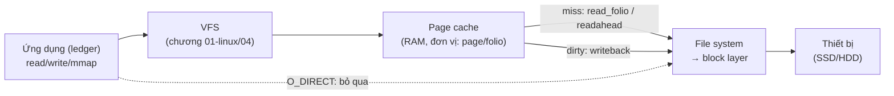
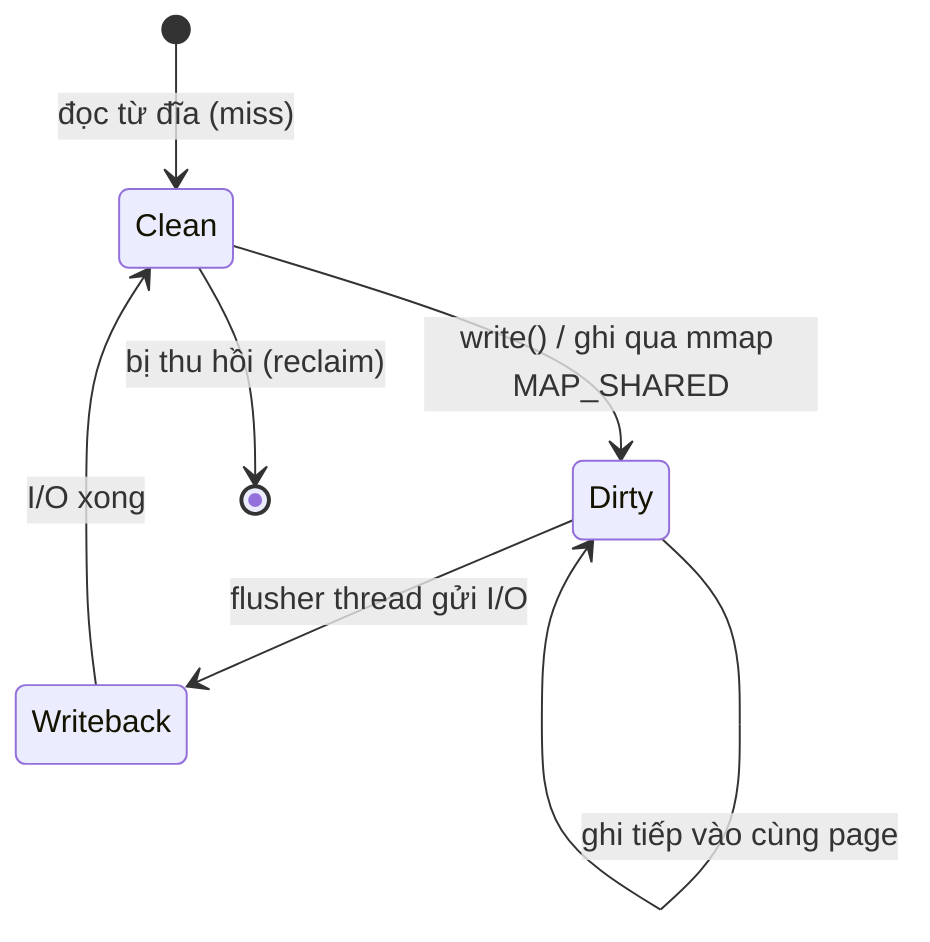

# P5 · Chương 04 — Page cache, writeback và direct I/O

## Bạn sẽ hiểu được gì

1. **Q1.** `read()` một file lần thứ hai nhanh hơn lần đầu là nhờ cái gì, và cái đó nằm ở đâu trong `/proc/meminfo`? → mục 1
2. **Q2.** Readahead là gì, `posix_fadvise` và `readahead(2)` can thiệp ra sao? → mục 2
3. **Q3.** `write()` trả về thành công thì dữ liệu đã nằm trên đĩa chưa? Nếu chưa thì nó nằm ở đâu, và ai đẩy nó xuống đĩa? → mục 3
4. **Q4.** Bốn sysctl `dirty_*` làm gì, bao lâu sau dữ liệu mới xuống đĩa, và vì sao một `write()` đang chạy nhanh có thể đột ngột bị chậm lại (write stall)? → mục 4
5. **Q5.** `O_SYNC`/`O_DSYNC` khác `fsync` thế nào, và khác `O_DIRECT` ở điểm nào? → mục 5
6. **Q6.** Vì sao một container "hết RAM" trong khi ứng dụng bên trong chỉ đọc/ghi file, và cách đọc `memory.stat` để phân biệt cache với memory thật? → mục 6
7. **Q7.** `O_DIRECT` bỏ qua cái gì, đổi lại phải trả giá gì (alignment, mất cache), và vì sao database không mặc định dùng nó? → mục 7

## Kiến thức cần trước

- [Chương 04 P1 — File descriptor và VFS](../01-linux/04-file-descriptor-va-vfs.md): fd, open file description, inode, VFS.
- [Chương 05 P3 — Bộ nhớ tiến trình Linux](../03-memory/05-bo-nho-tien-trinh-linux.md): `mmap` file-backed vs anonymous, `MAP_SHARED`/`MAP_PRIVATE`.

Cấu trúc file system trên đĩa thuộc `03-cai-dat-file-system.md`; sống sót qua mất điện thuộc `05-crash-consistency-va-journaling.md` và `06-durability-trong-thuc-te.md`. Chương này chỉ nói về lớp đệm trong RAM nằm giữa ứng dụng và đĩa.

---

## 1. Page cache: vì sao đọc lần hai nhanh hơn (Q1)

> **Trả lời ngắn.** Lần đọc đầu phải lấy dữ liệu từ đĩa, nhưng kernel giữ lại một bản trong RAM, nên lần đọc sau lấy thẳng từ RAM. Vùng đệm đó gọi là page cache, và `read`, `write`, `mmap` thông thường đều đi qua nó[^pcg]. Dung lượng nó chiếm hiện ở dòng `Cached` của `/proc/meminfo`[^proc-cached]. Khi nơi khác cần RAM, kernel tự thu hồi bớt page cache[^vm-autoreclaim].

**Giải thích.**

*Với service của bạn.* Hãy hình dung `ledger`, một service Rust chạy trong container trên Linux. Nó dùng hai file: `snapshot.bin`, ảnh chụp dữ liệu vài trăm MiB mà nó đọc lúc khởi động và lúc trả lời truy vấn, và `ledger.log`, file nó nối thêm một bản ghi cho mỗi giao dịch. Ta sẽ bám theo `ledger` suốt chương (nhận xét của người soạn: đây là ví dụ giả định, không phải code trong repo). Câu hỏi của mục này: restart `ledger` lần thứ hai, vì sao `snapshot.bin` được đọc nhanh hơn dù code không đổi một dòng?

Câu trả lời nằm ở chỗ nếu mỗi lần `read(fd, buf, n)` đều phải xuống thiết bị lưu trữ thì quá tốn kém. Ví dụ cụ thể: nếu file system không có cache, mỗi lần mở một đường dẫn dài sẽ phải đọc inode và dữ liệu của từng thư mục trên đường đi, tức hàng trăm lần đọc chỉ để mở một file[^osi-cache]. Linux giải bài toán đó bằng cách dùng RAM làm bộ đệm cho dữ liệu file, và bộ đệm này tên là **page cache**. Nó có thể bị bỏ qua, chẳng hạn bằng `O_DIRECT` (mục 7), nhưng `read`, `write`, `mmap` thông thường đều đi qua nó[^pcg].

Vì page cache nằm trong kernel chứ không nằm trong process của `ledger`, nên nó vẫn còn khi `ledger` chết và chạy lại (suy luận của người soạn). Cũng vì vậy, đây là đường mặc định của mọi I/O file, bất kể bạn viết bằng ngôn ngữ nào (suy luận của người soạn từ câu trích ở trên), trừ khi bạn chủ động tắt nó.



(Sơ đồ của người soạn.)

### 1.1 Hit và miss

Mỗi lần `ledger` đọc một đoạn của `snapshot.bin`, có hai khả năng. Nếu page chứa đoạn đó đã nằm trong RAM thì đó là một **hit**: kernel chép dữ liệu vào `buf` và không đụng tới thiết bị. Nếu chưa thì đó là một **miss**: kernel cấp một page trống, nhờ file system đọc dữ liệu từ đĩa lên, thread của `ledger` ngủ tới khi I/O xong rồi mới được chép dữ liệu (mô tả của người soạn; phần Đi sâu dẫn tài liệu VFS về chuyện page cache gọi xuống file system).

### 1.2 Xem trạng thái cache

Bốn chỗ để nhìn, ba trong `/proc/meminfo` và một cho từng file:

- Dòng `Cached` là bộ nhớ đệm trong RAM cho các file đọc từ đĩa, tức chính page cache; nó không gồm SwapCached[^proc-cached].
- Dòng `Mapped` là các file đã được ánh xạ vào bộ nhớ bằng `mmap(2)`, chẳng hạn thư viện[^proc-mapped]. Hiểu nôm na đó là phần page cache đang được gắn vào page table của một process nào đó (suy luận của người soạn).
- Dòng `MemAvailable` ước lượng lượng bộ nhớ có thể dùng để chạy ứng dụng mới mà không phải swap[^proc-avail]. Khi hỏi "máy còn bao nhiêu RAM" thì nên nhìn con số này, không nhìn `MemFree`, vì page cache sạch thu hồi được (nhận xét của người soạn; xem 1.3).
- Với từng file, bạn `mmap` nó rồi gọi `mincore(2)` trên vùng ánh xạ để biết trang nào đang nằm trong cache[^fadv-mincore].

### 1.3 Cache bị đuổi khi nào

Page cache dùng RAM mà chương trình chưa cần, và bị thu hồi khi chương trình cần. Tài liệu `sysctl vm` nói thẳng về `drop_caches`: các object này được kernel tự động thu hồi khi nơi khác trong hệ thống cần bộ nhớ[^vm-autoreclaim]. Hệ quả cho người vận hành `ledger`: cột `buff/cache` lớn không tự nó là dấu hiệu thiếu RAM (nhận xét của người soạn). Mục 6 sẽ cho thấy chuyện này gây hiểu lầm thế nào trong container.

<details><summary>Đi sâu: folio, hàm gọi ngược của file system, <code>drop_caches</code>, thí nghiệm đọc hai lần</summary>

**Folio.** Về mặt cài đặt, đơn vị quản lý bộ nhớ bên trong page cache là *folio*[^pcg-folio]. Bạn có thể hiểu nó là "một hoặc vài page liền nhau" gắn với một cặp (file, offset).

**File system gọi ngược.** Mỗi file system cung cấp cho page cache một số hàm. `read_folio` là hàm page cache gọi để đọc một folio từ backing store[^vfs-readfolio]. Còn `readahead` là hàm VM gọi để đọc các page gắn với đối tượng `address_space`[^vfs-ra]. Nói cách khác, khi page cache không có dữ liệu bạn cần (cache miss), chính nó gọi xuống file system để nạp.

**`drop_caches`.** `echo 1 > /proc/sys/vm/drop_caches` giải phóng page cache; `2` giải phóng slab có thể thu hồi (gồm dentry và inode); `3` giải phóng cả hai[^vm-drop]. Hai điều cần nhớ:

- Đây là thao tác không phá hủy và không giải phóng object dirty nào, nên muốn xóa được nhiều hơn thì chạy `sync` trước[^vm-drop-dirty].
- Tài liệu không khuyến nghị dùng nó ngoài môi trường test hoặc debug[^vm-drop-warn].

`/proc/sys` trong container lab là read-only nên người soạn dùng `posix_fadvise(DONTNEED)` trên từng file thay cho `drop_caches`. Cách này cũng chỉ thả page sạch; page dirty chưa ghi sẽ không được giải phóng[^fadv-dontneed].

**Thí nghiệm: đọc hai lần, nhìn `Cached`.** Ghi 512 MiB, `fsync`, xoá cache của file, rồi đọc hai lần:

```
start                        Cached=922MiB Dirty=0MiB
after fadvise DONTNEED       Cached=922MiB Dirty=0MiB
read cold: 0.058s (8819 MiB/s)
after cold read              Cached=1434MiB Dirty=0MiB     # +512 MiB
read warm: 0.022s (23060 MiB/s)
after DONTNEED again         Cached=922MiB Dirty=0MiB
```

`Cached` tăng đúng 512 MiB sau lần đọc đầu và giảm lại khi `DONTNEED`; lần đọc thứ hai nhanh gấp ~2,6 lần. Mức chênh khiêm tốn, có thể do đĩa ảo đã được cache phía host (suy luận của người soạn, chưa kiểm chứng).

</details>

**Quay lại Q1:** lần đọc đầu nạp dữ liệu vào page cache (tăng `Cached`), lần sau là cache hit nên `ledger` không phải chờ đĩa.

## 2. Readahead và `posix_fadvise` (Q2)

> **Trả lời ngắn.** Readahead là việc kernel đọc trước dữ liệu vào cache, để các lần đọc sau lấy từ cache mà không phải chờ đĩa[^ra-def]. Bạn gợi ý cho kernel bằng `posix_fadvise`, nhưng đó chỉ là lời khuyên, không ràng buộc[^fadv-nb]. Trên Linux, riêng `RANDOM` tắt hẳn readahead[^fadv-linux].

**Giải thích.**

*Với `ledger`.* Lúc khởi động, `ledger` quét `snapshot.bin` từ đầu tới cuối bằng những lần `read` 4 KiB. Lúc phục vụ truy vấn, nó lại nhảy tới những offset rời rạc. Hai kiểu truy cập này cần hai cách đối xử khác nhau, và mục này nói kernel xử lý chúng ra sao.

Với kiểu quét tuần tự, nếu mỗi page phải chờ một I/O riêng thì rất lãng phí. Vì vậy kernel *đọc trước* các page kế tiếp vào cache để lần `read` kế là hit. Chuyện kernel nhận ra kiểu truy cập tuần tự bằng cách nào là hiểu biết của người soạn, chưa dẫn nguồn. Về phía file system, trong vận hành bình thường các folio được đọc qua phương thức `readahead`[^vfs-ra-normal]. Phương thức này nhận các page liên tiếp trong page cache rồi khởi động I/O cho chúng[^vfs-ra2].

Khi bạn biết trước kiểu truy cập, `posix_fadvise(2)` cho phép nói với kernel. Các `advice` là `NORMAL`, `SEQUENTIAL`, `RANDOM`, `WILLNEED`, `DONTNEED`, `NOREUSE`. Man page nhấn mạnh rằng lời khuyên không ràng buộc, nó chỉ là một kỳ vọng phía ứng dụng[^fadv-nb]. Riêng trên Linux, ghi chú trong man page nói rõ tác dụng lên readahead: `NORMAL` đặt cửa sổ readahead bằng kích thước mặc định của thiết bị, `SEQUENTIAL` nhân đôi cửa sổ đó, `RANDOM` tắt hẳn readahead, và thay đổi áp dụng cho cả file (không ảnh hưởng các file handle khác của cùng file)[^fadv-linux]. Với `ledger`, gợi ý hợp lý là `SEQUENTIAL` cho lượt quét lúc khởi động và `RANDOM` cho phần truy vấn rời rạc (nhận xét của người soạn).

Hai advice còn lại và syscall riêng của Linux:

- `WILLNEED` khởi động một lần đọc không chặn vùng bạn chỉ định vào page cache[^fadv-willneed].
- `NOREUSE` từ Linux 2.6.18 là no-op[^fadv-noreuse].
- `readahead(2)` là syscall riêng của Linux, nên tránh dùng trong code cần portable[^ra-linux].
- `readahead(2)` vẫn có thể block khi phải đọc metadata để định vị block; man page nêu ví dụ ext2/3/4 dùng indirect block[^ra-bug].

<details><summary>Đi sâu: thí nghiệm đọc 256 MiB với NORMAL/SEQUENTIAL/RANDOM</summary>

**Thí nghiệm (quan sát thật, không phải bảo đảm).** Trong container Linux 6.8 của lab, người soạn tạo file 256 MiB rồi đọc bằng 65 536 lần `read` 4 KiB sau khi xoá cache của file (`POSIX_FADV_DONTNEED`), lặp hai lượt:

| Chế độ | Lượt 1 | Lượt 2 |
|---|---|---|
| NORMAL | 0,071 s | 0,069 s |
| SEQUENTIAL | 0,053 s | 0,055 s |
| RANDOM (tắt readahead) | 2,357 s | 1,909 s |

`read_ahead_kb` của các block device trong container đều là 128. Chênh lệch ~30 lần giữa NORMAL và RANDOM phù hợp với việc mỗi lần `read` 4 KiB nhỏ không có readahead thành một I/O riêng (suy luận của người soạn; chưa đo số I/O thực tế). Đây là một lần chạy trên máy ảo; chỉ *tỷ lệ* là hữu ích.

</details>

**Quay lại Q2:** readahead đọc trước các page tuần tự để biến lần đọc sau thành hit; `posix_fadvise` chỉ gợi ý, riêng `RANDOM` tắt readahead trên Linux.

## 3. Ghi: `write()` chỉ chép vào page cache (Q3)

> **Trả lời ngắn.** Chưa. Man page nói một lần `write()` thành công không bảo đảm dữ liệu đã được commit xuống đĩa[^write-nocommit]. Với ghi buffered, kernel chép dữ liệu vào page cache và đánh dấu dirty; lượng dirty hiện ở dòng `Dirty` của `/proc/meminfo`[^proc-dirty]. Sau đó cơ chế writeback ghi chúng xuống file system một cách bất đồng bộ[^cg-wb].

**Giải thích.**

*Với `ledger`.* Mỗi giao dịch, `ledger` gọi `write` để nối một bản ghi vào `ledger.log`, và gần như lập tức nhận kết quả thành công. Nếu máy mất điện ngay sau đó, bản ghi ấy còn không? Mục này trả lời phần "chuyện gì đã xảy ra với bản ghi"; mục 4 nói khi nào nó xuống đĩa, mục 5 nói cách ép nó xuống.

### 3.1 Điều `write()` hứa và không hứa

`write()` trả về thành công chỉ cho bạn biết kernel đã nhận dữ liệu, không bảo đảm dữ liệu đã được commit xuống đĩa[^write-nocommit]. Với ghi *buffered* (mặc định), kernel chép dữ liệu vào page cache, đánh dấu page đó là **dirty**[^cg-wb], rồi trả về ngay. Việc đẩy xuống đĩa diễn ra sau, và gọi là **writeback**. Dưới đây là vòng đời một page của `ledger.log` (sơ đồ của người soạn):



### 3.2 Vì sao hoãn ghi là hợp lý

Hoãn ghi nghe có vẻ liều, nhưng nó có lý do. Kernel nhờ vậy gộp được nhiều cập nhật nhỏ thành ít lần I/O hơn, sắp xếp lại lịch I/O, và đôi khi tránh được cả lần ghi (file vừa tạo đã bị xoá). OSTEP gói ý này trong câu "lười (trong việc ghi block xuống đĩa) là một đức tính"[^osi-lazy]. Cái giá cũng rõ: hầu hết file system hiện đại đệm ghi trong bộ nhớ khoảng từ năm đến ba mươi giây[^osi-5-30]. Nếu máy sập trong khoảng đó, những bản ghi còn dirty của `ledger` mất. Vì vậy có `fsync` (mục 5, và chi tiết ở chương 06).

### 3.3 Dirty và Writeback trong `/proc/meminfo`

`/proc/meminfo` tách hai trạng thái:

- `Dirty` là bộ nhớ đang chờ được ghi trả xuống đĩa[^proc-dirty].
- `Writeback` là bộ nhớ đang thực sự được ghi trả xuống đĩa[^proc-wb].

<details><summary>Đi sâu: <code>mmap</code> dùng chung bộ máy dirty/writeback; thí nghiệm ghi 512 MiB</summary>

**`mmap` dùng chung bộ máy này.** VFS có hook `dirty_folio`, được gọi chẳng hạn khi một page ánh xạ bộ nhớ bị sửa[^vfs-dirty]. Với `MAP_SHARED` file-backed, thay đổi được chuyển tiếp xuống file bên dưới[^mmap-shared]. Tài liệu cgroup v2 gói gọn cả hai đường: page cache bị làm dirty qua ghi buffered và `mmap` dùng chung, rồi được cơ chế writeback ghi bất đồng bộ xuống filesystem bên dưới[^cg-wb]. Tức là `write()` và `mmap` ghi chung một bộ máy dirty/writeback, nhất quán với việc cả `read`, `write` lẫn `mmap` thông thường đều đi qua page cache[^pcg]. (Xem [P3 chương 05](../03-memory/05-bo-nho-tien-trinh-linux.md).)

**Thí nghiệm (Python và Rust).** Ghi 512 MiB bằng 512 lệnh `write` 1 MiB, không `fsync`:

```
write 512MiB (no fsync): 0.104s
after write   Cached=1434MiB Dirty=512MiB Writeback=0MiB
fsync: 0.162s
after fsync   Cached=1434MiB Dirty=0MiB  Writeback=0MiB
```

`write` trả về sau 0,1 s trong khi cả 512 MiB còn "dirty"; `fsync` mất thêm 0,16 s để đẩy xuống. Cùng kịch bản bằng Rust (`File::write_all` 256 MiB rồi `sync_data`): `Dirty` 260 MiB sau ghi (34 ms), 4 MiB sau `sync_data` (111–122 ms, hai lần chạy). Số tuyệt đối chỉ minh hoạ.

</details>

**Quay lại Q3:** `write()` buffered chỉ chép vào page cache và đánh dấu dirty; việc xuống đĩa do writeback đảm nhiệm sau đó.

## 4. Writeback: bốn núm vặn `vm.dirty_*` (Q4)

> **Trả lời ngắn.** Kernel có hai ngưỡng dirty. Qua `dirty_background_ratio`, flusher thread nền bắt đầu ghi[^vm-bg]. Qua `dirty_ratio`, chính process đang ghi phải tự ghi dữ liệu dirty[^vm-dr]. Hai tham số còn lại quy định tuổi và nhịp: `dirty_expire_centisecs` cho biết dữ liệu dirty bao lâu thì đủ già để bị ghi[^vm-exp]. Còn `dirty_writeback_centisecs` là chu kỳ thức dậy của flusher[^vm-wbc]. Khi chạm `dirty_ratio`, một `write()` vốn nhanh bỗng chậm lại: đó là write stall (suy luận của người soạn từ định nghĩa `dirty_ratio`, xem mục 4.2).

**Giải thích.**

*Với `ledger`.* Giả sử cùng máy với `ledger` có một job batch xuất báo cáo, ghi file lớn liên tục. Lượng dirty của cả máy tăng lên, và p99 của `write` trong `ledger` bắt đầu xấu đi dù `ledger` không làm gì khác (nhận xét của người soạn). Hiểu bốn núm `vm.dirty_*` là cách giải thích chuyện đó, vì chúng quyết định ai đẩy page dirty xuống đĩa và khi nào.

Tài liệu `admin-guide/sysctl/vm` mô tả các tham số này (trích từ `vm.rst` ở tag v6.8; phần `dirty_*` và `drop_caches` trùng docs.kernel.org hiện hành):

| Sysctl | Mặc định trong container lab (đo) | Ý nghĩa theo tài liệu |
|---|---|---|
| `dirty_background_ratio` | 10 | % bộ nhớ "available" mà ở đó **flusher thread nền** bắt đầu ghi[^vm-bg] |
| `dirty_ratio` | 20 | % mà ở đó **chính process đang ghi** phải tự ghi[^vm-dr] |
| `dirty_expire_centisecs` | 3000 (30 s) | dữ liệu dirty lâu hơn ngưỡng này thì bị ghi vào lần flusher thức dậy kế tiếp[^vm-exp] |
| `dirty_writeback_centisecs` | 500 (5 s) | chu kỳ thức dậy của flusher thread; đặt 0 thì tắt hẳn writeback định kỳ[^vm-wbc] |

Ngưỡng ở hai dòng đầu tính theo phần trăm của tổng bộ nhớ khả dụng, gồm các page trống và các page thu hồi được. Hai chú ý để đọc cho đúng:

1. Tổng bộ nhớ khả dụng (*total available memory*) **không** bằng tổng RAM: tài liệu nói thẳng điều đó[^vm-notequal]. Vì vậy `dirty_ratio=20` trên máy 64 GiB không có nghĩa là ngưỡng đúng 12,8 GiB.
2. Mỗi ratio có một phiên bản tuyệt đối là `dirty_background_bytes` và `dirty_bytes`. Chỉ một trong hai tham số của một cặp được đặt tại một thời điểm: ghi vào cái này thì cái kia đọc ra 0[^vm-bytes]. Máy RAM lớn dùng ratio thường cho ngưỡng quá lớn so với tốc độ đĩa (nhận xét của người soạn; hãy đo workload của bạn).

### 4.1 Trình tự

Đi theo lượng dirty tăng dần. Dưới ngưỡng nền, dữ liệu dirty nằm yên; flusher thức dậy mỗi `dirty_writeback_centisecs` và ghi phần đã quá `dirty_expire_centisecs`. Vượt `dirty_background_ratio`, flusher ghi ngay, không chờ tới nhịp. Nếu process vẫn ghi nhanh hơn đĩa và lượng dirty vượt `dirty_ratio`, tài liệu sysctl nói process ghi bị kéo vào ghi dữ liệu dirty. Cách làm chậm process cụ thể ra sao nằm ở 4.2.

### 4.2 Write stall

Khi ghi nhanh hơn thiết bị trong đủ lâu, lượng dirty chạm `dirty_ratio`, và lúc đó process ghi tự ghi dữ liệu dirty[^vm-dr]. Phía ứng dụng, một `write()` vốn mất micro-giây bỗng chậm hẳn; đó là *write stall*. Đây là suy luận của người soạn từ định nghĩa trên; người soạn không tái tạo được stall trong container lab (không sửa được sysctl, đĩa ảo quá nhanh).

Với `ledger`, hệ quả thực tế là p99 của `write` có thể tăng khi job khác làm đầy dirty. Khi gặp triệu chứng đó, hãy theo dõi `Dirty` và `Writeback` song song với latency (nhận xét của người soạn).

<details><summary>Đi sâu: <code>balance_dirty_pages()</code> trong source v6.8</summary>

**Chi tiết cài đặt (source Linux v6.8 `mm/page-writeback.c`; có thể đổi giữa các bản kernel).** `balance_dirty_pages()` bắt đầu làm chậm process ghi từ mức trung bình của hai ngưỡng, không đợi tới `dirty_ratio`: `dirty_freerun_ceiling` trả về `(thresh + bg_thresh) / 2`, tức khoảng 15% với mặc định 10%/20%[^pw-free]. Cách làm chậm là cho process *ngủ*, mỗi lần tối đa 200 ms[^pw-sleep]. Chỉ khi ngủ vẫn không đủ thì ngưỡng mới thành giới hạn cứng thật sự[^pw-hard]. Theo comment trong source, process ghi chỉ bị làm chậm khi writeback nền không đuổi kịp[^pw-throttle]. Ở đây "dirty" gồm cả page `PG_dirty` lẫn `PG_writeback`[^pw-def], nên hãy theo dõi cả `Dirty` và `Writeback`. Vậy (suy luận của người soạn từ source, chưa quan sát): ứng dụng thường thấy `write()` ngủ từng quãng ngắn, bắt đầu trước khi chạm `dirty_ratio`.

</details>

**Quay lại Q4:** flusher nền ghi từ `dirty_background_ratio`, process ghi tự ghi khi vượt `dirty_ratio` và đó là lúc `write()` bị chậm; dữ liệu dirty quá `dirty_expire_centisecs` thì bị ghi vào lần flusher thức dậy kế tiếp, nhịp thức dậy do `dirty_writeback_centisecs` quy định.

## 5. `fsync`, `O_SYNC` và `O_DSYNC`: ép ghi đồng bộ (Q5)

> **Trả lời ngắn.** `fsync` là một lời gọi riêng: nó đẩy dữ liệu đã sửa của file xuống thiết bị và chặn tới khi thiết bị báo xong[^fsync-def]. `O_SYNC` và `O_DSYNC` là cờ khi mở file, làm mỗi `write` hoàn tất theo chuẩn synchronized I/O[^open-osync]. Dữ liệu của cả hai cách vẫn đi qua page cache[^pcg]. `O_DIRECT` thì bỏ qua page cache và tự nó không cho bảo đảm của `O_SYNC`[^open-direct-sync].

**Giải thích.**

*Với `ledger`.* Trước khi báo "đã commit" cho client, `ledger` cần chắc bản ghi vừa nối vào `ledger.log` không bay mất khi máy sập. `write` thường không đủ (mục 3), nên `ledger` có ba lựa chọn: gọi `fsync` sau khi ghi, mở file với `O_SYNC` hoặc `O_DSYNC`, hoặc mở với `O_DIRECT`. Mục này phân biệt ba lựa chọn đó.

### 5.1 `fsync`, `fdatasync`: ép writeback có chủ đích

Ứng dụng không bắt buộc phải chờ flusher: nó có thể yêu cầu ghi ngay. `fsync(2)` chuyển ("flush") mọi dữ liệu in-core đã sửa của file xuống thiết bị đĩa, kể cả flush cache của đĩa nếu có, và chặn tới khi thiết bị báo việc chuyển đã hoàn tất[^fsync-def]. `fdatasync` nhẹ hơn: nó bỏ qua metadata không cần cho việc đọc lại dữ liệu (như `mtime`), nhưng vẫn flush khi kích thước file đổi[^fdatasync]. Hợp đồng đầy đủ của hai lời gọi, chuyện `fsync` file không bảo đảm entry trong thư mục cha (cần `fsync` cả thư mục) và `sync_file_range` nằm ở [Chương 06, mục 2, 3 và 6](./06-durability-trong-thuc-te.md).

### 5.2 `O_SYNC` và `O_DSYNC`: bắt mỗi `write` phải đồng bộ

Thay vì gọi `fsync` sau mỗi lần ghi, bạn có thể mở file với cờ để mỗi `write` tự hoàn tất theo chuẩn synchronized I/O. `O_SYNC` flush dữ liệu và mọi metadata liên quan xuống phần cứng (file integrity completion)[^open-osync]. `O_DSYNC` flush dữ liệu, nhưng chỉ flush những cập nhật metadata cần để một thao tác đọc sau đó hoàn tất đúng (data integrity completion)[^open-odsync]. Khác biệt cụ thể: `O_DSYNC` chỉ bảo đảm flush kích thước file (khi nó đổi), còn `O_SYNC` luôn flush cả `mtime`[^open-example]. Định nghĩa đầy đủ và lịch sử của hai cờ ở [Chương 06, mục 6](./06-durability-trong-thuc-te.md).

<details><summary>Đi sâu: <code>O_SYNC</code>/<code>O_DSYNC</code> vẫn qua page cache, khác <code>O_DIRECT</code></summary>

Nếu không có `O_DIRECT` thì dữ liệu vẫn đi qua page cache. Đây là suy luận của người soạn, vì tài liệu page cache chỉ nêu `O_DIRECT` làm ví dụ bỏ qua cache[^pcg]. Hai cờ `O_SYNC` và `O_DSYNC` chỉ ép `write()` không trả về cho tới khi dữ liệu xuống thiết bị (theo định nghĩa flush xuống phần cứng ở trên). Chúng khác `O_DIRECT` đúng ở chỗ đó: `O_DIRECT` bỏ cache nhưng không tự có bảo đảm này (xem bảng ở mục 7.3).

</details>

**Quay lại Q5:** `fsync` ép từ ngoài, `O_SYNC`/`O_DSYNC` ép trong mỗi `write` nhưng vẫn qua page cache, còn `O_DIRECT` bỏ qua cache mà không tự đem lại bảo đảm của `O_SYNC`.

## 6. Page cache trong container: "hết RAM" vì cache (Q6)

> **Trả lời ngắn.** Memory controller của cgroup v2 theo dõi cả page cache lẫn bộ nhớ anonymous[^cg-userland]. Khóa `file` trong `memory.stat` là lượng bộ nhớ dùng để cache dữ liệu file system[^cg-file]. OOM killer chỉ được gọi khi usage chạm giới hạn mà không giảm xuống được[^cg-max]. Vì vậy hãy so `anon` với `file` trong `memory.stat` trước khi kết luận là leak.

**Giải thích.**

*Với `ledger`.* Giả sử `ledger` chạy trong container có `--memory=128m`. Sau vài giờ đọc `snapshot.bin` và ghi `ledger.log`, dashboard cho thấy memory của container luôn sát 128 MiB. Đây là leak hay chuyện bình thường? Mục này cho cách phân biệt.

### 6.1 Cache được tính vào memory cgroup

Memory controller của cgroup v2 tính cả page cache lẫn bộ nhớ anonymous[^cg-userland]. Khoá `file` của `memory.stat` gồm cả tmpfs và shared memory[^cg-file]. Cơ chế đầy đủ, gồm các file `memory.current`/`high`/`max`/`events` và lý do `high` chỉ throttle còn `max` mới OOM, nằm ở [Chương 08·03, mục 4](../08-containers/03-cgroups-v2.md). Ở đây chỉ nêu các khoá liên quan tới writeback:

- `file_dirty` là lượng dữ liệu filesystem được cache đã bị sửa nhưng chưa ghi trả xuống đĩa, và `file_writeback` là phần đang được ghi trả xuống đĩa[^cg-dirty].
- `file_mapped` là phần cache đang được `mmap`[^cg-mapped].

`memory.max` là hard limit: khi usage chạm limit và không giảm xuống được thì OOM killer được gọi trong cgroup[^cg-max]. Điều kiện then chốt là "không giảm xuống được". Trong source v6.8, khi charge vượt `memory.max`, kernel ghi sự kiện `max` rồi gọi `try_to_free_mem_cgroup_pages` để reclaim[^mc-max]. Vì vậy `memory.current` sát `memory.max` chỉ do page cache sạch thì chưa đủ để có OOM kill (suy luận của người soạn từ đoạn code và định nghĩa `memory.max`).

### 6.2 Ai trả tiền cho cache

Cache được tính (charge) cho cgroup đã *tạo ra* nó, và chuyển process sang cgroup khác không chuyển phần đã tính (chi tiết ở [Chương 08·03, mục 4](../08-containers/03-cgroups-v2.md)). Với vùng được nhiều cgroup cùng dùng, tài liệu nói việc nó được tính cho cgroup nào là "in-deterministic", tức không xác định trước[^cg-indet].

### 6.3 Writeback theo cgroup

Kernel xem xét cả trạng thái bộ nhớ dirty toàn hệ thống lẫn theo từng cgroup, và áp dụng giới hạn chặt hơn trong hai giới hạn[^cg-wb2]. Vậy container của `ledger` có thể bị throttle ghi dù cả máy còn rộng (suy luận của người soạn từ câu trích). Tính năng này cần file system hỗ trợ (ext2, ext4, btrfs, f2fs, xfs); trên loại khác, mọi I/O writeback đều được tính cho root cgroup[^cg-wb3]. Phần cgroup v2 nói chung xem [Chương 08·03](../08-containers/03-cgroups-v2.md).

<details><summary>Đi sâu: thí nghiệm container 128 MiB ghi 400 MiB</summary>

Thí nghiệm này bổ sung cho thí nghiệm `dd` 300 MiB vào cgroup 50 MiB ở [Chương 08·03, mục 4](../08-containers/03-cgroups-v2.md) (cùng kết luận: page cache lấp đầy `memory.current`, `oom_kill` = 0). Ở đây thêm cột `file_dirty`/`file_writeback` và đối chiếu với `fsync`. Chạy `docker run --memory=128m` rồi ghi 400 MiB vào một file (`/tmp` trên overlay) và in `memory.current` + `memory.stat`:

```
memory.max = 134217728
start                  current=3MiB   anon=2 file=0   file_dirty=0  file_writeback=0
written 50 MiB         current=55MiB  anon=3 file=49  file_dirty=11
written 100 MiB        current=107MiB anon=3 file=100 file_dirty=2
written 200 MiB        current=128MiB anon=3 file=120 file_dirty=5
written 400 MiB        current=128MiB anon=3 file=119 file_dirty=12
after fsync            current=127MiB anon=3 file=119 file_dirty=0
after read             current=127MiB anon=4 file=122
memory.events: low 0 | high 0 | max 2712 | oom 0 | oom_kill 0
```

Đọc kết quả:

- `anon` chỉ ~3 MiB suốt thí nghiệm; gần như toàn bộ `memory.current` là `file`.
- `memory.current` chạm 128 MiB và đứng đó, `oom_kill = 0`, trong khi `max` là 2712. Theo tài liệu, `max` đếm số lần usage sắp vượt qua ranh giới max, và nếu direct reclaim không hạ được thì cgroup mới vào trạng thái OOM[^cg-events]. Ở v6.8 bộ đếm này tăng *trước* khi gọi direct reclaim (§6.1)[^mc-max], nên 2712 là số lần charge phải reclaim, *không* phải số lần reclaim thành công. Reclaim đủ dùng thể hiện ở `oom_kill = 0` và `file` đứng quanh 119–122 MiB (suy luận của người soạn; không đo trực tiếp lượng page bị reclaim). Đây là quan sát một lần chạy, không phải bảo đảm.

</details>

**Quay lại Q6:** cache được tính vào memory cgroup; `memory.current` sát `memory.max` chỉ vì cache sạch là chưa phải OOM, nên so `anon` với `file` để phân biệt.

## 7. `O_DIRECT`: bỏ qua page cache (Q7)

> **Trả lời ngắn.** `O_DIRECT` cho I/O đi thẳng giữa buffer user space và thiết bị thay vì qua page cache[^open-directbuf]. Giá phải trả thứ nhất: thường giảm hiệu năng nếu ứng dụng không tự cache[^open-direct]. Giá thứ hai: có thể đòi alignment cho độ dài, địa chỉ buffer và offset[^open-align]. PostgreSQL không bật nó mặc định[^pg-dio-3].

**Giải thích.**

*Với `ledger`.* Page cache đang lo cho `ledger` chuyện đọc `snapshot.bin` và đệm ghi `ledger.log`. Nếu `ledger` có cache riêng trong process thì page cache của kernel thành lớp đệm thứ hai giữ cùng dữ liệu. Câu hỏi: `ledger` có nên mở file với `O_DIRECT` để bỏ lớp thừa đó? Mục này nói `O_DIRECT` đổi gì, mất gì, và vì sao câu trả lời thường là "không".

### 7.1 Cơ chế và mục đích

`O_DIRECT` cố gắng giảm thiểu ảnh hưởng của cache lên I/O đến và đi từ file; nó thường làm giảm hiệu năng, nhưng hữu ích khi ứng dụng tự làm cache[^open-direct]. Với cờ này, I/O file được thực hiện trực tiếp tới/từ buffer user space thay vì qua page cache[^open-directbuf].

Có một hiểu lầm hay gặp: `O_DIRECT` **không** đồng nghĩa với "đã xuống đĩa bền vững". Riêng cờ `O_DIRECT` chỉ nỗ lực truyền dữ liệu đồng bộ, chứ không đem lại bảo đảm của cờ `O_SYNC` rằng dữ liệu và metadata cần thiết đã được truyền[^open-direct-sync]. Muốn bảo đảm thì kết hợp thêm `O_SYNC` hoặc `fsync`.

### 7.2 Yêu cầu alignment

Cái giá thứ hai là alignment. `O_DIRECT` có thể áp ràng buộc lên độ dài và địa chỉ của buffer user space, cùng offset file của I/O[^open-align]. Những ràng buộc này tuỳ file system và phiên bản kernel, có thể không tồn tại, và khi vi phạm thì I/O có thể lỗi `EINVAL` hoặc rơi về buffered I/O. Từ Linux 6.1, bạn hỏi được ràng buộc của từng file bằng `statx(2)` với cờ `STATX_DIOALIGN`[^open-statx]. Với `ledger`, điều này nghĩa là mọi buffer đọc/ghi phải được cấp có chủ đích (mục 8), không dùng `Vec<u8>` thường.

### 7.3 So sánh các cách ghi

Bảng dưới đặt các cách `ledger` có thể ghi `ledger.log` cạnh nhau:

| | Qua page cache? | `write()` trả về khi | Dữ liệu bền khi trả về? |
|---|---|---|---|
| buffered (mặc định) | Có | đã chép vào page cache | Không[^write-nocommit] |
| buffered + `fsync` | Có | sau khi `fsync` xong | Có, theo định nghĩa `fsync`[^fsync-def] (xem chương 06 về giới hạn) |
| `O_SYNC` / `O_DSYNC` | Có | sau flush (đủ metadata / chỉ metadata cần thiết) | Theo định nghĩa `O_SYNC`[^open-osync] và `O_DSYNC`[^open-odsync] |
| `O_DIRECT` | Không | cố gắng đồng bộ, nhưng không bằng `O_SYNC` | Không bảo đảm nếu không thêm `O_SYNC`[^open-direct-sync] |
| `O_DIRECT` + `O_SYNC` | Không | sau flush | Theo `O_SYNC`[^open-osync] |

### 7.4 Database có dùng direct I/O không?

**PostgreSQL** mặc định dùng I/O buffered qua page cache của OS. Docs của PostgreSQL xếp cache của OS vào chuỗi bền vững: trước hết có buffer cache của hệ điều hành, vốn cache các block đĩa được yêu cầu thường xuyên và gộp các lần ghi đĩa[^pg-oscache]. Khi hướng dẫn đặt `effective_cache_size`, docs bảo hãy xét cả shared buffers của PostgreSQL lẫn phần disk cache của kernel sẽ dùng cho file dữ liệu PostgreSQL, dù một số dữ liệu có thể tồn tại ở cả hai nơi[^pg-ecs]. Nói cách khác, planner *giả định* kernel cache có góp phần.

PostgreSQL 17 có tuỳ chọn `debug_io_direct`: nó yêu cầu kernel giảm thiểu hiệu ứng caching cho dữ liệu relation và file WAL, bằng `O_DIRECT` (hầu hết hệ Unix-like), `F_NOCACHE` (macOS) hoặc `FILE_FLAG_NO_BUFFERING` (Windows)[^pg-dio-1]. Docs ghi rõ hiện tính năng này làm giảm hiệu năng và chỉ dành cho developer testing[^pg-dio-2]. Giá trị mặc định là chuỗi rỗng, tức tắt direct I/O[^pg-dio-3]. (Phiên bản đã đối chiếu: PostgreSQL 17.)

**DB có buffer pool riêng** (nhận xét của người soạn): cache thứ hai của OS trùng lặp dữ liệu, và đó là lý do kinh điển để chọn direct I/O. Người soạn không dẫn được docs MySQL (trang từ chối truy cập tự động khi soạn); hãy xem `innodb_flush_method` của phiên bản bạn dùng.

Tổng kết cho `ledger` (nhận xét của người soạn): direct I/O đổi cache và readahead miễn phí của OS lấy quyền kiểm soát I/O, nên chỉ có lời khi `ledger` có cache tốt riêng. Nếu không thì page cache đang làm việc đó giúp bạn.

<details><summary>Đi sâu: lịch sử alignment, <code>statx</code>, thí nghiệm trên overlayfs, cạm bẫy khác trong man page</summary>

**Lịch sử và `statx`.** Linux 2.4 yêu cầu bội số kích thước block của file system (thường 4096 B); từ 2.6.0 ràng buộc nới xuống logical block size của thiết bị (thường 512 B)[^open-align-hist]. `statx(2)` trên bookworm có cờ `STATX_DIOALIGN`, trả `stx_dio_mem_align` (căn buffer) và `stx_dio_offset_align` (căn offset và độ dài); với file thường, ext4, f2fs và xfs hỗ trợ từ Linux 6.1[^statx-dio]. Nếu file system không cài đặt `O_DIRECT`, `open` có thể thất bại với `EINVAL`[^open-einval].

**Thí nghiệm (overlayfs, Linux 6.8, bộ nhớ cấp bằng `mmap` anonymous nên căn trang):**

Kết quả (`pread` với O_DIRECT): offset 0/len 4096, offset 512/len 512 và offset 4096/len 8192 đều OK; offset 1/len 4096, offset 0/len 100, và buffer Python `bytearray` không căn địa chỉ (offset 0/len 4096) đều `EINVAL`.

Ca cuối cho thấy ràng buộc áp lên cả *địa chỉ buffer*, không chỉ offset/length. Đo cũng cho thấy `Cached` gần như không đổi khi đọc 512 MiB bằng `O_DIRECT` (922 → 923 MiB), trong khi đọc buffered tăng 512 MiB. Đây là kết quả trên một file system và một kernel; đừng suy rộng "offset 512 luôn được".

**Cạm bẫy khác trong man page.**

- Không chạy `O_DIRECT` đồng thời với `fork` nếu buffer là private mapping[^open-fork].
- Ứng dụng nên tránh trộn `O_DIRECT` với I/O thường trên cùng một file, và đặc biệt trên các vùng byte chồng lấn trong cùng file[^open-mix].
- Với NFS, `O_DIRECT` chỉ bỏ qua cache phía client; server vẫn có thể cache I/O đó[^open-nfs].
- Hãy coi `O_DIRECT` là tùy chọn hiệu năng, tắt mặc định[^open-default].

</details>

**Quay lại Q7:** `O_DIRECT` bỏ qua page cache, đòi alignment và không tự bền; database có cache riêng mới thật sự cần (nhận xét của người soạn, xem 7.4).

## 8. Liên hệ với Rust

Trong Rust, `ledger` đứng trên hai tầng đệm: buffer của user space do bạn quyết định, và page cache của kernel bên dưới. Phần lớn các câu hỏi ở các mục trên quy về việc bạn đang đệm ở tầng nào và ép xuống tầng nào.

- `std::fs::File` **không** có buffer ở user space: docs ghi `File` không đệm các lần đọc và ghi[^rs-file]. Mỗi `read`/`write` trên `File` là một syscall vào page cache. Với nhiều lần đọc/ghi nhỏ, hãy bọc bằng `BufReader`/`BufWriter`; `BufWriter` giữ một buffer dữ liệu trong bộ nhớ và ghi nó xuống writer bên dưới thành các lô lớn, thưa[^rs-bufwriter]. Suy ra (suy luận của người soạn từ định nghĩa đó): `flush()` của `BufWriter` chỉ đẩy dữ liệu xuống kernel, chưa phải xuống đĩa.
- `File::sync_all` cố gắng đồng bộ xuống đĩa mọi nội dung file và metadata do hệ điều hành giữ nội bộ[^rs-syncall]. `File::sync_data` giống vậy nhưng có thể không đồng bộ metadata của file xuống filesystem[^rs-syncdata]. Hai hàm này tương ứng khái niệm `fsync`/`fdatasync`; việc map cụ thể sang syscall là chi tiết cài đặt trong std, hãy kiểm tra source khi cần.
- Để mở với `O_DIRECT`/`O_SYNC`/`O_DSYNC`, dùng `OpenOptionsExt::custom_flags` (Unix), hàm này truyền cờ tùy chỉnh vào đối số flags của `open`[^rs-customflags]. Hằng số `O_DIRECT` thường lấy từ crate `libc` thay vì hard-code số (nhận xét của người soạn; người soạn không kiểm tra std có xuất hằng số này hay không).
- Với `O_DIRECT`, bạn phải tự cấp buffer có địa chỉ và độ dài đúng alignment. Một `Vec<u8>` thông thường không bảo đảm căn theo yêu cầu của `O_DIRECT` (suy luận của người soạn: alignment của `u8` là 1), và thí nghiệm ở mục 7 (Đi sâu) cho thấy buffer không căn (Python `bytearray`) bị `EINVAL`.
- `posix_fadvise`, `readahead`, `sync_file_range` cần `libc` hoặc crate bọc (`nix`…); người soạn không kiểm tra std có bọc chúng không.

Ví dụ minh họa (của người soạn, chỉ biên dịch, không dùng để đo): đường ghi một lô giao dịch của `ledger`, qua hai tầng đệm rồi ép xuống thiết bị.

```rust
use std::fs::OpenOptions;
use std::io::{BufWriter, Write};

fn append_batch(path: &str, records: &[Vec<u8>]) -> std::io::Result<()> {
    let file = OpenOptions::new().create(true).append(true).open(path)?;
    let mut w = BufWriter::new(file);
    for r in records {
        w.write_all(r)?; // vào buffer user space
    }
    w.flush()?; // xuống kernel: dữ liệu nằm trong page cache (dirty)
    w.get_ref().sync_data()?; // xuống thiết bị, lỗi được trả về cho bạn
    Ok(())
}
```

Code Rust cần "ghi bền" (WAL, file cấu hình) phải gọi `sync_all`/`sync_data` và xử lý lỗi của chúng, vì `drop` một `File` bỏ qua lỗi[^rs-syncall-drop] (nhận xét của người soạn).

---

## Tóm tắt

- Page cache là đường mặc định của `read`, `write`, `mmap`; chỉ `O_DIRECT` bỏ qua nó[^pcg].
- `read` miss kéo dữ liệu từ đĩa vào cache, còn readahead đọc trước. `posix_fadvise` chỉ là lời khuyên, riêng `RANDOM` tắt readahead trên Linux[^fadv-linux].
- `write` buffered chỉ chép vào page cache và đánh dấu dirty; nó không bảo đảm dữ liệu xuống đĩa[^write-nocommit].
- Flusher thread bắt đầu ghi ở `dirty_background_ratio`, thức dậy mỗi `dirty_writeback_centisecs` và ghi dữ liệu già quá `dirty_expire_centisecs`. Vượt `dirty_ratio` thì process ghi bị kéo vào ghi (tài liệu sysctl)[^vm-dr]. Ở v6.8, process bị throttle bằng cách ngủ từ mức giữa hai ngưỡng, và đó là write stall[^pw-free].
- `drop_caches` chỉ bỏ page sạch và không dành cho vận hành thường ngày[^vm-drop-warn]. Ngưỡng `dirty_*` tính trên "available memory", không phải tổng RAM[^vm-notequal].
- `O_SYNC`/`O_DSYNC` ép `write` đồng bộ nhưng vẫn qua cache (suy luận, xem mục 5.2)[^open-osync]. `O_DIRECT` bỏ cache nhưng không tự bền[^open-direct-sync]. Nó còn đòi alignment, cả địa chỉ buffer[^open-align].
- Cache được tính vào memory cgroup (khoá `file` trong `memory.stat`)[^cg-file]. "Container đầy RAM" thường là cache (suy luận từ thí nghiệm mục 6); phân biệt bằng `anon` so với `file` và `oom_kill`.
- PostgreSQL (docs v17) mặc định dựa vào cache của OS[^pg-dio-3]; direct I/O của nó chỉ dành cho developer testing[^pg-dio-2].

---

## Câu hỏi tự kiểm tra

1. Hai lần `cat` cùng một file: lần hai nhanh hơn vì sao? Dòng nào trong `/proc/meminfo` thay đổi sau lần đầu?
<details><summary>Đáp án</summary>

Lần đầu là cache miss, dữ liệu được nạp vào page cache; lần hai là hit[^pcg]. Dòng `Cached` tăng (thí nghiệm ở mục 1: +512 MiB cho file 512 MiB)[^proc-cached].

</details>

2. `write()` trả về 512 MiB thành công trong 0,1 s. Dữ liệu đã bền chưa? Chỉ báo nào cho thấy câu trả lời?
<details><summary>Đáp án</summary>

Chưa bảo đảm; man page `write(2)` nói không[^write-nocommit]. Chỉ báo là `Dirty` trong `/proc/meminfo` tăng ~512 MiB (mục 3)[^proc-dirty].

</details>

3. Ai ghi dữ liệu dirty xuống đĩa khi dưới `dirty_ratio`, và khi vượt `dirty_ratio` thì sao?
<details><summary>Đáp án</summary>

Flusher thread (nền) bắt đầu ghi từ `dirty_background_ratio`[^vm-bg]. Khi vượt `dirty_ratio`, process đang ghi tự ghi dữ liệu dirty[^vm-dr]. Ở v6.8, process đó bị làm chậm bằng cách cho ngủ nên `write()` chậm lại[^pw-sleep].

</details>

4. `echo 3 > drop_caches` có mất dữ liệu chưa ghi không? Có nên cron nó mỗi giờ để "giải phóng RAM"?
<details><summary>Đáp án</summary>

Không mất dữ liệu, vì nó không free dirty object[^vm-drop-dirty]. Không nên cron: tài liệu không khuyến nghị dùng ngoài môi trường test hoặc debug[^vm-drop-warn].

</details>

5. `O_DIRECT` đã đủ để dữ liệu bền khi `write` trả về chưa?
<details><summary>Đáp án</summary>

Không. Cần thêm `O_SYNC` (hoặc `fsync`)[^open-direct-sync].

</details>

6. Ba thành phần nào của một I/O `O_DIRECT` có thể phải căn, và lỗi thường gặp là gì?
<details><summary>Đáp án</summary>

Offset trong file, độ dài, và địa chỉ buffer; vi phạm có thể `EINVAL` hoặc rơi về buffered I/O tuỳ file system[^open-align].

</details>

7. Container `--memory=128m`, `memory.current` luôn sát 128 MiB nhưng `anon` chỉ vài MiB và `oom_kill=0`. Có leak không? Xem gì để chắc?
<details><summary>Đáp án</summary>

Rất có thể chỉ là page cache (`file` chiếm gần hết). Memory controller tính cả page cache lẫn bộ nhớ anonymous[^cg-userland], nên hãy xem `memory.stat` (`anon` so với `file`, `file_dirty`) và `memory.events` (`oom_kill`); thí nghiệm ở mục 6 (Đi sâu) cho thấy đúng hình dạng đó.

</details>

8. PostgreSQL có dùng direct I/O mặc định không?
<details><summary>Đáp án</summary>

Không; giá trị mặc định là chuỗi rỗng[^pg-dio-3]. Tuỳ chọn `debug_io_direct` (v17) chỉ dành cho developer testing và hiện làm giảm hiệu năng[^pg-dio-2].

</details>

9. Trong Rust, `BufWriter::flush()` có bảo đảm dữ liệu xuống đĩa không?
<details><summary>Đáp án</summary>

Không: nó đẩy buffer user space xuống writer bên dưới[^rs-bufwriter], tức vào page cache của kernel. Muốn xuống thiết bị cần `File::sync_all`/`sync_data`[^rs-syncall].

</details>

---

## Đọc thêm

- OSTEP, [File System Implementation, mục 40.7](https://pages.cs.wisc.edu/~remzi/OSTEP/file-implementation.pdf): caching và write buffering.
- [Linux kernel — /proc/sys/vm](https://docs.kernel.org/admin-guide/sysctl/vm.html): `dirty_*`, `drop_caches`.
- [open(2), NOTES](https://manpages.debian.org/bookworm/manpages-dev/open.2.en.html): `O_DIRECT`, alignment, `O_SYNC`.
- [cgroup v2](https://docs.kernel.org/admin-guide/cgroup-v2.html): `memory.stat`, Writeback.
- Chương tiếp: `05-crash-consistency-va-journaling.md`.

---

[^osi-cache]: OSTEP, File System Implementation, mục 40.7 Caching and Buffering — <https://pages.cs.wisc.edu/~remzi/OSTEP/file-implementation.pdf> — "the file system would literally perform hundreds of reads just to open the file!"
[^pcg]: Linux kernel docs, Page Cache — <https://docs.kernel.org/mm/page_cache.html> — "It can be bypassed (e.g. with O_DIRECT), but normal reads, writes and mmaps go through the page cache."
[^pcg-folio]: Linux kernel docs, Page Cache — <https://docs.kernel.org/mm/page_cache.html> — "The folio is the unit of memory management within the page cache."
[^vfs-readfolio]: Linux kernel docs, Overview of the Linux Virtual File System, address_space_operations — <https://docs.kernel.org/filesystems/vfs.html> — "Called by the page cache to read a folio from the backing store."
[^vfs-ra]: Linux kernel docs, Overview of the Linux Virtual File System, address_space_operations — <https://docs.kernel.org/filesystems/vfs.html> — "Called by the VM to read pages associated with the address_space object."
[^vfs-ra2]: Linux kernel docs, Overview of the Linux Virtual File System, address_space_operations — <https://docs.kernel.org/filesystems/vfs.html> — "The pages are consecutive in the page cache and are locked."
[^fadv-nb]: posix_fadvise(2), DESCRIPTION — <https://manpages.debian.org/bookworm/manpages-dev/posix_fadvise.2.en.html> — "The advice is not binding; it merely constitutes an expectation on behalf of the application."
[^fadv-linux]: posix_fadvise(2), NOTES — <https://manpages.debian.org/bookworm/manpages-dev/posix_fadvise.2.en.html> — "POSIX_FADV_NORMAL sets the readahead window to the default size for the backing device; POSIX_FADV_SEQUENTIAL doubles this size, and POSIX_FADV_RANDOM disables file readahead entirely."
[^fadv-willneed]: posix_fadvise(2), DESCRIPTION — <https://manpages.debian.org/bookworm/manpages-dev/posix_fadvise.2.en.html> — "POSIX_FADV_WILLNEED initiates a nonblocking read of the specified region into the page cache."
[^fadv-noreuse]: posix_fadvise(2), DESCRIPTION — <https://manpages.debian.org/bookworm/manpages-dev/posix_fadvise.2.en.html> — "since Linux 2.6.18, this flag is a no-op."
[^fadv-dontneed]: posix_fadvise(2), DESCRIPTION — <https://manpages.debian.org/bookworm/manpages-dev/posix_fadvise.2.en.html> — "Any unwritten dirty pages will not be freed."
[^fadv-mincore]: posix_fadvise(2), NOTES — <https://manpages.debian.org/bookworm/manpages-dev/posix_fadvise.2.en.html> — "One can obtain a snapshot of which pages of a file are resident in the buffer cache by opening a file, mapping it with mmap(2), and then applying mincore(2) to the mapping."
[^ra-def]: readahead(2), DESCRIPTION — <https://manpages.debian.org/bookworm/manpages-dev/readahead.2.en.html> — "readahead() initiates readahead on a file so that subsequent reads from that file will be satisfied from the cache, and not block on disk I/O"
[^ra-linux]: readahead(2), STANDARDS — <https://manpages.debian.org/bookworm/manpages-dev/readahead.2.en.html> — "The readahead() system call is Linux-specific, and its use should be avoided in portable applications."
[^ra-bug]: readahead(2), BUGS — <https://manpages.debian.org/bookworm/manpages-dev/readahead.2.en.html> — "However, it may block while it reads the filesystem metadata needed to locate the requested blocks."
[^proc-cached]: proc(5), /proc/meminfo — <https://manpages.debian.org/bookworm/manpages/proc.5.en.html> — "In-memory cache for files read from the disk (the page cache). Doesn't include SwapCached."
[^proc-mapped]: proc(5), /proc/meminfo — <https://manpages.debian.org/bookworm/manpages/proc.5.en.html> — "Files which have been mapped into memory (with mmap(2)), such as libraries."
[^proc-avail]: proc(5), /proc/meminfo — <https://manpages.debian.org/bookworm/manpages/proc.5.en.html> — "An estimate of how much memory is available for starting new applications, without swapping."
[^proc-dirty]: proc(5), /proc/meminfo — <https://manpages.debian.org/bookworm/manpages/proc.5.en.html> — "Memory which is waiting to get written back to the disk."
[^proc-wb]: proc(5), /proc/meminfo — <https://manpages.debian.org/bookworm/manpages/proc.5.en.html> — "Memory which is actively being written back to the disk."
[^vm-autoreclaim]: Linux v6.8 Documentation/admin-guide/sysctl/vm.rst, drop_caches — <https://raw.githubusercontent.com/torvalds/linux/v6.8/Documentation/admin-guide/sysctl/vm.rst> — "These objects are automatically reclaimed by the kernel when memory is needed elsewhere on the system."
[^vm-drop]: Linux v6.8 Documentation/admin-guide/sysctl/vm.rst, drop_caches — <https://raw.githubusercontent.com/torvalds/linux/v6.8/Documentation/admin-guide/sysctl/vm.rst> — "Writing to this will cause the kernel to drop clean caches, as well as reclaimable slab objects like dentries and inodes."
[^vm-drop-dirty]: Linux v6.8 Documentation/admin-guide/sysctl/vm.rst, drop_caches — <https://raw.githubusercontent.com/torvalds/linux/v6.8/Documentation/admin-guide/sysctl/vm.rst> — "This is a non-destructive operation and will not free any dirty objects."
[^vm-drop-warn]: Linux v6.8 Documentation/admin-guide/sysctl/vm.rst, drop_caches — <https://raw.githubusercontent.com/torvalds/linux/v6.8/Documentation/admin-guide/sysctl/vm.rst> — "use outside of a testing or debugging environment is not recommended."
[^write-nocommit]: write(2), NOTES — <https://manpages.debian.org/bookworm/manpages-dev/write.2.en.html> — "A successful return from write() does not make any guarantee that data has been committed to disk."
[^vfs-dirty]: Linux kernel docs, Overview of the Linux Virtual File System, dirty_folio — <https://docs.kernel.org/filesystems/vfs.html> — "This is called, for example, when a memory mapped page gets modified."
[^mmap-shared]: mmap(2), MAP_SHARED — <https://manpages.debian.org/bookworm/manpages-dev/mmap.2.en.html> — "Updates to the mapping are visible to other processes mapping the same region, and (in the case of file-backed mappings) are carried through to the underlying file."
[^cg-wb]: Linux kernel v6.8, Control Group v2, Writeback — <https://raw.githubusercontent.com/torvalds/linux/v6.8/Documentation/admin-guide/cgroup-v2.rst> — "Page cache is dirtied through buffered writes and shared mmaps and written asynchronously to the backing filesystem by the writeback mechanism."
[^osi-lazy]: OSTEP, File System Implementation, mục 40.7 — <https://pages.cs.wisc.edu/~remzi/OSTEP/file-implementation.pdf> — "laziness (in writing blocks to disk) is a virtue."
[^osi-5-30]: OSTEP, File System Implementation, mục 40.7 — <https://pages.cs.wisc.edu/~remzi/OSTEP/file-implementation.pdf> — "buffer writes in memory for anywhere between five and thirty seconds"
[^vm-bg]: Linux v6.8 Documentation/admin-guide/sysctl/vm.rst, dirty_background_ratio — <https://raw.githubusercontent.com/torvalds/linux/v6.8/Documentation/admin-guide/sysctl/vm.rst> — "the number of pages at which the background kernel flusher threads will start writing out dirty data."
[^vm-dr]: Linux v6.8 Documentation/admin-guide/sysctl/vm.rst, dirty_ratio — <https://raw.githubusercontent.com/torvalds/linux/v6.8/Documentation/admin-guide/sysctl/vm.rst> — "the number of pages at which a process which is generating disk writes will itself start writing out dirty data."
[^vm-exp]: Linux v6.8 Documentation/admin-guide/sysctl/vm.rst, dirty_expire_centisecs — <https://raw.githubusercontent.com/torvalds/linux/v6.8/Documentation/admin-guide/sysctl/vm.rst> — "Data which has been dirty in-memory for longer than this interval will be written out next time a flusher thread wakes up."
[^vm-wbc]: Linux v6.8 Documentation/admin-guide/sysctl/vm.rst, dirty_writeback_centisecs — <https://raw.githubusercontent.com/torvalds/linux/v6.8/Documentation/admin-guide/sysctl/vm.rst> — "Setting this to zero disables periodic writeback altogether."
[^vm-notequal]: Linux v6.8 Documentation/admin-guide/sysctl/vm.rst, dirty_ratio — <https://raw.githubusercontent.com/torvalds/linux/v6.8/Documentation/admin-guide/sysctl/vm.rst> — "The total available memory is not equal to total system memory."
[^vm-bytes]: Linux v6.8 Documentation/admin-guide/sysctl/vm.rst, dirty_bytes — <https://raw.githubusercontent.com/torvalds/linux/v6.8/Documentation/admin-guide/sysctl/vm.rst> — "Only one of them may be specified at a time."
[^fsync-def]: fsync(2), DESCRIPTION — <https://manpages.debian.org/bookworm/manpages-dev/fsync.2.en.html> — "The call blocks until the device reports that the transfer has completed."
[^fdatasync]: fsync(2), DESCRIPTION — <https://manpages.debian.org/bookworm/manpages-dev/fsync.2.en.html> — "a change to the file size (st_size, as made by say ftruncate(2)), would require a metadata flush."
[^open-osync]: open(2), NOTES — <https://manpages.debian.org/bookworm/manpages-dev/open.2.en.html> — "O_SYNC provides synchronized I/O file integrity completion, meaning write operations will flush data and all associated metadata to the underlying hardware."
[^open-odsync]: open(2), NOTES — <https://manpages.debian.org/bookworm/manpages-dev/open.2.en.html> — "O_DSYNC provides synchronized I/O data integrity completion, meaning write operations will flush data to the underlying hardware, but will only flush metadata updates that are required to allow a subsequent read operation to complete successfully."
[^open-example]: open(2), NOTES — <https://manpages.debian.org/bookworm/manpages-dev/open.2.en.html> — "Thus, O_DSYNC would only guarantee to flush updates to the file length metadata (whereas O_SYNC would also always flush the last modification timestamp metadata)."
[^cg-userland]: Linux kernel v6.8, Control Group v2, Memory — <https://raw.githubusercontent.com/torvalds/linux/v6.8/Documentation/admin-guide/cgroup-v2.rst> — "Userland memory - page cache and anonymous memory."
[^cg-file]: Linux kernel v6.8, Control Group v2, memory.stat — <https://raw.githubusercontent.com/torvalds/linux/v6.8/Documentation/admin-guide/cgroup-v2.rst> — "Amount of memory used to cache filesystem data, including tmpfs and shared memory."
[^cg-dirty]: Linux kernel v6.8, Control Group v2, memory.stat — <https://raw.githubusercontent.com/torvalds/linux/v6.8/Documentation/admin-guide/cgroup-v2.rst> — "Amount of cached filesystem data that was modified but not yet written back to disk"
[^cg-mapped]: Linux kernel v6.8, Control Group v2, memory.stat — <https://raw.githubusercontent.com/torvalds/linux/v6.8/Documentation/admin-guide/cgroup-v2.rst> — "Amount of cached filesystem data mapped with mmap()."
[^cg-max]: Linux kernel v6.8, Control Group v2, memory.max — <https://raw.githubusercontent.com/torvalds/linux/v6.8/Documentation/admin-guide/cgroup-v2.rst> — "If a cgroup's memory usage reaches this limit and can't be reduced, the OOM killer is invoked in the cgroup."
[^cg-events]: Linux kernel v6.8, Control Group v2, memory.events — <https://raw.githubusercontent.com/torvalds/linux/v6.8/Documentation/admin-guide/cgroup-v2.rst> — "about to go over the max boundary. If direct reclaim fails to bring it down, the cgroup goes to OOM state."
[^cg-indet]: Linux kernel v6.8, Control Group v2, Memory Ownership — <https://raw.githubusercontent.com/torvalds/linux/v6.8/Documentation/admin-guide/cgroup-v2.rst> — "To which cgroup the area will be charged is in-deterministic"
[^cg-wb2]: Linux kernel v6.8, Control Group v2, Writeback — <https://raw.githubusercontent.com/torvalds/linux/v6.8/Documentation/admin-guide/cgroup-v2.rst> — "Both system-wide and per-cgroup dirty memory states are examined and the more restrictive of the two is enforced."
[^cg-wb3]: Linux kernel v6.8, Control Group v2, Writeback — <https://raw.githubusercontent.com/torvalds/linux/v6.8/Documentation/admin-guide/cgroup-v2.rst> — "Currently, cgroup writeback is implemented on ext2, ext4, btrfs, f2fs, and xfs. On other filesystems, all writeback IOs are attributed to the root cgroup."
[^open-direct]: open(2), O_DIRECT — <https://manpages.debian.org/bookworm/manpages-dev/open.2.en.html> — "Try to minimize cache effects of the I/O to and from this file. In general this will degrade performance, but it is useful in special situations, such as when applications do their own caching."
[^vfs-ra-normal]: Linux kernel docs, Overview of the Linux Virtual File System, address_space_operations — <https://docs.kernel.org/filesystems/vfs.html> — "In normal operation, folios are read through the ->readahead() method."
[^open-directbuf]: open(2), O_DIRECT — <https://manpages.debian.org/bookworm/manpages-dev/open.2.en.html> — "File I/O is done directly to/from user-space buffers."
[^open-direct-sync]: open(2), O_DIRECT — <https://manpages.debian.org/bookworm/manpages-dev/open.2.en.html> — "The O_DIRECT flag on its own makes an effort to transfer data synchronously, but does not give the guarantees of the O_SYNC flag that data and necessary metadata are transferred."
[^open-align]: open(2), NOTES — <https://manpages.debian.org/bookworm/manpages-dev/open.2.en.html> — "The O_DIRECT flag may impose alignment restrictions on the length and address of user-space buffers and the file offset of I/Os."
[^open-align-hist]: open(2), NOTES — <https://manpages.debian.org/bookworm/manpages-dev/open.2.en.html> — "In Linux 2.6.0, this was relaxed to the logical block size of the block device (typically 512 bytes)."
[^open-statx]: open(2), NOTES — <https://manpages.debian.org/bookworm/manpages-dev/open.2.en.html> — "Since Linux 6.1, O_DIRECT support and alignment restrictions for a file can be queried using statx(2), using the STATX_DIOALIGN flag."
[^open-einval]: open(2), NOTES — <https://manpages.debian.org/bookworm/manpages-dev/open.2.en.html> — "Some filesystems may not implement the flag, in which case open() fails with the error EINVAL if it is used."
[^open-fork]: open(2), NOTES — <https://manpages.debian.org/bookworm/manpages-dev/open.2.en.html> — "O_DIRECT I/Os should never be run concurrently with the fork(2) system call, if the memory buffer is a private mapping"
[^open-mix]: open(2), NOTES — <https://manpages.debian.org/bookworm/manpages-dev/open.2.en.html> — "Applications should avoid mixing O_DIRECT and normal I/O to the same file, and especially to overlapping byte regions in the same file."
[^open-nfs]: open(2), NOTES — <https://manpages.debian.org/bookworm/manpages-dev/open.2.en.html> — "so O_DIRECT I/O will bypass the page cache only on the client; the server may still cache the I/O."
[^open-default]: open(2), NOTES — <https://manpages.debian.org/bookworm/manpages-dev/open.2.en.html> — "It is recommended that applications treat use of O_DIRECT as a performance option which is disabled by default."
[^pg-oscache]: PostgreSQL 17 docs, WAL Reliability — <https://www.postgresql.org/docs/17/wal-reliability.html> — "First, there is the operating system's buffer cache, which caches frequently requested disk blocks and combines disk writes."
[^pg-ecs]: PostgreSQL 17 docs, effective_cache_size — <https://www.postgresql.org/docs/17/runtime-config-query.html> — "you should consider both PostgreSQL's shared buffers and the portion of the kernel's disk cache that will be used for PostgreSQL data files, though some data might exist in both places."
[^pg-dio-1]: PostgreSQL 17 docs, debug_io_direct — <https://www.postgresql.org/docs/17/runtime-config-developer.html> — "Ask the kernel to minimize caching effects for relation data and WAL files using O_DIRECT (most Unix-like systems), F_NOCACHE (macOS) or FILE_FLAG_NO_BUFFERING (Windows)."
[^pg-dio-3]: PostgreSQL 17 docs, debug_io_direct — <https://www.postgresql.org/docs/17/runtime-config-developer.html> — "May be set to an empty string (the default) to disable use of direct I/O"
[^pg-dio-2]: PostgreSQL 17 docs, debug_io_direct — <https://www.postgresql.org/docs/17/runtime-config-developer.html> — "Currently this feature reduces performance, and is intended for developer testing only."
[^rs-file]: Rust 1.95.0 std, struct File — <https://doc.rust-lang.org/1.95.0/std/fs/struct.File.html> — "File does not buffer reads and writes."
[^rs-bufwriter]: Rust 1.95.0 std, struct BufWriter — <https://doc.rust-lang.org/1.95.0/std/io/struct.BufWriter.html> — "keeps an in-memory buffer of data and writes it to an underlying writer in large, infrequent batches."
[^rs-syncall]: Rust 1.95.0 std, File::sync_all — <https://doc.rust-lang.org/1.95.0/std/fs/struct.File.html> — "Attempts to sync all OS-internal file content and metadata to disk."
[^rs-syncall-drop]: Rust 1.95.0 std, File::sync_all — <https://doc.rust-lang.org/1.95.0/std/fs/struct.File.html> — "as dropping a File will ignore all errors."
[^rs-syncdata]: Rust 1.95.0 std, File::sync_data — <https://doc.rust-lang.org/1.95.0/std/fs/struct.File.html> — "This function is similar to sync_all, except that it might not synchronize file metadata to the filesystem."
[^rs-customflags]: Rust 1.95.0 std, OpenOptionsExt::custom_flags — <https://doc.rust-lang.org/1.95.0/std/os/unix/fs/trait.OpenOptionsExt.html> — "Pass custom flags to the flags argument of open."
[^pw-free]: Linux v6.8 mm/page-writeback.c, dirty_freerun_ceiling — <https://raw.githubusercontent.com/torvalds/linux/v6.8/mm/page-writeback.c> — "static unsigned long dirty_freerun_ceiling(unsigned long thresh, unsigned long bg_thresh) { return (thresh + bg_thresh) / 2; }"
[^pw-sleep]: Linux v6.8 mm/page-writeback.c, MAX_PAUSE — <https://raw.githubusercontent.com/torvalds/linux/v6.8/mm/page-writeback.c> — "Sleep at most 200ms at a time in balance_dirty_pages()."
[^pw-hard]: Linux v6.8 mm/page-writeback.c, __wb_calc_thresh — <https://raw.githubusercontent.com/torvalds/linux/v6.8/mm/page-writeback.c> — "Note that balance_dirty_pages() will only seriously take it as a hard limit when sleeping max_pause per page is not enough to keep the dirty pages under control."
[^pw-throttle]: Linux v6.8 mm/page-writeback.c, balance_dirty_pages — <https://raw.githubusercontent.com/torvalds/linux/v6.8/mm/page-writeback.c> — "Throttle it only when the background writeback cannot catch-up."
[^pw-def]: Linux v6.8 mm/page-writeback.c, __wb_calc_thresh — <https://raw.githubusercontent.com/torvalds/linux/v6.8/mm/page-writeback.c> — "The term "dirty" in the context of dirty balancing includes all PG_dirty and PG_writeback pages."
[^mc-max]: Linux v6.8 mm/memcontrol.c, try_charge_memcg — <https://raw.githubusercontent.com/torvalds/linux/v6.8/mm/memcontrol.c> — "memcg_memory_event(mem_over_limit, MEMCG_MAX); raised_max_event = true; psi_memstall_enter(&pflags); nr_reclaimed = try_to_free_mem_cgroup_pages(mem_over_limit, nr_pages, gfp_mask, reclaim_options);"
[^statx-dio]: statx(2), stx_dio_offset_align — <https://manpages.debian.org/bookworm/manpages-dev/statx.2.en.html> — "The support on regular files varies by filesystem; it is supported by ext4, f2fs, and xfs since Linux 6.1."
