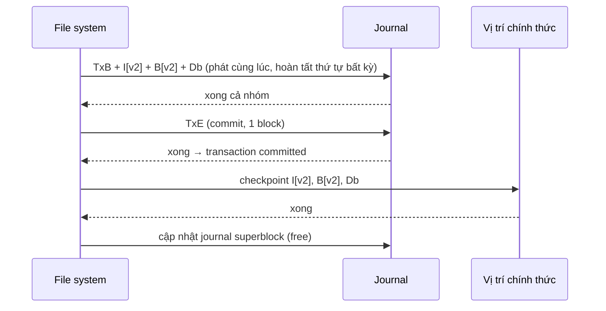

# P5 · Chương 05 — Crash consistency và journaling

## Bạn sẽ hiểu được gì

1. **Q1.** Append một block vào file có 6 kịch bản crash nào, và `fsck` chữa được tới đâu, vì sao chậm? → mục 1
2. **Q2.** Một transaction journal gồm những khối nào, ghi theo thứ tự nào, recovery replay ra sao? → mục 2
3. **Q3.** Ordered (metadata) journaling khác data journaling thế nào, và `data=journal` / `ordered` / `writeback` của ext4 khác nhau ra sao (mode nào có thể lộ dữ liệu cũ)? → mục 3
4. **Q4.** Revoke record giải quyết chuyện gì (block reuse)? → mục 4
5. **Q5.** Vì sao cần barrier / flush / FUA? → mục 5
6. **Q6.** Soft updates, COW và log-structured file system khác journaling thế nào? → mục 6
7. **Q7.** Checksum, LSE, misdirected write, scrubbing bảo vệ dữ liệu ra sao? → mục 7
8. **Q8.** WAL của database liên quan thế nào tới journal của file system? → mục 8

## Kiến thức cần trước

- File, inode, bitmap, block, page cache: xem [Chương 04 của P1 — fd, inode và VFS](../01-linux/04-file-descriptor-va-vfs.md) và [Chương 03 — Cài đặt file system](03-cai-dat-file-system.md).
- Thiết bị lưu trữ và cache ghi của ổ đĩa: [Chương 01 — Thiết bị lưu trữ](01-thiet-bi-luu-tru.md).
- `fsync`/`fdatasync` trong thực tế ứng dụng được bàn kỹ ở [Chương 06 — Durability trong thực tế](06-durability-trong-thuc-te.md); copy-on-write file system ở [Chương 07](07-raid-va-copy-on-write-fs.md).

## 1. Bài toán: cập nhật nhiều cấu trúc trên đĩa mà máy có thể chết bất kỳ lúc nào (Q1)

> **Trả lời ngắn.** Để append một block, file system phải sửa ba cấu trúc: inode, bitmap dữ liệu và chính data block[^three]. Nếu máy sập khi mới ghi được một phần thì đĩa rơi vào một trong sáu trạng thái dở dang: một trạng thái vô hại vì như chưa ghi gì, năm trạng thái còn lại gây bất nhất, rò rỉ không gian hoặc để inode trỏ tới rác[^scen2]. `fsck` là cách chữa kiểu cũ: sửa sau khi khởi động lại, nhưng chỉ làm metadata nhất quán nội bộ[^fsck-intro]. Muốn vậy nó phải quét cả đĩa nên rất chậm[^fsck-slow].

**Giải thích.**

*Với service của bạn.* Hãy hình dung `orders`, một service Rust chạy trên Linux với ext4, nhận đơn hàng và nối mỗi đơn vào cuối file `orders.log`. Ta sẽ bám theo `orders` suốt chương (nhận xét của người soạn: đây là ví dụ giả định, không phải code trong repo). Mỗi lần nối, `orders` chỉ thấy một lời gọi `write` trả về. Nhưng bên dưới, file system phải sửa nhiều chỗ trên đĩa để lần nối đó thành thật, và máy có thể mất điện đúng giữa chừng. Câu hỏi của mục này: lúc ấy `orders.log` còn lại gì, và file system có tự sửa được không?

Cấu trúc dữ liệu trong RAM mất khi tắt máy thì chẳng ai ngạc nhiên; cấu trúc của file system thì phải sống sót qua mất điện. Khó ở chỗ một thao tác của file system thường phải cập nhật hai cấu trúc trên đĩa, gọi là A và B, mà đĩa chỉ nhận từng yêu cầu một. Nếu máy sập ngay sau khi một yêu cầu xong, đĩa nằm ở trạng thái không nhất quán. Đó là *crash-consistency problem*[^crux].

### 1.1 `orders` nối một block vào `orders.log`

Để thấy cụ thể, ta dùng một file system đồ chơi: 8 inode, 8 data block, mỗi loại có một bitmap 8 bit. Giả sử `orders.log` là inode số 2, đang trỏ tới data block 4 (`I[v1]`, size = 1), và `orders` nối thêm 4 KB: mở file, `lseek` tới cuối, `write` 4 KB, đóng[^example].

Lần nối này làm đổi **ba** thứ: inode mới `I[v2]` (trỏ thêm block 5, size = 2), bitmap data mới `B[v2]` (`00001100`) và chính data block `Db`[^three]. Cả ba lúc đầu chỉ nằm trong bộ nhớ (page cache hoặc buffer cache) một lúc rồi mới xuống đĩa, nên giữa chúng luôn có một khoảng thời gian để crash chen vào[^delay].

### 1.2 Sáu kịch bản crash

Thử đếm xem crash để lại những gì. Nếu chỉ một lần ghi kịp xuống đĩa thì có ba khả năng; chẳng hạn chỉ `B[v2]` xuống, bitmap báo block 5 đã cấp phát mà không inode nào trỏ tới nó[^scen1]. Nếu hai lần ghi xong còn lần cuối hỏng thì có thêm ba khả năng; chẳng hạn `I[v2]` và `B[v2]` xuống mà `Db` chưa, khi đó metadata hoàn toàn nhất quán[^scen2]. Tổng cộng 6 kịch bản, chưa tính "chưa ghi gì" và "ghi đủ" (con số 6 cũng bằng 2³ − 2, phép tính của người soạn).

| # | Đã xuống đĩa | Hậu quả |
|---|---|---|
| 1 | Chỉ `Db` | Như chưa ghi gì (người dùng mất dữ liệu) |
| 2 | Chỉ `I[v2]` | Bất nhất inode–bitmap và đọc ra rác |
| 3 | Chỉ `B[v2]` | Bất nhất; rò rỉ không gian (space leak) |
| 4 | `I[v2]` + `B[v2]` | Metadata nhất quán, nhưng block 5 chứa rác |
| 5 | `I[v2]` + `Db` | Bất nhất inode–bitmap |
| 6 | `B[v2]` + `Db` | Bất nhất; không biết block thuộc file nào |

Bảng cho thấy hai loại hỏng khác hẳn nhau. Loại thứ nhất là *bất nhất cấu trúc*: inode nói một đằng, bitmap nói một nẻo. Loại thứ hai là *dữ liệu rác*, và kịch bản 4 là ví dụ thuần túy: metadata hoàn toàn nhất quán nên đối chiếu metadata không thấy gì, trong khi inode trỏ tới rác[^scen2]. Với `orders`, đó là trường hợp đáng sợ nhất: file dài thêm 4 KB, mọi công cụ kiểm tra cấu trúc đều hài lòng, nhưng 4 KB cuối là rác (nhận xét của người soạn).

Lý tưởng nhất là file system chuyển nguyên tử từ trạng thái nhất quán này sang trạng thái nhất quán khác. Điều đó không làm được trực tiếp vì đĩa chỉ commit từng lần ghi một[^goal].

### 1.3 Giải pháp cũ: `fsck`

Các file system đời đầu chọn cách để bất nhất xảy ra rồi sửa sau, lúc khởi động lại, bằng công cụ `fsck` (file system checker). Nó chạy **trước khi mount** và giả định không còn hoạt động nào khác trên file system[^fsck-phases1]. Nhưng `fsck` không sửa được mọi thứ. Mục tiêu thật sự của nó chỉ là làm metadata nhất quán nội bộ[^fsck-intro], nên với kịch bản 4, khi metadata đã nhất quán mà inode vẫn trỏ tới rác, nó không còn gì để sửa (suy luận của người soạn).

Cái giá thứ hai là thời gian: `fsck` phải quét cả đĩa, nên `orders` chỉ lên lại được sau khi quét xong (nhận xét của người soạn). Phần Đi sâu nói chi tiết các pha của `fsck` và vì sao nó chậm.

Đi sâu: các pha của <code>fsck</code> và vì sao nó chậm

`fsck` làm lần lượt các việc sau: kiểm tra superblock (nghi hỏng thì dùng bản sao); quét inode và indirect block để dựng lại bitmap, và **tin vào inode** khi bất đồng với bitmap; kiểm tra trạng thái inode; tự đếm link count bằng cách duyệt cây thư mục từ root; tìm block bị hai inode cùng trỏ; xóa con trỏ ngoài phạm vi phân vùng; kiểm tra cấu trúc thư mục. Inode đang cấp phát mà không thư mục nào nhắc tới thì bị chuyển vào `lost+found`[^fsck-phases2].

### Vì sao `fsck` chậm

Vấn đề lớn nhất là hiệu năng. Với ổ lớn, quét toàn bộ đĩa để tìm block đã cấp phát rồi đọc cả cây thư mục có thể mất nhiều phút đến hàng giờ[^fsck-slow], dù việc dở chỉ là ba block. Nói cách khác, chi phí recovery của `fsck` tăng theo kích thước volume, còn journaling thì tăng theo kích thước log[^summary].

**Quay lại Q1:** append chạm ba cấu trúc nên crash để lại sáu trạng thái trung gian; `fsck` chỉ vá metadata sau khi khởi động và tốn thời gian theo kích thước đĩa.

## 2. Journaling (write-ahead logging): giao thức và recovery (Q2)

> **Trả lời ngắn.** Journaling ghi trước một "ghi chú" mô tả việc sắp làm vào log ở một chỗ cố định, rồi mới sửa tại chỗ[^wal-idea]. Một transaction gồm TxB, nội dung cập nhật và TxE[^txb]. TxE chỉ được phát sau khi các lần ghi còn lại đã xong[^timeline]. Sau crash, recovery replay các transaction đã commit và bỏ qua phần chưa commit[^recovery].

**Giải thích.**

*Với service `orders`.* Nếu ext4 cứ sửa thẳng inode, bitmap và data block mỗi khi `orders` nối log, mất điện sẽ để lại một trong sáu trạng thái ở mục 1 mà chỉ `fsck` mới dọn được. Journaling đổi cách làm: ext4 ghi lại việc sắp làm vào một chỗ riêng, chờ cho bản ghi đó nằm chắc trên đĩa, rồi mới sửa thật. Mục này đi qua bản ghi ấy gồm những gì, ghi theo thứ tự nào, và đọc lại sau crash ra sao.

Ý tưởng này mượn từ database: *write-ahead logging*, mà trong file system quen gọi là *journaling*[^wal-db]. Trước khi ghi đè cấu trúc tại chỗ, file system ghi một "ghi chú" mô tả việc sắp làm vào một chỗ cố định gọi là log. Nếu crash giữa lúc cập nhật, sau khi khởi động chỉ cần đọc log là biết cần làm lại gì, khỏi quét cả đĩa. Nói gọn, journaling thêm một ít việc lúc cập nhật để giảm mạnh việc lúc recovery[^wal-idea]. Cedar là file system đầu tiên áp dụng[^cedar]; ext3, ext4, reiserfs, JFS, XFS và NTFS đều dùng ý tưởng này[^wal-list].

Với ext3 (và ext4 sau này), cấu trúc trên đĩa gần như ext2, chỉ khác là có thêm journal. Journal có thể nằm ngay trong phân vùng, trên một thiết bị riêng, hoặc là một file[^journal-place]. Trong ext4 hiện tại, journal là một file bình thường nhưng bị ẩn, thường là inode số 8; cũng có thể dùng journal device ngoài[^jbd2-inode].

### 2.1 Data journaling: TxB, nội dung, TxE

Với lần nối của `orders`, ta ghi vào journal 5 block: `TxB`, `I[v2]`, `B[v2]`, `Db`, `TxE`. `TxB` (transaction begin) chứa thông tin về cập nhật sắp tới, gồm địa chỉ đích cuối cùng của các block, cùng một transaction ID (TID). Ba block ở giữa là *bản sao nguyên văn* nội dung các block (*physical logging*; ngược lại, *logical logging* ghi biểu diễn gọn như "append block Db vào file X"). `TxE` đánh dấu hết transaction và cũng mang TID[^txb].

Khi transaction đã nằm an toàn trong journal, file system mới ghi đè các cấu trúc ở chỗ chính thức. Bước này gọi là **checkpointing**[^checkpoint].

Giao thức hoàn chỉnh của data journaling có 4 bước[^proto4]:

1. **Journal write**: ghi TxB và nội dung update vào log, chờ xong.
2. **Journal commit**: ghi block commit (chứa TxE), chờ xong; transaction được coi là *committed*.
3. **Checkpoint**: ghi nội dung update ra vị trí cuối cùng.
4. **Free**: sau này đánh dấu transaction là rảnh trong journal superblock.

#### Vì sao tách commit ra bước riêng

Muốn nhanh thì cứ phát cả 5 lần ghi cùng lúc. Nhưng đĩa có thể sắp xếp lại nội bộ và hoàn tất từng phần theo thứ tự bất kỳ. Giả sử mất điện sau khi `TxB`, `I[v2]`, `B[v2]`, `TxE` đã xuống đĩa mà `Db` chưa. Journal khi đó trông như một transaction hợp lệ, vì đầu và cuối có TID khớp nhau, và file system **không thể** nhận ra block thứ tư là sai: đó chỉ là dữ liệu người dùng tùy ý. Recovery sẽ replay và chép rác vào chỗ của `Db`, và còn tệ hơn nhiều nếu block bị chép đè là một cấu trúc trọng yếu như superblock[^torn-commit].

Vì vậy file system ghi mọi thứ trừ `TxE` trước, chờ xong rồi mới ghi `TxE`. Để việc ghi `TxE` nguyên tử, nên gói nó trong một block 512 byte, dựa vào bảo đảm rằng ghi 512 byte hoặc xảy ra trọn vẹn hoặc không xảy ra[^atomic512].

Sơ đồ dưới đây vẽ thứ tự bắt buộc:

Sơ đồ là của người soạn, dựng từ giao thức 4 bước ở trên[^proto4]. Ràng buộc "TxE chỉ được phát sau các lần ghi còn lại" lấy từ timeline của OSTEP[^timeline].

### 2.2 Recovery

Bây giờ quay lại câu hỏi ban đầu: máy mất điện thì `orders.log` ra sao? Điều đó phụ thuộc crash rơi vào điểm nào[^recovery]:

- Crash trước khi transaction commit xong vào log: file system bỏ qua cập nhật đang chờ.
- Crash sau commit nhưng trước khi checkpoint xong: lúc boot, file system quét log, tìm các transaction đã commit và **replay theo thứ tự** để ghi lại các block ra vị trí chính thức. Kiểu này gọi là **redo logging**.
- Crash giữa chừng checkpoint cũng ổn: tệ nhất là một số lần ghi bị làm lại, mà recovery hiếm xảy ra nên vài lần ghi dư không đáng lo.

Ở mức jbd2 (lớp journal của ext4), tài liệu kernel mô tả cùng ý: journal được replay tới commit record mới nhất, nhờ đó những gì ghi qua journal có tính nguyên tử[^jbd2-intro].

Vậy sáu kịch bản ở mục 1 giờ ra sao? Mọi thứ đã nằm trong journal trước khi được ghi vào chỗ chính thức, nên chỉ còn hai khả năng: transaction chưa commit (như chưa có gì xảy ra, file như cũ) hoặc đã commit (replay đủ cả ba block). Ở vị trí chính thức không còn trạng thái "một nửa" nào mà journal không sửa được (suy luận của người soạn, từ giao thức ở mục 2.1).

### 2.3 Batching: gộp cập nhật

Giao thức cơ bản có thể sinh nhiều lưu lượng thừa. `orders` tạo `file1` rồi `file2` trong cùng một thư mục thì cả hai lần đều chạm bitmap inode, inode, data block của thư mục và inode thư mục, tức ghi đi ghi lại cùng các block. Để tránh, ext3 đệm mọi cập nhật vào **một transaction toàn cục** và đến lúc hết timeout (ví dụ 5 giây) mới commit một lần[^batch].

### 2.4 Journal tròn

Log có kích thước hữu hạn, và đầy là rắc rối. Log càng lớn thì recovery càng lâu vì phải replay hết, còn nghiêm trọng hơn là log đầy thì không commit được transaction mới. Cách giải quyết là coi log như một cấu trúc **vòng** (circular log). Sau khi một transaction đã checkpoint, chỗ của nó được giải phóng để dùng lại; chẳng hạn ghi vào *journal superblock* (khác superblock của file system) vị trí của transaction cũ nhất và mới nhất chưa checkpoint[^circular]. Đó là lý do giao thức có bước 4 "Free".

Đi sâu: <code>commit=</code> của ext4 và checksum thay cho lần chờ

Mount option `commit=nrsec` của ext4 đặt tuổi tối đa của transaction đang chạy, mặc định 5 giây. Nghĩa là mất điện có thể mất tới 5 giây thay đổi metadata mới nhất (file system vẫn không hỏng). Do delayed allocation, dữ liệu cũ hơn còn có thể mất vì writeback chỉ bắt đầu sau `dirty_expire_centisecs`[^commit].

#### Tối ưu của ext4: checksum thay cho lần chờ

Chờ nhóm ghi đầu xong rồi mới ghi `TxE` tốn thêm một vòng quay đĩa. Prabhakaran và cộng sự đề xuất đặt **checksum** của nội dung journal vào block begin và end, để ghi cả transaction một lần. Khi recovery thấy checksum không khớp thì kết luận crash xảy ra giữa lúc ghi và bỏ transaction đó. Ý tưởng này đã được đưa vào ext4[^txcsum].

Trong tài liệu kernel cho ext4, mount option `journal_checksum` bật checksum cho transaction của journal để code recovery của `e2fsck` và kernel phát hiện hỏng[^jchk]. Option `journal_async_commit` cho phép ghi commit block mà không chờ descriptor block, và bật `journal_checksum` ngầm[^jcsum]. Còn trong định dạng jbd2, một transaction hoàn thành luôn kết thúc bằng commit; thiếu commit record (hoặc checksum không khớp) thì transaction bị bỏ khi replay[^jbd2-layout].

**Quay lại Q2:** ghi TxB và nội dung, chờ xong, rồi mới ghi TxE; sau crash chỉ replay những transaction đã commit.

## 3. Ordered journaling và ba mode `data=` của ext4 (Q3)

> **Trả lời ngắn.** Ordered (metadata) journaling chỉ đưa metadata vào journal, còn dữ liệu người dùng thì không[^md-journal]. Đổi lại, dữ liệu phải được ghi ra chỗ chính trước khi commit[^md-proto]. ext4 cho chọn ba mode `data=`: `journal` (cả dữ liệu vào journal), `ordered` (mặc định) và `writeback` (không bảo đảm thứ tự)[^ext4-wb]. Riêng `writeback` có thể để lộ dữ liệu cũ sau một lần shutdown không sạch[^wb-sec].

**Giải thích.**

*Với service `orders`.* `orders` ghi log tuần tự, mỗi đơn một lần nối. Nếu ext4 đưa cả dữ liệu vào journal, mỗi block của `orders.log` sẽ bị ghi hai lần: một lần vào journal, một lần ra chỗ chính. Mục này trả lời câu hỏi `orders` nên trả giá thế nào cho sự an toàn đó, và ba mode của ext4 cho `orders` những bảo đảm nào.

Data journaling ghi mỗi data block **hai lần**, một cái giá đắt cho một chuyện hiếm như crash. Với workload ghi tuần tự như của `orders`, băng thông ghi tụt còn một nửa đỉnh của ổ, và còn thêm seek giữa journal với vùng chính[^dj-cost]. Dạng phổ biến hơn là *ordered journaling* hay *metadata journaling*. Nó gần như giống hệt, trừ việc dữ liệu người dùng không vào journal: chỉ `TxB`, `I[v2]`, `B[v2]`, `TxE` được ghi[^md-journal].

Nhưng lúc nào thì ghi `Db`? Nếu ghi sau khi transaction đã commit, crash xen vào giữa sẽ để `I[v2]` và `B[v2]` nằm trong log mà `Db` chưa tới đĩa. Recovery replay metadata, ra một file system nhất quán về metadata nhưng inode lại trỏ tới rác, chính là kịch bản 4 ở mục 1[^md-order]. Giao thức đúng như sau[^md-proto]:

1. **Data write**: ghi dữ liệu ra vị trí cuối cùng (có thể chưa cần chờ).
2. **Journal metadata write**: ghi begin block và metadata vào log.
3. **Journal commit**: ghi commit block, chờ xong.
4. **Checkpoint metadata**.
5. **Free**.

Quy tắc đằng sau là ghi cái được trỏ tới trước cái trỏ tới nó (nhận xét của người soạn, rút từ giao thức trên). Bước 1 không nhất thiết phải xong trước khi bắt đầu bước 2; yêu cầu thật sự chỉ là bước 1 và 2 hoàn tất trước khi phát block commit[^md-proto].

### 3.1 ext4: ba mode `data=`

Tài liệu kernel cho ext4 mô tả ba mode như sau:

| Mode | Ngữ nghĩa theo docs | Lưu ý |
|---|---|---|
| `data=journal` | Toàn bộ dữ liệu được commit vào journal trước khi ghi vào file system chính[^ext4-journal] | Tắt delayed allocation và hỗ trợ `O_DIRECT`; chậm nhất, trừ khi vừa đọc vừa ghi cùng lúc |
| `data=ordered` (mặc định) | Dữ liệu được đẩy ra file system chính **trước** khi metadata của chúng được commit vào journal[^ext4-ordered] | Chỉ metadata thật sự vào journal; nhưng nhóm metadata liên quan vào cùng transaction với dữ liệu[^ordered-group] |
| `data=writeback` | Không bảo đảm thứ tự: dữ liệu có thể được ghi sau khi metadata đã commit[^ext4-wb] | Sau crash có thể thấy dữ liệu sai trong file vừa ghi; thường nhanh nhất[^wb-incorrect] |

Với `writeback`, docs cảnh báo: chạy mode này có thể để lộ dữ liệu cũ (stale data) trong các file mới ghi sau một lần shutdown không sạch, và trong vài tình huống đó là vấn đề bảo mật[^wb-sec]. Còn mode mặc định chỉ ghi metadata qua journal, nên khối dữ liệu file *không* được bảo đảm ở trạng thái nhất quán nào sau crash[^jbd2-default]. Hãy đọc cho kỹ: "mặc định" bảo đảm *file system* nhất quán, không bảo đảm *nội dung file* của ứng dụng. Với `orders`, một lần mất điện có thể để lại `orders.log` mà phần đuôi không đúng những gì `orders` đã ghi; cách phòng là `fsync` đúng chỗ, xem [Chương 06](06-durability-trong-thuc-te.md).

Có một trường hợp đáng nhớ với backend. Giả sử `orders` ghi snapshot trạng thái ra `state.new` rồi `rename` đè lên `state` mà không `fsync`. Nếu `auto_da_alloc` bật, ext4 nhận ra mẫu replace-via-rename (và replace-via-truncate), rồi ép các block delayed-allocation được cấp phát để ở lần journal commit kế tiếp, trong mode ordered mặc định, dữ liệu file mới xuống đĩa trước khi `rename()` được commit. Docs gọi đó là tránh vấn đề "zero-length"[^autoda]. Đây là cơ chế bù cụ thể của ext4 cho ứng dụng thiếu `fsync` (docs gọi thẳng là *broken applications*), không phải bảo đảm chung của mọi file system hay của POSIX (nhận xét của người soạn, dựa trên cách docs mô tả).

Đi sâu: metadata journaling ở các file system khác và ghim nguồn kernel

Metadata journaling phổ biến hơn full data journaling: Windows NTFS và SGI XFS đều dùng một dạng metadata journaling, còn ext3 cho chọn data, ordered hoặc unordered. Mọi mode đều giữ metadata nhất quán, chỉ khác nhau về ngữ nghĩa với dữ liệu[^md-popular].

Về nguồn: các trang `docs.kernel.org` dùng ở đây là bản docs mới nhất, **không ghim phiên bản**. Các câu về `data=`, `journal_checksum`, `journal_async_commit`, `commit=`, `barrier`, `auto_da_alloc` và `REQ_PREFLUSH/REQ_FUA` đã được đối chiếu với source kernel ghim tag v6.8 (`Documentation/admin-guide/ext4.rst`, `Documentation/block/writeback_cache_control.rst`) và giống nhau[^v68].

**Quay lại Q3:** ordered ghi dữ liệu trước rồi mới commit metadata; writeback bỏ ràng buộc đó và đổi lại có thể lộ dữ liệu cũ.

## 4. Block reuse và revoke record (Q4)

> **Trả lời ngắn.** Khi một block bị xóa rồi cấp phát lại cho file khác, journal có thể còn giữ bản ghi cũ của block đó. Replay bản ghi ấy sẽ đè nội dung cũ lên dữ liệu mới[^reuse]. Revoke record là loại record báo cho recovery đừng replay các block đã bị revoke[^revoke].

**Giải thích.**

*Với service `orders`.* Giả sử `orders` có thư mục `spool/` chứa các đơn chờ xử lý. Xử lý xong, nó xóa cả thư mục rồi tạo file `report.csv`, và file mới này lại nhận đúng block mà thư mục vừa nhả ra (ví dụ giả định của người soạn). Nếu máy sập vào lúc đó, journal có thể bắt `report.csv` mang nội dung của thư mục cũ. Mục này giải thích vì sao, và ext3/ext4 chặn chuyện đó ra sao.

Đây là một góc hiểm của journaling: mọi thứ liên quan tới việc xóa, tức block bị xóa rồi cấp phát lại, đều rắc rối[^tweedie].

Kịch bản cụ thể (metadata journaling), vẫn theo ví dụ trên: thư mục `foo` có block dữ liệu 1000. Thêm một entry vào `foo` thì nội dung thư mục, vốn là metadata, được ghi vào log (`D[foo]`, đích là block 1000). Sau đó người dùng xóa sạch thư mục, block 1000 được giải phóng, rồi tạo file `bar` dùng lại block 1000. Chỉ inode của `bar` vào journal, còn dữ liệu của `bar` thì không. Nếu lúc này crash trong khi cả hai transaction vẫn nằm trong log, recovery sẽ replay mọi thứ, **kể cả ghi `D[foo]` vào block 1000**, và đè nội dung thư mục cũ lên dữ liệu hiện tại của `bar`[^reuse].

Cách ext3 chọn là thêm một loại record mới, **revoke record**. Xóa thư mục sinh ra một revoke record; khi replay, hệ thống quét các revoke record trước và không bao giờ replay những block đã bị revoke[^revoke].

Đi sâu: revocation block trong jbd2

Trong jbd2, revocation block ngăn replay một block của transaction trước, thường khi block metadata được giải phóng rồi cấp phát lại làm block dữ liệu file. Cơ chế này **không** dùng để nói "block journal này bị block khác thay thế"[^jbd2-revoke].

**Quay lại Q4:** xóa thư mục sinh revoke record để recovery không replay đè lên block đã được tái sử dụng.

## 5. Thứ tự thật sự cần barrier / flush / FUA (Q5)

> **Trả lời ngắn.** Ổ đĩa có bộ nhớ đệm ghi và có thể báo "xong" trước khi dữ liệu thật sự bền, nên muốn giữ thứ tự "A xong rồi mới B" thì OS phải ép dữ liệu ra[^wbc-intro]. Linux ép bằng hai cờ của block layer. `REQ_PREFLUSH` flush cache trước khi I/O gắn cờ bắt đầu[^wbc-flush]. `REQ_FUA` chỉ báo hoàn tất khi dữ liệu đã bền[^wbc-fua].

**Giải thích.**

*Với service `orders`.* Giả sử `orders` gọi `fsync` sau khi nối một đơn vào `orders.log` và nhận về kết quả thành công. Nếu ổ đĩa vừa báo "xong" mà dữ liệu mới nằm trong cache của nó thì mất điện lúc này vẫn mất đơn, và cả thứ tự journal-rồi-commit của mục 2 cũng đổ theo. Các giao thức ở trên đều nói "chờ xong", và mục này hỏi: "xong" ở đâu?

Thời xưa mọi chuyện đơn giản: phát A, chờ ổ ngắt báo xong, rồi phát B. Với write cache trong ổ, ổ báo hoàn tất khi dữ liệu mới nằm ở cache của nó, nên thứ tự không còn được bảo toàn. Có hai lối ra: tắt write buffering, hoặc dùng **write barrier** tường minh. Đáng lưu ý là một số nhà sản xuất cố ý bỏ qua barrier để ổ trông nhanh hơn, và cái giá là chạy sai[^barrier-aside].

Ở Linux, tài liệu block layer nói nhiều thiết bị có write-back cache dễ bay hơi, báo hoàn tất cho OS trước khi dữ liệu thật sự vào bộ nhớ không mất điện. Vì vậy OS phải ép dữ liệu ra khi làm thao tác bảo toàn dữ liệu như `fsync`, `sync` hay unmount[^wbc-intro]. Block layer có hai cơ chế cho việc này:

- `REQ_PREFLUSH`: bảo đảm cache dễ bay hơi đã được flush *trước khi* I/O gắn cờ bắt đầu, tức các request ghi đã hoàn tất trước đó đã nằm trên bộ nhớ không mất điện[^wbc-flush].
- `REQ_FUA` (Force Unit Access): hoàn tất của request chỉ được báo sau khi dữ liệu đã commit vào bộ nhớ không mất điện[^wbc-fua].

Phía file system gọn hơn nhiều: chỉ cần đặt hai cờ này, không phải lo thiết bị có cần flush tường minh hay FUA được hiện thực ra sao[^wbc-impl].

Đi sâu: thiết bị không có cache, và cờ nào ext4/jbd2 thật sự dùng

Với thiết bị không hỗ trợ write cache dễ bay hơi, docs mô tả block layer hoàn tất ngay request `REQ_PREFLUSH` rỗng và bỏ hai cờ khỏi request có payload (đoạn này nằm trong phần về driver kiểu `request_fn`)[^wbc-nocache].

Còn trong commit của ext4, docs ext4/jbd2 chỉ nói kết quả: transaction được ghi xong và được flush khỏi cache ghi của đĩa rồi mới ghi commit record[^jbd2-intro]. Docs cũng nói `barrier=1` (mặc định) bảo đảm thứ tự đúng của journal commit trên đĩa, và nếu ổ có pin dự phòng thì tắt barrier có thể an toàn[^barrier-opt]. Nhưng docs **không** nêu tên cờ nào được dùng.

Tên cờ lấy từ source kernel v6.8 (chi tiết cài đặt, có thể đổi ở bản khác): trong `fs/jbd2/commit.c`, khi `JBD2_BARRIER` bật và không dùng `journal_async_commit`, block commit được ghi với `REQ_PREFLUSH | REQ_FUA`[^commit-src]. Ghép với ngữ nghĩa hai cờ ở trên (suy luận của người soạn): `REQ_PREFLUSH` đưa các block transaction đã hoàn tất lên bộ nhớ bền *trước khi* commit block bắt đầu ghi, còn `REQ_FUA` làm commit block đã bền khi hoàn tất được báo, nên checkpoint sau đó không vượt mặt nó. Với `journal_async_commit`, source v6.8 không gắn hai cờ này ở bước ghi commit (bù bằng checksum). Cuối cùng, ext4 bật barrier mặc định còn ext3 thì không[^barrier-default].

**Quay lại Q5:** flush/FUA là cách file system bắt thiết bị tôn trọng thứ tự "journal xong rồi mới commit".

## 6. Các hướng khác: soft updates, copy-on-write, log-structured (Q6)

> **Trả lời ngắn.** Soft updates sắp xếp cẩn thận thứ tự mọi lần ghi để cấu trúc trên đĩa không bao giờ bất nhất[^softupd]. COW không ghi đè tại chỗ mà ghi sang chỗ chưa dùng rồi chuyển con trỏ gốc[^others]. LFS biến mọi cập nhật thành ghi tuần tự vào segment mới và không bao giờ ghi đè dữ liệu cũ[^lfs-idea].

**Giải thích.**

*Với service `orders`.* Journaling mới là một cách giữ cho `orders.log` không vỡ khi mất điện. Nếu `orders` chạy trên file system khác, ví dụ ZFS hay btrfs, sự nhất quán có thể đến từ một cơ chế khác hẳn (nhận xét của người soạn). Mục này điểm qua các cơ chế đó, để thấy journaling là một lựa chọn trong số nhiều lựa chọn.

### 6.1 Soft updates, COW, backpointer

OSTEP điểm qua ba hướng thay thế[^others]:

- **Soft Updates** (Ganger & Patt): sắp xếp cẩn thận mọi lần ghi để cấu trúc trên đĩa không bao giờ ở trạng thái bất nhất, ví dụ ghi block dữ liệu trước inode trỏ tới nó. Hướng này khó hiện thực vì cần hiểu sâu từng cấu trúc, trong khi lớp journaling cần ít hiểu biết về cấu trúc cụ thể[^softupd].
- **Copy-on-write (COW)**: không bao giờ ghi đè tại chỗ; ghi cập nhật sang chỗ chưa dùng rồi "lật" cấu trúc gốc để trỏ vào cấu trúc mới, như ZFS. Chi tiết cơ chế và btrfs/ZFS: [Chương 07](07-raid-va-copy-on-write-fs.md).
- **Backpointer-based consistency** và **optimistic crash consistency**: hướng nghiên cứu của chính nhóm OSTEP, không bàn thêm ở đây[^bbc].

Tổng kết lại, journaling giảm thời gian recovery từ O(kích thước volume) xuống O(kích thước log)[^summary]. Dạng thông dụng nhất là ordered metadata journaling, giảm lưu lượng journal mà vẫn bảo đảm hợp lý cho cả metadata lẫn dữ liệu[^summary2]. Còn bảo đảm mạnh cho *dữ liệu người dùng* vẫn là mảng đang làm dở[^summary3].

### 6.2 Log-structured file system (tổng quan)

LFS (Rosenblum & Ousterhout, 1991)[^lfs-date] đi theo hướng khác hẳn: biến **mọi** cập nhật thành ghi tuần tự. Họ có bốn động lực. Bộ nhớ ngày càng lớn nên đọc phần lớn được cache và hiệu năng do ghi quyết định. Khoảng cách giữa I/O ngẫu nhiên và tuần tự rất lớn. File system hiện có kém với workload phổ biến. Và file system không "biết" RAID[^lfs-motive].

Cách làm của LFS: đệm mọi cập nhật, cả metadata, trong một *segment* ở RAM. Segment đầy thì ghi ra đĩa một lần dài, tuần tự, vào vùng chưa dùng. LFS **không bao giờ ghi đè dữ liệu cũ**[^lfs-idea].

Đi sâu: kích thước segment, imap, cleaner và roll forward

Ghi tuần tự thôi chưa đủ; phải ghi các đoạn lớn để bù chi phí định vị. Ví dụ OSTEP: với positioning 10 ms và tốc độ đỉnh 100 MB/s, muốn đạt 90% băng thông đỉnh thì cần đệm D = 9 MB[^lfs-buffer]. (Công thức D = F/(1−F) × R_peak × T_position; 0,9/0,1 × 100 MB/s × 0,01 s = 9 MB, đúng với số của sách.)

Các mảnh ghép còn lại: **inode map (imap)** ánh xạ số inode tới địa chỉ bản mới nhất, vì inode không còn ở chỗ cố định[^lfs-pieces1]. **Segment summary** ghi (số inode, offset) của mỗi block để cleaner biết block còn sống hay không[^lfs-pieces2]. Cleaner đọc M segment cũ, nén phần còn sống thành N < M segment mới[^lfs-cleaner].

Về crash: LFS giữ hai bản checkpoint region (CR) ở hai đầu đĩa và ghi luân phiên, với timestamp ở đầu và cuối; bản nào timestamp không khớp thì bị bỏ[^lfs-crash]. Phần log ghi sau checkpoint cuối được cứu bằng kỹ thuật **roll forward**: từ CR tìm cuối log rồi đọc các segment tiếp theo để áp dụng cập nhật hợp lệ. Cuối cùng, OSTEP nối LFS với COW, thứ mà database gọi là "shadow paging"[^lfs-cow].

**Quay lại Q6:** soft updates đạt nhất quán bằng thứ tự ghi, còn COW và LFS bằng cách không ghi đè; cả ba không cần một journal riêng đứng cạnh dữ liệu như journaling (nhận xét của người soạn).

## 7. Toàn vẹn dữ liệu: checksum, LSE, misdirected write, scrubbing (Q7)

> **Trả lời ngắn.** Journaling chỉ bảo vệ khỏi crash, còn đĩa có kiểu hỏng riêng: vài block không đọc được hoặc chứa nội dung sai[^failpartial]. Checksum lưu cùng dữ liệu giúp phát hiện corruption im lặng[^checksum]. Misdirected write cần thêm physical ID[^misdirected]. Còn scrubbing là việc định kỳ đọc kiểm mọi block để bắt lỗi sớm[^scrub].

**Giải thích.**

*Với service `orders`.* Một đơn hàng từ tháng trước nằm trong `orders.log`, và hôm nay `orders` đọc lại để đối soát. Journaling không giúp gì ở đây, vì máy đâu có crash. Nhưng ổ đĩa vẫn có thể trả về một block sai mà không báo lỗi nào. Mục này đi qua các kiểu hỏng đó và cách phát hiện từng kiểu.

OSTEP mô tả mô hình **fail-partial**: đĩa vẫn chạy bình thường nhưng một vài block không truy cập được hoặc chứa nội dung sai[^failpartial]. Có hai kiểu:

- **Latent sector error (LSE)**: sector hỏng. Ổ không sửa được bằng ECC thì trả lỗi khi đọc, nên lỗi này *dễ phát hiện*, và khôi phục được bằng dư thừa sẵn có (mirror, parity)[^lse].
- **Corruption**: ổ trả dữ liệu sai mà không báo gì, tức hỏng im lặng[^silent].

LSE còn có một hệ quả riêng với RAID-4/5: gặp LSE khi đang dựng lại một ổ hỏng toàn phần thì việc dựng lại không hoàn tất được[^raid-lse]. (RAID: [Chương 07](07-raid-va-copy-on-write-fs.md).)

Cơ chế chính để phát hiện corruption là **checksum**[^checksum]. Khi đọc, hệ thống so checksum đã lưu (*stored*) với checksum vừa tính lại từ dữ liệu (*computed*); lệch thì dùng bản sao dư thừa hoặc trả lỗi. Dù vậy checksum không phải viên đạn bạc[^usechecksum].

Có hai kiểu hỏng checksum đơn thuần không bắt hết. **Misdirected write** là ghi đúng dữ liệu nhưng sai chỗ; để bắt nó cần thêm physical ID (đĩa, block) cạnh checksum[^misdirected]. **Lost write** là ổ báo đã ghi mà thực ra chưa bền: lúc này cả checksum lẫn physical ID đều không thấy gì, vì bản cũ vẫn khớp cả hai[^lost]. ZFS giải bài này bằng cách đặt checksum của từng block trong inode và indirect block[^zfs-cs].

Cuối cùng là **scrubbing**. Dữ liệu ít được đọc có thể hỏng dần mà không ai hay, nên hệ thống định kỳ đọc mọi block để kiểm checksum; thường là hằng đêm hoặc hằng tuần[^scrub]. Với `orders`, đơn hàng cũ chính là loại dữ liệu ít ai đọc (nhận xét của người soạn).

Đi sâu: số liệu về LSE/corruption, Fletcher, collision, chi phí checksum

Một nghiên cứu kéo dài khoảng 3 năm trên hơn 1,5 triệu ổ cho thấy: ổ loại "cheap" có 9,40% gặp ít nhất một LSE và 0,50% gặp corruption; ổ "costly" là 1,40% và 0,05%[^freq]. Scrubbing là cách tìm ra phần lớn LSE[^findings].

Về checksum: Fletcher bắt mọi lỗi 1 và 2 bit và nhiều lỗi burst[^checksum-fns], nhưng không checksum nào hoàn hảo vì hai block khác nội dung vẫn có thể có cùng checksum, gọi là *collision*[^collision]. Chi phí điển hình là 8 byte cho block 4 KB, tức 0,19% dung lượng[^overhead].

**Quay lại Q7:** checksum phát hiện hỏng im lặng, physical ID bắt ghi sai chỗ, scrubbing quét định kỳ; lost write vẫn lọt qua cả hai.

## 8. Liên hệ backend: WAL của database và journal của file system (Q8)

> **Trả lời ngắn.** Journal của file system và WAL của database là cùng một ý tưởng: ghi log trước, sửa file dữ liệu sau[^wal-db]. Nhờ vậy PostgreSQL không cần flush data page mỗi lần commit, vì sau crash nó khôi phục được từ log[^pg-wal].

**Giải thích.**

*Với service `orders`.* Đơn hàng của `orders` cuối cùng vào một database PostgreSQL (ví dụ giả định của người soạn). Vậy `orders` có hai lớp cùng ghi log trước: ext4 ghi journal cho file system, còn PostgreSQL ghi WAL cho dữ liệu của nó. Mục này hỏi lớp nào lo việc gì, và `orders` còn phải tự làm gì.

PostgreSQL chỉ ghi thay đổi vào file dữ liệu *sau khi* đã log: các WAL record mô tả thay đổi phải được flush ra bộ nhớ lâu dài trước. Làm đúng quy trình này thì không cần flush data page mỗi lần commit, vì crash xong có log để khôi phục[^pg-wal]. Hơn nữa, một lần `fsync` file WAL có thể commit nhiều transaction cùng lúc[^pg-wal2]. Điều này giống batching ở mục 2.3 (nhận xét của người soạn: database gọi là *group commit*; docs PostgreSQL 16 ở đây không dùng thuật ngữ đó).

Hai tầng không thay thế nhau (nhận xét của người soạn). Nếu `orders` tự giữ một WAL hay append-only log, nó làm đúng việc file system làm ở tầng dưới, và vẫn phải `fsync` đúng chỗ, kể cả thư mục chứa file mới, vì `fsync` một file chưa chắc đã đưa entry của file đó trong thư mục xuống đĩa[^fsync-dir]. Xem [Chương 06](06-durability-trong-thuc-te.md).

Đi sâu: CRC, full page image, journaled file system và flush cache trong PostgreSQL

PostgreSQL còn có những điểm tương ứng nữa với file system. Mỗi record WAL có CRC-32C để kiểm khi recovery, cùng ý với checksum journal của ext4[^pg-crc]. Page 8192 byte có thể ghi dở khi mất điện, nên định kỳ PostgreSQL ghi *full page image* vào WAL[^pg-torn].

Tài liệu PostgreSQL 16 còn viết rằng journaled file system không cần thiết cho độ tin cậy của file dữ liệu và WAL, dù chúng giúp boot nhanh hơn sau crash[^pg-tip]. Lệnh flush cache của ổ (FLUSH CACHE EXT, SYNCHRONIZE CACHE) cũng không được PostgreSQL gọi trực tiếp mà đi qua file system như ZFS hay ext4[^pg-flush]. Đây là cùng lớp cơ chế với mục 5 (suy luận của người soạn: docs PostgreSQL không nhắc tên `REQ_PREFLUSH`/`REQ_FUA`).

**Quay lại Q8:** journal và WAL cùng ghi log trước, nhưng hai tầng không thay thế nhau.

## Liên hệ với Rust

Trong Rust, `orders` đẩy dữ liệu xuống đĩa bằng `std::fs::File`, và type này có hai hàm. `sync_all` cố gắng đồng bộ mọi nội dung và metadata do OS giữ trong bộ nhớ xuống đĩa[^rust-sync-all]. `sync_data` tương tự nhưng *có thể* không đồng bộ metadata của file[^rust-sync]. Docs còn lưu ý một số nền tảng cài `sync_data` bằng chính `sync_all`[^rust-sync-plat].

Cặp này cùng ý với `fsync`/`fdatasync` của POSIX, trong đó `fdatasync` không flush metadata trừ khi metadata đó cần để đọc lại dữ liệu[^fdatasync]. Docs `File` không nói syscall nào được gọi. Ở source Rust 1.95.0 trên Linux (chi tiết cài đặt, không phải bảo đảm của docs), `sync_all` gọi `libc::fsync`[^rust-impl-all] và `sync_data` gọi `libc::fdatasync`[^rust-impl-data]. Trên Apple cả hai dùng `F_FULLFSYNC`[^rust-apple].

Với `orders`, đây là cách chương trình Rust kích hoạt chuỗi "journal write → commit → flush" ở trên (suy luận của người soạn). Việc `fsync` thư mục chứa file mới là chuyện riêng, xem [Chương 08](08-rust-va-luu-tru.md).

## Tóm tắt

- Append một block cần ghi ba cấu trúc (`I[v2]`, `B[v2]`, `Db`); crash giữa chừng để lại 6 kịch bản trung gian: một kịch bản vô hại (như chưa ghi), các kịch bản còn lại gây bất nhất, rò rỉ không gian hoặc đọc ra rác.
- `fsck` sửa metadata sau crash bằng cách quét toàn volume: chậm theo kích thước đĩa và không cứu được dữ liệu rác.
- Journaling/WAL ghi TxB + nội dung + TxE trước, rồi checkpoint; recovery replay các transaction đã commit (redo), tỷ lệ với kích thước log.
- Commit block chỉ được ghi sau khi phần còn lại bền (hoặc dùng checksum như ext4); journal là vòng; batching gộp cập nhật.
- Ordered journaling không ghi dữ liệu hai lần nhưng phải ghi dữ liệu trước commit; ext4 có `data=journal/ordered/writeback`.
- Revoke record chặn replay đè lên block đã tái sử dụng; thứ tự thật sự dựa vào flush/FUA của block layer.
- LFS, COW, soft updates là hướng khác; checksum, physical ID, scrubbing bảo vệ khỏi hỏng im lặng; WAL của DB cùng ý tưởng với journal.

## Câu hỏi tự kiểm tra

1. Trong 6 kịch bản crash khi append, kịch bản nào cho metadata nhất quán nhưng dữ liệu là rác?

Đáp án

`I[v2]` + `B[v2]` đã ghi, thiếu `Db`.[^scen2]

2. Vì sao `fsck` không xử lý được trường hợp inode nhất quán nhưng trỏ tới rác?

Đáp án

Mục tiêu duy nhất của nó là metadata nhất quán nội bộ.[^fsck-intro]

3. Vì sao phải ghi `TxE` sau khi các block còn lại của transaction đã xong?

Đáp án

Đĩa có thể hoàn tất theo thứ tự bất kỳ; nếu `TxE` lên đĩa mà `Db` chưa, transaction trông hợp lệ và recovery chép rác vào đích.[^torn-commit]

4. Journal tròn giải quyết vấn đề gì?

Đáp án

Log đầy thì không commit được nữa và log lớn làm recovery lâu; sau checkpoint chỗ được giải phóng để dùng lại.[^circular]

5. Trong metadata journaling, vì sao phải ghi dữ liệu trước khi commit?

Đáp án

Nếu không, recovery có thể replay metadata trỏ tới block dữ liệu chưa được ghi.[^md-order]

6. Ba mode `data=` của ext4 khác nhau thế nào?

Đáp án

`journal`: dữ liệu vào journal.[^ext4-journal] `ordered` (mặc định): dữ liệu ghi trước khi metadata commit.[^ext4-ordered] `writeback`: không bảo đảm thứ tự.[^ext4-wb]

7. Revoke record giải quyết điều gì?

Đáp án

Block đã xóa rồi tái dùng; không có revoke thì replay đè nội dung cũ lên dữ liệu mới.[^reuse]

8. Checksum thường có phát hiện được lost write không?

Đáp án

Không: bản cũ vẫn khớp checksum và physical ID.[^lost]

## Đọc thêm

- OSTEP, [Crash Consistency: FSCK and Journaling](https://pages.cs.wisc.edu/~remzi/OSTEP/file-journaling.pdf) — toàn bộ ví dụ, timeline và các tối ưu.
- OSTEP, [Log-structured File Systems](https://pages.cs.wisc.edu/~remzi/OSTEP/file-lfs.pdf) — chi tiết imap, cleaner, roll forward.
- OSTEP, [Data Integrity and Protection](https://pages.cs.wisc.edu/~remzi/OSTEP/file-integrity.pdf) — checksum, lost write, scrubbing.
- Linux kernel docs, [ext4 admin guide](https://docs.kernel.org/admin-guide/ext4.html) — mọi mount option nói trong chương.
- Linux kernel docs, [ext4 journal (jbd2)](https://docs.kernel.org/filesystems/ext4/journal.html) — định dạng on-disk của journal.
- Linux kernel docs, [Explicit volatile write back cache control](https://docs.kernel.org/block/writeback_cache_control.html) — flush và FUA.
- PostgreSQL 16, [30.3 Write-Ahead Logging (WAL)](https://www.postgresql.org/docs/16/wal-intro.html) và [Reliability](https://www.postgresql.org/docs/16/wal-reliability.html) — WAL ở phía database.

[^crux]: OSTEP, Ch.42 Crash Consistency: FSCK and Journaling — <https://pages.cs.wisc.edu/~remzi/OSTEP/file-journaling.pdf> — "If the system crashes or loses power after one write completes, the on-disk structure will be left in an inconsistent state."
[^example]: OSTEP, Ch.42, mục 42.1 — <https://pages.cs.wisc.edu/~remzi/OSTEP/file-journaling.pdf> — "Assume here that the workload is simple: the append of a single data block to an existing file."
[^three]: OSTEP, Ch.42, mục 42.1 — <https://pages.cs.wisc.edu/~remzi/OSTEP/file-journaling.pdf> — "The updated data bitmap (B[v2]) now looks like this: 00001100."
[^delay]: OSTEP, Ch.42, mục 42.1 — <https://pages.cs.wisc.edu/~remzi/OSTEP/file-journaling.pdf> — "the dirty inode, bitmap, and new data will sit in main memory (in the page cache or buffer cache) for some time first"
[^scen1]: OSTEP, Ch.42, Crash Scenarios — <https://pages.cs.wisc.edu/~remzi/OSTEP/file-journaling.pdf> — "Just the updated bitmap (B[v2]) is written to disk. In this case, the bitmap indicates that block 5 is allocated, but there is no inode that points to it."
[^scen2]: OSTEP, Ch.42, Crash Scenarios — <https://pages.cs.wisc.edu/~remzi/OSTEP/file-journaling.pdf> — "the file system metadata is completely consistent: the inode has a pointer to block 5, the bitmap indicates that 5 is in use"
[^goal]: OSTEP, Ch.42, The Crash Consistency Problem — <https://pages.cs.wisc.edu/~remzi/OSTEP/file-journaling.pdf> — "the disk only commits one write at a time, and crashes or power loss may occur between these updates"
[^fsck-intro]: OSTEP, Ch.42, mục 42.2 — <https://pages.cs.wisc.edu/~remzi/OSTEP/file-journaling.pdf> — "The only real goal is to make sure the file system metadata is internally consistent."
[^fsck-phases1]: OSTEP, Ch.42, mục 42.2 — <https://pages.cs.wisc.edu/~remzi/OSTEP/file-journaling.pdf> — "it is run before the file system is mounted and made available (fsck assumes that no other file-system activity is on-going while it runs)"
[^fsck-phases2]: OSTEP, Ch.42, mục 42.2 — <https://pages.cs.wisc.edu/~remzi/OSTEP/file-journaling.pdf> — "If an allocated inode is discovered but no directory refers to it, it is moved to the lost+found directory."
[^fsck-slow]: OSTEP, Ch.42, mục 42.2 — <https://pages.cs.wisc.edu/~remzi/OSTEP/file-journaling.pdf> — "scanning the entire disk to find all the allocated blocks and read the entire directory tree may take many minutes or hours"
[^wal-idea]: OSTEP, Ch.42, mục 42.3 — <https://pages.cs.wisc.edu/~remzi/OSTEP/file-journaling.pdf> — "By design, journaling thus adds a bit of work during updates to greatly reduce the amount of work required during recovery."
[^journal-place]: OSTEP, Ch.42, mục 42.3 — <https://pages.cs.wisc.edu/~remzi/OSTEP/file-journaling.pdf> — "sometimes it is placed on a separate device, or as a file within the file system"
[^jbd2-inode]: Linux kernel docs, ext4 Journal (jbd2) — <https://docs.kernel.org/filesystems/ext4/journal.html> — "The journal inode is typically inode 8. The first 68 bytes of the journal inode are replicated in the ext4 superblock. The journal itself is normal (but hidden) file within the filesystem."
[^txb]: OSTEP, Ch.42, Data Journaling — <https://pages.cs.wisc.edu/~remzi/OSTEP/file-journaling.pdf> — "The final block (TxE) is a marker of the end of this transaction, and will also contain the TID."
[^checkpoint]: OSTEP, Ch.42, Data Journaling — <https://pages.cs.wisc.edu/~remzi/OSTEP/file-journaling.pdf> — "Once this transaction is safely on disk, we are ready to overwrite the old structures in the file system; this process is called checkpointing."
[^proto4]: OSTEP, Ch.42, Making The Log Finite — <https://pages.cs.wisc.edu/~remzi/OSTEP/file-journaling.pdf> — "Free: Some time later, mark the transaction free in the journal by updating the journal superblock."
[^torn-commit]: OSTEP, Ch.42, Data Journaling — <https://pages.cs.wisc.edu/~remzi/OSTEP/file-journaling.pdf> — "it will replay this transaction, and ignorantly copy the contents of the garbage block"
[^atomic512]: OSTEP, Ch.42, Data Journaling — <https://pages.cs.wisc.edu/~remzi/OSTEP/file-journaling.pdf> — "will either happen or not (and never be half-written)"
[^timeline]: OSTEP, Ch.42, Wrapping Up Journaling: A Timeline — <https://pages.cs.wisc.edu/~remzi/OSTEP/file-journaling.pdf> — "the write to the transaction end block (TxE) must not be issued until said previous writes complete"
[^txcsum]: OSTEP, Ch.42, Aside: Optimizing Log Writes — <https://pages.cs.wisc.edu/~remzi/OSTEP/file-journaling.pdf> — "include a checksum of the contents of the journal in the begin and end blocks"
[^jcsum]: Linux kernel docs, ext4 admin guide — <https://docs.kernel.org/admin-guide/ext4.html> — "Commit block can be written to disk without waiting for descriptor blocks."
[^jbd2-layout]: Linux kernel docs, ext4 Journal (jbd2), Layout — <https://docs.kernel.org/filesystems/ext4/journal.html> — "If there is no commit record (or the checksums don’t match), the transaction will be discarded during replay."
[^recovery]: OSTEP, Ch.42, Recovery — <https://pages.cs.wisc.edu/~remzi/OSTEP/file-journaling.pdf> — "This form of logging is one of the simplest forms there is, and is called redo logging."
[^jbd2-intro]: Linux kernel docs, ext4 Journal (jbd2) — <https://docs.kernel.org/filesystems/ext4/journal.html> — "the journal can be replayed all the way to the latest commit record, guaranteeing the atomicity of whatever gets written through the journal to the disk"
[^batch]: OSTEP, Ch.42, Batching Log Updates — <https://pages.cs.wisc.edu/~remzi/OSTEP/file-journaling.pdf> — "one can buffer all updates into a global transaction"
[^commit]: Linux kernel docs, ext4 admin guide — <https://docs.kernel.org/admin-guide/ext4.html> — "This setting limits the maximum age of the running transaction to ‘nrsec’ seconds. The default value is 5 seconds."
[^circular]: OSTEP, Ch.42, Making The Log Finite — <https://pages.cs.wisc.edu/~remzi/OSTEP/file-journaling.pdf> — "journaling file systems treat the log as a circular data structure, re-using it over and over"
[^dj-cost]: OSTEP, Ch.42, Metadata Journaling — <https://pages.cs.wisc.edu/~remzi/OSTEP/file-journaling.pdf> — "this doubling is especially painful during sequential write workloads, which now will proceed at half the peak write bandwidth of the drive"
[^md-journal]: OSTEP, Ch.42, Metadata Journaling — <https://pages.cs.wisc.edu/~remzi/OSTEP/file-journaling.pdf> — "it is nearly the same, except that user data is not written to the journal"
[^md-order]: OSTEP, Ch.42, Metadata Journaling — <https://pages.cs.wisc.edu/~remzi/OSTEP/file-journaling.pdf> — "the file system is consistent but I[v2] may end up pointing to garbage data"
[^md-proto]: OSTEP, Ch.42, Metadata Journaling — <https://pages.cs.wisc.edu/~remzi/OSTEP/file-journaling.pdf> — "the only real requirement is that Steps 1 and 2 complete before the issuing of the journal commit block"
[^md-popular]: OSTEP, Ch.42, Metadata Journaling — <https://pages.cs.wisc.edu/~remzi/OSTEP/file-journaling.pdf> — "Windows NTFS and SGI’s XFS both use some form of metadata journaling. Linux ext3 gives you the option of choosing either data, ordered, or unordered modes (in unordered mode, data can be written at any time). All of these modes keep metadata consistent; they vary in their semantics for data."
[^ext4-journal]: Linux kernel docs, ext4 admin guide — <https://docs.kernel.org/admin-guide/ext4.html> — "All data are committed into the journal prior to being written into the main file system. Enabling this mode will disable delayed allocation and O_DIRECT support."
[^ext4-ordered]: Linux kernel docs, ext4 admin guide — <https://docs.kernel.org/admin-guide/ext4.html> — "All data are forced directly out to the main file system prior to its metadata being committed to the journal."
[^ext4-wb]: Linux kernel docs, ext4 admin guide — <https://docs.kernel.org/admin-guide/ext4.html> — "Data ordering is not preserved, data may be written into the main file system after its metadata has been committed to the journal."
[^wb-sec]: Linux kernel docs, ext4 admin guide — <https://docs.kernel.org/admin-guide/ext4.html> — "running mounted with data=writeback can potentially leave stale data exposed in recently written files in case of an unclean shutdown"
[^jbd2-default]: Linux kernel docs, ext4 Journal (jbd2) — <https://docs.kernel.org/filesystems/ext4/journal.html> — "This means that file data blocks are /not/ guaranteed to be in any consistent state after a crash."
[^autoda]: Linux kernel docs, ext4 admin guide, auto_da_alloc — <https://docs.kernel.org/admin-guide/ext4.html> — "avoids the “zero-length” problem that can happen when a system crashes before the delayed allocation blocks are forced to disk"
[^tweedie]: OSTEP, Ch.42, Tricky Case: Block Reuse — <https://pages.cs.wisc.edu/~remzi/OSTEP/file-journaling.pdf> — "Everything to do with delete is hairy."
[^reuse]: OSTEP, Ch.42, Tricky Case: Block Reuse — <https://pages.cs.wisc.edu/~remzi/OSTEP/file-journaling.pdf> — "the recovery process simply replays everything in the log, including the write of directory data in block 1000"
[^revoke]: OSTEP, Ch.42, Tricky Case: Block Reuse — <https://pages.cs.wisc.edu/~remzi/OSTEP/file-journaling.pdf> — "any such revoked data is never replayed, thus avoiding the problem mentioned above"
[^jbd2-revoke]: Linux kernel docs, ext4 Journal (jbd2), Revocation Block — <https://docs.kernel.org/filesystems/ext4/journal.html> — "A revocation block is used to prevent replay of a block in an earlier transaction."
[^barrier-aside]: OSTEP, Ch.42, Aside: Forcing Writes To Disk — <https://pages.cs.wisc.edu/~remzi/OSTEP/file-journaling.pdf> — "some disk manufacturers, in an effort to deliver “higher performing” disks, explicitly ignore write-barrier requests"
[^wbc-intro]: Linux kernel docs, Explicit volatile write back cache control — <https://docs.kernel.org/block/writeback_cache_control.html> — "the operating system needs to force data out to the non-volatile storage when it performs a data integrity operation like fsync, sync or an unmount"
[^wbc-flush]: Linux kernel docs, Explicit volatile write back cache control — <https://docs.kernel.org/block/writeback_cache_control.html> — "This explicitly guarantees that previously completed write requests are on non-volatile storage before the flagged bio starts."
[^wbc-fua]: Linux kernel docs, Explicit volatile write back cache control — <https://docs.kernel.org/block/writeback_cache_control.html> — "will make sure that I/O completion for this request is only signaled after the data has been committed to non-volatile storage"
[^wbc-impl]: Linux kernel docs, Explicit volatile write back cache control — <https://docs.kernel.org/block/writeback_cache_control.html> — "Filesystems can simply set the REQ_PREFLUSH and REQ_FUA bits and do not have to worry if the underlying devices need any explicit cache flushing"
[^wbc-nocache]: Linux kernel docs, Explicit volatile write back cache control, Implementation details for request_fn based block drivers — <https://docs.kernel.org/block/writeback_cache_control.html> — "the block layer completes empty REQ_PREFLUSH requests before entering the driver and strips off the REQ_PREFLUSH and REQ_FUA bits from requests that have a payload"
[^barrier-opt]: Linux kernel docs, ext4 admin guide — <https://docs.kernel.org/admin-guide/ext4.html> — "Write barriers enforce proper on-disk ordering of journal commits, making volatile disk write caches safe to use, at some performance penalty."
[^barrier-default]: Linux kernel docs, ext4 admin guide — <https://docs.kernel.org/admin-guide/ext4.html> — "note that ext4 enables write barriers by default, while ext3 does not enable write barriers by default"
[^others]: OSTEP, Ch.42, mục 42.4 — <https://pages.cs.wisc.edu/~remzi/OSTEP/file-journaling.pdf> — "This technique never overwrites files or directories in place; rather, it places new updates to previously unused locations on disk."
[^summary]: OSTEP, Ch.42, mục 42.5 — <https://pages.cs.wisc.edu/~remzi/OSTEP/file-journaling.pdf> — "Journaling reduces recovery time from O(size-of-the-disk-volume) to"
[^lfs-motive]: OSTEP, Ch.43 Log-structured File Systems — <https://pages.cs.wisc.edu/~remzi/OSTEP/file-lfs.pdf> — "There is a large gap between random I/O performance and sequential I/O performance"
[^lfs-idea]: OSTEP, Ch.43 — <https://pages.cs.wisc.edu/~remzi/OSTEP/file-lfs.pdf> — "LFS never overwrites existing data, but rather always writes segments to free locations."
[^lfs-buffer]: OSTEP, Ch.43, mục 43.3 — <https://pages.cs.wisc.edu/~remzi/OSTEP/file-lfs.pdf> — "Let’s do an example, with a disk with a positioning time of 10 milliseconds and peak transfer rate of 100 MB/s"
[^lfs-pieces1]: OSTEP, Ch.43, mục 43.5–43.6 — <https://pages.cs.wisc.edu/~remzi/OSTEP/file-lfs.pdf> — "The imap is a structure that takes an inode number as input and produces the disk address of the most recent version of the"
[^lfs-pieces2]: OSTEP, Ch.43, mục 43.10 — <https://pages.cs.wisc.edu/~remzi/OSTEP/file-lfs.pdf> — "This information is recorded in a structure at the head of the segment known as the segment summary block."
[^lfs-crash]: OSTEP, Ch.43, mục 43.12 — <https://pages.cs.wisc.edu/~remzi/OSTEP/file-lfs.pdf> — "LFS actually keeps two CRs, one at either end of the disk, and writes to them alternately."
[^lfs-cow]: OSTEP, Ch.43, mục 43.13 — <https://pages.cs.wisc.edu/~remzi/OSTEP/file-lfs.pdf> — "which in database systems is called shadow paging [L77] and in file-system-speak is sometimes called copy-on-write"
[^failpartial]: OSTEP, Ch.45 Data Integrity and Protection — <https://pages.cs.wisc.edu/~remzi/OSTEP/file-integrity.pdf> — "disks can also seemingly be working and have one or more blocks become inaccessible (i.e., LSEs) or hold the wrong contents (i.e., corruption)"
[^lse]: OSTEP, Ch.45, mục 45.2 — <https://pages.cs.wisc.edu/~remzi/OSTEP/file-integrity.pdf> — "latent sector errors are rather straightforward to handle, as they are (by definition) easily detected"
[^silent]: OSTEP, Ch.45, mục 45.1 — <https://pages.cs.wisc.edu/~remzi/OSTEP/file-integrity.pdf> — "These types of faults are particularly insidious because they are silent faults; the disk gives no indication of the problem when returning the faulty data."
[^freq]: OSTEP, Ch.45, mục 45.1 — <https://pages.cs.wisc.edu/~remzi/OSTEP/file-integrity.pdf> — "The figure shows the percent of drives that exhibited at least one LSE or block corruption over the course of the study (about 3 years, over 1.5 million disk drives)."
[^findings]: OSTEP, Ch.45, mục 45.1 — <https://pages.cs.wisc.edu/~remzi/OSTEP/file-integrity.pdf> — "Disk scrubbing is useful (most LSEs were found this way)"
[^raid-lse]: OSTEP, Ch.45, mục 45.2 — <https://pages.cs.wisc.edu/~remzi/OSTEP/file-integrity.pdf> — "If, during reconstruction, an LSE is encountered on any one of the other disks, we have a problem: the reconstruction cannot successfully complete."
[^checksum]: OSTEP, Ch.45, mục 45.3 — <https://pages.cs.wisc.edu/~remzi/OSTEP/file-integrity.pdf> — "The primary mechanism used by modern storage systems to preserve data integrity is called the checksum."
[^checksum-fns]: OSTEP, Ch.45, Common Checksum Functions — <https://pages.cs.wisc.edu/~remzi/OSTEP/file-integrity.pdf> — "The Fletcher checksum is almost as strong as the CRC (see below), detecting all single-bit, double-bit errors, and many burst errors"
[^collision]: OSTEP, Ch.45, Common Checksum Functions — <https://pages.cs.wisc.edu/~remzi/OSTEP/file-integrity.pdf> — "it is possible two data blocks with non-identical contents will have identical checksums, something referred to as a collision"
[^usechecksum]: OSTEP, Ch.45, mục 45.4 — <https://pages.cs.wisc.edu/~remzi/OSTEP/file-integrity.pdf> — "corruption detection is not a magic bullet"
[^overhead]: OSTEP, Ch.45, mục 45.8 — <https://pages.cs.wisc.edu/~remzi/OSTEP/file-integrity.pdf> — "A typical ratio might be an 8byte checksum per 4 KB data block, for a 0.19% on-disk space overhead."
[^misdirected]: OSTEP, Ch.45, mục 45.5 — <https://pages.cs.wisc.edu/~remzi/OSTEP/file-integrity.pdf> — "adding a physical identifier (physical ID) is quite helpful"
[^lost]: OSTEP, Ch.45, mục 45.6 — <https://pages.cs.wisc.edu/~remzi/OSTEP/file-integrity.pdf> — "the old block likely has a matching checksum, and the physical ID used above (disk number and block offset) will also be correct"
[^scrub]: OSTEP, Ch.45, mục 45.7 — <https://pages.cs.wisc.edu/~remzi/OSTEP/file-integrity.pdf> — "Typical systems schedule scans on a nightly or weekly basis."
[^pg-wal]: PostgreSQL 16 docs, 30.3 Write-Ahead Logging (WAL) — <https://www.postgresql.org/docs/16/wal-intro.html> — "changes to data files (where tables and indexes reside) must be written only after those changes have been logged, that is, after WAL records describing the changes have been flushed to permanent storage. If we follow this procedure, we do not need to flush data pages to disk on every transaction commit"
[^pg-wal2]: PostgreSQL 16 docs, 30.3 Write-Ahead Logging (WAL) — <https://www.postgresql.org/docs/16/wal-intro.html> — "one fsync of the WAL file may suffice to commit many transactions"
[^pg-crc]: PostgreSQL 16 docs, 30.1 Reliability — <https://www.postgresql.org/docs/16/wal-reliability.html> — "Each individual record in a WAL file is protected by a CRC-32C (32-bit) check"
[^pg-torn]: PostgreSQL 16 docs, 30.1 Reliability — <https://www.postgresql.org/docs/16/wal-reliability.html> — "PostgreSQL periodically writes full page images to permanent WAL storage before modifying the actual page on disk."
[^pg-tip]: PostgreSQL 16 docs, 30.3 Write-Ahead Logging (WAL) — <https://www.postgresql.org/docs/16/wal-intro.html> — "journaled file systems are not necessary for reliable storage of the data files or WAL files"
[^pg-flush]: PostgreSQL 16 docs, 30.1 Reliability — <https://www.postgresql.org/docs/16/wal-reliability.html> — "These commands are not directly accessible to PostgreSQL, but some file systems (e.g., ZFS, ext4) can use them"
[^fsync-dir]: fsync(2), Debian bookworm — <https://manpages.debian.org/bookworm/manpages-dev/fsync.2.en.html> — "Calling fsync() does not necessarily ensure that the entry in the directory containing the file has also reached disk."
[^fdatasync]: fsync(2), Debian bookworm — <https://manpages.debian.org/bookworm/manpages-dev/fsync.2.en.html> — "fdatasync() is similar to fsync(), but does not flush modified metadata unless that metadata is needed in order to allow a"
[^rust-sync]: Rust std 1.95.0, `std::fs::File::sync_data` — <https://doc.rust-lang.org/1.95.0/std/fs/struct.File.html> — "This function is similar to sync_all, except that it might not synchronize file metadata to the filesystem."
[^rust-sync-all]: Rust std 1.95.0, `std::fs::File::sync_all` — <https://doc.rust-lang.org/1.95.0/std/fs/struct.File.html> — "Attempts to sync all OS-internal file content and metadata to disk."
[^rust-impl-all]: Rust 1.95.0 source, library/std/src/sys/fs/unix.rs, File::fsync — <https://raw.githubusercontent.com/rust-lang/rust/1.95.0/library/std/src/sys/fs/unix.rs> — "unsafe fn os_fsync(fd: c_int) -> c_int { libc::fsync(fd) }"
[^rust-impl-data]: Rust 1.95.0 source, library/std/src/sys/fs/unix.rs, File::datasync — <https://raw.githubusercontent.com/rust-lang/rust/1.95.0/library/std/src/sys/fs/unix.rs> — "unsafe fn os_datasync(fd: c_int) -> c_int { libc::fdatasync(fd) }"
[^jchk]: Linux kernel docs, ext4 admin guide, journal_checksum — <https://docs.kernel.org/admin-guide/ext4.html> — "Enable checksumming of the journal transactions. This will allow the recovery code in e2fsck and the kernel to detect corruption in the kernel."
[^ordered-group]: Linux kernel docs, ext4 admin guide, Data Mode — <https://docs.kernel.org/admin-guide/ext4.html> — "it logically groups metadata information related to data changes with the data blocks into a single unit called a transaction."
[^wb-incorrect]: Linux kernel docs, ext4 admin guide, Data Mode — <https://docs.kernel.org/admin-guide/ext4.html> — "A crash+recovery can cause incorrect data to appear in files which were written shortly before the crash."
[^v68]: Linux v6.8, Documentation/admin-guide/ext4.rst — <https://raw.githubusercontent.com/torvalds/linux/v6.8/Documentation/admin-guide/ext4.rst> — "All data are forced directly out to the main file system prior to its metadata being committed to the journal."
[^commit-src]: Linux v6.8, fs/jbd2/commit.c, journal_submit_commit_record — <https://raw.githubusercontent.com/torvalds/linux/v6.8/fs/jbd2/commit.c> — "write_flags |= REQ_PREFLUSH | REQ_FUA;"
[^lfs-date]: OSTEP, Ch.43, References — <https://pages.cs.wisc.edu/~remzi/OSTEP/file-lfs.pdf> — "Design and Implementation of the Log-structured File System” by Mendel Rosenblum and John Ousterhout. SOSP ’91, Pacific Grove, CA, October 1991."
[^lfs-cleaner]: OSTEP, Ch.43, mục 43.8 — <https://pages.cs.wisc.edu/~remzi/OSTEP/file-lfs.pdf> — "we expect the cleaner to read in M existing segments, compact their contents into N new segments (where N < M )"
[^wal-db]: OSTEP, Ch.42, mục 42.3 — <https://pages.cs.wisc.edu/~remzi/OSTEP/file-journaling.pdf> — "is to steal an idea from the world of database management systems."
[^cedar]: OSTEP, Ch.42, mục 42.3 — <https://pages.cs.wisc.edu/~remzi/OSTEP/file-journaling.pdf> — "The first file system to do this was Cedar"
[^wal-list]: OSTEP, Ch.42, mục 42.3 — <https://pages.cs.wisc.edu/~remzi/OSTEP/file-journaling.pdf> — "many modern file systems use the idea, including Linux ext3 and ext4, reiserfs, IBM’s JFS, SGI’s XFS, and Windows NTFS."
[^softupd]: OSTEP, Ch.42, mục 42.4 — <https://pages.cs.wisc.edu/~remzi/OSTEP/file-journaling.pdf> — "This approach carefully orders all writes to the file system to ensure that the on-disk structures are never left in an inconsistent state."
[^bbc]: OSTEP, Ch.42, mục 42.4 — <https://pages.cs.wisc.edu/~remzi/OSTEP/file-journaling.pdf> — "Another approach is one we just developed here at Wisconsin."
[^summary2]: OSTEP, Ch.42, mục 42.5 — <https://pages.cs.wisc.edu/~remzi/OSTEP/file-journaling.pdf> — "the most commonly used is ordered metadata journaling, which reduces the amount of traffic to the journal while still preserving reasonable consistency guarantees for both file system metadata and user data."
[^summary3]: OSTEP, Ch.42, mục 42.5 — <https://pages.cs.wisc.edu/~remzi/OSTEP/file-journaling.pdf> — "this area remains a work in progress"
[^zfs-cs]: OSTEP, Ch.45, mục 45.6 — <https://pages.cs.wisc.edu/~remzi/OSTEP/file-integrity.pdf> — "ZFS) includes a checksum in each file system inode and indirect block for every block included within a file."
[^rust-sync-plat]: Rust std 1.95.0, `std::fs::File::sync_data` — <https://doc.rust-lang.org/1.95.0/std/fs/struct.File.html> — "Note that some platforms may simply implement this in terms of sync_all."
[^rust-apple]: Rust 1.95.0 source, library/std/src/sys/fs/unix.rs, File::fsync/datasync — <https://raw.githubusercontent.com/rust-lang/rust/1.95.0/library/std/src/sys/fs/unix.rs> — "libc::fcntl(fd, libc::F_FULLFSYNC)"
