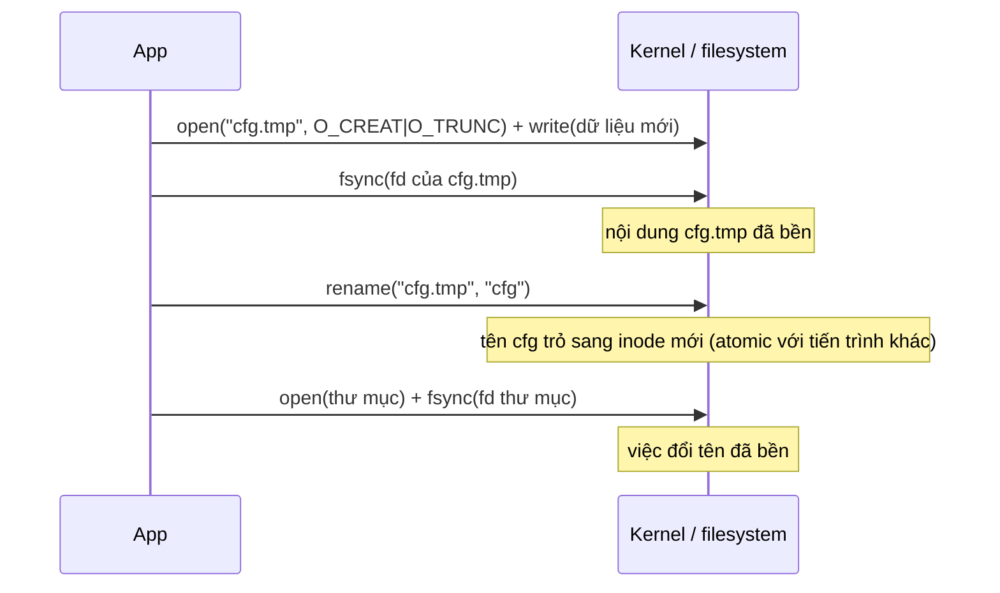

# P5 · Chương 06 — Durability trong thực tế

## Bạn sẽ hiểu được gì

1. **Q1.** Vì sao `write()` trả về thành công mà dữ liệu vẫn có thể mất khi mất điện, và "thành công" của nó thực sự hứa điều gì? → mục 1
2. **Q2.** `fsync` và `fdatasync` khác nhau ở đâu, và tốn bao nhiêu so với không sync? → mục 2
3. **Q3.** Vì sao tạo file mới rồi `fsync` file vẫn chưa đủ, và vì sao phải `fsync` cả thư mục cha? → mục 3
4. **Q4.** Mẫu ghi an toàn "ghi file tạm → fsync → rename → fsync thư mục" hoạt động thế nào, mỗi bước chặn lỗi nào? → mục 4
5. **Q5.** `fsync` thất bại thì nên làm gì? Vì sao PostgreSQL chuyển sang PANIC, và "fsyncgate" là gì? → mục 5
6. **Q6.** `sync_file_range`, `O_SYNC`, `O_DSYNC` giải quyết được gì, không giải quyết được gì? → mục 6
7. **Q7.** Bộ nhớ đệm ghi (volatile write cache) của đĩa nằm ở đâu trong đường đi, và vì sao macOS cần `F_FULLFSYNC`? → mục 7
8. **Q8.** Trong Rust, `File::sync_all` / `sync_data` gọi syscall nào trên Linux và macOS; fsync thư mục viết ra sao? → mục 8

Phạm vi: chương này chỉ bàn Linux và macOS.

## Kiến thức cần trước

Bạn đã viết service ghi log hoặc ghi file bằng Rust và quen với việc `write` trả về `Ok`; chương này hỏi `Ok` đó thật sự bảo đảm gì. Bốn chương trước đặt nền cho câu trả lời:

- [Chương 04 — File descriptor và VFS](../01-linux/04-file-descriptor-va-vfs.md): fd, inode, thư mục là gì.
- [Chương 01 của P5 — Thiết bị lưu trữ](./01-thiet-bi-luu-tru.md): đĩa, cache trong đĩa.
- [Chương 04 của P5 — Page cache và direct I/O](./04-page-cache-va-direct-io.md): dữ liệu ghi nằm ở page cache ra sao (chương này chỉ nhắc ngắn).
- [Chương 05 của P5 — Crash consistency và journaling](./05-crash-consistency-va-journaling.md): vì sao crash giữa chừng để lại trạng thái hỏng; chương này là phần "dùng đúng ở tầng ứng dụng".

---

## 1. `write()` thành công chưa có nghĩa là dữ liệu đã bền (Q1)

> **Trả lời ngắn.** `write()` trả về thành công chỉ cho biết kernel đã nhận dữ liệu; nó không hứa dữ liệu đã nằm trên đĩa[^write-nogarantee]. Man page nói cách duy nhất để chắc là gọi `fsync(2)` sau khi ghi xong[^write-fsync] (đó là lời khuyên cho ghi buffered thông thường; mở file bằng `O_SYNC`/`O_DSYNC` là đường khác, xem mục 6). Trên đường từ chương trình xuống đĩa, dữ liệu có thể đang nằm ở bộ đệm trong process, ở page cache của kernel, hoặc ở cache ghi dễ bay hơi của thiết bị[^wcc-intro].

**Giải thích.**

*Với service của bạn.* Hãy hình dung `ledger`, một service Rust ghi sổ chuyển tiền. Mỗi request `POST /transfers`, nó nối một dòng vào file `ledger.log`, và ngay khi `write` trả về `Ok` thì trả `201 Created` cho client. Giả sử một giây sau đó máy mất điện. Khởi động lại, dòng của giao dịch vừa được báo "đã tạo" có còn trong `ledger.log` không? Ta sẽ bám theo `ledger` suốt chương (nhận xét của người soạn: đây là ví dụ giả định, không phải code trong repo). Câu hỏi của mục này là `201` đó dựa trên lời hứa nào của kernel, và câu trả lời là không có lời hứa nào về đĩa.

### 1.1 `write` hứa gì

Nhiều người đọc "`write(fd, buf, n)` trả về `n`" thành "dữ liệu đã nằm trên đĩa". Man page của Linux nói ngược lại, rất thẳng: một lần `write()` thành công không bảo đảm gì về việc dữ liệu đã được commit xuống đĩa[^write-nogarantee]. Cũng trang đó cho biết muốn chắc thì phải gọi `fsync(2)` sau khi ghi xong toàn bộ dữ liệu[^write-fsync]. Vậy nếu `ledger` trả `201` ngay sau `write`, nó mới hứa với client rằng kernel đã nhận dòng đó, chưa hơn (suy luận của người soạn).

### 1.2 Dòng ghi đi qua những chỗ nào

Thử theo một dòng của `ledger` từ lúc ứng dụng ghi cho tới khi nằm trên phương tiện lưu trữ:


Trên đường đó dữ liệu có thể dừng ở ít nhất ba chỗ, và chỗ nào cũng mất được khi mất điện:

1. **Bộ đệm trong process.** Nếu `ledger` bọc file trong `BufWriter` của Rust (hay dùng `stdio` của C) thì `write()` còn chưa được gọi. Chương này không bàn thêm; [Chương 08](./08-rust-va-luu-tru.md) sẽ quay lại.
2. **Page cache của kernel.** `write()` chép dữ liệu vào đây, đánh dấu trang là dirty rồi trả về; kernel mới ghi xuống thiết bị sau. Sau bao lâu thì do hai tham số của kernel quyết định. `vm.dirty_expire_centisecs` cho biết dữ liệu dirty phải "cũ" đến đâu thì thread flusher của kernel ghi ra[^vm-expire]. `vm.dirty_writeback_centisecs` là chu kỳ thức dậy của các thread ấy[^vm-writeback]. Ở mức khái niệm, các lần ghi nằm trong bộ nhớ một lúc (ví dụ 5 hoặc 30 giây) rồi file system mới gửi yêu cầu xuống đĩa[^ostep-5-30]. Crash trong khoảng đó thì phần chưa ghi mất theo. Với `ledger`, đây thường là nơi dòng giao dịch đang nằm khi client nhận `201` (nhận xét của người soạn).
3. **Cache ghi của thiết bị.** Kernel gửi lệnh ghi xuống rồi cũng chưa hết chuyện: nhiều thiết bị, và tài liệu kernel nhắc riêng thiết bị thị trường tiêu dùng, có volatile write-back cache, tức là báo "xong" cho OS trước khi dữ liệu thực sự nằm trên phương tiện không mất điện[^wcc-intro]. Đây là chỗ nhiều lập trình viên quên.

<details><summary>Đi sâu: lỗi ghi đến muộn, và đánh đổi durability/performance</summary>

**Lỗi ghi có thể đến muộn.** Trên một số filesystem (kể cả NFS), lỗi ghi có thể bị hoãn đến một lần `write()` sau, đến `fsync(2)`, hoặc thậm chí đến `close(2)`[^write-delayed].

**Đánh đổi durability/performance.** Muốn ghi xong là bền ngay thì hệ thống phải làm đủ việc commit xuống đĩa, nên chậm; chịu mất một ít dữ liệu thì nó có thể gom các lần ghi trong bộ nhớ và ghi sau[^ostep-tradeoff]. Database không chấp nhận mất nên chủ động ép ghi: gọi `fsync()`, dùng direct I/O, hoặc bỏ qua file system[^ostep-force].

</details>

**Quay lại Q1:** `write()` chỉ giao dữ liệu cho kernel; với `ledger`, `201` trả ngay sau `write` chưa bảo đảm giao dịch còn sau mất điện, vì bền hay không còn tùy page cache và cache của thiết bị.

---

## 2. `fsync` và `fdatasync` (Q2)

> **Trả lời ngắn.** `fsync` chuyển mọi dữ liệu dirty của file xuống thiết bị lưu trữ bền, để dù crash hay reboot vẫn lấy lại được[^fsync-def]. Man page Linux nói rõ việc đó gồm cả ghi xuyên qua hoặc flush cache của đĩa, và lời gọi chặn tới khi thiết bị báo xong[^fsync-cache]. `fdatasync` giống `fsync` nhưng bỏ qua metadata không cần cho việc đọc lại dữ liệu; đổi kích thước file thì vẫn phải flush[^fdatasync-def]. Cả hai đều đắt hơn `write` thuần cỡ vài trăm lần trong lần đo của mình (phần Đi sâu có số liệu).

**Giải thích.**

*Với `ledger`.* Để `201` có nghĩa, `ledger` phải gọi `fsync` (hoặc `fdatasync`) sau `write` rồi mới trả lời. Mục này trả lời hai câu: hai hàm đó hứa chính xác điều gì, và mỗi request của `ledger` phải trả thêm bao nhiêu thời gian.

### 2.1 Hợp đồng của `fsync(2)`

`fsync()` chuyển ("flush") mọi dữ liệu in-core đã sửa của file (tức các trang buffer cache dirty) xuống đĩa hoặc thiết bị lưu trữ bền khác, để mọi thông tin đã đổi vẫn lấy lại được dù hệ thống crash hay reboot[^fsync-def]. Điểm đáng chú ý nằm ở hai câu kế tiếp của man page: lệnh này bao gồm cả việc ghi xuyên qua hoặc flush disk cache nếu có, và lời gọi chặn cho đến khi thiết bị báo việc chuyển đã hoàn tất[^fsync-cache]. Nói cách khác, trên Linux `fsync` được định nghĩa để chạm tới bến thứ ba ở mục 1, chứ không dừng ở page cache.

Có một giới hạn cần nhớ. Man page thừa nhận cài đặt `fsync` ở kernel cũ và filesystem ít dùng không biết flush disk cache, và trong trường hợp đó phải tắt disk cache bằng `hdparm(8)` hoặc `sdparm(8)` mới an toàn[^fsync-old]. Vì vậy "`fsync` chạm tới đĩa" là bảo đảm của tài liệu cho cấu hình bình thường, không phải lời thề cho mọi phần cứng và mọi filesystem.

### 2.2 `fdatasync` bỏ bớt metadata

`fdatasync()` giống `fsync()` nhưng không flush metadata đã sửa, trừ khi metadata đó cần để đọc lại dữ liệu cho đúng. Man page đưa ví dụ: đổi `st_atime`/`st_mtime` không cần flush vì không ảnh hưởng việc đọc dữ liệu, còn đổi kích thước file (`st_size`, chẳng hạn do `ftruncate(2)`) thì phải flush metadata[^fdatasync-def]. Mục tiêu là giảm hoạt động đĩa cho ứng dụng không cần đồng bộ mọi metadata[^fdatasync-aim].

Hệ quả cho `ledger` (suy luận của người soạn từ định nghĩa trên): ghi đè vùng file đã có thì `fdatasync` rẻ hơn `fsync`, nhưng `ledger` chỉ append, file dài ra, kích thước đổi, nên `fdatasync` vẫn phải flush metadata kích thước.

### 2.3 Giá phải trả

Trong lần đo của mình (một lần chạy, chỉ đọc được bậc độ lớn; bảng đầy đủ ở phần Đi sâu), mỗi lần ghi có sync tốn 265–338 µs trên overlay, so với 0,8 µs của `write` thuần, tức khoảng 330–420 lần. Nếu mỗi request của `ledger` chờ một lần sync như vậy thì thread handler bị chặn thêm cỡ vài trăm µs mỗi request trên đĩa ảo của lab (suy luận của người soạn; số trên phần cứng của bạn sẽ khác). Cách giảm thường dùng là gom nhiều request vào một lần sync, sẽ gặp lại ở mục 6.

<details><summary>Đi sâu: từ <code>fsync</code> xuống block layer</summary>

Ở tầng block, tài liệu kernel nêu hai cờ mà filesystem dùng cho các thao tác toàn vẹn dữ liệu như `fsync` (mình không lần theo code kernel để xác nhận đường gọi từ `fsync` tới từng cờ). `REQ_PREFLUSH` bảo đảm cache volatile của thiết bị được flush trước khi I/O được gắn cờ bắt đầu[^wcc-preflush]. `REQ_FUA` chỉ báo hoàn tất I/O sau khi dữ liệu đã được commit xuống bộ nhớ không mất điện[^wcc-flags]. Filesystem chỉ cần đặt hai cờ này mà không phải lo thiết bị cụ thể có cần flush hay không[^wcc-simple].

</details>

<details><summary>Đi sâu: số đo thực tế (một lần chạy, để thấy bậc độ lớn)</summary>

Mình chạy chương trình Rust ghi 500 khối 4 KiB, mỗi lần ghi theo một chế độ, trong container Linux (kernel `6.8.0-117-generic` trên VM Lima), với 2 nơi đặt file khác nhau. Đây là **một lần chạy duy nhất, không lặp, không có độ phân tán**, nên chỉ đọc được bậc độ lớn; chênh nhau vài chục phần trăm giữa các chế độ sync (ví dụ 265 so với 300 µs) nằm trong mức nhiễu có thể xảy ra, đừng suy ra chế độ nào nhanh hơn. Đã kiểm bằng `mount` trong container: `/tmp` nằm trên `overlay`, `/work` là `virtiofs`. Cả hai nằm trong một VM nên "đĩa" bên dưới là đĩa ảo; guest `fsync` có thực sự ép xuống phần cứng của máy chủ hay không thì mình không biết (phụ thuộc cấu hình ảo hoá):

| Chế độ | `/tmp` (overlay) | `/work` (virtiofs, repo mount) |
|---|---|---|
| chỉ `write` | 0,8 µs/lần | 66,1 µs/lần |
| `write` + `sync_data` | 265,1 µs | 107,5 µs |
| `write` + `sync_all` | 300,2 µs | 104,0 µs |
| `O_DSYNC` | 331,2 µs | 102,5 µs |
| `O_SYNC` | 338,0 µs | 101,0 µs |

Trên overlay, mỗi lần ghi có sync tốn 265–338 µs so với 0,8 µs của `write` thuần, tức khoảng 330–420 lần (chỉ là bậc độ lớn). Virtiofs là filesystem chia sẻ giữa VM và host nên các con số ở cột đó không nói gì về đĩa. Muốn biết tỷ lệ thật, đo trên phần cứng của bạn.

</details>

**Quay lại Q2:** `fsync` ép tới thiết bị (gồm cache đĩa), `fdatasync` rẻ hơn vì bỏ metadata không cần, và cả hai đều tốn bậc độ lớn hơn `write` thuần; với `ledger`, đó là giá của mỗi lần trả `201` có nghĩa.

---

## 3. Fsync file mới thì phải fsync cả thư mục cha (Q3)

> **Trả lời ngắn.** Nội dung file và entry tên của nó trong thư mục là hai thứ riêng. `fsync(fd)` làm bền nội dung nhưng không nhất thiết bảo đảm entry thư mục đã xuống đĩa, nên cần `fsync` thêm file descriptor của chính thư mục cha[^fsync-dir]. PostgreSQL làm đúng vậy sau `rename`[^pg-rename]. Sau `unlink` nó cũng làm thế[^pg-unlink].

**Giải thích.**

*Với `ledger`.* Khi `ledger.log` đầy, `ledger` tạo segment mới `ledger-0002.log`, ghi dòng đầu tiên, `fsync` file rồi trả `201`. Nếu máy mất điện ngay sau đó, `fsync` đã làm bền nội dung, nhưng tên `ledger-0002.log` có còn trong thư mục không? Mục này trả lời câu đó.

### 3.1 Hai thứ riêng biệt

Một file gồm nội dung cùng inode, và **mục (entry) tên trong thư mục** trỏ tới inode đó (xem [Chương 04 P1](../01-linux/04-file-descriptor-va-vfs.md)). `fsync(fd)` trên file làm bền thứ nhất. Man page nói rõ: gọi `fsync()` không nhất thiết bảo đảm entry trong thư mục chứa file cũng đã xuống đĩa; muốn vậy cần một `fsync()` tường minh trên file descriptor của chính thư mục[^fsync-dir].

### 3.2 Hậu quả với `ledger`, và cách PostgreSQL làm

Vậy `ledger` tạo `ledger-0002.log`, ghi, `fsync`, rồi crash thì nội dung vẫn có thể nằm đâu đó trên đĩa mà tên `ledger-0002.log` không có trong thư mục, vì bản cập nhật thư mục chưa được flush (suy luận của người soạn). Cách chặn là `fsync` thư mục cha.

Man page `fsync(2)` chỉ nói về entry của file; với `rename` và `unlink` nó không nói gì. Về thực hành, mã nguồn PostgreSQL 16 `fsync` thư mục chứa file sau `rename` để việc đổi tên bền (hàm `durable_rename`)[^pg-rename]. Hàm `durable_unlink` cũng `fsync` thư mục cha sau khi xoá[^pg-unlink]. Đó là cách làm của một ứng dụng chuyên về durability, không phải lời hứa của kernel, còn lý do bên dưới (bản cập nhật nội dung thư mục chưa được flush) vẫn là suy luận của người soạn.

<details><summary>Đi sâu: cách làm trong Rust, đã chạy thật</summary>

Trên Linux, mở thư mục chỉ-đọc rồi `sync_all`. Mình chạy thử trên container:

```rust
use std::fs::File;
File::open("/tmp/dd")?.sync_all()?;   // Ok(()) trên Linux
```

Kết quả quan sát: mở thư mục bằng `File::open` rồi `sync_all` trả `Ok`; còn `File::create` hoặc mở với quyền ghi trên một thư mục trả lỗi `os error 21 (Is a directory)`. Đây là quan sát trên Linux; chương trình `strace` ở mục 8 cho thấy syscall thực tế là `openat(AT_FDCWD, "d", O_RDONLY|O_CLOEXEC)` rồi `fsync(3)`.

</details>

**Quay lại Q3:** `fsync` file không đủ vì entry tên là dữ liệu của thư mục; `ledger` tạo segment mới thì phải `fsync` cả fd thư mục cha.

---

## 4. Mẫu ghi an toàn: tạo tạm → fsync → rename → fsync thư mục (Q4)

> **Trả lời ngắn.** Ghi bản mới ra file tạm cùng thư mục, `fsync` file tạm, `rename` đè lên tên cũ, rồi `fsync` thư mục. `rename` thay tên cũ một cách atomic theo góc nhìn của process khác[^rename-atomic]. Phải `fsync` file tạm trước `rename` để tránh thứ tự "tên đã đổi mà dữ liệu chưa bền" (ext4 có `auto_da_alloc` giảm hậu quả, nhưng đó là hành vi riêng của ext4[^ext4-autoda]). Bước `fsync` thư mục cuối cùng làm bền việc đổi tên, theo thực hành của PostgreSQL[^pg-rename].

**Giải thích.**

*Với `ledger`.* Ngoài log, `ledger` giữ một file `cfg` chứa cấu hình đang chạy. Admin đẩy cấu hình mới qua API, và `ledger` phải thay `cfg` sao cho dù crash giữa chừng, lúc khởi động lại vẫn đọc được một bản nguyên vẹn. Nếu `ledger` `open(O_TRUNC)` rồi `write` đè thẳng lên `cfg` thì crash giữa chừng để lại file rỗng hoặc viết dở. Thứ `ledger` cần là một thao tác "hoặc bản cũ nguyên vẹn, hoặc bản mới nguyên vẹn".

### 4.1 Các bước và lý do mỗi bước



1. **Ghi vào file tạm cùng thư mục.** Phải cùng filesystem: `rename(2)` trả `EXDEV` khi `oldpath` và `newpath` không nằm trên cùng một mounted filesystem, và không chạy xuyên các mount point khác nhau dù cùng một filesystem được mount ở cả hai[^rename-exdev].
2. **`fsync` file tạm trước khi rename.** Nếu bỏ bước này, thứ tự "rename xuống đĩa nhưng dữ liệu chưa" có thể xảy ra, và sau crash tên `cfg` trỏ tới file rỗng. Đừng trông vào filesystem sửa hộ: ext4 có `auto_da_alloc` để giảm hậu quả, nhưng đó là hành vi riêng của ext4, không phải bảo đảm chung (nhận xét của người soạn; chi tiết ở phần Đi sâu).
3. **`rename` đè lên tên cũ.** Nếu `newpath` đã tồn tại, nó bị thay thế một cách atomic, để không process nào đang truy cập `newpath` thấy nó biến mất[^rename-atomic]. Cần đọc đúng phạm vi: câu này nói về góc nhìn của process khác đang chạy, không phải lời hứa về trạng thái trên đĩa sau mất điện. Bền hay không là việc của bước sau.
4. **`fsync` thư mục.** Man page `fsync(2)` chỉ nói về entry thư mục chứa file (mục 3). Việc áp dụng cho `rename` dựa trên thực hành của PostgreSQL, vốn `fsync` thư mục chứa file sau khi rename[^pg-rename].

Thiếu bước nào thì gặp lỗi tương ứng (suy luận của người soạn). Thiếu bước 2, `ledger` có thể thấy `cfg` rỗng sau crash. Thiếu bước 4, sau crash có thể vẫn thấy bản `cfg` cũ (hoặc còn cả `cfg.tmp`): thao tác bị "mất" nhưng file không hỏng.

<details><summary>Đi sâu: auto_da_alloc của ext4 và ví dụ Rust (đã chạy)</summary>

**`auto_da_alloc`.** Tài liệu ext4 nói nhiều ứng dụng "hỏng" không `fsync()` khi thay file bằng chuỗi `open("foo.new")`/`write`/`close`/`rename`. Khi `auto_da_alloc` bật, ext4 phát hiện mẫu replace-via-rename và ép các block cấp phát trễ được cấp phát sao cho ở lần journal commit tiếp theo (chế độ mặc định `data=ordered`) dữ liệu của file mới được ghi xuống trước khi `rename()` được commit[^ext4-autoda]. Đây là hành vi riêng của ext4; đừng dựa vào nó.

**Ví dụ Rust.**

```rust
fn atomic_write(dir: &Path, name: &str, data: &[u8]) -> std::io::Result<()> {
    let tmp = dir.join(format!("{name}.tmp"));
    let dst = dir.join(name);
    let mut f = File::create(&tmp)?;
    f.write_all(data)?;
    f.sync_all()?;            // bước 2
    drop(f);
    fs::rename(&tmp, &dst)?;  // bước 3
    File::open(dir)?.sync_all()?; // bước 4
    Ok(())
}
```

Mình chạy hàm này (`strace` ở mục 8) và trên Linux nó phát ra đúng chuỗi syscall `openat(…cfg.tmp…) → write → fsync → close → renameat → openat(thư mục) → fsync → close`. Lưu ý đây chỉ chứng minh **thứ tự lời gọi**; chương trình chạy bình thường không chứng minh được tính bền sau mất điện — muốn thế phải có fault injection (cắt điện hoặc giết process có kiểm soát), việc mà chương này không làm.

</details>

**Quay lại Q4:** thứ tự file tạm → fsync → rename → fsync thư mục cho "hoặc bản cũ nguyên vẹn, hoặc bản mới nguyên vẹn", mỗi bước chặn một kiểu lỗi; `ledger` thay `cfg` theo đúng chuỗi này.

---

## 5. Khi `fsync` thất bại: errseq và "fsyncgate" (Q5)

> **Trả lời ngắn.** Khi writeback thất bại, Linux báo lỗi cho mỗi bên theo dõi đúng một lần, nên một lần `fsync` sau đó có thể trả `0` dù dữ liệu đã mất[^errseq-once]. Cộng đồng gọi chuyện này là "fsyncgate": PostgreSQL thử lại `fsync` thất bại, nhận thành công giả, rồi cắt bớt WAL và mất dữ liệu[^atc-pg]. Vì vậy PostgreSQL mặc định PANIC khi `fsync` dữ liệu lỗi[^pg-off]. Lý do là cách duy nhất tránh mất dữ liệu là phục hồi từ WAL sau mọi lỗi được báo[^pg-why].

**Giải thích.**

*Với `ledger`.* Giả sử một lần `fsync` của `ledger` trả `EIO`: đĩa hỏng, hết chỗ với thin provisioning, hay NFS mất kết nối. Phản xạ tự nhiên của người viết service là ghi log rồi gọi lại `fsync`, và nếu lần sau trả `0` thì coi như xong. Mục này cho thấy phản xạ đó sai ở đâu: dữ liệu dirty trong page cache sau lần lỗi đầu ở trạng thái gì, và `fsync` thứ hai thật sự làm gì?

### 5.1 Linux báo lỗi writeback thế nào: `errseq_t`

Từ Linux 4.13, lỗi write-back được báo cho mọi file descriptor có thể đã ghi dữ liệu gây ra lỗi; NFS theo dõi chi tiết hơn, còn hầu hết filesystem cục bộ báo cho mọi fd đang mở trên file khi lỗi được ghi nhận[^fsync-eio]. Vì vậy `EIO` từ `fsync` có thể liên quan đến dữ liệu ghi qua một fd khác của cùng file.

Cơ chế nằm sau là `errseq_t`: một cách ghi lỗi ở một nơi và cho phép nhiều "subscriber" biết nó có đổi kể từ lần lấy mẫu trước hay không. Use case ban đầu của nó là theo dõi lỗi cho các syscall đồng bộ file (`fsync`, `fdatasync`, `msync`, `sync_file_range`)[^errseq-def]. Điều đáng nhớ là cách báo: khi lỗi được ghi, mỗi bên theo dõi nhận lỗi **một lần** vào lần kiểm tra kế tiếp, các lần sau trả 0 cho đến khi có lỗi mới[^errseq-once]. Dịch sang ngôn ngữ ứng dụng: sau khi `fsync` của `ledger` đã trả `EIO` một lần, `fsync` kế tiếp có thể trả `0` mà dữ liệu vẫn chưa xuống đĩa.

### 5.2 "fsyncgate" và bài báo ATC 2020

Bài báo USENIX ATC 2020 "Can Applications Recover from fsync Failures?" mở đầu bằng quan sát rằng hành vi của `fsync` khi lỗi không được định nghĩa rõ. Một số hệ thống đánh dấu trang là clean khi `fsync` thất bại dù trang dirty chưa được ghi đúng xuống đĩa, nên phản ứng đơn giản như thử lại `fsync` không chạy như mong đợi và dẫn đến hỏng hoặc mất dữ liệu[^atc-intro].

Chuyện PostgreSQL là ví dụ nổi tiếng nhất. Trên nhiều filesystem Linux, trang không ghi được bị đánh dấu clean ngay khi `fsync` gọi và lỗi. Khi PostgreSQL thử lại `fsync` lần hai thì không còn trang dirty nào, nên `fsync` thứ hai thành công mà không ghi gì, và PostgreSQL tiếp tục cắt bớt write-ahead log, tức là mất dữ liệu[^atc-pg]. Bài báo nói PostgreSQL đã dùng `fsync` sai suốt 20 năm[^atc-20y]. Sau đó PostgreSQL đổi sang crash và restart thay vì thử lại, rồi dựng lại trạng thái từ WAL; WiredTiger/MongoDB và MySQL cũng sửa logic thử lại `fsync` của họ (bài báo không nói họ chọn đúng cách crash-và-restart)[^atc-fix]. Tên "fsyncgate" là cách gọi của cộng đồng; mình không có nguồn chính thức cho tên đó.

### 5.3 Khuyến nghị đã thành cấu hình: `data_sync_retry`

Tham số `data_sync_retry` của PostgreSQL 16 mặc định là `off`: khi `fsync` dữ liệu thất bại, PostgreSQL phát lỗi mức PANIC và server sập[^pg-off]. Tài liệu giải thích: trên một số hệ điều hành, trạng thái dữ liệu trong page cache của kernel là không rõ sau khi write-back thất bại, có thể nó đã bị quên hoàn toàn, nên thử lại là không an toàn vì lần hai có thể báo thành công trong khi dữ liệu đã mất. Cách duy nhất tránh mất dữ liệu là khôi phục từ WAL sau mọi lỗi được báo[^pg-why]. Chỉ nên đặt `on` sau khi đã điều tra cách hệ điều hành xử lý dữ liệu buffered khi write-back lỗi[^pg-on].

Bài học cho `ledger` (nhận xét của người soạn): nếu `fsync` của một service quan trọng lỗi, coi dữ liệu chưa sync của file đó là **không còn tin được**. Ghi log, fail-stop, hoặc dựng lại từ nguồn thật (WAL, replica) thay vì lặp `fsync` đến khi nó trả 0.

<details><summary>Đi sâu: cách errseq_t lưu lỗi, và ba filesystem trong bài báo ATC 2020</summary>

`errseq_t` là một số 32 bit không dấu: các bit thấp chứa mã lỗi, các bit cao là bộ đếm[^errseq-bits].

Bài báo cũng đo trên ba filesystem (ext4, XFS, Btrfs): cả ba đều đánh dấu trang clean sau khi `fsync` thất bại, nên retry ở mức ứng dụng không hiệu quả[^atc-all3]. Nội dung của trang clean đó khác nhau tùy filesystem: ext4 và XFS giữ trang chứa dữ liệu mới nhất, còn Btrfs hoàn lại trạng thái trong bộ nhớ cho khớp với đĩa[^atc-detail]. Thử nghiệm của bài báo dùng Linux 5.2.11[^atc-kernel]. Đó là kết quả trên một kernel cụ thể; kernel hiện tại có thể khác (mình không kiểm chứng lại).

</details>

**Quay lại Q5:** sau lỗi `fsync`, đừng coi dữ liệu là bền chỉ vì lần gọi kế tiếp trả 0; PostgreSQL chọn PANIC và dựng lại từ WAL, và `ledger` nên làm tương tự.

---

## 6. `sync_file_range(2)`, `O_SYNC`, `O_DSYNC` (Q6)

> **Trả lời ngắn.** `sync_file_range` không ghi metadata của file ra[^sfr-warn1]. Nó cũng không flush cache ghi của đĩa[^sfr-warn2], nên đừng dùng làm công cụ bền vững. `O_SYNC`/`O_DSYNC` biến mỗi `write` thành đồng bộ, với mức hoàn tất tương ứng là file integrity / data integrity completion[^osync-def].

**Giải thích.**

*Với `ledger`.* Mỗi lần `fsync` tốn vài trăm µs (mục 2), nên người viết `ledger` dễ nghĩ tới hai lối tắt: gợi ý kernel ghi sớm bằng `sync_file_range`, hoặc mở `ledger.log` với `O_DSYNC` để khỏi gọi `fsync` bằng tay. Mục này xét từng lối tắt xem nó thay được `fsync` tới đâu.

### 6.1 `sync_file_range`: đừng dùng làm công cụ bền vững

Phần Warning của man page mở đầu bằng việc gọi lời gọi này là "cực kỳ nguy hiểm", không nên dùng trong chương trình portable, và không thao tác nào của nó ghi metadata của file ra. Hệ quả là trừ khi ứng dụng chỉ ghi đè các block đã có sẵn trên đĩa, không có bảo đảm gì dữ liệu còn sau crash[^sfr-warn1]. Tài liệu còn thêm ba điều: không có giao diện nào cho ứng dụng biết một lần ghi có phải thuần ghi đè hay không, trên filesystem copy-on-write (ví dụ btrfs) ghi đè block đã cấp phát là không thể, và lời gọi **không flush disk write cache**, nên không cung cấp bảo đảm toàn vẹn dữ liệu trên hệ thống có volatile write cache[^sfr-warn2].

Riêng cờ `SYNC_FILE_RANGE_WRITE` là thao tác flush bất đồng bộ và "không phù hợp cho các thao tác toàn vẹn dữ liệu"[^sfr-write]. Vậy chỗ dùng hợp lý (nhận xét của người soạn) là chỉ *gợi ý* kernel bắt đầu ghi sớm để san phẳng tải I/O, chẳng hạn khi database ghi checkpoint từ từ, và luôn kết thúc bằng `fsync`/`fdatasync` thật. Với `ledger`, `sync_file_range` không thể thay `fsync` trước khi trả `201`.

### 6.2 `O_SYNC` và `O_DSYNC`

Hai cờ của `open(2)` này biến mỗi `write` thành đồng bộ. `O_DSYNC` làm thao tác ghi hoàn tất theo yêu cầu "synchronized I/O data integrity completion", còn `O_SYNC` theo "synchronized I/O file integrity completion"[^osync-def]. `O_SYNC` flush dữ liệu và mọi metadata liên quan xuống phần cứng, còn `O_DSYNC` flush dữ liệu và chỉ flush cập nhật metadata cần cho việc đọc lại[^osync-notes]. Về ngữ nghĩa, đó là cặp `fsync`/`fdatasync` ở mục 2 gắn sẵn vào từng `write`: `O_SYNC` ≈ `write` + `fsync`, `O_DSYNC` ≈ `write` + `fdatasync` (suy luận của người soạn từ hai định nghĩa trên; man page không viết phép tương đương này).

Vậy `ledger` nên chọn cách nào? `O_SYNC` có ích khi mỗi lần ghi đều cần bền, vì chỉ tốn một syscall thay vì hai. `fsync` riêng có ích khi `ledger` gom nhiều `write` của nhiều request rồi sync một lần (group commit), và số đo ở mục 2 cho thấy `O_DSYNC`/`O_SYNC` cùng bậc chi phí với `write` + sync tương ứng (nhận xét của người soạn).

<details><summary>Đi sâu: lịch sử <code>O_SYNC</code> và chuyện <code>O_DIRECT</code></summary>

Trước Linux 2.6.33, Linux chỉ cài cờ `O_SYNC` cho `open()`[^osync-before], và đa số filesystem thực tế cung cấp ngữ nghĩa của `O_DSYNC`. Từ 2.6.33 mới có `O_SYNC` đúng nghĩa[^osync-history].

`O_DIRECT` là chuyện khác. Man page nhấn mạnh muốn đồng bộ thật thì phải thêm `O_SYNC`; `O_DIRECT` một mình không bảo đảm dữ liệu và metadata đã chuyển xong[^odirect-sync]. Chi tiết `O_DIRECT` ở [Chương 04](./04-page-cache-va-direct-io.md).

</details>

**Quay lại Q6:** `sync_file_range` chỉ gợi ý ghi sớm; muốn bền thì `ledger` dùng `fsync`/`fdatasync` hoặc `O_SYNC`/`O_DSYNC`.

---

## 7. Volatile write cache của đĩa, và macOS (Q7)

> **Trả lời ngắn.** Nhiều thiết bị có volatile write-back cache và báo "xong" cho OS trước khi dữ liệu nằm trên bộ nhớ không mất điện[^wcc-intro2], nên OS phải ép flush khi làm thao tác như `fsync`. Trên Linux `fsync` được định nghĩa gồm việc đó[^fsync-cache]. Trên macOS `fsync()` chỉ đẩy dữ liệu tới drive[^apple-drive]; muốn ép drive flush phải dùng `fcntl` `F_FULLFSYNC`[^apple-full].

**Giải thích.**

*Với `ledger`.* Dev chạy thử `ledger` trên MacBook, còn production chạy trên Linux. Cùng một lời gọi `fsync` sau mỗi `write`, nhưng "xong" trên hai máy có cùng nghĩa không? Mục này xét bến đỗ cuối cùng của dữ liệu, cache ghi trong chính cái đĩa, và chỗ hai hệ điều hành đối xử với nó khác nhau.

### 7.1 Linux

Tài liệu kernel `block/writeback_cache_control` nói thẳng: nhiều thiết bị có volatile write-back cache, nên hệ điều hành cần ép dữ liệu ra bộ nhớ không mất điện khi thực hiện một thao tác toàn vẹn dữ liệu như `fsync`, `sync` hay unmount[^wcc-intro2]. Ở cấp mount, `ext4` có tùy chọn `barrier` (mặc định bật): write barrier bảo đảm thứ tự đúng trên đĩa của journal commit, giúp dùng volatile disk write cache an toàn, đổi lại giảm chút hiệu năng[^ext4-barrier]. Nguyên nhân cùng gốc này cũng được OSTEP giải thích: khi write buffering bật (còn gọi "immediate reporting"), đĩa báo ghi xong lúc dữ liệu mới nằm trong cache của đĩa, và không bảo đảm các lần ghi sau đến đĩa sau các lần trước, nên thứ tự không được giữ[^ostep-immediate].

### 7.2 macOS khác Linux

Trang man `fsync(2)` của Apple (bản archive trong tài liệu iOS) mô tả: `fsync()` đẩy toàn bộ dữ liệu từ host sang drive (thiết bị lưu trữ bền), nhưng chỉ đến đó[^apple-drive]. Drive có thể chưa ghi vật lý trong một thời gian khá dài, và có thể ghi không theo thứ tự[^apple-reorder]. Cụ thể, nếu drive mất điện hoặc OS crash, ứng dụng có thể thấy chỉ một phần dữ liệu, hoặc không có gì, được ghi[^apple-lose]. Apple nói đây không phải tình huống lý thuyết: nó dễ tái hiện với workload thật và tắt nguồn thật[^apple-notheory]. Với ứng dụng cần bảo đảm chặt hơn, Mac OS X có `fcntl` `F_FULLFSYNC`, yêu cầu drive flush mọi dữ liệu buffered xuống bộ nhớ bền; ứng dụng như database, cần thứ tự ghi nghiêm ngặt, nên dùng nó[^apple-full].

Cho `ledger`: trên laptop macOS, `fsync` sau mỗi `write` chưa đủ để `201` có nghĩa như trên Linux (suy luận của người soạn từ hai đoạn trên). Mục 8 cho thấy `File::sync_all` của Rust lo chuyện này thế nào.

<details><summary>Đi sâu: đối chiếu Linux/macOS và độ tin cậy của nguồn Apple</summary>

Đối chiếu với Linux: man page Linux định nghĩa chính `fsync` là gồm cả flush disk cache (mục 2), còn Apple tách việc đó sang `F_FULLFSYNC`. Cho nên cùng gọi `fsync()` mà bảo đảm khác nhau giữa hai hệ điều hành.

Nguồn Apple ở đây là trang man bản archive; mình không biết nó khớp macOS hiện tại đến đâu. Trang `fcntl(2)` cùng bộ archive còn nói `F_FULLFSYNC` "làm như `fsync(2)` rồi yêu cầu drive flush" và lúc đó chỉ cài trên HFS, FAT và UDF[^apple-fcntl-fs]. Danh sách này cũ (không nhắc APFS), đừng suy ra APFS không hỗ trợ. Nguồn ghim ổn định hơn là header XNU ở tag `xnu-10002.1.13`: nó vẫn định nghĩa `F_FULLFSYNC`, với chú thích là chạy `fsync` rồi yêu cầu drive flush xuống phương tiện[^xnu-fullfsync]. Tag này chỉ chứng minh định nghĩa lệnh tồn tại, không chứng minh hành vi của từng filesystem hay từng loại ổ. Mình không tìm được trang man macOS hiện hành truy cập được.

</details>

**Quay lại Q7:** cache ghi của đĩa là bến đỗ cuối cùng cần ép; Linux gộp việc đó vào `fsync`, macOS tách sang `F_FULLFSYNC`, nên `ledger` chạy trên macOS cần chú ý hơn.

---

## 8. Rust gọi syscall nào: `strace` và `sync_all` (Q8)

> **Trả lời ngắn.** Theo source Rust 1.95.0, trên Linux `File::sync_all` gọi `fsync`[^src-fsync-other]. Còn `File::sync_data` gọi `fdatasync`[^src-datasync]. Trên Apple, `sync_all` dùng `fcntl(F_FULLFSYNC)`[^src-fsync]. `sync_data` cũng vậy[^src-datasync-apple]. Đó là chi tiết cài đặt, không phải bảo đảm của docs. Rust std không có hàm riêng để sync thư mục: mở thư mục chỉ-đọc bằng `File::open` rồi gọi `sync_all` (đã quan sát trên Linux, xem mục 3 và phần strace ở dưới).

**Giải thích.**

*Với `ledger`.* `ledger` viết bằng Rust nên không gọi `fsync` trực tiếp mà gọi `File::sync_all`. Câu hỏi của mục này: lời gọi đó thực sự đi tới syscall nào, trên Linux và trên macOS, và `ledger` phải làm gì cho thư mục và cho `BufWriter`?

### 8.1 Nhìn bằng `strace`

Chương trình thử (rút gọn) gọi lần lượt `write`, `sync_data`, `sync_all`, rồi `atomic_write` ở mục 4. Mình biên dịch bằng `rustc 1.95.0 -O` và chạy `strace -f` trong container lab (kernel `6.8.0-117-generic`), lọc bớt syscall nạp thư viện:

```text
openat(AT_FDCWD, "d/a", O_WRONLY|O_CREAT|O_CLOEXEC, 0666) = 3
write(3, "hello", 5)                    = 5
fdatasync(3)                            = 0      <- File::sync_data
fsync(3)                                = 0      <- File::sync_all
close(3)                                = 0
openat(AT_FDCWD, "d/cfg.tmp", O_WRONLY|O_CREAT|O_TRUNC|O_CLOEXEC, 0666) = 3
write(3, "v1", 2)                       = 2
fsync(3)                                = 0
close(3)                                = 0
renameat(AT_FDCWD, "d/cfg.tmp", AT_FDCWD, "d/cfg") = 0
openat(AT_FDCWD, "d", O_RDONLY|O_CLOEXEC) = 3
fsync(3)                                = 0      <- fsync thư mục
close(3)                                = 0
```

Quan sát được: (1) `sync_data` → `fdatasync`, `sync_all` → `fsync` trên Linux; (2) `fs::rename` ra `renameat`; (3) fsync thư mục chỉ là `openat(…, O_RDONLY…)` rồi `fsync` trên fd đó; (4) `File::create` dùng `O_TRUNC`. strace **không** cho biết thiết bị có flush cache hay không, và thư mục `d` nằm trên virtiofs, nên đây chỉ là bằng chứng về syscall, không về hành vi đĩa.

### 8.2 `sync_all` và `sync_data` trong docs

Docs Rust 1.95.0 viết `File::sync_all` "cố gắng" (attempts) đảm bảo mọi nội dung và metadata do OS giữ trong bộ nhớ đã lên đĩa[^rust-syncall]. Hàm này cố bảo đảm dữ liệu trong bộ nhớ đến filesystem trước khi trả về[^rust-syncall2]. Docs còn nói nó dùng để bắt các lỗi mà nếu không sẽ chỉ bị bắt khi `File` đóng, vì drop một `File` bỏ qua mọi lỗi[^rust-dropign]. Vì drop không bắt buộc chặn đến khi dữ liệu đã ghi, `sync_all` thường đắt hơn đóng bằng drop[^rust-drop]. `sync_data` giống `sync_all` ngoại trừ việc có thể không đồng bộ metadata của file, với mục đích giảm thao tác đĩa; docs cảnh báo một số nền tảng có thể cài nó đơn giản bằng `sync_all`[^rust-syncdata].

Ở tầng source, `File::sync_all` chuyển thẳng sang `self.inner.fsync()`[^src-fs-all]. `File::sync_data` chuyển sang `self.inner.datasync()`[^src-fs-data]. Việc chọn syscall nằm ở nhánh theo nền tảng bên dưới (phần Đi sâu).

Với `ledger`, ý nghĩa thực tế là: `write_all` thành công rồi để `File` bị drop thì lỗi lúc đóng bị bỏ qua và drop không bắt buộc chặn đến khi dữ liệu xuống filesystem, nên chưa có gì bảo đảm tính bền. Muốn bền và muốn bắt lỗi thì phải gọi `sync_all`/`sync_data` rồi kiểm `Result` (nhận xét của người soạn, dựa trên hai đoạn docs trên).

### 8.3 Thư mục và `BufWriter`

Rust std không có hàm riêng "sync dir"; mẫu là `File::open(dir)?.sync_all()` như ở mục 3 và mục 4 (đã chạy trên Linux). `File::open` trên thư mục thành công vì mở chỉ-đọc, còn `File::create` lỗi `IsADirectory`.

`File` không đệm trong user space, nhưng `BufWriter<File>` thì có. Nếu `ledger` bọc log trong `BufWriter`, nó phải `flush()` (hoặc `into_inner()`) rồi mới `sync_all()`. Chi tiết ở [Chương 08](./08-rust-va-luu-tru.md).

<details><summary>Đi sâu: cài đặt theo nền tảng (source tag 1.95.0)</summary>

Source `library/std/src/sys/fs/unix.rs` ở tag 1.95.0 là nơi quyết định syscall (đây là chi tiết cài đặt, có thể đổi giữa các phiên bản; mình đã đọc đúng tag):

- `fsync` (dùng cho `sync_all`): trên `target_vendor = "apple"` gọi `libc::fcntl(fd, libc::F_FULLFSYNC)`[^src-fsync]. Trên các mục tiêu khác nó gọi `libc::fsync(fd)`[^src-fsync-other].
- `datasync` (dùng cho `sync_data`): trên `target_vendor = "apple"` cũng là `libc::fcntl(fd, libc::F_FULLFSYNC)`[^src-datasync-apple]. Trên Linux (cùng FreeBSD, Android, NetBSD, OpenBSD…) nó là `libc::fdatasync(fd)`; các nền tảng khác rơi về `libc::fsync(fd)`[^src-datasync].

Vậy trả lời câu hỏi "macOS `sync_all` có dùng `F_FULLFSYNC` không?": **có**, theo source 1.95.0, và `sync_data` trên macOS cũng vậy. Hệ quả (suy luận của người soạn, dựa trên mục 7): code Rust gọi `sync_all` cho chuỗi bền vững giống nhau trên Linux và macOS, nhưng trên macOS nó đắt hơn và đúng hơn so với gọi `libc::fsync` trần. Chuỗi syscall bạn thấy từ `strace` ở Linux (`fdatasync`/`fsync`) khớp với nhánh `not(apple)` của code trên, như đã đối chiếu ở đầu mục này. Đoạn code đó không có nhánh dự phòng sang `fsync`: nếu `fcntl(F_FULLFSYNC)` trả lỗi thì `sync_all` trả lỗi (đọc source, không chạy). Mình không chạy trên macOS để quan sát `F_FULLFSYNC` (không có công cụ vết syscall dùng được không cần quyền cao), nên mọi điều về macOS ở đây là đọc tài liệu và source, không phải quan sát.

</details>

**Quay lại Q8:** `sync_all` → `fsync` và `sync_data` → `fdatasync` trên Linux (đã thấy trong strace); trên Apple cả hai dùng `F_FULLFSYNC`; `ledger` cần thêm `fsync` thư mục và `flush` `BufWriter` trước `sync_all`.

---

## Tóm tắt

- `write()` thành công chỉ nói dữ liệu đã được kernel nhận (thường vào page cache), không nói đã bền; man page khuyên `fsync` sau khi ghi cho ghi buffered thông thường (`O_SYNC`/`O_DSYNC` là đường khác, mục 6). Với `ledger`, trả `201` ngay sau `write` chưa bảo đảm gì về đĩa.
- Dữ liệu đi qua bộ đệm user → page cache → cache của thiết bị → phương tiện; mỗi bến có thể mất khi crash hoặc mất điện.
- `fsync` (Linux) được định nghĩa gồm flush disk cache và chặn đến khi thiết bị báo xong; `fdatasync` bỏ metadata không cần cho việc đọc lại, nhưng kích thước file đổi thì vẫn phải flush. Cả hai tốn bậc độ lớn hơn `write` thuần.
- File mới (hay rename) cần `fsync` thư mục cha, vì entry thư mục là dữ liệu riêng.
- Mẫu ghi an toàn: ghi file tạm cùng thư mục → `fsync` file → `rename` → `fsync` thư mục.
- `fsync` thất bại: lỗi chỉ báo một lần cho mỗi bên theo dõi (errseq), trang có thể bị đánh dấu clean, retry có thể "thành công" giả; PostgreSQL chọn PANIC rồi phục hồi từ WAL.
- `sync_file_range` không ghi metadata, không flush cache đĩa, nên không dùng làm công cụ bền vững.
- `O_SYNC`/`O_DSYNC` đòi mỗi lần ghi hoàn tất theo mức file integrity / data integrity completion của `fsync`/`fdatasync` (phép tương đương `write` + `fsync` là suy luận của người soạn).
- macOS: `fsync` không bắt drive flush hết cache; cần `F_FULLFSYNC`. Rust 1.95.0 dùng `F_FULLFSYNC` cho cả `sync_all` và `sync_data` trên Apple.
- Rust: `sync_all` ↔ `fsync`, `sync_data` ↔ `fdatasync` trên Linux (đã quan sát bằng strace); fsync thư mục = `File::open(dir)?.sync_all()`.

## Câu hỏi tự kiểm tra

1. `ledger` gọi `write()` và nhận về `n` byte thành công. Liệt kê các nơi dữ liệu có thể đang nằm và có thể mất khi mất điện.
<details><summary>Đáp án</summary>

Bộ đệm user (nếu có `BufWriter`/stdio thì dữ liệu thậm chí chưa tới `write`), page cache của kernel, và cache ghi volatile của thiết bị. `write()` thành công không bảo đảm dữ liệu đã commit xuống đĩa[^write-nogarantee]. Thiết bị cũng có thể báo xong trước khi dữ liệu nằm trên phương tiện bền[^wcc-intro].

</details>

2. Hai dòng man page nào làm `fsync` Linux khác trực giác "chỉ đẩy xuống kernel"?
<details><summary>Đáp án</summary>

Nó bao gồm ghi xuyên qua hoặc flush disk cache nếu có, và chặn cho đến khi thiết bị báo hoàn tất[^fsync-cache].

</details>

3. Khi nào `fdatasync` vẫn phải flush metadata?
<details><summary>Đáp án</summary>

Khi metadata cần cho việc đọc lại đúng dữ liệu, ví dụ kích thước file đổi (`ftruncate`); không cần cho `atime`/`mtime`[^fdatasync-def].

</details>

4. `ledger` tạo file mới, ghi, `fsync(fd)` rồi crash. Còn rủi ro nào, và cách chặn?
<details><summary>Đáp án</summary>

Entry thư mục có thể chưa lên đĩa; cần `fsync` fd của thư mục cha[^fsync-dir].

</details>

5. Trong mẫu ghi an toàn, vì sao phải `fsync` file tạm *trước* `rename`?
<details><summary>Đáp án</summary>

Nếu không, rename có thể bền trước dữ liệu và sau crash tên đích trỏ tới file rỗng. ext4 có `auto_da_alloc` để giảm vấn đề này, nhưng đó là hành vi riêng của ext4, không phải bảo đảm chung[^ext4-autoda].

</details>

6. `rename` atomic nghĩa là gì và không có nghĩa là gì?
<details><summary>Đáp án</summary>

Process khác không thấy `newpath` biến mất[^rename-atomic]. Nó không phải lời hứa về trạng thái trên đĩa sau mất điện; muốn bền cần `fsync` thư mục. Man page nói về entry thư mục chứa file[^fsync-dir]. Với rename thì đây là thực hành của PostgreSQL[^pg-rename].

</details>

7. `fsync` trả `EIO` lần 1; bạn gọi lại và nhận 0. Có thể kết luận dữ liệu đã bền không?
<details><summary>Đáp án</summary>

Không. Lỗi errseq chỉ báo một lần cho mỗi bên theo dõi[^errseq-once]. Trang cũng có thể đã bị đánh dấu clean, nên lần hai thành công giả[^atc-pg].

</details>

8. PostgreSQL phản ứng với `fsync` dữ liệu lỗi ra sao (mặc định) và vì sao?
<details><summary>Đáp án</summary>

PANIC, server sập, rồi phục hồi từ WAL[^pg-off]. Lý do là trạng thái dữ liệu trong page cache sau lỗi không rõ[^pg-why].

</details>

9. Vì sao `sync_file_range` không thay được `fdatasync`?
<details><summary>Đáp án</summary>

Nó không ghi metadata, và không có bảo đảm sau crash nếu không chỉ là ghi đè block có sẵn[^sfr-warn1]. Nó cũng không flush disk write cache[^sfr-warn2].

</details>

10. `O_SYNC` khác `O_DSYNC` ở đâu?
<details><summary>Đáp án</summary>

`O_SYNC` flush dữ liệu và mọi metadata liên quan; `O_DSYNC` chỉ flush metadata cần cho việc đọc lại[^osync-notes].

</details>

11. Trên macOS, `File::sync_all` của Rust 1.95.0 gọi gì, và vì sao khác Linux?
<details><summary>Đáp án</summary>

`fcntl(fd, F_FULLFSYNC)`[^src-fsync]. Lý do là `fsync()` trên macOS không bắt drive flush hết cache còn `F_FULLFSYNC` thì có[^apple-full].

</details>

12. Viết cách fsync thư mục trong Rust và nói điều gì đã được kiểm chứng.
<details><summary>Đáp án</summary>

`File::open(dir)?.sync_all()?`; chạy trên Linux: mở chỉ-đọc OK, `fsync(3)` trả 0, còn `File::create` thư mục lỗi `IsADirectory` (mục 3, 8).

</details>

## Đọc thêm

- [fsync(2) – Debian bookworm](https://manpages.debian.org/bookworm/manpages-dev/fsync.2.en.html): đọc toàn bộ để thấy `fsync`/`fdatasync`, `EIO`, thư mục.
- [sync_file_range(2)](https://manpages.debian.org/bookworm/manpages-dev/sync_file_range.2.en.html): phần Warning và các tổ hợp cờ.
- [Can Applications Recover from fsync Failures? (USENIX ATC 2020)](https://www.usenix.org/system/files/atc20-rebello.pdf): bảng hành vi ext4/XFS/Btrfs khi fsync lỗi.
- [The errseq_t datatype](https://docs.kernel.org/core-api/errseq.html): mô hình "worker và supervisor" báo lỗi một lần.
- [Explicit volatile write back cache control](https://docs.kernel.org/block/writeback_cache_control.html): `REQ_PREFLUSH`, `REQ_FUA`.
- [PostgreSQL 16 – Error Handling](https://www.postgresql.org/docs/16/runtime-config-error-handling.html): `data_sync_retry`.
- [Chương 08 của P5 — Rust và lưu trữ](./08-rust-va-luu-tru.md): `BufWriter`, drop và lỗi I/O.

[^write-nogarantee]: write(2), NOTES (Debian bookworm) — <https://manpages.debian.org/bookworm/manpages-dev/write.2.en.html> — "A successful return from write() does not make any guarantee that data has been committed to disk."
[^write-fsync]: write(2), NOTES (Debian bookworm) — <https://manpages.debian.org/bookworm/manpages-dev/write.2.en.html> — "The only way to be sure is to call fsync(2) after you are done writing all your data."
[^write-delayed]: write(2), NOTES (Debian bookworm) — <https://manpages.debian.org/bookworm/manpages-dev/write.2.en.html> — "In this case, some errors might be delayed until a future write(), fsync(2), or even close(2)."
[^vm-expire]: Documentation for /proc/sys/vm/, dirty_expire_centisecs — <https://docs.kernel.org/admin-guide/sysctl/vm.html> — "Data which has been dirty in-memory for longer than this interval will be written out next time a flusher thread wakes up."
[^ostep-5-30]: OSTEP, Crash Consistency: FSCK and Journaling — <https://pages.cs.wisc.edu/~remzi/OSTEP/file-journaling.pdf> — "when the file system finally decides to write them to disk (after say 5 seconds or 30 seconds), the file system will issue the requisite write requests to the disk."
[^wcc-intro]: Explicit volatile write back cache control, Introduction — <https://docs.kernel.org/block/writeback_cache_control.html> — "That means the devices signal I/O completion to the operating system before data actually has hit the non-volatile storage."
[^ostep-tradeoff]: OSTEP, File System Implementation, Tip: Understand the Durability/Performance Trade-off — <https://pages.cs.wisc.edu/~remzi/OSTEP/file-implementation.pdf> — "If the user wishes data that is written to be immediately durable, the system must go through the full effort of committing the newlywritten data to disk, and thus the write is slow (but safe)."
[^ostep-force]: OSTEP, File System Implementation, Write Buffering — <https://pages.cs.wisc.edu/~remzi/OSTEP/file-implementation.pdf> — "to avoid unexpected data loss due to write buffering, they simply force writes to disk, by calling fsync(), by using direct I/O interfaces that work around the cache"
[^fsync-def]: fsync(2), DESCRIPTION (Debian bookworm) — <https://manpages.debian.org/bookworm/manpages-dev/fsync.2.en.html> — "so that all changed information can be retrieved even if the system crashes or is rebooted."
[^fsync-cache]: fsync(2), DESCRIPTION (Debian bookworm) — <https://manpages.debian.org/bookworm/manpages-dev/fsync.2.en.html> — "This includes writing through or flushing a disk cache if present. The call blocks until the device reports that the transfer has completed."
[^wcc-flags]: Explicit volatile write back cache control, Forced Unit Access — <https://docs.kernel.org/block/writeback_cache_control.html> — "The REQ_FUA flag can be OR ed into the r/w flags of a bio submitted from the filesystem and will make sure that I/O completion for this request is only signaled after the data has been committed to non-volatile storage."
[^fsync-old]: fsync(2), NOTES (Debian bookworm) — <https://manpages.debian.org/bookworm/manpages-dev/fsync.2.en.html> — "The fsync() implementations in older kernels and lesser used filesystems do not know how to flush disk caches."
[^fdatasync-def]: fsync(2), DESCRIPTION (Debian bookworm) — <https://manpages.debian.org/bookworm/manpages-dev/fsync.2.en.html> — "On the other hand, a change to the file size (st_size, as made by say ftruncate(2)), would require a metadata flush."
[^fdatasync-aim]: fsync(2), DESCRIPTION (Debian bookworm) — <https://manpages.debian.org/bookworm/manpages-dev/fsync.2.en.html> — "The aim of fdatasync() is to reduce disk activity for applications that do not require all metadata to be synchronized with the disk."
[^fsync-dir]: fsync(2), DESCRIPTION (Debian bookworm) — <https://manpages.debian.org/bookworm/manpages-dev/fsync.2.en.html> — "Calling fsync() does not necessarily ensure that the entry in the directory containing the file has also reached disk. For that an explicit fsync() on a file descriptor for the directory is also needed."
[^ext4-autoda]: ext4 General Information, auto_da_alloc — <https://docs.kernel.org/admin-guide/ext4.html> — "the data blocks of the new file are forced to disk before the rename() operation is committed."
[^rename-atomic]: rename(2), DESCRIPTION (Debian bookworm) — <https://manpages.debian.org/bookworm/manpages-dev/rename.2.en.html> — "If newpath already exists, it will be atomically replaced, so that there is no point at which another process attempting to access newpath will find it missing."
[^fsync-eio]: fsync(2), ERRORS (Debian bookworm) — <https://manpages.debian.org/bookworm/manpages-dev/fsync.2.en.html> — "Since Linux 4.13, errors from write-back will be reported to all file descriptors that might have written the data which triggered the error."
[^errseq-def]: The errseq_t datatype — <https://docs.kernel.org/core-api/errseq.html> — "The initial use case for this is tracking errors for file synchronization syscalls (fsync, fdatasync, msync and sync_file_range), but it may be usable in other situations."
[^errseq-bits]: The errseq_t datatype — <https://docs.kernel.org/core-api/errseq.html> — "The low order bits are designated to hold an error code (between 1 and MAX_ERRNO). The upper bits are used as a counter."
[^errseq-once]: The errseq_t datatype — <https://docs.kernel.org/core-api/errseq.html> — "Subsequent calls will return 0, until another error is recorded, at which point it’s reported to each of them once."
[^atc-intro]: Rebello et al., Can Applications Recover from fsync Failures? (USENIX ATC 2020), Introduction — <https://www.usenix.org/system/files/atc20-rebello.pdf> — "Some systems, for example, mark the relevant pages clean upon fsync failure, even though the dirty pages have not yet been written properly to disk."
[^atc-pg]: Rebello et al., Can Applications Recover from fsync Failures? (USENIX ATC 2020), Background — <https://www.usenix.org/system/files/atc20-rebello.pdf> — "there were no dirty pages for the file system to write, resulting in the second fsync succeeding without actually writing data to disk."
[^atc-20y]: Rebello et al., Can Applications Recover from fsync Failures? (USENIX ATC 2020), Background — <https://www.usenix.org/system/files/atc20-rebello.pdf> — "PostgreSQL had been using fsync incorrectly for 20 years"
[^atc-fix]: Rebello et al., Can Applications Recover from fsync Failures? (USENIX ATC 2020), Background — <https://www.usenix.org/system/files/atc20-rebello.pdf> — "Many other applications like WiredTiger/MongoDB [24] and MySQL [3] followed suit in fixing their fsync retry logic."
[^atc-all3]: Rebello et al., Can Applications Recover from fsync Failures? (USENIX ATC 2020), Introduction — <https://www.usenix.org/system/files/atc20-rebello.pdf> — "all three file systems mark pages clean after fsync fails, rendering techniques such as application-level retry ineffective."
[^atc-detail]: Rebello et al., Can Applications Recover from fsync Failures? (USENIX ATC 2020), File-system behavior — <https://www.usenix.org/system/files/atc20-rebello.pdf> — "In both modes of ext4 and XFS, the page contains the latest write while Btrfs reverts the in-memory state to be consistent with what is on disk (Q5)."
[^atc-kernel]: Rebello et al., Can Applications Recover from fsync Failures? (USENIX ATC 2020), Methodology — <https://www.usenix.org/system/files/atc20-rebello.pdf> — "use an Ubuntu OS with Linux kernel version 5.2.11."
[^pg-off]: PostgreSQL 16 documentation, Error Handling, data_sync_retry — <https://www.postgresql.org/docs/16/runtime-config-error-handling.html> — "When set to off, which is the default, PostgreSQL will raise a PANIC-level error on failure to flush modified data files to the file system."
[^pg-why]: PostgreSQL 16 documentation, Error Handling, data_sync_retry — <https://www.postgresql.org/docs/16/runtime-config-error-handling.html> — "the only way to avoid data loss is to recover from the WAL after any failure is reported"
[^pg-on]: PostgreSQL 16 documentation, Error Handling, data_sync_retry — <https://www.postgresql.org/docs/16/runtime-config-error-handling.html> — "Only set it to on after investigating the operating system's treatment of buffered data in case of write-back failure."
[^sfr-warn1]: sync_file_range(2), Warning (Debian bookworm) — <https://manpages.debian.org/bookworm/manpages-dev/sync_file_range.2.en.html> — "This system call is extremely dangerous and should not be used in portable programs. None of these operations writes out the file's metadata."
[^sfr-warn2]: sync_file_range(2), Warning (Debian bookworm) — <https://manpages.debian.org/bookworm/manpages-dev/sync_file_range.2.en.html> — "This system call does not flush disk write caches and thus does not provide any data integrity on systems with volatile disk write caches."
[^sfr-write]: sync_file_range(2), Some details (Debian bookworm) — <https://manpages.debian.org/bookworm/manpages-dev/sync_file_range.2.en.html> — "This is an asynchronous flush-to-disk operation. This is not suitable for data integrity operations."
[^osync-def]: open(2), O_SYNC (Debian bookworm) — <https://manpages.debian.org/bookworm/manpages-dev/open.2.en.html> — "Write operations on the file will complete according to the requirements of synchronized I/O file integrity completion"
[^osync-notes]: open(2), NOTES (Debian bookworm) — <https://manpages.debian.org/bookworm/manpages-dev/open.2.en.html> — "O_DSYNC provides synchronized I/O data integrity completion, meaning write operations will flush data to the underlying hardware, but will only flush metadata updates that are required to allow a subsequent read operation to complete successfully."
[^osync-history]: open(2), NOTES (Debian bookworm) — <https://manpages.debian.org/bookworm/manpages-dev/open.2.en.html> — "Since Linux 2.6.33, proper O_SYNC support is provided."
[^odirect-sync]: open(2), O_DIRECT (Debian bookworm) — <https://manpages.debian.org/bookworm/manpages-dev/open.2.en.html> — "To guarantee synchronous I/O, O_SYNC must be used in addition to O_DIRECT."
[^wcc-intro2]: Explicit volatile write back cache control, Introduction — <https://docs.kernel.org/block/writeback_cache_control.html> — "the operating system needs to force data out to the non-volatile storage when it performs a data integrity operation like fsync, sync or an unmount."
[^ext4-barrier]: ext4 General Information, barrier — <https://docs.kernel.org/admin-guide/ext4.html> — "Write barriers enforce proper on-disk ordering of journal commits, making volatile disk write caches safe to use, at some performance penalty."
[^ostep-immediate]: OSTEP, Crash Consistency: FSCK and Journaling — <https://pages.cs.wisc.edu/~remzi/OSTEP/file-journaling.pdf> — "With write buffering enabled (sometimes called immediate reporting), a disk will inform the OS the write is complete when it simply has been placed in the disk’s memory cache, and has not yet reached disk."
[^apple-drive]: Apple, fsync(2) man page (iPhone OS manual pages archive) — <https://developer.apple.com/library/archive/documentation/System/Conceptual/ManPages_iPhoneOS/man2/fsync.2.html> — "Note that while fsync() will flush all data from the host to the drive"
[^apple-reorder]: Apple, fsync(2) man page (iPhone OS manual pages archive) — <https://developer.apple.com/library/archive/documentation/System/Conceptual/ManPages_iPhoneOS/man2/fsync.2.html> — "The disk drive may also re-order the data so that later writes may be present, while earlier writes are not."
[^apple-lose]: Apple, fsync(2) man page (iPhone OS manual pages archive) — <https://developer.apple.com/library/archive/documentation/System/Conceptual/ManPages_iPhoneOS/man2/fsync.2.html> — "if the drive loses power or the OS crashes, the application may find that only some or none of their data was written."
[^apple-notheory]: Apple, fsync(2) man page (iPhone OS manual pages archive) — <https://developer.apple.com/library/archive/documentation/System/Conceptual/ManPages_iPhoneOS/man2/fsync.2.html> — "This is not a theoretical edge case. This scenario is easily reproduced with real world workloads and drive power failures."
[^apple-full]: Apple, fsync(2) man page (iPhone OS manual pages archive) — <https://developer.apple.com/library/archive/documentation/System/Conceptual/ManPages_iPhoneOS/man2/fsync.2.html> — "The F_FULLFSYNC fcntl asks the drive to flush all buffered data to permanent storage."
[^rust-syncall]: Rust std 1.95.0, File::sync_all — <https://doc.rust-lang.org/1.95.0/std/fs/struct.File.html> — "Attempts to sync all OS-internal file content and metadata to disk."
[^rust-drop]: Rust std 1.95.0, File::sync_all — <https://doc.rust-lang.org/1.95.0/std/fs/struct.File.html> — "Note, however, that sync_all is generally more expensive than closing a file by dropping it, because the latter is not required to block until the data has been written to the filesystem."
[^rust-syncdata]: Rust std 1.95.0, File::sync_data — <https://doc.rust-lang.org/1.95.0/std/fs/struct.File.html> — "Note that some platforms may simply implement this in terms of sync_all."
[^src-fsync]: rust-lang/rust tag 1.95.0, library/std/src/sys/fs/unix.rs, File::fsync (nhánh `#[cfg(target_vendor = "apple")]`) — <https://raw.githubusercontent.com/rust-lang/rust/1.95.0/library/std/src/sys/fs/unix.rs> — "unsafe fn os_fsync(fd: c_int) -> c_int { libc::fcntl(fd, libc::F_FULLFSYNC) }"
[^src-datasync]: rust-lang/rust tag 1.95.0, library/std/src/sys/fs/unix.rs, File::datasync — <https://raw.githubusercontent.com/rust-lang/rust/1.95.0/library/std/src/sys/fs/unix.rs> — "unsafe fn os_datasync(fd: c_int) -> c_int { libc::fdatasync(fd) }"
[^src-datasync-apple]: rust-lang/rust tag 1.95.0, library/std/src/sys/fs/unix.rs, File::datasync (nhánh `#[cfg(target_vendor = "apple")]`) — <https://raw.githubusercontent.com/rust-lang/rust/1.95.0/library/std/src/sys/fs/unix.rs> — "unsafe fn os_datasync(fd: c_int) -> c_int { libc::fcntl(fd, libc::F_FULLFSYNC) }"
[^apple-fcntl-fs]: Apple, fcntl(2) man page (iPhone OS manual pages archive), F_FULLFSYNC — <https://developer.apple.com/library/archive/documentation/System/Conceptual/ManPages_iPhoneOS/man2/fcntl.2.html> — "on HFS, MS-DOS (FAT), and Universal Disk Format (UDF) file systems"
[^xnu-fullfsync]: Apple XNU tag xnu-10002.1.13, bsd/sys/fcntl.h — <https://raw.githubusercontent.com/apple-oss-distributions/xnu/xnu-10002.1.13/bsd/sys/fcntl.h> — "fsync + ask the drive to flush to the media"
[^pg-rename]: PostgreSQL REL_16_0, src/backend/storage/file/fd.c, durable_rename — <https://raw.githubusercontent.com/postgres/postgres/REL_16_0/src/backend/storage/file/fd.c> — "To guarantee renaming the file is persistent, fsync the file with its new name, and its containing directory."
[^pg-unlink]: PostgreSQL REL_16_0, src/backend/storage/file/fd.c, durable_unlink — <https://raw.githubusercontent.com/postgres/postgres/REL_16_0/src/backend/storage/file/fd.c> — "It does so by using fsync on the parent directory of the file after the actual removal is done."
[^rename-exdev]: rename(2), ERRORS (Debian bookworm) — <https://manpages.debian.org/bookworm/manpages-dev/rename.2.en.html> — "oldpath and newpath are not on the same mounted filesystem."
[^vm-writeback]: Documentation for /proc/sys/vm/, dirty_writeback_centisecs — <https://docs.kernel.org/admin-guide/sysctl/vm.html> — "The kernel flusher threads will periodically wake up and write old data"
[^wcc-preflush]: Explicit volatile write back cache control, Explicit cache flushes — <https://docs.kernel.org/block/writeback_cache_control.html> — "will make sure the volatile cache of the storage device has been flushed before the actual I/O operation is started."
[^wcc-simple]: Explicit volatile write back cache control, Implementation details for filesystems — <https://docs.kernel.org/block/writeback_cache_control.html> — "Filesystems can simply set the REQ_PREFLUSH and REQ_FUA bits and do not have to worry if the underlying devices need any explicit cache flushing"
[^rust-syncall2]: Rust std 1.95.0, File::sync_all — <https://doc.rust-lang.org/1.95.0/std/fs/struct.File.html> — "This function will attempt to ensure that all in-memory data reaches the filesystem before returning."
[^rust-dropign]: Rust std 1.95.0, File::sync_all — <https://doc.rust-lang.org/1.95.0/std/fs/struct.File.html> — "This can be used to handle errors that would otherwise only be caught when the File is closed, as dropping a File will ignore all errors."
[^osync-before]: open(2), NOTES (Debian bookworm) — <https://manpages.debian.org/bookworm/manpages-dev/open.2.en.html> — "Before Linux 2.6.33, Linux implemented only the O_SYNC flag for open()."
[^src-fs-all]: rust-lang/rust tag 1.95.0, library/std/src/fs.rs, File::sync_all — <https://raw.githubusercontent.com/rust-lang/rust/1.95.0/library/std/src/fs.rs> — "pub fn sync_all(&self) -> io::Result<()> { self.inner.fsync() }"
[^src-fs-data]: rust-lang/rust tag 1.95.0, library/std/src/fs.rs, File::sync_data — <https://raw.githubusercontent.com/rust-lang/rust/1.95.0/library/std/src/fs.rs> — "pub fn sync_data(&self) -> io::Result<()> { self.inner.datasync() }"
[^src-fsync-other]: rust-lang/rust tag 1.95.0, library/std/src/sys/fs/unix.rs, File::fsync (nhánh `#[cfg(not(target_vendor = "apple"))]`) — <https://raw.githubusercontent.com/rust-lang/rust/1.95.0/library/std/src/sys/fs/unix.rs> — "unsafe fn os_fsync(fd: c_int) -> c_int { libc::fsync(fd) }"
