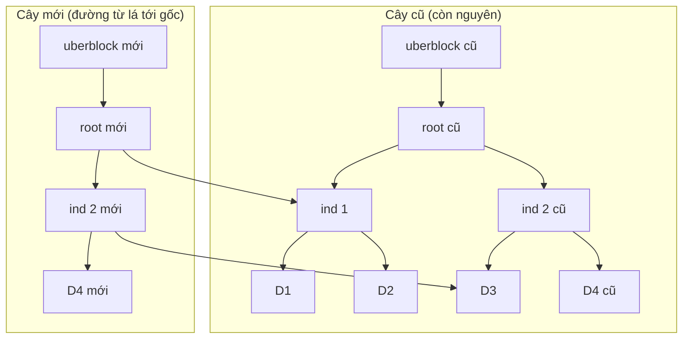

# P5 · Chương 07 — RAID và copy-on-write file system

## Bạn sẽ hiểu được gì

1. **Q1.** RAID giải quyết ba vấn đề gì, vì sao nó giả dạng một "đĩa lớn", và mô hình lỗi **fail-stop** giả định/bỏ qua điều gì? → mục 1
2. **Q2.** RAID-0, RAID-1, RAID-4 bố trí block ra sao; parity XOR dựng lại block mất thế nào? → mục 2
3. **Q3.** Vì sao một ghi nhỏ vào RAID-4/5 tốn 4 I/O (**small-write problem**), RAID-5 xoay parity để làm gì, và các cấp so với nhau thế nào? → mục 3
4. **Q4.** **Consistent-update problem** / "write hole" là gì, và Linux md xử lý nó bằng cơ chế nào? → mục 4
5. **Q5.** Vì sao cần checksum: những lỗi nào nằm ngoài fail-stop (LSE, corruption, misdirected write, lost write)? → mục 5
6. **Q6.** Copy-on-write (COW) / shadow paging là gì; vì sao snapshot gần như miễn phí và vì sao snapshot **không phải** backup? → mục 6
7. **Q7.** Btrfs và ZFS dùng ý tưởng đó cho checksum và RAID thế nào, và cái giá của COW là gì (garbage, fragmentation, ghi nhỏ đắt)? → mục 7

## Kiến thức cần trước

- [Chương 01 — Thiết bị lưu trữ](./01-thiet-bi-luu-tru.md)
- [Chương 03 — Cài đặt file system](./03-cai-dat-file-system.md)
- [Chương 05 — Crash consistency và journaling](./05-crash-consistency-va-journaling.md): write-ahead log; chương này dùng lại cùng ý tưởng ở tầng RAID.
- [Chương 04 — File descriptor và VFS](../01-linux/04-file-descriptor-va-vfs.md)

## 1. RAID: nhiều đĩa trông như một đĩa (Q1)

> **Trả lời ngắn.** RAID ghép nhiều đĩa thành một hệ đĩa nhanh hơn, lớn hơn và đáng tin hơn[^raid-def]; bên ngoài nó trông như một đĩa nên phần còn lại của hệ thống không phải đổi gì[^raid-looks][^raid-transparent]. Để so sánh các thiết kế, người ta giả định mỗi đĩa chỉ ở một trong hai trạng thái, chạy hoặc hỏng hẳn, và lỗi hỏng dễ phát hiện[^failstop][^failstop-detect]; giả định này chỉ là bước đầu, OSTEP hẹn xét các lỗi phức tạp và thực tế hơn về sau[^failstop-later].

**Giải thích.**

Hình dung (nhận xét của người soạn): một cụm database có nhiều replica sau một load balancer. Client chỉ thấy một endpoint; bên trong nhiều máy phối hợp để nhanh hơn và chịu được một máy chết. RAID làm việc tương tự với đĩa.

**Vấn đề.** Một đĩa đơn lẻ bị giới hạn về tốc độ, dung lượng và độ tin cậy. OSTEP mô tả RAID (Redundant Array of Inexpensive Disks) là kỹ thuật dùng nhiều đĩa phối hợp để dựng một hệ đĩa nhanh hơn, lớn hơn và đáng tin hơn.[^raid-def] Các lợi ích đúng theo thứ tự đó: hiệu năng (nhiều đĩa chạy song song), dung lượng, và độ tin cậy (dữ liệu trải trên nhiều đĩa mà không có kỹ thuật RAID thì dễ mất khi một đĩa hỏng).[^raid-adv]

**Tính trong suốt.** Từ bên ngoài, RAID trông như một đĩa: một nhóm block có thể đọc hoặc ghi.[^raid-looks] Khi file system gửi một I/O logic, RAID tính xem truy cập đĩa nào rồi phát một hay nhiều I/O vật lý; ví dụ của OSTEP: RAID giữ hai bản sao mỗi block (mirror) thì mỗi I/O logic khi ghi thành hai I/O vật lý.[^raid-logical] Nhờ vậy thay một đĩa SCSI bằng mảng RAID mà phần còn lại của hệ thống không phải đổi gì.[^raid-transparent]

### 1.1 Mô hình lỗi fail-stop

Để so sánh các thiết kế, OSTEP giả định mô hình **fail-stop**: mỗi đĩa ở đúng một trong hai trạng thái, đang hoạt động hoặc đã hỏng.[^failstop] Đĩa đang hoạt động thì mọi block đọc/ghi được; đĩa đã hỏng thì coi như mất vĩnh viễn.[^failstop] Giả định thứ hai là việc phát hiện lỗi dễ: khi một đĩa hỏng, ta giả định điều đó được phát hiện dễ dàng.[^failstop-detect]

Mô hình này **chỉ là bước đầu**. OSTEP nói thẳng rằng nó chưa xét các lỗi "im lặng" như corruption hay latent sector error (một block đơn lẻ không đọc được trên đĩa vẫn hoạt động), và gọi các lỗi đó là phức tạp hơn nhưng, tiếc thay, thực tế hơn.[^failstop-later]

Đi sâu: ba trục đánh giá một thiết kế RAID

OSTEP đánh giá mỗi thiết kế theo ba trục: **capacity**, **reliability** (chịu được mấy lần hỏng đĩa) và **performance**; cấp dùng parity có dung lượng nằm giữa mức không dư thừa và mức mirror.[^axes]

**Quay lại Q1:** RAID ghép nhiều đĩa thành một đĩa trông như bình thường; fail-stop là mô hình lỗi đơn giản hóa, chưa phản ánh hỏng im lặng.

## 2. RAID-0, RAID-1 và parity của RAID-4 (Q2)

> **Trả lời ngắn.** RAID-0 rải block luân phiên qua các đĩa và không có dư thừa[^r0]. RAID-1 giữ nhiều bản sao của mỗi block trên các đĩa khác nhau, nên mỗi lần ghi phải cập nhật mọi bản[^r1-rw]. RAID-4 thêm một block parity cho mỗi stripe, tính bằng XOR, để chịu mất một block bất kỳ trong stripe[^par-xor].

**Giải thích.**

Hình dung (nhận xét của người soạn): RAID-0 như sharding không có replica, nhanh nhưng mất một shard là mất dữ liệu; RAID-1 như replication một-một, tốn gấp đôi chỗ; parity như một "mã kiểm" cho cả nhóm, đủ để dựng lại đúng một phần bị thiếu.

### 2.1 RAID-0: striping

RAID-0 thực ra không phải một cấp RAID theo đúng nghĩa, vì không có dư thừa; nó đóng vai cận trên về hiệu năng và dung lượng.[^r0] Các block logic được rải luân phiên qua các đĩa. Với 4 đĩa và chunk một block:

| | Disk 0 | Disk 1 | Disk 2 | Disk 3 |
|---|---|---|---|---|
| stripe 0 | 0 | 1 | 2 | 3 |
| stripe 1 | 4 | 5 | 6 | 7 |
| stripe 2 | 8 | 9 | 10 | 11 |

Một **stripe** là một hàng các **chunk**; chunk có thể lớn hơn một block (ví dụ chunk 8 KB và 4 đĩa thì một stripe là 32 KB).[^chunk-size-def]

**Chunk size.** OSTEP: chunk size chủ yếu ảnh hưởng hiệu năng của mảng; chunk nhỏ làm nhiều file bị rải qua nhiều đĩa, còn chunk lớn làm giảm song song trong nội bộ file nên phải dựa vào nhiều request đồng thời để đạt throughput cao, đổi lại giảm thời gian định vị.[^chunk-perf] Chọn "tốt nhất" khó vì phụ thuộc workload; OSTEP nói phần lớn mảng dùng chunk lớn (ví dụ 64 KB).[^chunk-perf] Về độ tin cậy, OSTEP nhận xét striping là "hoàn hảo, nhưng theo nghĩa xấu": bất kỳ đĩa nào hỏng cũng dẫn tới mất dữ liệu — hình 38.8 ghi chịu mất 0 đĩa.[^r0-rel] (Nguồn nói mất dữ liệu, không nói "mất cả mảng"; "phần nằm trên đĩa hỏng không dựng lại được" là suy luận của người soạn từ việc không có dư thừa.)

### 2.2 RAID-1: mirroring

RAID-1 giữ nhiều bản sao của mỗi block trên các đĩa khác nhau. Khi đọc, RAID tự do chọn một bản; khi ghi thì không có lựa chọn: RAID phải cập nhật cả hai bản để giữ độ tin cậy, và hai lần ghi có thể diễn ra song song.[^r1-rw] Dung lượng hữu dụng là một nửa (với mức mirror 2).[^r1-cap]

Về độ tin cậy, mảng mirror mức 2 chắc chắn chịu được 1 đĩa hỏng, và tối đa N/2 đĩa hỏng tùy đĩa nào hỏng — nhưng OSTEP cũng ghi rằng thực tế người ta không muốn phó mặc may rủi, nên coi mirror là để chịu **một** lần hỏng.[^r1-rel]

Biến thể ghép lớp: **RAID-10** (stripe trên các cặp mirror) và **RAID-01** (mirror của hai mảng stripe).[^r10]

### 2.3 RAID-4: parity

Mirror tốn một nửa dung lượng. **Parity** dùng ít chỗ hơn, nhưng phải trả giá: hiệu năng.[^par-intro] Với mỗi stripe, một block parity chứa thông tin dư thừa tính từ các block dữ liệu; ví dụ P1 tính từ block 4, 5, 6, 7.[^par-p1] Hàm tính là XOR, một hàm đơn giản làm việc này rất khéo, cho phép chịu mất bất kỳ một block nào trong stripe.[^par-xor]

Trong RAID-4, parity nằm trọn trên **một** đĩa riêng (đĩa 4 trong ví dụ 5 đĩa của OSTEP).[^par-p1][^r4-parity-disk]

**Dung lượng và độ tin cậy.** RAID-4 dùng một đĩa cho parity nên dung lượng hữu dụng là (N − 1)·B;[^r4-parity-disk] theo bảng tổng kết của OSTEP, dung lượng và độ chịu lỗi của RAID-4 và RAID-5 như nhau, cả hai chịu 1 lần hỏng đĩa.[^table]

Đi sâu: ví dụ XOR bằng số cụ thể

Ví dụ cụ thể (mô phỏng của người soạn, đã chạy bằng `rustc`, xem mục Rust): với ba block dữ liệu 4 byte `d0=11 22 33 44`, `d1=aa bb cc dd`, `d2=01 02 03 04`, parity `P = d0⊕d1⊕d2 = ba 9b fc 9d`. Mất `d1`, ta dựng lại bằng `d0⊕d2⊕P = aa bb cc dd` — đúng bằng `d1`.

**Quay lại Q2:** RAID-0 không dư thừa, RAID-1 tốn một nửa dung lượng, RAID-4 dùng một đĩa parity XOR để chịu mất một đĩa.

## 3. Ghi nhỏ, RAID-5 xoay parity và bảng so sánh (Q3)

> **Trả lời ngắn.** Ghi đè một block làm parity cũ sai, nên cách subtractive đọc dữ liệu cũ và parity cũ rồi ghi dữ liệu mới và parity mới, tức 4 I/O[^4io]. Ở RAID-4 mọi ghi nhỏ đều đi qua một đĩa parity nên bị tuần tự hóa[^bottleneck]; RAID-5 xoay parity qua các đĩa để các ghi nhỏ chạy song song, nhưng vẫn mất hệ số 4[^r5-rotate][^r5-four].

**Giải thích.**

Hình dung (nhận xét của người soạn): sổ cái có dòng tổng cộng cuối mỗi trang. Sửa một số trong trang thì phải đọc số cũ, đọc tổng cũ, ghi số mới, ghi tổng mới. Nếu mọi dòng tổng nằm trong cùng một cuốn sổ thì cuốn đó là cổ chai; rải các dòng tổng ra nhiều cuốn thì nhiều người sửa song song được.

### 3.1 Small-write problem

Ghi đè một block của stripe làm parity cũ sai, nên phải cập nhật parity. Có hai cách:

1. **Additive parity**: đọc *toàn bộ* các block dữ liệu khác trong stripe, XOR với block mới để ra parity mới, rồi ghi dữ liệu mới + parity mới. Số lần đọc tăng theo số đĩa nên không hợp với mảng lớn.[^additive]
2. **Subtractive parity**: đọc dữ liệu cũ và parity cũ, so với dữ liệu mới; parity mới `P_new = (C_old ⊕ C_new) ⊕ P_old`. Bit dữ liệu không đổi thì parity bit không đổi; đổi thì parity bit đảo.[^subtractive]

Ví dụ chạy thật: `d1_old=aa bb cc dd`, `d1_new=5a 5b 5c 5d`, `P_old=ba 9b fc 9d` cho parity mới `4a 7b 6c 1d` theo subtractive (`(d1_old ⊕ d1_new) ⊕ P_old`); tính lại từ đầu `d0 ⊕ d1_new ⊕ d2` cũng ra đúng giá trị đó.

Với cách subtractive, mỗi lần ghi RAID phải thực hiện 4 I/O vật lý (hai đọc, hai ghi).[^4io] Vấn đề lộ ra khi có nhiều ghi nhỏ đồng thời: dữ liệu ở các đĩa khác nhau thì song song được, nhưng đều phải đi qua đĩa parity duy nhất, nên mọi lần ghi vào hệ thống bị tuần tự hóa vì đĩa parity.[^bottleneck] OSTEP gọi đó là small-write problem, và kết luận: throughput của RAID-4 với ghi nhỏ ngẫu nhiên rất tệ và không cải thiện khi thêm đĩa.[^r4-terrible]

### 3.2 RAID-5: parity xoay vòng

RAID-5 hoạt động gần như giống hệt RAID-4, trừ việc xoay block parity qua các ổ, để bỏ nút thắt đĩa parity.[^r5-rotate] Minh họa 5 đĩa, bốn stripe đầu của bố trí trong hình 38.7 của OSTEP (bảng dưới có block 0–15 và parity P0–P3; hình gốc có thêm stripe thứ năm với block 16–19 và P4); theo ví dụ của OSTEP, ghi block 1 chạm đĩa 1 và đĩa 4, ghi block 10 chạm đĩa 0 và đĩa 2:[^r5-example][^r5-layout]

| | Disk 0 | Disk 1 | Disk 2 | Disk 3 | Disk 4 |
|---|---|---|---|---|---|
| stripe 0 | 0 | 1 | 2 | 3 | **P0** |
| stripe 1 | 5 | 6 | 7 | **P1** | 4 |
| stripe 2 | 10 | 11 | **P2** | 8 | 9 |
| stripe 3 | 15 | **P3** | 12 | 13 | 14 |

Các ghi nhỏ tới những stripe khác nhau giờ có parity ở các đĩa khác nhau nên chạy song song được.[^r5-example] Dung lượng, độ chịu lỗi, throughput tuần tự và latency đơn lẻ giống RAID-4; random read tốt hơn chút vì dùng được mọi đĩa; random write cải thiện rõ.[^r5-analysis] Tuy vậy mỗi ghi nhỏ vẫn sinh 4 I/O: OSTEP viết rằng hệ số 4 bị mất là vì mỗi lần ghi RAID-5 vẫn sinh tổng cộng 4 thao tác I/O, đó đơn giản là cái giá của RAID dựa trên parity.[^r5-four]

OSTEP nhận xét RAID-5 gần như đã thay hoàn toàn RAID-4 trên thị trường; RAID-4 chỉ còn ở hệ thống biết chắc chỉ có ghi lớn, vì khi đó không dính small-write problem và RAID-4 hơi đơn giản hơn.[^r5-replace]

### 3.3 Bảng so sánh (OSTEP hình 38.8)

N = số đĩa, B = số block mỗi đĩa, S = băng thông tuần tự một đĩa, R = băng thông ngẫu nhiên một đĩa, T = latency một request trên một đĩa.[^table-legend]

| | RAID-0 | RAID-1 | RAID-4 | RAID-5 |
|---|---|---|---|---|
| Dung lượng | N·B | (N·B)/2 | (N−1)·B | (N−1)·B |
| Chịu mất | 0 | 1 chắc chắn; tối đa N/2 nếu may | 1 | 1 |
| Tuần tự đọc | N·S | (N/2)·S | (N−1)·S | (N−1)·S |
| Tuần tự ghi | N·S | (N/2)·S | (N−1)·S | (N−1)·S |
| Ngẫu nhiên đọc | N·R | N·R | (N−1)·R | N·R |
| Ngẫu nhiên ghi | N·R | (N/2)·R | R/2 | (N/4)·R |
| Latency đọc / ghi | T / T | T / T | T / 2T | T / 2T |

**Lựa chọn theo OSTEP.** Chỉ cần hiệu năng thì striping; cần random I/O và độ tin cậy thì mirroring, trả bằng dung lượng; cần dung lượng và độ tin cậy thì RAID-5, trả bằng hiệu năng ghi nhỏ; luôn I/O tuần tự và muốn tối đa dung lượng cũng hợp RAID-5.[^choose] Chọn cấp RAID và tham số (chunk size, số đĩa) vẫn thiên về nghệ thuật hơn là khoa học.[^art]

Đi sâu: đối chiếu từng ô của bảng với OSTEP

Bảng là bản chuyển thể của người soạn từ hình 38.8;[^table] PDF trích ra không giữ lưới, nên từng ô được đối chiếu với phân tích từng cấp trong cùng chương, kết quả là không ô nào lệch:

- **RAID-0**: N·B;[^axes] chịu mất 0, latency bằng một đĩa;[^r0-rel][^r0-lat] N·S tuần tự, N·R ngẫu nhiên.[^r0-tp]
- **RAID-1**: (N·B)/2, chịu 1 chắc chắn, tối đa N/2;[^r1-cap][^r1-rel] đọc tuần tự (N/2)·S, đọc ngẫu nhiên N·R, ghi ngẫu nhiên (N/2)·R;[^r1-seqread][^r1-rand] ghi tuần tự (N/2)·S theo "2× performance penalty".[^table-footnote] Latency ghi T là giá trị đơn giản hóa; văn bản nói ghi mirror chậm hơn một chút.[^r1-wlat]
- **RAID-4**: (N−1)·B, chịu 1;[^r4-cap] đọc tuần tự (N−1)·S, đọc ngẫu nhiên (N−1)·R;[^r4-seq] ghi ngẫu nhiên R/2;[^r4-terrible] latency ghi 2T.[^r4-lat]
- **RAID-5**: như RAID-4 trừ đọc ngẫu nhiên N·R và ghi ngẫu nhiên (N/4)·R.[^r5-analysis][^r5-four]

Chú thích 1 của OSTEP: hệ số 1/2 của RAID-1 tuần tự là với kiểu đọc/ghi ngây thơ, phát I/O lớn đến các phần khác nhau của mỗi mirror có thể đạt băng thông đầy đủ.[^table-note1] OSTEP nói mô hình đã bỏ qua nhiều chi tiết nhưng vẫn nắm bắt được các khác biệt cốt yếu.[^table-caveat]

**Quay lại Q3:** ghi nhỏ trên parity luôn tốn 4 I/O; RAID-5 chỉ bỏ cổ chai đĩa parity chứ không bỏ chi phí đó.

## 4. Write hole: consistent-update problem và Linux md (Q4)

> **Trả lời ngắn.** Một thao tác logic của RAID phải ghi nhiều đĩa mà các lần ghi đó không nguyên tử: mất điện giữa chừng thì các bản sao lệch nhau[^cu-scenario] (với RAID-5, OpenZFS mô tả là dữ liệu và parity lệch nhau[^raidz-hole]). Lời giải chung là ghi log trước khi làm (write-ahead log)[^cu-wal]; Linux md có các chính sách `journal` và `ppl` cho việc này[^md-policy], và thường từ chối khởi động mảng raid5 vừa dirty vừa degraded nếu quản trị viên không ra lệnh rõ ràng[^md-dirty].

**Giải thích.**

Hình dung (nhận xét của người soạn): chuyển tiền giữa hai tài khoản mà hệ thống chết sau khi đã trừ bên A và chưa cộng bên B. Cần một nhật ký giao dịch để biết phải làm nốt hay hủy. Trạng thái dữ liệu và parity lệch nhau sau mất điện được OpenZFS gọi là "write hole" của RAID-5.[^raidz-hole]

### 4.1 Consistent-update problem

Bất kỳ RAID nào phải cập nhật nhiều đĩa trong một thao tác logic đều gặp vấn đề này. Kịch bản của OSTEP (trên mảng mirror): RAID ghi xuống đĩa 0 xong, mất điện trước khi kịp phát lệnh ghi cho đĩa 1; kết quả là hai bản sao không nhất quán — đĩa 0 giữ phiên bản mới, đĩa 1 giữ phiên bản cũ.[^cu-scenario] Cần hai đĩa đổi nguyên tử: cả hai thành mới hoặc không đĩa nào.[^cu-scenario]

Lời giải chung là **write-ahead log**: ghi lại điều sắp làm trước khi làm; sau crash, thủ tục recovery phát lại các giao dịch còn dở để không có hai bản sao nào lệch nhau.[^cu-wal] Log xuống đĩa mỗi lần ghi quá đắt, nên phần cứng RAID thường có ít NVRAM (ví dụ có pin) để ghi log.[^cu-nvram] OSTEP lưu ý RAID phần mềm rẻ hơn nhưng cũng chịu consistent-update problem.[^cu-sw]

### 4.2 Linux md ở mức tổng quan

Linux có RAID phần mềm tên **md**. Mục này dựa vào `md.rst` ở tag kernel v6.8 (trang docs.kernel.org không ghim phiên bản). Tài liệu liệt kê giá trị `level` của một mảng, ví dụ "raid0, raid1, raid5, linear, multipath, faulty".[^md-level] Công cụ quản lý md được tài liệu trỏ tới `https://www.kernel.org/pub/linux/utils/raid/`.[^md-tools]

Điều kernel docs nói rõ và liên quan trực tiếp đến mục 4.1 là mảng raid5/raid6 vừa **dirty** vừa **degraded**. md đánh dấu mảng là dirty trước khi một lệnh ghi bắt đầu (và clean lại sau một khoảng không có lệnh ghi);[^md-safe] tài liệu viết rằng mảng raid5 hoặc raid6 vừa dirty vừa degraded có thể bị hỏng dữ liệu không phát hiện được.[^md-dirty]

Lý do theo tài liệu: dirty nghĩa là parity không tin được; degraded nghĩa là một số block dữ liệu thiếu và không dựng lại được một cách đáng tin do không còn parity đúng. Vì vậy md thường từ chối khởi động mảng như vậy và buộc quản trị viên ra lệnh rõ ràng (tài liệu nêu `mdadm --assemble --force`).[^md-dirty] Đây chính là hậu quả của consistent-update problem trên RAID-5: data và parity là hai lần ghi vật lý trên hai đĩa, crash giữa chừng để lại stripe không nhất quán (suy luận của người soạn từ mục 4.1 và đoạn trích trên).

Đi sâu: các chính sách <code>consistency_policy</code> của md

md cung cấp các chế độ để giảm chi phí hoặc đóng lỗ hổng này, qua thuộc tính sysfs `consistency_policy`:[^md-policy]

| Chính sách | Ý nghĩa theo tài liệu |
|---|---|
| `none` | Mảng không có thông tin dư thừa, ví dụ raid0 và linear.[^md-policy] |
| `resync` | Sau tắt không sạch, resync toàn mảng và tạo lại toàn bộ dư thừa.[^md-policy] |
| `bitmap` | Resync có hỗ trợ **write-intent bitmap**.[^md-policy] |
| `journal` | Chỉ cho raid4/5/6: dùng một thiết bị journal ghi lại giao dịch và phát lại sau tắt không sạch.[^md-policy] |
| `ppl` | Chỉ raid5: Partial Parity Log, nhằm đóng write hole và loại bỏ resync.[^md-policy] |

`journal` là ý tưởng write-ahead log ở mục 4.1, đặt trên một thiết bị journal riêng (đối chiếu với NVRAM của RAID phần cứng là nhận xét của người soạn).

**Quay lại Q4:** write hole nảy sinh vì cập nhật nhiều đĩa không nguyên tử; ghi log trước (NVRAM, journal, PPL) là cách chữa chung.

## 5. Vì sao cần checksum: các lỗi ngoài fail-stop (Q5)

> **Trả lời ngắn.** Ngoài đĩa hỏng hẳn còn có latent sector error (một block không đọc được, ổ báo lỗi) và corruption im lặng (ổ trả dữ liệu sai mà không báo)[^lse-vs-corrupt]. Checksum, một bản tóm tắt nhỏ lưu cùng dữ liệu rồi so lại khi đọc, là cách chính để phát hiện corruption[^checksum-def]; nhưng misdirected write cần thêm thông tin định danh vị trí vào checksum[^misdirected][^misdirected-id], còn lost write thì checksum cùng physical ID đều không phát hiện được[^lost-write][^lost-cksum].

**Giải thích.**

Hình dung (nhận xét của người soạn): thùng hàng có tem niêm phong cho biết nó có bị mở hay đổi ruột không; nhưng tem không cho biết thùng bị giao nhầm địa chỉ, hay hãng báo "đã gửi" mà thực ra chưa gửi.

Mô hình fail-stop giả định lỗi rõ ràng. Chương integrity của OSTEP thêm hai loại: LSE (dễ phát hiện vì đọc báo lỗi) và **corruption** (đĩa trả dữ liệu sai mà không báo, "silent").[^lse-vs-corrupt] Cách chính để phát hiện corruption là **checksum**: một hàm tính trên một khối dữ liệu (ví dụ 4 KB) cho ra bản tóm tắt nhỏ (4–8 byte), lưu cùng dữ liệu và so lại khi đọc.[^checksum-def]

OSTEP cũng nêu hai kiểu lỗi mà checksum cơ bản không đủ:

- **Misdirected write**: controller ghi đúng dữ liệu nhưng sai vị trí (block Dx lên địa chỉ y, hoặc sang đĩa khác).[^misdirected] Cách chữa của OSTEP: lưu kèm checksum một physical ID (số đĩa và số sector của block) để so khi đọc.[^misdirected-id]
- **Lost write**: thiết bị báo ghi xong nhưng thực chất chưa persist, nên vẫn là nội dung cũ.[^lost-write] Block cũ vẫn có checksum khớp và physical ID đúng nên hai cơ chế trên không bắt được;[^lost-cksum] một hướng chữa là thêm checksum ở nơi khác, ví dụ ZFS đặt checksum trong inode và indirect block.[^lost-zfs]

Đi sâu: parity gặp LSE khi rebuild, RAID-DP và scrubbing

Chương data integrity của OSTEP chỉ ra điểm yếu của parity khi có **latent sector error (LSE)**: khi một đĩa hỏng cả, RAID dựng lại nó (ví dụ lên hot spare) bằng cách đọc mọi đĩa còn lại; nếu gặp một LSE trên bất kỳ đĩa nào trong lúc đó thì việc dựng lại không thể hoàn tất.[^lse-rebuild] Cách đối phó: thêm tầng dư thừa, như RAID-DP của NetApp với hai đĩa parity.[^raiddp] Cũng theo các nghiên cứu OSTEP tóm tắt, scrub đĩa là hữu ích (phần lớn LSE được tìm thấy theo cách này).[^scrub] **Scrubbing** là đọc định kỳ mọi block và kiểm tra checksum còn hợp lệ, thường theo lịch hằng đêm hoặc hằng tuần.[^scrub-def]

**Quay lại Q5:** checksum bắt corruption im lặng; misdirected write cần thêm physical ID, lost write cần checksum ở nơi khác; LSE khi rebuild là điểm yếu của parity.

## 6. Copy-on-write: không bao giờ ghi đè (Q6)

> **Trả lời ngắn.** COW (trong database gọi là shadow paging) không ghi đè dữ liệu đang dùng: nó ghi bản mới sang chỗ trống rồi chuyển sang trỏ vào bản mới[^lfs-shadow][^zfs-rule]. Vì cây cũ còn nguyên nên snapshot chỉ là một tham chiếu ngăn các block cũ bị giải phóng, không copy gì[^zfs-snap]; nhưng snapshot chia sẻ block với bản gốc nên không thay được backup[^btrfs-notbackup].

**Giải thích.**

Hình dung (nhận xét của người soạn): giống git. Commit mới không sửa commit cũ mà tạo object mới rồi dời con trỏ branch; mọi commit cũ vẫn còn đó, và "chụp" một thời điểm chỉ là giữ lại một con trỏ cũ.

### 6.1 Ý tưởng: không ghi đè, ghi sang chỗ mới

Journaling ([Chương 05](./05-crash-consistency-va-journaling.md)) bảo vệ cập nhật tại chỗ bằng log; hướng khác là **không bao giờ ghi đè**. LFS (log-structured file system) của OSTEP không bao giờ ghi đè dữ liệu hiện có mà luôn ghi các segment vào chỗ trống.[^lfs-never] Hệ quả: vì LFS không ghi đè tại chỗ, phiên bản mới nhất của một inode (thứ ta cần) cứ liên tục dịch chuyển, nên cần một lớp gián tiếp là **inode map** và một vị trí cố định là **checkpoint region** trỏ tới các mảnh inode map mới nhất.[^lfs-move][^lfs-cr]

OSTEP gọi tên kỹ thuật này: trong database gọi là shadow paging, còn trong cách nói của file system đôi khi gọi là copy-on-write; nó cho phép ghi rất hiệu quả vì gom nhiều cập nhật vào một segment trong bộ nhớ rồi ghi tuần tự.[^lfs-shadow]

Ghi lớn tốt cho đĩa quay (ít thời gian định vị) và trên RAID-4/5 tránh hoàn toàn small-write problem.[^lfs-raid] Đây là chỗ nối với mục 3.1: LFS gom cập nhật vào segment lớn nên không dính small-write problem (đó là mô tả về LFS; với ZFS, mục 7.3 cho thấy ghi một phần record lại đắt).

OSTEP cũng ghi rằng WAFL của NetApp, ZFS của Sun và Btrfs của Linux đều dùng cách tiếp cận copy-on-write tương tự.[^lfs-legacy]

### 6.2 Cơ chế COW trên cây: ví dụ OpenZFS

Tài liệu OpenZFS tóm tắt quy tắc gốc: block đang dùng không bao giờ bị ghi đè; thay đổi dữ liệu nghĩa là ghi nó ở chỗ khác rồi chuyển sang phiên bản mới.[^zfs-rule] Cấu trúc: pool là một cây lớn; lá chứa dữ liệu, nút trong chứa block pointer ghi vị trí, kích thước và checksum của con; gốc là **uberblock**.[^zfs-tree]

Sửa một block giữa cây theo bốn bước: ghi dữ liệu mới vào chỗ trống; ghi phiên bản mới của nút cha trỏ vào block mới; lặp lên trên (vì checksum của cha giờ đã đổi); cuối cùng ghi uberblock mới.[^zfs-write]

(Sơ đồ của người soạn, vẽ lại ví dụ D4 của tài liệu OpenZFS ở dưới.)

Ví dụ trong tài liệu: chỉ D4 đổi thì chỉ D4, cha của nó (ind 2), root và uberblock có bản sao mới; D1, D2, D3 và ind 1 được cây mới tham chiếu chứ không nhân đôi.[^zfs-path] Đến bước cuối, uberblock cũ vẫn mô tả một pool trọn vẹn nên việc chuyển sang cây mới là một lần ghi nguyên tử.[^zfs-atomic] Tài liệu suy ra: không có "RAID-5 write hole" và không cần journal replay cho metadata.[^zfs-atomic]

Điểm tinh tế về checksum: checksum của block lưu ở **cha**, không cạnh block, nên một block hỏng không thể tự đứng ra bảo chứng cho mình.[^zfs-tree] (Đối chiếu mục 5: OSTEP nêu ZFS đặt checksum trong inode và indirect block để bắt lost write;[^lost-zfs] đó cùng ý tưởng "checksum ở cha" — phép nối của người soạn.)

### 6.3 Snapshot

Với cây không bị ghi đè, snapshot gần như không tốn gì: tài liệu OpenZFS viết rằng snapshot chỉ là một tham chiếu ngăn các block đó bị giải phóng, không có gì được copy.[^zfs-snap] OSTEP kể lại cách WAFL biến "garbage" của LFS thành tính năng: cung cấp phiên bản cũ qua snapshot để người dùng lấy lại file lỡ xóa.[^lfs-wafl]

Btrfs tương tự: snapshot là subvolume có nội dung khởi tạo; mặc định tạo ở dạng read-write, và sửa file trong snapshot không ảnh hưởng subvolume gốc.[^btrfs-snap] Tài liệu Btrfs cũng cảnh báo rõ: snapshot không phải là backup. Snapshot và bản gốc ban đầu chia sẻ mọi block dữ liệu; nếu dữ liệu đó hỏng (bad sector, `dd` nhầm lên đĩa) thì cả hai cùng hỏng.[^btrfs-notbackup]

Đi sâu: transaction group (txg) và ZIL của ZFS

Ghi theo lô: ZFS gom ghi thành **transaction group (txg)** commit nguyên tử cả nhóm; có ba txg cùng tồn tại (đang mở, đang quiescing, đang sync) và nhóm đóng khi `zfs_txg_timeout` hết, mặc định 5 giây, hoặc khi đủ dữ liệu bẩn.[^zfs-txg] Với ghi bất đồng bộ, hàm trả về khi dữ liệu đã trong RAM; crash làm mất các txg chưa sync, pool quay về txg đã commit gần nhất — nhất quán nhưng cũ hơn một chút.[^zfs-txg-loss] Ứng dụng gọi `fsync()` được ZFS Intent Log (ZIL) phục vụ: nó ghi ngay các ghi đồng bộ để phát lại nếu hệ thống chết trước khi txg commit.[^zfs-zil] `fsync` ở tầng ứng dụng: [Chương 06](./06-durability-trong-thuc-te.md).

**Quay lại Q6:** COW ghi bản mới rồi đổi gốc nên cây cũ còn nguyên; snapshot rẻ nhưng chia sẻ block với bản gốc nên không phải backup.

## 7. Btrfs và ZFS: checksum, RAID tích hợp và cái giá của COW (Q7)

> **Trả lời ngắn.** ZFS và Btrfs đều lưu checksum cho dữ liệu để phát hiện hỏng, và ZFS tự sửa nếu có dư thừa[^zfs-cksum][^btrfs-ck-layout]; cả hai cũng có hỗ trợ nhiều thiết bị kiểu RAID ngay trong file system (Btrfs liệt kê striping, mirroring, parity; ZFS có RAIDZ)[^btrfs-raid][^raidz]. Cái giá của COW là fragmentation, cần chỗ trống để ghi, và ghi từng phần record đắt[^zfs-costs].

**Giải thích.**

Hình dung (nhận xét của người soạn): cuốn sổ cái mà mỗi trang cha ghi kèm mã kiểm của từng trang con. Muốn tin một trang thì đối chiếu với mã ở trang cha; và vì COW luôn ghi trang mới thay vì sửa trang cũ nên việc cập nhật mã kiểm đi cùng đường ghi lên gốc.

### 7.1 Checksum end-to-end và tự sửa lỗi

OpenZFS: checksum end-to-end phát hiện dữ liệu hỏng khi đọc từ phương tiện; block hỏng được tự sửa nếu có thể, nhờ bảo vệ kiểu RAID của pool hoặc các bản sao dư thừa; scrub định kỳ phát hiện và sửa suy thoái tiềm ẩn.[^zfs-cksum]

Btrfs lưu checksum cho cả dữ liệu và metadata: block metadata có checksum nội tuyến trong header nút b-tree, còn mỗi block dữ liệu có checksum tách rời trong **checksum tree**.[^btrfs-ck-layout] Thuật toán mặc định là crc32c; có thêm xxhash, sha256, blake2b từ kernel 5.5 với đánh đổi về tốc độ/độ mạnh.[^btrfs-ck-algos] Tính năng "Self-healing" của Btrfs nằm trong danh sách đặc điểm chính trên trang giới thiệu.[^btrfs-intro]

### 7.2 RAID tích hợp trong file system

Vì Btrfs và ZFS quản lý nhiều thiết bị, chúng có "RAID" riêng. Btrfs liệt kê striping (như RAID0), mirroring (như RAID1, tới 4 bản), stripe+mirror (như RAID10), và parity đơn/kép (như RAID5/6) — với ghi chú là thử nghiệm, chưa sẵn sàng cho production cho nhóm parity trong tài liệu btrfs-progs tag v6.14.[^btrfs-raid] (Trạng thái ở tag đó, không suy ra cho bản khác; kernel v6.8 `btrfs.rst` chỉ ghi chung là có nhiều thuật toán raid.[^btrfs-k68])

ZFS có **RAIDZ**, một biến thể của RAID-5 cho phép phân bố parity tốt hơn, với một, hai hoặc ba parity (raidz1/2/3); nhóm N đĩa kích thước X với P parity chứa khoảng (N−P)·X byte và chịu P đĩa hỏng.[^raidz] Tài liệu nói RAIDZ loại bỏ "write hole" của RAID-5 (tình trạng dữ liệu và parity trở nên bất nhất sau khi mất điện).[^raidz-hole] md xử lý write hole bằng journal hoặc PPL,[^md-policy] còn tài liệu COW của OpenZFS gắn việc pool không có "RAID-5 write hole" với việc chuyển sang cây mới bằng một lần ghi nguyên tử (mục 6.2).[^zfs-atomic] Tài liệu RAIDZ chỉ nêu kết quả, không nêu cơ chế riêng của RAIDZ, nên chương không khẳng định RAIDZ tránh write hole bằng cách nào; đặt md cạnh ZFS là tổng hợp của người soạn.

### 7.3 Cái giá của COW

LFS: ghi sang chỗ mới sinh ra rác, các bản cũ của dữ liệu nằm rải rác khắp đĩa, nên phải dọn segment cũ định kỳ (**cleaning**, một dạng garbage collection).[^lfs-garbage] OSTEP nói cleaning là điểm gây tranh cãi và có thể đã hạn chế ảnh hưởng ban đầu của LFS.[^lfs-garbage]

OpenZFS liệt kê ba chi phí của COW trong tài liệu của mình:[^zfs-costs]

| Chi phí | Mô tả theo tài liệu |
|---|---|
| Fragmentation | Ghi lại file làm block mới nằm ở nơi nào còn chỗ trống, nên dữ liệu ghi tuần tự rồi sửa ngẫu nhiên không còn tuần tự; pool đầy khiến tìm chỗ trống liền khó hơn. |
| Cần chỗ trống để ghi | Ngay cả xóa dữ liệu cũng cần cấp phát, nên có "slop space" dành riêng. |
| Ghi từng phần đắt | Đổi một phần record nghĩa là đọc cả record, sửa, rồi ghi record mới; khớp `recordsize` với kích thước I/O ứng dụng là cách xử lý thông thường. |

Về chi phí ghi: chi phí một ghi nhỏ tỷ lệ với độ sâu của cây, không phải kích thước của nó.[^zfs-depth] (Suy luận của người soạn: có thể gọi đó là một dạng **write amplification**, vì sửa một block kéo theo ghi lại cả đường tới gốc. Tài liệu OpenZFS không dùng thuật ngữ này và chương không có số liệu đo nên không khẳng định mức khuếch đại.)

### 7.4 Overlay / union file system

Overlay/union file system của container: xem [Chương 04 — Filesystem của container](../08-containers/04-filesystem-cua-container.md).

Đi sâu: Btrfs checksum và O_DIRECT

**Tương tác với O_DIRECT (chương [04](./04-page-cache-va-direct-io.md)).** Checksum dữ liệu tính ngay trước khi gửi xuống thiết bị, nên Btrfs đòi block không đổi cho đến khi writeback xong; bộ đệm `O_DIRECT` ở user space nên không kiểm soát được. Theo tài liệu, từ kernel 6.14 direct write bị ép quay về buffered nếu inode cần checksum dữ liệu.[^btrfs-odirect]

**Quay lại Q7:** ZFS/Btrfs gắn checksum vào cây COW và tự quản RAID, đổi lại là fragmentation, nhu cầu chỗ trống và ghi từng phần đắt.

## 8. Storage trên cloud: nhận xét về backend

(Nhận xét của người soạn, không có nguồn trích; chương chưa đọc tài liệu của nhà cung cấp cloud nên không khẳng định gì về cách họ làm dư thừa.) Khi chồng nhiều lớp dư thừa (nhà cung cấp, md, ZFS/Btrfs, replication của database), hãy hỏi mỗi lớp: ai ghi checksum, ghi nhỏ tốn bao nhiêu I/O.

## 9. Liên hệ với Rust

Chương này không có API Rust riêng (nhận xét của người soạn); phần Rust duy nhất là kiểm chứng số học parity.

Đoạn code (của người soạn, `rustc -O` 1.95.0, chạy trong `/tmp`, đã xóa) XOR từng byte của các block: tính parity, dựng lại block mất, và so cập nhật subtractive với tính lại từ đầu.

Kết quả đã quan sát: parity `[ba, 9b, fc, 9d]`; dựng lại `d1` đúng; parity mới theo hai cách đều `[4a, 7b, 6c, 1d]`. Đây chỉ kiểm chứng số học, không mô phỏng crash.

## Tóm tắt

- RAID ghép nhiều đĩa thành một "đĩa" nhanh, lớn, đáng tin hơn, trong suốt với phía trên.[^raid-def][^raid-looks]
- Fail-stop là giả định đơn giản hóa; corruption im lặng và LSE thực tế hơn.[^failstop][^failstop-detect][^failstop-later][^lse-vs-corrupt]
- RAID-0 không dư thừa; RAID-1 tốn nửa dung lượng; RAID-4/5 dùng XOR parity, dung lượng (N−1)·B, chịu 1 đĩa hỏng.[^r0][^r1-cap][^table]
- Ghi nhỏ trên RAID parity tốn 4 I/O; RAID-5 xoay parity để bỏ nút thắt nhưng vẫn mất hệ số 4.[^4io][^bottleneck][^r5-four]
- Consistent-update problem: cập nhật nhiều đĩa không nguyên tử; giải bằng write-ahead log (NVRAM, hoặc journal/PPL ở md).[^cu-wal][^md-policy]
- COW/shadow paging: không ghi đè, ghi bản mới rồi đổi gốc; cho snapshot rẻ, checksum ở cha, nhất quán sau crash.[^lfs-shadow][^zfs-write][^zfs-tree][^zfs-atomic][^zfs-snap]
- Giá của COW: cleaning, fragmentation, ghi từng phần đắt; snapshot không phải backup.[^lfs-garbage][^zfs-costs][^btrfs-notbackup]

## Câu hỏi tự kiểm tra

1. Fail-stop giả định gì? Nêu hai loại lỗi nó chưa xét.

Đáp án

Đĩa hoạt động hoặc hỏng hẳn, lỗi dễ phát hiện;[^failstop][^failstop-detect] chưa xét corruption im lặng và latent sector error.[^failstop-later]

2. RAID-1 mức 2 chịu được mấy đĩa hỏng, vì sao thực tế chỉ tin một?

Đáp án

Chắc chắn 1, tối đa N/2 tùy đĩa nào hỏng; không nên phó mặc may rủi.[^r1-rel]

3. Tính parity của (0,0,1,1) và nêu cách dựng lại một bit mất.

Đáp án

XOR = 0;[^par-xor] bit mất = XOR của các bit còn lại với parity (suy ra từ tính chất XOR, đã kiểm bằng code ở mục 9).

4. Vì sao ghi một block vào RAID-5 (subtractive) tốn 4 I/O?

Đáp án

Đọc dữ liệu cũ, đọc parity cũ, ghi dữ liệu mới, ghi parity mới.[^4io][^subtractive]

5. Vì sao RAID-4 không scale ghi nhỏ, và RAID-5 sửa gì?

Đáp án

Mọi ghi nhỏ đi qua đĩa parity duy nhất nên bị tuần tự hóa; RAID-5 xoay parity để ghi chạy song song, đạt (N/4)·R.[^bottleneck][^r4-terrible][^r5-rotate][^r5-four]

6. Mô tả consistent-update problem và lời giải.

Đáp án

Ghi đĩa 0 xong rồi mất điện trước khi ghi đĩa 1 khiến hai bản lệch;[^cu-scenario] giải bằng write-ahead log (NVRAM ở phần cứng; journal/PPL ở md).[^cu-wal][^cu-nvram][^md-policy]

7. Vì sao md thường từ chối khởi động mảng raid5 vừa dirty vừa degraded?

Đáp án

Parity không tin được và thiếu block dữ liệu nên có thể hỏng dữ liệu không phát hiện được.[^md-dirty]

8. Bốn bước ZFS sửa một block là gì, và điều gì giữ pool nhất quán sau mất điện?

Đáp án

Ghi dữ liệu mới; ghi cha mới; lặp lên gốc; ghi uberblock mới.[^zfs-write] Uberblock cũ vẫn mô tả cây trọn vẹn, chuyển sang cây mới là một lần ghi nguyên tử.[^zfs-atomic]

9. Vì sao snapshot COW rẻ nhưng không thay được backup?

Đáp án

Cây cũ còn nguyên, snapshot chỉ là tham chiếu ngăn giải phóng block;[^zfs-snap] snapshot chia sẻ block với bản gốc nên hỏng cùng nhau.[^btrfs-notbackup]

## Đọc thêm

- [OSTEP — RAID (file-raid)](https://pages.cs.wisc.edu/~remzi/OSTEP/file-raid.pdf): phân tích từng cấp RAID.
- [OSTEP — Log-structured file systems (file-lfs)](https://pages.cs.wisc.edu/~remzi/OSTEP/file-lfs.pdf): nền của COW.
- [OSTEP — Data integrity (file-integrity)](https://pages.cs.wisc.edu/~remzi/OSTEP/file-integrity.pdf): LSE, checksum, lost write.
- [OpenZFS — Copy-on-write](https://openzfs.github.io/openzfs-docs/Basic%20Concepts/Copy-on-write.html): diễn giải cây, txg, ZIL và chi phí của COW.
- [Linux kernel v6.8 — md.rst](https://raw.githubusercontent.com/torvalds/linux/v6.8/Documentation/admin-guide/md.rst): thuộc tính `consistency_policy`, boot-time assembly, mảng dirty/degraded.
- [Btrfs — Introduction](https://raw.githubusercontent.com/kdave/btrfs-progs/v6.14/Documentation/Introduction.rst), [Subvolumes](https://raw.githubusercontent.com/kdave/btrfs-progs/v6.14/Documentation/ch-subvolume-intro.rst), [Checksumming](https://raw.githubusercontent.com/kdave/btrfs-progs/v6.14/Documentation/ch-checksumming.rst): tính năng, snapshot, checksum (nguồn rst của btrfs-progs tag v6.14; trang readthedocs `latest` không ghim phiên bản).
- [Chương 05](./05-crash-consistency-va-journaling.md) và [Chương 06](./06-durability-trong-thuc-te.md): log và `fsync` ở tầng file system/ứng dụng.

[^raid-def]: OSTEP, "Redundant Arrays of Inexpensive Disks" (file-raid), mục giới thiệu — <https://pages.cs.wisc.edu/~remzi/OSTEP/file-raid.pdf> — "a technique to use multiple disks in concert to build a faster, bigger, and more reliable disk system"
[^raid-adv]: OSTEP, file-raid, mục giới thiệu — <https://pages.cs.wisc.edu/~remzi/OSTEP/file-raid.pdf> — "RAIDs offer a number of advantages over a single disk. One advantage is performance."
[^raid-looks]: OSTEP, file-raid, mục giới thiệu — <https://pages.cs.wisc.edu/~remzi/OSTEP/file-raid.pdf> — "Externally, a RAID looks like a disk: a group of blocks one can read or write."
[^raid-logical]: OSTEP, file-raid, mục 38.1 Interface And RAID Internals — <https://pages.cs.wisc.edu/~remzi/OSTEP/file-raid.pdf> — "the RAID will have to perform two physical I/Os for every one logical I/O it is issued."
[^raid-transparent]: OSTEP, file-raid, hộp TIP: Transparency Enables Deployment — <https://pages.cs.wisc.edu/~remzi/OSTEP/file-raid.pdf> — "administrators could install a SCSI-based RAID storage array instead of a SCSI disk, and the rest of the system (host computer, OS, etc.) did not have to change one bit to start using it."
[^failstop]: OSTEP, file-raid, mục 38.2 Fault Model — <https://pages.cs.wisc.edu/~remzi/OSTEP/file-raid.pdf> — "In this model, a disk can be in exactly one of two states: working or failed."
[^failstop-detect]: OSTEP, file-raid, mục 38.2 Fault Model — <https://pages.cs.wisc.edu/~remzi/OSTEP/file-raid.pdf> — "when a disk has failed, we assume that this is easily detected."
[^failstop-later]: OSTEP, file-raid, mục 38.2 Fault Model — <https://pages.cs.wisc.edu/~remzi/OSTEP/file-raid.pdf> — "We will consider these more complex (and unfortunately, more realistic) disk faults later."
[^axes]: OSTEP, file-raid, mục 38.3 How To Evaluate A RAID — <https://pages.cs.wisc.edu/~remzi/OSTEP/file-raid.pdf> — "Different schemes (e.g., parity-based ones) tend to fall in between."
[^r0]: OSTEP, file-raid, mục 38.4 RAID Level 0: Striping — <https://pages.cs.wisc.edu/~remzi/OSTEP/file-raid.pdf> — "The first RAID level is actually not a RAID level at all, in that there is no redundancy."
[^r0-rel]: OSTEP, file-raid, mục 38.4, Back To RAID-0 Analysis — <https://pages.cs.wisc.edu/~remzi/OSTEP/file-raid.pdf> — "striping is also perfect, but in the bad way: any disk failure will lead to data loss."
[^chunk-size-def]: OSTEP, file-raid, mục 38.4 (Figure 38.2) — <https://pages.cs.wisc.edu/~remzi/OSTEP/file-raid.pdf> — "a stripe thus consists of 4 chunks or 32KB of data."
[^chunk-perf]: OSTEP, file-raid, mục 38.4, hộp Chunk Sizes — <https://pages.cs.wisc.edu/~remzi/OSTEP/file-raid.pdf> — "Chunk size mostly affects performance of the array."
[^r1-rw]: OSTEP, file-raid, mục 38.5 RAID Level 1: Mirroring — <https://pages.cs.wisc.edu/~remzi/OSTEP/file-raid.pdf> — "the RAID must update both copies of the data, in order to preserve reliability."
[^r1-cap]: OSTEP, file-raid, mục 38.5, RAID-1 Analysis — <https://pages.cs.wisc.edu/~remzi/OSTEP/file-raid.pdf> — "From a capacity standpoint, RAID-1 is expensive;"
[^r1-rel]: OSTEP, file-raid, mục 38.5, RAID-1 Analysis — <https://pages.cs.wisc.edu/~remzi/OSTEP/file-raid.pdf> — "a mirrored system (with mirroring level of 2) can tolerate 1 disk failure for certain, and up to N/2 failures depending on which disks fail."
[^r10]: OSTEP, file-raid, mục 38.5 — <https://pages.cs.wisc.edu/~remzi/OSTEP/file-raid.pdf> — "RAID-10 (or RAID 1+0, stripe of mirrors) because it uses mirrored pairs (RAID-1) and then stripes (RAID-0) on top of them; another common arrangement is RAID-01 (or RAID 0+1, mirror of stripes)"
[^cu-scenario]: OSTEP, file-raid, hộp The RAID Consistent-Update Problem — <https://pages.cs.wisc.edu/~remzi/OSTEP/file-raid.pdf> — "the copy on disk 0 is the new version, and the copy on disk 1 is the old."
[^cu-wal]: OSTEP, file-raid, hộp The RAID Consistent-Update Problem — <https://pages.cs.wisc.edu/~remzi/OSTEP/file-raid.pdf> — "The general way to solve this problem is to use a write-ahead log of some kind to first record what the RAID is about to do"
[^cu-nvram]: OSTEP, file-raid, hộp The RAID Consistent-Update Problem — <https://pages.cs.wisc.edu/~remzi/OSTEP/file-raid.pdf> — "most RAID hardware includes a small amount of non-volatile RAM (e.g., battery-backed) where it performs this type of logging."
[^cu-sw]: OSTEP, file-raid, mục 38.9 Other Interesting RAID Issues — <https://pages.cs.wisc.edu/~remzi/OSTEP/file-raid.pdf> — "such software RAID systems are cheaper but have other problems, including the consistent-update problem [DAA05]."
[^par-intro]: OSTEP, file-raid, mục 38.6 RAID Levels 4 and 5 — <https://pages.cs.wisc.edu/~remzi/OSTEP/file-raid.pdf> — "They do so at a cost, however: performance."
[^par-p1]: OSTEP, file-raid, mục 38.6 (Figure 38.4) — <https://pages.cs.wisc.edu/~remzi/OSTEP/file-raid.pdf> — "For example, parity block P1 has redundant information that it calculated from blocks 4, 5, 6, and 7."
[^par-xor]: OSTEP, file-raid, mục 38.6 — <https://pages.cs.wisc.edu/~remzi/OSTEP/file-raid.pdf> — "It turns out the simple function XOR does the trick quite nicely."
[^table]: OSTEP, file-raid, mục 38.7 RAID-5 Analysis và Figure 38.8 — <https://pages.cs.wisc.edu/~remzi/OSTEP/file-raid.pdf> — "the effective capacity and failure tolerance of the two levels are identical."
[^additive]: OSTEP, file-raid, mục 38.6 — <https://pages.cs.wisc.edu/~remzi/OSTEP/file-raid.pdf> — "read in all of the other data blocks in the stripe in parallel"
[^subtractive]: OSTEP, file-raid, mục 38.6 — <https://pages.cs.wisc.edu/~remzi/OSTEP/file-raid.pdf> — "we read in the old data at C2 (C2old = 1) and the old parity (Pold = 0)."
[^4io]: OSTEP, file-raid, mục 38.6 — <https://pages.cs.wisc.edu/~remzi/OSTEP/file-raid.pdf> — "for each write, the RAID has to perform 4 physical I/Os (two reads and two writes)."
[^bottleneck]: OSTEP, file-raid, mục 38.6 — <https://pages.cs.wisc.edu/~remzi/OSTEP/file-raid.pdf> — "all writes to the system will be serialized because of the parity disk."
[^r4-terrible]: OSTEP, file-raid, mục 38.6 — <https://pages.cs.wisc.edu/~remzi/OSTEP/file-raid.pdf> — "RAID-4 throughput under random small writes is terrible; it does not improve as you add disks to the system."
[^r5-rotate]: OSTEP, file-raid, mục 38.7 RAID Level 5: Rotating Parity — <https://pages.cs.wisc.edu/~remzi/OSTEP/file-raid.pdf> — "RAID-5 works almost identically to RAID-4, except that it rotates the parity block across drives"
[^r5-example]: OSTEP, file-raid, mục 38.7 RAID-5 Analysis — <https://pages.cs.wisc.edu/~remzi/OSTEP/file-raid.pdf> — "Imagine a write to block 1 and a write to block 10; this will turn into requests to disk 1 and disk 4"
[^r5-layout]: OSTEP, file-raid, mục 38.7, Figure 38.7 — <https://pages.cs.wisc.edu/~remzi/OSTEP/file-raid.pdf> — "the parity block for each stripe is now rotated across the disks, in order to remove the parity-disk bottleneck for RAID-4."
[^r5-analysis]: OSTEP, file-raid, mục 38.7 RAID-5 Analysis — <https://pages.cs.wisc.edu/~remzi/OSTEP/file-raid.pdf> — "Random read performance is a little better, because we can now utilize all disks."
[^r5-four]: OSTEP, file-raid, mục 38.7 RAID-5 Analysis — <https://pages.cs.wisc.edu/~remzi/OSTEP/file-raid.pdf> — "The factor of four loss is due to the fact that each RAID-5 write still generates 4 total I/O operations, which is simply the cost of using parity-based RAID."
[^r5-replace]: OSTEP, file-raid, mục 38.7 — <https://pages.cs.wisc.edu/~remzi/OSTEP/file-raid.pdf> — "it has almost completely replaced RAID-4 in the marketplace."
[^r0-lat]: OSTEP, file-raid, mục 38.4, Back To RAID-0 Analysis (performance) — <https://pages.cs.wisc.edu/~remzi/OSTEP/file-raid.pdf> — "the latency of a single-block request should be just about identical to that of a single disk"
[^r0-tp]: OSTEP, file-raid, mục 38.4, Back To RAID-0 Analysis, Again — <https://pages.cs.wisc.edu/~remzi/OSTEP/file-raid.pdf> — "From the perspective of steady-state sequential throughput, we’d expect to get the full bandwidth of the system."
[^r1-seqread]: OSTEP, file-raid, mục 38.5, RAID-1 Analysis — <https://pages.cs.wisc.edu/~remzi/OSTEP/file-raid.pdf> — "Unfortunately, we obtain the exact same performance during a sequential read."
[^r1-rand]: OSTEP, file-raid, mục 38.5, RAID-1 Analysis — <https://pages.cs.wisc.edu/~remzi/OSTEP/file-raid.pdf> — "Random reads are the best case for a mirrored RAID."
[^r1-wlat]: OSTEP, file-raid, mục 38.5, RAID-1 Analysis — <https://pages.cs.wisc.edu/~remzi/OSTEP/file-raid.pdf> — "because the logical write must wait for both physical writes to complete"
[^r4-cap]: OSTEP, file-raid, mục 38.6, RAID-4 Analysis — <https://pages.cs.wisc.edu/~remzi/OSTEP/file-raid.pdf> — "RAID-4 tolerates 1 disk failure and no more."
[^r4-seq]: OSTEP, file-raid, mục 38.6, RAID-4 Analysis — <https://pages.cs.wisc.edu/~remzi/OSTEP/file-raid.pdf> — "Sequential read performance can utilize all of the disks except for the parity disk"
[^r4-lat]: OSTEP, file-raid, mục 38.6, RAID-4 Analysis — <https://pages.cs.wisc.edu/~remzi/OSTEP/file-raid.pdf> — "The latency of a single write requires two reads and then two writes;"
[^table-note1]: OSTEP, file-raid, mục 38.8, chú thích 1 — <https://pages.cs.wisc.edu/~remzi/OSTEP/file-raid.pdf> — "The 1/2 penalty assumes a naive read/write pattern for mirroring;"
[^table-legend]: OSTEP, file-raid, mục 38.8 RAID Comparison: A Summary — <https://pages.cs.wisc.edu/~remzi/OSTEP/file-raid.pdf> — "For the latency analysis, we simply use T to represent the time that a request to a single disk would take."
[^table-footnote]: OSTEP, file-raid, mục 38.8 — <https://pages.cs.wisc.edu/~remzi/OSTEP/file-raid.pdf> — "Finally, sequential I/O to mirrored RAIDs pay a 2× performance penalty"
[^table-caveat]: OSTEP, file-raid, mục 38.8 — <https://pages.cs.wisc.edu/~remzi/OSTEP/file-raid.pdf> — "However, the comparison in Figure 38.8 does capture the essential differences, and is useful for understanding tradeoffs across RAID levels."
[^choose]: OSTEP, file-raid, mục 38.8 — <https://pages.cs.wisc.edu/~remzi/OSTEP/file-raid.pdf> — "If capacity and reliability are your main goals, then RAID5 is the winner; the cost you pay is in small-write performance."
[^art]: OSTEP, file-raid, mục 38.10 Summary — <https://pages.cs.wisc.edu/~remzi/OSTEP/file-raid.pdf> — "remains more of an art than a science."
[^lse-rebuild]: OSTEP, file-integrity, mục 45.2 Handling Latent Sector Errors — <https://pages.cs.wisc.edu/~remzi/OSTEP/file-integrity.pdf> — "the reconstruction cannot successfully complete."
[^raiddp]: OSTEP, file-integrity, mục 45.2 — <https://pages.cs.wisc.edu/~remzi/OSTEP/file-integrity.pdf> — "NetApp’s RAID-DP has the equivalent of two parity disks instead of one"
[^scrub]: OSTEP, file-integrity, mục 45.1 (các phát hiện về LSE) — <https://pages.cs.wisc.edu/~remzi/OSTEP/file-integrity.pdf> — "Disk scrubbing is useful (most LSEs were found this way)"
[^md-level]: Linux kernel v6.8, Documentation/admin-guide/md.rst, thuộc tính `level` — <https://raw.githubusercontent.com/torvalds/linux/v6.8/Documentation/admin-guide/md.rst> — "e.g. raid0, raid1, raid5, linear, multipath, faulty."
[^md-tools]: Linux kernel v6.8, Documentation/admin-guide/md.rst — <https://raw.githubusercontent.com/torvalds/linux/v6.8/Documentation/admin-guide/md.rst> — "Tools that manage md devices can be found at https://www.kernel.org/pub/linux/utils/raid/"
[^md-dirty]: Linux kernel v6.8, Documentation/admin-guide/md.rst, Boot time assembly of degraded/dirty arrays — <https://raw.githubusercontent.com/torvalds/linux/v6.8/Documentation/admin-guide/md.rst> — "If a raid5 or raid6 array is both dirty and degraded, it could have undetectable data corruption."
[^md-policy]: Linux kernel v6.8, Documentation/admin-guide/md.rst, thuộc tính `consistency_policy` — <https://raw.githubusercontent.com/torvalds/linux/v6.8/Documentation/admin-guide/md.rst> — "For raid5 only, Partial Parity Log is used to close the write hole and eliminate resync."
[^lse-vs-corrupt]: OSTEP, file-integrity, mục 45.1 — <https://pages.cs.wisc.edu/~remzi/OSTEP/file-integrity.pdf> — "silent faults; the disk gives no indication of the problem when returning"
[^checksum-def]: OSTEP, file-integrity, mục 45.3 Detecting Corruption: The Checksum — <https://pages.cs.wisc.edu/~remzi/OSTEP/file-integrity.pdf> — "A checksum is simply the result of a function that takes a chunk of data (say a 4KB block) as input"
[^misdirected]: OSTEP, file-integrity, mục 45.5 A New Problem: Misdirected Writes — <https://pages.cs.wisc.edu/~remzi/OSTEP/file-integrity.pdf> — "This arises in disk and RAID controllers which write the data to disk correctly, except in the wrong location."
[^lost-write]: OSTEP, file-integrity, mục 45.6 One Last Problem: Lost Writes — <https://pages.cs.wisc.edu/~remzi/OSTEP/file-integrity.pdf> — "which occurs when the device informs the upper layer that a write has completed but in fact it never is persisted"
[^lfs-never]: OSTEP, file-lfs, mục giới thiệu — <https://pages.cs.wisc.edu/~remzi/OSTEP/file-lfs.pdf> — "LFS never overwrites existing data, but rather always writes segments to free locations."
[^lfs-move]: OSTEP, file-lfs, mục 43.4 — <https://pages.cs.wisc.edu/~remzi/OSTEP/file-lfs.pdf> — "Worse, we never overwrite in place, and thus the latest version of an inode (i.e., the one we want) keeps moving."
[^lfs-shadow]: OSTEP, file-lfs, mục 43.13 Summary — <https://pages.cs.wisc.edu/~remzi/OSTEP/file-lfs.pdf> — "which in database systems is called shadow paging [L77] and in file-system-speak is sometimes called copy-on-write"
[^lfs-raid]: OSTEP, file-lfs, mục 43.13 — <https://pages.cs.wisc.edu/~remzi/OSTEP/file-lfs.pdf> — "on parity-based RAIDs, such as RAID-4 and RAID-5, they avoid the small-write problem entirely."
[^lfs-legacy]: OSTEP, file-lfs, mục 43.13 — <https://pages.cs.wisc.edu/~remzi/OSTEP/file-lfs.pdf> — "Sun’s ZFS [B07], and Linux btrfs [R+13]"
[^lfs-wafl]: OSTEP, file-lfs, mục 43.13 — <https://pages.cs.wisc.edu/~remzi/OSTEP/file-lfs.pdf> — "users could access old files whenever they deleted current ones accidentally."
[^lfs-garbage]: OSTEP, file-lfs, mục 43.13 — <https://pages.cs.wisc.edu/~remzi/OSTEP/file-lfs.pdf> — "one must clean old segments periodically."
[^zfs-rule]: OpenZFS docs, Basic Concepts, Copy-on-Write — <https://openzfs.github.io/openzfs-docs/Basic%20Concepts/Copy-on-write.html> — "a block that is in use is never overwritten."
[^zfs-tree]: OpenZFS docs, Copy-on-Write, mục The tree — <https://openzfs.github.io/openzfs-docs/Basic%20Concepts/Copy-on-write.html> — "A block’s checksum is therefore stored in its parent, not next to the block itself, so a damaged block cannot vouch for itself."
[^zfs-write]: OpenZFS docs, Copy-on-Write, mục Writing something — <https://openzfs.github.io/openzfs-docs/Basic%20Concepts/Copy-on-write.html> — "writes the new data to free space;"
[^zfs-path]: OpenZFS docs, Copy-on-Write, mục Writing something — <https://openzfs.github.io/openzfs-docs/Basic%20Concepts/Copy-on-write.html> — "the path from the changed block to the root, and nothing else."
[^zfs-atomic]: OpenZFS docs, Copy-on-Write, mục Writing something — <https://openzfs.github.io/openzfs-docs/Basic%20Concepts/Copy-on-write.html> — "so no equivalent of the RAID-5 write hole and no need for a journal replay of metadata."
[^zfs-txg]: OpenZFS docs, Copy-on-Write, mục Transaction groups — <https://openzfs.github.io/openzfs-docs/Basic%20Concepts/Copy-on-write.html> — "Three transaction groups are in flight at once"
[^zfs-txg-loss]: OpenZFS docs, Copy-on-Write, mục Transaction groups — <https://openzfs.github.io/openzfs-docs/Basic%20Concepts/Copy-on-write.html> — "It is consistent, just slightly older."
[^zfs-zil]: OpenZFS docs, Copy-on-Write, mục Transaction groups — <https://openzfs.github.io/openzfs-docs/Basic%20Concepts/Copy-on-write.html> — "it records synchronous writes immediately so they can be replayed if the system dies before the txg commits."
[^zfs-snap]: OpenZFS docs, Copy-on-Write, mục What follows from it — <https://openzfs.github.io/openzfs-docs/Basic%20Concepts/Copy-on-write.html> — "a snapshot is just a reference that stops those blocks being freed. Nothing is copied."
[^zfs-costs]: OpenZFS docs, Copy-on-Write, mục The costs — <https://openzfs.github.io/openzfs-docs/Basic%20Concepts/Copy-on-write.html> — "Rewriting a file scatters its new blocks wherever there was free space, so data that was written sequentially and then modified randomly does not stay sequential."
[^zfs-depth]: OpenZFS docs, Copy-on-Write, mục Writing something — <https://openzfs.github.io/openzfs-docs/Basic%20Concepts/Copy-on-write.html> — "The cost of a small write is therefore proportional to the depth of the tree, not its size"
[^zfs-cksum]: OpenZFS docs, Checksums and Their Use in ZFS — <https://openzfs.github.io/openzfs-docs/Basic%20Concepts/Data%20Storage/Checksums.html> — "detects data corruption upon reading from media"
[^raidz]: OpenZFS docs, Pool Structure, RAIDZ — <https://openzfs.github.io/openzfs-docs/Basic%20Concepts/Pool%20Structure/RAIDZ.html> — "RAIDZ is a variation on RAID-5 that allows for better distribution of parity"
[^raidz-hole]: OpenZFS docs, Pool Structure, RAIDZ — <https://openzfs.github.io/openzfs-docs/Basic%20Concepts/Pool%20Structure/RAIDZ.html> — "in which data and parity become inconsistent after a power loss"
[^btrfs-snap]: btrfs-progs v6.14, Documentation/ch-subvolume-intro.rst (nội dung trang Subvolumes) — <https://raw.githubusercontent.com/kdave/btrfs-progs/v6.14/Documentation/ch-subvolume-intro.rst> — "File modifications in a snapshot do not affect the files in the original subvolume."
[^btrfs-notbackup]: btrfs-progs v6.14, Documentation/ch-subvolume-intro.rst — <https://raw.githubusercontent.com/kdave/btrfs-progs/v6.14/Documentation/ch-subvolume-intro.rst> — "A snapshot is not a backup: snapshots work by use of BTRFS' copy-on-write behaviour."
[^btrfs-ck-layout]: btrfs-progs v6.14, Documentation/ch-checksumming.rst — <https://raw.githubusercontent.com/kdave/btrfs-progs/v6.14/Documentation/ch-checksumming.rst> — "Each data block has a detached checksum stored in the checksum tree."
[^btrfs-ck-algos]: btrfs-progs v6.14, Documentation/ch-checksumming.rst — <https://raw.githubusercontent.com/kdave/btrfs-progs/v6.14/Documentation/ch-checksumming.rst> — "The default and backward compatible algorithm is crc32c. Since kernel 5.5 there are three more with different characteristics and trade-offs regarding speed and strength."
[^btrfs-intro]: btrfs-progs v6.14, Documentation/Introduction.rst — <https://raw.githubusercontent.com/kdave/btrfs-progs/v6.14/Documentation/Introduction.rst> — "Self-healing - checksums for data and metadata, automatic detection of silent data corruptions"
[^btrfs-odirect]: btrfs-progs v6.14, Documentation/ch-checksumming.rst — <https://raw.githubusercontent.com/kdave/btrfs-progs/v6.14/Documentation/ch-checksumming.rst> — "kernel starting with version 6.14 will force a direct write to fall back to buffered, if the inode requires a data checksum."
[^btrfs-raid]: btrfs-progs v6.14, Documentation/Introduction.rst, Feature overview — <https://raw.githubusercontent.com/kdave/btrfs-progs/v6.14/Documentation/Introduction.rst> — "Single and Dual Parity implementations (like RAID5/6, experimental, not production-ready)"
[^r4-parity-disk]: OSTEP, file-raid, mục 38.6, RAID-4 Analysis — <https://pages.cs.wisc.edu/~remzi/OSTEP/file-raid.pdf> — "RAID-4 uses 1 disk for parity information for every group of disks it is protecting. Thus, our useful capacity for a RAID group is (N − 1) · B."
[^md-safe]: Linux kernel v6.8, Documentation/admin-guide/md.rst, thuộc tính `safe_mode_delay` — <https://raw.githubusercontent.com/torvalds/linux/v6.8/Documentation/admin-guide/md.rst> — "When another write request arrives, the array is marked as ``dirty`` before the write commences."
[^misdirected-id]: OSTEP, file-integrity, mục 45.5 — <https://pages.cs.wisc.edu/~remzi/OSTEP/file-integrity.pdf> — "if the stored information now contains the checksum C(D) and both the disk and sector numbers of the block, it is easy for the client to determine whether the correct information resides within a particular locale."
[^lost-cksum]: OSTEP, file-integrity, mục 45.6 — <https://pages.cs.wisc.edu/~remzi/OSTEP/file-integrity.pdf> — "the old block likely has a matching checksum, and the physical ID used above (disk number and block offset) will also be correct."
[^lost-zfs]: OSTEP, file-integrity, mục 45.6 — <https://pages.cs.wisc.edu/~remzi/OSTEP/file-integrity.pdf> — "Sun’s Zettabyte File System (ZFS) includes a checksum in each file system inode and indirect block for every block included within a file."
[^scrub-def]: OSTEP, file-integrity, mục 45.7 Scrubbing — <https://pages.cs.wisc.edu/~remzi/OSTEP/file-integrity.pdf> — "By periodically reading through every block of the system, and checking whether checksums are still valid"
[^lfs-cr]: OSTEP, file-lfs, mục 43.6 — <https://pages.cs.wisc.edu/~remzi/OSTEP/file-lfs.pdf> — "The checkpoint region contains pointers to (i.e., addresses of) the latest pieces of the inode map"
[^btrfs-k68]: Linux kernel v6.8, Documentation/filesystems/btrfs.rst — <https://raw.githubusercontent.com/torvalds/linux/v6.8/Documentation/filesystems/btrfs.rst> — "Integrated multiple device support, with several raid algorithms"
