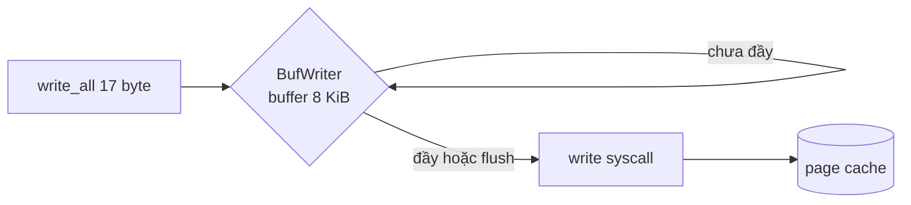

# P5 · Chương 08 — Rust và lưu trữ

Các chương trước của phase này đi từ thiết bị, file system, page cache đến crash consistency và durability. Chương này gom lại phía Rust: thư viện chuẩn (`std::fs`, `std::io`, `std::os::unix::fs`) và hai crate hay gặp (`memmap2`, `tokio::fs`) chuyển thành những system call nào, bảo đảm gì, và bẫy nằm ở đâu. Mọi ví dụ đều đã chạy thật bằng rustc 1.95.0 trong container Linux (aarch64, kernel của Lima/Colima), và syscall được xác nhận bằng `strace`.

## Bạn sẽ hiểu được gì

1. **Q1.** `OpenOptions` với `append`, `create`, `create_new`, `truncate` biến thành cờ `open(2)` nào, và vì sao `create_new` là cách tạo file "nếu và chỉ nếu chưa tồn tại" không có race? → mục 1
2. **Q2.** `write` và `write_all` khác nhau thế nào khi gặp partial write; `BufWriter` có buffer bao nhiêu, vì sao `drop` nuốt lỗi flush và vì sao phải gọi `flush()` tường minh? → mục 2
3. **Q3.** `sync_all` và `sync_data` làm gì, và `File::drop`/`flush` có giúp bạn bền dữ liệu không? → mục 3
4. **Q4.** Mẫu "ghi file tạm → `sync_all` → `rename`" viết bằng Rust ra sao, và vì sao `fs::write` không đủ? → mục 4
5. **Q5.** `read_at`/`write_at` (pread/pwrite) khác `seek` + `read` chỗ nào, và bẫy `O_APPEND` là gì? → mục 5
6. **Q6.** `File::lock` có stable ở 1.95.0 không, nó là loại khóa gì? → mục 7
7. **Q7.** Vì sao `Mmap::map` là `unsafe`? → mục 8
8. **Q8.** `tokio::fs` có thật sự async không? → mục 9

(Mục phụ trợ: thứ tự `read_dir`, metadata và quyền Unix → mục 6.)

## Kiến thức cần trước

- [File descriptor, OFD, inode và VFS](../01-linux/04-file-descriptor-va-vfs.md) — fd, open file description, offset dùng chung.
- [Rust trên giao diện hệ thống](../01-linux/07-rust-tren-giao-dien-he-thong.md) — `OwnedFd`, `io::Error` và `errno`, `Drop` đóng fd.
- [Durability trong thực tế](./06-durability-trong-thuc-te.md) — `fsync`, thư mục cha, mẫu ghi an toàn (chương này chỉ làm phần API Rust).
- [Bộ nhớ tiến trình Linux](../03-memory/05-bo-nho-tien-trinh-linux.md) — `mmap`, page fault.

## 1. `OpenOptions`: cờ nào đi xuống kernel (Q1)

> **Trả lời ngắn.** Mỗi phương thức của `OpenOptions` bật một cờ của `open(2)`: `append` → `O_APPEND`, `truncate` → `O_TRUNC`, `create_new` → `O_CREAT|O_EXCL` (đây là quan sát bằng `strace` trên Linux; docs Rust chỉ hứa hành vi, không hứa tên cờ). `create_new` là cách tạo file "chỉ khi chưa tồn tại" không có race, vì docs nói nó nguyên tử còn "kiểm tra tồn tại rồi tạo" thì có TOCTOU race[^rs-createnew-atomic]. `append` bảo đảm mỗi lần ghi nằm ở cuối file kể cả khi nhiều process cùng ghi[^rs-append].

**Giải thích.**

Hình dung (nhận xét của người soạn): mở file giống thủ tục ở quầy giấy tờ. Bạn điền một tờ phiếu: chỉ đọc hay có ghi, nếu chưa có hồ sơ thì tạo mới không, nếu có rồi thì xóa nội dung cũ không. `OpenOptions` là tờ phiếu đó; các cờ `open(2)` là những ô đã được đánh dấu mà kernel đọc.

`File::open` chỉ mở để đọc, `File::create` tạo/cắt file để ghi. Mọi tổ hợp khác (nối đuôi, tạo độc quyền, đọc-ghi không cắt) cần `OpenOptions`. Câu hỏi thực tế: mỗi phương thức builder bật cờ nào của `open(2)`? Docs Rust nói về hành vi; để biết cờ thật, ta chạy và đọc `strace`.

**Bảng cờ quan sát được.** Một chương trình Rust mở file theo bảy cách khác nhau; `strace -e trace=openat` cho:

| Mã Rust | `openat` flags quan sát được (Linux, std 1.95.0) |
|---|---|
| `File::open(p)` | `O_RDONLY\|O_CLOEXEC` |
| `File::create(p)` | `O_WRONLY\|O_CREAT\|O_TRUNC\|O_CLOEXEC`, mode `0666` |
| `.append(true).create(true)` | `O_WRONLY\|O_CREAT\|O_APPEND\|O_CLOEXEC` |
| `.write(true).create_new(true)` | `O_WRONLY\|O_CREAT\|O_EXCL\|O_CLOEXEC` |
| `.write(true).truncate(true)` | `O_WRONLY\|O_TRUNC\|O_CLOEXEC` |
| `.read(true).write(true)` | `O_RDWR\|O_CLOEXEC` |
| `.write(true).create(true)` | `O_WRONLY\|O_CREAT\|O_CLOEXEC` |

Đây là **quan sát** một lần chạy trên Linux; docs Rust không hứa tên cờ, chỉ hứa hành vi. `O_CLOEXEC` luôn xuất hiện: std tự đặt close-on-exec để fd không rò sang process con (xem chương [Rust trên giao diện hệ thống](../01-linux/07-rust-tren-giao-dien-he-thong.md)). Mode `0666` là mode yêu cầu; kernel còn áp `umask`.

**Từng cờ nghĩa là gì.**

**`append(true)` → `O_APPEND`.** Docs Rust: chế độ append bảo đảm mỗi lần ghi nằm ở cuối file, kể cả khi nhiều process/thread cùng ghi, khác với `seek(End(0))` rồi `write()` vốn có race giữa hai bước.[^rs-append] Man page nói cùng điều ở tầng kernel: dịch chuyển offset và ghi là một bước nguyên tử.[^man-oappend] Nhưng "nguyên tử vị trí" không phải "nguyên tử nội dung": docs Rust cảnh báo một `write()` thành công được phép chỉ ghi một phần nên dữ liệu của các writer có thể xen kẽ nếu bạn không gom thông điệp vào một lần ghi.[^rs-append-interleave] Và trên NFS, `O_APPEND` có thể làm hỏng file khi nhiều process cùng nối đuôi.[^man-nfs-append]

**`truncate(true)` → `O_TRUNC`.** Cắt về độ dài 0 nếu file đã tồn tại, và cần quyền ghi.[^rs-trunc] Man page: với regular file mở có quyền ghi thì bị cắt về 0.[^man-otrunc] `File::create` chính là `write + create + truncate`. Hệ quả vận hành (nhận xét của người soạn): ngay khoảnh khắc `open` thành công, nội dung cũ đã mất; nếu tiến trình chết trước khi ghi xong, bạn có file rỗng hoặc dở dang. Đó là lý do chương [Durability](./06-durability-trong-thuc-te.md) dùng file tạm + rename thay vì ghi đè tại chỗ.

**`create_new(true)` → `O_CREAT|O_EXCL`.** Docs Rust: không được có file nào ở vị trí đó, kể cả symlink treo; nếu lệnh thành công, file trả về được bảo đảm là file mới.[^rs-createnew] Docs còn nói rõ lợi ích: nó nguyên tử, còn "kiểm tra tồn tại rồi tạo" có TOCTOU race.[^rs-createnew-atomic] Khi `create_new` bật, `create` và `truncate` bị bỏ qua.[^rs-createnew-ignored] Man page: với `O_EXCL` đi cùng `O_CREAT`, nếu đường dẫn đã tồn tại thì `open()` lỗi `EEXIST`,[^man-oexcl] và Rust ánh xạ thành `ErrorKind::AlreadyExists`.[^rs-errors] Chương trình thí nghiệm của tôi xác nhận: lần mở thứ hai trả `openat(...) = -1 EEXIST` và `AlreadyExists File exists`.

Ứng dụng điển hình: lock file kiểu "tạo được là mình giữ khóa", hoặc tên file tạm duy nhất (mục 4).

**Hiểu lầm hay gặp:** `.create(true)` không có `.write(true)`/`.append(true)` không phải là "tạo file rỗng"; docs nói `open` sẽ lỗi `InvalidInput`.[^rs-create-needs-write]

<details><summary>Đi sâu: <code>Drop</code> của <code>File</code> và lỗi khi đóng</summary>

Docs: file tự đóng khi ra khỏi scope và lỗi lúc đóng bị `Drop` bỏ qua; nếu cần xử lý lỗi thì dùng `sync_all`.[^rs-file-drop] Điểm này quay lại ở mục 3.

</details>

**Quay lại Q1:** mỗi phương thức builder bật một cờ `open(2)`; muốn "tạo nếu chưa có" không race thì dùng `create_new` (`O_CREAT|O_EXCL`).

## 2. `write`, `write_all` và `BufWriter` (Q2)

> **Trả lời ngắn.** `write` được phép ghi ít byte hơn bạn đưa mà không bị coi là lỗi[^rs-write-partial]; `write_all` lặp lại đến hết dữ liệu hoặc gặp lỗi thật[^rs-write-all]. `BufWriter` gom nhiều lần ghi nhỏ vào một buffer[^rs-bufwriter-when], mặc định hiện là 8 KiB[^rs-bufwriter-8k]. Lỗi xảy ra khi nó bị drop bị bỏ qua, nên phải gọi `flush()` và kiểm tra `Result`[^rs-bufwriter-flush].

**Giải thích.**

Hình dung (nhận xét của người soạn): bạn chuyển nhà bằng xe tải. `write` là một chuyến xe có thể không chở hết đồ bạn xếp ra, nên phải đi thêm chuyến; `write_all` là vòng lặp đi cho đến hết. `BufWriter` là cái thùng ở sân: bạn bỏ đồ vào thùng, thùng đầy mới gọi xe. Nếu bạn bỏ đi mà không chốt đơn (`flush`), xe có gặp sự cố trên đường thì không ai báo lại cho bạn.

**`write` có thể ghi ít hơn bạn yêu cầu.**

Trait `Write::write` trả về `Ok(n)` với `n` là số byte đã ghi; docs nói không coi là lỗi nếu không ghi hết buffer.[^rs-write-partial] Man page `write(2)` liệt kê nguyên nhân: hết chỗ trên thiết bị, chạm `RLIMIT_FSIZE`, bị signal handler ngắt sau khi đã ghi một phần, và người gọi nên gọi `write()` lại cho phần còn lại.[^man-write-partial]

`write_all` là vòng lặp làm việc đó: gọi `write` liên tục đến khi hết dữ liệu hoặc gặp lỗi không phải `Interrupted`.[^rs-write-all] Thí nghiệm với một writer giả cố tình chỉ nhận 3 byte mỗi lần:

```rust
struct Short(Vec<u8>);
impl Write for Short {
    fn write(&mut self, b: &[u8]) -> io::Result<usize> {
        let n = b.len().min(3);
        self.0.extend_from_slice(&b[..n]);
        Ok(n)
    }
    fn flush(&mut self) -> io::Result<()> { Ok(()) }
}
// s.write(b"abcdefgh")  -> Ok(3)
// s.write_all(b"abcdefgh") -> Ok(()), s.0.len() == 11 (3 + 8)
```

Chạy thật: `write -> 3`, rồi sau `write_all` tổng độ dài là 11. Quy tắc (nhận xét của người soạn): luôn dùng `write_all` trừ khi bạn thực sự muốn điều khiển từng lần ghi (ví dụ non-blocking I/O); bỏ qua giá trị trả về của `write` là một bug im lặng.

**`BufWriter`: gom nhiều lần ghi nhỏ.**

Mỗi `File::write` là một syscall. `BufWriter` giữ buffer trong bộ nhớ và ghi xuống theo mẻ lớn; docs nói nó giúp khi có nhiều lần ghi nhỏ, nhưng không giúp khi ghi một lượng rất lớn một lần hoặc chỉ ghi một vài lần.[^rs-bufwriter-when] Dung lượng mặc định "hiện là 8 KiB, nhưng có thể đổi trong tương lai".[^rs-bufwriter-8k]




**`BufWriter::drop` nuốt lỗi — vì sao phải `flush()`.**

Docs nói thẳng: "điều quan trọng là gọi `flush` trước khi `BufWriter` bị drop. Dù drop sẽ cố flush, mọi lỗi xảy ra khi đó bị bỏ qua."[^rs-bufwriter-flush] `Drop` không thể trả lỗi (không có giá trị trả về), nên không có cách nào báo cáo.

Thí nghiệm dùng `/dev/full` (thiết bị luôn trả `ENOSPC` khi ghi):

```rust
let f = OpenOptions::new().write(true).open("/dev/full")?;
{
    let mut w = BufWriter::new(f);
    w.write_all(b"data")?;          // Ok: chỉ vào buffer
}                                   // drop: write -> ENOSPC, im lặng
// flush() tường minh: Err("No space left on device (os error 28)")
// into_inner() cũng trả Err(IntoInnerError) mang lỗi ENOSPC
```

Kết quả thật: `write_all` thành công, sau khi drop không có dấu hiệu lỗi nào ở mức chương trình, trong khi `strace` cho thấy `write(3, "data", 4) = -1 ENOSPC` đã xảy ra bên trong drop. Còn `flush()` và `into_inner()` đều trả `Err` với "No space left on device (os error 28)". Docs còn nói thêm: gọi `flush` xong thì buffer rỗng nên drop sẽ không thử thao tác file nào nữa.[^rs-bufwriter-flush]

Đối chiếu với backend (nhận xét của người soạn): đây là phiên bản thu nhỏ của lỗi "log/tệp xuất ra hỏng mà job báo thành công". Mẫu đúng cho code cần tin kết quả:

```rust
let mut w = BufWriter::new(file);
// ... write_all ...
w.flush()?;                       // lỗi buffer lớp Rust
w.get_ref().sync_all()?;          // lỗi từ kernel/thiết bị (mục 3)
```

<details><summary>Đi sâu: số đo syscall của <code>BufWriter</code> và <code>BufReader</code></summary>

Số đo (quan sát một lần chạy, 100.000 lần `write_all` 17 byte = 1.700.000 byte, `strace -c`):

| Cách | Số syscall `write` |
|---|---|
| `File` trực tiếp | 100.001 |
| `BufWriter::new(file)` | 209 |

Chạy lại thí nghiệm: các lần ghi xuống kernel đều là `write(5, ..., 8177)` — không phải đúng 8192. Lý do (quan sát): mỗi bản ghi dài 17 byte nên buffer 8 KiB chứa tối đa 481 bản ghi = 8177 byte, và `BufWriter` xả khi bản ghi kế tiếp không còn vừa. Vậy 1.700.000 byte thành 207 lần ghi 8177 byte cộng một lần ghi 7361 byte (lúc `flush`) = 208, cộng một `write` in ra stdout = 209. Với thí nghiệm khác, ghi 20.000 byte một lần vào `BufWriter` cho đúng một `write(3, ..., 20000)` ngay lập tức: lượng dữ liệu lớn hơn buffer đi thẳng xuống, buffer không giữ lại (quan sát; docs không hứa chi tiết này).

`BufReader` đối xứng: mặc định 8 KiB,[^rs-bufreader-8k] đọc 3 byte đơn lẻ chỉ gây một `read(3, ..., 8192)` đầu tiên (quan sát). Cạm bẫy: tạo nhiều `BufReader` trên cùng một stream có thể làm mất dữ liệu vì dữ liệu đã đọc trước nằm trong buffer của reader bị bỏ đi.[^rs-bufreader-loss]

</details>

**Quay lại Q2:** `write` có thể ghi thiếu nên dùng `write_all`; `BufWriter` gom ghi nhỏ nhưng drop nuốt lỗi, vì vậy phải `flush()` tường minh và kiểm tra kết quả.

## 3. `sync_all` và `sync_data` (Q3)

> **Trả lời ngắn.** `sync_all` cố bảo đảm mọi dữ liệu trong bộ nhớ của OS đến được file system[^rs-sync-all-attempt]; `sync_data` tương tự nhưng có thể không đồng bộ metadata[^rs-sync-data]. `File::drop` không thay được chúng: drop không bắt buộc phải chờ dữ liệu xuống đĩa[^rs-sync-all] và lỗi lúc đóng bị bỏ qua[^rs-file-drop].

**Giải thích.**

Hình dung (nhận xét của người soạn): gửi thư. `flush` là đưa thư cho nhân viên bưu điện (kernel); `sync_all` là đứng chờ biên nhận rằng thư đã lên xe chuyển phát (thiết bị lưu trữ). Có thư trong tay nhân viên chưa có nghĩa là thư đã đi.

`flush()` của `BufWriter` chỉ đẩy dữ liệu từ buffer user-space xuống kernel (page cache). Docs `File::sync_all`: "cố gắng bảo đảm mọi dữ liệu trong bộ nhớ của OS đến được file system"[^rs-sync-all-attempt] và lưu ý nó thường đắt hơn đóng file bằng drop, vì drop không bắt buộc phải chờ dữ liệu xuống đĩa.[^rs-sync-all] `sync_data` tương tự nhưng "có thể không đồng bộ metadata";[^rs-sync-data] docs cũng cảnh báo một số nền tảng cài nó bằng chính `sync_all`.[^rs-sync-data-platform]

Trên Linux ta quan sát đúng như vậy: `sync_all()` → `fsync(3)`, `sync_data()` → `fdatasync(3)` (strace). Hợp đồng của kernel cho hai lời gọi này (xả cache của đĩa, metadata nào bị bỏ qua, việc `fsync` file không bảo đảm entry thư mục) và phân tích sâu (errseq, fsyncgate, chi phí thực) ở [chương 06, mục 2, 3 và 5](./06-durability-trong-thuc-te.md).

<details><summary>Đi sâu: <code>File::flush</code> là no-op và không thay được <code>fsync</code></summary>

Cạm bẫy Rust: `File` **không có buffer riêng** (mục 2: 100.000 lần `write_all` cho 100.001 `write`), nên với `File` trần không có buffer user-space nào để `flush`. Source std 1.95.0 chốt điều này: doc comment của `File::flush` ghi "vì `File` không chứa buffer nào, hàm này hiện là no-op trên Unix và Windows" và có thể đổi trong tương lai;[^rs-file-flush] phần cài đặt Unix chỉ là `Ok(())`.[^src-file-flush] Vậy `flush()` của `File` không thay được `fsync`. Docs của `tokio::fs::File` nhắc đúng điều này cho kiểu async: flush không bảo đảm file đã ghi hết xuống đĩa, "hệ điều hành có thể giữ thay đổi trong buffer bộ nhớ", và hãy dùng `sync_all`.[^tokio-file-flush]

</details>

**Quay lại Q3:** `flush` chỉ tới kernel; muốn xuống thiết bị phải `sync_all`/`sync_data`, còn drop của `File` không làm việc đó.

## 4. Ghi nguyên tử: `fs::write`, `rename` và file tạm (Q4)

> **Trả lời ngắn.** Mẫu đúng: ghi vào một file tạm mới (`create_new`), `sync_all`, `rename` đè lên file đích, rồi `sync_all` thư mục cha (man page: `fsync` file không bảo đảm entry thư mục chứa nó đã xuống đĩa, cần `fsync` cả thư mục[^man-fsync-dir]). `rename` thay đích một cách nguyên tử, không có thời điểm nào process khác thấy đích biến mất[^man-rename]. Còn `fs::write` thay hoàn toàn nội dung tại chỗ[^rs-fs-write] và (quan sát bằng `strace`) không có `fsync`, nên không nguyên tử và không bền (suy luận của người soạn).

**Giải thích.**

Hình dung (nhận xét của người soạn): sửa bản hợp đồng đang để trên bàn chung. Nếu bạn xóa bản cũ rồi mới viết lại, ai đi ngang giữa chừng sẽ thấy tờ giấy trắng. Cách đúng là viết bản mới ở bàn bên cạnh, kiểm tra cho chắc, rồi đặt nó chồng lên bản cũ trong một động tác.

Hai hàm tiện ích cho trường hợp "cả file một lần":

- `fs::write(path, bytes)`: tạo file nếu chưa có và **thay hoàn toàn** nội dung nếu có;[^rs-fs-write] trên Linux ta thấy `openat(..., O_WRONLY|O_CREAT|O_TRUNC|O_CLOEXEC, 0666)`, `write(3, "v1", 2)`, `close(3)` — không `fsync`.
- `fs::read_to_string(path)`: mở, đọc hết, lỗi nếu không phải UTF-8, tự retry khi gặp `Interrupted`.[^rs-fs-rts] Quan sát: nó gọi `statx` trên fd để lấy kích thước làm gợi ý cấp phát, rồi `read(3, ..., 2)` và một `read` nữa trả 0 để phát hiện EOF.

Hệ quả: `fs::write` là đường **không bền** và **không nguyên tử** (cắt rồi mới ghi). Nó phù hợp với file dễ tái tạo; không phù hợp với config/state mà mất nửa chừng là thảm họa (nhận xét của người soạn).

**`fs::rename` và mẫu ghi nguyên tử.**

Docs `fs::rename`: đổi tên và thay thế đích nếu có; không chạy qua ranh giới mount point.[^rs-rename] Man page `rename(2)`: nếu `newpath` tồn tại, nó bị thay thế nguyên tử, không có thời điểm nào process khác thấy `newpath` biến mất.[^man-rename] Khác mount point thì kernel trả `EXDEV`[^man-exdev] và docs Rust liệt kê "from and to are on separate filesystems" trong các tình huống lỗi.[^rs-rename-err]

Ghép với mục 3 ta được mẫu đã phân tích ở chương 06 (lý do từng bước ở đó); đây là bản Rust, đã chạy thật:

```rust
fn atomic_write(path: &Path, data: &[u8]) -> io::Result<()> {
    let dir = path.parent().unwrap();
    let tmp = dir.join(".config.tmp");
    let mut f = OpenOptions::new().write(true).create_new(true).open(&tmp)?;
    f.write_all(data)?;
    f.sync_all()?;               // dữ liệu file tạm bền trước khi đổi tên
    drop(f);
    fs::rename(&tmp, path)?;     // thay thế nguyên tử
    File::open(dir)?.sync_all()?; // làm bền entry thư mục
    Ok(())
}
```

<details><summary>Đi sâu: thứ tự syscall quan sát được và tên file tạm</summary>

`strace` xác nhận đúng thứ tự: `openat(... .config.tmp, O_WRONLY|O_CREAT|O_EXCL ...)` → `write(3, "version-2", 9)` → `fsync(3)` → `close(3)` → `renameat(...)` → `openat(dir, O_RDONLY)` → `fsync(3)`. Hai điểm Rust: `create_new` cho tên tạm độc quyền (nếu hai tiến trình dùng chung tên tạm cố định như ví dụ này, cái thứ hai nhận `AlreadyExists`, tốt hơn là âm thầm giẫm lên nhau; thực tế nên đặt tên tạm có PID/ngẫu nhiên — nhận xét của người soạn); và mở thư mục bằng `File::open(dir)` rồi `sync_all` là cách `std` cho phép `fsync` một thư mục trên Unix (quan sát: `openat(dir, O_RDONLY)` rồi `fsync`).

</details>

**Quay lại Q4:** ghi file tạm → `sync_all` → `rename` → sync thư mục; `fs::write` thì không nguyên tử, không bền.

## 5. Seek, `pread` và `pwrite` (Q5)

> **Trả lời ngắn.** `read_at`/`write_at` đọc/ghi tại offset chỉ định, độc lập với con trỏ file và không làm đổi nó[^rs-readat]; `seek` rồi `read` thì dùng một con trỏ chung nên là hai bước có trạng thái chia sẻ (suy luận của người soạn từ mô hình OFD). Bẫy: với file mở bằng `append(true)`, trên Linux `pwrite` vẫn nối vào cuối bất kể offset[^man-pwrite-bug].

**Giải thích.**

Hình dung (nhận xét của người soạn): `seek` + `read` giống ngón tay chỉ dòng trên một trang sách dùng chung — ai chạm vào cũng dời dòng của người khác. `read_at` là nói thẳng "đọc từ dòng 8" mà không động tới ngón tay của ai.

**Con trỏ vị trí dùng chung.**

`File` implement `Seek`, nhắc rằng file chứa một con trỏ logic bên trong.[^rs-file-seek] Con trỏ đó nằm trong open file description của kernel và dùng chung giữa các fd nhân bản bằng `dup`/`fork` (xem [chương 04 P1](../01-linux/04-file-descriptor-va-vfs.md)). Do đó `seek` rồi `read` là hai bước có trạng thái chia sẻ: hai thread dùng chung một `File` qua `&File` có thể giẫm vị trí của nhau (suy luận của người soạn từ mô hình OFD).

**`FileExt::read_at`/`write_at`.**

Trait `std::os::unix::fs::FileExt` cho đọc/ghi tại offset chỉ định mà **không đụng con trỏ file**: docs nói offset tính từ đầu file, độc lập với cursor, và cursor không bị ảnh hưởng.[^rs-readat] Chữ ký của chúng nhận `&self`,[^rs-fileext-self] nên (suy luận của người soạn) có thể gọi qua tham chiếu chung từ nhiều thread. Trên Linux chúng thành `pread64`/`pwrite64`: strace của thí nghiệm cho `pread64(4, "2", 3, 8) = 1`, `pwrite64(4, "XY", 2, 2) = 2`, `pread64(4, "veX", 3, 0) = 3`.

**Bẫy `O_APPEND`.** Docs của chính `write_at` ghi rõ một "Bug": trên một số hệ thống, file mở với `O_APPEND` thì `pwrite64` không tôn trọng offset mà luôn ghi vào cuối.[^rs-writeat-bug] Với Linux, man page `pwrite(2)` mục BUGS xác nhận: POSIX yêu cầu `O_APPEND` không ảnh hưởng vị trí ghi của `pwrite()`, nhưng trên Linux nó vẫn nối vào cuối bất kể `offset`.[^man-pwrite-bug] Thí nghiệm (chạy lại trong container): file 5 byte `12345`, mở bằng `.append(true)`, gọi `write_at(b"sushi", 10)` → strace `pwrite64(4, "sushi", 5, 10) = 5`, độ dài file là 10 (nối đuôi, không có khoảng đệm 0 tại offset 10). Ứng dụng kiểu database (ghi page tại offset) không được mở file bằng `append(true)` (nhận xét của người soạn).

<details><summary>Đi sâu: short read, <code>read_exact_at</code>/<code>write_all_at</code> và ghi vượt cuối file</summary>

Như `read`/`write`, chúng có thể trả short: `read_at` đọc yêu cầu 3 byte tại offset 8 của file dài 9 byte chỉ trả 1 byte (đúng do hết file). Docs: "không phải lỗi khi trả short read".[^rs-readat-short] Vì vậy có `read_exact_at` và `write_all_at` để lặp cho đủ. Ghi vượt cuối file thì file được kéo dài và khoảng giữa điền 0.[^rs-writeat-extend]

</details>

**Quay lại Q5:** `read_at`/`write_at` không đụng con trỏ file, nhưng `O_APPEND` làm `write_at` bỏ qua offset trên Linux.

## 6. Mục phụ trợ: `read_dir`, metadata và quyền

> **Trả lời ngắn.** Thứ tự các entry mà `fs::read_dir` trả về phụ thuộc nền tảng và file system, và có thể đổi giữa các lần gọi[^rs-readdir-order][^rs-readdir-platform]. Cần thứ tự ổn định thì phải tự sắp xếp.

**Giải thích.**

Hình dung (nhận xét của người soạn): thư mục giống ngăn kéo hồ sơ không xếp theo thứ tự nào — thứ tự bạn lôi hồ sơ ra tùy cách ngăn kéo tổ chức bên trong, không phải thứ tự bạn bỏ vào.

`fs::read_dir`: docs nói thứ tự trả về có thể đổi giữa các lần gọi và nếu cần ổn định thì tự sắp xếp;[^rs-readdir-order] nó "phụ thuộc nền tảng và file system".[^rs-readdir-platform] Quan sát: trong thư mục thí nghiệm có 9 entry (gồm 7 file tạo theo thứ tự `zeta, alpha, mid, beta, omega, a1, k`), `read_dir` trả `["alpha.txt", "omega.txt", "ap", "a1.txt", "k.txt", "lock", "zeta.txt", "beta.txt", "mid.txt"]` — không theo thứ tự tạo hay thứ tự chữ cái. Đây là virtiofs trong container của tôi; file system khác cho thứ tự khác. Với test hoặc output cần tái lập, thu entry vào `Vec` rồi `sort()` (nhận xét của người soạn). Cơ chế thư mục ở [chương 03](./03-cai-dat-file-system.md).

<details><summary>Đi sâu: <code>metadata</code>, <code>PermissionsExt</code> và <code>statx</code></summary>

`File::metadata` và `fs::metadata` lấy thông tin inode; ở Linux std dùng `statx` (quan sát từ strace). `fs::Permissions` trên Unix mở rộng bởi `PermissionsExt` với `mode()`, `set_mode()`, `from_mode()`.[^rs-permsext] Thí nghiệm: file tạo bởi `fs::write` có `mode()` = `0o100644` — tức giá trị `st_mode` đầy đủ gồm cả bit loại file `0o100000` (regular file) lẫn quyền `0o644` (quan sát; nhớ mask `& 0o7777` nếu chỉ muốn quyền). `fs::set_permissions(p, Permissions::from_mode(0o600))` chạy ra `fchmodat(AT_FDCWD, ..., 0600)`.

</details>

**Chốt mục phụ trợ:** không dựa vào thứ tự `read_dir`; `mode()` trên Unix trả cả bit loại file lẫn quyền.

## 7. File locking: `File::lock` (Q6)

> **Trả lời ngắn.** Có: `File::lock` đã stable từ 1.89.0[^src-lock-stable]. Trên Unix nó hiện tương ứng với `flock`[^rs-lock-flock]; khóa có thể là advisory hoặc mandatory tùy nền tảng[^rs-lock-advisory]. Trên Linux, advisory nghĩa là process khác vẫn tự do bỏ qua khóa và I/O file nếu có quyền[^man-flock-advisory].

**Giải thích.**

Hình dung (nhận xét của người soạn): khóa advisory giống tấm biển "đang họp" treo trên cửa phòng — chỉ người chịu đọc biển mới tôn trọng; ai đẩy cửa đi vào thì không có gì cản.

Trước đây phải dùng crate ngoài (`fs2`, `fs4`) hoặc `libc::flock`. Source std 1.95.0 đánh dấu `File::lock` là `stable(feature = "file_lock", since = "1.89.0")`,[^src-lock-stable] và docs 1.95.0 ghi "1.89.0" cạnh chữ ký hàm.[^rs-lock-stable] Các phương thức: `lock`, `lock_shared`, `try_lock`, `try_lock_shared`, `unlock`; `try_lock` trả `Err(TryLockError::WouldBlock)` nếu có khóa khác đang giữ qua handle khác.[^rs-trylock]

Bảo đảm cần nắm:

- Khóa "có thể là advisory hoặc mandatory"; tương tác với `read`/`write` là tùy nền tảng.[^rs-lock-advisory]
- Trên Unix hiện tương ứng với `flock` (`LOCK_EX`, `LOCK_SH`), và docs nói điều này "có thể đổi trong tương lai".[^rs-lock-flock] Source std 1.95.0 cho Linux gọi `flock` với `LOCK_EX | LOCK_NB` cho `try_lock`.[^src-trylock-flock]
- Nếu handle này (hoặc bản clone) đã giữ khóa thì hành vi gọi lại là không xác định và tùy nền tảng, kể cả deadlock.[^rs-lock-reentrant]
- Khóa được nhả khi file (và mọi descriptor nhân bản) bị đóng, hoặc khi gọi `unlock`.[^rs-lock-release]

Cái "advisory" nghĩa là gì ở tầng Linux: man page `flock(2)` nói process vẫn tự do bỏ qua khóa và I/O trên file nếu có quyền.[^man-flock-advisory] Và khóa gắn với open file description, nên fd nhân bản bằng `fork`/`dup` cùng chia sẻ một khóa.[^man-flock-ofd]

<details><summary>Đi sâu: thí nghiệm hai handle và <code>flock</code></summary>

Thí nghiệm (strace + kết quả):

```text
a.lock()               -> flock(3, LOCK_EX) = 0
b.try_lock()           -> flock(4, LOCK_EX|LOCK_NB) = -1 EAGAIN  => Err(WouldBlock)
b.write_all_at(...)    -> vẫn ghi được, đọc lại thấy "ignored-lock"
a.unlock()             -> flock(3, LOCK_UN) = 0
b.try_lock()           -> Ok (sau unlock)
```

`a` và `b` là hai lần `open` độc lập cùng file (hai open file description khác nhau nên chặn nhau như hai process). Kết quả: khóa **không** ngăn một kẻ không hỏi khóa ghi đè dữ liệu. Chỉ dùng cho các bên hợp tác. Lưu ý: `flock` với NFS có lịch sử riêng (man page mục NFS), nên đừng giả định trên file system mạng.

</details>

**Quay lại Q6:** `File::lock` stable từ 1.89.0, hiện là `flock` advisory — chỉ dùng cho các bên hợp tác.

## 8. Memory-mapped file với `memmap2` (Q7)

> **Trả lời ngắn.** `Mmap::map` là `unsafe` vì có thể có Undefined Behavior khi dùng map nếu file nền bị sửa sau đó, trong hay ngoài process[^mm-safety]. Compiler của Rust không kiểm tra được điều này, nên trách nhiệm chuyển sang người gọi (suy luận của người soạn).

**Giải thích.**

Hình dung (nhận xét của người soạn): mmap giống dán một trang của cuốn sổ chung lên tường nhà bạn. Bạn đọc `&[u8]` tưởng đó là bản chụp bất biến, nhưng người khác vẫn đang sửa chính cuốn sổ phía sau trang đó.

`std` không có mmap. Crate phổ biến là `memmap2`; ví dụ ở đây ghim `memmap2 = "=0.9.11"` (docs.rs/memmap2/0.9.11).

**Cơ chế.**

`mmap(2)` với `MAP_SHARED`: cập nhật trên mapping nhìn thấy được bởi process khác map cùng vùng và (với file-backed) được chuyển xuống file nền;[^man-mmap-shared] muốn kiểm soát chính xác lúc nào xuống file phải dùng `msync(2)`.[^man-msync] `memmap2::Mmap` là handle cho buffer map bất biến,[^mm-immutable] `MmapMut` là phiên bản khả biến.[^mm-mutable] Mapping độc lập với `File` đã tạo ra nó: vẫn hợp lệ sau khi `File` bị drop.[^mm-independent] Truy cập byte có thể gây page fault (chuyển trang vào RAM), chi tiết tùy nền tảng,[^mm-pagefault] cơ chế xem [chương bộ nhớ tiến trình](../03-memory/05-bo-nho-tien-trinh-linux.md) và [page fault](../03-memory/04-page-fault-va-swapping.md).

**Vì sao `Mmap::map` là `unsafe`.**

Docs memmap2 (mục Safety): mọi constructor file-backed đều `unsafe` vì có thể có Undefined Behavior khi dùng map nếu file nền sau đó bị sửa, trong hay ngoài process; ứng dụng phải tự cân nhắc rủi ro, các biện pháp như quyền file, khóa hay file private (đã unlink) tồn tại nhưng phụ thuộc nền tảng và hạn chế.[^mm-safety]

Hiểu theo mô hình Rust (suy luận của người soạn): `&[u8]` lấy từ `Mmap` hứa là bất biến trong suốt lifetime; nhưng RAM phía sau thực ra là page cache dùng chung, một process khác (hoặc chính ta qua đường khác) có thể ghi vào cùng trang. Compiler tối ưu dựa trên giả định bất biến nên mâu thuẫn đó là UB. Một dạng khác là truncation: man page `mmap(2)` mô tả `SIGBUS` khi truy cập trang nằm ngoài cuối file đã map.[^man-sigbus] Signal này không đi qua `Result` của Rust (suy luận của người soạn: truy cập `&[u8]` là phép đọc bộ nhớ thường, không có chỗ trả lỗi).

**Khi nào dùng.**

Trade-off (nhận xét của người soạn): mmap bỏ đi một lần copy kernel→user và cho truy cập ngẫu nhiên tiện, nhưng lỗi I/O trở thành signal (`SIGBUS`) thay vì `Result`, độ trễ page fault khó thấy trong profile, và an toàn phụ thuộc kỷ luật không ai sửa file. Nhiều database chọn `pread`/`pwrite` hoặc direct I/O chính vì kiểm soát được lỗi và lịch ghi — xem [page cache và direct I/O](./04-page-cache-va-direct-io.md).

<details><summary>Đi sâu: thí nghiệm — hai mapping thấy nhau, slice "bất biến" đổi dưới chân</summary>

Thí nghiệm cho thấy chính nó (và vì vậy đoạn code dưới là minh họa **vì sao unsafe**, không phải mẫu nên theo):

```rust
let m  = unsafe { Mmap::map(&f)? };        // &[u8] "bất biến"
let mut mm = unsafe { MmapMut::map_mut(&f)? };
mm[0..5].copy_from_slice(b"HELLO");
mm.flush()?;
// std::fs::read_to_string(p)  -> "HELLO mmap"
// &m[..5] (slice "bất biến") -> "HELLO"   <- đã đổi dưới chân
```

Hai mapping của cùng file nhìn thấy nhau; slice mà type system gọi là bất biến đã đổi nội dung. (Đây đúng là điều `unsafe` ghi nhận trách nhiệm cho người gọi.)

</details>

**Quay lại Q7:** `Mmap::map` là `unsafe` vì an toàn bộ nhớ phụ thuộc việc không ai sửa file nền, điều type system không kiểm tra được.

## 9. `tokio::fs`: async trên bề mặt, thread pool bên dưới (Q8)

> **Trả lời ngắn.** Không theo nghĩa kernel async. Đa số hệ điều hành không có API async cho file system, nên Tokio mặc định dùng thao tác file blocking thông thường chạy trên thread pool `spawn_blocking`[^tokio-blocking] (đường io_uring chỉ có khi bật thêm ba điều kiện, xem bên dưới). Bạn vẫn `await` được, nhưng việc thật nằm ở thread khác.

**Giải thích.**

Hình dung (nhận xét của người soạn): nhà hàng có quầy gọi món rất gọn (`async`), nhưng người nấu thật là một nhóm đầu bếp làm việc chặn (thread pool). Khách thấy "không phải đợi" vì việc nặng đã được giao đi chỗ khác.

Docs tokio 1.53.2: đa số hệ điều hành không có API async cho file system, nên Tokio dùng thao tác file blocking thông thường phía sau, chạy trên thread pool `spawn_blocking`.[^tokio-blocking] Docs module nói hiện luôn dùng `spawn_blocking` trên mọi nền tảng và có thể đổi sang API async như io_uring trong tương lai.[^tokio-uring] Câu đó đã cũ so với source: docs của `tokio::fs::read` ghi rằng trên Linux, để dùng io_uring cần `--cfg tokio_unstable`, cargo feature `io-uring` và tùy chọn runtime `Builder::enable_io_uring`, và hỗ trợ này còn thử nghiệm (experimental).[^tokio-fs-uring][^tokio-fs-uring-exp] Vậy `spawn_blocking` là đường mặc định; chi tiết ba điều kiện và cách đọc hai đoạn docs không khớp nhau ở [P7 · Chương 03, mục 6](../07-io-async/03-kqueue-io-uring.md). Chỉ nên dùng `tokio::fs` cho file thường: docs nói dùng nó với named pipe trên Linux có thể gây hành vi bất ngờ như treo lúc shutdown runtime; với file đặc biệt hãy dùng `tokio::net::unix::pipe` hoặc `AsyncFd`.[^tokio-special]

Hệ quả hiệu năng theo docs: gộp thao tác vào ít lần `spawn_blocking` nhất có thể,[^tokio-batch] ví dụ `tokio::fs::read`/`write` làm cả file trong một lần; và dùng `BufReader`/`BufWriter` để gom nhiều đọc/ghi nhỏ.[^tokio-bufwriter] Tương tự `BufWriter` đồng bộ, docs `tokio::fs::File` dặn gọi `flush` trước khi drop.[^tokio-file-flush] Cơ chế `spawn_blocking`, executor và so sánh với io_uring ở phase P7: [Tokio](../07-io-async/08-tokio.md) và [kqueue/io_uring](../07-io-async/03-kqueue-io-uring.md).

<details><summary>Đi sâu: xác nhận bằng <code>strace</code> thread nào chạy <code>open</code></summary>

Xác nhận bằng strace (`current_thread` runtime, `tokio = "=1.53.2"`): `std::fs::write` chạy trên thread chính (tid 91) nhưng `tokio::fs::read_to_string(...).await` cho `[pid 92] openat(... O_RDONLY|O_CLOEXEC)` sau một lần `clone(...CLONE_THREAD...)` — `open` chạy trên thread khác sinh ra cho pool.

</details>

**Quay lại Q8:** `tokio::fs` là giao diện async bọc thao tác blocking trên thread pool (mặc định; io_uring chỉ là đường thử nghiệm opt-in); gộp thao tác để giảm số lần `spawn_blocking`.

## Tóm tắt

- `OpenOptions` ánh xạ: `append`→`O_APPEND`, `truncate`→`O_TRUNC`, `create_new`→`O_CREAT|O_EXCL`; `File::create` = write+create+truncate (đã strace; docs Rust chỉ hứa hành vi, không hứa tên cờ).
- `create_new` là cách nguyên tử để "tạo nếu chưa tồn tại"; lỗi trả `AlreadyExists`.[^rs-createnew-atomic][^rs-errors]
- `write` có thể ghi thiếu; `write_all` lặp lại đến hết hoặc lỗi.[^rs-write-partial][^rs-write-all]
- `File` không có buffer (`File::flush` là no-op);[^rs-file-flush] `BufWriter` mặc định 8 KiB[^rs-bufwriter-8k] gom 100.000 lần ghi thành 209 syscall (số đo một lần chạy); drop của `BufWriter` nuốt lỗi flush nên phải `flush()` tường minh.[^rs-bufwriter-flush]
- `flush` chỉ tới kernel; muốn xuống thiết bị: `sync_all` (`fsync`) hoặc `sync_data` (`fdatasync`),[^rs-sync-all-attempt][^rs-sync-data] và với file mới phải sync cả thư mục.[^man-fsync-dir]
- Mẫu bền: file tạm `create_new` → `sync_all` → `rename` → sync thư mục; `fs::write` thì không nguyên tử, không bền (suy luận của người soạn từ quan sát `strace`).
- `FileExt::read_at/write_at` = `pread/pwrite`, không đổi cursor,[^rs-readat] nhưng `O_APPEND` làm `write_at` bỏ qua offset.[^rs-writeat-bug]
- `read_dir` không bảo đảm thứ tự; muốn ổn định thì sort.[^rs-readdir-order]
- `File::lock` stable từ 1.89.0,[^src-lock-stable] hiện là `flock`, advisory hoặc mandatory tùy nền tảng, nhả khi đóng hoặc `unlock`.[^rs-lock-flock][^rs-lock-release]
- `Mmap::map` `unsafe` vì file nền bị sửa thì UB;[^mm-safety] `tokio::fs` mặc định chạy trên `spawn_blocking` (io_uring chỉ là đường thử nghiệm opt-in, ba điều kiện ở P7·03 mục 6).[^tokio-blocking]

## Câu hỏi tự kiểm tra

1. `OpenOptions::new().write(true).create_new(true)` truyền cờ `open(2)` nào, và lỗi khi file đã tồn tại là gì?
<details><summary>Đáp án</summary>

`O_WRONLY|O_CREAT|O_EXCL|O_CLOEXEC`; `EEXIST` ↔ `ErrorKind::AlreadyExists`. [^man-oexcl] [^rs-createnew]

</details>

2. Vì sao `seek(End(0))` + `write` không thay được `append(true)`?
<details><summary>Đáp án</summary>

Có race giữa seek và write; `O_APPEND` làm việc đó thành một bước nguyên tử. [^rs-append] [^man-oappend]

</details>

3. `BufWriter` drop khi đĩa đầy: chương trình thấy gì, và cách đúng?
<details><summary>Đáp án</summary>

Không thấy gì (lỗi bị bỏ qua); gọi `flush()` (hoặc `into_inner()`) và kiểm tra `Result`. [^rs-bufwriter-flush]

</details>

4. `write` trả `Ok(3)` cho buffer 8 byte: có phải lỗi không?
<details><summary>Đáp án</summary>

Không; phải gọi lại, hoặc dùng `write_all`. [^rs-write-partial] [^rs-write-all]

</details>

5. `flush()` của `BufWriter` có bảo đảm dữ liệu bền khi mất điện không?
<details><summary>Đáp án</summary>

Không, chỉ tới kernel (và `File::flush` là no-op); cần `sync_all`/`sync_data`. [^rs-sync-all] [^tokio-file-flush] [^rs-file-flush]

</details>

6. Điều gì xảy ra nếu file mở bằng `append(true)` rồi `write_at(buf, 10)`?
<details><summary>Đáp án</summary>

Dữ liệu vẫn được ghi vào cuối file, bỏ qua offset. [^rs-writeat-bug]

</details>

7. Vì sao test dựa vào thứ tự `read_dir` là sai?
<details><summary>Đáp án</summary>

Thứ tự phụ thuộc nền tảng/file system và có thể đổi giữa các lần gọi. [^rs-readdir-order] [^rs-readdir-platform]

</details>

8. `File::lock` ngăn process khác ghi vào file được không?
<details><summary>Đáp án</summary>

Không bảo đảm: trên Linux là `flock` advisory; tiến trình có quyền vẫn ghi được (đã chạy thật). [^man-flock-advisory] [^rs-lock-advisory]

</details>

9. Vì sao `Mmap::map` là `unsafe` dù chỉ để đọc?
<details><summary>Đáp án</summary>

File nền bị sửa trong hay ngoài process có thể gây UB khi dùng map. [^mm-safety]

</details>

10. `tokio::fs::read_to_string` chạy trên thread nào, và vì sao?
<details><summary>Đáp án</summary>

Mặc định trên thread của pool `spawn_blocking`, vì OS phổ thông thiếu async file API. [^tokio-blocking] Chỉ khi bật `--cfg tokio_unstable` + feature `io-uring` + `Builder::enable_io_uring` thì Linux mới có đường io_uring thử nghiệm.[^tokio-fs-uring]

</details>

11. Vì sao nên `create_new` cho file tạm trong mẫu ghi nguyên tử?
<details><summary>Đáp án</summary>

Bảo đảm file là mới và tránh TOCTOU/giẫm lên file của bên khác. [^rs-createnew-atomic]

</details>

## Đọc thêm

- [`std::fs::File`](https://doc.rust-lang.org/1.95.0/std/fs/struct.File.html) — toàn bộ API file, phần `lock`/`sync_*` và ghi chú Drop.
- [`std::fs::OpenOptions`](https://doc.rust-lang.org/1.95.0/std/fs/struct.OpenOptions.html) — bảng lỗi và quy tắc kết hợp tùy chọn.
- [`BufWriter`](https://doc.rust-lang.org/1.95.0/std/io/struct.BufWriter.html) — phần cảnh báo flush/drop và `into_inner`.
- [`open(2)`](https://manpages.debian.org/bookworm/manpages-dev/open.2.en.html) — nghĩa chính xác của từng cờ, đặc biệt `O_APPEND`/`O_EXCL`/`O_TRUNC`.
- [`fsync(2)`](https://manpages.debian.org/bookworm/manpages-dev/fsync.2.en.html) — hợp đồng bền dữ liệu và thư mục.
- [`mmap(2)`](https://manpages.debian.org/bookworm/manpages-dev/mmap.2.en.html) — `MAP_SHARED`, `MAP_PRIVATE`, `SIGBUS`.
- [`tokio::fs`](https://docs.rs/tokio/1.53.2/tokio/fs/index.html) — mục "Tuning your file IO".
- [Durability trong thực tế](./06-durability-trong-thuc-te.md) — lý do đằng sau từng bước của mẫu ghi nguyên tử.

[^rs-append]: Rust std, OpenOptions::append — <https://doc.rust-lang.org/1.95.0/std/fs/struct.OpenOptions.html> — "Append mode guarantees that writes will be positioned at the current end of file, even when there are other processes or threads appending to the same file."
[^man-oappend]: open(2), O_APPEND — <https://manpages.debian.org/bookworm/manpages-dev/open.2.en.html> — "The modification of the file offset and the write operation are performed as a single atomic step."
[^rs-append-interleave]: Rust std, OpenOptions::append — <https://doc.rust-lang.org/1.95.0/std/fs/struct.OpenOptions.html> — "A successful write() is allowed to write only part of the given data, so even if you’re careful to provide the whole message in a single call to write(), there is no guarantee that it will be written out in full."
[^man-nfs-append]: open(2), O_APPEND — <https://manpages.debian.org/bookworm/manpages-dev/open.2.en.html> — "O_APPEND may lead to corrupted files on NFS filesystems if more than one process appends data to a file at once."
[^rs-trunc]: Rust std, OpenOptions::truncate — <https://doc.rust-lang.org/1.95.0/std/fs/struct.OpenOptions.html> — "If a file is successfully opened with this option set to true, it will truncate the file to 0 length if it already exists."
[^man-otrunc]: open(2), O_TRUNC — <https://manpages.debian.org/bookworm/manpages-dev/open.2.en.html> — "If the file already exists and is a regular file and the access mode allows writing (i.e., is O_RDWR or O_WRONLY) it will be truncated to length 0."
[^rs-createnew]: Rust std, OpenOptions::create_new — <https://doc.rust-lang.org/1.95.0/std/fs/struct.OpenOptions.html> — "In this way, if the call succeeds, the file returned is guaranteed to be new."
[^rs-createnew-atomic]: Rust std, OpenOptions::create_new — <https://doc.rust-lang.org/1.95.0/std/fs/struct.OpenOptions.html> — "This option is useful because it is atomic. Otherwise between checking whether a file exists and creating a new one, the file may have been created by another process (a TOCTOU race condition / attack)."
[^rs-createnew-ignored]: Rust std, OpenOptions::create_new — <https://doc.rust-lang.org/1.95.0/std/fs/struct.OpenOptions.html> — "If .create_new(true) is set, .create() and .truncate() are ignored."
[^man-oexcl]: open(2), O_EXCL — <https://manpages.debian.org/bookworm/manpages-dev/open.2.en.html> — "Ensure that this call creates the file: if this flag is specified in conjunction with O_CREAT, and pathname already exists, then open() fails with the error EEXIST."
[^rs-errors]: Rust std, OpenOptions::open, Errors — <https://doc.rust-lang.org/1.95.0/std/fs/struct.OpenOptions.html> — "AlreadyExists: create_new was specified and the file already exists."
[^rs-create-needs-write]: Rust std, OpenOptions::create — <https://doc.rust-lang.org/1.95.0/std/fs/struct.OpenOptions.html> — "If .create(true) is set without .write(true) or .append(true), calling open will fail with InvalidInput error."
[^rs-file-drop]: Rust std, File — <https://doc.rust-lang.org/1.95.0/std/fs/struct.File.html> — "Files are automatically closed when they go out of scope. Errors detected on closing are ignored by the implementation of Drop. Use the method sync_all if these errors must be manually handled."
[^rs-write-partial]: Rust std, Write::write — <https://doc.rust-lang.org/1.95.0/std/io/trait.Write.html> — "It is not considered an error if the entire buffer could not be written to this writer."
[^man-write-partial]: write(2) — <https://manpages.debian.org/bookworm/manpages-dev/write.2.en.html> — "In the event of a partial write, the caller can make another write() call to transfer the remaining bytes."
[^rs-write-all]: Rust std, Write::write_all — <https://doc.rust-lang.org/1.95.0/std/io/trait.Write.html> — "This method will continuously call write until there is no more data to be written or an error of non-ErrorKind::Interrupted kind is returned."
[^rs-bufwriter-when]: Rust std, BufWriter — <https://doc.rust-lang.org/1.95.0/std/io/struct.BufWriter.html> — "It does not help when writing very large amounts at once, or writing just one or a few times."
[^rs-bufwriter-8k]: Rust std, BufWriter::new — <https://doc.rust-lang.org/1.95.0/std/io/struct.BufWriter.html> — "Creates a new BufWriter\<W> with a default buffer capacity. The default is currently 8 KiB, but may change in the future."
[^rs-bufreader-8k]: Rust std, BufReader::new — <https://doc.rust-lang.org/1.95.0/std/io/struct.BufReader.html> — "Creates a new BufReader\<R> with a default buffer capacity. The default is currently 8 KiB, but may change in the future."
[^rs-bufreader-loss]: Rust std, BufReader — <https://doc.rust-lang.org/1.95.0/std/io/struct.BufReader.html> — "When the BufReader\<R> is dropped, the contents of its buffer will be discarded. Creating multiple instances of a BufReader\<R> on the same stream can cause data loss."
[^rs-bufwriter-flush]: Rust std, BufWriter — <https://doc.rust-lang.org/1.95.0/std/io/struct.BufWriter.html> — "It is critical to call flush before BufWriter\<W> is dropped. Though dropping will attempt to flush the contents of the buffer, any errors that happen in the process of dropping will be ignored."
[^rs-sync-all]: Rust std, File::sync_all — <https://doc.rust-lang.org/1.95.0/std/fs/struct.File.html> — "Note, however, that sync_all is generally more expensive than closing a file by dropping it, because the latter is not required to block until the data has been written to the filesystem."
[^rs-sync-data]: Rust std, File::sync_data — <https://doc.rust-lang.org/1.95.0/std/fs/struct.File.html> — "This function is similar to sync_all, except that it might not synchronize file metadata to the filesystem."
[^rs-sync-data-platform]: Rust std, File::sync_data — <https://doc.rust-lang.org/1.95.0/std/fs/struct.File.html> — "Note that some platforms may simply implement this in terms of sync_all."
[^man-fsync-dir]: fsync(2) — <https://manpages.debian.org/bookworm/manpages-dev/fsync.2.en.html> — "Calling fsync() does not necessarily ensure that the entry in the directory containing the file has also reached disk. For that an explicit fsync() on a file descriptor for the directory is also needed."
[^tokio-file-flush]: tokio::fs::File — <https://docs.rs/tokio/1.53.2/tokio/fs/struct.File.html> — "Note that this does not ensure that the file has been fully written to disk; the operating system might keep the changes around in an in-memory buffer."
[^rs-fs-write]: Rust std, fs::write — <https://doc.rust-lang.org/1.95.0/std/fs/fn.write.html> — "This function will create a file if it does not exist, and will entirely replace its contents if it does."
[^rs-fs-rts]: Rust std, fs::read_to_string — <https://doc.rust-lang.org/1.95.0/std/fs/fn.read_to_string.html> — "While reading from the file, this function handles io::ErrorKind::Interrupted with automatic retries."
[^rs-rename]: Rust std, fs::rename — <https://doc.rust-lang.org/1.95.0/std/fs/fn.rename.html> — "Renames a file or directory to a new name, replacing the original file if to already exists. This will not work if the new name is on a different mount point."
[^man-rename]: rename(2) — <https://manpages.debian.org/bookworm/manpages-dev/rename.2.en.html> — "If newpath already exists, it will be atomically replaced, so that there is no point at which another process attempting to access newpath will find it missing."
[^rs-rename-err]: Rust std, fs::rename, Errors — <https://doc.rust-lang.org/1.95.0/std/fs/fn.rename.html> — "from and to are on separate filesystems."
[^rs-file-seek]: Rust std, File — <https://doc.rust-lang.org/1.95.0/std/fs/struct.File.html> — "Files also implement Seek to alter the logical cursor that the file contains internally."
[^rs-readat]: Rust std, FileExt::read_at — <https://doc.rust-lang.org/1.95.0/std/os/unix/fs/trait.FileExt.html> — "The offset is relative to the start of the file and thus independent from the current cursor. The current file cursor is not affected by this function."
[^rs-readat-short]: Rust std, FileExt::read_at — <https://doc.rust-lang.org/1.95.0/std/os/unix/fs/trait.FileExt.html> — "Note that similar to File::read, it is not an error to return with a short read."
[^rs-writeat-extend]: Rust std, FileExt::write_at — <https://doc.rust-lang.org/1.95.0/std/os/unix/fs/trait.FileExt.html> — "When writing beyond the end of the file, the file is appropriately extended and the intermediate bytes are initialized with the value 0."
[^rs-writeat-bug]: Rust std, FileExt::write_at, Bug — <https://doc.rust-lang.org/1.95.0/std/os/unix/fs/trait.FileExt.html> — "However, this syscall has a bug where files opened with the O_APPEND flag fail to respect the offset parameter, always appending to the end of the file instead."
[^rs-permsext]: Rust std, PermissionsExt — <https://doc.rust-lang.org/1.95.0/std/os/unix/fs/trait.PermissionsExt.html> — "Unix-specific extensions to fs::Permissions."
[^rs-readdir-order]: Rust std, fs::read_dir — <https://doc.rust-lang.org/1.95.0/std/fs/fn.read_dir.html> — "The order in which read_dir returns entries can change between calls. If reproducible ordering is required, the entries should be explicitly sorted."
[^rs-readdir-platform]: Rust std, fs::read_dir — <https://doc.rust-lang.org/1.95.0/std/fs/fn.read_dir.html> — "The order in which this iterator returns entries is platform and filesystem dependent."
[^rs-lock-stable]: Rust std, File::lock — <https://doc.rust-lang.org/1.95.0/std/fs/struct.File.html> — "1.89.0 · Source pub fn lock(&self) -> Result<()> Acquire an exclusive lock on the file. Blocks until the lock can be acquired."
[^rs-trylock]: Rust std, File::try_lock — <https://doc.rust-lang.org/1.95.0/std/fs/struct.File.html> — "Returns Err(TryLockError::WouldBlock) if a different lock is already held on this file (via another handle/descriptor)."
[^rs-lock-advisory]: Rust std, File::lock — <https://doc.rust-lang.org/1.95.0/std/fs/struct.File.html> — "This lock may be advisory or mandatory. This lock is meant to interact with lock, try_lock, lock_shared, try_lock_shared, and unlock. Its interactions with other methods, such as read and write are platform specific, and it may or may not cause non-lockholders to block."
[^rs-lock-flock]: Rust std, File::lock — <https://doc.rust-lang.org/1.95.0/std/fs/struct.File.html> — "This function currently corresponds to the flock function on Unix with the LOCK_EX flag, and the LockFileEx function on Windows with the LOCKFILE_EXCLUSIVE_LOCK flag. Note that, this may change in the future."
[^rs-lock-reentrant]: Rust std, File::lock — <https://doc.rust-lang.org/1.95.0/std/fs/struct.File.html> — "If this file handle/descriptor, or a clone of it, already holds a lock the exact behavior is unspecified and platform dependent, including the possibility that it will deadlock."
[^rs-lock-release]: Rust std, File::lock — <https://doc.rust-lang.org/1.95.0/std/fs/struct.File.html> — "The lock will be released when this file (along with any other file descriptors/handles duplicated or inherited from it) is closed, or if the unlock method is called."
[^man-flock-advisory]: flock(2) — <https://manpages.debian.org/bookworm/manpages-dev/flock.2.en.html> — "flock() places advisory locks only; given suitable permissions on a file, a process is free to ignore the use of flock() and perform I/O on the file."
[^man-flock-ofd]: flock(2) — <https://manpages.debian.org/bookworm/manpages-dev/flock.2.en.html> — "Locks created by flock() are associated with an open file description (see open(2)). This means that duplicate file descriptors (created by, for example, fork(2) or dup(2)) refer to the same lock"
[^man-mmap-shared]: mmap(2), MAP_SHARED — <https://manpages.debian.org/bookworm/manpages-dev/mmap.2.en.html> — "Share this mapping. Updates to the mapping are visible to other processes mapping the same region, and (in the case of file-backed mappings) are carried through to the underlying file."
[^mm-independent]: memmap2 0.9.11, Mmap — <https://docs.rs/memmap2/0.9.11/memmap2/struct.Mmap.html> — "A file backed Mmap is created by &File reference, and will remain valid even after the File is dropped."
[^mm-pagefault]: memmap2 0.9.11, Mmap — <https://docs.rs/memmap2/0.9.11/memmap2/struct.Mmap.html> — "Dereferencing and accessing the bytes of the buffer may result in page faults (e.g. swapping the mapped pages into physical memory) though the details of this are platform specific."
[^mm-safety]: memmap2 0.9.11, Mmap, Safety — <https://docs.rs/memmap2/0.9.11/memmap2/struct.Mmap.html> — "All file-backed memory map constructors are marked unsafe because of the potential for Undefined Behavior (UB) using the map if the underlying file is subsequently modified, in or out of process. Applications must consider the risk and take appropriate precautions when using file-backed maps. Solutions such as file permissions, locks or process-private (e.g. unlinked) files exist but are platform specific and limited."
[^mm-immutable]: memmap2 0.9.11, Mmap — <https://docs.rs/memmap2/0.9.11/memmap2/struct.Mmap.html> — "A handle to an immutable memory mapped buffer."
[^mm-mutable]: memmap2 0.9.11, Mmap — <https://docs.rs/memmap2/0.9.11/memmap2/struct.Mmap.html> — "See MmapMut for the mutable version."
[^man-sigbus]: mmap(2), SIGBUS — <https://manpages.debian.org/bookworm/manpages-dev/mmap.2.en.html> — "Attempted access to a page of the buffer that lies beyond the end of the mapped file."
[^tokio-blocking]: tokio 1.53.2, tokio::fs — <https://docs.rs/tokio/1.53.2/tokio/fs/index.html> — "Be aware that most operating systems do not provide asynchronous file system APIs. Because of that, Tokio will use ordinary blocking file operations behind the scenes. This is done using the spawn_blocking threadpool to run them in the background."
[^tokio-uring]: tokio 1.53.2, tokio::fs — <https://docs.rs/tokio/1.53.2/tokio/fs/index.html> — "Currently, Tokio will always use spawn_blocking on all platforms, but it may be changed to use asynchronous file system APIs such as io_uring in the future."
[^tokio-fs-uring]: Tokio 1.53.2, source fs/read.rs, mục io_uring support — <https://raw.githubusercontent.com/tokio-rs/tokio/tokio-1.53.2/tokio/src/fs/read.rs> — "To enable io_uring, you need to specify the --cfg tokio_unstable flag at compile time, enable the io-uring cargo feature, and set the Builder::enable_io_uring runtime option."
[^tokio-fs-uring-exp]: Tokio 1.53.2, source fs/read.rs, mục io_uring support — <https://raw.githubusercontent.com/tokio-rs/tokio/tokio-1.53.2/tokio/src/fs/read.rs> — "Support for io_uring is currently experimental, so its behavior may change or it may be removed in future versions."
[^tokio-special]: tokio 1.53.2, tokio::fs — <https://docs.rs/tokio/1.53.2/tokio/fs/index.html> — "The tokio::fs module should only be used for ordinary files. Trying to use it with e.g., a named pipe on Linux can result in surprising behavior, such as hangs during runtime shutdown."
[^tokio-batch]: tokio 1.53.2, tokio::fs, Tuning your file IO — <https://docs.rs/tokio/1.53.2/tokio/fs/index.html> — "it is recommended to batch your operations into as few spawn_blocking calls as possible."
[^tokio-bufwriter]: tokio 1.53.2, tokio::fs, Tuning your file IO — <https://docs.rs/tokio/1.53.2/tokio/fs/index.html> — "Use BufReader and BufWriter to buffer many small reads or writes into a few large ones."
[^rs-file-flush]: Rust std, File::flush, Platform-specific behavior — <https://doc.rust-lang.org/1.95.0/std/fs/struct.File.html> — "Since a File structure doesn't contain any buffers, this function is currently a no-op on Unix and Windows."
[^src-file-flush]: Rust 1.95.0 source, library/std/src/sys/fs/unix.rs, File::flush — <https://raw.githubusercontent.com/rust-lang/rust/1.95.0/library/std/src/sys/fs/unix.rs> — "pub fn flush(&self) -> io::Result<()> { Ok(()) }"
[^src-trylock-flock]: Rust 1.95.0 source, library/std/src/sys/fs/unix.rs, File::try_lock — <https://raw.githubusercontent.com/rust-lang/rust/1.95.0/library/std/src/sys/fs/unix.rs> — "let result = cvt(unsafe { libc::flock(self.as_raw_fd(), libc::LOCK_EX | libc::LOCK_NB) });"
[^man-pwrite-bug]: pwrite(2), BUGS — <https://manpages.debian.org/bookworm/manpages-dev/pwrite.2.en.html> — "However, on Linux, if a file is opened with O_APPEND, pwrite() appends data to the end of the file, regardless of the value of offset."
[^man-exdev]: rename(2), EXDEV — <https://manpages.debian.org/bookworm/manpages-dev/rename.2.en.html> — "oldpath and newpath are not on the same mounted filesystem."
[^man-msync]: mmap(2), MAP_SHARED — <https://manpages.debian.org/bookworm/manpages-dev/mmap.2.en.html> — "To precisely control when updates are carried through to the underlying file requires the use of msync(2)."
[^rs-sync-all-attempt]: Rust std, File::sync_all — <https://doc.rust-lang.org/1.95.0/std/fs/struct.File.html> — "This function will attempt to ensure that all in-memory data reaches the filesystem before returning."
[^rs-fileext-self]: Rust std, FileExt — <https://doc.rust-lang.org/1.95.0/std/os/unix/fs/trait.FileExt.html> — "fn read_at(&self, buf: &mut [u8], offset: u64) -> Result\<usize>;"
[^src-lock-stable]: Rust 1.95.0 source, library/std/src/fs.rs, File::lock — <https://raw.githubusercontent.com/rust-lang/rust/1.95.0/library/std/src/fs.rs> — "#[stable(feature = "file_lock", since = "1.89.0")]"
