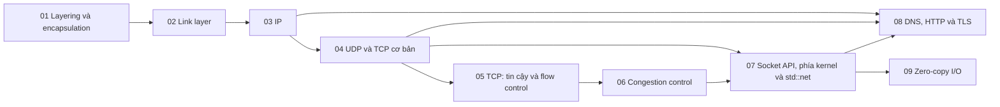

# P6 · Tổng quan — Networking

> Trang này chỉ điều hướng: mục tiêu, bản đồ chương, thứ tự đọc, sách gốc và câu hỏi tổng hợp. Mọi khẳng định kỹ thuật có chú thích nằm trong từng chương; các lời khuyên về thứ tự đọc là của người soạn.

## Mục tiêu của phase

Phase này đi từ phân tầng, link layer, IP, UDP/TCP đến congestion control, rồi vào socket API phía kernel và DNS/HTTP/TLS. Mục tiêu là đọc được `ss`, `ip route`, `tcpdump` và giải thích độ trễ của một request HTTPS mới. Phần Rust nằm trong chương 07: `std::net` ánh xạ lên những syscall nào.

## Bản đồ chương

Mũi tên nghĩa là chương đích dùng khái niệm của chương nguồn (nhận xét của người soạn về thứ tự học).

## Các chương

| Chương | Nội dung chính |
|---|---|
| [01 — Layering và encapsulation](01-layering.md) | Vì sao chia tầng; OSI vs Internet 4 tầng; end-to-end argument; encapsulation và PDU; packet vs circuit switching; latency, bandwidth, RTT, BDP; `sk_buff`, NAPI. |
| [02 — Link layer](02-link-layer.md) | Framing; CRC vs checksum Internet; frame Ethernet, MAC, broadcast; switch học địa chỉ; ARP và `ip neigh`; IPv6 thay ARP; MTU và jumbo frame; `ip link`, `tcpdump -e`, loopback/veth/bridge. |
| [03 — IP](03-ip.md) | IP làm và không làm gì, forwarding vs routing; header IPv4, TTL, DF, checksum; CIDR và dải riêng; bảng định tuyến, longest prefix match; distance vector/link state/BGP; `ping`, `traceroute`, PMTUD; NAT; IPv6. |
| [04 — UDP và TCP cơ bản](04-udp-va-tcp-co-ban.md) | Port và định danh kết nối TCP; header UDP; byte stream; segment TCP, MSS; three-way handshake, ISN; trạng thái TCP và `ss -tan`; đóng kết nối, RST, TIME-WAIT, CLOSE-WAIT. |
| [05 — TCP: tin cậy và flow control](05-tcp-reliability-va-flow-control.md) | Seq/ACK cộng dồn; RTO, backoff, Karn; dup ACK, SACK; receive window, zero window, window scaling; silly window syndrome; Nagle × delayed ACK, `TCP_NODELAY`; keepalive; head-of-line blocking. |
| [06 — Congestion control](06-congestion-control.md) | Congestion collapse; `cwnd`/`rwnd`/`ssthresh`/`FlightSize`; slow start, AIMD; fast retransmit/recovery; slow-start restart; CUBIC, BBR, ECN, bufferbloat; chọn thuật toán trên Linux; hệ quả với connection pool. |
| [07 — Socket API, phía kernel và `std::net`](07-socket-va-kernel.md) | Socket vs fd; `bind`/`listen`/`accept`/`connect`; SYN queue vs accept queue, `backlog`; `Recv-Q`/`Send-Q` của `ss`; socket buffer và autotuning; ephemeral port, `SO_REUSEADDR`/`SO_REUSEPORT`; `SIGPIPE`, `MSG_NOSIGNAL`; `std::net`. |
| [08 — DNS, HTTP và TLS](08-dns-http-tls.md) | DNS: zone, resolver, record, TTL; EDNS(0) và giới hạn 512 byte; `getaddrinfo` và đường từ tên tới địa chỉ; HTTP/1.1 và HTTP/2, head-of-line blocking; HTTP/3 và QUIC; TLS 1.3 handshake, 0-RTT; số RTT của một request HTTPS mới. |
| [09 — Zero-copy I/O: sendfile, splice, MSG_ZEROCOPY](09-zero-copy-io.md) | Đường đi của `read` + `write` và zero-copy tránh cái gì; `sendfile(2)`, điều kiện và bẫy; `splice`, `tee`, `vmsplice` và pipe làm buffer kernel; `copy_file_range(2)`; `MSG_ZEROCOPY` và khi nào không có lợi; `mmap` cho I/O và cái giá; kTLS; `std::io::copy` và `tokio::io::copy`. |

## Thứ tự đọc

Đọc 01 → 09 theo số. Nếu bạn chỉ làm việc ở tầng ứng dụng, 02 và 03 có thể đọc lướt lần đầu rồi quay lại khi gặp lỗi mạng thật (nhận xét của người soạn); 04 → 07 là lõi. Chương 08 đọc cuối vì nó dùng hầu hết các chương trước. Chương 09 (zero-copy I/O) đứng sau 07 vì dựa trên socket và buffer của kernel, và nên đọc kèm [P5 chương 04](../05-storage/04-page-cache-va-direct-io.md) (page cache); nó độc lập với 08 nên có thể đọc trước hoặc sau 08.

## Lộ trình đọc sách gốc

Các nguồn dưới đây đều là nguồn mà chương của phase đã dùng; mở đọc song song với chương tương ứng. Không bắt buộc: chương đã tự chứa phần cần thiết.

- [Computer Networks: A Systems Approach — Network Architecture](https://book.systemsapproach.org/foundation/architecture.html) — chương 01.
- [Computer Networks: A Systems Approach — Performance](https://book.systemsapproach.org/foundation/performance.html) — chương 01.
- [Computer Networks: A Systems Approach — Ethernet](https://book.systemsapproach.org/direct/ethernet.html) — chương 02.
- [Computer Networks: A Systems Approach — Routing](https://book.systemsapproach.org/internetworking/routing.html) — chương 03.
- [High Performance Browser Networking — Primer on Latency and Bandwidth](https://hpbn.co/primer-on-latency-and-bandwidth/) — chương 01.
- [High Performance Browser Networking — Building Blocks of TCP](https://hpbn.co/building-blocks-of-tcp/) — chương 04, 05, 06.
- [RFC 791 — Internet Protocol](https://www.rfc-editor.org/rfc/rfc791.html) — chương 03.
- [RFC 9293 — Transmission Control Protocol](https://www.rfc-editor.org/rfc/rfc9293.html) — chương 04, 05.
- [RFC 5681 — TCP Congestion Control](https://www.rfc-editor.org/rfc/rfc5681.html) — chương 06.
- [RFC 1034 — Domain Names: Concepts and Facilities](https://www.rfc-editor.org/rfc/rfc1034.html) — chương 08.
- [RFC 8446 — TLS 1.3](https://www.rfc-editor.org/rfc/rfc8446.html) — chương 08.
- [Beej's Guide to Network Programming — System Calls or Bust](https://beej.us/guide/bgnet/html/split/system-calls-or-bust.html) — chương 04, 07.

## Câu hỏi tổng hợp xuyên chương

Không có đáp án ở đây; mỗi câu trỏ về chương cần đọc lại.

1. Một request HTTPS tới server chưa từng kết nối tốn bao nhiêu RTT cho DNS, TCP và TLS, và connection pool tiết kiệm phần nào? ([chương 08](08-dns-http-tls.md), [chương 04](04-udp-va-tcp-co-ban.md), [chương 06](06-congestion-control.md)).
2. `connect()` thành công mà server chưa `accept()`: kết nối đang nằm ở đâu và nhìn nó trong `ss` thế nào? ([chương 07](07-socket-va-kernel.md), [chương 04](04-udp-va-tcp-co-ban.md)).
3. `write` 100 byte rồi `read` ở phía kia: vì sao không bảo đảm nhận đúng 100 byte, và hệ quả cho việc đóng khung message? ([chương 04](04-udp-va-tcp-co-ban.md), [chương 05](05-tcp-reliability-va-flow-control.md)).
4. Hai `write` nhỏ liên tiếp chậm thêm một khoảng cố định: Nagle, delayed ACK và `TCP_NODELAY` phối hợp ra sao? ([chương 05](05-tcp-reliability-va-flow-control.md)).
5. Kết nối TCP "treo" sau handshake: Path MTU, ICMP và MSS liên quan thế nào? ([chương 03](03-ip.md), [chương 04](04-udp-va-tcp-co-ban.md)).
6. TIME-WAIT và CLOSE-WAIT chất đống nói lên điều gì về client/server, và sửa ở đâu? ([chương 04](04-udp-va-tcp-co-ban.md), [chương 07](07-socket-va-kernel.md)).
7. Máy A không `ping` được máy B trong cùng mạng: bạn đi từ `ip neigh`, `ip route get` tới `tcpdump` theo thứ tự nào? ([chương 02](02-link-layer.md), [chương 03](03-ip.md), [chương 01](01-layering.md)).
8. Mỗi kiểu của `std::net` gọi những syscall nào, và API Rust che giấu hay lộ ra điều gì của socket? ([chương 07](07-socket-va-kernel.md)).

## Lab

Làm sau khi đã đọc lý thuyết:

- [Lab 06 — Networking](../labs/06-networking-lab.md)
- [Capstone — HTTP server trên epoll rồi mini async runtime](../labs/capstone.md)
