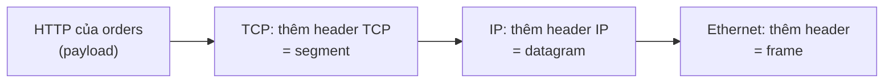
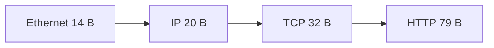

# P6 · Chương 01 — Layering và encapsulation

## Bạn sẽ hiểu được gì

1. **Q1.** Vì sao mạng được chia tầng, và "giao thức", "interface", "peer" nghĩa là gì? → mục 1
2. **Q2.** Mô hình OSI 7 tầng khác kiến trúc Internet (4 tầng, RFC 1122) ở đâu; cái nào còn được dùng thật? → mục 2
3. **Q3.** "Hourglass / narrow waist" và end-to-end argument nói gì, và vì sao TCP nằm ở hai đầu chứ không trong router? → mục 3
4. **Q4.** Encapsulation hoạt động ra sao: mỗi tầng thêm header gì, đơn vị dữ liệu (PDU) mỗi tầng tên là gì, và một HTTP request trên dây thực sự gồm những byte nào? → mục 4
5. **Q5.** Packet switching khác circuit switching thế nào, và vì sao mạng máy tính chọn packet switching? → mục 5
6. **Q6.** Bốn thành phần của latency (propagation, transmission, queuing, processing), bandwidth, RTT, bandwidth-delay product (BDP) là gì và tính ra sao? → mục 6
7. **Q7.** Ở mức tổng quan, kernel Linux hiện thực việc "phân tầng" thế nào (`sk_buff`, NAPI)? → mục 7

## Kiến thức cần trước

Đây là chương mở đầu của phase Networking nên không cần chương mạng nào trước. Bạn chỉ cần biết syscall và socket ở mức người dùng, tức là đã từng `bind`/`accept`/`read` trên một socket ([P1 — Linux](../01-linux/00-tong-quan.md)). Các chương sau đào sâu từng tầng: [02-link-layer](02-link-layer.md), [03-ip](03-ip.md), [04-udp-va-tcp-co-ban](04-udp-va-tcp-co-ban.md), [05-tcp-reliability-va-flow-control](05-tcp-reliability-va-flow-control.md), [06-congestion-control](06-congestion-control.md), [07-socket-va-kernel](07-socket-va-kernel.md), [08-dns-http-tls](08-dns-http-tls.md).

Cả chương bám theo một tình huống quen thuộc của backend: service `orders` viết bằng Rust, mỗi lần khách đặt hàng lại gọi service `payments` bằng một HTTP request `POST /charge` để trừ tiền. Mỗi mục sẽ hỏi: request đó đi qua chỗ nào, và `orders` cần biết gì về chuyện ấy.

---

## 1. Vì sao phải phân tầng (Q1)

> **Trả lời ngắn.** Phân tầng là cách giấu chi tiết cài đặt sau một interface rõ ràng để quản lý độ phức tạp[^sa-abstraction]. Mỗi giao thức vừa có interface với tầng trên cùng máy, vừa có thỏa thuận với *peer* (thực thể cùng tầng ở máy bên kia) về hình dạng và ý nghĩa của message[^sa-peers]. Nhờ vậy đổi Ethernet sang Wi-Fi không buộc phải viết lại trình duyệt (nhận xét của người soạn).

**Giải thích.**

*Với service của bạn.* Trong code của `orders`, việc gọi `payments` chỉ có vài dòng: mở một `TcpStream`, `write` request, `read` response. Nhưng giữa hai dòng đó, byte phải rời card mạng của máy chạy `orders`, qua vài switch và router, rồi mới tới máy chạy `payments`; chặng này đi trên Ethernet, chặng kia có thể là Wi-Fi hay cáp quang. `orders` không biết, cũng không cần biết. Mục này trả lời: mạng làm thế nào để `orders` được ngây thơ như vậy. Ta sẽ dùng lại cặp `orders`/`payments` ở mọi mục sau (nhận xét của người soạn: đây là ví dụ giả định, không phải code trong repo).

### 1.1 Vì sao không để ứng dụng tự lo

Mạng gồm rất nhiều việc khác nhau: đẩy bit lên dây hoặc sóng vô tuyến, đóng bit thành frame, chọn đường qua nhiều mạng, truyền cho tin cậy, rồi mới đến chuyện "tải một trang web". Nếu `orders` phải biết hết, mỗi lần máy đổi từ Ethernet sang Wi-Fi thì code của nó cũng phải sửa theo. Cách người thiết kế hệ thống tránh chuyện đó là abstraction: giấu chi tiết cài đặt sau một interface định nghĩa rõ ràng. Sách *Computer Networks: A Systems Approach* (SA) gọi đây là công cụ nền để quản lý độ phức tạp[^sa-abstraction]. Mạng phân tầng áp dụng đúng ý ấy: mỗi tầng giấu cách làm của mình sau interface mà tầng trên gọi.

### 1.2 Hai mặt của một giao thức

Trong kiến trúc phân tầng, mỗi giao thức quay ra hai phía:

- **Interface** với tầng trên (và tầng dưới) trên cùng một máy: một dịch vụ mà tầng trên gọi.
- **Thỏa thuận với peer**, tức thực thể cùng tầng ở máy bên kia: hai bên chốt với nhau hình dạng và ý nghĩa của các message trao đổi giữa các protocol peer[^sa-peers].

Với `orders` thì hai mặt đó cụ thể như sau. `write()` trên socket là interface. Còn TCP của máy `orders` và TCP của máy `payments` nói chuyện với nhau bằng segment có định dạng cố định: đó là thỏa thuận peer. Vì vậy ứng dụng không thấy segment, và TCP không biết các byte nó chở là JSON hay ảnh (nhận xét của người soạn).

<details><summary>Đi sâu: tầng nào chạy trên node nào</summary>

Các nút nằm giữa `orders` và `payments` (switch, router) chỉ chạy các tầng thấp. SA nêu rằng ba tầng thấp nhất được cài đặt trên mọi node mạng, kể cả switch trong mạng lẫn host nối ra ngoài[^sa-lower3]. Từ transport trở lên thì thường chỉ chạy trên các end host, không chạy trên switch hay router trung gian[^sa-endhosts]. Hệ quả (nhận xét của người soạn): phần lớn logic "đáng tin" nằm ở hai đầu chứ không nằm ở giữa. Lý do ở mục 3.

</details>

**Quay lại Q1:** mỗi giao thức có interface với tầng trên và thỏa thuận với peer cùng tầng, còn chi tiết bên dưới bị giấu đi; nhờ vậy `orders` chỉ cần `write` và `read`.

## 2. OSI 7 tầng và kiến trúc Internet (Q2)

> **Trả lời ngắn.** OSI có 7 tầng nhưng chỉ là mô hình tham chiếu: SA nói hiện không có mạng nào chạy theo OSI, tuy thuật ngữ của nó vẫn được dùng rộng rãi[^sa-osi]. Mạng thật chạy theo kiến trúc Internet (RFC 1122), gồm bốn tầng: link, internet (IP), transport, application (mục 2.2 dẫn từng tầng).

**Giải thích.**

*Với service của bạn.* Trước `payments` có một load balancer, và đội hạ tầng gọi nó là "L4" hay "L7"; switch trong rack thì là "L2". Mấy con số ấy là số tầng của OSI, trong khi stack mà `orders` chạy thật lại theo kiến trúc Internet. Mục này nối hai cách đánh số lại với nhau (nhận xét của người soạn: tình huống giả định).

### 2.1 OSI: mô hình tham chiếu

OSI chia 7 tầng. Đi từ dưới lên:

- **Physical**: truyền bit thô qua link.
- **Data link**: gom một dòng bit thành một đơn vị lớn hơn gọi là frame. Card mạng cùng driver trong OS thường hiện thực tầng này[^sa-osi-frame].
- **Network**: định tuyến giữa các node trong mạng packet-switched. Đơn vị dữ liệu ở đây thường gọi là packet chứ không phải frame, dù về bản chất hai thứ là một[^sa-pdu-packet].
- **Transport**: kênh process-to-process. Đơn vị dữ liệu thường gọi là message[^sa-pdu-msg].
- **Session** và **presentation**: hai tầng ít khi gặp trong thực tế, xem phần Đi sâu.
- **Application**: HTTP nằm ở đây.

Điều cần nhớ là OSI là *reference model*, không phải protocol graph. SA viết rằng không có mạng nào chạy theo OSI, nhưng thuật ngữ OSI định nghĩa vẫn được dùng rộng rãi, nên vẫn đáng xem lướt[^sa-osi]. Vì thế "L2 switch", "L4 load balancer", "L7 proxy" đều lấy số tầng OSI, dù stack chạy thật là Internet (nhận xét của người soạn).

### 2.2 Kiến trúc Internet (RFC 1122)

RFC 1122 ("Requirements for Internet Hosts — Communication Layers") đòi một host phải hiện thực bộ giao thức phân tầng làm nên Internet protocol suite[^rfc1122-layers]. Phạm vi của RFC là các tầng giao tiếp: link, IP và transport. Tầng application để RFC 1123 lo[^rfc1122-scope]. Với `POST /charge` của `orders`, bốn tầng đó là:

- **Link**: giao thức của mạng nối trực tiếp với host. RFC gọi nó là link layer hay media-access layer[^rfc1122-link]. Với máy chạy `orders`, đó là Ethernet hay Wi-Fi.
- **Internet (IP)**: dịch vụ liên mạng không kết nối (datagram), không bảo đảm giao đến đích. Datagram IP vì vậy có thể đến nơi bị hỏng, bị lặp, sai thứ tự, hoặc không đến[^rfc1122-ip]. RFC 791 giới hạn phạm vi của IP vào đúng một việc: chuyển một "internet datagram" từ nguồn tới đích qua hệ thống các mạng nối nhau[^rfc791-scope].
- **Transport**: cung cấp dịch vụ truyền thông đầu-cuối cho ứng dụng[^rfc1122-transport]. TCP hướng kết nối, tin cậy, có resequencing và flow control; UDP là dịch vụ datagram không kết nối[^rfc1122-tcpudp]. `orders` dùng TCP.
- **Application**: tầng trên cùng của bộ giao thức Internet[^rfc1122-app]. HTTP của `POST /charge` nằm ở đây.

<details><summary>Đi sâu: session, presentation, ánh xạ OSI sang Internet và chỗ đứng của TLS</summary>

Hai tầng OSI còn lại. Presentation lo định dạng dữ liệu trao đổi giữa các peer (số nguyên 16/32/64 bit, byte nào đi trước…)[^sa-pres]. Session cung cấp một không gian tên để gắn các transport stream thuộc cùng một ứng dụng, ví dụ luồng audio và video của một cuộc họp[^sa-sess].

Ánh xạ OSI sang Internet chỉ để tham khảo (nhận xét của người soạn): application/presentation/session ≈ application; transport giữ nguyên; network ≈ internet; data link + physical ≈ link. Bảng ánh xạ này không có ô riêng cho TLS; chương [08](08-dns-http-tls.md) trình bày TLS 1.3 handshake.

</details>

**Quay lại Q2:** OSI là bản vẽ để gọi tên tầng; kiến trúc Internet với bốn tầng mới là thứ `orders` chạy thật.

## 3. Hourglass và end-to-end argument (Q3)

> **Trả lời ngắn.** Kiến trúc Internet có hình đồng hồ cát: IP là điểm hẹp chung mà mọi mạng trao đổi packet qua đó[^sa-hourglass]. Phía trên IP có nhiều giao thức transport, phía dưới có nhiều công nghệ mạng[^sa-above-below]. End-to-end argument nói một chức năng như độ tin cậy chỉ có thể cài hoàn chỉnh với sự trợ giúp của ứng dụng ở hai đầu[^e2e-def]; đôi khi một bản không đầy đủ do tầng dưới cung cấp vẫn có ích, như một cách tăng hiệu năng[^e2e-perf]. Hợp với lập luận đó, transport như TCP thường chỉ chạy ở end host chứ không trên router[^sa-endhosts] (suy luận của người soạn về mối liên hệ).

**Giải thích.**

*Với service của bạn.* Mạng đã lo cho `orders` khá nhiều: TCP là dịch vụ tin cậy, có resequencing và flow control (mục 2.2). Vậy sao `orders` vẫn phải tự phòng chuyện `charge` bị mất hay bị gửi hai lần? Và vì sao mọi thứ tin cậy đó nằm trong TCP ở hai máy, không nằm trong router? Hai câu hỏi này có chung một lời giải.

### 3.1 Hourglass: eo hẹp là IP

Kiến trúc Internet không đòi phân tầng nghiêm ngặt: ứng dụng được tự do bỏ qua các tầng transport đã định nghĩa để dùng thẳng IP hoặc một trong các mạng bên dưới[^sa-notstrict]. Dù vậy, hình dạng protocol graph vẫn là đồng hồ cát, vì IP là điểm hội tụ của kiến trúc: nó định nghĩa một cách chung để trao đổi packet giữa nhiều loại mạng[^sa-hourglass]. Phía trên IP có thể có vô số giao thức transport, mỗi giao thức đưa ra một kiểu kênh khác nhau cho ứng dụng[^sa-above-below]. Phía dưới có thể có đủ loại công nghệ mạng, từ Ethernet tới wireless.

SA gọi cái eo ấy là một tập năng lực toàn cục tối thiểu, được chọn lọc kỹ. Nhờ nó, ứng dụng ở tầng trên và công nghệ truyền thông ở tầng dưới cùng tồn tại, chia sẻ năng lực và tiến hóa nhanh[^sa-waist]. Với `orders`: request HTTP chạy trên Wi-Fi, cáp quang hay mạng ảo của container mà không phải đổi code, vì tất cả đều "nói IP" ở eo (nhận xét của người soạn).

### 3.2 End-to-end argument: vì sao độ tin cậy nằm ở hai đầu

Lập luận này đến từ bài *End-to-End Arguments in System Design* của Saltzer, Reed và Clark (MIT). Ý chính: một chức năng chỉ cài đặt đầy đủ và đúng đắn được khi có kiến thức và sự trợ giúp của ứng dụng đứng ở hai đầu hệ thống truyền thông. Vì vậy, cung cấp nó như một tính năng của chính hệ thống truyền thông là không thể[^e2e-def]. Bài không bảo tầng dưới đừng làm gì cả. Một bản không đầy đủ do tầng dưới cung cấp đôi khi vẫn có ích như cách tăng hiệu năng[^e2e-perf].

Áp vào `orders` và `payments` (suy luận của người soạn từ các nguồn trên): IP chọn *không* bảo đảm giao đúng, như RFC 1122 ghi ở mục 2. Độ tin cậy được dựng ở TCP trên hai end host, và router không phải giữ trạng thái cho từng connection. Nhưng ngay cả khi TCP báo "đã giao", đó mới là ack của kernel bên nhận, chứ chưa phải việc `payments` đã xử lý xong. Nếu `orders` hết thời gian chờ mà không biết `charge` đã chạy hay chưa, gửi lại có thể trừ tiền hai lần. Vì vậy giao dịch quan trọng (thanh toán, ghi DB) vẫn cần ack ở tầng ứng dụng và idempotency, ví dụ một idempotency key trong request (nhận xét của người soạn, cùng tinh thần với end-to-end argument).

<details><summary>Đi sâu: ví dụ "careful file transfer" và trade-off hiệu năng</summary>

Ví dụ trong bài là "careful file transfer". Mạng có cố hết sức đáng tin thì ứng dụng vẫn phải tự kiểm checksum đầu-cuối rồi retry. Bài kết luận rằng việc hệ thống truyền thông cố hết mức để cực kỳ đáng tin không làm giảm gánh nặng bảo đảm độ tin cậy của chương trình ứng dụng[^e2e-careful].

Điều đó không có nghĩa tầng dưới nên bỏ mặc độ tin cậy. Một số nỗ lực ở tầng dưới có thể ảnh hưởng đáng kể tới hiệu năng ứng dụng, chỉ là tầng dưới không cần cung cấp độ tin cậy "hoàn hảo". Điều đáng nhớ: mức công sức đầu tư cho các biện pháp tin cậy bên trong hệ thống truyền dữ liệu là một đánh đổi kỹ thuật dựa trên hiệu năng, chứ không phải yêu cầu về tính đúng đắn[^e2e-tradeoff].

</details>

**Quay lại Q3:** IP là eo chung; độ tin cậy hoàn chỉnh cần ứng dụng ở hai đầu, và transport thường chỉ chạy ở end host, nên TCP nằm ở máy `orders` và máy `payments` chứ không nằm trong router.

## 4. Encapsulation: header, payload, PDU (Q4)

> **Trả lời ngắn.** Mỗi tầng coi thứ tầng trên đưa xuống là một chuỗi byte không diễn giải, rồi gắn thêm header của mình vào[^sa-header]. Bên nhận gỡ header, đọc demux key để biết giao cho giao thức nào ở tầng trên[^sa-demux]. TCP gọi đơn vị dữ liệu của mình là segment, và mỗi segment được gửi đi như một IP datagram[^rfc9293-seg]. Vì vậy một HTTP request trên dây là byte nằm trong payload của TCP segment, trong payload của IP datagram, trong payload của Ethernet frame (ví dụ đã chạy ở phần Đi sâu).

**Giải thích.**

*Với service của bạn.* `orders` chỉ ghi vào `TcpStream` một đoạn text kiểu `POST /charge HTTP/1.1 …`, dài vài trăm byte. Nhưng thứ rời card mạng là một Ethernet frame, và trong frame đó còn có header IP và header TCP. Mục này mở từng lớp ra: ai thêm gì, bên nhận dựa vào trường nào để biết giao cho ai, và cộng lại thì được bao nhiêu byte (nhận xét của người soạn).

### 4.1 Mỗi tầng gắn header

Để nói chuyện với peer, mỗi tầng cần chuyển cho nó một ít thông tin điều khiển. Cách làm: tầng coi thứ tầng trên đưa xuống là một chuỗi byte không diễn giải, rồi gắn vào đầu message một header. Header là một cấu trúc dữ liệu nhỏ, từ vài byte đến vài chục byte, dùng giữa các peer để giao tiếp với nhau[^sa-header]. Thông tin điều khiển đặt ở cuối message thì gọi là *trailer*[^sa-trailer]. Ethernet có cả hai: header 14 byte ở đầu[^sa-eth-14] và CRC ở cuối (chi tiết ở [chương 02](02-link-layer.md)).



(Sơ đồ minh họa của người soạn; số byte thật của một request ở phần Đi sâu.)

### 4.2 Bên nhận gỡ header, đọc demux key

Bên nhận làm ngược lại. Tầng dưới gỡ header của mình, đọc demux key, rồi tách (demultiplex) message tới đúng chỗ ở tầng trên[^sa-demux]. Vậy ở mỗi tầng của Internet, trường nào đóng vai demux key?

| Tầng | Header | Trường chọn tầng trên |
|---|---|---|
| Link (Ethernet) | Ethernet | `type`: cho biết frame này nên giao cho giao thức nào trong số nhiều giao thức tầng trên có thể có[^sa-eth-type] |
| Internet | IP | `Protocol`: cho biết giao thức tầng kế tiếp dùng trong phần dữ liệu của internet datagram[^rfc791-protocol] |
| Transport | TCP/UDP | port đích → socket (chương [04](04-udp-va-tcp-co-ban.md), [07](07-socket-va-kernel.md)) |

Với `POST /charge`, máy `payments` đọc type để biết frame mang IP, đọc Protocol để biết datagram mang TCP, rồi đọc port đích 443 hay 8080 để biết giao segment cho socket của process `payments` (nhận xét của người soạn: số cổng là giả định).

SA nhấn thêm hai điều. Message đi lên tới ứng dụng bên nhận chính là message mà ứng dụng bên gửi đã đưa xuống, ứng dụng không thấy header nào[^sa-same-msg]. Còn trên đường đi, trong ví dụ của SA, các node trong mạng (switch, router) có thể xem header đặt ở đầu message[^sa-nodes-inspect].

### 4.3 Tên gọi đơn vị dữ liệu (PDU)

PDU (protocol data unit) là thuật ngữ chung cho "một message của giao thức ở tầng X". Tên thường dùng:

| Tầng | PDU | Nguồn tên |
|---|---|---|
| Application | message (HTTP request/response) | — |
| Transport (TCP) | segment | RFC 9293: byte-stream của ứng dụng được chở qua mạng bằng các TCP segment, mỗi segment được gửi đi như một IP datagram[^rfc9293-seg] |
| Transport (UDP) | datagram | RFC 1122: UDP là dịch vụ "datagram"[^rfc1122-tcpudp] |
| Internet | datagram / packet | RFC 791 gọi "internet datagram"[^rfc791-scope]; SA gọi chung là packet[^sa-pdu-packet] |
| Link | frame | SA[^sa-osi-frame] |

Tên gọi không nhất quán. SA nói thẳng rằng ở tầng network, packet và frame về bản chất là một thứ[^sa-pdu-packet], còn ở transport thì người ta thường gọi là message thay vì packet hay frame[^sa-pdu-msg]. Đừng cãi vặt về tên; chỉ cần biết đang nói về lớp nào (nhận xét của người soạn).

Từ hai trường trong header ta suy ra được kích thước tối thiểu (suy luận của người soạn). IHL của IPv4 tính bằng từ 32 bit, và giá trị tối thiểu cho một header hợp lệ là 5[^rfc791-ihl], tức header IP dài ít nhất 20 byte. Data Offset của TCP cũng đếm bằng từ 32 bit và cho biết dữ liệu bắt đầu ở đâu[^rfc9293-doff].

<details><summary>Đi sâu: ví dụ chạy thật — một HTTP request trên dây</summary>

Để không chỉ tin sơ đồ, tôi bắt một request thật. Request này không phải của `orders` mà do `curl` gửi `GET /x` tới một "server" `nc` trả về response HTTP cố định ở port 8080. Mọi thứ chạy trong container Linux của repo (`./labs/linux.sh`), và `tcpdump -i lo -e -x` bắt gói có cờ PSH. Đây là **quan sát từ một lần chạy trên interface loopback**, không phải bảo đảm. Trên `lo` địa chỉ MAC toàn số 0 và MTU là 65536 (`ip link show lo`), nên số liệu về MAC/MTU không đại diện cho Ethernet thật.

Gói request (rút gọn từ output của tcpdump):

```text
ethertype IPv4 (0x0800), length 145: 127.0.0.1.48132 > 127.0.0.1.8080:
  Flags [P.], seq 3287511036:3287511115, ack 3843767310, win 512,
  options [nop,nop,TS val … ecr …], length 79: HTTP: GET /x HTTP/1.1
0x0000:  4500 0083 5653 4000 4006 e61f 7f00 0001
0x0010:  7f00 0001 bc04 1f90 c3f3 6ffc e51b 3c0e
0x0020:  8018 0200 fe77 0000 0101 080a 2e52 8c3a
0x0030:  2e52 8c39 4745 5420 2f78 2048 5454 502f   ← "GET /x HTTP/"
```

(`-x` in từ đầu IP, không in header Ethernet.) Giải mã từng byte:

| Byte (hex) | Ý nghĩa | Giá trị |
|---|---|---|
| `45` | IP version 4, IHL = 5 từ | header IP 20 byte |
| `0083` | IP Total Length | 131 byte = 20 (IP) + 32 (TCP) + 79 (HTTP); trường này tính cả header lẫn dữ liệu[^rfc791-totlen] |
| `40` | TTL | 64 |
| `06` | IP Protocol | 6 = TCP |
| `bc04` `1f90` | port nguồn, port đích | 48132 → 8080 |
| `80` (đầu byte 0x20) | TCP Data Offset = 8 từ | header TCP 32 byte = 20 + 12 byte options. Options là `0101 080a` rồi TSval, TSecr: hai NOP, rồi Timestamps kind 8 độ dài 10[^rfc7323-kind]. Option này thêm 10 byte (tối đa 12 kể cả padding) vào header TCP[^rfc7323-ts] |
| `4745 5420 …` | payload | "GET /x HTTP/1.1\r\nHost: …" |

Tổng frame tcpdump báo là 145 byte = 14 (Ethernet) + 20 (IP) + 32 (TCP) + 79 (HTTP): khớp từng byte. Gói response cộng cùng cách: 14 + 20 + 32 + 62 = 128, đúng với `length 128` và IP Total Length `0x0072` = 114 = 20 + 32 + 62. Header ăn 66/145 byte, khoảng 45%. Frame Ethernet trong capture này không kèm preamble hay CRC; theo SA, adaptor là bên gắn các thứ đó khi gửi[^sa-eth-adaptor].



Nghĩa là "một HTTP request" ở mức dây chỉ là byte nằm trong payload của TCP segment, nằm trong payload của IP datagram, nằm trong payload của Ethernet frame.

</details>

**Quay lại Q4:** mỗi tầng gắn header của mình và bên nhận dùng demux key để chọn tầng trên; request `POST /charge` của `orders` chỉ là payload lồng trong TCP, IP, Ethernet.

## 5. Packet switching và circuit switching (Q5)

> **Trả lời ngắn.** Circuit switching dựng trước một mạch riêng rồi mới gửi bit[^sa-circuit]. Packet switching thì gửi các khối rời rạc, và mỗi node nhận đủ cả gói rồi mới chuyển tiếp (store-and-forward)[^sa-sf]. Mạng máy tính chọn packet switching vì hiệu quả hơn: link không bị bỏ không những lúc một luồng chẳng có gì để gửi[^sa-stat].

**Giải thích.**

*Với service của bạn.* Link ra khỏi máy chạy `orders` không chỉ chở request tới `payments`. Nó còn chở truy vấn tới database, log đẩy đi chỗ khác, health check từ load balancer. Phần lớn thời gian mỗi luồng chỉ gửi lẻ tẻ vài gói rồi im. Nếu mỗi luồng giữ riêng một đường suốt cuộc "gọi", đường đó nằm không gần hết thời gian. Câu hỏi của mục này là mạng chia link cho các luồng ấy thế nào, và `orders` phải trả giá gì cho cách chia đó (nhận xét của người soạn: tình huống giả định).

### 5.1 Hai kiểu mạng chuyển mạch

Mạng chuyển mạch (switched network) gồm các node nối với nhau bằng link point-to-point. Node nào nối ít nhất hai link thì chạy phần mềm chuyển tiếp dữ liệu từ link này sang link khác. Có nhiều loại mạng chuyển mạch, và hai loại phổ biến nhất là circuit switched và packet switched. Loại đầu dùng nổi bật nhất trong hệ thống điện thoại, loại sau dùng cho phần lớn áp đảo các mạng máy tính[^sa-switched].

- **Circuit switching**: dựng trước một mạch riêng qua một chuỗi link, rồi cho node nguồn gửi một dòng bit qua mạch đó tới node đích[^sa-circuit].
- **Packet switching**: các node gửi nhau những khối dữ liệu rời rạc (packet) theo kiểu *store-and-forward*. Mỗi node trước hết nhận trọn một packet qua một link, lưu nó trong bộ nhớ trong, rồi mới chuyển trọn packet đó tới node kế tiếp[^sa-sf].

### 5.2 Cái giá: queuing và mất gói

Packet switching không dành riêng tài nguyên cho từng luồng. Vì vậy packet của `orders` có thể phải chờ trong hàng đợi của switch hay router (queuing delay, xem mục 6), và khi tải vượt khả năng thì packet bị bỏ (suy luận của người soạn). Đây cũng là lý do TCP cần congestion control ([chương 06](06-congestion-control.md)): đó là cái giá của việc chia sẻ link hiệu quả.

<details><summary>Đi sâu: statistical multiplexing và vì sao packet có kích thước tối đa</summary>

SA nêu lý do chọn packet switching là *efficiency*. Cơ chế gọi là statistical multiplexing. Link được chia sẻ theo thời gian, nhưng dữ liệu của mỗi luồng được gửi *theo nhu cầu*, không theo khe thời gian định sẵn. Nếu chỉ một luồng có dữ liệu thì nó được gửi ngay, không phải chờ tới lượt (quantum) của mình. Chính việc tránh thời gian rảnh đó làm nên hiệu quả của packet switching[^sa-stat].

Để các luồng thay phiên nhau, mỗi lần mỗi luồng chỉ được gửi một khối kích thước tối đa, chính là packet. Message lớn bị chia thành nhiều packet và bên nhận ghép lại[^sa-frag].

</details>

**Quay lại Q5:** packet switching chia sẻ link theo nhu cầu nên hiệu quả; đổi lại, packet của `orders` có thể phải xếp hàng hoặc bị bỏ.

## 6. Thước đo: bandwidth, latency, RTT, BDP (Q6)

> **Trả lời ngắn.** Latency là tổng các độ trễ: propagation, transmission, processing và queuing[^hpbn-latency-sum]. Bandwidth là số bit/giây mà link truyền được[^sa-bandwidth]. RTT là thời gian đi và về[^sa-rtt]. Nhân bandwidth với RTT ra BDP, lượng bit tối đa có thể đang "bay" trong ống tại một thời điểm[^sa-bdp]; bên gửi không đẩy đủ lượng đó thì không lấp đầy đường[^sa-fill].

**Giải thích.**

*Với service của bạn.* Một cuộc gọi `payments` chậm thì chậm vì đâu: đường dài, link hẹp, hay hàng đợi? Mục này cho bộ thước đo để tách ba khả năng đó, và một công thức trả lời "cần bao nhiêu byte đang bay thì mới dùng hết đường". Để có số cụ thể, giả sử máy chạy `orders` và máy chạy `payments` cách nhau RTT 50 ms trên đường 100 Mbps (số giả định của người soạn, dùng ở 6.4).

### 6.1 Bandwidth và throughput

Hiệu năng mạng được đo theo hai cách cơ bản: bandwidth (còn gọi là throughput) và latency (còn gọi là delay)[^sa-two]. Khi nói về một link, bandwidth là số bit/giây có thể truyền qua nó[^sa-bandwidth]. *Throughput* thì thường dùng cho hiệu năng đo được: một link 10 Mbps có thể chỉ đạt 2 Mbps do thiếu hiệu quả ở cài đặt[^sa-throughput]. Cũng đừng nhầm đơn vị: tốc độ mạng đo bằng bit/s (bps), còn thiết bị không phải mạng thường ghi byte/s (Bps)[^hpbn-units].

### 6.2 Bốn thành phần của latency

Latency là thời gian từ khi nguồn gửi gói đến khi đích nhận được. Nó gồm bốn thành phần, và mỗi router, mỗi link trên đường đều góp phần:

- **Propagation delay**: thời gian tín hiệu đi từ người gửi đến người nhận, là hàm của khoảng cách và tốc độ lan truyền tín hiệu[^hpbn-lat4].
- **Transmission delay**: thời gian đẩy toàn bộ bit của gói vào link, là hàm của độ dài gói và data rate của link[^hpbn-trans].
- **Processing delay**: thời gian xử lý header, kiểm tra lỗi bit và xác định đích của gói[^hpbn-proc].
- **Queuing delay**: thời gian gói chờ trong hàng đợi. Thời gian dữ liệu nằm chờ trong buffer chính là queuing delay[^hpbn-queue].

Latency giữa client và server là tổng tất cả các độ trễ đó[^hpbn-latency-sum]. SA viết công thức ba thành phần, không tách processing riêng: `Latency = Propagation + Transmit + Queue`, với `Propagation = Distance/SpeedOfLight` và `Transmit = Size/Bandwidth`[^sa-formula]. Chú ý hai thành phần đầu phụ thuộc rất khác nhau. Transmission không liên quan gì tới khoảng cách giữa client và server, nó chỉ phụ thuộc data rate của link[^hpbn-trans]. Propagation thì do khoảng cách và môi trường tín hiệu đi qua quyết định[^hpbn-prop]. Nghĩa là mua link nhanh hơn chỉ rút được transmission, không đụng được tới propagation của đường `orders` → `payments`.

### 6.3 RTT và bandwidth-delay product

RTT (round-trip time) là thời gian cần để gửi một message từ đầu này của mạng tới đầu kia rồi ngược lại, tức thời gian đi và về[^sa-rtt]. Còn bandwidth × delay là thể tích của "ống": số bit tối đa có thể đang truyền trong ống tại một thời điểm bất kỳ[^sa-bdp]. Ở đây "delay" thường được hiểu là RTT. Bên gửi có thể phát đi cả RTT × bandwidth bit trước khi nghe được phản hồi đầu tiên; nếu không phát đủ để lấp đầy "ống" thì mạng không được tận dụng hết[^sa-fill].

Ví dụ của SA: kênh xuyên lục địa có độ trễ một chiều 50 ms, băng thông 45 Mbps, chứa được `50×10⁻³ × 45×10⁶ = 2,25×10⁶ bit`, xấp xỉ 280 KB[^sa-bdp-ex]. Tôi tính lại: 2,25×10⁶ bit / 8 = 281.250 byte, khớp "xấp xỉ 280 KB" (KB ở đây hiểu là 1000 byte, suy luận của người soạn từ phép tính; tính theo 1024 thì ≈ 274,7 KiB).

### 6.4 Áp vào `orders` và `payments`: BDP và cửa sổ

Với đường 100 Mbps và RTT 50 ms của ví dụ, BDP = 100×10⁶ × 0,05 / 8 = 625.000 byte ≈ 610 KiB (người soạn tính, không có trong nguồn). Muốn lấp đầy đường, bên gửi phải có khoảng 610 KiB dữ liệu "đang bay" chưa được ack.

Giả sử giao thức dùng cửa sổ cố định 65.535 byte. Con số này không tự nghĩ ra: trường window của TCP rộng 16 bit nên có giới hạn cứng trên là 65.535 byte[^hpbn-winscale]. Mỗi RTT bên gửi chỉ phát được một cửa sổ (suy luận của người soạn), nên tốc độ tối đa là 65.535 × 8 / 0,05 s ≈ 10,5 Mbps, bất kể link là 100 Mbps hay 1 Gbps. Đó là lý do TCP có window scaling, và vì sao throughput của một kết nối TCP bị chặn bởi window / RTT (nhận xét của người soạn). Chi tiết ở [chương 05](05-tcp-reliability-va-flow-control.md) và [06](06-congestion-control.md).

### 6.5 Mấy RTT trước byte đầu tiên

TCP cần trọn một roundtrip độ trễ trước khi có thể truyền bất kỳ dữ liệu ứng dụng nào[^hpbn-hs]. TLS 1.3 nhắm tới 1 RTT cho phiên mới và 0 RTT cho phiên được nối lại[^hpbn-tls13]. Với RTT 50 ms (người soạn tính, bỏ qua DNS và thời gian xử lý của `payments`): TCP 1 RTT + TLS 1.3 1 RTT + request/response 1 RTT = 150 ms tới byte đầu của response trên kết nối mới, so với 50 ms trên kết nối tái dùng. Đó là lý do `orders` nên giữ connection pool tới `payments` thay vì mở kết nối mới mỗi request (nhận xét của người soạn). Chi tiết ở [chương 04](04-udp-va-tcp-co-ban.md) và [08](08-dns-http-tls.md).

<details><summary>Đi sâu: tốc độ ánh sáng, bảng khoảng cách, ví dụ số, lỗi số học trong SA</summary>

**Tốc độ ánh sáng đặt cận dưới.** SA cho tốc độ lan truyền: 3,0 × 10⁸ m/s trong chân không, 2,3 × 10⁸ m/s trong cáp đồng và 2,0 × 10⁸ m/s trong sợi quang[^sa-speeds]. HPBN dùng quy tắc ngón tay cái khoảng 200.000.000 m/s cho sợi quang[^hpbn-fiber], và nhấn rằng tốc độ ánh sáng đặt một giới hạn cứng, đồng thời là bộ điều tốc, lên thời gian lan truyền của mọi packet mạng[^hpbn-light]. Hệ quả: tăng băng thông không giảm propagation. SA: RTT xuyên lục địa của link 1 Gbps vẫn là 100 ms, y như với link 1 Mbps[^sa-highspeed].

Tính lại các số trong bảng của HPBN (phép chia của người soạn, tốc độ sợi quang = 2×10⁸ m/s; riêng one-way New York–Sydney đã được kiểm bằng chương trình Rust ở mục 8):

| Tuyến | Khoảng cách (HPBN) | One-way tính lại | RTT tính lại | HPBN (RTT trong sợi quang) |
|---|---|---|---|---|
| New York – San Francisco | 4.148 km | 20,7 ms | 41,5 ms | 42 ms |
| New York – London | 5.585 km | 27,9 ms | 55,8 ms | 56 ms |
| New York – Sydney | 15.993 km | 80,0 ms | 159,9 ms | 160 ms |

Nếu `orders` ở New York còn `payments` ở Sydney thì dù ánh sáng nhanh, vẫn mất 160 mili-giây cho một vòng đi-về (RTT)[^hpbn-sydney]. Đây còn là con số lạc quan vì giả định cáp quang đi theo đường tròn lớn. Thực tế gói đi đường dài hơn, và mỗi hop thêm độ trễ routing, processing, queuing và transmission[^hpbn-hops], nên RTT thực tế rơi vào khoảng 200–300 mili-giây[^hpbn-actual]. Các số khoảng cách là của HPBN, phần chia là phép tính của người soạn; khớp với bảng.

Thêm hai điểm thực tế. Độ trễ đáng kể thường nằm ở "last few miles", không phải ở các chặng vượt đại dương hay lục địa[^hpbn-lastmile]. Còn bufferbloat là queuing delay sinh ra khi router có bộ đệm lớn, với giả định rằng nên tránh bỏ gói bằng mọi giá[^hpbn-bufferbloat]. Theo suy luận của người soạn, bộ đệm sâu như vậy làm TCP thấy tắc nghẽn muộn; chương [06](06-congestion-control.md) sẽ nói tiếp.

**Transmission vs propagation, tính bằng số.** Gói 1500 byte = 12.000 bit. Transmission delay theo `Size / Bandwidth` (người soạn tính) là 1,2 ms ở 10 Mbps, 120 µs ở 100 Mbps, 12 µs ở 1 Gbps. Propagation trên 1.000 km sợi quang: 1.000.000 m / 2×10⁸ m/s = 5 ms. Tức là trên đường dài, propagation lấn át transmission của gói nhỏ: nâng link từ 100 Mbps lên 1 Gbps chỉ bớt 108 µs cho mỗi gói 1500 byte, vô nghĩa so với 5 ms.

Với file lớn thì ngược lại. SA tính tải ảnh 25 MB qua kênh 10 Mbps mất 20 giây (25×10⁶×8 / 10×10⁶), nên khác biệt giữa kênh 1 ms và 100 ms (20,001 s vs 20,1 s) không đáng kể; băng thông mới quyết định[^sa-25mb]. Còn một client gửi 1 byte rồi nhận 1 byte là "latency bound": RTT 100 ms hay 1 ms mới là chuyện chính, link 1 hay 100 Mbps không quan trọng[^sa-latbound]. Request nhỏ của `orders` tới `payments` thuộc loại thứ hai (nhận xét của người soạn).

Store-and-forward cộng thêm: qua 3 link 100 Mbps liên tiếp, mỗi link phải nhận đủ gói rồi mới chuyển ([mục 5](#5-packet-switching-và-circuit-switching-q5)), nên tổng transmission là 3 × 120 µs = 360 µs (người soạn tính, bỏ qua processing và queuing).

**Một con số trong sách không khớp phép tính.** Vài câu sau ví dụ 45 Mbps, SA viết về lượng dữ liệu tối đa đang bay ("in flight") theo RTT: trong "ví dụ ở trên", lượng đó tương ứng 5,5×10⁶ bit (671 KB)[^sa-bdp-rtt]. Tôi đọc kỹ ngữ cảnh nguồn: câu đó nằm ngay sau ví dụ trên và nói "ví dụ ở trên", không đưa RTT hay băng thông khác. Vậy RTT = 2 × 50 ms = 100 ms, băng thông 45 Mbps, và:

- Cách tính đúng theo ví dụ: 100×10⁻³ s × 45×10⁶ bit/s = **4,5×10⁶ bit** = 562.500 byte (≈ 562 KB hoặc ≈ 549 KiB), đúng gấp đôi 2,25×10⁶.
- Con số in trong sách: 5,5×10⁶ bit. Nó ứng với RTT = 5,5×10⁶ / 45×10⁶ ≈ 122 ms, không phải 100 ms. Còn "671 KB" là 5,5×10⁶ / 8 / 1024 ≈ 671,4 KiB, tức đổi đơn vị theo 1024 trong khi "280 KB" ở trên đổi theo 1000.

Tôi không thấy trong nguồn RTT hay băng thông nào cho ra 5,5×10⁶ bit, nên coi đây là lỗi số học của sách (suy luận của người soạn từ phép tính; chưa kiểm tra bản in hay errata). Chương này dùng **4,5×10⁶ bit cho RTT 100 ms**. Ý của SA không đổi: lượng dữ liệu đang bay tối đa bằng RTT × bandwidth, và gửi ít hơn thì không lấp đầy đường[^sa-fill].

</details>

**Quay lại Q6:** latency là tổng bốn độ trễ; BDP = bandwidth × RTT cho biết `orders` cần giữ bao nhiêu dữ liệu đang bay tới `payments` để lấp đầy đường.

## 7. Phân tầng trong Linux network stack (Q7)

> **Trả lời ngắn.** Kernel đại diện mỗi packet bằng `struct sk_buff` (skb)[^kdoc-skb]. Đó là một cấu trúc metadata, còn dữ liệu nằm ở các buffer đi kèm[^kdoc-skb-meta]. Thiết kế đếm tham chiếu của skb cho phép tầng dưới thêm header của mình phía trước[^kdoc-skb-prepend]. Về đường nhận, ở chế độ hoạt động cơ bản thiết bị báo sự kiện mới bằng interrupt, rồi host lên lịch một instance NAPI để xử lý[^kdoc-napi].

**Giải thích.**

*Với service của bạn.* Khi `orders` `write` request xuống `TcpStream`, kernel của máy phải biến chuỗi byte đó thành packet có đủ header TCP, IP, Ethernet, rồi đưa qua nhiều tầng code của stack. Câu hỏi của mục này: kernel dùng cấu trúc nào để cầm một packet đi xuyên các tầng, và chuyện "tầng dưới thêm header vào trước" của mục 4 hiện ra trong kernel ở chỗ nào. Phần này chỉ là bức tranh tổng quan, chi tiết ở [chương 07](07-socket-va-kernel.md) (nhận xét của người soạn).

Ta trích tài liệu `Documentation/networking` của kernel **v6.8** (ghim tag, trong file `.rst` và `include/linux/skbuff.h` của tag đó), và chỉ dẫn điều tài liệu nói trực tiếp.

- **`struct sk_buff` (skb)** là cấu trúc mạng chính đại diện cho một packet[^kdoc-skb]. Nó là cấu trúc metadata: bản thân struct không chứa dữ liệu packet nào, dữ liệu nằm ở các buffer đi kèm[^kdoc-skb-meta].
- **Encapsulation có chỗ trong kernel.** Tài liệu nói tầng transport gửi đi các bản clone của skb payload mà nó giữ lại để retransmit[^kdoc-skb-clone]. Còn thiết kế đếm tham chiếu cho phép các tầng thấp hơn của stack thêm header của chúng vào phía trước[^kdoc-skb-prepend]. Đó cũng là ý "tầng dưới thêm header của mình vào trước" ở mục 4. Việc skb ban đầu do tầng transport tạo ra rồi các tầng dưới thêm header phía trước là suy luận của người soạn từ đoạn này; chương 07 sẽ kiểm bằng source.

<details><summary>Đi sâu: đường nhận và NAPI</summary>

Đường nhận theo tài liệu NAPI: thiết bị báo cho host về sự kiện mới bằng một interrupt, rồi host lên lịch một instance NAPI để xử lý các sự kiện đó[^kdoc-napi]. NAPI thường chạy trong ngữ cảnh software interrupt, dù có tùy chọn dùng kernel thread riêng[^kdoc-napi-softirq]. Nói cách khác (nhận xét của người soạn), driver của tầng link là nơi gói đi vào kernel. Những gì xảy ra sau đó (IP rồi TCP rồi socket) là chủ đề của chương 07 và các chương giao thức.

</details>

**Quay lại Q7:** skb là cấu trúc metadata đi xuyên stack và tầng dưới thêm header vào trước; gói tới máy `payments` đi vào kernel qua driver của tầng link và NAPI.

## 8. Liên hệ với Rust

Với `orders` viết bằng Rust, chương này không bắt bạn đổi dòng code nào. Nó chỉ cho thấy API của `std::net` đứng ở đâu trên chồng giao thức.

`std::net` cung cấp chức năng mạng cho các giao thức Transmission Control và User Datagram, cùng các kiểu cho địa chỉ IP/socket và các hàm liên quan đến thuộc tính mạng[^std-net-mod]. Nói cách khác (nhận xét của người soạn), nó đứng ở mức transport (TCP, UDP) cộng với địa chỉ IP/socket. Header Ethernet/IP/TCP của mục 4 không xuất hiện trong API: bạn đọc và ghi *payload*, đúng nghĩa encapsulation giấu header khỏi tầng trên (nhận xét của người soạn).

Hai hệ quả:

- **`TcpStream` là byte stream.** Docs mô tả nó là một TCP stream giữa socket cục bộ và socket từ xa[^std-tcpstream]. RFC 9293 thì mô tả byte-stream của ứng dụng được chở qua các TCP segment[^rfc9293-seg]. Ghép hai nguồn lại suy ra: ranh giới segment không đến được `read` của `orders`, nên một `read` không đảm bảo trả đúng một request (suy luận của người soạn).
- **`UdpSocket` thì khác.** Tài liệu nói UDP là giao thức không bảo đảm thứ tự và không tin cậy[^std-udp-rfc]. Ví dụ của `recv_from` nhận một datagram mỗi lần, và nếu buffer nhận quá nhỏ thì thông điệp bị cắt bớt[^std-udp-trunc].

Các phép tính ở mục 6 tôi kiểm lại bằng một chương trình Rust ngắn (`rustc --edition 2021 -O`, hằng số sợi quang 2×10⁸ m/s theo HPBN): `fn transmit_s(bytes, bps) = bytes*8/bps`, `fn propagate_s(m) = m/2e8`, `fn bdp_bytes(bps, rtt) = bps*rtt/8`. Kết quả khi chạy: 1500 B @ 100 Mbps = `120.0 us`; New York–Sydney one-way `80.0 ms`; BDP 100 Mbps × 50 ms = `625000 B`; cửa sổ 65535 B @ RTT 50 ms = `10.49 Mbps`.

## Tóm tắt

- Phân tầng là abstraction: mỗi giao thức có interface với tầng trên và thỏa thuận với peer cùng tầng[^sa-peers]. `orders` chỉ thấy `write` và `read`.
- OSI là mô hình tham chiếu, không có mạng chạy OSI nhưng thuật ngữ còn dùng[^sa-osi]. Internet dùng bốn tầng link / internet / transport / application (mục 2.2).
- IP là eo của đồng hồ cát[^sa-hourglass]. End-to-end argument: độ tin cậy hoàn chỉnh cần ứng dụng ở hai đầu[^e2e-def], tầng dưới nhiều nhất cung cấp bản không đầy đủ, có ích về hiệu năng[^e2e-tradeoff]. Nên `charge` vẫn cần idempotency ở tầng ứng dụng (nhận xét của người soạn).
- Encapsulation: mỗi tầng gắn header, bên nhận đọc demux key (Ethernet type, IP protocol, port) để chọn tầng trên[^sa-demux]. Trong capture đã chạy, 79 byte HTTP thành frame 145 byte = 14 + 20 + 32 + 79.
- Packet switching dùng statistical multiplexing để tránh thời gian rảnh[^sa-stat]; đổi lại có queuing và có thể mất gói (suy luận của người soạn).
- Latency = propagation + transmission + processing + queuing[^hpbn-latency-sum]. Băng thông không giảm propagation[^sa-highspeed].
- BDP = bandwidth × RTT; cửa sổ nhỏ hơn BDP thì không lấp đầy đường[^sa-fill]. Với 100 Mbps và RTT 50 ms, BDP ≈ 610 KiB.
- Trong Linux, `sk_buff` đại diện packet[^kdoc-skb], và cấu trúc đếm tham chiếu của nó được thiết kế để tầng dưới thêm header vào phía trước[^kdoc-skb-prepend].

## Câu hỏi tự kiểm tra

1. Hai "mặt" của một giao thức trong kiến trúc phân tầng là gì?
<details><summary>Đáp án</summary>

Interface với tầng trên cùng máy[^sa-abstraction], và thỏa thuận với peer cùng tầng ở máy kia về hình dạng, ý nghĩa message[^sa-peers].

</details>

2. Bốn tầng của RFC 1122 là gì, và OSI có "chạy thật" không?
<details><summary>Đáp án</summary>

Link, internet, transport, application[^rfc1122-link][^rfc1122-ip][^rfc1122-transport][^rfc1122-app]. SA: không có mạng nào chạy OSI, nhưng thuật ngữ còn dùng[^sa-osi].

</details>

3. Vì sao router thường không chạy TCP, và end-to-end argument liên quan thế nào?
<details><summary>Đáp án</summary>

Transport trở lên thường chỉ chạy ở end host[^sa-endhosts]; chức năng như độ tin cậy chỉ hoàn chỉnh khi có ứng dụng ở hai đầu[^e2e-def].

</details>

4. Trường nào chọn giao thức tầng trên ở Ethernet, IP, TCP/UDP?
<details><summary>Đáp án</summary>

Ethernet type[^sa-eth-type]; IP Protocol[^rfc791-protocol]; port đích chọn socket (chương [04](04-udp-va-tcp-co-ban.md) mục 1; capture: ethertype 0x0800, protocol 6, dport 8080).

</details>

5. Vì sao frame request trong capture dài 145 byte?
<details><summary>Đáp án</summary>

14 Ethernet + 20 IP (IHL=5[^rfc791-ihl]) + 32 TCP (Data Offset=8 từ[^rfc9293-doff]) + 79 byte HTTP; quan sát một lần chạy trên loopback.

</details>

6. Packet switching hơn circuit switching ở đâu, trả giá gì?
<details><summary>Đáp án</summary>

Hiệu quả vì tránh idle time[^sa-stat], trong khi circuit switching dựng mạch dành riêng[^sa-circuit]. Giá: store-and-forward[^sa-sf], tức queuing và có thể mất gói (suy luận của người soạn).

</details>

7. Kể bốn thành phần latency; thành phần nào không phụ thuộc khoảng cách?
<details><summary>Đáp án</summary>

Propagation, transmission, processing, queuing[^hpbn-lat4][^hpbn-trans][^hpbn-proc][^hpbn-queue]; transmission không phụ thuộc khoảng cách[^hpbn-trans].

</details>

8. Gói 1500 byte qua link 100 Mbps: transmission delay? Qua 3 link nối tiếp thì tổng là bao nhiêu?
<details><summary>Đáp án</summary>

12.000 bit / 100×10⁶ = 120 µs[^sa-formula]; 3 link → 360 µs vì mỗi link nhận đủ gói rồi mới chuyển[^sa-sf].

</details>

9. RTT trong sợi quang cho tuyến 15.993 km? Vì sao RTT thực tế lớn hơn?
<details><summary>Đáp án</summary>

15.993.000 / 2×10⁸ ≈ 80 ms một chiều, RTT ≈ 160 ms[^hpbn-fiber][^hpbn-sydney]; thực tế 200–300 ms vì đường dài hơn và có thêm độ trễ mỗi hop[^hpbn-hops][^hpbn-actual].

</details>

10. BDP của đường 100 Mbps, RTT 50 ms? Cửa sổ cố định 65.535 byte đạt tối đa bao nhiêu?
<details><summary>Đáp án</summary>

625.000 byte (≈ 610 KiB)[^sa-bdp]. Cửa sổ 65.535 byte: 65.535×8 / 0,05 ≈ 10,5 Mbps (suy luận: mỗi RTT gửi được một cửa sổ)[^hpbn-winscale].

</details>

## Đọc thêm

- [Computer Networks: A Systems Approach, §1.3 Architecture](https://book.systemsapproach.org/foundation/architecture.html) — protocol graph, encapsulation, demux key, OSI, hourglass (đoạn "Key Takeaway").
- [Computer Networks: A Systems Approach, §1.5 Performance](https://book.systemsapproach.org/foundation/performance.html) — latency, bandwidth, delay × bandwidth và bảng ví dụ.
- [High Performance Browser Networking, Primer on Latency and Bandwidth](https://hpbn.co/primer-on-latency-and-bandwidth/) — bốn thành phần latency, bảng tốc độ ánh sáng, bufferbloat.
- [Saltzer, Reed, Clark — End-to-End Arguments in System Design](https://web.mit.edu/Saltzer/www/publications/endtoend/endtoend.pdf) — bài gốc, đọc phần "careful file transfer" và "Performance aspects".
- [RFC 1122, §1.1.3](https://www.rfc-editor.org/rfc/rfc1122.html) — mô tả bốn tầng của host Internet.
- [Linux kernel v6.8: networking/skbuff.rst](https://github.com/torvalds/linux/blob/v6.8/Documentation/networking/skbuff.rst) và [napi.rst](https://github.com/torvalds/linux/blob/v6.8/Documentation/networking/napi.rst) — nền để đọc chương 07 (bản HTML mới nhất: [skbuff](https://docs.kernel.org/networking/skbuff.html), [NAPI](https://docs.kernel.org/networking/napi.html)).

[^sa-abstraction]: Computer Networks: A Systems Approach, §1.3.1 Layering and Protocols — <https://book.systemsapproach.org/foundation/architecture.html> — "Abstraction—the hiding of implementation details behind a well-defined interface—is the fundamental tool used by system designers to manage complexity."
[^sa-peers]: Computer Networks: A Systems Approach, §1.3.1 Layering and Protocols — <https://book.systemsapproach.org/foundation/architecture.html> — "defines the form and meaning of messages exchanged between protocol peers to implement the communication service."
[^sa-lower3]: Computer Networks: A Systems Approach, §1.3.4 OSI Architecture — <https://book.systemsapproach.org/foundation/architecture.html> — "The lower three layers are implemented on all network nodes, including switches within the network and hosts connected to the exterior of the network."
[^sa-endhosts]: Computer Networks: A Systems Approach, §1.3.4 OSI Architecture — <https://book.systemsapproach.org/foundation/architecture.html> — "The transport layer and higher layers typically run only on the end hosts and not on the intermediate switches or routers."
[^sa-osi-frame]: Computer Networks: A Systems Approach, §1.3.4 OSI Architecture — <https://book.systemsapproach.org/foundation/architecture.html> — "The data link layer then collects a stream of bits into a larger aggregate called a frame."
[^sa-pdu-packet]: Computer Networks: A Systems Approach, §1.3.4 OSI Architecture — <https://book.systemsapproach.org/foundation/architecture.html> — "At this layer, the unit of data exchanged among nodes is typically called a packet rather than a frame, although they are fundamentally the same thing."
[^sa-pdu-msg]: Computer Networks: A Systems Approach, §1.3.4 OSI Architecture — <https://book.systemsapproach.org/foundation/architecture.html> — "Here, the unit of data exchanged is commonly called a message rather than a packet or a frame."
[^sa-pres]: Computer Networks: A Systems Approach, §1.3.4 OSI Architecture — <https://book.systemsapproach.org/foundation/architecture.html> — "the presentation layer is concerned with the format of data exchanged between peers"
[^sa-sess]: Computer Networks: A Systems Approach, §1.3.4 OSI Architecture — <https://book.systemsapproach.org/foundation/architecture.html> — "the session layer provides a name space that is used to tie together the potentially different transport streams that are part of a single application."
[^sa-osi]: Computer Networks: A Systems Approach, §1.3.4 OSI Architecture — <https://book.systemsapproach.org/foundation/architecture.html> — "While there is no OSI-based network running today, the terminology it defined is still widely used, so it is still worth a cursory look."
[^rfc1122-layers]: RFC 1122, §1.1.3 Internet Protocol Suite — <https://www.rfc-editor.org/rfc/rfc1122.html> — "To communicate using the Internet system, a host must implement the layered set of protocols comprising the Internet protocol suite."
[^rfc1122-scope]: RFC 1122, Introduction — <https://www.rfc-editor.org/rfc/rfc1122.html> — "This RFC covers the communications protocol layers: link layer, IP layer, and transport layer"
[^rfc1122-link]: RFC 1122, §1.1.3 Link Layer — <https://www.rfc-editor.org/rfc/rfc1122.html> — "To communicate on its directly-connected network, a host must implement the communication protocol used to interface to that network. We call this a link layer or media-access layer protocol."
[^rfc1122-ip]: RFC 1122, §1.1.3 Internet Layer — <https://www.rfc-editor.org/rfc/rfc1122.html> — "IP is a connectionless or datagram internetwork service, providing no end-to-end delivery guarantees. Thus, IP datagrams may arrive at the destination host damaged, duplicated, out of order, or not at all."
[^rfc791-scope]: RFC 791, §1.2 Scope — <https://www.rfc-editor.org/rfc/rfc791.html> — "The internet protocol is specifically limited in scope to provide the functions necessary to deliver a package of bits (an internet datagram) from a source to a destination over an interconnected system of networks."
[^rfc1122-transport]: RFC 1122, §1.1.3 Transport Layer — <https://www.rfc-editor.org/rfc/rfc1122.html> — "The transport layer provides end-to-end communication services for applications."
[^rfc1122-tcpudp]: RFC 1122, §1.1.3 Transport Layer — <https://www.rfc-editor.org/rfc/rfc1122.html> — "TCP is a reliable connection-oriented transport service that provides end-to-end reliability, resequencing, and flow control. UDP is a connectionless (\"datagram\") transport service."
[^rfc1122-app]: RFC 1122, §1.1.3 Application Layer — <https://www.rfc-editor.org/rfc/rfc1122.html> — "The application layer is the top layer of the Internet protocol suite."
[^sa-notstrict]: Computer Networks: A Systems Approach, §1.3.5 Internet Architecture — <https://book.systemsapproach.org/foundation/architecture.html> — "the Internet architecture does not imply strict layering. The application is free to bypass the defined transport layers and to directly use IP or one of the underlying networks."
[^sa-hourglass]: Computer Networks: A Systems Approach, §1.3.5 Internet Architecture — <https://book.systemsapproach.org/foundation/architecture.html> — "IP serves as the focal point for the architecture—it defines a common method for exchanging packets among a wide collection of networks."
[^sa-above-below]: Computer Networks: A Systems Approach, §1.3.5 Internet Architecture — <https://book.systemsapproach.org/foundation/architecture.html> — "Above IP there can be arbitrarily many transport protocols, each offering a different channel abstraction to application programs."
[^sa-waist]: Computer Networks: A Systems Approach, §1.3.5 Internet Architecture (Key Takeaway) — <https://book.systemsapproach.org/foundation/architecture.html> — "The hourglass's narrow waist represents a minimal and carefully chosen set of global capabilities that allows both higher-level applications and lower-level communication technologies to coexist, share capabilities, and evolve rapidly."
[^e2e-def]: Saltzer, Reed, Clark, End-to-End Arguments in System Design, §1 — <https://web.mit.edu/Saltzer/www/publications/endtoend/endtoend.pdf> — "The function in question can completely and correctly be implemented only with the knowledge and help of the application standing at the end points of the communication system. Therefore, providing that questioned function as a feature of the communication system itself is not possible."
[^e2e-careful]: Saltzer, Reed, Clark, End-to-End Arguments in System Design, §2.1 Careful file transfer — <https://web.mit.edu/Saltzer/www/publications/endtoend/endtoend.pdf> — "For the data communication system to go out of its way to be extraordinarily reliable does not reduce the burden on the application program to ensure reliability."
[^e2e-tradeoff]: Saltzer, Reed, Clark, End-to-End Arguments in System Design, §2.1 Performance aspects — <https://web.mit.edu/Saltzer/www/publications/endtoend/endtoend.pdf> — "Thus the amount of effort to put into reliability measures within the data communication system is seen to be an engineering tradeoff based on performance, rather than a requirement for correctness."
[^sa-header]: Computer Networks: A Systems Approach, §1.3.2 Encapsulation — <https://book.systemsapproach.org/foundation/architecture.html> — "Generally speaking, a header is a small data structure—from a few bytes to a few dozen bytes—that is used among peers to communicate with each other."
[^sa-trailer]: Computer Networks: A Systems Approach, §1.3.2 Encapsulation — <https://book.systemsapproach.org/foundation/architecture.html> — "In some cases, however, this peer-to-peer control information is sent at the end of the message, in which case it is called a trailer."
[^sa-demux]: Computer Networks: A Systems Approach, §1.3.3 Multiplexing and Demultiplexing — <https://book.systemsapproach.org/foundation/architecture.html> — "When the message is delivered to RRP on the destination host, it strips its header, examines the demux key, and demultiplexes the message to the correct application."
[^sa-eth-type]: Computer Networks: A Systems Approach, §2.6.2 Ethernet (Frame Format) — <https://book.systemsapproach.org/direct/ethernet.html> — "The packet type field serves as the demultiplexing key; it identifies to which of possibly many higher-level protocols this frame should be delivered."
[^rfc791-protocol]: RFC 791, §3.1 Internet Header Format (Protocol) — <https://www.rfc-editor.org/rfc/rfc791.html> — "Protocol: 8 bits This field indicates the next level protocol used in the data portion of the internet datagram."
[^sa-same-msg]: Computer Networks: A Systems Approach, §1.3.2 Encapsulation — <https://book.systemsapproach.org/foundation/architecture.html> — "The message passed up from RRP to the application on host 2 is exactly the same message as the application passed down to RRP on host 1"
[^sa-nodes-inspect]: Computer Networks: A Systems Approach, §1.3.2 Encapsulation — <https://book.systemsapproach.org/foundation/architecture.html> — "nodes in the network (e.g., switches and routers) may inspect the HHP header at the front of the message."
[^rfc9293-seg]: RFC 9293, §3 Functional Specification — <https://www.rfc-editor.org/rfc/rfc9293.html> — "The application byte-stream is conveyed over the network via TCP segments, with each TCP segment sent as an Internet Protocol (IP) datagram."
[^rfc791-ihl]: RFC 791, §3.1 Internet Header Format (IHL) — <https://www.rfc-editor.org/rfc/rfc791.html> — "the minimum value for a correct header is 5"
[^rfc9293-doff]: RFC 9293, §3.1 Header Format (Data Offset) — <https://www.rfc-editor.org/rfc/rfc9293.html> — "The number of 32-bit words in the TCP header. This indicates where the data begins."
[^sa-eth-14]: Computer Networks: A Systems Approach, §2.6.2 Ethernet (Frame Format) — <https://book.systemsapproach.org/direct/ethernet.html> — "an Ethernet frame has a 14-byte header: two 6-byte addresses and a 2-byte type field."
[^sa-eth-adaptor]: Computer Networks: A Systems Approach, §2.6.2 Ethernet (Frame Format) — <https://book.systemsapproach.org/direct/ethernet.html> — "The sending adaptor attaches the preamble and CRC before transmitting, and the receiving adaptor removes them."
[^sa-switched]: Computer Networks: A Systems Approach, §1.2 Requirements (Scalable Connectivity) — <https://book.systemsapproach.org/foundation/requirements.html> — "There are numerous types of switched networks, of which the two most common are circuit switched and packet switched."
[^sa-circuit]: Computer Networks: A Systems Approach, §1.2 Requirements (Scalable Connectivity) — <https://book.systemsapproach.org/foundation/requirements.html> — "a circuit-switched network first establishes a dedicated circuit across a sequence of links and then allows the source node to send a stream of bits across this circuit to a destination node."
[^sa-sf]: Computer Networks: A Systems Approach, §1.2 Requirements (Scalable Connectivity) — <https://book.systemsapproach.org/foundation/requirements.html> — "each node in a store-and-forward network first receives a complete packet over some link, stores the packet in its internal memory, and then forwards the complete packet to the next node."
[^sa-stat]: Computer Networks: A Systems Approach, §1.2 Requirements (Cost-Effective Resource Sharing) — <https://book.systemsapproach.org/foundation/requirements.html> — "It is this avoidance of idle time that gives packet switching its efficiency."
[^sa-frag]: Computer Networks: A Systems Approach, §1.2 Requirements (Cost-Effective Resource Sharing) — <https://book.systemsapproach.org/foundation/requirements.html> — "The source may need to fragment the message into several packets, with the receiver reassembling the packets back into the original message."
[^sa-two]: Computer Networks: A Systems Approach, §1.5.1 Bandwidth and Latency — <https://book.systemsapproach.org/foundation/performance.html> — "Network performance is measured in two fundamental ways: bandwidth (also called throughput) and latency (also called delay)."
[^sa-throughput]: Computer Networks: A Systems Approach, §1.5.1 Bandwidth and Latency — <https://book.systemsapproach.org/foundation/performance.html> — "We tend to use the word throughput to refer to the measured performance of a system."
[^hpbn-units]: High Performance Browser Networking, Primer on Latency and Bandwidth — <https://hpbn.co/primer-on-latency-and-bandwidth/> — "Network data rates are typically measured in bits per second (bps), whereas data rates for non-network equipment are typically shown in bytes per second (Bps)."
[^hpbn-lat4]: High Performance Browser Networking, Primer on Latency and Bandwidth — <https://hpbn.co/primer-on-latency-and-bandwidth/> — "Propagation delay Amount of time required for a message to travel from the sender to receiver, which is a function of distance over speed with which the signal propagates."
[^hpbn-trans]: High Performance Browser Networking, Primer on Latency and Bandwidth — <https://hpbn.co/primer-on-latency-and-bandwidth/> — "transmission delay is dictated by the available data rate of the transmitting link and has nothing to do with the distance between the client and the server."
[^hpbn-proc]: High Performance Browser Networking, Primer on Latency and Bandwidth — <https://hpbn.co/primer-on-latency-and-bandwidth/> — "Amount of time required to process the packet header, check for bit-level errors, and determine the packet’s destination."
[^hpbn-queue]: High Performance Browser Networking, Primer on Latency and Bandwidth — <https://hpbn.co/primer-on-latency-and-bandwidth/> — "The time data spends queued inside the buffer is, not surprisingly, known as queuing delay."
[^hpbn-latency-sum]: High Performance Browser Networking, Primer on Latency and Bandwidth — <https://hpbn.co/primer-on-latency-and-bandwidth/> — "The total latency between the client and the server is the sum of all the delays just listed."
[^sa-formula]: Computer Networks: A Systems Approach, §1.5.1 Bandwidth and Latency — <https://book.systemsapproach.org/foundation/performance.html> — "Latency = Propagation + Transmit + Queue Propagation = Distance/SpeedOfLight Transmit = Size/Bandwidth"
[^sa-speeds]: Computer Networks: A Systems Approach, §1.5.1 Bandwidth and Latency — <https://book.systemsapproach.org/foundation/performance.html> — "It travels at 3.0 × 108 m/s in a vacuum, 2.3 × 108 m/s in a copper cable, and 2.0 × 108 m/s in an optical fiber."
[^hpbn-fiber]: High Performance Browser Networking, Primer on Latency and Bandwidth — <https://hpbn.co/primer-on-latency-and-bandwidth/> — "the rule of thumb is to assume that the speed of light in fiber is around 200,000,000 meters per second"
[^hpbn-light]: High Performance Browser Networking, Primer on Latency and Bandwidth — <https://hpbn.co/primer-on-latency-and-bandwidth/> — "This observation places a hard limit, and a governor, on the propagation time of any network packet."
[^sa-highspeed]: Computer Networks: A Systems Approach, §1.5.3 High-Speed Networks — <https://book.systemsapproach.org/foundation/performance.html> — "the transcontinental RTT of a 1-Gbps link is the same 100 ms as it is for a 1-Mbps link"
[^hpbn-sydney]: High Performance Browser Networking, Primer on Latency and Bandwidth — <https://hpbn.co/primer-on-latency-and-bandwidth/> — "The speed of light is fast, but it nonetheless takes 160 milliseconds to make the round-trip (RTT) from New York to Sydney."
[^hpbn-lastmile]: High Performance Browser Networking, Primer on Latency and Bandwidth — <https://hpbn.co/primer-on-latency-and-bandwidth/> — "Ironically, it is often the last few miles, not the crossing of oceans or continents, where significant latency is introduced"
[^hpbn-bufferbloat]: High Performance Browser Networking, Primer on Latency and Bandwidth — <https://hpbn.co/primer-on-latency-and-bandwidth/> — "many routers are now shipping with large incoming buffers under the assumption that dropping packets should be avoided at all costs."
[^sa-25mb]: Computer Networks: A Systems Approach, §1.5.1 Bandwidth and Latency — <https://book.systemsapproach.org/foundation/performance.html> — "Here, the bandwidth of the channel dominates performance."
[^sa-latbound]: Computer Networks: A Systems Approach, §1.5.1 Bandwidth and Latency — <https://book.systemsapproach.org/foundation/performance.html> — "a client that sends a 1-byte message to a server and receives a 1-byte message in return is latency bound."
[^sa-rtt]: Computer Networks: A Systems Approach, §1.5.1 Bandwidth and Latency — <https://book.systemsapproach.org/foundation/performance.html> — "We call this the round-trip time (RTT) of the network."
[^sa-bdp]: Computer Networks: A Systems Approach, §1.5.2 Delay × Bandwidth Product — <https://book.systemsapproach.org/foundation/performance.html> — "the maximum number of bits that could be in transit through the pipe at any given instant."
[^sa-fill]: Computer Networks: A Systems Approach, §1.5.2 Delay × Bandwidth Product — <https://book.systemsapproach.org/foundation/performance.html> — "the sender will not fully utilize the network."
[^sa-bdp-ex]: Computer Networks: A Systems Approach, §1.5.2 Delay × Bandwidth Product — <https://book.systemsapproach.org/foundation/performance.html> — "or approximately 280 KB of data."
[^sa-bdp-rtt]: Computer Networks: A Systems Approach, §1.5.2 Delay × Bandwidth Product — <https://book.systemsapproach.org/foundation/performance.html> — "5.5 × 106 bits (671 KB) of data."
[^hpbn-winscale]: High Performance Browser Networking, Building Blocks of TCP (Window Scaling) — <https://hpbn.co/building-blocks-of-tcp/> — "which places a hard upper bound on the maximum value (216, or 65,535 bytes) that can be advertised by the sender and receiver."
[^hpbn-hs]: High Performance Browser Networking, Building Blocks of TCP — <https://hpbn.co/building-blocks-of-tcp/> — "a full roundtrip of latency before any application data can be transferred"
[^hpbn-tls13]: High Performance Browser Networking, Transport Layer Security (TLS) — <https://hpbn.co/transport-layer-security-tls/> — "One of the design goals for TLS 1.3 is to reduce the latency overhead for setting up the secure connection: 1-RTT for new, and 0-RTT for resumed sessions!"
[^kdoc-skb]: Linux v6.8, Documentation/networking/skbuff.rst — <https://raw.githubusercontent.com/torvalds/linux/v6.8/Documentation/networking/skbuff.rst> — "is the main networking structure representing"
[^kdoc-skb-meta]: Linux v6.8, include/linux/skbuff.h (DOC: Basic sk_buff geometry) — <https://raw.githubusercontent.com/torvalds/linux/v6.8/include/linux/skbuff.h> — "struct sk_buff itself is a metadata structure and does not hold any packet"
[^kdoc-skb-prepend]: Linux v6.8, include/linux/skbuff.h (DOC: dataref and headerless skbs) — <https://raw.githubusercontent.com/torvalds/linux/v6.8/include/linux/skbuff.h> — "To allow lower layers of the stack to prepend their headers"
[^kdoc-napi]: Linux v6.8, Documentation/networking/napi.rst — <https://raw.githubusercontent.com/torvalds/linux/v6.8/Documentation/networking/napi.rst> — "In basic operation the device notifies the host about new events"
[^kdoc-napi-softirq]: Linux v6.8, Documentation/networking/napi.rst — <https://raw.githubusercontent.com/torvalds/linux/v6.8/Documentation/networking/napi.rst> — "NAPI processing usually happens in the software interrupt context,"
[^rfc7323-ts]: RFC 7323, §3 TCP Timestamps Option — <https://www.rfc-editor.org/rfc/rfc7323.html> — "adding 10 bytes (up to 12 bytes including padding) to the 20-byte TCP header"
[^std-net-mod]: Rust std 1.95.0 source, library/std/src/net/mod.rs — <https://raw.githubusercontent.com/rust-lang/rust/1.95.0/library/std/src/net/mod.rs> — "This module provides networking functionality for the Transmission Control and User Datagram Protocols, as well as types for IP and socket addresses and functions related to network properties."
[^std-udp-rfc]: Rust std 1.95.0 source, library/std/src/net/udp.rs (UdpSocket) — <https://raw.githubusercontent.com/rust-lang/rust/1.95.0/library/std/src/net/udp.rs> — "UDP is an unordered, unreliable protocol"
[^std-udp-trunc]: Rust std 1.95.0 source, library/std/src/net/udp.rs (UdpSocket::recv_from example) — <https://raw.githubusercontent.com/rust-lang/rust/1.95.0/library/std/src/net/udp.rs> — "Receives a single datagram message on the socket. If `buf` is too small to hold the message, it will be cut off."
[^sa-bandwidth]: Computer Networks: A Systems Approach, §1.5.1 Bandwidth and Latency — <https://book.systemsapproach.org/foundation/performance.html> — "When we talk about the bandwidth of a communication link, we normally refer to the number of bits per second that can be transmitted on the link."
[^hpbn-prop]: High Performance Browser Networking, Primer on Latency and Bandwidth — <https://hpbn.co/primer-on-latency-and-bandwidth/> — "Propagation time is dictated by the distance and the medium through which the signal travels"
[^e2e-perf]: Saltzer, Reed, Clark, End-to-End Arguments in System Design, §1 — <https://web.mit.edu/Saltzer/www/publications/endtoend/endtoend.pdf> — "Sometimes an incomplete version of the function provided by the communication system may be useful as a performance enhancement."
[^rfc7323-kind]: RFC 7323, §3.2 TCP Timestamps Option — <https://www.rfc-editor.org/rfc/rfc7323.html> — "Kind: 8 Length: 10 bytes"
[^rfc791-totlen]: RFC 791, §3.1 Internet Header Format (Total Length) — <https://www.rfc-editor.org/rfc/rfc791.html> — "Total Length is the length of the datagram, measured in octets, including internet header and data."
[^hpbn-hops]: High Performance Browser Networking, Primer on Latency and Bandwidth — <https://hpbn.co/primer-on-latency-and-bandwidth/> — "In practice, that is rarely the case, and the packet would take a much longer route between New York and Sydney. Each hop along this route will introduce additional routing, processing, queuing, and transmission delays."
[^hpbn-actual]: High Performance Browser Networking, Primer on Latency and Bandwidth — <https://hpbn.co/primer-on-latency-and-bandwidth/> — "the actual RTT between New York and Sydney, over our existing networks, works out to be in the 200–300 millisecond range."
[^kdoc-skb-clone]: Linux v6.8, include/linux/skbuff.h (DOC: dataref and headerless skbs) — <https://raw.githubusercontent.com/torvalds/linux/v6.8/include/linux/skbuff.h> — "Transport layers send out clones of payload skbs they hold for"
[^std-tcpstream]: Rust std 1.95.0 source, library/std/src/net/tcp.rs (TcpStream) — <https://raw.githubusercontent.com/rust-lang/rust/1.95.0/library/std/src/net/tcp.rs> — "A TCP stream between a local and a remote socket."
