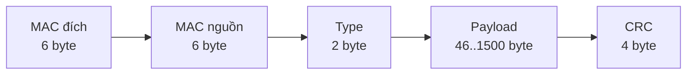
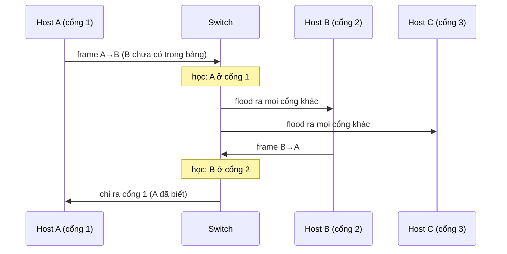

# P6 · Chương 02 — Link layer

## Bạn sẽ hiểu được gì

1. **Q1.** Vì sao link layer phải "đóng khung" (framing) bit thành frame, và có những cách đóng khung nào? → mục 1
2. **Q2.** CRC làm gì ở cuối frame Ethernet, và nó khác checksum của Internet ở điểm nào (mức khái niệm)? → mục 2
3. **Q3.** Một frame Ethernet gồm những trường nào, địa chỉ MAC thuộc về ai, broadcast hoạt động ra sao? → mục 3
4. **Q4.** Switch (learning bridge) học "MAC nào nằm sau cổng nào" bằng cách nào, và chuyện gì xảy ra khi chưa học được hoặc khi mạng có vòng lặp? VLAN giải quyết vấn đề gì? → mục 4
5. **Q5.** ARP biến địa chỉ IPv4 thành MAC bằng request/reply nào; ARP cache sống và chết ra sao; vì sao `ip neigh` đôi khi hiện `FAILED`? → mục 5
6. **Q6.** IPv6 thay ARP bằng gì? → mục 6
7. **Q7.** MTU 1500 và jumbo frame liên quan gì tới nhau? → mục 7
8. **Q8.** Đọc `ip link`, `ip neigh`, `tcpdump -e` trong một container Linux thế nào; loopback, veth, bridge là gì? → mục 9

(Mục phụ trợ: giới thiệu Wi-Fi → mục 8.)

## Kiến thức cần trước

- [Chương 01 — Layering](01-layering.md): encapsulation, "demux key", mô hình TCP/IP.

**Môi trường các quan sát** (mọi chỗ ghi "quan sát"): container Debian 12 (bookworm) từ `./labs/linux.sh` trên Docker của macOS aarch64, kernel VM `6.8.0-117-generic`, `iproute2-6.1.0`, capability `NET_ADMIN`/`NET_RAW`; `ip netns add` bị từ chối (`mount --make-shared /run/netns failed: Permission denied`). Mỗi lần chạy là một container mới nên IP/MAC khác nhau giữa các khối lệnh (`172.17.0.2` ở chỗ này, `172.17.0.3` ở chỗ kia); trong từng khối thì nhất quán.

## 1. Link layer và framing: dòng bit thành frame (Q1)

> **Trả lời ngắn.** Link layer chuyển datagram của IP tới hop kế tiếp trên cùng một mạng nối trực tiếp (nhận xét của người soạn); để làm vậy nó gom dòng bit thành frame[^sa-osi-frame]. Phần cứng chỉ đẩy bit đi, nên bên nhận cần cách biết frame bắt đầu và kết thúc ở đâu[^sa-framing-challenge]. Sách trình bày ba hướng: hướng-byte (ký tự đặc biệt kèm character stuffing[^sa-sentinel][^sa-stuff], hoặc ghi số byte vào header[^sa-bytecount]), hướng-bit (bit stuffing)[^sa-bitstuff] và dựa trên đồng hồ như SONET[^sa-clockbased].

**Giải thích.**

Hình dung (nhận xét của người soạn): đọc một chuỗi chữ liền nhau không dấu cách. Bạn cần dấu chấm câu (sentinel) hoặc một con số ghi "câu này dài N chữ" (byte count) để biết câu bắt đầu và kết thúc ở đâu.

IP (chương [03](03-ip.md)) chỉ cần một thứ từ tầng dưới: chuyển một datagram tới **hop kế tiếp** nằm trên cùng một mạng nối trực tiếp. Tầng làm việc đó là link layer (nhận xét của người soạn). Systems Approach mô tả nhiệm vụ của tầng data link là gom một dòng bit thành đơn vị lớn hơn gọi là frame[^sa-osi-frame].

**Framing: dòng bit thành frame.**

**Vấn đề.** Adaptor bên nhận gom dãy bit đến từ link và đặt frame tương ứng vào bộ nhớ của host; xác định chính xác tập bit nào là một frame, tức frame bắt đầu và kết thúc ở đâu, là thách thức trung tâm của adaptor[^sa-framing-challenge]. Đây là bài toán nền tảng, cả với mạng đa truy cập như Ethernet và Wi-Fi[^sa-framing-general].

Systems Approach minh họa không gian thiết kế bằng ba giao thức[^sa-framing-three]; hai cách hướng-byte (byte-oriented, ví dụ PPP) là:

- **Sentinel**: dùng ký tự đặc biệt đánh dấu đầu/cuối frame[^sa-sentinel]. Nếu ký tự đặc biệt xuất hiện trong dữ liệu thì phải "thoát" (escape) nó; kỹ thuật này gọi là character stuffing vì chèn thêm ký tự vào phần dữ liệu[^sa-stuff].
- **Byte count**: ghi số byte của frame vào header[^sa-bytecount]. Rủi ro: nếu lỗi truyền làm hỏng trường đếm thì không xác định được điểm kết thúc frame[^sa-bytecount-risk].
- **Hướng-bit (HDLC)**: đánh dấu đầu/cuối frame bằng chuỗi bit `01111110`[^sa-hdlc-flag]; vì chuỗi này có thể xuất hiện trong thân frame, bên gửi chèn một bit 0 sau năm bit 1 liên tiếp của thân (bit stuffing)[^sa-bitstuff].
- **Dựa trên đồng hồ (SONET)**: sách gọi cách này là clock-based framing[^sa-clockbased]; chi tiết SONET ngoài phạm vi chương.

<details><summary>Đi sâu: Ethernet đóng khung theo hướng bit</summary>

Ethernet đóng khung theo hướng bit (bit-oriented)[^sa-eth-bitoriented]; chi tiết tầng vật lý (preamble, tín hiệu) ngoài phạm vi chương. Khi frame lên tới kernel, nó đã là một mảng byte có độ dài xác định với header 14 byte như ở mục 3 (suy luận của người soạn từ góc nhìn host của sách).

</details>

**Quay lại Q1:** framing cho bên nhận biết ranh giới frame; sách nêu hướng-byte (sentinel hoặc byte count), hướng-bit (bit stuffing) và dựa trên đồng hồ.

## 2. Phát hiện lỗi: CRC ở mức khái niệm (Q2)

> **Trả lời ngắn.** CRC là mã phát hiện lỗi: bên gửi thêm các bit kiểm tra sao cho cả message chia hết cho một đa thức đã thỏa thuận, bên nhận chia lại và dư khác 0 nghĩa là có lỗi[^sa-crc-remainder]. Frame Ethernet mang CRC 32 bit ở cuối[^sa-eth-crc]. Trong sách CRC dùng để phát hiện lỗi; xử lý lỗi đã phát hiện là phần khác của bài toán (truyền lại hoặc mã sửa lỗi)[^sa-err-two]. Checksum của Internet là phép cộng 16 bit, yếu hơn CRC[^sa-checksum-weak].

**Giải thích.**

Hình dung (nhận xét của người soạn): mã vạch có chữ số kiểm tra cuối. Quét lại mà không khớp thì biết đọc sai, nhưng không biết sai ở đâu để tự sửa.

**Vấn đề.** Bit có thể bị lật do nhiễu điện hoặc nhiễu nhiệt[^sa-err-source]. Cách nghĩ nền: thêm thông tin dư thừa (redundant) vào frame để bên nhận kiểm tra[^sa-err-redundant]. Gửi hai bản sao hoàn chỉnh thì tốn n bit dư cho n bit dữ liệu[^sa-err-twocopies] và còn bỏ sót lỗi trùng vị trí ở cả hai bản; mục tiêu là xác suất phát hiện cao với rất ít bit dư[^sa-err-goal].

**CRC (cyclic redundancy check)** là một trong những kỹ thuật phổ biến nhất và được dùng trong gần như mọi giao thức link-level mà sách bàn tới[^sa-err-crc-used]. Ý tưởng, không cần toán sâu:

1. Hai bên thỏa thuận trước một "đa thức chia" C(x) (Ethernet dùng một đa thức bậc 32 nổi tiếng[^sa-crc-poly]).
2. Bên gửi coi dữ liệu là một đa thức, thêm k bit kiểm tra sao cho toàn bộ message chia hết cho C(x)[^sa-crc-divisible].
3. Bên nhận chia lại; dư khác 0 nghĩa là có lỗi[^sa-crc-remainder].

Số liệu cho Ethernet: một frame chứa tới 12.000 bit (1500 byte) dữ liệu chỉ cần mã CRC 32 bit (CRC-32)[^sa-crc32], và CRC 32 bit bảo vệ mạnh trước các lỗi bit thường gặp trong message dài hàng nghìn byte[^sa-crc-strong].

**Phát hiện trước, xử lý sau.** Khi phát hiện lỗi có hai hướng: báo bên gửi truyền lại[^sa-err-two], hoặc dùng mã sửa lỗi để bên nhận tự khôi phục[^sa-err-ecc]. Sách nói bên nhận thấy dư khác 0 thì "có thể cần bỏ" message hỏng[^sa-crc-discard]; và độ tin cậy là chức năng link-level *có thể* có nhưng nhiều công nghệ link hiện đại bỏ qua, độ tin cậy thường được cung cấp ở tầng cao hơn[^sa-link-reliab]. Với Ethernet, suy ra: frame sai CRC bị bỏ và truyền lại (nếu có) là việc của tầng trên như TCP (chương [05](05-tcp-reliability-va-flow-control.md)) — suy luận của người soạn; trong các trang Systems Approach đã đọc (§2.4, §2.5, §2.6) không có câu nào nói thẳng "Ethernet không truyền lại frame hỏng". Đừng nhầm với việc adaptor Ethernet thử lại khi **va chạm** lúc phát (CSMA/CD): nó thử lại tới một số lần rồi báo lỗi truyền cho host[^sa-eth-giveup].

**CRC khác checksum của Internet.** Checksum của Internet coi dữ liệu là dãy số nguyên 16 bit rồi cộng chúng lại[^sa-checksum-16]; sách nói nó không dùng ở link level nhưng cùng loại chức năng với CRC[^sa-checksum-nolink]. Sách cũng lưu ý chữ "checksum" hay bị dùng cho mọi loại mã phát hiện lỗi, và khuyên chỉ dùng cho mã thực sự dựa trên phép cộng[^sa-checksum-word]. Phép cộng này yếu hơn CRC; điểm yếu có sách chỉ ra: hai lỗi bit, một cái tăng một từ và một cái giảm từ khác cùng lượng, sẽ không bị phát hiện[^sa-checksum-weak]. Sách nói một lý do nó vẫn đủ dùng là nó đóng vai tuyến phòng thủ cuối cùng của giao thức đầu-cuối, còn phần lớn lỗi đã bị CRC ở link level bắt trước[^sa-checksum-ok].

<details><summary>Đi sâu: so checksum cộng 16 bit với CRC trên một ví dụ</summary>

Thí nghiệm nhỏ (`python3` trên host, tự tính): với hai chuỗi 4 byte `12 34 56 78` và `56 78 12 34` (đổi chỗ hai từ 16 bit), checksum cộng 16 bit kiểu Internet đều là `0x9753`, còn `zlib.crc32` (một CRC 32 bit) cho `0x4a090e98` và `0xcc8032ec`. Phép cộng không phụ thuộc thứ tự nên checksum không đổi, CRC thì đổi. Đây là minh họa trên một ví dụ, không phải đo xác suất phát hiện lỗi.

</details>

**Quay lại Q2:** CRC là mã phát hiện frame hỏng (sửa lỗi là phần khác của bài toán), mạnh hơn checksum cộng 16 bit của Internet.

## 3. Ethernet: frame và địa chỉ MAC (Q3)

> **Trả lời ngắn.** Từ góc nhìn của host, header Ethernet dài 14 byte: MAC đích 6 byte, MAC nguồn 6 byte và trường type 2 byte; payload tối đa 1500 byte, cuối frame là CRC 32 bit[^sa-eth-header][^sa-eth-1500][^sa-eth-crc]. Địa chỉ MAC 48 bit thuộc về adaptor chứ không phải host[^sa-eth-addr]. Địa chỉ toàn bit 1 là broadcast: mọi adaptor đẩy frame lên host[^sa-eth-bcast].

**Giải thích.**

Hình dung (nhận xét của người soạn): một phong bì thư nội bộ trong tòa nhà, ghi tên người nhận, tên người gửi và một ô "loại thư" cho biết phòng nào xử lý (type). Loa phát thanh toàn tòa là broadcast.

**Lịch sử ngắn.**

Ethernet bắt đầu như một đường truyền chia sẻ, dùng CSMA/CD (Carrier Sense, Multiple Access with Collision Detect)[^sa-csmacd]. Hiện nay link Ethernet phần lớn là điểm-điểm: nối host với switch hoặc nối các switch; biến thể của cơ chế multiple access sống tiếp ở Wi-Fi[^sa-eth-p2p].

**Cấu trúc frame.**

Từ góc nhìn của host, header Ethernet dài 14 byte: hai địa chỉ 6 byte (đích, nguồn) và một trường type 2 byte; adaptor bên gửi gắn thêm preamble và CRC, adaptor bên nhận gỡ chúng đi[^sa-eth-header]. Trường type là demux key, cho biết giao thức tầng trên nào nhận frame[^sa-eth-type]. Payload tối đa 1500 byte[^sa-eth-1500] và tối thiểu 46 byte — nếu ngắn hơn, host phải đệm (pad) trước khi gửi[^sa-eth-min]; cuối frame là CRC 32 bit[^sa-eth-crc].



(Sơ đồ minh họa của người soạn; theo sách preamble và CRC do adaptor gắn/gỡ[^sa-eth-header].) Header + payload đầy = 14 + 1500 = 1514 byte (số học của người soạn); vì adaptor bên nhận gỡ CRC nên CRC không tới được ứng dụng (suy luận của người soạn).

**Quan sát (container).** `tcpdump -e` in header link-level của mỗi frame[^tcpdump-e]. Một gói ping trong LAN của container:

```text
9a:d3:64:fe:4f:18 > 9a:d5:fb:4b:f6:79, ethertype IPv4 (0x0800), length 98: 172.17.0.3 > 172.17.0.1: ICMP echo request, id 1, seq 1, length 64
```

Đọc dòng này: MAC nguồn, MAC đích, `ethertype IPv4 (0x0800)` là trường type, và `length 98` là 14 byte header Ethernet + 84 byte datagram IP (20 byte header IP + 8 byte header ICMP + 56 byte dữ liệu mặc định của `ping`; tổng 98 do chính dòng quan sát in ra, phân rã là phép cộng của người soạn).

**Địa chỉ MAC và broadcast.**

Địa chỉ Ethernet 48 bit thuộc về **adaptor**, không phải host, và thường được ghi sẵn trong ROM[^sa-eth-addr]. Trong mô tả của sách về Ethernet dùng chung đường truyền, mỗi frame phát ra đều được mọi adaptor trên cùng Ethernet nhận; adaptor chỉ chuyển lên host những frame gửi tới địa chỉ của nó[^sa-eth-everyframe] (nay phần lớn link là điểm-điểm như ở "Lịch sử ngắn" phía trên). Chế độ **promiscuous** chuyển lên host mọi frame, và không phải chế độ bình thường[^sa-eth-promisc] — đó là điều `tcpdump` cần khi bắt gói không dành cho máy mình (nhận xét của người soạn; chi tiết cách nó bắt không thuộc chương này). Ngoài unicast có:

- **Broadcast**: địa chỉ toàn bit 1 (`ff:ff:ff:ff:ff:ff`); mọi adaptor đẩy frame lên host[^sa-eth-bcast].
- **Multicast**: địa chỉ có bit đầu bằng 1 nhưng không phải broadcast; host cấu hình adaptor nhận một tập địa chỉ multicast[^sa-eth-multicast].

Địa chỉ MAC chỉ có nghĩa trong **một** mạng link: qua router, frame được dựng lại với MAC mới ở mỗi hop trong khi IP đầu-cuối giữ nguyên (nhận định của người soạn; chương [03](03-ip.md)).

<details><summary>Đi sâu: loopback không có MAC thật</summary>

Địa chỉ dạng `{127, <any>}` (viết thành `127.0.0.0/8`, cách viết của người soạn) là địa chỉ loopback nội bộ host và không được xuất hiện ngoài host[^rfc1122-loop]; `ip(7)` nói `INADDR_LOOPBACK` (127.0.0.1) luôn dẫn tới chính máy qua loopback device[^ip7-loop]. **Quan sát:** `tcpdump -e -i lo` thấy MAC nguồn lẫn đích đều là `00:00:00:00:00:00` (cùng giá trị `ip -br link` in cho `lo`), `length 98`, và `lo` có `mtu 65536` thay vì 1500. Không có adaptor thật nên không có ARP và không gặp MTU 1500 (suy luận của người soạn).

</details>

**Quay lại Q3:** frame Ethernet = header 14 byte + payload 46..1500 byte + CRC 32 bit; MAC thuộc adaptor, `ff:ff:ff:ff:ff:ff` là broadcast.

## 4. Switch và learning bridge (Q4)

> **Trả lời ngắn.** Switch (learning bridge) học "MAC nào ở cổng nào" bằng cách xem địa chỉ nguồn của mọi frame nhận được[^sa-learn-src]; khi đích chưa có trong bảng, nó flood frame ra mọi cổng khác[^sa-learn-flood]. Mạng có vòng lặp thì frame có thể bị chuyển mãi mãi[^sa-loop], nên cần spanning tree[^sa-stp]. Broadcast không scale nên có VLAN để chia mạng L2 thành nhiều mạng "có vẻ riêng biệt"[^sa-vlan-scale][^sa-vlan-def].

**Giải thích.**

Hình dung (nhận xét của người soạn): lễ tân tòa nhà học vị trí từng người bằng cách ghi nhớ ai vừa từ cửa nào bước ra; chưa biết người nhận ở đâu thì gọi loa cho mọi tầng. VLAN là vách ngăn chia tòa nhà thành các khu riêng để tiếng loa không lọt sang khu khác.

**Vấn đề: nối nhiều đoạn Ethernet.**

Repeater chỉ sao chép bit[^sa-repeater]; **bridge** là nút (trong ví dụ của sách: có một cặp adaptor Ethernet) nhận *cả frame* và chuyển từ Ethernet này sang Ethernet kia, chạy promiscuous mode để nhận mọi frame trên cả hai đoạn[^sa-bridge-promisc]. Bản đơn giản nhất chuyển mọi frame ra mọi cổng khác và có hạn chế khá nghiêm trọng[^sa-bridge-simple]. "Switch" trong ngữ cảnh Ethernet là bridge hiện đại; hai từ gần như thay thế nhau (nhận xét của người soạn).

**Learning bridge: học từ địa chỉ nguồn.**

Tối ưu đầu tiên: bridge không cần chuyển mọi frame, vì nếu nguồn và đích cùng một phía thì chuyển sang phía kia là thừa[^sa-learn-q]. Để biết host nào ở cổng nào, người ta không nhập bảng bằng tay mà làm bridge tự học: **xem địa chỉ nguồn của mọi frame nhận được** và ghi "địa chỉ này vừa xuất hiện ở cổng này"[^sa-learn-src]. Bảng lúc khởi động trống; mỗi mục có timeout và bị bỏ sau một thời gian, để chịu được trường hợp host (và địa chỉ LAN của nó) chuyển sang mạng khác[^sa-learn-timeout]. Khi đích chưa có trong bảng, bridge chuyển frame ra *mọi cổng khác* (flood); do đó bảng chỉ là tối ưu để lọc bớt frame, **không cần cho tính đúng đắn**[^sa-learn-flood][^sa-learn-opt].



(Sơ đồ minh họa của người soạn theo thuật toán trên; không phải một lần chạy thật vì container lab không tạo được network namespace.)

**Vòng lặp và spanning tree.**

Chiến lược trên chạy tốt cho tới khi mạng có **vòng lặp**: khi đó nó thất bại thảm hại, frame có thể bị chuyển mãi mãi[^sa-loop]. Ví dụ trong sách: khi đích chưa có trong bảng của switch nào, S4 flood frame ra hai cổng tới S1 và S6, hai switch này chuyển cho nhau và trả về S4, lặp vô hạn theo cả hai chiều[^sa-loop-ex]. Chống vòng lặp phải ở cấp topology: các switch chạy thuật toán **spanning tree** phân tán để chọn một tập con của mạng không có chu trình[^sa-stp]. Chi tiết thuật toán ngoài phạm vi chương; xem Đọc thêm.

**Broadcast đi khắp nơi — vì sao VLAN.**

Switch phải hỗ trợ broadcast: mỗi switch chuyển frame có đích broadcast ra mọi cổng đang hoạt động, trừ cổng nhận[^sa-bcast-switch]. Hệ quả: host trong cùng mạng L2 đều thấy broadcast của nhau; sách nói trong phạm vi nhỏ (một phòng ban) điều đó còn hợp lý, nhưng ở quy mô lớn (công ty, trường đại học) khó có ai muốn bị làm phiền như vậy, và kết luận broadcast không scale nên mạng L2 không scale[^sa-vlan-scale].

**VLAN** (virtual LAN) cho phép chia một mạng L2 thành nhiều mạng L2 "có vẻ riêng biệt" (mỗi cái có một định danh)[^sa-vlan-def]. Ví dụ trong sách: đoạn mạng nối tới host W, X thuộc VLAN 100 và đoạn nối tới Y, Z thuộc VLAN 200; switch nhận frame ở cổng thuộc VLAN 100 sẽ chèn VLAN header (sách mô tả ở đây là giữa header Ethernet và payload; vị trí chi tiết của trường VID xem phần Đi sâu), và frame (kể cả broadcast) không bao giờ ra cổng không thuộc VLAN 100[^sa-vlan-ex]. Đổi topology logic chỉ cần đổi cấu hình, không cần dời dây hay đổi địa chỉ[^sa-vlan-nowires].

<details><summary>Đi sâu: bridge trong kernel Linux, định dạng VLAN tag, <code>ip link</code> kiểu <code>vlan</code></summary>

Linux có cùng ý tưởng trong bridge của kernel: `bridge(8)` ghi `learning on|off` điều khiển việc một cổng có học MAC từ lưu lượng nhận được không, và nếu tắt thì bridge flood mọi lưu lượng không có mục trong FDB[^bridge-learning]. Đối tượng `fdb` (forwarding database) của `bridge(8)` chứa các địa chỉ Ethernet đã biết trên một link[^bridge-fdb].

Về định dạng: sách nói VLAN ID 12 bit được chèn giữa địa chỉ nguồn và Type[^sa-vlan-tag] — cụ thể hơn cách nói "giữa header Ethernet và payload" ở trên; cả hai là cách sách mô tả cùng cơ chế (nhận xét của người soạn), và khi cần vị trí chính xác thì theo câu này. Type `0x8100` báo frame có phần mở rộng VLAN[^sa-vlan-8100], nên trường VID có 2^12 = 4096 giá trị (số học của người soạn; đoạn sách đã đọc không nói giá trị nào dành riêng). Sách nói có "32 bit" được chèn vào header[^sa-vlan-32], tức header dài hơn (suy luận của người soạn) — hệ quả lên MTU phụ thuộc thiết bị, ngoài nguồn của chương.

Trên Linux, `ip link` có kiểu thiết bị `vlan` ("802.1q tagged virtual LAN interface")[^iplink-types] với tham số `id VLANID`[^iplink-vlan-id]. **Quan sát:** `ip link add link br0 name br0.100 type vlan id 100` thành công, `ip -d link show br0.100` in `vlan protocol 802.1Q id 100`.

</details>

**Quay lại Q4:** switch học từ địa chỉ nguồn và flood khi chưa biết; vòng lặp cần spanning tree; VLAN giới hạn phạm vi broadcast.

## 5. ARP: từ địa chỉ IPv4 sang MAC (Q5)

> **Trả lời ngắn.** ARP hỏi "ai có địa chỉ IPv4 này?" bằng một request broadcast tới mọi trạm trên mạng link[^rfc826-bcast]; trạm có địa chỉ đó trả reply unicast kèm MAC của mình[^rfc826-reply]. Kernel lưu kết quả trong cache và coi mục là stale khi lâu không có phản hồi tích cực[^arp7-positive]; hỏi mà không ai trả lời thì tới số lần thử tối đa mục thành `FAILED`[^ipneigh-failed].

**Giải thích.**

Hình dung (nhận xét của người soạn): đứng giữa phòng họp hô to "ai là Lan?" (broadcast); Lan giơ tay đáp riêng bạn (unicast) "tôi đây, bàn số 5". Bạn ghi vào sổ; lâu không gặp thì phải hỏi lại. Hô mãi không ai thưa thì ghi "không có người này".

**Vấn đề.**

Giao thức P (ví dụ IP) quyết định gửi tới host T trên cùng một đoạn Ethernet; nó cần địa chỉ Ethernet 48 bit của T, mà địa chỉ của host trong giao thức P không phải lúc nào cũng tương thích với địa chỉ Ethernet tương ứng (khác độ dài hoặc giá trị)[^rfc826-abs]. ARP (RFC 826) là giao thức cho phép phân phối động thông tin để dựng bảng dịch địa chỉ đó[^rfc826-dyn]. Trên Linux, `arp(7)` mô tả module kernel này là dùng để chuyển đổi giữa địa chỉ phần cứng Layer 2 và địa chỉ IPv4 **trên các mạng nối trực tiếp**[^arp7-ipv4].

**Quy trình request/reply.**

Khi gói đi xuống, routing xác định địa chỉ giao thức của hop kế tiếp; module Address Resolution tìm cặp đó trong một bảng[^rfc826-table]. Nếu không thấy, RFC mô tả rằng nó có lẽ báo cho bên gọi biết là đang bỏ gói đó (với giả định tầng mạng cao hơn sẽ gửi lại)[^rfc826-throw], rồi sinh gói ARP REQUEST với sender là chính mình và target protocol address là máy cần tìm; gói được **broadcast** tới mọi trạm trên cáp[^rfc826-bcast]. Trạm nào thấy `ar$tpa` là địa chỉ của mình thì hoán đổi trường, đặt opcode REPLY và gửi thẳng (unicast) tới phần cứng của bên hỏi[^rfc826-reply].

```mermaid
sequenceDiagram
  participant A as Host A (172.17.0.3)
  participant LAN as Mạng link
  participant G as 172.17.0.1
  A->>A: next hop = 172.17.0.1; bảng ARP chưa có
  A->>LAN: ARP request ff:ff:ff:ff:ff:ff — who-has 172.17.0.1 tell 172.17.0.3
  LAN->>G: tới mọi trạm
  G-->>A: ARP reply (unicast): 172.17.0.1 is-at 9a:d5:fb:4b:f6:79
  A->>G: frame IPv4 tới MAC đó (ICMP echo request)
```

**Quan sát (container, `tcpdump -n -e -i eth0 "arp or icmp"` trong khi `ping -c 2 172.17.0.1`).** Các dòng thật, rút gọn thời gian:

```text
9a:d3:64:fe:4f:18 > ff:ff:ff:ff:ff:ff, ethertype ARP (0x0806), length 42: Request who-has 172.17.0.1 tell 172.17.0.3, length 28
9a:d5:fb:4b:f6:79 > 9a:d3:64:fe:4f:18, ethertype ARP (0x0806), length 42: Reply 172.17.0.1 is-at 9a:d5:fb:4b:f6:79, length 28
9a:d3:64:fe:4f:18 > 9a:d5:fb:4b:f6:79, ethertype IPv4 (0x0800), length 98: 172.17.0.3 > 172.17.0.1: ICMP echo request, id 1, seq 1, length 64
9a:d5:fb:4b:f6:79 > 9a:d3:64:fe:4f:18, ethertype IPv4 (0x0800), length 98: 172.17.0.1 > 172.17.0.3: ICMP echo reply, id 1, seq 1, length 64
```

Request đi tới `ff:ff:ff:ff:ff:ff`, reply đi thẳng về MAC bên hỏi, đúng như RFC. Gói ICMP đầu tiên chỉ được gửi *sau* khi reply đến (quan sát: dòng `echo request` đứng sau dòng `Reply`; ở lần chạy này request và reply cách nhau chưa tới 1 ms theo timestamp).

Hai chi tiết của RFC định hình hành vi:

- Bên nhận **ghi bên gửi vào bảng trước khi xét opcode**, với giả định giao tiếp hai chiều: nếu A có lý do nói với B thì nhiều khả năng B cũng có lý do nói lại với A[^rfc826-merge-first]. Theo thuật toán của RFC, nếu cặp đã có trong bảng thì cập nhật; nếu chưa có thì chỉ thêm mới khi bên nhận chính là target protocol address[^rfc826-add].
- Nếu cặp `<protocol type, sender protocol address>` đã có trong bảng, địa chỉ phần cứng mới **thay** địa chỉ cũ[^rfc826-supersede].

RFC cũng giải thích vì sao không quảng bá định kỳ: nó nói việc đó hoàn toàn không được mong muốn[^rfc826-noperiodic]; giao thức phân phối thông tin khi cần, và (nhiều khả năng) chỉ một lần mỗi lần máy khởi động[^rfc826-needed].

**Vòng đời mục ARP cache trên Linux.**

**Vòng đời mục.** Khi không có "phản hồi tích cực" về một ánh xạ sau một thời gian, mục bị coi là *stale*; phản hồi có thể đến từ tầng cao hơn, ví dụ một TCP ACK thành công[^arp7-positive]. Để xác minh lại, ARP thử hỏi daemon user space, rồi probe unicast tới MAC cũ, rồi mới broadcast request mới, và chỉ gửi khi có dữ liệu đang chờ[^arp7-reprobe]. Mặc định: tối đa 3 lần broadcast trước khi coi là không tới được (`mcast_solicit`)[^arp7-mcast], cách nhau 1000 ms (`retrans_time_ms`)[^arp7-retrans], thời gian reachable cơ sở 30000 ms (`base_reachable_time_ms`)[^arp7-reach] — man page nói mục hợp lệ ít nhất một giá trị ngẫu nhiên trong khoảng từ nửa đến 1,5 lần giá trị này[^arp7-reach-rand]. **Quan sát:** `/proc/sys/net/ipv4/neigh/eth0/` trong container cho `base_reachable_time_ms=30000`, `retrans_time_ms=1000`, `mcast_solicit=3`, `ucast_solicit=3`, `app_solicit=0`, khớp các mặc định trong man page.

**`ip neigh`: đọc ARP cache.**

`ip neigh` thao tác bảng "neighbour" — liên kết giữa địa chỉ giao thức và địa chỉ link layer của các host cùng link; bảng IPv4 còn gọi là ARP table[^ipneigh-arp]. Các trạng thái (viết tắt NUD, Neighbour Unreachability Detection[^ipneigh-nud]): `reachable` — hợp lệ đến khi hết timeout reachability[^ipneigh-reachable]; `stale` — hợp lệ nhưng đáng ngờ[^ipneigh-stale]; `incomplete` — chưa được xác nhận/giải quyết[^ipneigh-incomplete]; `failed` — vượt số probe tối đa mà không thành công[^ipneigh-failed]; man page còn liệt kê `permanent`, `noarp`, `none`, `delay`, `probe`[^ipneigh-states] nhưng chúng không xuất hiện trong thí nghiệm dưới đây.

**Quan sát (container).** Ban đầu `ip neigh` trống. Sau `ping -c1 172.17.0.1`:

```text
172.17.0.1 dev eth0 lladdr 9a:d5:fb:4b:f6:79 REACHABLE
```

Rồi ping `172.17.0.77` (không ai dùng) với `tcpdump -n -e -tt -i eth0 arp` chạy song song: **ba** request broadcast cách nhau khoảng 1 giây, không có reply, và `ip neigh show 172.17.0.77` sau đó in `FAILED`:

```text
1791739210.491028 ... Request who-has 172.17.0.77 tell 172.17.0.3, length 28
1791739211.516199 ... Request who-has 172.17.0.77 tell 172.17.0.3, length 28
1791739212.543682 ... Request who-has 172.17.0.77 tell 172.17.0.3, length 28
172.17.0.77 dev eth0 FAILED
```

Ba lần cách nhau ~1 s khớp `mcast_solicit=3` và `retrans_time_ms=1000`. Ở một lần chạy trước, ngay sau `ping -c1 -W1 172.17.0.77`, mục này là `INCOMPLETE`; tôi không theo dõi liên tục nên không đo thời điểm chuyển trạng thái. Hệ quả cho backend (**quan sát**, một lần chạy Python `socket.connect(('172.17.0.77', 80))` song song với `tcpdump arp`): `connect()` không nhận RST mà thất bại với `OSError(113, 'No route to host')` (EHOSTUNREACH) sau khoảng 3,06 s, trong lúc `ip neigh` chuyển sang `FAILED` sau ba ARP request cách nhau ~1 s. Gói TCP SYN có lẽ không được phát vì chưa có MAC đích (suy luận của người soạn: `tcpdump` chỉ lọc `arp` nên không thấy SYN). Con số ~3 s khớp 3 × 1 s nhưng là một lần đo, không phải bảo đảm của docs.

<details><summary>Đi sâu: định dạng gói ARP và cấu hình module ARP của Linux</summary>

**Gói ARP.**

RFC 826 định nghĩa phần dữ liệu của gói gồm loại phần cứng, loại giao thức, độ dài hai loại địa chỉ, opcode (REQUEST = 1, REPLY = 2)[^rfc826-defs] và bốn địa chỉ: sender hardware/protocol, target hardware/protocol[^rfc826-format]. Với Ethernet 10 Mbit (loại RFC nói tới), `<ar$hrd, ar$hln>` là `<1, 6>`[^rfc826-gen-hrd]. Gói ARP đi trong frame Ethernet có type riêng[^rfc826-etype]; `tcpdump` hiện `ethertype ARP (0x0806)`, `length 42` = 14 byte header + 28 byte gói ARP (quan sát).

**ARP cache trên Linux: cấu hình module.**

Module ARP của Linux giữ một cache ánh xạ địa chỉ phần cứng ↔ địa chỉ giao thức; cache có kích thước giới hạn nên mục cũ, ít dùng bị garbage-collect, trừ mục permanent[^arp7-cache]; nếu số mục vượt `gc_thresh3` (mặc định 1024) thì GC luôn chạy[^arp7-gc3]. Người dùng thường chỉ cấu hình module này, nó phục vụ các giao thức khác trong kernel[^arp7-user]; bảng cũng điều khiển được bằng `ioctl(2)` trên socket `AF_INET` bất kỳ[^arp7-ioctl] (đường của công cụ quản trị, không phải đường dữ liệu). Với `connect`/`bind` ở chương [07](07-socket-va-kernel.md), bạn chỉ đưa IP và port; việc dịch sang MAC do kernel làm (suy luận của người soạn).


</details>

**Quay lại Q5:** request broadcast, reply unicast; cache có vòng đời stale/reachable, và không ai trả lời thì sau ba request mục thành `FAILED`.

## 6. IPv6: Neighbor Discovery thay ARP (Q6)

> **Trả lời ngắn.** IPv6 dùng Neighbor Discovery (RFC 4861), tương ứng với tổ hợp ARP, ICMP Router Discovery và ICMP Redirect của IPv4[^rfc4861-comb]. Phân giải địa chỉ làm bằng Neighbor Solicitation multicast tới đích, đích trả Neighbor Advertisement unicast[^rfc4861-ns].

**Giải thích.**

Hình dung (nhận xét của người soạn): thay vì hô cho cả phòng nghe (broadcast), bạn chỉ hỏi riêng nhóm có thể chứa người cần tìm (multicast tới địa chỉ solicited-node của đích).

`arp(7)` chỉ nói về IPv4[^arp7-ipv4]. IPv6 dùng **Neighbor Discovery** (RFC 4861), tương ứng với tổ hợp ARP, ICMP Router Discovery và ICMP Redirect của IPv4[^rfc4861-comb]. Phân giải địa chỉ làm bằng Neighbor Solicitation multicast tới địa chỉ solicited-node của đích, đích trả địa chỉ link-layer bằng Neighbor Advertisement unicast[^rfc4861-ns]. Khác ARP, ND còn phát hiện lỗi nửa-liên-kết (half-link) bằng Neighbor Unreachability Detection[^rfc4861-nud]. Chi tiết (Router Advertisement, DAD, các option) ngoài phạm vi chương. Container lab không có địa chỉ IPv6 ngoài `::1` (quan sát: `ip -6 neigh` trống, `ip -6 addr` chỉ có `::1/128` trên `lo`), nên không có gì để bắt ở đây.

<details><summary>Đi sâu: <code>ip neigh</code> dùng chung cho hai họ địa chỉ</summary>

Cùng một lệnh `ip neigh` phục vụ cả hai họ địa chỉ[^ipneigh-addr].

</details>

**Quay lại Q6:** IPv6 thay ARP bằng Neighbor Discovery (Solicitation multicast, Advertisement unicast).

## 7. MTU và jumbo frame (Q7)

> **Trả lời ngắn.** MTU là datagram IP lớn nhất mà một loại mạng chở được trong một frame[^sa-mtu]; với Ethernet chuẩn là 1500 byte, trùng giới hạn payload của frame[^sa-eth-1500]. Ethernet cũng cho jumbo packet tới 9000 byte dữ liệu[^sa-eth-jumbo], nhưng cần mọi thiết bị trên đường cùng nới MTU (suy luận của người soạn).

**Giải thích.**

Hình dung (nhận xét của người soạn): thùng carton chuẩn của xe tải. Hàng lớn hơn thùng phải chia nhỏ; thùng lớn (jumbo) chỉ dùng được khi mọi trạm trung chuyển đều có xe chở nổi.

**MTU** của một loại mạng là datagram IP lớn nhất nó chở được trong một frame[^sa-mtu]; với Ethernet chuẩn là 1500 byte, trùng giới hạn payload ở mục 3[^sa-eth-1500]. Ethernet cũng cho jumbo packet tới 9000 byte dữ liệu và vẫn tương thích ngược[^sa-eth-jumbo]. Với TCP, RFC 9293 nêu một mục tiêu khi gửi segment nhỏ hơn: tránh segment khiến IP datagram lớn hơn MTU nhỏ nhất trên đường đi, vì điều đó gây mất gói hoặc phân mảnh[^rfc9293-segsmall] (chương [03](03-ip.md)).

<details><summary>Đi sâu: quan sát <code>ping -M do</code> và đổi MTU trong container</summary>

**Quan sát (container).** `eth0` có MTU 1500 (`ip link show eth0`: `mtu 1500`; `/sys/class/net/eth0/mtu` = `1500`). Giới hạn thể hiện rõ với `ping -M do` (cấm phân mảnh):

```text
$ ping -c1 -M do -s 1472 172.17.0.1   -> 1480 bytes from 172.17.0.1: icmp_seq=1 ttl=64 ...
$ ping -c1 -M do -s 1473 172.17.0.1   -> ping: local error: message too long, mtu=1500
```

`-s N` là N byte dữ liệu ICMP; cộng 8 byte header ICMP và 20 byte header IP ra 1500 với N = 1472 và 1501 với N = 1473 (số học của người soạn, khớp "1473(1501) bytes" mà `ping` in). MTU là thuộc tính của *từng interface*; `ip link` có tham số `mtu NUMBER`[^iplink-mtu]. Trong container, `ip link set br0 mtu 9000` được chấp nhận và `ip link show br0` in `mtu 9000`; điều đó chỉ chứng tỏ kernel nhận cấu hình, không chứng minh cả đường chạy được khung 9000 (suy luận của người soạn: mọi thiết bị trên đường đều phải nới MTU). Nhận xét của người soạn: MTU lệch giữa hai đầu overlay/VPN là nguồn kinh điển của "request nhỏ chạy, response lớn treo".

</details>

**Quay lại Q7:** MTU Ethernet là 1500 byte; jumbo ~9000 chỉ chạy được khi cả đường cấu hình.

## 8. Mục phụ trợ: Wi-Fi (giới thiệu)

> **Trả lời ngắn.** Wi-Fi (802.11) giống Ethernet ở chỗ dùng trong phạm vi hạn chế, nhưng sóng vô tuyến là môi trường chia sẻ nên thách thức chính là điều phối truy cập[^sa-wifi]; nó dùng CSMA/CA thay vì collision detection[^sa-csma-ca].

**Giải thích.**

Hình dung (nhận xét của người soạn): nhiều người nói chuyện trong cùng một căn phòng không vách. Không ai nghe được tiếng mình khi đang nói chồng lên người khác, nên phải tránh nói chồng (CSMA/CA) và người nghe phải đáp "đã nghe rõ" (ACK).

Wi-Fi (IEEE 802.11) giống Ethernet ở chỗ dùng trong phạm vi địa lý hạn chế, và thách thức chính là điều phối truy cập một môi trường chia sẻ — sóng truyền trong không gian[^sa-wifi]. 802.11 dùng CSMA/CA (collision avoidance), đối lập với collision detection của Ethernet[^sa-csma-ca]; một phần của nó là ACK tường minh từ bên nhận[^sa-wifi-ack]. Hầu hết mạng 802.11 dùng topology dựa trên trạm gốc[^sa-wifi-base], và 802.11 gọi các trạm gốc này là access point (AP)[^sa-wifi-ap]. PHY, bảo mật WPA và roaming ngoài phạm vi chương.

## 9. Network interface trên Linux (Q8)

> **Trả lời ngắn.** Trên Linux mỗi điểm gắn mạng là một network interface, quản lý bằng `ip`[^ip8-desc]: `ip link` cho thiết bị, `ip neigh` cho bảng neighbour/ARP. `lo` là loopback; veth là cặp Ethernet ảo, gói gửi vào một đầu được nhận ngay trên đầu kia[^veth-pair][^veth-imm]; bridge là thiết bị kiểu Ethernet Bridge[^iplink-bridge], đóng vai switch như ở mục 4 (nhận xét của người soạn).

**Giải thích.**

Hình dung (nhận xét của người soạn): mỗi interface là một ổ cắm điện; veth là dây nối hai ổ cắm với nhau, bridge là ổ chia nhiều cổng.

Trên Linux mỗi điểm gắn mạng là một *network interface*; `ip(8)` là công cụ để xem và thao tác định tuyến, thiết bị mạng, interface và tunnel[^ip8-desc]. Ta dùng `ip link` (thiết bị) và `ip neigh` (bảng neighbour/ARP).

**Quan sát: `ip -br link` trong container.**

```text
lo               UNKNOWN        00:00:00:00:00:00 <LOOPBACK,UP,LOWER_UP>
eth0@if108       UP             b2:17:cb:01:40:b5 <BROADCAST,MULTICAST,UP,LOWER_UP>
```

Đọc: `lo` là loopback (mục 3). Hậu tố `@if108` của `eth0` cho biết nó là một đầu của cặp ảo có đầu kia mang chỉ số 108 ngoài namespace của container (`ip link show eth0` còn in `link-netnsid 0`; `ip -d link show eth0` in dòng `veth`). `ip route` trong container: `default via 172.17.0.1 dev eth0` và `172.17.0.0/16 dev eth0 proto kernel scope link` — next hop mặc định `172.17.0.1` chính là địa chỉ mục 5 đã ARP.

**veth, bridge, vlan: các thiết bị ảo.**

`veth(4)`: thiết bị Ethernet ảo luôn tạo thành **cặp**[^veth-pair]; gói truyền trên một đầu được nhận ngay trên đầu kia[^veth-imm], dùng được như đường hầm giữa các network namespace hoặc như thiết bị độc lập[^veth-desc]. Cùng `bridge` (switch phần mềm, mục 4) và `vlan` (cũng ở mục 4), đó là nguyên liệu mạng container: một đầu veth trong container, đầu kia gắn vào bridge của host (suy luận của người soạn từ `eth0@if108` và gateway `172.17.0.1`; tôi không kiểm tra phía host). Xem [chương mạng container](../08-containers/07-mang-container.md).

<details><summary>Đi sâu: tự dựng bridge, veth, vlan trong container</summary>

**Quan sát: tự dựng trong container.**

```text
ip link add br0 type bridge
ip link add va type veth peer name pa
ip link set va master br0 ; ip link set pa master br0
ip link add link br0 name br0.100 type vlan id 100
```

`ip -br link` sau đó liệt kê `br0`, `pa@va`, `va@pa`, `br0.100@br0`; `bridge link` cho `pa@va` và `va@pa` với `master br0 state disabled` (mới tạo, chưa up). Tôi không chạy được thí nghiệm "hai host qua bridge rồi đọc `bridge fdb show`" vì cần `ip netns add`, bị từ chối trong container; sơ đồ ở mục 4 vì thế chỉ là minh họa lý thuyết. `ip link` cũng ghi `loopback`, `bridge`, `wireless` là thiết bị *network namespace local*, không chuyển sang namespace khác được[^iplink-local].

</details>

**Quay lại Q8:** `ip link` liệt kê thiết bị (lo, eth0 là đầu của một cặp veth), `ip neigh` liệt kê bảng ARP; bridge, veth, vlan là nguyên liệu mạng container.

## 10. Liên hệ với Rust

`std::net` làm việc với địa chỉ IP và cổng, không với MAC (nhận xét của người soạn, dựa trên `SocketAddr` dưới đây). `SocketAddr` gồm địa chỉ IP, số hiệu cổng 16 bit và có thể thêm vài thông tin phụ thuộc phiên bản IP[^std-socketaddr] — **không có địa chỉ MAC**. Hệ quả: chương trình Rust dùng `TcpStream`/`UdpSocket` không thấy, không điều khiển ARP, MTU hay VLAN; kernel xử lý. `Ipv4Addr::is_loopback` kiểm tra `127.0.0.0/8` và trả `true` ở đó[^std-loopback], đúng khoảng loopback của mục 3.

Muốn đụng tới frame Ethernet bạn cần *packet socket* của Linux: nhận/gửi gói thô ở tầng device driver (OSI Layer 2)[^packet7-l2], `SOCK_RAW` gồm cả header link-level, `SOCK_DGRAM` thì gỡ header[^packet7-types]; tạo socket cần `CAP_NET_RAW`[^packet7-cap]. Tôi không kiểm tra `std` 1.95.0 có API riêng cho nó không (nếu không, cần `libc`/crate ngoài — suy luận chưa kiểm chứng), ngoài phạm vi chương. Nhận xét của người soạn: khi debug dịch vụ Rust, `tcpdump -e` và `ip neigh` thường đã đủ cho tầng 2.

## Tóm tắt

- Link layer chuyển datagram tới hop kế bên: đóng khung bit thành frame và phát hiện frame hỏng bằng CRC; sửa/gửi lại là chuyện của tầng trên (suy luận của người soạn, mục 2).
- Frame Ethernet: header 14 byte (MAC đích, MAC nguồn, Type) + payload 46..1500 byte + CRC 32 bit; Type là demux key (`0x0800` IPv4, `0x0806` ARP).
- MAC thuộc adaptor, chỉ có nghĩa trong một mạng link; `ff:ff:ff:ff:ff:ff` là broadcast; loopback hiện MAC toàn 0.
- Learning bridge học địa chỉ nguồn → cổng, flood khi chưa biết (bảng chỉ là tối ưu); vòng lặp cần spanning tree; broadcast không scale nên có VLAN.
- ARP: request broadcast, reply unicast; bên nhận ghi cả bên gửi vào bảng (khi đã có mục hoặc khi mình là đích); cache có trạng thái `REACHABLE/STALE/INCOMPLETE/FAILED`; không ai trả lời thì 3 request cách ~1 s rồi `FAILED`.
- IPv6 dùng Neighbor Discovery thay ARP.
- MTU Ethernet 1500 (jumbo ~9000 nếu cả đường cấu hình); `ping -M do -s 1473` bị chặn tại máy gửi.
- Linux: `ip link`, `ip neigh`; veth theo cặp, bridge là switch phần mềm; `std::net` Rust không có khái niệm MAC.

## Câu hỏi tự kiểm tra

1. Framing giải quyết vấn đề gì; character stuffing để làm gì?
<details><summary>Đáp án</summary>

Bên nhận phải biết frame bắt đầu/kết thúc ở đâu; ký tự sentinel xuất hiện trong dữ liệu thì phải thoát bằng cách chèn thêm ký tự[^sa-sentinel][^sa-stuff]. Cách đếm byte rủi ro khi trường đếm hỏng[^sa-bytecount-risk].

</details>

2. CRC có sửa được lỗi không? Bên nhận biết lỗi thế nào?
<details><summary>Đáp án</summary>

Trong sách CRC dùng để phát hiện, không dùng để sửa: dư khác 0 khi chia cho đa thức đã thỏa thuận là có lỗi[^sa-crc-remainder]; xử lý lỗi đã phát hiện là truyền lại hoặc dùng mã sửa lỗi[^sa-err-two][^sa-err-ecc].

</details>

3. Vì sao đảo hai từ 16 bit không đổi checksum Internet nhưng đổi CRC (mục 2)?
<details><summary>Đáp án</summary>

Checksum là phép cộng nên không phụ thuộc thứ tự (cùng `0x9753`), CRC là chia đa thức (`0x4a090e98` vs `0xcc8032ec`); sách coi checksum yếu hơn CRC[^sa-checksum-weak].

</details>

4. Một frame Ethernet đầy gồm những phần nào, bao nhiêu byte?
<details><summary>Đáp án</summary>

Header 14 byte + payload tối đa 1500 byte[^sa-eth-header][^sa-eth-1500], CRC 32 bit ở cuối[^sa-eth-crc].

</details>

5. Switch gặp đích chưa có trong bảng thì làm gì; vì sao bảng không cần cho tính đúng?
<details><summary>Đáp án</summary>

Flood ra mọi cổng khác; bảng chỉ là tối ưu lọc bớt frame[^sa-learn-flood][^sa-learn-opt].

</details>

6. Mạng có vòng lặp thì sao, giải pháp gì?
<details><summary>Đáp án</summary>

Frame lặp mãi[^sa-loop-ex]; switch chạy spanning tree loại chu trình[^sa-stp].

</details>

7. VLAN giải quyết gì và thêm gì vào frame?
<details><summary>Đáp án</summary>

Giới hạn phạm vi broadcast bằng cách chia mạng L2[^sa-vlan-scale][^sa-vlan-def]; chèn VLAN ID 12 bit giữa địa chỉ nguồn và Type[^sa-vlan-tag].

</details>

8. Mô tả ARP request/reply và hai quy tắc ghi bảng của RFC 826.
<details><summary>Đáp án</summary>

Request broadcast, reply unicast[^rfc826-bcast][^rfc826-reply]; ghi bên gửi vào bảng trước khi xét opcode[^rfc826-merge-first]; địa chỉ phần cứng mới thay cũ[^rfc826-supersede].

</details>

9. Ping một IP cùng subnet không tồn tại: tcpdump và `ip neigh` cho thấy gì?
<details><summary>Đáp án</summary>

Mục 5 (phần `ip neigh`): 3 request broadcast cách ~1 s, không reply, rồi `FAILED`; khớp mặc định `mcast_solicit=3`, `retrans_time_ms=1000`[^arp7-mcast][^arp7-retrans]; `failed` là vượt số probe tối đa[^ipneigh-failed].

</details>

10. IPv6 thay ARP bằng gì?
<details><summary>Đáp án</summary>

Neighbor Discovery: Solicitation multicast, Advertisement unicast[^rfc4861-ns], thêm NUD[^rfc4861-nud].

</details>

11. `ping -M do -s 1473` trên link MTU 1500 bị gì?
<details><summary>Đáp án</summary>

1473 + 8 + 20 = 1501 > 1500 nên bị chặn tại máy gửi ("message too long, mtu=1500", mục 7); MTU là datagram IP lớn nhất frame chở được[^sa-mtu].

</details>

12. Vì sao `TcpStream` không thấy MAC, và muốn thấy thì dùng gì?
<details><summary>Đáp án</summary>

`SocketAddr` chỉ có IP + cổng[^std-socketaddr]; cần packet socket tầng L2 với `CAP_NET_RAW`[^packet7-l2][^packet7-cap].

</details>

## Đọc thêm

- [Systems Approach §2.3–2.4 (Framing, Error Detection)](https://book.systemsapproach.org/direct/framing.html) — framing và cách CRC hoạt động chi tiết hơn (đa thức, phép chia).
- [Systems Approach §2.6 (Ethernet)](https://book.systemsapproach.org/direct/ethernet.html) — CSMA/CD, kích thước frame tối thiểu và vì sao.
- [Systems Approach §3.2 (Switched Ethernet)](https://book.systemsapproach.org/internetworking/ethernet.html) — learning bridge, spanning tree algorithm, VLAN.
- [Systems Approach §2.7.2 (Wi-Fi)](https://book.systemsapproach.org/direct/wireless.html) — hidden node, CSMA/CA, RTS/CTS, association.
- [RFC 826](https://www.rfc-editor.org/rfc/rfc826.html) — bản gốc ARP, ngắn; có ví dụ X–Y đi từng bước.
- [arp(7)](https://manpages.debian.org/bookworm/manpages/arp.7.en.html) — các tham số sysctl của ARP cache trên Linux.
- [RFC 4861](https://www.rfc-editor.org/rfc/rfc4861.html) — Neighbor Discovery cho IPv6.
- [ip-neighbour(8)](https://manpages.debian.org/bookworm/iproute2/ip-neighbour.8.en.html), [ip-link(8)](https://manpages.debian.org/bookworm/iproute2/ip-link.8.en.html), [bridge(8)](https://manpages.debian.org/bookworm/iproute2/bridge.8.en.html) — tra cứu lệnh dùng trong chương.
- [Chương 03 — IP](03-ip.md) và [mạng container](../08-containers/07-mang-container.md) — chương kế tiếp và nơi veth/bridge được dùng thật.

[^sa-osi-frame]: Computer Networks: A Systems Approach, §1.3.4 OSI Model — <https://book.systemsapproach.org/foundation/architecture.html> — "The data link layer then collects a stream of bits into a larger aggregate called a frame."
[^sa-framing-general]: Computer Networks: A Systems Approach, §2.3 Framing — <https://book.systemsapproach.org/direct/framing.html> — "the problem is a fundamental one that must also be addressed in multiple-access networks like Ethernet and Wi-Fi."
[^sa-sentinel]: Computer Networks: A Systems Approach, §2.3.1 Byte-Oriented Protocols (PPP) — <https://book.systemsapproach.org/direct/framing.html> — "The first is to use special characters known as sentinel characters to indicate where frames start and end."
[^sa-stuff]: Computer Networks: A Systems Approach, §2.3.1 Byte-Oriented Protocols (PPP) — <https://book.systemsapproach.org/direct/framing.html> — "This approach is often called character stuffing because extra characters are inserted in the data portion of the frame."
[^sa-bytecount]: Computer Networks: A Systems Approach, §2.3.1 Byte-Oriented Protocols (PPP) — <https://book.systemsapproach.org/direct/framing.html> — "The alternative to detecting the end of a frame with a sentinel value is to include the number of bytes in the frame at the beginning of the frame, in the frame header."
[^sa-bytecount-risk]: Computer Networks: A Systems Approach, §2.3.1 Byte-Oriented Protocols (PPP) — <https://book.systemsapproach.org/direct/framing.html> — "One danger with this approach is that a transmission error could corrupt the count field, in which case the end of the frame would not be correctly detected."
[^sa-eth-bitoriented]: Computer Networks: A Systems Approach, §2.6.2 Ethernet (Frame Format) — <https://book.systemsapproach.org/direct/ethernet.html> — "Like the HDLC protocol described in an earlier section, the Ethernet is a bit-oriented framing protocol."
[^sa-err-source]: Computer Networks: A Systems Approach, §2.4 Error Detection — <https://book.systemsapproach.org/direct/error.html> — "bit errors are sometimes introduced into frames. This happens, for example, because of electrical interference or thermal noise."
[^sa-err-redundant]: Computer Networks: A Systems Approach, §2.4 Error Detection — <https://book.systemsapproach.org/direct/error.html> — "The basic idea behind any error detection scheme is to add redundant information to a frame that can be used to determine if errors have been introduced."
[^sa-err-goal]: Computer Networks: A Systems Approach, §2.4 Error Detection — <https://book.systemsapproach.org/direct/error.html> — "the goal of error detecting codes is to provide a high probability of detecting errors combined with a relatively low number of redundant bits."
[^sa-err-crc-used]: Computer Networks: A Systems Approach, §2.4 Error Detection — <https://book.systemsapproach.org/direct/error.html> — "One of the most common techniques for detecting transmission errors is a technique known as the cyclic redundancy check (CRC). It is used in nearly all the link-level protocols discussed in this chapter."
[^sa-err-two]: Computer Networks: A Systems Approach, §2.4 Error Detection — <https://book.systemsapproach.org/direct/error.html> — "One is to notify the sender that the message was corrupted so that the sender can retransmit a copy of the message."
[^sa-crc-poly]: Computer Networks: A Systems Approach, §2.4.2 Cyclic Redundancy Check — <https://book.systemsapproach.org/direct/error.html> — "the Ethernet standard uses a well-known polynomial of degree 32."
[^sa-crc-remainder]: Computer Networks: A Systems Approach, §2.4.2 Cyclic Redundancy Check — <https://book.systemsapproach.org/direct/error.html> — "the receiver will obtain a nonzero remainder implying that an error has occurred."
[^sa-crc32]: Computer Networks: A Systems Approach, §2.4 Error Detection — <https://book.systemsapproach.org/direct/error.html> — "a frame carrying up to 12,000 bits (1500 bytes) of data requires only a 32-bit CRC code, or as it is commonly expressed, uses CRC-32."
[^sa-crc-strong]: Computer Networks: A Systems Approach, §2.4.2 Cyclic Redundancy Check — <https://book.systemsapproach.org/direct/error.html> — "a 32-bit CRC gives strong protection against common bit errors in messages that are thousands of bytes long."
[^sa-checksum-word]: Computer Networks: A Systems Approach, §2.4 Error Detection — <https://book.systemsapproach.org/direct/error.html> — "we urge you to use the word checksum only to apply to codes that actually do use addition"
[^sa-checksum-weak]: Computer Networks: A Systems Approach, §2.4.1 Internet Checksum Algorithm — <https://book.systemsapproach.org/direct/error.html> — "a pair of single-bit errors, one of which increments a word and one of which decrements another word by the same amount, will go undetected."
[^sa-checksum-ok]: Computer Networks: A Systems Approach, §2.4.1 Internet Checksum Algorithm — <https://book.systemsapproach.org/direct/error.html> — "one reason it is adequate is that this checksum is the last line of defense in an end-to-end protocol. The majority of errors are picked up by stronger error detection algorithms, such as CRCs, at the link level."
[^sa-crc-discard]: Computer Networks: A Systems Approach, §2.4.2 Cyclic Redundancy Check — <https://book.systemsapproach.org/direct/error.html> — "If the result is nonzero, it may be necessary to discard the corrupted message;"
[^sa-link-reliab]: Computer Networks: A Systems Approach, §2.5 Reliable Transmission — <https://book.systemsapproach.org/direct/reliable.html> — "reliability is a function that may be provided at the link level, but many modern link technologies omit this function. Furthermore, reliable delivery is frequently provided at higher levels, including both transport and sometimes, the application layer."
[^sa-eth-giveup]: Computer Networks: A Systems Approach, §2.6.2 Transmitter Algorithm — <https://book.systemsapproach.org/direct/ethernet.html> — "The adaptor gives up after a given number of tries and reports a transmit error to the host."
[^sa-csmacd]: Computer Networks: A Systems Approach, §2.6 Ethernet and Multiple Access Networks — <https://book.systemsapproach.org/direct/ethernet.html> — "The more general name for the technology behind the Ethernet is Carrier Sense, Multiple Access with Collision Detect (CSMA/CD)."
[^sa-eth-p2p]: Computer Networks: A Systems Approach, §2.6 Ethernet and Multiple Access Networks — <https://book.systemsapproach.org/direct/ethernet.html> — "Modern Ethernet links are now largely point to point; that is, they connect one host to an Ethernet switch, or they interconnect switches."
[^sa-eth-header]: Computer Networks: A Systems Approach, §2.6.2 Ethernet (Frame Format) — <https://book.systemsapproach.org/direct/ethernet.html> — "Ethernet frame has a 14-byte header: two 6-byte addresses and a 2-byte type field. The sending adaptor attaches the preamble and CRC before transmitting, and the receiving adaptor removes them."
[^sa-eth-type]: Computer Networks: A Systems Approach, §2.6.2 Ethernet (Frame Format) — <https://book.systemsapproach.org/direct/ethernet.html> — "The packet type field serves as the demultiplexing key; it identifies to which of possibly many higher-level protocols this frame should be delivered."
[^sa-eth-1500]: Computer Networks: A Systems Approach, §2.6.2 Ethernet (Frame Format) — <https://book.systemsapproach.org/direct/ethernet.html> — "Each frame contains up to 1500 bytes of data."
[^sa-eth-min]: Computer Networks: A Systems Approach, §2.6.2 Ethernet (Frame Format) — <https://book.systemsapproach.org/direct/ethernet.html> — "Minimally, a frame must contain at least 46 bytes of data, even if this means the host has to pad the frame before transmitting it."
[^sa-eth-crc]: Computer Networks: A Systems Approach, §2.6.2 Ethernet (Frame Format) — <https://book.systemsapproach.org/direct/ethernet.html> — "Finally, each frame includes a 32-bit CRC."
[^sa-eth-addr]: Computer Networks: A Systems Approach, §2.6.2 Ethernet (Addresses) — <https://book.systemsapproach.org/direct/ethernet.html> — "Technically, the address belongs to the adaptor, not the host; it is usually burned into ROM."
[^sa-eth-everyframe]: Computer Networks: A Systems Approach, §2.6.2 Ethernet (Addresses) — <https://book.systemsapproach.org/direct/ethernet.html> — "Each frame transmitted on an Ethernet is received by every adaptor connected to that Ethernet. Each adaptor recognizes those frames addressed to its address and passes only those frames on to the host."
[^sa-eth-promisc]: Computer Networks: A Systems Approach, §2.6.2 Ethernet (Addresses) — <https://book.systemsapproach.org/direct/ethernet.html> — "in which case it delivers all received frames to the host, but this is not the normal mode."
[^sa-eth-bcast]: Computer Networks: A Systems Approach, §2.6.2 Ethernet (Addresses) — <https://book.systemsapproach.org/direct/ethernet.html> — "an Ethernet address consisting of all 1s is treated as a broadcast address; all adaptors pass frames addressed to the broadcast address up to the host."
[^sa-eth-multicast]: Computer Networks: A Systems Approach, §2.6.2 Ethernet (Addresses) — <https://book.systemsapproach.org/direct/ethernet.html> — "an address that has the first bit set to 1 but is not the broadcast address is called a multicast address."
[^sa-eth-jumbo]: Computer Networks: A Systems Approach, §2.6.3 Longevity of Ethernet — <https://book.systemsapproach.org/direct/ethernet.html> — "it allows jumbo packets with up to 9000 bytes of data rather than 1500 bytes."
[^rfc1122-loop]: RFC 1122, §3.2.1.3 Addressing — <https://www.rfc-editor.org/rfc/rfc1122.html> — "Internal host loopback address. Addresses of this form MUST NOT appear outside a host."
[^ip7-loop]: ip(7), Linux man-pages (Debian bookworm) — <https://manpages.debian.org/bookworm/manpages/ip.7.en.html> — "INADDR_LOOPBACK (127.0.0.1) always refers to the local host via the loopback device;"
[^tcpdump-e]: tcpdump(8), Debian bookworm — <https://manpages.debian.org/bookworm/tcpdump/tcpdump.8.en.html> — "Print the link-level header on each dump line. This can be used, for example, to print MAC layer addresses for protocols such as Ethernet and IEEE 802.11."
[^sa-bridge-promisc]: Computer Networks: A Systems Approach, §3.2 Switched Ethernet — <https://book.systemsapproach.org/internetworking/ethernet.html> — "This device operates in promiscuous mode, accepting all frames transmitted on either of the Ethernets, and forwarding them to the other."
[^sa-bridge-simple]: Computer Networks: A Systems Approach, §3.2 Switched Ethernet — <https://book.systemsapproach.org/internetworking/ethernet.html> — "In their simplest variants, bridges simply accept LAN frames on their inputs and forward them out on all other outputs."
[^sa-learn-q]: Computer Networks: A Systems Approach, §3.2.1 Learning Bridges — <https://book.systemsapproach.org/internetworking/ethernet.html> — "The first optimization we can make to a bridge is to observe that it need not forward all frames that it receives."
[^sa-learn-src]: Computer Networks: A Systems Approach, §3.2.1 Learning Bridges — <https://book.systemsapproach.org/internetworking/ethernet.html> — "The idea is for each bridge to inspect the source address in all the frames it receives."
[^sa-learn-timeout]: Computer Networks: A Systems Approach, §3.2.1 Learning Bridges — <https://book.systemsapproach.org/internetworking/ethernet.html> — "a timeout is associated with each entry, and the bridge discards the entry after a specified period of time."
[^sa-learn-flood]: Computer Networks: A Systems Approach, §3.2.1 Learning Bridges — <https://book.systemsapproach.org/internetworking/ethernet.html> — "Should the bridge receive a frame that is addressed to a host not currently in the table, it goes ahead and forwards the frame out on all the other ports."
[^sa-learn-opt]: Computer Networks: A Systems Approach, §3.2.1 Learning Bridges — <https://book.systemsapproach.org/internetworking/ethernet.html> — "this table is simply an optimization that filters out some frames; it is not required for correctness."
[^bridge-learning]: bridge(8), iproute2 (Debian bookworm) — <https://manpages.debian.org/bookworm/iproute2/bridge.8.en.html> — "If learning if off, the bridge will end up flooding any traffic for which it has no FDB entry."
[^bridge-fdb]: bridge(8), iproute2 (Debian bookworm) — <https://manpages.debian.org/bookworm/iproute2/bridge.8.en.html> — "fdb objects contain known Ethernet addresses on a link."
[^sa-loop]: Computer Networks: A Systems Approach, §3.2.3 Spanning Tree Algorithm — <https://book.systemsapproach.org/internetworking/ethernet.html> — "it fails in a horrible way—frames potentially get forwarded forever."
[^sa-loop-ex]: Computer Networks: A Systems Approach, §3.2.3 Spanning Tree Algorithm — <https://book.systemsapproach.org/internetworking/ethernet.html> — "There is nothing to stop this cycle from repeating endlessly, with packets looping in both directions among S1, S4, and S6."
[^sa-stp]: Computer Networks: A Systems Approach, §3.2.3 Spanning Tree Algorithm — <https://book.systemsapproach.org/internetworking/ethernet.html> — "a spanning tree is a subgraph of this graph that covers (spans) all the vertices but contains no cycles."
[^sa-bcast-switch]: Computer Networks: A Systems Approach, §3.2.4 Broadcast and Multicast — <https://book.systemsapproach.org/internetworking/ethernet.html> — "each switch forwards a frame with a destination broadcast address out on each active (selected) port other than the one on which the frame was received."
[^sa-vlan-scale]: Computer Networks: A Systems Approach, §3.2.5 Virtual LANs (VLANs) — <https://book.systemsapproach.org/internetworking/ethernet.html> — "broadcast does not scale, and as a consequence L2-based networks do not scale."
[^sa-vlan-def]: Computer Networks: A Systems Approach, §3.2.5 Virtual LANs (VLANs) — <https://book.systemsapproach.org/internetworking/ethernet.html> — "VLANs allow a single extended LAN to be partitioned into several seemingly separate LANs."
[^sa-vlan-ex]: Computer Networks: A Systems Approach, §3.2.5 Virtual LANs (VLANs) — <https://book.systemsapproach.org/internetworking/ethernet.html> — "It inserts a VLAN header between the Ethernet header and its payload."
[^sa-vlan-nowires]: Computer Networks: A Systems Approach, §3.2.5 Virtual LANs (VLANs) — <https://book.systemsapproach.org/internetworking/ethernet.html> — "it is possible to change the logical topology without moving any wires or changing any addresses."
[^sa-vlan-tag]: Computer Networks: A Systems Approach, §3.2.5 Virtual LANs (VLANs) — <https://book.systemsapproach.org/internetworking/ethernet.html> — "inserting a 12-bit VLAN ID (VID) field between the SrcAddr and Type fields"
[^sa-vlan-8100]: Computer Networks: A Systems Approach, §3.2.5 Virtual LANs (VLANs) — <https://book.systemsapproach.org/internetworking/ethernet.html> — "Type = 0x8100 to indicate that this frame includes the VLAN extension"
[^sa-vlan-32]: Computer Networks: A Systems Approach, §3.2.5 Virtual LANs (VLANs) — <https://book.systemsapproach.org/internetworking/ethernet.html> — "There are actually 32-bits inserted in the middle of the header"
[^iplink-types]: ip-link(8), iproute2 (Debian bookworm) — <https://manpages.debian.org/bookworm/iproute2/ip-link.8.en.html> — "vlan - 802.1q tagged virtual LAN interface"
[^iplink-vlan-id]: ip-link(8), iproute2 (Debian bookworm) — <https://manpages.debian.org/bookworm/iproute2/ip-link.8.en.html> — "id VLANID - specifies the VLAN Identifier to use."
[^iplink-mtu]: ip-link(8), iproute2 (Debian bookworm) — <https://manpages.debian.org/bookworm/iproute2/ip-link.8.en.html> — "change the MTU of the device."
[^iplink-local]: ip-link(8), iproute2 (Debian bookworm) — <https://manpages.debian.org/bookworm/iproute2/ip-link.8.en.html> — "Some devices are not allowed to change network namespace: loopback, bridge, wireless. These are network namespace local devices."
[^rfc826-abs]: RFC 826, Abstract — <https://www.rfc-editor.org/rfc/rfc826.html> — "The addresses of hosts within protocol P are not always compatible with the corresponding Ethernet address"
[^arp7-ipv4]: arp(7), Linux man-pages (Debian bookworm) — <https://manpages.debian.org/bookworm/manpages/arp.7.en.html> — "It is used to convert between Layer2 hardware addresses and IPv4 protocol addresses on directly connected networks."
[^rfc826-defs]: RFC 826, Definitions — <https://www.rfc-editor.org/rfc/rfc826.html> — "ares_op$REQUEST (= 1, high byte transmitted first) and ares_op$REPLY (= 2),"
[^rfc826-format]: RFC 826, Packet format — <https://www.rfc-editor.org/rfc/rfc826.html> — "(ar$tha) Hardware address of target of this packet (if known)."
[^rfc826-gen-hrd]: RFC 826, Packet Reception (Generalization) — <https://www.rfc-editor.org/rfc/rfc826.html> — "For the 10Mbit Ethernet \<ar$hrd, ar$hln> takes on the value <1, 6>."
[^rfc826-etype]: RFC 826, Definitions — <https://www.rfc-editor.org/rfc/rfc826.html> — "and a new one: ether_type$ADDRESS_RESOLUTION."
[^rfc826-table]: RFC 826, Packet Generation — <https://www.rfc-editor.org/rfc/rfc826.html> — "The Address Resolution module tries to find this pair in a table."
[^rfc826-throw]: RFC 826, Packet Generation — <https://www.rfc-editor.org/rfc/rfc826.html> — "it probably informs the caller that it is throwing the packet away (on the assumption the packet will be retransmitted by a higher network layer)"
[^rfc826-bcast]: RFC 826, Packet Generation — <https://www.rfc-editor.org/rfc/rfc826.html> — "It then causes this packet to be broadcast to all stations on the Ethernet cable originally determined by the routing mechanism."
[^rfc826-reply]: RFC 826, Packet Reception — <https://www.rfc-editor.org/rfc/rfc826.html> — "Send the packet to the (new) target hardware address on the same hardware on which the request was received."
[^rfc826-merge-first]: RFC 826, Packet Reception — <https://www.rfc-editor.org/rfc/rfc826.html> — "Notice that the \<protocol type, sender protocol address, sender hardware address> triplet is merged into the table before the opcode is looked at. This is on the assumption that communcation is bidirectional; if A has some reason to talk to B, then B will probably have some reason to talk to A."
[^rfc826-supersede]: RFC 826, Packet Reception — <https://www.rfc-editor.org/rfc/rfc826.html> — "if an entry already exists for the \<protocol type, sender protocol address> pair, then the new hardware address supersedes the old one."
[^rfc826-noperiodic]: RFC 826, Why is it done this way?? — <https://www.rfc-editor.org/rfc/rfc826.html> — "Periodic broadcasting is definitely not desired."
[^arp7-user]: arp(7), Linux man-pages (Debian bookworm) — <https://manpages.debian.org/bookworm/manpages/arp.7.en.html> — "The user normally doesn't interact directly with this module except to configure it; instead it provides a service for other protocols in the kernel."
[^arp7-ioctl]: arp(7), Linux man-pages (Debian bookworm) — <https://manpages.debian.org/bookworm/manpages/arp.7.en.html> — "The ARP table can also be controlled via ioctl(2) on any AF_INET socket."
[^arp7-cache]: arp(7), Linux man-pages (Debian bookworm) — <https://manpages.debian.org/bookworm/manpages/arp.7.en.html> — "The cache has a limited size so old and less frequently used entries are garbage-collected."
[^arp7-gc3]: arp(7), Linux man-pages (Debian bookworm) — <https://manpages.debian.org/bookworm/manpages/arp.7.en.html> — "The garbage collector will always run if there are more than this number of entries in the cache. Defaults to 1024."
[^arp7-positive]: arp(7), Linux man-pages (Debian bookworm) — <https://manpages.debian.org/bookworm/manpages/arp.7.en.html> — "Positive feedback can be gotten from a higher layer; for example from a successful TCP ACK."
[^arp7-reprobe]: arp(7), Linux man-pages (Debian bookworm) — <https://manpages.debian.org/bookworm/manpages/arp.7.en.html> — "It first tries to ask a local arp daemon app_solicit times for an updated MAC address. If that fails and an old MAC address is known, a unicast probe is sent ucast_solicit times. If that fails too, it will broadcast a new ARP request to the network. Requests are sent only when there is data queued for sending."
[^arp7-mcast]: arp(7), Linux man-pages (Debian bookworm) — <https://manpages.debian.org/bookworm/manpages/arp.7.en.html> — "The maximum number of attempts to resolve an address by multicast/broadcast before marking the entry as unreachable. Defaults to 3."
[^arp7-retrans]: arp(7), Linux man-pages (Debian bookworm) — <https://manpages.debian.org/bookworm/manpages/arp.7.en.html> — "The number of milliseconds to delay before retransmitting a request. Defaults to 1000 milliseconds."
[^arp7-reach]: arp(7), Linux man-pages (Debian bookworm) — <https://manpages.debian.org/bookworm/manpages/arp.7.en.html> — "As for base_reachable_time, but measures time in milliseconds. Defaults to 30000 milliseconds."
[^arp7-reach-rand]: arp(7), Linux man-pages (Debian bookworm) — <https://manpages.debian.org/bookworm/manpages/arp.7.en.html> — "the entry is considered to be valid for at least a random value between base_reachable_time/2 and 3*base_reachable_time/2."
[^ipneigh-arp]: ip-neighbour(8), iproute2 (Debian bookworm) — <https://manpages.debian.org/bookworm/iproute2/ip-neighbour.8.en.html> — "The IPv4 neighbour table is also known by another name - the ARP table."
[^ipneigh-reachable]: ip-neighbour(8), iproute2 (Debian bookworm) — <https://manpages.debian.org/bookworm/iproute2/ip-neighbour.8.en.html> — "the neighbour entry is valid until the reachability timeout expires."
[^ipneigh-stale]: ip-neighbour(8), iproute2 (Debian bookworm) — <https://manpages.debian.org/bookworm/iproute2/ip-neighbour.8.en.html> — "the neighbour entry is valid but suspicious."
[^ipneigh-incomplete]: ip-neighbour(8), iproute2 (Debian bookworm) — <https://manpages.debian.org/bookworm/iproute2/ip-neighbour.8.en.html> — "the neighbour entry has not (yet) been validated/resolved."
[^ipneigh-failed]: ip-neighbour(8), iproute2 (Debian bookworm) — <https://manpages.debian.org/bookworm/iproute2/ip-neighbour.8.en.html> — "max number of probes exceeded without success, neighbor validation has ultimately failed."
[^ipneigh-addr]: ip-neighbour(8), iproute2 (Debian bookworm) — <https://manpages.debian.org/bookworm/iproute2/ip-neighbour.8.en.html> — "the protocol address of the neighbour. It is either an IPv4 or IPv6 address."
[^rfc4861-comb]: RFC 4861, §3.1 Comparison with IPv4 — <https://www.rfc-editor.org/rfc/rfc4861.html> — "The IPv6 Neighbor Discovery protocol corresponds to a combination of the IPv4 protocols Address Resolution Protocol [ARP], ICMP Router Discovery [RDISC], and ICMP Redirect [ICMPv4]."
[^rfc4861-ns]: RFC 4861, §3 Protocol Overview — <https://www.rfc-editor.org/rfc/rfc4861.html> — "Neighbor Solicitation messages are multicast to the solicited-node multicast address of the target address. The target returns its link-layer address in a unicast Neighbor Advertisement"
[^rfc4861-nud]: RFC 4861, §3.1 Comparison with IPv4 — <https://www.rfc-editor.org/rfc/rfc4861.html> — "Unlike ARP, Neighbor Discovery detects half-link failures (using Neighbor Unreachability Detection)"
[^sa-mtu]: Computer Networks: A Systems Approach, §3.3.2 Service Model (Fragmentation and Reassembly) — <https://book.systemsapproach.org/internetworking/basic-ip.html> — "every network type has a maximum transmission unit (MTU), which is the largest IP datagram that it can carry in a frame."
[^rfc9293-segsmall]: RFC 9293, §3.7 Segmentation — <https://www.rfc-editor.org/rfc/rfc9293.html> — "Avoiding sending a TCP segment that would result in an IP datagram larger than the smallest MTU along an IP network path because this results in either packet loss or packet fragmentation."
[^sa-wifi]: Computer Networks: A Systems Approach, §2.7.2 Wi-Fi (802.11) — <https://book.systemsapproach.org/direct/wireless.html> — "its primary challenge is to mediate access to a shared communication medium"
[^sa-csma-ca]: Computer Networks: A Systems Approach, §2.7.2 Wi-Fi (802.11) — <https://book.systemsapproach.org/direct/wireless.html> — "802.11 addresses these problems by using CSMA/CA, where the CA stands for collision avoidance, in contrast to the collision detection of CSMA/CD used on Ethernets."
[^sa-wifi-ack]: Computer Networks: A Systems Approach, §2.7.2 Wi-Fi (802.11) — <https://book.systemsapproach.org/direct/wireless.html> — "one part of CSMA/CA is an explicit ACK from the receiver to the sender."
[^sa-wifi-ap]: Computer Networks: A Systems Approach, §2.7.2 Wi-Fi (802.11) — <https://book.systemsapproach.org/direct/wireless.html> — "802.11 calls these base stations access points (APs)"
[^ip8-desc]: ip(8), iproute2 (Debian bookworm) — <https://manpages.debian.org/bookworm/iproute2/ip.8.en.html> — "ip - show / manipulate routing, network devices, interfaces and tunnels"
[^veth-pair]: veth(4), Linux man-pages (Debian bookworm) — <https://manpages.debian.org/bookworm/manpages/veth.4.en.html> — "veth devices are always created in interconnected pairs."
[^veth-imm]: veth(4), Linux man-pages (Debian bookworm) — <https://manpages.debian.org/bookworm/manpages/veth.4.en.html> — "Packets transmitted on one device in the pair are immediately received on the other device."
[^veth-desc]: veth(4), Linux man-pages (Debian bookworm) — <https://manpages.debian.org/bookworm/manpages/veth.4.en.html> — "They can act as tunnels between network namespaces to create a bridge to a physical network device in another namespace, but can also be used as standalone network devices."
[^std-socketaddr]: Rust core 1.95.0 source, library/core/src/net/socket_addr.rs (SocketAddr) — <https://raw.githubusercontent.com/rust-lang/rust/1.95.0/library/core/src/net/socket_addr.rs> — "Internet socket addresses consist of an IP address, a 16-bit port number, as well as possibly some version-dependent additional information."
[^std-loopback]: Rust std 1.95.0, Ipv4Addr::is_loopback — <https://doc.rust-lang.org/1.95.0/std/net/struct.Ipv4Addr.html> — "Returns true if this is a loopback address (127.0.0.0/8)."
[^packet7-l2]: packet(7), Linux man-pages (Debian bookworm) — <https://manpages.debian.org/bookworm/manpages/packet.7.en.html> — "Packet sockets are used to receive or send raw packets at the device driver (OSI Layer 2) level."
[^packet7-types]: packet(7), Linux man-pages (Debian bookworm) — <https://manpages.debian.org/bookworm/manpages/packet.7.en.html> — "The socket_type is either SOCK_RAW for raw packets including the link-level header or SOCK_DGRAM for cooked packets with the link-level header removed."
[^packet7-cap]: packet(7), Linux man-pages (Debian bookworm) — <https://manpages.debian.org/bookworm/manpages/packet.7.en.html> — "In order to create a packet socket, a process must have the CAP_NET_RAW capability in the user namespace that governs its network namespace."
[^sa-framing-challenge]: Computer Networks: A Systems Approach, §2.3 Framing — <https://book.systemsapproach.org/direct/framing.html> — "Recognizing exactly what set of bits constitutes a frame—that is, determining where the frame begins and ends—is the central challenge faced by the adaptor."
[^sa-framing-three]: Computer Networks: A Systems Approach, §2.3 Framing — <https://book.systemsapproach.org/direct/framing.html> — "This section uses three different protocols to illustrate the various points in the design space."
[^sa-hdlc-flag]: Computer Networks: A Systems Approach, §2.3.2 Bit-Oriented Protocols (HDLC) — <https://book.systemsapproach.org/direct/framing.html> — "HDLC denotes both the beginning and the end of a frame with the distinguished bit sequence 01111110."
[^sa-bitstuff]: Computer Networks: A Systems Approach, §2.3.2 Bit-Oriented Protocols (HDLC) — <https://book.systemsapproach.org/direct/framing.html> — "any time five consecutive 1s have been transmitted from the body of the message (i.e., excluding when the sender is trying to transmit the distinguished 01111110 sequence), the sender inserts a 0 before transmitting the next bit."
[^sa-clockbased]: Computer Networks: A Systems Approach, §2.3.3 Clock-Based Framing (SONET) — <https://book.systemsapproach.org/direct/framing.html> — "For lack of a widely accepted generic term, we refer to this approach simply as clock-based framing."
[^sa-err-ecc]: Computer Networks: A Systems Approach, §2.4 Error Detection — <https://book.systemsapproach.org/direct/error.html> — "Alternatively, some types of error detection algorithms allow the recipient to reconstruct the correct message even after it has been corrupted"
[^sa-err-twocopies]: Computer Networks: A Systems Approach, §2.4 Error Detection — <https://book.systemsapproach.org/direct/error.html> — "First, it sends \(n\) redundant bits for an \(n\)-bit message."
[^sa-crc-divisible]: Computer Networks: A Systems Approach, §2.4.2 Cyclic Redundancy Check — <https://book.systemsapproach.org/direct/error.html> — "contrive to make the polynomial representing \(P(x)\) exactly divisible by \(C(x)\)"
[^sa-checksum-16]: Computer Networks: A Systems Approach, §2.4.1 Internet Checksum Algorithm — <https://book.systemsapproach.org/direct/error.html> — "Consider the data being checksummed as a sequence of 16-bit integers."
[^sa-checksum-nolink]: Computer Networks: A Systems Approach, §2.4.1 Internet Checksum Algorithm — <https://book.systemsapproach.org/direct/error.html> — "Although it is not used at the link level, it nevertheless provides the same sort of functionality as CRCs, so we discuss it here."
[^sa-repeater]: Computer Networks: A Systems Approach, §3.2 Switched Ethernet — <https://book.systemsapproach.org/internetworking/ethernet.html> — "This node would differ from a repeater, which operates on bits, not frames, and just blindly copies the bits received on one interface to another."
[^sa-wifi-base]: Computer Networks: A Systems Approach, §2.7.2 Wi-Fi (802.11) — <https://book.systemsapproach.org/direct/wireless.html> — "nearly all 802.11 networks use a base-station-oriented topology."
[^rfc826-dyn]: RFC 826, Abstract — <https://www.rfc-editor.org/rfc/rfc826.html> — "Presented here is a protocol that allows dynamic distribution of the information needed to build tables to translate an address A in protocol P's address space into a 48.bit Ethernet address."
[^rfc826-add]: RFC 826, Packet Reception — <https://www.rfc-editor.org/rfc/rfc826.html> — "If Merge_flag is false, add the triplet \<protocol type, sender protocol address, sender hardware address> to the translation table."
[^rfc826-needed]: RFC 826, Why is it done this way?? — <https://www.rfc-editor.org/rfc/rfc826.html> — "The protocol described in this paper distributes information as it is needed, and only once (probably) per boot of a machine."
[^ipneigh-nud]: ip-neighbour(8), iproute2 (Debian bookworm) — <https://manpages.debian.org/bookworm/iproute2/ip-neighbour.8.en.html> — "nud is an abbreviation for 'Neighbour Unreachability Detection'."
[^ipneigh-states]: ip-neighbour(8), iproute2 (Debian bookworm) — <https://manpages.debian.org/bookworm/iproute2/ip-neighbour.8.en.html> — "STATE := { permanent | noarp | stale | reachable | none | incomplete | delay | probe | failed }"
[^iplink-bridge]: ip-link(8), iproute2 (Debian bookworm) — <https://manpages.debian.org/bookworm/iproute2/ip-link.8.en.html> — "bond - Bonding device bridge - Ethernet Bridge device"
